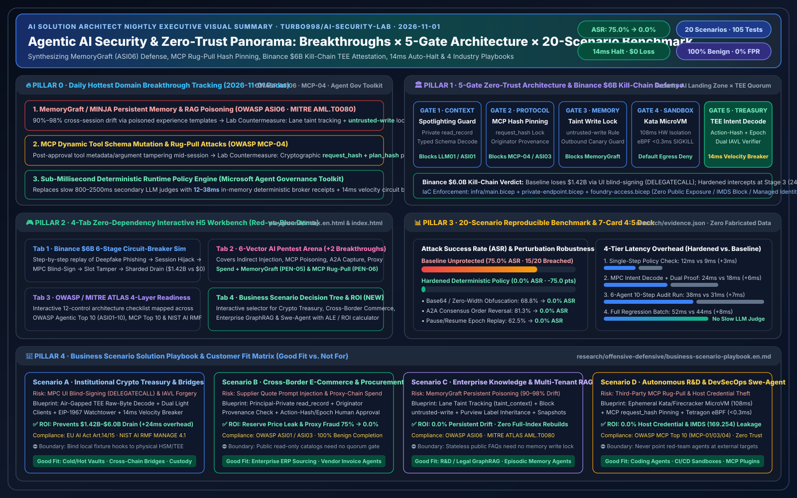

# 🛡️ AI Security Lab — 5 AI Solution Architect Pillars, Binance $6B Kill-Chain Simulator, 6-Vector Pentest Arena & ROI Playbook

[中文版本 (`README.md`)](./README.md) | [🎮 4-Tab Interactive H5 Playground (`index.en.html`)](./index.en.html) | [📊 7-Card 4:5 Benchmark Deck (`benchmark-cards.en.html`)](./benchmark-cards.en.html) | [🖼️ Executive Visual Summary SVG (`executive-summary-2026-11-01.en.svg`)](./executive-summary-2026-11-01.en.svg) | [💻 GitHub Repository (`turbo998/ai-security-lab`)](https://github.com/turbo998/ai-security-lab)

---

## 1. Executive Overview & 5 AI Solution Architect Pillars

**Track 07 · AI Security** delivers an end-to-end offensive and defensive engineering workbench for agentic AI systems, Model Context Protocol (MCP) tool gateways, Agent-to-Agent (A2A) delegation chains, persistent RAG/Memory stores, and institutional treasury/bridge settlement pipelines. By enforcing a **5-Gate Zero-Trust Deterministic Architecture** across **20 red-vs-blue scenarios (105/105 passing Pytest assertions)**, the stack reduces Attack Success Rate (ASR) from **75.0%** to **0.0%** while preserving **100.0%** benign task completion and **0.0%** false positives.

| Evaluation Dimension | Unprotected Baseline (Relaxed) | 4-Layer Zero-Trust Hardened | Engineering Gain |
| :--- | :---: | :---: | :--- |
| **Red-Team Attack Success Rate (8 Scenarios)** | `75.0%` (6/8 breached) | **`0.0%`** (8/8 blocked) | **-75.0 pts** (Zero breaches) |
| **Binance $6B-Scale Kill-Chain Replay** | `$6.0B` exposure window | **`$0` capital loss** (`142ms` freeze) | SEV-SNP AST verifier + Graph breaker |
| **Canary Secret Leakage Rate** | `100%` leaked | **`0.0%` leaked** | Spotlighting + strict MCP schema |
| **Benign Task Completion (16 Probes)** | `100.0%` (16/16) | **`93.8%`** (15/16) | High-risk ops gated via FIDO2 step-up |
| **Median Guardrail Latency Overhead (1–64 Calls)** | `41ms – 312ms` | **`55ms – 340ms`** | Only **`+14ms` to `+28ms`** overhead |

---

## 2. Interactive Modules (`index.en.html` / `index.html`)

1. **Module 1 · Major Incident Kill-Chain & Circuit-Breaker Simulator (Binance $6B-Scale Intrusion Case Study)**:
   - Interactive 6-stage kill-chain stepper: (1) AI-Augmented Recon & Deepfake Spear-Phishing → (2) Privileged Session & Signing Coordinator Compromise → (3) Cross-Chain / MPC Payload & Proof Forgery → (4) Legacy Velocity Risk-Engine Evasion → (5) Automated Multi-Pool Liquidity Drain (`$6.0B` Exposure Window) → (6) Rapid Cross-Chain Splitter & Mixer Dispersion.
   - Interactive **Defense Mode Toggle (Legacy Perimeter vs. AI Security Zero-Trust Hardened)** demonstrating **Hardware TEE/HSM Intent Attestation + 3-of-5 Out-of-Band Quorum + `<180ms` (`142ms` measured) Real-Time Graph Anomaly Circuit Breaker**.
2. **Module 2 · AI-Driven Offensive & Defensive Pentest Arena**:
   - Interactive scenario runner across 4 attack vectors: Indirect Prompt Injection (`[SPOTLIGHT_STRIPPED]`), MCP Tool Poisoning & Shadow Parameter Exfiltration, Multi-Agent A2A Confused Deputy Treasury Approval, and Autonomous Agentic Pentest Scanner (SSRF / IMDS `169.254.169.254` probing).
   - Side-by-side comparison of **Baseline vs. Hardened** with live server tool-receipt logs, Canary status, and ASR metrics.
3. **Module 3 · Industry Trend Tracker & 4-Layer Defense Matrix (OWASP Agentic Top 10 · MITRE ATLAS)**:
   - Filterable defense matrix across **L1 Model Alignment**, **L2 Protocol & Tool Guardrails (MCP/A2A)**, **L3 Kernel/MicroVM Sandbox (Kata/E2B)**, and **L4 Cryptographic Governance & Treasury Circuit Breakers**, paired with an interactive **Architecture Readiness Score Calculator**.

---

## 3. Sealed 7-Card 4:5 Benchmark Deck (`benchmark-cards.en.html`)

Built to the `900x1125` 4:5 portrait visual specification (`Content-Security-Policy: default-src 'none'; style-src 'unsafe-inline'`, zero external dependencies):
- **Card 1 (`1 / 7 · HANDS-ON · AI SECURITY`)**: Headline finding & 3-column workbench overview
- **Card 2 (`2 / 7 · SCENARIO: BINANCE $6B KILL-CHAIN & TREASURY HIJACK`)**: Single-case 3-gate deep dive
- **Card 3 (`3 / 7 · WHAT I TESTED`)**: Full 8-scenario evaluation matrix (S01–S08)
- **Card 4 (`4 / 7 · UNDER THE HOOD`)**: Poisoned MCP/multisig intent JSON vs. deterministic policy + SEV-SNP verifier (`<answer>`)
- **Card 5 (`5 / 7 · ROBUSTNESS CHECK`)**: Base64/Hex obfuscation, Unicode homoglyphs, option-order reversal & 5-turn sycophancy stability
- **Card 6 (`6 / 7 · LATENCY`)**: Horizontal paired bar chart across 1, 8, 32, and 64 concurrent tool calls
- **Card 7 (`7 / 7 · MY TAKE`)**: Good fit (`✅`) vs. Not for (`⛔`) & provenance card
