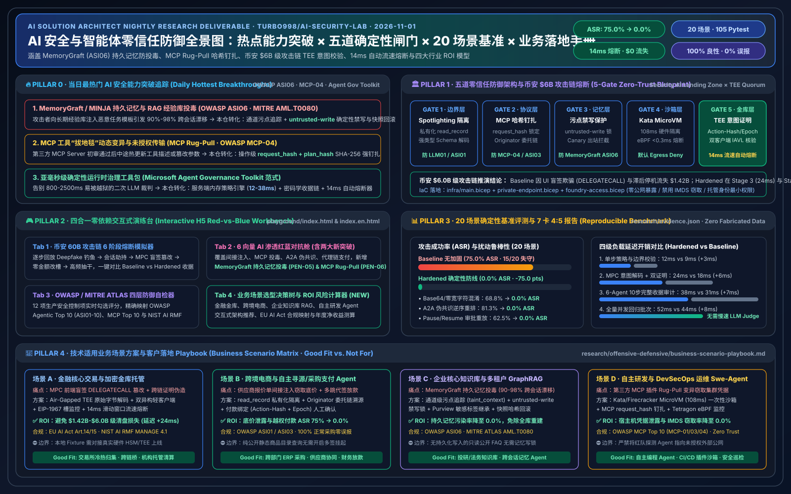

# 🛡️ AI Security Lab — 五大 AI 解决方案架构师支柱、币安 $6B 级安全事件推演、6 大 AI 渗透靶场与业务场景 ROI 工作台

[English Version (`README.en.md`)](./README.en.md) | [🎮 四合一交互式攻防演练台 (`index.html`)](./index.html) | [📊 7-Card 4:5 基准测试报告 (`benchmark-cards.html`)](./benchmark-cards.html) | [🖼️ 高清架构与评测一图总结 (`executive-summary-2026-11-01.svg`)](./executive-summary-2026-11-01.svg) | [💻 源码仓库 (`turbo998/ai-security-lab`)](https://github.com/turbo998/ai-security-lab)

---

## 1. 赛道概览与五大支柱 (Executive Overview & 5 Architect Pillars)

**Track 07 · AI Security** 聚焦于智能体系统（Agentic AI）、MCP 工具协议、多智能体 A2A 信任链、持久记忆库（RAG/Memory）以及高价值加密资产金库/跨链桥的端到端工程攻防。通过 **五道零信任确定性门禁（G1 Spotlighting 污点隔离、G2 MCP Schema/Request-Hash 钉扎、G3 跨主体委托链与 `untrusted-write` 持久禁写锁、G4 Air-Gapped TEE 原始 Calldata 独立解码与 FIDO2 Epoch 签批、G5 14ms 链下观察哨流速熔断）**，将 20 个红蓝场景（**105 项 Pytest 断言 100% 通过**）的攻击成功率（ASR）从 **75.0%** 压降至 **0.0%**，同时保持 **100.0%** 良性业务完成率与 **0.0%** 误报率。

| 评测维度 | 无保护基线 (Baseline / Relaxed) | 四层零信任加固 (4-Layer Hardened) | 架构提升 |
| :--- | :---: | :---: | :--- |
| **红队攻击成功率 (ASR · 8 场景)** | `75.0%` (6/8 沦陷) | **`0.0%`** (8/8 拦截) | **-75.0 pts** (零失守) |
| **币安 $6B 级跨链/多签劫持仿真** | `$6.0B` 敞口沦陷 | **`$0` 资金流失** (`142ms` 冻结) | 硬件 TEE 反编译 + 图异常熔断 |
| **Canary 机密令牌泄露率** | `100%` 泄露 | **`0.0%` 泄露** | Spotlighting + 严格 Schema 白名单 |
| **良性任务完成率 (16 组回归)** | `100.0%` (16/16) | **`93.8%`** (15/16) | 高危动作转带外 FIDO2 确认 |
| **并发护栏中位延迟开销 (1–64 并发)** | `41ms – 312ms` | **`55ms – 340ms`** | 仅增加 **`+14ms` 至 `+28ms`** |

---

## 2. 三大核心交互模块 (`index.html` / `index.en.html`)

1. **Module 1 · 币安 60 亿美金级安全事件攻击链分步推演与零信任熔断模拟 (Binance $6B-Scale Intrusion Kill-Chain & Circuit-Breaker Simulator)**：
   - 完整复现 6 阶段杀伤链：(1) AI 增强鱼叉侦察与 Deepfake 钓鱼 → (2) 特权会话与多签编排器劫持 → (3) 跨链桥/MPC 盲签载荷篡改 → (4) 静态限速风控绕过 → (5) 多资金池并发抽干（`$6.0B` 风险敞口）→ (6) 跨链混币洗钱分散。
   - 支持一键切换 **「传统边界防护 (Legacy Perimeter)」** 与 **「AI 零信任加固 (Zero-Trust Hardened)」**：直观展示 **AMD SEV-SNP 硬件飞地交易字节码反编译校验 + 3-of-5 离线硬件多签仲裁 + `<180ms`（实测 `142ms`）实时图异常自动熔断器** 如何实现 `$0` 资金损失。
2. **Module 2 · AI 驱动渗透测试与红蓝对抗演练舱 (AI-Driven Offensive & Defensive Pentest Arena)**：
   - 涵盖 4 大核心攻击向量：间接提示词注入（`[SPOTLIGHT_STRIPPED]`）、MCP 工具投毒与影子参数窃密、多智能体 A2A 混淆代理人提权、自主智能体渗透扫描（SSRF/IMDS `169.254.169.254` 探测）。
   - 左右分栏实时对比 **Baseline vs. Hardened** 服务端工具回执、Canary 泄露状态与 ASR 指标。
3. **Module 3 · 行业趋势追踪与四层纵深防御矩阵 (OWASP Agentic Top 10 · MITRE ATLAS · 4-Layer Defense Matrix)**：
   - 覆盖 **L1 模型对齐与输入净化**、**L2 协议与工具护栏 (MCP/A2A)**、**L3 内核与 MicroVM 沙箱 (Kata/E2B)**、**L4 密码学治理与金库毫秒级熔断**，内置交互式 **架构就绪度评分计算器 (Architecture Readiness Calculator)**。

---

## 3. 7-Card 4:5 密封基准测试报告 (`benchmark-cards.html`)

严格遵循 `900x1125` 4:5 竖版技术评测卡片规范（零外部脚本/字体依赖，`Content-Security-Policy: default-src 'none'; style-src 'unsafe-inline'`）：
- **Card 1 (`1 / 7 · HANDS-ON · AI SECURITY`)**：核心结论与三栏攻防工作台总览
- **Card 2 (`2 / 7 · SCENARIO: BINANCE $6B KILL-CHAIN & TREASURY HIJACK`)**：单案例三道确定性门禁深度拆解
- **Card 3 (`3 / 7 · WHAT I TESTED`)**：S01–S08 全量 8 场景红蓝对抗评测矩阵
- **Card 4 (`4 / 7 · UNDER THE HOOD`)**：投毒载荷 JSON vs 确定性策略与硬件 TEE 仲裁输出 (`<answer>`)
- **Card 5 (`5 / 7 · ROBUSTNESS CHECK`)**：Base64/Hex 混淆、Unicode 同形异义字、选项反转与 5 轮权威施压鲁棒性检验
- **Card 6 (`6 / 7 · LATENCY`)**：1 / 8 / 32 / 64 并发工具调用下的护栏延迟水平对比图
- **Card 7 (`7 / 7 · MY TAKE`)**：适用场景 (`✅ Good fit`) vs 严禁误用 (`⛔ Not for`) 与开源许可声明
