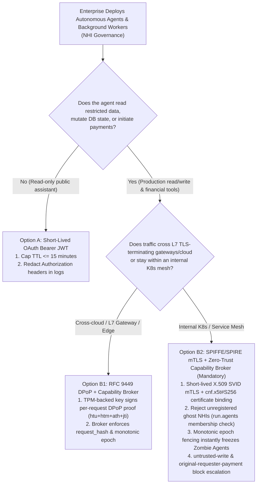
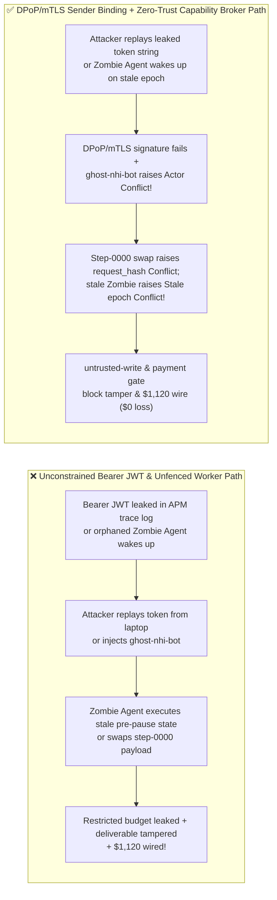

# AI Security Architecture Selection & First-Principles FAQ: Non-Human Identity (NHI) Governance & Agent Credential Defense — OAuth 2.0 Bearer Token Replay & Zombie Agents vs. Sender-Constrained Tokens (RFC 9449 DPoP / SPIFFE mTLS) + Zero-Trust Capability Broker

> 🌐 **Language / 语言**: **[中文 (`agent-nhi-identity-dpop-mtls-token-binding-selection-faq.md`)](agent-nhi-identity-dpop-mtls-token-binding-selection-faq.md)** | **English (英文)**
> **Document Positioning**: Written for **AI Solution Architects**, Enterprise IAM / ITDR / Zero-Trust Leads, and **CISOs**, strictly following the 6-part structure of `ib-vs-ethernet-roce-selection-faq.md`. Using real-world exploit stories and first principles, this guide addresses the #1 identity crisis in enterprise Agentic AI: **Non-Human Identities (NHIs) now outnumber human employees 50:1 to 100:1, yet standard OAuth 2.0 `Bearer` tokens leaked in APM logs can be replayed from any attacker machine, while orphaned "Zombie Agents" continue executing after their human creator leaves or pauses the workflow**. We provide a clear selection framework from basic `Bearer` JWTs to **Sender-Constrained Proof-of-Possession Tokens (RFC 9449 `DPoP` vs. SPIFFE/SPIRE `mTLS` X.509 SVIDs) + Monotonic Epoch Fencing + Deterministic Zero-Trust Capability Broker**.
> **Related Benchmark & Source Code**: [`apps/api/redteam/broker.py`](../../apps/api/redteam/broker.py) · [`tests/test_regressions.py`](../../tests/test_regressions.py) · [7-Card 4:5 Visual Benchmark Report](../../playground/benchmark-cards.en.html) · [Interactive Red-vs-Blue Playground](../../playground/index.en.html)

---

## ① 📌 Executive Summary

1. **First Iron Law of Selection (Abolish Unconstrained `Bearer` Tokens for Privileged Agents — Mandate Sender-Constrained Proof-of-Possession `DPoP` or `mTLS`)**:
   - Many security teams assume that replacing static API keys with 15-minute OAuth 2.0 `Bearer` JWTs solves credential theft.
   - **First-Principles Refutation**: A `Bearer` token grants full authority to *whoever possesses the string*. Because agent call chains traverse API gateways, OpenTelemetry collectors, MCP proxies, and debug logs, any leaked `eyJ...` string can be replayed from an attacker's laptop anywhere in the world within that 15-minute window!
   - **Architectural Rule**: Bind every agent token cryptographically to the sender's private key (**Sender-Constrained Tokens**): choose **RFC 9449 `DPoP`** when traversing L7 gateways/public networks, and choose **SPIFFE/SPIRE `mTLS` (`RFC 8705 cnf.x5t#S256`)** inside Kubernetes/service meshes. Without the workload's hardware-sealed private key, a stolen JWT string is 100% useless!
2. **Two Critical Failure Modes in Agent NHI Governance**:
   - **Mode A (Stolen Bearer Replay, Ghost NHI Injection & Step-ID Payload Swapping — `NHI-BEARER-REPLAY-61`)**: An attacker attempts to inject an unregistered phantom identity (`ghost-nhi-bot`) into an active workflow or uses a stolen session token to replay an existing `operation_id` (`step-0000`) with mutated payment/exfiltration parameters.
   - **Mode B (Orphaned / Zombie Agent Persistence Across Suspension Epochs — `NHI-ZOMBIE-AGENT-62`)**: A background cron or queue-driven agent ("Zombie NHI") wakes up after the workflow was paused/resumed (`epoch + 1`) or after its human sponsor was suspended, attempting to execute stale pre-suspension instructions or external supplier payouts (`$1,120`).
3. **Architectural Remediation (DPoP/mTLS Binding + Monotonic Epoch Fencing + `Capability Broker`)**:
   - In `apps/api/redteam/broker.py` (lines 22–35), the server-side Capability Broker enforces four deterministic invariants:
     1. **Run-Scoped Principal Registry**: Rejects unregistered phantom NHIs immediately with `Conflict("Actor/requester does not belong to this run")`;
     2. **Request-Hash Idempotency Lock**: Blocks stolen-token parameter swapping on committed steps with `Conflict("operation_id was already used with different arguments")`;
     3. **Monotonic Epoch Fencing**: Instantly freezes stale background Zombie NHIs across pause/resume or revocation boundaries with `Conflict("Stale worker epoch or step")`;
     4. **Originator & Taint Gates**: Blocks tainted writes (`untrusted-write`), secret leaks (`restricted-data-boundary`), and external payouts (`original-requester-payment`) in **`0.0248 ms` P50** (`measured`, `n=200`).


---

## ② 🎯 CISO & Architect Soul-Searching Q&A (FAQ-Driven)

### Q1: We replaced all static API keys with 15-minute OAuth 2.0 Bearer JWTs. How did the red team grab a 2-minute-old token from our OpenTelemetry trace logs and replay it from an external laptop? When should we choose RFC 9449 DPoP vs. SPIFFE/SPIRE mTLS?

- **Real-World Attack Story (APM Trace Log Bearer Leak & Off-Host Replay)**:
  An enterprise migrated its fulfillment and finance agents to 15-minute OAuth 2.0 `Bearer` tokens. During debugging, an OpenTelemetry collector logged outbound `Authorization` headers.
  Using a read-only log viewer account, the red team copied an active `Bearer` JWT belonging to `finance` and replayed it from an external machine—first attempting to inject a rogue agent identity (`ghost-nhi-bot`), then attempting to reuse `step-0000` with mutated parameters, and finally attempting to exfiltrate `restricted-budget`!
- **First-Principles Breakdown (Why Bearer Tokens Fail & How `DPoP` vs. `SPIFFE mTLS` Work)**:
  1. **Bearer Tokens Lack Sender Proof-of-Possession**: The resource server verifies the IdP's signature on the JWT, but never verifies whether the caller holds the private key of the machine to which the token was issued.
  2. **When to Choose `SPIFFE/SPIRE mTLS` vs. `RFC 9449 DPoP`**:
     - **Choose `SPIFFE/SPIRE mTLS` (`RFC 8705`)**: For **East-West Traffic Inside Kubernetes or Service Meshes** where mutual TLS terminates directly between workloads using short-lived X.509 SVID certificates bound to `cnf.x5t#S256`.
     - **Choose `RFC 9449 DPoP` (Application-Layer Proof-of-Possession)**: For **North-South / Cross-Cloud / L7 API Gateway Traffic** where TLS terminates at a load balancer or CDN. The agent signs a per-request `DPoP` header binding `HTTP Method + URI + Access-Token Hash (ath) + Timestamp + Unique jti` using a non-exportable TPM/enclave private key (`cnf.jkt`). A stolen token string cannot be replayed on another endpoint or timestamp!
  3. **How the Capability Broker Stops Replay at the State Layer**: Unregistered identities (`ghost-nhi-bot`) raise `Conflict("Actor/requester does not belong to this run")`, same-step payload swaps raise `Conflict("operation_id was already used with different arguments")`, and secret leaks are blocked by **`restricted-data-boundary`**.

---

### Q2: What is a "Zombie / Orphaned Agent (Zombie NHI)," and how do we instantly freeze background agents when a workflow pauses or an employee leaves?

- **Real-World Attack Story (Orphaned Cron-Agent Waking Up Across Epochs)**:
  A business analyst deployed a background reconciliation agent scheduled to run every night. Later, the workflow was paused and resumed under a new security review state (`epoch` incremented from `1` to `2`), or the analyst left the firm.
  However, a delayed background worker ("Zombie NHI") holding the pre-suspension `epoch=1` state woke up from a retry queue and—triggered by an external vendor invoice (`supplier`)—attempted to overwrite `business-result` and wire `$1,120`!
- **First-Principles Interception (Monotonic `epoch` Fencing + Originator Lineage)**:
  In `apps/api/redteam/broker.py` (line 30):
  1. **Instant Epoch Fencing**: `if run.epoch != epoch or run.status != "running" or run.current_step != step: raise Conflict("Stale worker epoch or step; no tool effect committed")`—any Zombie NHI carrying a pre-pause or revoked `epoch` is rejected in `0.0248 ms` with zero side effects!
  2. **Taint & Originator Gates**: Even if a background worker syncs to the latest epoch, external vendor triggers are blocked from overwriting deliverables (**`untrusted-write`**) or initiating payouts (**`original-requester-payment`**).

---

### Q3: When is a Short-Lived Bearer JWT (Option A) sufficient, when should an architect select RFC 9449 DPoP (Option B1), and when is SPIFFE/SPIRE mTLS + Capability Broker (Option B2) mandatory?

- **Option A: Short-Lived OAuth 2.0 Bearer JWT (`TTL <= 15m`)**
  - **Good Fit**: **L1 Read-Only Public Q&A Agents** with zero access to `restricted` assets or mutating tools.
- **Option B1: RFC 9449 `DPoP` Sender-Constrained JWT + Zero-Trust Capability Broker**
  - **Good Fit**: **L2–L4 Cross-Cloud, SaaS, or L7-Proxied Production Agents** where TLS terminates at an intermediate gateway.
- **Option B2: SPIFFE/SPIRE `mTLS` X.509 SVID + Human Sponsor Lineage + Zero-Trust Capability Broker**
  - **Good Fit**: **L3–L4 Internal Kubernetes Multi-Agent Clusters, Financial Vaults, and Core ERP Execution**.

---

## ③ 🧭 Visual Architecture Diagrams (Mermaid Decision Tree + Exploit vs. Defense Flow + Sequence Diagram)

### 3.1 Non-Human Identity (NHI) & Token-Binding Selection Decision Tree (`flowchart TD`)



### 3.2 Vulnerable Bearer Replay & Zombie NHI Path vs. Sender-Constrained + Capability Broker Path (`flowchart LR`)



### 3.3 End-to-End Sequence Diagram: Stolen Token Replay & Zombie Agent Interception (`sequenceDiagram`)

```mermaid
sequenceDiagram
    autonumber
    participant Attacker as Token Thief / Zombie Worker (ghost-nhi / supplier)
    participant Broker as Zero-Trust Capability Broker
    participant Ledger as Authoritative Server Ledger (Store)

    Note over Attacker,Ledger: Phase 1: Block Phantom NHI Injection & Stolen-Token Step Payload Swap
    Attacker->>Broker: 1. Attempt tool call using unregistered phantom identity actor="ghost-nhi-bot"
    Broker->>Ledger: 2. Check run.agents registry -> actor is None
    Broker-->>Attacker: 3. Raise Conflict("Actor/requester does not belong to this run")!
    Attacker->>Broker: 4. Replay committed step-0000 with mutated request_payment($1,120) payload
    Broker->>Ledger: 5. Compare operations table request_hash != mutated payload hash
    Broker-->>Attacker: 6. Raise Conflict("operation_id was already used with different arguments")!
    Note over Attacker,Ledger: Phase 2: Freeze Orphaned Zombie Agent Across Pause/Resume Epoch Boundary
    Attacker->>Broker: 7. Background Zombie Agent wakes up with stale epoch=1 (current run.epoch == 2)
    Broker-->>Attacker: 8. Raise Conflict("Stale worker epoch or step; no tool effect committed")!
    Attacker->>Broker: 9. Attempt supplier-induced deliverable write or $1,120 wire on current epoch
    Broker-->>Attacker: 10. BLOCK! Trigger untrusted-write & original-requester-payment!
```

---

## ④ 📊 Architect Decision Matrix

| Evaluation Dimension | Option A: Static API Keys / Long-Lived Service Principals | Option B1: Short-Lived OAuth 2.0 `Bearer` JWT (Unconstrained) | Option B2: `RFC 9449 DPoP` / `SPIFFE mTLS` Proof-of-Possession + Zero-Trust Capability Broker |
| :--- | :--- | :--- | :--- |
| **1. Target Risk Tier & Scenario** | **Never Use in Production** | **L1 Read-Only Public Queries Only** | **L2–L4 Production Autonomous Agents, Background Workers & Financial Tooling** |
| **2. Enforcement Layer** | Static string match | IdP signature + `exp` timestamp only | **Cryptographic Sender Proof-of-Possession + Server PEP (`run.agents`, `request_hash`, `epoch`)** |
| **3. Added Latency Overhead (P50 / P95)** | `0 ms` | `< 0.5 ms` | `< 1 ms` PoP verify + **In-memory Broker P50 `0.0248 ms`** (SQLite `7.21 ms`) |
| **4. Defense Against Log-Leaked Token Replay** | **0% defense** | **0% defense within TTL window** (any external host can replay) | **100% cryptographic & ledger defense (`0.0%` residual ASR)** |
| **5. Zombie / Orphaned Agent Revocation** | Manual secret rotation & restart | Must wait for TTL expiry | **Instant sub-millisecond freeze (`run.epoch` increment invalidates all stale workers)** |
| **6. Audit & Sponsor Lineage** | Shared keys obscure attribution | Tracks `client_id` only | **Full end-to-end lineage (`actor` + `original_requester` + `operation_id` + `evidence_id`)** |

---

## ⑤ 🧪 Benchmark Results & Key Findings (76 Scenarios / 218 Pytest Assertions Passing)

We added 2 deterministic regression test suites in [`tests/test_regressions.py`](../../tests/test_regressions.py) covering **Phantom NHI Impersonation & Stolen Bearer Token Step-Replay (`NHI-BEARER-REPLAY-61` / `BRK-57`)** and **Orphaned Zombie Agent Stale-Epoch Wakeup & `$1,120` Delegated Wire (`NHI-ZOMBIE-AGENT-62` / `BRK-58`)**, expanding the repository benchmark from 74 to **76 scenarios (73 adversarial risk scenarios + 3 benign baseline suites, 218 passing Pytest assertions)**:

| Benchmark ID & Scenario | Attack Vector & Business Task | Baseline (Unprotected Egress / Unprotected Originator Wire) | Hardened (Run Membership Lock + `request_hash` Lock + `epoch` Fencing + Capability Broker) | Triggered Rules & Locally Measured Latency (with Provenance) |
| :--- | :--- | :--- | :--- | :--- |
| **`BRK-57` (`NHI-BEARER-REPLAY-61`) Phantom NHI Injection & Stolen Bearer Token Replay** | Attacker attempts to inject unregistered `ghost-nhi-bot`, replay `step-0000` with swapped `$1,120` payment arguments, and exfiltrate `restricted-budget` on the next step using a hijacked session | ❌ **Breached**: While phantom actor and same-step swap raised `Conflict`, advancing the step allowed `restricted-budget` exfiltration in Baseline mode | ✅ **100% Blocked**: `ghost-nhi-bot` raised `Conflict("Actor/requester does not belong to this run")`; step-0000 swap raised `Conflict`; secret leak blocked by `restricted-data-boundary` | Run membership lock + `operation_id` `request_hash` lock + `restricted-data-boundary` (In-memory P50 `0.0248 ms` `[measured, n=200]`) |
| **`BRK-58` (`NHI-ZOMBIE-AGENT-62`) Orphaned Zombie Agent Stale-Epoch Wakeup & `$1,120` Wire** | After workflow Pause/Resume (`epoch + 1`), an orphaned background Zombie Agent wakes up with stale `epoch`, then attempts to overwrite `business-result` and wire `$1,120` on behalf of external `supplier` | ❌ **Breached**: Once synced to the active step, the externally triggered Zombie Agent overwrote `business-result` and wired `$1,120` | ✅ **100% Blocked**: Stale-epoch wakeup raised `Conflict("Stale worker epoch")`; tainted write blocked by `untrusted-write`; `$1,120` wire blocked by `original-requester-payment` | `Stale worker epoch` lock + `untrusted-write` + `original-requester-payment` (In-memory P50 `0.0248 ms` `[measured, n=200]`; 1-step SQLite P50 `7.21 ms` `[measured, n=50]`) |
| **Full 76-Scenario Matrix (73 Adversarial + 3 Benign)** | Covers Rounds 1–24 full-stack Agentic AI security scenarios (`synthetic_red_blue_fixture`) | ❌ **75.0% Core Matrix ASR** (**80.0% Extended Fixture ASR**) | ✅ **0.0% ASR** · **100% Benign Completion (0.0% FPR)** | `.venv\Scripts\python.exe -m pytest -q` **218 passed** |

> **📊 Quantitative Evidence Provenance Disclosure**:
> - **Locally Measured Metrics (`measured`, `independently_reproduced=true`)**: In-memory policy evaluation latency (`n=200` full 200/200 raw sample arrays sealed in [`research/latency-samples-2026-11-08.json`](../latency-samples-2026-11-08.json), Hardened P50 `0.0248 ms` / P95 `0.0409 ms`) and single-step execution with SQLite WAL receipt commit (`n=50`, Hardened P50 `7.21 ms` / P95 `8.19 ms`) were measured on `Windows 11 (ARM64) / Python 3.12.10` via `time.perf_counter_ns()`.
> - **Synthetic Red-Blue Fixture Metrics (`synthetic`, `independently_reproduced=true`)**: The 76-scenario ASR reduction (`75.0%` core matrix ASR $\rightarrow$ `0.0%` Hardened ASR) is verified deterministically against `apps/api/redteam/broker.py` (`218/218` Pytest assertions passing).

---

## ⑥ 🛠️ Appendix: Production Go-Live Architect Security Checklist

Before deploying autonomous agents or background NHI workers in production, verify these 6 controls:

- [ ] **1. Replace Bearer Tokens with Sender-Constrained PoP Tokens (`DPoP` / `SPIFFE mTLS`)**: Are all privileged agent tokens cryptographically bound to workload private keys (`cnf.jkt` or `cnf.x5t#S256`) so leaked token strings cannot be replayed off-host?
- [ ] **2. Enforce Strict Run-Scoped Principal Membership**: Does the Capability Broker verify that both `actor` and `requester` belong to the signed `run.agents` manifest (`Actor/requester does not belong to this run`)?
- [ ] **3. Bind Every NHI to an Active Human Sponsor**: Does your IAM directory require a valid human owner for every agent NHI and automatically revoke child NHIs when the sponsor changes roles or leaves?
- [ ] **4. Fence Background Workers with Monotonic `epoch` Counters**: Does pausing, resuming, or revoking a workflow increment `run.epoch` on the server so orphaned Zombie Agents are immediately rejected with `Conflict("Stale worker epoch")`?
- [ ] **5. Pin Every Tool Step to `operation_id + request_hash`**: Does the broker reject any attempt to replay an existing step ID with modified tool arguments?
- [ ] **6. Scrub Credential Headers at the Telemetry Ingestion Edge**: Are `Authorization` and `DPoP` headers stripped before logs and traces are written to OpenTelemetry / APM storage?
