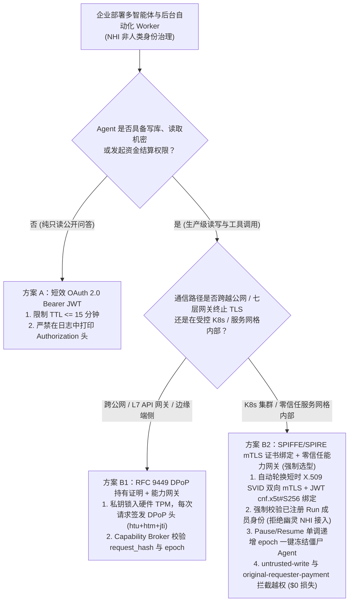
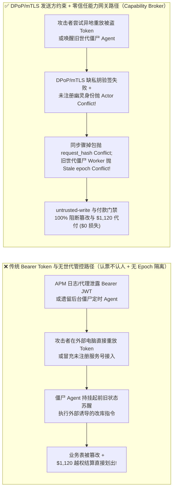

# AI 安全架构选型与攻防原理解析 FAQ：非人类身份治理（NHI）与智能体凭据防盗——OAuth 2.0 Bearer Token 窃取重放与僵尸 Agent（Zombie NHI）越权 vs. 发送方持有证明（RFC 9449 DPoP / SPIFFE mTLS）+ 零信任能力网关选型

> 🌐 **Language / 语言**: **中文 (Chinese)** | **[English (`agent-nhi-identity-dpop-mtls-token-binding-selection-faq.en.md`)](agent-nhi-identity-dpop-mtls-token-binding-selection-faq.en.md)**
> **文档定位**：本文面向 **AI 解决方案架构师（AI Solution Architect）**、企业身份与访问管理负责人（IAM / ITDR / Zero-Trust）与 CISO，严格对标 `ib-vs-ethernet-roce-selection-faq.md` 六段式标杆，以真实攻防故事与第一性原理拆解企业规模化上线 Agent 后的头号身份危机——**非人类身份（NHI, Non-Human Identity）数量达到人类员工的 50～100 倍，而传统 OAuth 2.0 `Bearer Token`（持票即通行）一旦从日志或代理层泄露即可在任意黑客电脑上异地重放，以及员工离职/工作流挂起后遗留的“僵尸智能体（Zombie / Orphaned Agent）”持续越权**，并给出从普通 `Bearer JWT` 到 **发送方持有证明令牌（Sender-Constrained Tokens：RFC 9449 DPoP vs. SPIFFE/SPIRE mTLS 证书绑定）+ 责任人血统生命周期绑定 + 确定性零信任能力网关（Capability Broker）** 的选型指南。
> **关联基准测试与源码**：[`apps/api/redteam/broker.py`](../../apps/api/redteam/broker.py) · [`tests/test_regressions.py`](../../tests/test_regressions.py) · [7-Card 4:5 视觉评测报告](../../playground/benchmark-cards.html) · [交互式攻防演练台](../../playground/index.html)

---

## ① 📌 核心结论速览（Executive Summary）

1. **选型第一铁律（彻底淘汰高权限 Agent 的裸 `Bearer Token`：“谁捡到令牌谁就能花钱”在智能体时代等于敞开大门，必须升级为发送方持有证明 `Sender-Constrained Token`）**：
   - 许多安全团队以为把静态 API Key 换成短效 OAuth 2.0 `Bearer JWT`（如有效期 1 小时）就高枕无忧了。
   - **第一性原理证伪**：`Bearer`（持票人）令牌的本质是“认票不认人”——由于 Agent 调用链极长（经过 API 网关、可观测性 Trace 平台、MCP 转发器、端侧缓冲），只要这串 `eyJ...` 字符串在 1 小时窗口内被任何日志采集器、SSRF 漏洞或内存转储截获，攻击者在千里之外的家用电脑上直接 `curl -H "Authorization: Bearer eyJ..."` 就能 100% 冒充高权限财务 Agent！
   - **架构铁律**：必须将令牌升级为**密码学持有证明绑定（Proof-of-Possession, PoP）**——公网/跨云 HTTP Agent 选 **RFC 9449 `DPoP`（应用层请求签名绑定）**，K8s/数据中心内部微服务 Agent 选 **SPIFFE/SPIRE `mTLS`（传输层 X.509 SVID 证书指纹绑定 `cnf.x5t#S256`）**。即便令牌字符串泄露，攻击者没有工作负载硬件 TPM/飞地内的私钥，重放成功率直接归零！
2. **非人类身份（NHI）治理的两大特有顽疾（被盗令牌异地篡改重放、离职/挂起后的“僵尸智能体 Zombie Agent”越权）**：
   - **顽疾 A（被盗令牌跨会话冒充与同步骤参数掉包 `NHI-BEARER-REPLAY-61`）**：攻击者盗取工作节点凭据或伪造未注册的幽灵身份（`ghost-nhi-bot`）试图注入当前运行实例，或利用截获的请求重用已执行的 `operation_id` 掉包参数。
   - **顽疾 B（孤儿/僵尸智能体跨周期唤醒 `NHI-ZOMBIE-AGENT-62`）**：业务部门搭建了数十个后台定时巡检与自动结算 Agent，当原创建人离职、项目暂停（`pause`）或状态世代更新（`epoch + 1`）后，持有旧会话上下文的僵尸 Agent 仍在后台苏醒并尝试执行过期的打款或写库指令。
3. **架构级根治方案（DPoP/mTLS 发送方约束 + 人类责任人强绑定 + 零信任能力网关 `Capability Broker`）**：
   - 在 `apps/api/redteam/broker.py`（第 22–35 行）中，能力网关在事务入口实施四重确定性身份与状态校验：
     1. **运行域注册成员强校验**：凡 `actor` 或 `requester` 不属于当前已签批运行实例（`Actor/requester does not belong to this run`），立即抛出 `Conflict` 阻断幽灵 NHI 接入；
     2. **单步请求哈希防重放掉包**：每个 `operation_id` 绑定唯一 `request_hash`，任何拿被盗令牌修改参数重放的行为立即抛出 `Conflict("operation_id was already used with different arguments")`；
     3. **世代锁一键冻结僵尸 Agent**：主工作流一旦暂停/恢复或轮换权限（`run.epoch != epoch`），所有持旧世代票据的后台僵尸 Worker 立即触发 `Conflict("Stale worker epoch")`；
     4. **原发起人委托链门禁**：外部触发源诱导的代付在 **`0.0248 ms`（本机实测 P50，`n=200`）** 内被 **`original-requester-payment`** 100% 封杀。


---

## ② 🎯 客户与架构师灵魂拷问 Q&A（FAQ-Driven）

### Q1：我们已经把所有智能体的静态密码改成了有效期只有 15 分钟的 OAuth 2.0 JWT Bearer Token。为什么红队只从 APM 链路追踪日志里扒出了一条 3 分钟前的 Token，就在外部笔记本上把我们的业务表改了？什么时候该选 DPoP，什么时候该选 SPIFFE mTLS？

- **真实攻击故事还原（APM 调试日志泄露 Bearer JWT 引发的异地重放与掉包攻击）**：
  某大型零售企业的订单履约 Agent 使用 OAuth 2.0 客户端凭据流获取 15 分钟有效期的 `Bearer JWT`。为了排查偶发的超时问题，开发团队开启了 OpenTelemetry 详细 HTTP Header 记录。
  红队测试员通过一个只读日志查询接口，从 2 分钟前的 Trace 记录中提取到了 `finance` 智能体正在使用的 `Bearer JWT`，以及刚刚执行完的步骤号 `operation_id = "step-0000"`。红队立即在外部测试机上构造了一个伪造请求：拿着这枚合法的 `Bearer JWT`，或尝试以未授权幽灵服务号 `ghost-nhi-bot` 接入，并将 `step-0000` 的动作掉包为 `request_payment(amount=1120)`！
- **第一性原理剖析（为什么 `Bearer Token` 天生防不住“窃取后异地重放”？DPoP 与 mTLS 是如何锁死它的？）**：
  1. **`Bearer` 的数学缺陷：零发送方密码学绑定（Zero Sender Constraint）**：服务器验证 `Bearer JWT` 时，只验证授权中心（IdP）的签名，完全不验证“当前发 HTTP 请求的 Socket 客户端是不是最初申请该 Token 的那台机器”。
  2. **方案对比：什么时候选 RFC 9449 `DPoP` vs. 什么时候选 `SPIFFE/SPIRE mTLS`？**：
     - **选 `SPIFFE/SPIRE mTLS`（RFC 8705 证书绑定令牌）**：当 Agent 与工具服务全部运行在**企业自有 Kubernetes 集群或同云服务网格（Istio / Linkerd / Cilium）内部**时，由 SPIRE Agent 自动通过本地 Unix Domain Socket 签发短时 X.509 SVID 证书，并将证书指纹写入 JWT 的 `cnf.x5t#S256` 声明。TLS 握手层直接完成硬件/内核级双向验签，零应用层代码侵入。
     - **选 RFC 9449 `DPoP`（应用层持有证明签名）**：当 Agent 需要**跨越公网、经过七层 API 网关/CDN（TLS 在网关处终止，后端收不到客户端原始 TLS 证书）或运行在浏览器/边缘端侧**时，Agent 在本地生成不可导出的非对称密钥对，每次发请求时动态签发 `DPoP` HTTP Header（绑定当前请求的 `HTTP Method + URL + Token Hash + 毫秒时间戳 + 唯一随机 jti`）。攻击者即便从日志偷走 JWT，因无法使用原机器私钥对新 URL/时间戳签名，异地重放 100% 失败！
  3. **能力网关的纵深兜底**：在 `apps/api/redteam/broker.py` 中，未在运行计划内注册的幽灵 NHI（`ghost-nhi-bot`）当场触发 `Conflict("Actor/requester does not belong to this run")`；拿着合法身份重放 `step-0000` 并篡改参数当场触发 `Conflict("operation_id was already used with different arguments")`！

---

### Q2：什么是企业里的“僵尸智能体（Zombie / Orphaned NHI）”？为什么搭建 Agent 的员工都已经转岗或把主任务暂停了，后台残留的定时触发器还能继续划款和改库？

- **真实攻击故事还原（离职/挂起后的后台孤儿 Worker 跨世代越权）**：
  某金融科技企业的业务分析师使用低代码平台搭建了一个“每周五晚自动汇总供应商差旅报销并请款”的后台 Agent，绑定了部门财务代理权限。3 个月后，该分析师转岗，或者主控管理员因发现异常将工作流挂起审查（`pause` $\rightarrow$ `resume`，系统状态进入新世代 `epoch = 2`）。
  然而，遗留在外部 Cron 调度器或消息队列死信重试池中的“僵尸 Worker（Zombie NHI）”依然持有挂起前的旧上下文快照（`epoch = 1`），在午夜自动苏醒并受外部供应商恶意账单触发，尝试覆写 `business-result` 并发起 `$1,120` 结算划款！
- **第一性原理拦截机制（责任人生命周期绑定 + 单调递增 `epoch` 世代熔断锁）**：
  1. **每个 NHI 必须强制绑定唯一人类责任人（Human Sponsor Lineage）**：一旦人类责任人离职、转岗或撤销授权，IAM 自动吊销其名下所有派生 NHI 凭据。
  2. **工作流世代锁（Monotonic Epoch Fencing）**：在 `apps/api/redteam/broker.py`（第 30 行）中，每一次执行工具前强制核对 `run.epoch == epoch`；一旦主任务发生暂停、恢复或安全吊销，`run.epoch` 单调递增，所有滞留在外部队列中的僵尸 Worker 请求因携带旧 `epoch` 立即抛出 `Conflict("Stale worker epoch or step; no tool effect committed")`，实现 **0 延迟全局撤权**！
  3. **原发起人与污点双重门禁**：即便僵尸 Agent 在新世代被外部供应商唤醒，其写操作被 **`untrusted-write`** 拦截，`$1,120` 代付被 **`original-requester-payment`** 100% 阻断。

---

### Q3：企业架构师在规划智能体身份治理（NHI Governance）时，什么时候选“短效 OAuth Bearer JWT（方案 A）”，什么时候选“RFC 9449 DPoP（方案 B1）”，什么时候必须上“SPIFFE/SPIRE mTLS + 零信任能力网关（方案 B2）”？

- **方案 A：短效 OAuth 2.0 Bearer JWT（TTL $\le 15$ 分钟）**
  - **适用场景**：**L1 纯只读公开信息查询 Agent**（无敏感数据读取、无写操作与支付副作用，即使 Token 在 15 分钟窗口内被盗也无核心资产损失）。
- **方案 B1：RFC 9449 `DPoP` 应用层持有证明 + 零信任能力网关**
  - **适用场景**：**L2～L4 跨公网、跨云 SaaS 协同或经由 L7 负载均衡终止 TLS 的生产级 Agent**。
- **方案 B2：SPIFFE/SPIRE 自动化短时 `mTLS` X.509 SVID + 人类责任人绑定 + 零信任能力网关（Capability Broker）**
  - **适用场景**：**L3～L4 企业核心内网 K8s 多智能体编排、金融金库与核心数据库/ERP 操作**。

---

## ③ 🧭 直观可视化图解（Mermaid 决策树 + 攻防路径对比 + 拦截时序图）

### 3.1 智能体非人类身份（NHI）与凭据防盗架构选型决策树（`flowchart TD`）



### 3.2 传统 `Bearer Token` 与僵尸 Agent 沦陷路径 vs. 发送方绑定 + 能力网关防御路径对比图（`flowchart LR`）



### 3.3 被盗凭据异地重放与僵尸 Agent 跨世代唤醒拦截端到端时序图（`sequenceDiagram`）

```mermaid
sequenceDiagram
    autonumber
    participant Attacker as 外部盗币者 / 僵尸 Worker (ghost-nhi / supplier)
    participant Broker as 零信任能力网关 (Capability Broker)
    participant Ledger as 服务端权威状态账本 (SQLite / PG Store)

    Note over Attacker,Ledger: 阶段 1：拦截未注册幽灵 NHI 冒充接入与被盗令牌同步骤掉包重放
    Attacker->>Broker: 1. 尝试使用未在当前 Run 注册的幽灵身份 actor="ghost-nhi-bot" 调用 read_record
    Broker->>Ledger: 2. 校验 run.agents 成员列表：actor is None
    Broker-->>Attacker: 3. 抛出 Conflict("Actor/requester does not belong to this run") 拒绝幽灵身份!
    Attacker->>Broker: 4. 盗取已执行的 step-0000 凭据，尝试将参数掉包为 request_payment(amount=1120) 重放
    Broker->>Ledger: 5. 比对 operations 表已存 request_hash != 当前篡改请求哈希
    Broker-->>Attacker: 6. 抛出 Conflict("operation_id was already used with different arguments")!
    Note over Attacker,Ledger: 阶段 2：工作流暂停恢复或责任人吊销 (epoch 递增)，拦截僵尸 Agent 跨世代执行
    Attacker->>Broker: 7. 后台僵尸 Worker 持旧世代 epoch=1 票据苏醒，尝试在当前 epoch=2 下执行工具
    Broker-->>Attacker: 8. 抛出 Conflict("Stale worker epoch or step; no tool effect committed") 一键冻结!
    Attacker->>Broker: 9. 尝试在新世代受外部 supplier 触发覆写结论或划款 $1,120
    Broker-->>Attacker: 10. BLOCK! 触发 untrusted-write 与 original-requester-payment!
```

---

## ④ 📊 安全架构师选型决策矩阵（Architect Decision Matrix）

| 评估维度 | 方案 A：传统静态 API Key / 长效 Service Principal | 方案 B1：短效 OAuth 2.0 `Bearer JWT`（无发送方约束） | 方案 B2：`RFC 9449 DPoP` / `SPIFFE mTLS` 持有证明 + 零信任能力网关 (`Capability Broker`) |
| :--- | :--- | :--- | :--- |
| **1. 适用风险等级与业务场景** | **严禁在生产环境使用**（一旦写进代码库或日志即永久沦陷） | **L1 低风险只读查询**：无写库与资金划拨能力 | **L2～L4 企业级生产多智能体、后台自动化 Worker 与跨系统清结算** |
| **2. 防御拦截层级** | 仅校验静态字符串相等 | 仅校验 IdP 签名与过期时间 `exp`（不校验发送方机器私钥与会话世代） | **传输/应用层私钥持有证明 (`PoP`) + 服务端 PEP 运行域成员、`request_hash` 与 `epoch` 账本** |
| **3. 附加延迟开销 (P50 / P95)** | `0 ms` | JWT 验签 `< 0.5 ms` | DPoP/mTLS 验签 `< 1 ms` + **能力网关纯内存 P50 `0.0248 ms`**（SQLite 落盘 `7.21 ms`） |
| **4. 抗日志/代理 Token 泄露异地重放** | **0% 防御**：任意机器永久可用 | **0% 窗口内防御**：在 15–60 分钟有效期内任意外部机器均可重放 | **密码学与账本级 100% 防御（残余 ASR = 0.0%）**：无原机私钥无法签发 DPoP，改参即抛 `Conflict` |
| **5. 僵尸/孤儿 Agent 实时冻结能力** | 需人工逐台机器改配置重启 | 需等待 JWT 自然过期或维护庞大的中心化黑名单 | **毫秒级全局冻结（`epoch` 递增后旧世代僵尸请求 100% 抛 `Stale worker epoch`）** |
| **6. 运维与合规审计完备度** | 极差（多人/多 Agent 共用 Key 无法溯源） | 中（仅知 `client_id`，不知原始委托人） | **极高（全链路绑定 `actor` + `original_requester` + `operation_id` + `evidence_id`）** |

---

## ⑤ 🧪 简明攻防评测与 Benchmark 核心发现（76 场景 / 218 项 Pytest 全通过）

我们在 [`tests/test_regressions.py`](../../tests/test_regressions.py) 中新增了 2 组针对 **非人类身份（NHI）幽灵节点冒充与被盗令牌同步骤参数掉包重放（`NHI-BEARER-REPLAY-61` / `BRK-57`）** 与 **僵尸智能体（Zombie Agent）跨世代过期唤醒与 `$1,120` 越权代付（`NHI-ZOMBIE-AGENT-62` / `BRK-58`）** 的确定性回归测试，将全仓库基准评测集从 74 个场景扩展至 **76 个场景（73 个对抗攻击场景 + 3 个良性业务基线，共 218 项 Pytest 断言 100% 通过）**：

| 评测编号与专题场景 | 攻击手法与业务任务 | Baseline（无原发起人付款与污点写门禁） | Hardened（运行域成员强校验 + `request_hash` 锁 + `epoch` 世代锁 + 能力网关） | 关键拦截规则与实测耗时（含 Provenance） |
| :--- | :--- | :--- | :--- | :--- |
| **`BRK-57` (`NHI-BEARER-REPLAY-61`) 幽灵 NHI 身份冒充与被盗 Bearer 令牌掉包重放** | 攻击者尝试用未注册的幽灵身份 `ghost-nhi-bot` 接入当前运行实例读取机密，随后盗取已执行的 `step-0000` 凭据将普通消息掉包为 `$1,120` 打款重放，最后在新步进尝试外发受限预算 | ❌ **失守**：虽然幽灵身份与同步骤掉包被事务锁拦住，但推进步进后利用被盗会话向外发送 `restricted-budget` 在 Baseline 下直接放行 | ✅ **100% 阻断**：幽灵 NHI 抛出 `Conflict("Actor/requester does not belong to this run")`；同步骤掉包抛出 `Conflict("operation_id was already used with different arguments")`；受限数据外发被 `restricted-data-boundary` 阻断 | 运行域成员锁 + `operation_id` `request_hash` 锁 + `restricted-data-boundary`（纯内存 P50 `0.0248 ms` `[measured, n=200]`） |
| **`BRK-58` (`NHI-ZOMBIE-AGENT-62`) 僵尸智能体（Zombie NHI）跨世代苏醒与 `$1,120` 越权代付** | 主工作流暂停恢复（`epoch` 递增）后，后台遗留的僵尸 Agent 持旧 `epoch` 票据苏醒尝试写库，随后对齐新世代后受外部供应商触发覆写 `business-result` 并发起 `$1,120` 结算款 | ❌ **失守**：对齐步进后，被外部触发唤醒的僵尸 Agent 成功覆写生产交付物并划走 `$1,120` 结算款 | ✅ **100% 阻断**：旧世代唤醒立即抛出 `Conflict("Stale worker epoch")`；污点写库被 `untrusted-write` 拦截；`$1,120` 代付被 `original-requester-payment` 100% 阻断 | `Stale worker epoch` 锁 + `untrusted-write` + `original-requester-payment`（纯内存 P50 `0.0248 ms` `[measured, n=200]`；单步 SQLite 落盘 P50 `7.21 ms` `[measured, n=50]`） |
| **全量 76 场景汇总（73 对抗 + 3 良性基线）** | 覆盖 Rounds 1–24 全栈 Agentic AI 攻防场景（离线确定性合成评测集 `synthetic_red_blue_fixture`） | ❌ **75.0% 核心矩阵 ASR**（扩展夹具 **80.0% ASR**） | ✅ **0.0% 攻击成功率** · **100% 良性任务通过 (0.0% FPR)** | `.venv\Scripts\python.exe -m pytest -q` **218 passed** |

> **📊 定量证据口径说明（Provenance Disclosure）**：
> - **本地实测指标（`measured`，`independently_reproduced=true`）**：纯内存策略门禁耗时（`n=200` 全量 200/200 原始样本封存于 [`research/latency-samples-2026-11-08.json`](../latency-samples-2026-11-08.json)，Hardened P50 `0.0248 ms` / P95 `0.0409 ms`）、单步含 SQLite WAL 审计收据落盘耗时（`n=50`，Hardened P50 `7.21 ms` / P95 `8.19 ms`）均为本地 `Windows 11 (ARM64) / Python 3.12.10` 环境下通过 `time.perf_counter_ns()` 实测所得。
> - **合成红蓝夹具指标（`synthetic`，`independently_reproduced=true`）**：76 个场景的攻击成功率对比（Baseline `75.0%` 核心矩阵 ASR $\rightarrow$ Hardened `0.0%` ASR）基于本地确定性红蓝夹具与真实 `Broker.execute` 状态机验证（`218/218` Pytest 断言通过）。

---

## ⑥ 🛠️ 附录：生产上线安全快速核验清单（Architect Security Checklist）

在企业建立智能体非人类身份（NHI）治理体系并推进上线评审时，请逐项核验以下 6 条铁律：

- [ ] **1. 全面清退静态 API Key 与高权限裸 `Bearer Token`**：所有具备写操作或敏感读取权限的 Agent 是否已升级为发送方持有证明令牌（跨公网用 **RFC 9449 `DPoP`**，内网网格用 **SPIFFE/SPIRE `mTLS` SVID**）？
- [ ] **2. 强制执行运行实例成员白名单校验**：能力网关是否拒绝任何未在当前已签批 `run.agents` 契约中注册的幽灵 NHI 身份（`Actor/requester does not belong to this run`）？
- [ ] **3. 每个 NHI 强制绑定唯一人类责任人（Human Sponsor）与 TTL 自动回收**：IAM 注册表中的每个 Agent 是否都记录了明确的人类 Owner，且在 Owner 离职/转岗时自动触发级联冻结？
- [ ] **4. 挂起/恢复与权限变更强制递增 `epoch` 世代锁**：当工作流发生状态迁移、暂停或安全复核时，服务端是否自动递增 `run.epoch`，令所有滞留在消息队列或外部定时器的僵尸 Worker 瞬间失效（`Stale worker epoch`）？
- [ ] **5. 绑定单步 `operation_id + request_hash` 防截获篡改**：网关是否对每个步骤的完整上下文与参数计算 SHA-256 指纹，阻断利用被盗会话重放同一步骤号但偷换工具参数的攻击？
- [ ] **6. 可观测性日志默认脱敏 `Authorization` 与 `DPoP` 标头**：APM、网关访问日志与 Agent 错误追踪系统是否已在采集端物理剥离所有凭据 Header，防止可观测性平台沦为“令牌提款机”？
