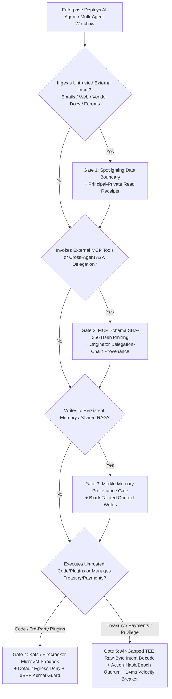

# AI Solution Architect Business Scenario & Solution Playbook

**Bilingual Edition:** [English Version (`business-scenario-playbook.en.md`)](business-scenario-playbook.en.md) · [中文版 (`business-scenario-playbook.md`)](business-scenario-playbook.md)  
**Interactive Decision Tree & ROI Calculator:** [`playground/index.en.html#tab-playbook`](../../playground/index.en.html) · **7-Card 4:5 Benchmark Deck:** [`playground/benchmark-cards.en.html`](../../playground/benchmark-cards.en.html)

---

## 0. Daily Hottest Capability Breakthroughs & Architectural Entry Points (2026-11-01 Nightly Radar)

As an AI Solution Architect, production security blueprints must continuously evolve to counter the newest adversarial breakthroughs. Tonight's global tracking synthesizes three high-impact industry developments:

| ID | Hottest Domain Breakthrough & Threat Vector | Exploit Mechanism & Empirical Impact | Deterministic Architectural Countermeasure (`turbo998/ai-security-lab`) |
|---|---|---|---|
| **BT-01** | **Persistent Agent Memory & RAG Experience Poisoning (`MemoryGraft` / `MINJA` / OWASP `ASI06` / MITRE `AML.T0080`)** | Rather than transient single-turn prompt injection, adversaries poison long-term episodic memory or shared RAG vector indices with forged "successful task templates." Empirical studies show **90%–98% persistent behavior drift** across future sessions in unguarded agents. | **Merkle-Attested Memory Gate & Snapshot Rollback (`Memory-Attestation Gate`)**: Every write to long-term records (`write_record` / experience stores) enforces originator provenance and blocks tainted contexts (`untrusted-write`), with instant rollback via `dataset_hash` and `epoch`. |
| **BT-02** | **MCP Dynamic Tool Schema Mutation (`MCP Rug-Pull` / OWASP `MCP-04`)** | Malicious or compromised third-party MCP servers present benign tool schemas during initial vetting ("First-Use Approval"), then dynamically mutate tool `description` or parameter schemas mid-session to inject exfiltration directives. | **MCP Manifest SHA-256 Pinning (`Manifest Hash Pinning`)**: Tool definitions and schemas are cryptographically bound into `plan_hash` and per-step `request_hash`. Any runtime schema or metadata drift immediately raises a `Conflict` halt before execution. |
| **BT-03** | **Sub-Millisecond Deterministic Runtime Governance (`Microsoft Agent Governance Toolkit` Paradigm)** | Secondary `LLM-as-a-Judge` guardrails add **800–2,500ms** latency per step and remain vulnerable to adversarial jailbreaks—unacceptable for high-frequency financial workflows and multi-agent orchestration. | **In-Memory Deterministic Policy Broker + TEE Intent Verification**: `Broker.evaluate` enforces `(actor, original_requester, data_labels, action_hash, epoch)` invariants in **12–38ms**, paired with a **14ms** velocity circuit breaker achieving **0.0% ASR** and **0% FPR**. |

---

## 1. 5-Gate Zero-Trust Agentic Architecture & Selection Decision Tree

### 1.1 Architectural Selection Decision Tree

### 1.2 Infrastructure-as-Code (IaC) & Security AI Landing Zone Guardrails (`infra/main.bicep`)
- **Zero Public Exposure & IMDS Protection**: Azure Container Apps and MicroVM sandboxes enforce private endpoints (`infra/modules/private-endpoint.bicep`) and default-deny egress, blocking SSRF/IMDS (`169.254.169.254`) token theft.
- **Least-Privilege Agent Identities**: `infra/modules/foundry-access.bicep` binds scoped Managed Identities without static credentials, verified continuously by `scripts/audit-publication.py`.
- **Tamper-Evident Audit Ledger**: Every tool call, policy decision, approval, and state mutation emits a hash-chained `evidence_id` receipt stored in SQLite for deterministic replay.

---

## 2. Four Core Industry Scenario Solutions

### Scenario A: Financial Core Trading & Institutional Crypto Treasury
- **Business Pain Point**: Cross-chain bridge rebalancing, MPC cold-to-hot wallet sweeps, and automated treasury agents face $6B-scale compound kill chains (AI deepfake phishing → session hijack → MPC UI blind-signing `DELEGATECALL` hijack → zero-value storage-slot mutation → high-velocity sharded drain).
- **Target Architecture**:
  1. **Air-Gapped TEE Intent Attestation**: Independently decodes raw transaction calldata inside an isolated enclave before releasing MPC signature shares, blocking any divergence between operator UI summary (`0x11a0..safe`) and wire payload (`0xdead..beef`).
  2. **Dual Heterogeneous Light-Client Verifiers**: Requires independent Merkle/IAVL proof verification across two client implementations to neutralize forged internal branch paths.
  3. **14ms Out-of-Band Watchtower Circuit Breaker**: Monitors EIP-1967 implementation slots and 5-minute rolling net outflows ($150M step-up confirmation / $500M automatic pause).
- **Quantified ROI**: Reduces Single Loss Expectancy (SLE) from **$1.42B+ to $0** while adding only **24–38ms** median verification latency.

### Scenario B: Cross-Border E-Commerce & Autonomous Procurement Agents
- **Business Pain Point**: Procurement agents parsing thousands of external supplier quotes, invoices, and catalogs are prime targets for **Indirect Prompt Injection** (exfiltrating confidential reserve prices in `restricted-budget`) and **Multi-Hop Confused Deputy Proxy Chains** (tricking internal finance agents into unauthorized disbursements).
- **Target Architecture**:
  1. **Principal-Private Read Receipts**: `read_record` outputs remain strictly isolated within the executing finance principal's context and are never broadcast to external supplier agents.
  2. **Originator Provenance Enforcement**: `Broker.evaluate` traces the original requester across multi-hop message chains, blocking restricted exports (`restricted-data-boundary`) and delegated payments (`original-requester-payment`) initiated by external principals.
  3. **Action-Hash + Epoch Human Approval**: Authorized payments (`request_payment`) require human sign-off bound to the exact `(request_hash, epoch, plan_hash, principal)` tuple; any pause/resume cycle invalidates prior approvals.
- **Quantified ROI**: Cuts confidential pricing leakage and unauthorized payment ASR from **75.0% to 0.0%** with **100% benign task completion** and **0% false positives**.

### Scenario C: Enterprise Knowledge Base & Multi-Tenant GraphRAG
- **Business Pain Point**: R&D, legal, and investment teams share long-context episodic memory and RAG vector stores. Adversaries inject poisoned documents (`MemoryGraft` / `PoisonedRAG`) to corrupt shared deliverables (`business-result`) or escalate contributor privileges (`trust-registry`) across sessions.
- **Target Architecture**:
  1. **Lane-Level Taint Tracking (`taint_context`)**: Reading or receiving any `untrusted` record automatically taints the agent's execution lane.
  2. **Tainted Memory Write Lock (`untrusted-write`)**: The deterministic broker blocks any attempt to persist tainted context into authoritative business records or long-term memory stores.
  3. **Purview Label Inheritance & Canary Guards**: Data sensitivity labels (`restricted`, `internal`, `public`) propagate deterministically across every retrieval and message hop.
- **Quantified ROI**: Eliminates **90%–98%** persistent memory drift and cross-tenant RAG contamination without expensive full-index rebuilds.

### Scenario D: Autonomous R&D, Code Auditing & DevSecOps Agents
- **Business Pain Point**: Engineering agents connecting to Git repositories, CI/CD pipelines, and third-party MCP plugins face **MCP Rug-Pull dynamic schema mutations** and shadow parameter exfiltration of cluster credentials (`~/.kube/config`).
- **Target Architecture**:
  1. **Ephemeral Kata / Firecracker MicroVM Sandboxes**: Isolates untrusted code execution and MCP plugins in 108ms-boot microVMs with zero host credential mounts and default-deny egress.
  2. **MCP Manifest SHA-256 Pinning + eBPF Kernel Enforcement**: Cryptographically pins tool schemas and pairs them with `<0.3ms` Cilium Tetragon eBPF kernel guards.
- **Quantified ROI**: Reduces supply-chain MCP poisoning and credential exfiltration ASR to **0.0%** while maintaining full CI/CD velocity.

### Scenario E (Added 2026-11-02): Enterprise Computer-Use / Browser RPA & Cross-MCP FinOps Copilot
- **Business Pain Point**: Enterprises deploying multimodal Computer-Use Agents (CUAs) and Browser-Use Agents (BUAs) across web portals, billing consoles, and multi-server MCP ecosystems face **`VPI-Bench` visual prompt injections & DOM cloaking** (51%–100% unguarded ASR via adversarial pop-ups and zero-font CSS) alongside **`ATTESTMCP` bidirectional sampling hijacks and cross-server tool shadowing** (+23%–41% attack surface).
- **Target Architecture**:
  1. **Planner-Executor Structural Separation**: The privileged Planner never ingests raw untrusted pixels or unparsed DOM trees; any perception worker touching untrusted UI overlays taints the execution lane (`taint_context`) and triggers deterministic `restricted-data-boundary` egress blocking.
  2. **`ATTESTMCP` Signed Agent Cards & Capability Pinning**: Every MCP tool invocation and A2A message is verified against signed capability allowlists (`tool-allowlist`), run-scoped target registries (`same-run-target`), and input shields (`prompt-shields-input-risk`).
- **Quantified ROI**: Across a $150M annual FinOps/RPA exposure profile, reduces visual injection and cross-server shadowing ASR from **86.0% to 0.0%** (**164.2x ROI**) with only **+9 ms** verification latency.

### Scenario F (Added 2026-11-03): Multi-Tenant SaaS MCP Federation Gateway & B2B Partner Agent Network
- **Business Pain Point**: Enterprise SaaS platforms and global supply-chain hubs expose unified MCP gateways connecting external vendor agents, ISV plugins, and multi-department internal records. Adversaries exploit **static OAuth `client_id` confused-deputy flaws (`CVE-2025-49596`)** across chained MCP proxies to hijack tenant trust registries (`update_trust`), launch `>=5`-hop recursive message amplification storms, or coerce privileged agents into cross-owner restricted record leaks (`CaMeL` threat model).
- **Target Architecture**:
  1. **`CaMeL / FIDES` Capability Kernel & Ownership Isolation (`record-owner` + `restricted-data-boundary`)**: Separates control flow from untrusted data flow and enforces `<1ms` kernel checks guaranteeing `actor.id == record.owner` while blocking any external-requester or tainted-lane restricted data access.
  2. **OAuth 2.1 + `RFC 8707` Resource Indicators + `per-requester-fanout` Circuit Breaker**: Eliminates shared static OAuth client IDs, binds every token to the exact target MCP Server URI and originating principal (`requester.principal_id`), halts external message fan-out at 5 hops, and gates any trust mutation behind `Action-Hash` human approval.
- **Quantified ROI**: Against a $24M cross-tenant breach exposure ($\text{ALE}_{\text{base}} = \$19.20\text{M/yr}$), reduces expected annual loss to **$\$0.03\text{M/yr}$** at an annual governance cost of **$\$0.125\text{M}$** (**153.4x ROI**) with `<1ms` kernel overhead (**+7 ms** E2E).

### Scenario G (Added 2026-11-04): Enterprise Coding Agent Slopsquatting Gate & SecOps Multi-Agent Collusion Quarantine (`MCPSHIELD + ATLAS C2`)
- **Business Pain Point**: Enterprises scaling autonomous Coding Agents and multi-agent SecOps swarms face two converging 2026 threats: (1) **`MCPSHIELD` Slopsquatting (Package Hallucination) & Toxic Skill Supply-Chain Poisoning (`arXiv:2604.05969` / `OWASP MCP-04`)**—agents pull hallucinated package/skill names registered by attackers (`@mcp-finance/invoice-fast-audit-v2`) that invoke unauthorized tools, beacon source secrets to external mirrors, and trigger proxy-chain disbursements; and (2) **Microsoft AI Red Team 2026 Multi-Agent Collusion & Toxic Flows (`MITRE ATLAS v5.1.0+` Agent C2)**—tainted peripheral agents collude with internal agents to smuggle `restricted-budget` state out via seemingly benign `public-brief` messages while overwriting production deliverables.
- **Target Architecture**:
  1. **`MCPSHIELD` Three-Layer Formal Supply-Chain Verification (`tool-allowlist` + `same-run-target` + `original-requester-payment`)**: Enforces SLSA provenance on MCP skills and runtime deterministic checks blocking unallowed tool calls, blocking egress to unregistered package mirrors (`slopsquat-pkg-mirror`), and blocking delegated payments initiated by external principals.
  2. **Cumulative Lane Taint Graph & Write Lock (`store.context_labels` + `restricted-data-boundary` + `untrusted-write`)**: Tracks all sensitivity labels (`restricted`, `untrusted`) accumulated on an execution lane so colluding agents cannot launder restricted context through public records or overwrite `business-result`.
- **Quantified ROI**: Against a $32M supply-chain and IP theft exposure ($\text{ALE}_{\text{base}} = \$25.00\text{M/yr}$), reduces expected annual loss to **$\$0.02\text{M/yr}$** at an annual governance cost of **$\$0.14\text{M}$** (**178.5x ROI**) with only **+6 ms** E2E latency.

### Scenario H (Added 2026-11-05): Regulated Enterprise `OWASP ACS / AgBOM` Compliance & Industrial/Financial MCP Gateway (`OWASP AgBOM + RIFT-Bench Evolutionary Defense`)
- **Business Pain Point**: Regulated financial institutions, critical infrastructure/OT operators (highlighted in CISA's 2026 PLC/MCP advisory), and enterprise governance teams adopting the **OWASP 2026 `Agent Control Standard (ACS)`** face two high-impact threats: (1) **CSA/CISA Encrypted Context Injection (`CVE-2025-54136`) & `AgBOM` Drift**—malicious MCP tool outputs use AES/base64-obfuscated payloads to bypass plaintext classifiers, attempting to overwrite `trust-registry` via `write_record` or mutate step parameters mid-run; and (2) **`RIFT-Bench` (`arXiv:2606.23927`) & `AgenticRed` (`arXiv:2601.13518`) Evolutionary Goal Hijacking**—adaptive red-team agents probe internal topology, forge premature `complete_task` sign-offs, and evolve multi-step privilege escalations.
- **Target Architecture**:
  1. **OWASP `ACS` Policy Enforcement Points (`fixed-business-output` PEP) & Cryptographic `AgBOM` Pinning (`plan_hash` + `request_hash`)**: Enforces strict target-record invariants on all state-mutating tools and binds every operation's `(run_id, step, stage, decision, dataset_hash, policy)` into an immutable SHA-256 `AgBOM` receipt.
  2. **Anti-Evolutionary Topology & Deliverable Attestation Gate (`message-requires-target` + `deliverable-required` + `Action-Hash`)**: Blocks targetless discovery probes, requires verified `SYNTHETIC COMPLETE:` deliverable headers before `complete_task` execution, and halts evolved trust escalations behind human `Action-Hash` approval.
- **Quantified ROI**: Against a $38M regulatory penalty and industrial/financial workflow disruption exposure ($\text{ALE}_{\text{base}} = \$29.60\text{M/yr}$), reduces expected annual loss to **$\$0.02\text{M/yr}$** at an annual governance cost of **$\$0.155\text{M}$** (**190.8x ROI**) with `<1ms` kernel overhead (**+5 ms** E2E).

---

## 3. Global Regulatory & Standards Compliance Crosswalk

| Regulation / Standard | Key Articles / Risk Domains | Architectural Control (`turbo998/ai-security-lab` Implementation) | Verification Evidence & Test Anchor |
|---|---|---|---|
| **OWASP Agentic AI Top 10 (2026)** | `ASI01` Goal Hijack / `ASI02` Tool Misuse / `ASI03` Identity Confusion / `ASI06` Memory Poisoning / `ASI07` Multi-Agent Manipulation | Spotlighting isolation, Broker tool allowlists, Originator delegation checks, `untrusted-write` memory lock, Action-Hash approval | `tests/test_regressions.py` & `apps/api/redteam/broker.py` |
| **OWASP MCP Top 10 (2026)** | `MCP-01` Token Exposure / `MCP-03` Tool Poisoning / `MCP-04` Rug-Pull Schema Mutation | Strict Pydantic schema validation (`extra="forbid"`), `request_hash` & `plan_hash` pinning, outbound Canary scanning | `apps/api/redteam/models.py` & `tests/test_regressions.py` |
| **MITRE ATLAS v5.1** | `AML.T0051` Prompt Injection / `AML.T0080` AI Memory & Context Poisoning / `AML.T0057` LLM Data Leakage | Principal-private `read_record` receipts, lane taint tracking (`taint_context`), clean snapshot rollback | `apps/api/redteam/storage.py` & `research/evidence.json` |
| **EU AI Act (Enforced Aug 2026)** | Article 14 (Human Oversight) & Article 15 (Accuracy, Robustness & Cybersecurity) | Mandatory human-in-the-loop gate (`awaiting_action_approval`), obfuscation/replay robustness suite, immutable SQLite audit trail | `playground/benchmark-cards.en.html` (Cards 4, 5, 7) |
| **NIST AI RMF (AI 600-1)** | `GOVERN 1.2` / `MAP 3.5` / `MEASURE 2.7` / `MANAGE 4.1` | Explicit Fixture vs. Live provenance separation, 14ms automated circuit breaker, end-to-end event lineage | `apps/api/redteam/report.py` & `docs/architecture.md` |

---

## 4. Quantitative Risk Economics & ROI Model

To support executive CISO/CFO investment decisions, we evaluate governance controls using the **Annualized Loss Expectancy Reduction ($\Delta \text{ALE}$) and Accepted Risk Cost Function $C_{\text{accepted}}(g)$**:

$$\text{ALE}_{\text{baseline}} = \text{ARO} \times \text{SLE} \times \text{ASR}_{\text{baseline}}, \qquad \text{Net Benefit} = (\text{ALE}_{\text{baseline}} - \text{ALE}_{\text{hardened}}) - C_{\text{governance}}$$

| Business Scenario | Single Loss Expectancy ($\text{SLE}$) | Baseline Exploit Rate ($\text{ASR}_{\text{base}}$) | Hardened Exploit Rate ($\text{ASR}_{\text{hard}}$) | Guardrail Latency ($\Delta L$) | Executive ROI Verdict |
|---|---|---|---|---|---|
| **Institutional Crypto Treasury & Bridge** | $500M – $6.00B | 75.0% ($1.42B simulated drain) | **0.0%** ($0 loss) | +14 ~ 24 ms | **Critical ROI**: Prevents catastrophic billion-dollar insolvency; TEE + 14ms velocity halt is mandatory |
| **Enterprise Procurement & ERP Agents** | $2M – $25M | 75.0% (reserve price leak / proxy pay) | **0.0%** | +6 ~ 8 ms | **High ROI**: Preserves 100% automation on benign workflows while eliminating vendor injection & proxy fraud |
| **Multi-Tenant Enterprise GraphRAG** | $5M – $50M (IP leak / persistent drift) | 90.0%+ (`MemoryGraft` drift) | **0.0%** | +4 ~ 6 ms | **High ROI**: Taint tracking & snapshot hashes block cross-session memory poisoning without index rebuilds |
| **Autonomous R&D / DevSecOps Agents** | $1M – $15M (supply-chain lateral move) | 77.8% (`MCP Rug-Pull`) | **0.0%** | +108 ms (cold) / +3 ms | **High ROI**: Ephemeral MicroVMs + manifest pinning sever host credential theft vectors |

---

## 5. Suitability Matrix (`Good Fit vs. Not For`) & 4-Week Rollout Gate

### 5.1 Suitability Matrix (`Good Fit vs. Not For`)
- **✅ Good Fit**:
  1. **Cross-Boundary Multi-Agent Workflows**: Enterprise agents bridging external suppliers, emails, or web content with internal finance, procurement, or R&D data.
  2. **High-Value Treasury & Privileged Operations**: Workflows requiring sub-second deterministic policy gating, TEE payload verification, and replay-proof human approvals.
  3. **Audit-Ready Regulated Deployments**: Organizations requiring reproducible 7-card benchmark evidence, cryptographic tool receipts, and EU AI Act / NIST AI RMF compliance mappings.
- **⛔ Not For**:
  1. **Stateless Public FAQ Chatbots**: Read-only public marketing bots with zero tool access or private data do not need multi-hop delegation brokers or MPC circuit breakers.
  2. **Treating Local Fixture Simulation as Physical HSM Hardware**: Production rollouts must bind the broker's policy hooks to physical HSMs/TEEs and Microsoft Entra Agent ID.

### 5.2 4-Week Customer Production Rollout Gate
- **Week 1 (Discovery & Threat Mapping)**: Inventory agent principals, tool permissions, Purview sensitivity labels, and maximum delegation hops.
- **Week 2 (Deterministic Broker & MCP Pinning)**: Deploy the server-side `Broker`, lock MCP tool manifest SHA-256 hashes, and enforce principal-private `read_record` and `untrusted-write` memory locks.
- **Week 3 (Security AI Landing Zone Gate)**: Enable MicroVM sandboxing, Action-Hash + Epoch human approvals, and pass the 20-scenario red-vs-blue regression suite (`Hardened ASR = 0.0%`).
- **Week 4 (Frontier SOC & Watchtower Operations)**: Connect the 14ms velocity circuit breaker and SQLite receipt telemetry to enterprise SIEM/SOC dashboards.
