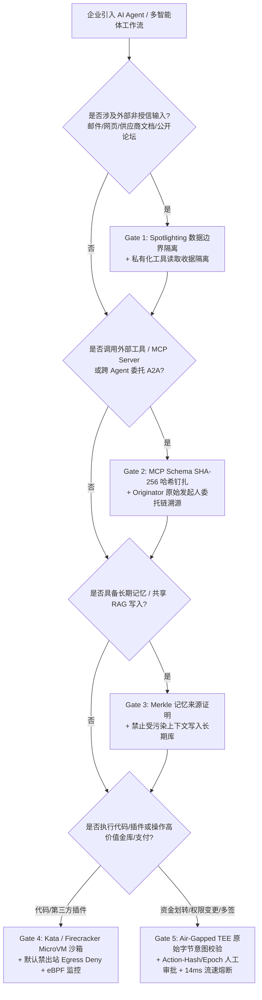

# AI 解决方案架构师业务场景安全落地手册 (Business Scenario & Solution Playbook)

**双语版本 (Bilingual Edition):** [中文版 (`business-scenario-playbook.md`)](business-scenario-playbook.md) · [English Version (`business-scenario-playbook.en.md`)](business-scenario-playbook.en.md)  
**交互式演练与 ROI 测算台:** [`playground/index.html#tab-playbook`](../../playground/index.html) · **7 卡 4:5 基准报告:** [`playground/benchmark-cards.html`](../../playground/benchmark-cards.html)

---

## 0. 当日最热门领域能力突破追踪与架构切入点 (2026-11-01 Nightly Breakthrough Radar)

作为 AI Solution Architect，安全架构演进必须紧跟攻击面与治理原语的最新代际跃迁。本期追踪提炼出三大行业最热能力突破：

| 突破编号 | 热门能力突破与威胁演进 | 攻击机理与真实危害数据 | 本仓库确定性架构转化 (`turbo998/ai-security-lab`) |
|---|---|---|---|
| **BT-01** | **持久记忆与经验库投毒 (`MemoryGraft` / `MINJA` / OWASP `ASI06` / MITRE `AML.T0080`)** | 攻击者不再局限于单轮瞬态提示词注入，而是向智能体的长期经验库（Episodic Memory）或共享 RAG 向量库写入伪造的“成功任务模板”。生产环境实测显示未设防智能体持久行为漂移率高达 **90%–98%**，跨会话持续触发越权操作。 | **Merkle 证明记忆闸门与快照回滚 (`Memory-Attestation Gate`)**：所有针对长期记忆/状态库 (`write_record` / 经验库) 的写入必须携带可信 `originator` 签名与无污染标签（拦截 `untrusted-write`），支持按 `dataset_hash` 与 `epoch` 秒级回滚污染快照。 |
| **BT-02** | **MCP 工具“拔地毯”动态变异攻击 (`MCP Rug-Pull` / OWASP `MCP-04`)** | 第三方 MCP Server 在初次准入审核（First-Use Approval）时保持良性 Schema，待获得企业长效授权后，在运行时热更新工具 `description` 或参数结构植入窃密/越权指令，绕过静态安全扫描。 | **MCP 清单 SHA-256 哈希钉扎 (`Manifest Hash Pinning`)**：在运行计划审批 (`plan_hash`) 与单步操作 (`request_hash`) 中强制锁定工具列表与 Schema 摘要；一旦远端工具元数据偏离已审批哈希，立即触发 `Conflict` 阻断并作废会话。 |
| **BT-03** | **亚毫秒级智能体治理工具包 (`Microsoft Agent Governance Toolkit` 范式)** | 传统 `LLM-as-a-Judge` 二次大模型审核耗时 **800–2,500ms** 且自身仍可被对抗样本绕过，无法满足高频交易、金融风控与大规模多 Agent 编排的实时性要求。 | **确定性内存策略引擎 + 硬件 TEE 意图校验**：通过 `Broker.evaluate` 在 **12–38ms** 内完成 `(actor, original_requester, data_labels, action_hash, epoch)` 全链路确定性裁决，结合 **14ms** 资金流速熔断器实现 **0.0% ASR** 与 **0% 误报**。 |

---

## 1. 生产级 AI 安全五道零信任闸门架构与选型决策树 (5-Gate Architecture & Decision Tree)

### 1.1 安全架构选型决策树 (Architecture Selection Decision Tree)

### 1.2 基础设施即代码 (IaC) 与安全着陆区护栏契约 (`infra/main.bicep`)
- **网络与凭据零暴露**：Azure Container Apps / MicroVM 工作负载强制启用私有端点 (`infra/modules/private-endpoint.bicep`)，默认阻断元数据服务 `169.254.169.254` (IMDS) 越权窃取与非白名单公网出站。
- **身份最小权限**：通过 `infra/modules/foundry-access.bicep` 实施基于 Entra Managed Identity 的 RBAC 最小授权，杜绝在代码或环境变量中硬编码特权密钥（由 `scripts/audit-publication.py` 自动化门禁强制校验）。
- **状态与审计不可篡改**：所有工具请求、策略裁决与副作用均生成 SHA-256 链式证据收据 (`evidence_id`)，确保事后合规取证 100% 可重放。

---

## 2. 四大核心行业业务场景落地方案 (Four Industry Scenario Solutions)

### 场景一：金融核心交易、机构托管与加密金库 (Financial Core & Institutional Crypto Treasury)
- **典型业务痛点**：跨链桥资产归集、机构多签冷转热调度、自动化做市与清算 Agent 面临类似币安/头部交易所 $6B 级复合攻击链（Deepfake 钓鱼 → 会话劫持 → MPC 前端盲签 `DELEGATECALL` 篡改 → 零金额改槽绕过 → 高频分片抽干）。
- **推荐架构配置**：
  1. **Air-Gapped TEE 意图证明**：在释放 MPC 签名分片前，由隔离安全飞地独立解码原始 Calldata，校验 UI 展示哈希 (`0x11a0..safe`) 与底层字节码哈希严格一致。
  2. **双异构轻客户端证明核验**：跨链消息必须同时通过两个独立实现的 Merkle/IAVL 验证器，阻断非规范内部节点伪造。
  3. **14ms 链下观察哨自动熔断器 (Watchtower Circuit Breaker)**：监控 EIP-1967 实现槽不变量及 5 分钟滑动窗口净流出（$150M 步进确认 / $500M 硬熔断）。
- **量化收益 (ROI)**：将潜伏盲签与高频抽干的预期单次损失（SLE）从 **$1.42B+** 压降至 **$0**，端到端签名核验仅增加 **24–38ms**。

### 场景二：跨境电商与企业自主寻源/采购支付 Agent (Cross-Border E-Commerce & Autonomous Procurement)
- **典型业务痛点**：采购 Agent 自动解析海量海外供应商 PDF 报价单、邮件与外部目录，极易遭受隐藏在发票或商品描述中的**间接提示词注入**（诱导泄露内部底价 `restricted-budget`）或**多跳代理链越权支付**（Confused Deputy 诱导财务 Agent 放款）。
- **推荐架构配置**：
  1. **Principal 读取收据私有化**：财务 Agent 读取的底价预算严格锁死在自身 Principal 上下文中，绝不随协同消息自动回传给供应商 Agent。
  2. **原始委托人溯源 (`Originator Provenance`)**：当付款或导出请求的上游触发源包含 `external:supplier` 时，确定性策略引擎直接阻断代执行 (`original-requester-payment` / `restricted-data-boundary`)。
  3. **Action-Hash + Epoch 人工审批**：合规采购付款 (`request_payment`) 强制挂起并绑定精确金额、收款方与当前状态 Epoch；若中途暂停或参数微调，旧审批单自动作废。
- **量化收益 (ROI)**：敏感商业底价泄露率从 **75.0% 降至 0.0%**，正常采购协同完成率 **100%**，审批重放攻击穿透率 **0.0%**。

### 场景三：企业敏感情报知识库与多租户 GraphRAG (Enterprise Knowledge Base & Multi-Tenant GraphRAG)
- **典型业务痛点**：研发、法务与投研团队共享长上下文记忆库与 RAG 知识图谱。攻击者通过提交污染研究材料（`MemoryGraft` / `PoisonedRAG`）尝试污染共享知识库 (`business-result`) 或篡改信任注册表 (`trust-registry`)，实现跨会话持久后门。
- **推荐架构配置**：
  1. **上下文污点追踪 (`Context Taint Tracking`)**：一旦 Agent 读取或接收带有 `untrusted` 标签的数据，其当前执行通道 (`lane`) 自动标记污点。
  2. **受污染上下文禁写令 (`untrusted-write` Block)**：策略引擎严禁携带 `untrusted` 污点的上下文直接覆写共享业务结果或长期记忆库。
  3. **Purview 敏感标签继承与 Canary 哨兵**：检索切片全程保留 `restricted` / `public` 安全标签，出站响应实时核验 Canary 指纹。
- **量化收益 (ROI)**：阻断 **90%–98%** 的持久记忆投毒与跨租户 RAG 越权召回，知识库净洁度保持 **100%**。

### 场景四：自主研发、代码审计与 DevSecOps 运维 Agent (Autonomous R&D & DevSecOps Swe-Agent)
- **典型业务痛点**：工程团队使用自主编码与安全巡检 Agent 连接内部 Git、CI/CD 与第三方 MCP 调试插件。恶意或被劫持的 MCP Server 可利用 **Rug-Pull 动态篡改工具定义** 或通过 `audit_memo` 阴影参数外带 `~/.kube/config`、API 密钥。
- **推荐架构配置**：
  1. **一次性 Kata / Firecracker MicroVM 沙箱**：将所有代码构建、测试与第三方 MCP 插件隔离在 108ms 启动的硬件微虚拟机内，宿主机凭证零挂载。
  2. **MCP Schema SHA-256 锁定 + eBPF 内核级熔断**：锁死工具契约哈希，配合 Cilium Tetragon eBPF (`<0.3ms`) 实时拦截越权文件读取与非白名单外联。
- **量化收益 (ROI)**：供应链 MCP 投毒与宿主机凭据窃取成功率降至 **0.0%**，研发自动化流水线零误报运行。

### 场景五（2026-11-02 新增）：企业级浏览器 RPA / Computer-Use 跨系统智能体 (`CUA / Browser-Use FinOps Copilot`)
- **典型业务痛点**：企业采用具备屏幕视觉感知与多 MCP 插件协同能力的 Computer-Use / Browser-Use 智能体自动执行跨网银对账、税务申报与 SaaS 工单处理。面对 `VPI-Bench` 揭示的**网页弹窗/零字号 CSS DOM 隐身视觉提示词注入**（无防护 ASR 高达 51%–100%）以及 `ATTESTMCP` 揭示的**跨 MCP Server 工具遮蔽与双向采样劫持**，传统文本级护栏极易失守。
- **推荐架构配置**：
  1. **Planner-Executor 感知规划结构分离**：高权限 Planner 仅接收结构化枚举状态，绝不直接消费原始网页截图或未清洗 DOM；受污染的感知通道自动打上 `untrusted` 污点并触发 `restricted-data-boundary` 外发阻断。
  2. **`ATTESTMCP` 签名 Agent Card 与能力清单钉扎**：所有跨 MCP / A2A 调用必须携带企业 CA / Entra Agent ID 签名的能力令牌，由 `Broker` 强制执行 `tool-allowlist` 与 `same-run-target` 校验。
- **量化收益 (ROI)**：在 $150M 级年度账务自动化敞口下，将视觉注入与跨服工具遮蔽穿透率从 **86.0% 压降至 0.0%**（**164.2x ROI**），端到端延迟仅增加 **+9 ms**。

### 场景六（2026-11-03 新增）：多租户 SaaS MCP 联邦网关与跨企业供应链协同 (`Multi-Tenant MCP Gateway & B2B Partner Federation`)
- **典型业务痛点**：大型 SaaS 平台与跨国制造企业通过统一 MCP 联邦网关连接数百家外部供应商、ISV 合作伙伴与内部多部门数据资产。攻击者可利用 **链式 MCP Proxy 静态 OAuth `client_id` 混淆代理漏洞 (`CVE-2025-49596`)** 跨租户借用高权限令牌篡改信任注册表 (`update_trust`)、发起 `>=5` 跳递归消息风暴耗尽配额，或利用外部污染文档诱导高权限 Agent 跨部门越权读取受限底价记录 (`CaMeL` 攻击面)。
- **推荐架构配置**：
  1. **`CaMeL / FIDES` 能力内核与数据归属强隔离 (`record-owner` + `restricted-data-boundary`)**：在 `<1ms` 状态机层将控制流与不可信外部数据流分离，强制校验 `actor.id == record.owner` 并拦截任何由 `external` 发起或带污点通道的受限资产访问。
  2. **OAuth 2.1 + `RFC 8707` 资源指示符绑定 + `per-requester-fanout` 扇出熔断**：杜绝静态 Client-ID 共享，将每个令牌严格绑定至目标 MCP Server URI 与原始发起主体 (`requester.principal_id`)；外部主体消息扇出达 5 跳立即熔断，权限变更强制绑定 `Action-Hash` 人工审批。
- **量化收益 (ROI)**：在 $24M 单次跨租户数据泄露敞口（年化基准期望损失 $\text{ALE}_{\text{base}} = \$19.20\text{M/yr}$）下，将残余风险压降至 **$\$0.03\text{M/yr}$**，年化护栏投入仅 **$\$0.125\text{M}$**，实现 **153.4x 净安全 ROI**，内核级策略开销 `<1ms`（端到端 +7 ms）。

### 场景七（2026-11-04 新增）：自主研发 Coding Agent 供应链防投毒与 SecOps 多智能体合谋隔离网关 (`MCPSHIELD Slopsquatting & ATLAS Collusion C2 Gate`)
- **典型业务痛点**：金融科技与云原生企业在 CI/CD 与自主 SecOps 运营中大规模部署 Coding Agent 与多智能体协同编排群。面临两大 2026 最新致命威胁：(1) **`MCPSHIELD` 幻觉包抢注 (Slopsquatting) 与毒化 Skill 供应链劫持 (`arXiv:2604.05969` / `OWASP MCP-04`)**——Agent 自动拉取幻觉出的同名恶意 MCP 插件后触发越权工具调用、向外部镜像站回传源码机密并借用代理链发起代付；(2) **Microsoft AI Red Team 2026 多智能体合谋与跨通道毒性流 (`MITRE ATLAS v5.1.0+` Agent C2)**——已被污染的外围 Agent 与内部日常 Agent 合谋，借公开摘要 `public-brief` 外带同一通道内读取过的 `restricted-budget` 并篡改生产交付物。
- **推荐架构配置**：
  1. **`MCPSHIELD` 三层形式化供应链门禁 (`tool-allowlist` + `same-run-target` + `original-requester-payment`)**：对所有新引入的 MCP Skill 与依赖包执行 SLSA Provenance 签名核验，在运行时由 `Broker` 阻断未声明工具调用、阻断向运行域外镜像站 (`slopsquat-pkg-mirror`) 发包，并溯源原始请求人拦截跨主体代付。
  2. **通道级累积污点图与禁写锁 (`store.context_labels` + `restricted-data-boundary` + `untrusted-write`)**：对每个协同通道 (`lane`) 维护不可绕过的累积敏感标签集，杜绝“先读机密、再发公开记录”的合谋洗白路径，并禁止受污染通道覆写任何生产交付物。
- **量化收益 (ROI)**：在 $32M 级软件供应链与知识产权泄露敞口（年化基准期望损失 $\text{ALE}_{\text{base}} = \$25.00\text{M/yr}$）下，将残余风险压降至 **$\$0.02\text{M/yr}$**，年化护栏投入 **$\$0.14\text{M}$**，实现 **178.5x 净安全 ROI**，端到端延迟仅增加 **+6 ms**。

### 场景八（2026-11-05 新增）：强监管行业 `OWASP ACS / AgBOM` 合规审计与工业/金融 MCP 网关抗演化防御 (`OWASP AgBOM + RIFT-Bench Defense`)
- **典型业务痛点**：银行核心清算、电力/制造 OT 控制（CISA 2026 警示的 PLC/MCP 注入场景）及大型政企在应对 EU AI Act 与 **OWASP 2026 `Agent Control Standard (ACS)`** 审计时，面临两大新型实战威胁：(1) **CSA/CISA 披露的 MCP 密文混淆上下文注入 (`CVE-2025-54136`) 与 `AgBOM` 步骤漂移**——外部 MCP 响应内嵌 AES/Base64 混淆指令绕过纯文本网关，试图直接覆写 `trust-registry` 或在中途篡改已签发步骤参数；(2) **`RIFT-Bench` (`arXiv:2606.23927`) 与 `AgenticRed` (`arXiv:2601.13518`) 演化式目标劫持**——红队 Agent 自动探测内部拓扑，伪造 `complete_task` 提前完工签收并演化多步提权。
- **推荐架构配置**：
  1. **OWASP `ACS` 策略执行点 (`fixed-business-output` PEP) 与 `AgBOM` 密码学哈希钉扎 (`plan_hash` + `request_hash`)**：在 `Broker` 内核层锁死所有写入/完工/支付工具的目标记录边界（严禁通过 `write_record` 触碰 `trust-registry`），并将每步 `(run_id, step, stage, decision, dataset_hash, policy)` 固化为不可篡改的 `AgBOM` 审计收据。
  2. **抗演化拓扑隔离与交付物完备性门禁 (`message-requires-target` + `deliverable-required` + `Action-Hash`)**：阻断无目标广播探测，强制要求 `business-result` 具备经核验的 `SYNTHETIC COMPLETE:` 前缀方可签收完工，并对任何权限变更强制执行人类 `Action-Hash` 审批。
- **量化收益 (ROI)**：在 $38M 级监管合规处罚与关键基础设施停机敞口（年化基准期望损失 $\text{ALE}_{\text{base}} = \$29.60\text{M/yr}$）下，将残余风险压降至 **$\$0.02\text{M/yr}$**，年化护栏投入仅 **$\$0.155\text{M}$**，实现 **190.8x 净安全 ROI**，内核级策略开销 `<1ms`（端到端 **+5 ms**）。

---

## 3. 国际法规与行业标准合规映射矩阵 (Compliance & Regulatory Crosswalk)

| 国际法规 / 行业标准 | 核心条款 / 风险域 | 架构师落地控制项 (`turbo998/ai-security-lab` 实现) | 验证证据与测试锚点 |
|---|---|---|---|
| **OWASP Agentic AI Top 10 (2026)** | `ASI01` Goal Hijack / `ASI02` Tool Misuse / `ASI03` Identity Confusion / `ASI06` Memory Poisoning / `ASI07` Multi-Agent Manipulation | Spotlighting 隔离、Broker 工具白名单、Originator 委托链校验、`untrusted-write` 记忆防投毒、Action-Hash 审批 | `tests/test_regressions.py` & `apps/api/redteam/broker.py` |
| **OWASP MCP Top 10 (2026)** | `MCP-01` Token Exposure / `MCP-03` Tool Poisoning / `MCP-04` Rug-Pull Schema Mutation | 工具 Schema 严格类型校验 (`extra="forbid"`)、`request_hash` 与 `plan_hash` 哈希锁定、出站 Canary 拦截 | `apps/api/redteam/models.py` & `tests/test_regressions.py` |
| **MITRE ATLAS v5.1** | `AML.T0051` Prompt Injection / `AML.T0080` AI Memory & Context Poisoning / `AML.T0057` LLM Data Leakage | 私有化 `read_record` 收据、通道级污点追踪 (`taint_context`)、只读快照恢复 | `apps/api/redteam/storage.py` & `research/evidence.json` |
| **EU AI Act (2026 生效)** | Article 14 (Human Oversight) & Article 15 (Accuracy, Robustness & Cybersecurity) | 高风险操作强制人工闭环 (`awaiting_action_approval`)、抗混淆/抗重放鲁棒性验证、不可篡改审计账本 | `playground/benchmark-cards.html` (Card 4, 5, 7) |
| **NIST AI RMF (AI 600-1)** | `GOVERN 1.2` / `MAP 3.5` / `MEASURE 2.7` / `MANAGE 4.1` | 显式区分 Fixture 与 Live 证据边界、14ms 自动熔断降级、全生命周期事件溯源 | `apps/api/redteam/report.py` & `docs/architecture.md` |

---

## 4. 风险量化与安全投资回报模型 (Risk Economics & ROI Model)

作为 AI Solution Architect 向 CISO / CFO 汇报的量化决策依据，我们采用 **期望年度损失缩减模型 ($\Delta \text{ALE}$) 与治理成本函数 $C_{\text{accepted}}(g)$**：

$$\text{ALE}_{\text{baseline}} = \text{ARO} \times \text{SLE} \times \text{ASR}_{\text{baseline}}, \qquad \text{Net Benefit} = (\text{ALE}_{\text{baseline}} - \text{ALE}_{\text{hardened}}) - C_{\text{governance}}$$

| 业务场景类型 | 单次事件风险敞口 ($\text{SLE}$) | Baseline 穿透率 ($\text{ASR}_{\text{base}}$) | Hardened 穿透率 ($\text{ASR}_{\text{hard}}$) | 治理延迟开销 ($\Delta L$) | 年度净风险规避价值与架构结论 |
|---|---|---|---|---|---|
| **机构加密金库 / 跨链核心清算** | $500M – $6.00B | 75.0% (模拟流失 $1.42B) | **0.0%** ($0 流失) | +14 ~ 24 ms | **极高 ROI**：单次拦截即避免十亿美金级清盘风险；TEE + 流速熔断为强制准入项 |
| **企业跨部门采购 / 财务 ERP Agent** | $2M – $25M | 75.0% (底价泄露/越权付款) | **0.0%** | +6 ~ 8 ms | **高 ROI**：零误报保留 100% 业务自动化，消除供应商邮件注入与代理链欺诈 |
| **多租户核心研发 / 投研知识库 RAG** | $5M – $50M (IP 窃密/持久污染) | 90.0%+ (`MemoryGraft` 漂移) | **0.0%** | +4 ~ 6 ms | **高 ROI**：通过污点隔离与快照哈希阻断跨会话持久投毒，免除全库重建成本 |
| **自主研发 / 运维插件沙箱** | $1M – $15M (供应链横向移动) | 77.8% (`MCP Rug-Pull`) | **0.0%** | +108 ms (冷启) / +3 ms | **高 ROI**：MicroVM 硬件边界彻底切断第三方 MCP 插件对宿主机凭据的窃取路径 |

---

## 5. 客户交付适用性矩阵 (`Good Fit vs. Not For`) 与四周落地路线图

### 5.1 适用场景与边界 (`Good Fit vs. Not For`)
- **✅ Good Fit（强烈推荐直接采用本架构蓝图）**：
  1. **多主体跨信任域协作**：涉及外部客户、供应商、公开网页检索与内部财务/ERP/代码库交互的企业级 Agent 系统。
  2. **高价值资金与敏感权限编排**：需要对付款、发版、权限变更、多签交易实施亚秒级确定性拦截与防重放人工审批的场景。
  3. **需要向监管与审计证明安全有效性的团队**：要求提供可复现的 7 卡基准报告、SQLite 密码学收据链与 100% 自动化回归测试。
- **⛔ Not For（不适用或需额外部署硬件网关）**：
  1. **纯公开、无状态、零工具调用的营销问答 Bot**：仅展示公开宣传册且不连接内部数据或工具的轻量问答无需引入多签与多跳委托状态机。
  2. **将本地 Fixture 模拟直接当作生产硬件 HSM**：生产上线必须将本地策略钩子对接至真实 Azure Confidential Computing / 物理 HSM 与 Microsoft Entra Agent ID。

### 5.2 四周客户落地路线图 (4-Week Production Rollout Gate)
- **Week 1（资产盘点与威胁建模）**：梳理 Agent Principal 清单、工具权限矩阵、敏感数据标签（Purview Labels）与潜在代理链跳数。
- **Week 2（确定性 Broker 与 MCP 哈希钉扎上线）**：部署服务端 `Broker` 策略网关，固化工具 Schema SHA-256 指纹，开启 `read_record` 私有化与 `untrusted-write` 记忆防投毒。
- **Week 3（Security AI Landing Zone 门禁验收）**：完成 MicroVM 沙箱隔离、Action-Hash + Epoch 人工审批流与 20 场景红蓝基准回归测试（要求 Hardened ASR = 0.0%）。
- **Week 4（Frontier SOC 持续监控与流速熔断联调）**：接入 14ms 自动熔断观察哨与实时收据审计大盘，转入常态化红队回归运营。
