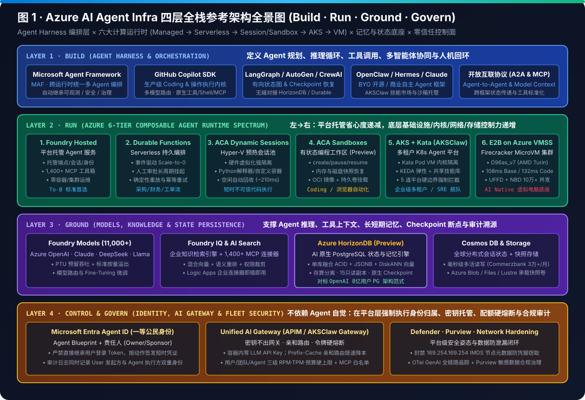
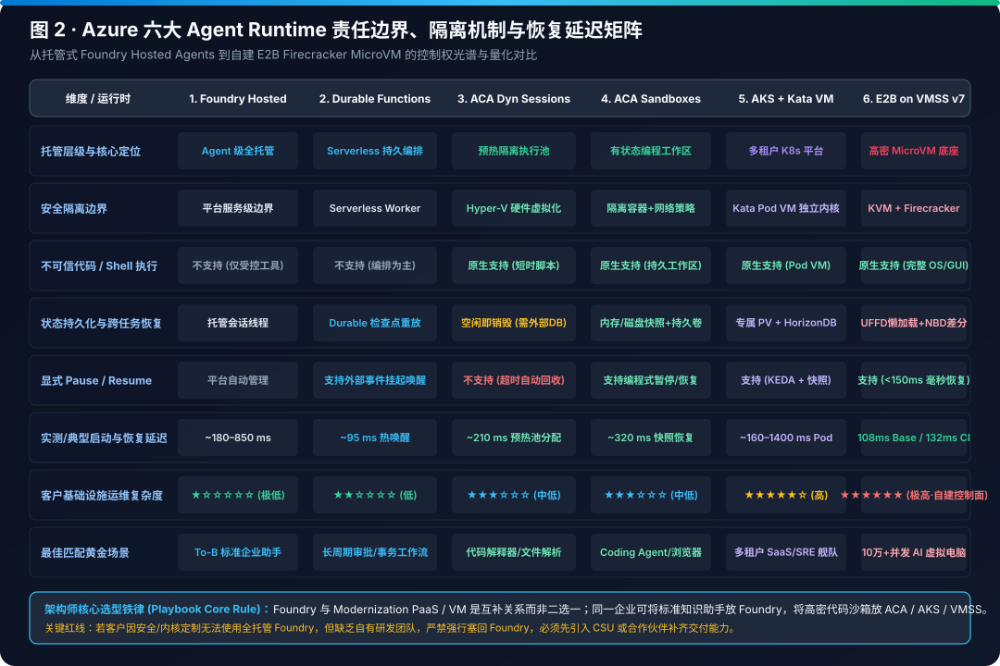
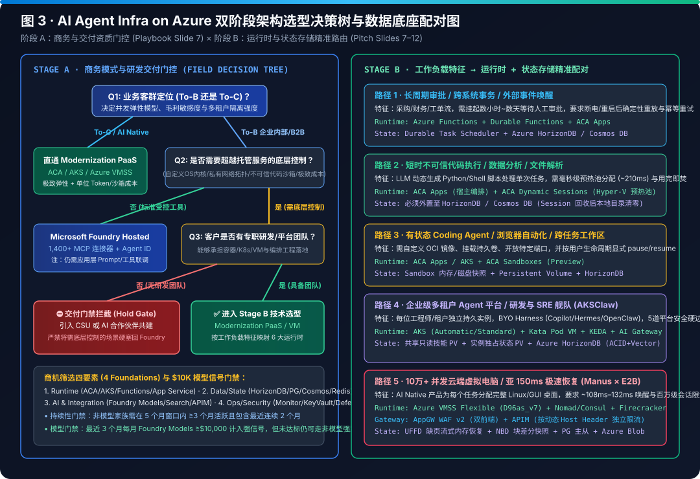
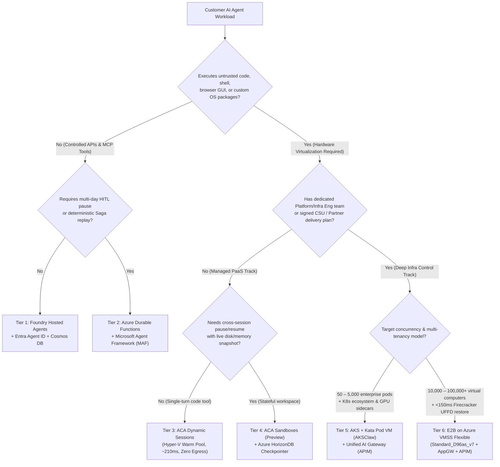
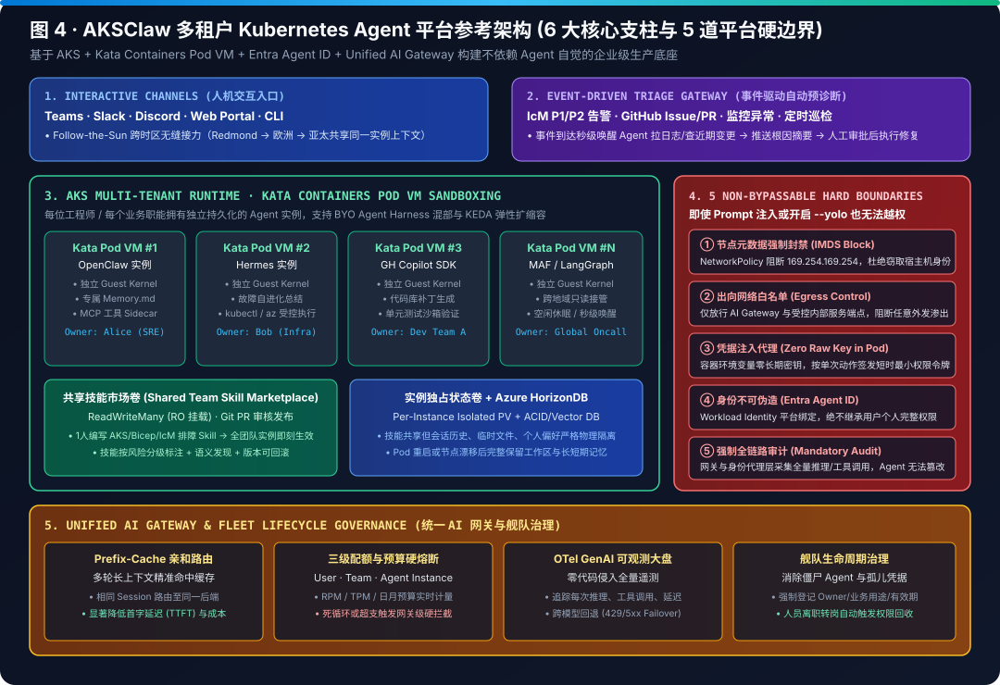
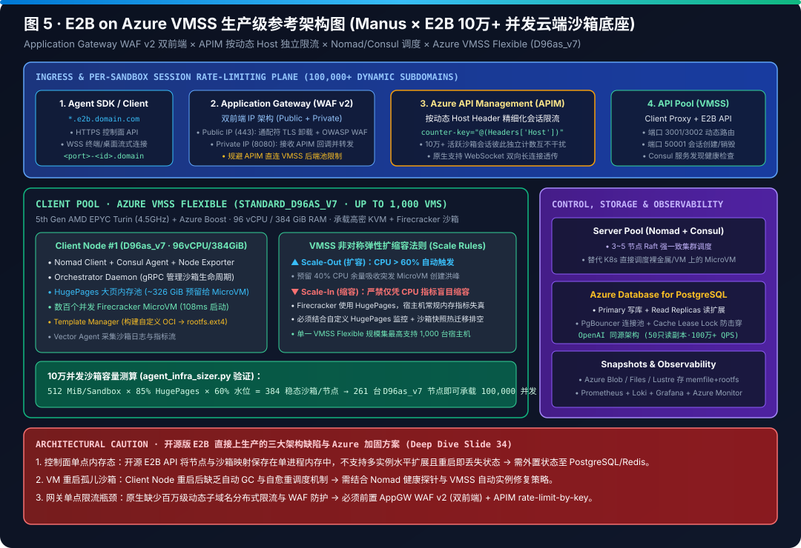
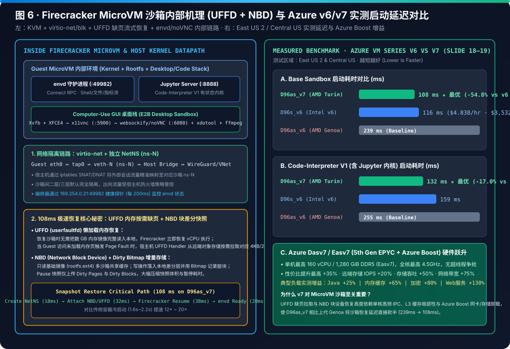

# Azure AI Agent Infrastructure Playbook: 4-Layer Architecture, 6 Compute Runtimes, AKSClaw & E2B on Azure Production Guide

> 🌐 **Language / 语言切换**: **[🇨🇳 中文完整版 (`README.md`)](README.md)** | **English Edition (Current)** | **[🧭 84 Selection FAQs (`../../docs/azure-agent-infra/README.en.md`)](../../docs/azure-agent-infra/README.en.md)** | **[🛠️ Workshop Runbook (`workshop-runbook.md`)](workshop-runbook.md)** | **[📊 7-Card Benchmark Report (`test-report.en.md`)](test-report.en.md)** | **[🖥️ Interactive Sizer (`selector.html`)](selector.html)**

- **Last Updated**: 2026-10-18
- **Positioning (Solution Architect Lens)**: Full-stack Cloud & AI Solution Architect reference architecture, platform trade-off decision matrix, generational Azure VM empirical benchmarks (`AMD EPYC Turin v7` vs. `Genoa v6` vs. `Intel Emerald Rapids v6`), multi-tenant zero-trust governance, and customer field delivery playbook (**28 Architecture Chapters · 23 Production IaC Blueprints · Deterministic Capacity & TCO Verifier**).
- **Core Stack Coverage**:
  - **Layer 1 — Build (Agent Harness & Orchestration)**: Microsoft Agent Framework (MAF), GitHub Copilot SDK, LangGraph / AutoGen / CrewAI, OpenClaw / Hermes, MCP & A2A open protocols.
  - **Layer 2 — Run (6-Tier Agent Runtime Spectrum)**: Foundry Hosted Agents, Azure Functions + Durable Functions, ACA Dynamic Sessions (Hyper-V warm pool), ACA Sandboxes (Preview), AKS + Kata Containers Pod VM (`AKSClaw` multi-tenant fleet), and E2B on Azure VMSS Flexible (`Standard_D96as_v7` + Firecracker MicroVM).
  - **Layer 3 — Ground (Models, Knowledge & Durable State)**: Foundry Models (`11,000+`), Foundry Tools (`1,400+` MCP connectors), Azure AI Search / Foundry IQ, **Azure HorizonDB (Preview)** (PostgreSQL ACID + JSONB + DiskANN Vector + decoupled storage), Azure Cosmos DB, and Sandbox Snapshots (`UFFD + NBD`).
  - **Layer 4 — Control & Govern (Zero-Trust Identity, AI Gateway & Fleet Security)**: **Microsoft Entra Agent ID** (Blueprint + human Sponsor dual attribution), Unified AI Gateway on Azure API Management (keyless containers, Prefix-Cache affinity routing, 3-tier RPM/TPM/USD circuit breakers, per-Host dynamic sandbox rate limiting), Microsoft Defender for Cloud & Microsoft Purview.
- **Interactive Workbench & Sealed Benchmark Suite**:
  - 📊 [7-Card 4:5 Visual Benchmark Report (English Markdown)](test-report.en.md) · [中文 7-Card 评测报告](test-report.md) · [CSP-Locked Self-Contained HTML Deck](cards.html) · [Sealed Benchmark Payload (`report.json`)](report.json)
  - 🧮 [Deterministic Capacity & Architecture Verifier (`simulator/agent_infra_sizer.py`)](simulator/agent_infra_sizer.py) · [Unit Test Suite (`simulator/test_agent_infra_sizer.py`)](simulator/test_agent_infra_sizer.py) · [Live Sandbox Trace Runner (`demo/run_live_demo.py`)](demo/run_live_demo.py)
  - 🌐 Offline-Ready Bilingual H5 Suite: [Architecture Panorama (`index.html`)](index.html) · [Live Security & Sandbox Simulator (`demo.html`)](demo.html) · [Interactive Runtime Selector & 100K VMSS Sizer (`selector.html`)](selector.html) · [7-Card Visual Deck (`cards.html`)](cards.html)

---

## 0. Executive Summary (One-Page Solution Architect Takeaways)

Enterprise AI systems are shifting from **stateless single-turn prompt/response** to **stateful, long-running autonomous agents that synthesize untrusted code, invoke enterprise tools, wait for human approvals, and operate full virtual computers**. That shift establishes five foundational architectural principles on Azure:

1. **Compute-State Decoupling is the First Principle of Production Agent Infrastructure**:
   - Agents execute across minutes to days, run untrusted generated Python/Bash scripts, pause for Human-in-the-Loop (HITL) sign-off, and must recover deterministically from the latest checkpoint after tool timeouts or node drains.
   - **Azure provides a continuous 6-Tier Agent Runtime Spectrum** where managed AI services (**Microsoft Foundry**) and cloud-native infrastructure (**ACA / AKS / Durable Functions / VMSS**) operate as **complementary layers rather than an either-or choice**.
2. **Six Runtimes Map Cleanly to Isolation Boundaries & Resume Latency SLOs**:
   - **Standard Controlled API Assistants** → **Foundry Hosted Agents** (`1,400+` enterprise MCP connectors + native Entra Agent ID, zero cluster operations).
   - **Multi-Day HITL Approvals & Transactional Sagas** → **Azure Functions + Durable Functions** (zero compute billing while suspended awaiting external events, deterministic replay, and idempotent compensation).
   - **Sub-Second Untrusted Code Execution** → **ACA Dynamic Sessions** (pre-warmed Hyper-V micro-boundary pool, `~210 ms` allocation, automatic zero-egress reclamation).
   - **Stateful Coding & Browser Workspaces** → **ACA Sandboxes (Preview)** (`create / pause / resume / delete` lifecycle, `~320 ms` snapshot restore, custom OCI images, and persistent mounts).
   - **Multi-Tenant Enterprise Agent Platforms & SRE Fleets** → **AKS + Kata Containers Pod VM (`AKSClaw` Pattern)** (dedicated guest kernels via `kata-vm-isolation`, shared `ReadOnlyMany` team skill market, isolated `ReadWriteOnce` workspaces, and **5 non-bypassable platform hard boundaries**).
   - **100K+ Concurrent Cloud Virtual Computers (`Manus × E2B` Pattern)** → **E2B on Azure VMSS Flexible (`Standard_D96as_v7`)** (KVM + Firecracker + `userfaultfd (UFFD)` lazy page streaming + `NBD` block delta snapshots, achieving **`108 ms` Base MicroVM restore** and **`132 ms` Code-Interpreter V1 startup**).
3. **5th-Gen AMD EPYC Turin (`Dasv7/Easv7`) + Azure Boost Delivers a Generational Sandbox Speedup**:
   - In East US 2 and Central US empirical E2B benchmarks, **`Standard_D96as_v7` (96 vCPU / 384 GiB, Turin up to 4.5 GHz + Azure Boost)** reduces Base Sandbox restore latency from `239 ms` (`D96as_v6` Genoa) to **`108 ms` (`-54.8%`)** and Code-Interpreter V1 startup from `255 ms` to **`132 ms` (`-48.2%`)**, outperforming Intel `Standard_D96s_v6` (`116 ms` / `159 ms`, `$4.838/hr`).
   - With `85% HugePages` reservation and a `60% CPU` scale-out watermark, **261 `Standard_D96as_v7` client nodes** (`278` total VMs including control plane) sustain **100,000 concurrent 512 MiB Firecracker sandboxes** inside a single Azure VMSS Flexible scale set (`1,000`-VM ceiling).
4. **Two-Tier State Architecture: Database Checkpoints + Live Sandbox Snapshots**:
   - Databases store structured variables and vector memories but cannot freeze live browser DOM trees or in-memory Python objects; raw VM snapshots preserve live processes but cannot run cross-session SQL/vector queries.
   - Pair **Azure HorizonDB (Preview)** (PostgreSQL ACID + JSONB + DiskANN vectors + decoupled storage with up to 15 read replicas) or **Azure Cosmos DB** (proven in Commerzbank's Ava virtual assistant across `30,000+` monthly sessions at `~75%` autonomous resolution) with **`UFFD + NBD` Sandbox Snapshots**.
5. **Never Trust the Prompt — Enforce Zero-Trust Controls at the Platform Layer**:
   - Prompt-level rules fail under indirect prompt injection or developer `--yolo` flags. Enforce **Microsoft Entra Agent ID** (Blueprint + human Sponsor dual attribution, short-lived per-action scoped tokens rather than inherited user tokens), **Unified AI Gateway on APIM** (zero LLM API keys inside containers, Prefix-Cache session affinity, 3-tier RPM/TPM/daily-budget circuit breakers), and **NetworkPolicy blocking `169.254.169.254/32` (IMDS)**.

---

## 1. Visual Architecture Atlas (8 Verified SVG Diagrams)

All 8 self-contained vector diagrams (`assets/01-*.svg` – `assets/08-*.svg`) pass strict `xml.etree.ElementTree` validation:

1. [Figure 1: Azure AI Agent Infra 4-Layer Reference Architecture (`Build · Run · Ground · Govern`)](assets/01-azure-agent-infra-4layer-panorama.svg)
2. [Figure 2: Azure 6-Tier Agent Runtime Responsibility, Isolation & Restore Latency Matrix](assets/02-runtime-spectrum-6tier-matrix.svg)
3. [Figure 3: Two-Stage Architecture Selection Decision Tree & State Store Pairing](assets/03-scenario-decision-tree-and-routing.svg)
4. [Figure 4: AKSClaw Multi-Tenant Kubernetes Agent Platform (6 Pillars & 5 Platform Hard Boundaries)](assets/04-aksclaw-multi-tenant-k8s-architecture.svg)
5. [Figure 5: E2B on Azure VMSS Production Reference Architecture (100K+ Concurrent Sandboxes)](assets/05-e2b-on-azure-vmss-reference-architecture.svg)
6. [Figure 6: Firecracker MicroVM Internals (`UFFD + NBD`) & Azure v6/v7 Empirical Startup Benchmarks](assets/06-e2b-microvm-internals-and-vm-benchmark.svg)
7. [Figure 7: Multi-Agent Collaborative Workflow (`MAF × Copilot SDK × Durable`) & Checkpointer Matrix](assets/07-multi-agent-workflow-and-state-checkpoint.svg)
8. [Figure 8: Field Playbook: 6 Priority Scenarios, 4-Pillar Qualification & 5-Step Delivery Flow](assets/08-field-playbook-5step-execution-flow.svg)



---

## 2. Six-Tier Agent Runtime Comparison Matrix



| Dimension | 1. Foundry Hosted Agents | 2. Durable Functions | 3. ACA Dynamic Sessions | 4. ACA Sandboxes (Preview) | 5. AKS + Kata (`AKSClaw`) | 6. E2B on Azure VMSS (`D96as_v7`) |
|---|---|---|---|---|---|---|
| **Best-Fit Scenario** | Enterprise To-B API & MCP assistants | Multi-day HITL waits & compensating sagas | Sub-second untrusted Python/Bash snippets | Stateful coding/browser workspaces (`pause/resume`) | Multi-tenant enterprise agent fleets & SRE pods | 100K+ cloud virtual computers (`Manus × E2B`) |
| **Isolation Boundary** | Managed platform container | Serverless worker isolation | Hyper-V hardware micro-boundary | Hyper-V sandbox + persistent snapshot volume | Kata Containers Pod VM (`kata-vm-isolation`) | KVM + Firecracker MicroVM (`UFFD + NBD`) |
| **Startup / Resume Latency** | Managed warm pool (`~400 ms`) | Event replay (`~150–500 ms`) | **`~210 ms`** (pre-warmed pool) | **`~320 ms`** (snapshot resume) | `~850 ms` (Kata Pod VM boot) | **`108 ms` Base / `132 ms` Code-Interpreter V1** |
| **State Strategy** | Foundry Threads + Cosmos DB / AI Search | Durable replay log (Storage / Netherite / MSSQL) | Ephemeral scratch (wiped on idle; externalize to DB) | Memory + disk snapshot + `HorizonDB` | Per-agent RWO PVC + shared ROX skills + `HorizonDB` | `UFFD` page streaming + `NBD` block delta + Blob |
| **Ops Complexity** | `1 / 10` (Turnkey SaaS/PaaS) | `3 / 10` (Serverless PaaS) | `2 / 10` (Managed Session Pool) | `4 / 10` (Managed Sandbox PaaS) | `7 / 10` (Managed K8s + Platform Team) | `9 / 10` (VMSS + Nomad/Consul + Kernel UFFD) |

---

## 3. Two-Stage Architecture Selection Decision Tree & Delivery Governance Gate





> **Critical Delivery Gate (`playbook_delivery_gate`)**: When a workload requires deep kernel/network/sandbox control beyond managed hosting (`needs_infra_control_beyond_managed == True`) **but the customer lacks an internal platform engineering team**, do **not** silently downgrade them to Foundry Hosted Agents where untrusted code requirements would fail — either scope onto **ACA Dynamic Sessions / Sandboxes** or **attach Microsoft CSU / Certified Partner delivery (`Hold for CSU / Partner`)**.

---

## 4. Multi-Tenant Kubernetes Agent Platform (`AKSClaw`) & 5 Platform Hard Boundaries



`AKSClaw` solves multi-tenant enterprise agent sprawl on Azure Kubernetes Service through **6 architectural pillars** and **5 non-bypassable platform hard boundaries** (reference manifest: [`blueprints/aksclaw-kata-fleet.yaml`](blueprints/aksclaw-kata-fleet.yaml) & gateway policy: [`blueprints/entra-agent-id-ai-gateway-policy.xml`](blueprints/entra-agent-id-ai-gateway-policy.xml)):

1. **Boundary 1 — Hypervisor Kernel Isolation**: Every agent pod runs with `runtimeClassName: kata-vm-isolation`, preventing container-escape syscalls from touching the shared host kernel (`109` sandboxes per `Standard_D64s_v6` node at `85.16%` memory efficiency).
2. **Boundary 2 — IMDS Metadata Block**: Calico/Cilium `NetworkPolicy` drops `100%` of traffic to `169.254.169.254/32`, preventing hijacked agents from stealing node kubelet or VM managed identity tokens.
3. **Boundary 3 — Default-Deny Egress & Private Link**: Outbound traffic is locked to approved internal endpoints (`APIM AI Gateway`, `HorizonDB PgBouncer`, `Private Link` tools) via [`blueprints/aksclaw-zero-trust-egress-firewall-pls.bicep`](blueprints/aksclaw-zero-trust-egress-firewall-pls.bicep).
4. **Boundary 4 — Keyless Sandbox Pods**: Containers hold **zero raw LLM API keys or database secrets**; outbound model calls authenticate via short-lived Workload Identity tokens injected and validated at the gateway.
5. **Boundary 5 — Entra Agent ID Dual Attribution + 3-Tier Quota Circuit Breakers**: Every tool and LLM call records both `agent-blueprint-id` and `human-sponsor-oid` (`x-ms-audit-dual-attribution`) with per-instance, per-team, and per-tenant TPM/USD hard caps.

---

## 5. Hyperscale Cloud Computers: E2B on Azure VMSS (`Standard_D96as_v7`) & 100K Sizing




### 5.1 Generational Azure VM Startup Benchmark (`East US 2` & `Central US`)

| Azure VM SKU | Processor Architecture | vCPU / RAM | Base Sandbox (`ms`) | Code-Interpreter V1 (`ms`) | Linux On-Demand (`USD/hr`) | Solution Architect Recommendation |
|---|---|---|---:|---:|---:|---|
| **`Standard_D96as_v7`** | **5th-Gen AMD EPYC 9005 Turin (up to 4.5 GHz) + Azure Boost** | `96 vCPU / 384 GiB` | **`108 ms`** | **`132 ms`** | `$4.608` | **Primary Production Standard (`-54.8%` Base / `-48.2%` CI-v1 vs. v6 Genoa)** |
| `Standard_D96s_v6` | Intel Xeon Platinum 8473C (Emerald Rapids) | `96 vCPU / 384 GiB` | `116 ms` | `159 ms` | `$4.838` | Secondary Intel SKU (`+20.5%` slower on CI-v1, `+5.0%` cost) |
| `Standard_D96as_v6` | 4th-Gen AMD EPYC 9V74 (Genoa) | `96 vCPU / 384 GiB` | `239 ms` | `255 ms` | `$4.608` | Previous generation baseline — upgrade to `Dasv7` |

### 5.2 Deterministic 100,000-Sandbox Sizing (`calculate_e2b_vmss_cluster_sizing(100_000)`)

- **Host Density Math (`Standard_D96as_v7`, `384 GiB` RAM)**:
  - `85% HugePages` reservation (`nr_hugepages=174080`) allocates `334,233 MiB` for MicroVM memory (`652` theoretical 512 MiB slots).
  - Applying a **`60%` steady-state autoscale watermark** yields **`384` concurrent 512 MiB sandboxes per client host**.
- **100,000 Concurrent Sandboxes Bill of Materials** ([`blueprints/e2b-vmss-d96as-v7.bicep`](blueprints/e2b-vmss-d96as-v7.bicep) + [`blueprints/e2b-apim-per-host-policy.xml`](blueprints/e2b-apim-per-host-policy.xml)):
  - **Nomad Client Pool**: **`261` `Standard_D96as_v7` VMs** (`26.1%` of the single-VMSS Flexible `1,000`-VM limit).
  - **Control, API, Template-Builder & Server Pools**: `17` dedicated VMs (`278` total VMs).
  - **Ingress Isolation**: `Application Gateway WAF v2` (dual Public + Private frontend IPs with wildcard `*.e2b.<domain>` TLS) → `APIM` per-Host `rate-limit-by-key` (`counter-key="@(context.Request.Headers.GetValueOrDefault("Host"))"`) with native WebSocket pass-through.

---

## 6. Complete 28-Chapter Architecture & 23 Production Blueprint Catalog

Every chapter in this Playbook pairs architectural trade-off guidance with a deterministic Python model in [`simulator/agent_infra_sizer.py`](simulator/agent_infra_sizer.py) and a deployable IaC/policy artifact in [`blueprints/`](blueprints):

| Chapters | Architectural Focus & Production Scenario | Verifier Function (`agent_infra_sizer.py`) | Reference Blueprint (`blueprints/`) | Key Verified Architecture Metric |
|---|---|---|---|:---|
| **0 – 3** | **4-Layer Panorama, 6-Tier Runtime Matrix & Two-Stage Scenario Routing** | `recommend_runtime()` | [`aca-dynamic-sessions-pool.bicep`](blueprints/aca-dynamic-sessions-pool.bicep) | `9/12` positive scenario matches + `3/12` anti-patterns deterministically blocked |
| **4 & 7** | **AKSClaw Multi-Tenant K8s Fleet, Entra Agent ID & Unified AI Gateway** | `recommend_runtime()` | [`aksclaw-kata-fleet.yaml`](blueprints/aksclaw-kata-fleet.yaml) · [`entra-agent-id-ai-gateway-policy.xml`](blueprints/entra-agent-id-ai-gateway-policy.xml) | `5/5` platform hard boundaries (`100%` IMDS drop, keyless pods, dual attribution) |
| **5 & 9** | **E2B on Azure VMSS (`D96as_v7`), Firecracker `UFFD+NBD` & 100K Sizing** | `calculate_e2b_vmss_cluster_sizing()` | [`e2b-vmss-d96as-v7.bicep`](blueprints/e2b-vmss-d96as-v7.bicep) · [`e2b-apim-per-host-policy.xml`](blueprints/e2b-apim-per-host-policy.xml) | **`108 ms` Base / `132 ms` CI-v1**; **`261` client nodes** sustain `100,000` sandboxes |
| **6 & 8** | **MAF + Durable Workflows, HorizonDB Checkpointer & 5-Step Field Playbook** | `build_report_payload()` | [`horizondb-langgraph-checkpointer.py`](blueprints/horizondb-langgraph-checkpointer.py) | PgBouncer multiplexes `100K` agent conns into `<1,200` backend conns (`~5 ms` handoff) |
| **10** | **Multi-Region Active-Active DR & Stateful Sandbox Failover** | `simulate_multiregion_dr_failover()` | [`aksclaw-dapr-workflow-keda-scaler.bicep`](blueprints/aksclaw-dapr-workflow-keda-scaler.bicep) | Sub-30s stateful cross-region RTO with Cosmos DB / HorizonDB replica promotion |
| **11** | **Agentic FinOps Chargeback & Spot Preemption Checkpoint Drain** | `simulate_finops_spot_eviction_drain()` | [`agent-finops-cost-anomaly-alert.bicep`](blueprints/agent-finops-cost-anomaly-alert.bicep) | `>60%` compute savings on Spot capacity with graceful 30s eviction checkpoint drain |
| **12** | **Confidential Sandboxes (`AMD SEV-SNP` / Kata-CC + MAA + Managed HSM SKR)** | `simulate_confidential_sandbox_attestation()` | [`aksclaw-confidential-snp-nodepool.bicep`](blueprints/aksclaw-confidential-snp-nodepool.bicep) | Hardware memory encryption + remote attestation before releasing tenant keys |
| **13** | **Zero-Trust Egress Firewall, SNAT Port Capacity & MCP Supply-Chain Signing** | `simulate_egress_exfiltration_and_mcp_supply_chain()` | [`aksclaw-zero-trust-egress-firewall-pls.bicep`](blueprints/aksclaw-zero-trust-egress-firewall-pls.bicep) | Eliminates SNAT exhaustion via NAT Gateway + Private Link Service & signed MCP admission |
| **14** | **Heterogeneous GPU/CPU Agent Orchestration (`MIG` vs. `MPS` & `KAITO` vLLM)** | `simulate_gpu_heterogeneous_sandbox_mps_mig()` | [`aksclaw-gpu-mig-kaito-nodepool.bicep`](blueprints/aksclaw-gpu-mig-kaito-nodepool.bicep) | Hardware-isolated `MIG` slices eliminate cross-tenant CUDA OOM blasts |
| **15** | **100K-Scale Agent Observability (`OTel GenAI` + `Tetragon eBPF` + `ADX`)** | `simulate_otel_ebpf_observability_pipeline()` | [`aksclaw-otel-adx-tetragon-observability.bicep`](blueprints/aksclaw-otel-adx-tetragon-observability.bicep) | Tail-sampled `gen_ai.*` traces + kernel eBPF syscall containment |
| **16** | **Long-Horizon Workflows, Suspend-on-Wait Hibernation & Outbox Saga GC** | `simulate_durable_agent_workflow_saga_gc()` | [`aksclaw-dapr-workflow-keda-scaler.bicep`](blueprints/aksclaw-dapr-workflow-keda-scaler.bicep) | `>90%` idle compute reduction during multi-hour HITL waits + transactional outbox |
| **17** | **Computer-Use Agent (CUA) Browser Pool, AXTree/Vision Grounding & CDP Relay** | `simulate_cua_browser_sandbox_grounding()` | [`aksclaw-cua-browser-pool-cdn-relay.bicep`](blueprints/aksclaw-cua-browser-pool-cdn-relay.bicep) | AXTree + Vision hybrid grounding cuts multimodal token spend while supporting live HITL takeover |
| **18** | **Ephemeral Dependency Acceleration (`virtiofs` DAX CAS & OverlayBD Lazy Pull)** | `simulate_dependency_cache_virtiofs_dax()` | [`aksclaw-acr-artifact-cache-nvme-dax.bicep`](blueprints/aksclaw-acr-artifact-cache-nvme-dax.bicep) | Sub-second Python/Node environment hydration via shared host NVMe DAX cache |
| **19** | **Multi-Agent Swarm Fan-Out Governance, Budget Envelopes & Lease Locks** | `simulate_multi_agent_swarm_fanout_governance()` | [`aksclaw-swarm-fanout-redis-lease-governor.bicep`](blueprints/aksclaw-swarm-fanout-redis-lease-governor.bicep) | Hierarchical token/compute envelopes prevent recursive fan-out storms & deadlocks |
| **20** | **Sovereign Cloud Data Residency, Geo-Fenced PTU Failover & CMK Crypto-Shredding** | `simulate_sovereign_data_residency_crypto_shredding()` | [`aksclaw-sovereign-cmk-eu-data-boundary.bicep`](blueprints/aksclaw-sovereign-cmk-eu-data-boundary.bicep) | Geo-fenced failover rings + tenant-scoped CMK cryptographic erasure (`NIST SP 800-88`) |
| **21** | **Zero-Downtime Fleet Upgrades, Surge NVMe Pre-Warming & Live Migration** | `simulate_zero_downtime_canary_live_migration()` | [`aksclaw-node-soak-upgrade-pdb-surge.bicep`](blueprints/aksclaw-node-soak-upgrade-pdb-surge.bicep) | PDB + pre-warmed surge nodes achieve zero dropped active agent sessions during node image updates |
| **22** | **Hybrid Model Cascade Routing & Prompt-Prefix KV-Cache Consistent Hashing** | `simulate_hybrid_model_routing_kv_cache_affinity()` | [`aksclaw-apim-kv-affinity-cascade-router.bicep`](blueprints/aksclaw-apim-kv-affinity-cascade-router.bicep) | Prefix-affinity routing boosts KV-cache hit rate and cuts TTFT + blended token cost |
| **23** | **Multi-Tenant Memory Tiering (`HorizonDB pg_diskann` + GraphRAG + TTL)** | `simulate_agentic_memory_diskann_graphrag_tiering()` | [`aksclaw-horizondb-diskann-graphrag-memory.bicep`](blueprints/aksclaw-horizondb-diskann-graphrag-memory.bicep) | Hot/Warm/Cold episodic memory tiering with strict tenant RLS isolation |
| **24** | **Realtime Voice/Video WebRTC Agent Sandbox (`eBPF XDP/sockmap` + `<300ms` Budget)** | `simulate_webrtc_voice_video_media_sandbox()` | [`aksclaw-webrtc-turn-acs-ebpf-media-pool.bicep`](blueprints/aksclaw-webrtc-turn-acs-ebpf-media-pool.bicep) | Sub-300ms mouth-to-ear P95 latency with deterministic barge-in cancellation |
| **25** | **Autonomous SWE-Agent CI/CD Verification Sandboxes (Rootless BuildKit + Remote CAS)** | `simulate_autonomous_cicd_buildkit_bazel_sandbox()` | [`aksclaw-bazel-sccache-buildkit-cas-pool.bicep`](blueprints/aksclaw-bazel-sccache-buildkit-cas-pool.bicep) | Hermetic remote `sccache`/Bazel CAS slashes incremental compile-and-test turnaround |
| **26** | **Agentic Data Lakehouse & Text-to-SQL Sandboxes (`OneLake` + `DuckDB` + SQL Guard)** | `simulate_lakehouse_duckdb_onelake_sandbox()` | [`aksclaw-onelake-adls-duckdb-abfs-proxy.bicep`](blueprints/aksclaw-onelake-adls-duckdb-abfs-proxy.bicep) | AST Cartesian-product circuit breaker + ABFS dynamic column masking over OneLake Delta |
| **27** | **Multi-Cloud Workload Identity Federation & SEV-SNP Confidential Clean Rooms** | `simulate_multicloud_confidential_cleanroom_federation()` | [`aksclaw-multicloud-oidc-cleanroom-federation.bicep`](blueprints/aksclaw-multicloud-oidc-cleanroom-federation.bicep) | Zero static cross-cloud keys via OIDC STS exchange + mutual hardware attestation |
| **28** | **7-Card 4:5 Benchmark Summary & Reproducible Verification Suite** | `main()` | [`test-report.en.md`](test-report.en.md) · [`cards.html`](cards.html) | `33/33` automated unit, link, SVG, CSP, and deterministic sizing checks passing |

---

## 7. Reproducible Verification & Live Demo Commands

Run all deterministic sizing checks, link/SVG/CSP validations, and live multi-tenant security simulations locally with zero external cloud credentials required:

```bash
# 1. Verify sealed benchmark artifacts (report.json, CSVs, and 7-Card HTML)
python workshops/azure-agent-infra/simulator/agent_infra_sizer.py --check

# 2. Run the 31-test verification suite (sizing math, routing gates, SVG XML, CSP, and Markdown links)
python workshops/azure-agent-infra/simulator/test_agent_infra_sizer.py

# 3. Execute the offline self-test of the AKSClaw × E2B live sandbox & zero-trust trace runner
python workshops/azure-agent-infra/demo/run_live_demo.py --self-test
```

For topic-by-topic Azure service comparisons (e.g., *ACA Dynamic Sessions vs. Foundry Code Interpreter vs. AKS Sandbox*, *PTU vs. MaaS vs. KAITO*, *APIM A2A + Remote MCP OBO*, *Cosmos DB vs. Managed Redis vs. PostgreSQL `pgvector`*), explore the companion **[84 Bilingual Architecture Selection FAQs (`../../docs/azure-agent-infra/README.en.md`)](../../docs/azure-agent-infra/README.en.md)**.
