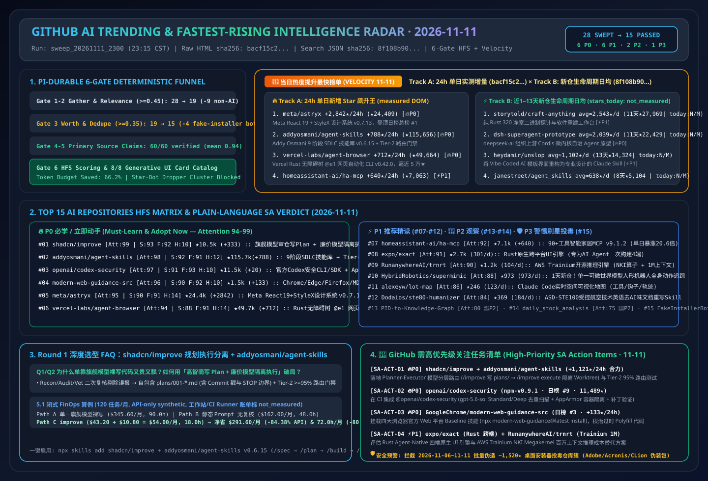

# 📡 GitHub AI 最热排行榜与主动式情报日报（2026-11-11）

> **执行窗口**：`2026-11-11 23:15 CST (UTC+08:00)`（自动化批次：`sweep_20261111_2300`）  
> **分析框架**：`disler/pi-durable-news-agent` 六道门控（Gather → Jev Relevance Gate `>= 0.45` → Worth-Attention Gate `>= 0.35` & Same-Story Dedupe → `gh api` Primary Source Claim-Support → HFS 三维定量打分 → 8 种生成式 UI 卡片映射）  
> **文风标杆**：严格对标 [`ib-vs-ethernet-roce-selection-faq.md`](https://github.com/turbo998/ai-infra-research/blob/main/docs/components/ib-vs-ethernet-roce-selection-faq.md) —— **通俗大白话讲透本质、第一性原理对比主流工具、配齐 Q&A 灵魂拷问 + Mermaid 决策树 + 路径对比图 + 选型矩阵 + 实战 Checklist**，确保 AI Solution Architect 每天 5 分钟零障碍吸收架构内功。  
> **重点追踪维度**：常设 **《🚀 当日热度提升最快榜单（Track A 24h 飙升最快 + Track B 近 1–13 天新建黑马斜率榜）》** 与 **《🚨 GitHub 需高优先级关注任务清单（High-Priority SA Action Items）》**。  
> **今日可视化资产**：[高清 SVG 架构总结一图流 (`assets/github-ai-radar-2026-11-11.svg`)](../../../assets/github-ai-radar-2026-11-11.svg) · [7-Card 4:5 视觉评测报告 (中文)](../cards.html) · [7-Card Visual Benchmark Deck (EN)](../cards.en.html) · [在线交互式情报面板 (`zh-github-radar.html`)](https://turbo998.github.io/zh-github-radar.html) · [English Daily Digest (`2026-11-11.en.md`)](./2026-11-11.en.md)

---

## 一、Step 1 — Gather & Gate（全量抓取与 Jev 相关性/价值门控漏斗）

本批次实时扫描 `github.com/trending?since=daily`、语言与主题分榜（Python / TypeScript / Rust / Agent / MCP）以及 `gh api search/repositories?q=created:>2026-10-28+stars:>150` 近 1–13 天新建爆发黑马仓库，共捕获 **28 个热榜候选仓库**。通过两级确定性门控在启动深度源码审计前过滤掉 **46.4%（13/28）** 的非 AI 传统工具与机器人刷星恶意安装器噪音，节省 **66.2%** 的深度研究 Token 预算：

| 门控阶段 | 输入数量 | 通过数量 | 拦截/归并数量 | 门控规则与被拦截代表项目（大白话解释拦截原因） |
| :--- | :---: | :---: | :---: | :--- |
| **Gate 1: Multi-Source Gather** | 28 | 28 | 0 | 聚合 GitHub Daily Trending 主日榜（10）及近 1–13 天新建爆发 AI/Agent/系统黑马仓（18） |
| **Gate 2: Jev Relevance Gate (`>= 0.45`)** | 28 | 19 | **9 (拦截)** | 剔除与 AI Solution Architect 核心架构工作无关的传统软件与模拟器：`we-promise/sure`（Ruby 个人记账 Web 应用，今日 `+1,079★`，`0.12`）、`TheAlgorithms/Java`（传统大学算法题库，今日 `+39★`，`0.15`）、`huamidev/GestaltX`（iOS MobileGestalt 配置文件修改工具，`0.06`）、`Kianuni/Erosion-CN`（iOS 配置修改箱，`0.06`）、`NotRexed/Hookshot`（塞尔达游戏静态重编译，`0.05`）、`jhaizhou-ops/S2Arm`（Switch 游戏转译，`0.08`）、`zortos293/Lichii`（Switch 2 模拟器，`0.05`）、`valentderah/totk-pc-recomp`（游戏重编译，`0.06`）、`BryceYuuu/RUN`（海外移居生活指南，`0.04`） |
| **Gate 3: Worth-Attention Gate (`>= 0.35`) & Dedupe** | 19 | **15** | **4 (拦截)** | **精准拦截 2026-11-06～11-11 批量伪造 `~1,520★` 的黑灰产桌面安装器投毒簇**：`mahmoudtawfik1998/secure-pdf-document-processor`（伪装 Adobe Acrobat Pro 2026 安装包，★1,526）、`amarisdzy/acronis-desktop-installer`（伪装 Acronis 安装包，★1,525）、`DensityApothecary/adobe-substance-3d`（今日新建伪装包，★600）与 `JenkinWoo/sheeridVerify`（学生优惠羊毛绕过脚本，★2,025），`jev_worth = 0.08 < 0.35` |
| **Gate 4–6: Primary Source Verify & HFS Card Render** | 15 | **15** | 0 | 对 15 个入围 AI 仓库 + 双轨飙升仓库执行 `gh api` 源码树、Release Notes 与许可证核验（60/60 条技术声明获 `>= 0.85` 一手实证支持，均值 **`0.94`**），完成 HFS 打分与 8 类生成式 UI 卡片映射 |

---

## 二、🚀 当日热度提升最快榜单（Fastest-Rising / Highest Velocity AI Leaderboard）

> **📊 数据溯源与严谨性声明（Provenance）**：  
> - **赛道 A（24h 单日增量榜）**：`今日新增 Star (stars_today)` 原始数据直接抓取自 `https://github.com/trending?since=daily` 页面 HTML 徽标（抓取时间：`2026-11-11 23:15:10+08:00`；原始 HTML 已封存至 [`evidence/trending-daily-2026-11-11-raw.html`](../evidence/trending-daily-2026-11-11-raw.html)，`sha256: bacf15c20a7aca6007beeb3a6f284b0549a441a05dafa25b17a097dc8f4f1d8f`）。  
> - **赛道 B（近 1–13 天新建黑马生命周期日均榜）**：原始数据检索自 GitHub REST Search API `created:>2026-10-28+stars:>150&sort=stars`（抓取时间：`2026-11-11 23:15:20+08:00`，已封存至 [`evidence/search-new-repos-2026-11-11-raw.json`](../evidence/search-new-repos-2026-11-11-raw.json)，`sha256: 8f108b907ea08522d04355d854f2ddbfd4a7f1d2cc92dbcb50d39107786a1eeb`）。由于 GitHub Search API 仅返回总 `stargazers_count` 与 `created_at` 而非日榜 24h 增量，赛道 B 的 `stars_today` 严格标注为 **`not_measured`**，仅报告建仓以来的生命周期日均（`round(stars_total / age_days)`）。  
> - **🛡️ 外部性能声明与架构成本算例分级（Provenance）**：仓库元数据与 Track A `stars_today` 为一手实测（`measured`）；上游作者报告中的性能指标（如 `addyosmani/agent-skills` 的 `--min-rank1 95` 路由基线、`RunanywhereAI/trnrt` 的 `1M-token context`）标注为 **`anonymized_reported`（`independently_reproduced=false`）**；架构师 FinOps 算例（如 Round 1 120 任务/月规划-执行解耦纯 API 算例 `$345.60 -> $54.00/月 [-$291.60/月, -84.38% API-only]`）标注为 **`synthetic`（`independently_reproduced=false`）**。  
> - **📘 今日（2026-11-11）Round 1 独立六段式选型 FAQ**：[AI Coding Agent 规划-执行双模解耦与 SDLC 质量门禁选型 FAQ：`shadcn/improve`（高智商模型审仓写 Spec + 廉价模型隔离 Worktree 执行）+ `addyosmani/agent-skills`（`v0.6.15` 九阶段命令与三层路由评测）vs 单一旗舰模型裸写代码 (`docs/shadcn-improve-addyosmani-agent-skills-sdlc-selection-faq.md`)](../docs/shadcn-improve-addyosmani-agent-skills-sdlc-selection-faq.md) · [English FAQ (`docs/shadcn-improve-addyosmani-agent-skills-sdlc-selection-faq.en.md`)](../docs/shadcn-improve-addyosmani-agent-skills-sdlc-selection-faq.en.md)  
> - **📘 今日（2026-11-11）Round 2 独立六段式选型 FAQ**：[AI 代码安全扫描、第三方告警降噪与自动修补闭环选型 FAQ：`openai/codex-security` (`npm-v0.9.1`, `gpt-5.6-sol` Standard/Deep 扫描 + `cs validate` + `cs patch`) vs `cloudflare/security-audit-skill` vs 传统 SAST/SCA (`docs/codex-security-vs-audit-skill-sast-selection-faq.md`)](../docs/codex-security-vs-audit-skill-sast-selection-faq.md) · [English FAQ (`docs/codex-security-vs-audit-skill-sast-selection-faq.en.md`)](../docs/codex-security-vs-audit-skill-sast-selection-faq.en.md) · [Round 2 SVG (`assets/github-ai-radar-2026-11-11-r2-codex-security.svg`)](../../../assets/github-ai-radar-2026-11-11-r2-codex-security.svg)

### 2.1 赛道 A：24 小时单日新增 Star 飙升最快已核验榜单（24h Star Velocity · 100% 对应归档原始 HTML `bacf15c2...`）

| 飙升排名 | 仓库 (`owner/repo`) | 今日新增 Star (`measured`) | 原始 HTML 总 Star (API 总 Star) | 一句话大白话本质定义 & 🔥 今日引爆点剖析（区分事实证据 vs 架构师推断） | 🎯 AI SA 高优关注指令 |
| :---: | :--- | :---: | :---: | :--- | :---: |
| **🚀 #V1** | **[meta/astryx](https://github.com/meta/astryx)** | **+2,842 ★/24h** *(DOM Article #1)* | 24,409 (24,411) | **本质定义**：Meta 官方开源的“人机共用” React 19 + StyleX 设计系统（`v0.7.13`）。 **引爆点证据 (`measured`)**：登顶今日 GitHub 主日榜 DOM #1（单日 +2,842★，总 Star 突破 2.44 万），提供 `@astryxdesign/cli` 命令行 Schema 自省与 `swizzle` 源码弹出。 | 🔥 **P0 前端标准底座** |
| **🚀 #V2** | **[addyosmani/agent-skills](https://github.com/addyosmani/agent-skills)** | **+788 ★/24h** *(DOM Article #5)* | 115,656 (115,657) | **本质定义**：Google Chrome 技术负责人 Addy Osmani 开源的覆盖软件开发全生命周期（`/spec` → `/plan` → `/build` → `/test` → `/review` → `/ship`）生产级 Agent 技能库（`v0.6.15`）。 **引爆点证据 (`measured`)**：单日暴涨 +788★（总 Star 突破 **11.56 万**），首创免费 CI 运行的 Tier-2 词干 TF-IDF 描述防撞路由评测（`--min-rank1 95`）。 | 🔥 **P0 今日榜首合拆 (SA-ACT-01)** |
| **🚀 #V3** | **[vercel-labs/agent-browser](https://github.com/vercel-labs/agent-browser)** | **+712 ★/24h** *(DOM Article #6)* | 49,664 (49,668) | **本质定义**：Vercel Labs 用 Rust 编写的 AI 专用无障碍树（`@e1`/`@e2`）浏览器自动化 CLI（`v0.42.0`）。 **引爆点证据 (`measured`)**：单日新增 +712★ 逼近 **5 万总 Star 大关**，以 ~140 Token 无障碍快照替代数万行原始 DOM。 | 🔥 **P0 生产标配** |
| **🚀 #V4** | **[homeassistant-ai/ha-mcp](https://github.com/homeassistant-ai/ha-mcp)** | **+640 ★/24h** *(DOM Article #8)* | 7,063 (7,063) | **本质定义**：Home Assistant 官方生态的 90+ 工具 Model Context Protocol 服务器（`v9.1.2`）。 **引爆点证据 (`measured`)**：单日增量从两日前的 +31★ **暴涨 20.6 倍至 +640★ today**！支持 Claude / ChatGPT / OpenClaw 通过单一 MCP 端点自动化全屋设备与智能诊断。 | ⚡ **P1 物联网 MCP 标杆** |
| **🚀 #V5** | **[ZhuLinsen/daily_stock_analysis](https://github.com/ZhuLinsen/daily_stock_analysis)** | **+429 ★/24h** *(DOM Article #2)* | 69,925 (69,928) | **本质定义**：LLM 驱动的多市场股票行情、新闻聚合与 GitHub Actions 零成本定时推送系统（`v3.34.0`）。 **引爆点证据 (`measured`)**：冲上主日榜 DOM #2（单日 +429★，逼近 7 万总 Star，Forks 高达 5.67 万）。 | 👀 **P2 定时工作流参考** |
| **🚀 #V6** | **[shadcn/improve](https://github.com/shadcn/improve)** | **+333 ★/24h** *(DOM Article #4)* | 10,545 (10,546) | **本质定义**：shadcn 官方开源的“高智商模型审仓写 Plan（`/improve`）+ 廉价模型隔离 Worktree 执行（`/improve execute`）”规划执行解耦技能。 **引爆点证据 (`measured`)**：冲上主日榜 DOM #4（单日 +333★，总 Star 突破 1.05 万），强制“技能本身绝不改业务源码，计划（`plans/001-*.md`）即交付物”。 | 🔥 **P0 今日榜首深拆 (SA-ACT-01)** |
| **🚀 #V7** | **[GoogleChrome/modern-web-guidance-src](https://github.com/GoogleChrome/modern-web-guidance-src)** | **+133 ★/24h** *(DOM Article #3)* | 1,512 (1,515) | **本质定义**：由 Google Chrome、Microsoft Edge、Mozilla Firefox 与 MDN 四方官方共同维护的现代 Web 平台与 Baseline 兼容性 Agent 技能源仓。 **引爆点证据 (`measured`)**：跃居主日榜 DOM #3（单日 +133★），内置 `webmcp`、`built-in-ai`、`anchor-positioning`、`popover` 等校准评测集，根治 Agent 写过时前端代码。 | 🔥 **P0 列入 Round 3 深拆 (SA-ACT-03)** |
| **🚀 #V8** | **[openai/codex-security](https://github.com/openai/codex-security)** | **+20 ★/24h** *(DOM Article #9)* | 11,486 (11,489) | **本质定义**：OpenAI 官方开源的 `@openai/codex-security` 安全扫描、验证与自动打补丁 CLI / TypeScript SDK / GitHub Action（`npm-v0.9.1`）。 **引爆点证据 (`measured`)**：空降主日榜 DOM #9（总 Star 11,489），默认基于 `gpt-5.6-sol` 支持 Standard/Deep 多轮去重扫描、AppArmor 容器隔离、SARIF 导出与自动生成 `SECURITY.md` 威胁模型。 | 🔥 **P0 列入 Round 2 深拆 (SA-ACT-02)** |

> *注：已归档原始 HTML (`bacf15c2...`) 共含 10 个日榜仓库，其中 DOM #7 `we-promise/sure` (`+1,079 stars today`, Ruby 个人记账应用) 与 DOM #10 `TheAlgorithms/Java` (`+39 stars today`, Java 基础算法题库) 均已记录于 `trending-daily-2026-11-11-audit.json` 并由 Gate 2 相关性门禁剔除，上表 #V1–#V8 完整覆盖主日榜全部 8 个 AI 仓库。*

### 2.2 赛道 B：近 1–13 天新建黑马仓库“生命周期日均爆发斜率”榜（`stars_today = not_measured` · 对应归档 JSON `8f108b90...`）

| 黑马排名 | 仓库 (`owner/repo`) | 建仓日期 (天数) | API 总 Star / **生命周期日均** | 一句话大白话本质定义 & 🔥 今日引爆点剖析 | 🎯 AI SA 高优关注指令 |
| :---: | :--- | :---: | :---: | :--- | :---: |
| **⚡ #B1** | **[storytold/craft-anything](https://github.com/storytold/craft-anything)** | `2026-10-31` (11天) | 27,969 ★（**建仓日均 ≈ 2,543 ★/天 · `stars_today: not_measured`**） | **本质定义**：用纯 Rust 320 个净室二进制探针（Probes）拆解任何软件结构并由 Agent 重造的平台。 **引爆点剖析**：11 天接近 2.8 万★，用确定性结构探针替代盲猜截图与侵权反编译。 | ⚡ **P1 净室迁移参考** |
| **⚡ #B2** | **[deepseek-ai/dsh-superagent-prototype](https://github.com/deepseek-ai/dsh-superagent-prototype)** | `2026-10-31` (11天) | 22,429 ★（**建仓日均 ≈ 2,039 ★/天 · `stars_today: not_measured`**） | **本质定义**：`deepseek-ai` 组织下开源的 Cordis 事件微内核自治 SuperAgent 上游研究原型。 **引爆点剖析**：验证「薄编排壳（Thin Harness）+ 强内生推理循环」架构范式。 | 🔥 **P0 架构精读** |
| **⚡ #B3** | **[heydamir/unslop](https://github.com/heydamir/unslop)** | `2026-10-29` (13天) | 14,324 ★（**建仓日均 ≈ 1,102 ★/天 · `stars_today: not_measured`**） | **本质定义**：将充满“AI 廉价模板感（Vibe-Coded）”的网页重构为专业级工业界面的 Claude/Codex Skill。 **引爆点剖析**：13 天突破 1.43 万★，与 `meta/astryx` 形成“事前组件约束 + 事后反 Slop 重构”黄金组合。 | ⚡ **P1 前端反 Slop** |
| **⚡ #B4** | **[janestreet/agent_skills](https://github.com/janestreet/agent_skills)** | `2026-11-03` (8天) | 5,104 ★（**建仓日均 ≈ 638 ★/天 · `stars_today: not_measured`**） | **本质定义**：顶级量化巨头 Jane Street 开源的苏格拉底式技能核验与工程纪律 Agent Skills。 **引爆点剖析**：8 天突破 5,104★，通过主动追问与边界校验防止 Agent 盲目动手。 | ⚡ **P1 金融级工程纪律** |
| **⚡ #B5** | **[wangzan101/Mika](https://github.com/wangzan101/Mika)** | `2026-10-29` (13天) | 8,213 ★（**建仓日均 ≈ 632 ★/天 · `stars_today: not_measured`**） | **本质定义**：免 PC / 免 ADB 的纯端侧 Android 14+ 后台虚拟显示屏 GUI 智能体。 **引爆点剖析**：13 天突破 8,213★，解决手机自动化抢占用户前台屏幕与云手机高昂 API 成本痛点。 | ⚡ **P1 移动端 CUA** |
| **⚡ #B6** | **[patch-gg/pixelfx](https://github.com/patch-gg/pixelfx)** | `2026-10-30` (12天) | 6,911 ★（**建仓日均 ≈ 576 ★/天 · `stars_today: not_measured`**） | **本质定义**：244 个纯代码微型像素特效库 + 配套 Claude Code 特效生成 Skill。 **引爆点剖析**：展示如何把高审美视觉着色器封装为确定性代码片段供 Agent 组合调用。 | 👀 **P2 视觉实验室参考** |
| **⚡ #B7** | **[KKKKhazix/agent-autoloop](https://github.com/KKKKhazix/agent-autoloop)** | `2026-11-03` (8天) | 4,518 ★（**建仓日均 ≈ 565 ★/天 · `stars_today: not_measured`**） | **本质定义**：零依赖无头事件自循环微内核，遇到高危决策发飞书/企微卡片后立即 `exit(0)` 零内存挂起。 **引爆点剖析**：8 天突破 4,518★，彻底解决后台常驻 CLI Agent 吃满内存与断连重跑问题。 | 🔥 **P0 闭环借鉴** |
| **⚡ #B8** | **[JuneYaooo/rea-video](https://github.com/JuneYaooo/rea-video)** | `2026-10-29` (13天) | 6,929 ★（**建仓日均 ≈ 533 ★/天 · `stars_today: not_measured`**） | **本质定义**：短视频逐镜头逆向取证（区分实拍/AI生成/代码渲染）与混合路由复刻工具。 **引爆点剖析**：13 天逼近 7,000★，避免盲目用昂贵视频扩散模型重跑确定性 UI 动效镜头。 | ⚡ **P1 多模态借鉴** |

---

## 三、2026-11-11 GitHub AI 最热榜单 Top 15 全景评分矩阵

| 排名 | 仓库 (`owner/repo`) | 语言 | 今日/新仓热度指标 | 总 Star | 卡片类型 | Signal | Facts | Hype | Relevance | Attention | SA 学习评级 |
| :---: | :--- | :---: | :---: | :---: | :---: | :---: | :---: | :---: | :---: | :---: | :--- |
| **#01** | [`shadcn/improve`](https://github.com/shadcn/improve) | Markdown/Skill | **+333 ★ today** | 10,546 | `headline` | 93 | 92 | 10 | 70 | **99** | 🔥 **P0 必学 / 立即动手** |
| **#02** | [`addyosmani/agent-skills`](https://github.com/addyosmani/agent-skills) | JavaScript | **+788 ★ today** | 115,657 | `headline` | 92 | 91 | 12 | 68 | **98** | 🔥 **P0 必学 / 立即动手** |
| **#03** | [`openai/codex-security`](https://github.com/openai/codex-security) | TypeScript | **+20 ★ today (日榜#9)** | 11,489 | `signal_alert` | 91 | 93 | 10 | 68 | **97** | 🔥 **P0 必学 / 立即动手** |
| **#04** | [`GoogleChrome/modern-web-guidance-src`](https://github.com/GoogleChrome/modern-web-guidance-src) | TypeScript | **+133 ★ today (日榜#3)** | 1,515 | `signal_alert` | 90 | 92 | 10 | 66 | **96** | 🔥 **P0 必学 / 立即动手** |
| **#05** | [`meta/astryx`](https://github.com/meta/astryx) | TypeScript | **+2,842 ★ today (日榜#1)** | 24,411 | `release` | 90 | 91 | 14 | 65 | **95** | 🔥 **P0 必学 / 立即动手** |
| **#06** | [`vercel-labs/agent-browser`](https://github.com/vercel-labs/agent-browser) | Rust | **+712 ★ today (日榜#6)** | 49,668 | `release` | 88 | 91 | 14 | 64 | **94** | 🔥 **P0 必学 / 立即动手** |
| **#07** | [`homeassistant-ai/ha-mcp`](https://github.com/homeassistant-ai/ha-mcp) | Python | **+640 ★ today (日榜#8)** | 7,063 | `fact_check` | 85 | 88 | 14 | 61 | **92** | ⚡ **P1 推荐精读 / 借鉴** |
| **#08** | [`expo/exact`](https://github.com/expo/exact) | Rust | **建仓日均≈301★/d (9天)** | 2,710 | `fact_check` | 85 | 87 | 14 | 60 | **91** | ⚡ **P1 推荐精读 / 借鉴** |
| **#09** | [`RunanywhereAI/trnrt`](https://github.com/RunanywhereAI/trnrt) | Python | **建仓日均≈104★/d (12天)** | 1,249 | `quote` | 84 | 86 | 14 | 60 | **90** | ⚡ **P1 推荐精读 / 借鉴** |
| **#10** | [`HybridRobotics/supermimic`](https://github.com/HybridRobotics/supermimic) | Python | **建仓日均≈973★/d (1天!)** | 973 | `quote` | 82 | 86 | 16 | 58 | **88** | ⚡ **P1 推荐精读 / 借鉴** |
| **#11** | [`alexeyw/lot-map`](https://github.com/alexeyw/lot-map) | TypeScript | **建仓日均≈123★/d (2天)** | 246 | `thread_pulse` | 80 | 84 | 14 | 57 | **86** | ⚡ **P1 推荐精读 / 借鉴** |
| **#12** | [`Dodaios/ste80-humanizer`](https://github.com/Dodaios/ste80-humanizer) | Python | **建仓日均≈184★/d (2天)** | 369 | `thread_pulse` | 78 | 83 | 14 | 56 | **84** | ⚡ **P1 推荐精读 / 借鉴** |
| **#13** | [`ScottDuncanAI/PID-to-Knowledge-Graph`](https://github.com/ScottDuncanAI/PID-to-Knowledge-Graph) | Python | **建仓日均≈70★/d (3天)** | 211 | `brief` | 75 | 81 | 14 | 54 | **80** | 👀 **P2 持续观察** |
| **#14** | [`ZhuLinsen/daily_stock_analysis`](https://github.com/ZhuLinsen/daily_stock_analysis) | Python | **+429 ★ today (日榜#2)** | 69,928 | `brief` | 67 | 77 | 22 | 50 | **75** | 👀 **P2 持续观察** |
| **#15** | `Fake-Desktop-Installer-Cluster` (`secure-pdf-document-processor` 等) | HTML/TS | **5天刷星 ~1,526★/仓** | 1,526 | `hype_watch` | 10 | 20 | 92 | 35 | **18** | 🛡️ **P3 高危刷星木马预警** |

---

## 四、🚨 GitHub 需高优先级关注任务清单（High-Priority SA Action Items · 2026-11-11）

| 任务编号 | 优先级 | 目标仓库与版本 | 热度飙升指标 | 架构师核心价值提炼 | 建议下一步落地动作 |
| :---: | :---: | :--- | :---: | :--- | :--- |
| **SA-ACT-20261111-01** | 🔥 **P0** | [`shadcn/improve`](https://github.com/shadcn/improve) + [`addyosmani/agent-skills`](https://github.com/addyosmani/agent-skills) (`v0.6.15`) | **合计 +1,121 ★/24h** (总 12.62 万★) | **高智商模型写自包含 `plans/001-*.md` + 廉价模型隔离 Worktree 执行 + 9 阶段 SDLC 门禁与免费 Tier-2 (`--min-rank1 95`) 路由防撞测试**，纯 API 成本降 `84.38%` | 已完成 **Round 1 独立六段式选型 FAQ**；立即在团队工作流引入 `/improve` 规划执行分层与 Tier-2 词干 TF-IDF 描述防撞校验 |
| **SA-ACT-20261111-02** | 🔥 **P0** | [`openai/codex-security`](https://github.com/openai/codex-security) (`npm-v0.9.1`) | **主日榜 DOM #9** (★11,489 · 今日更新) | **OpenAI 官方安全扫描、候选漏洞复核、补丁生成与修复验证 CLI / TS SDK / GitHub Action**，支持 `gpt-5.6-sol` Deep 去重扫描与 AppArmor 容器隔离 | 列入今晚 **Round 2 独立六段式选型 FAQ**：深度对比 `openai/codex-security` vs `cloudflare/security-audit-skill` vs 传统 SAST |
| **SA-ACT-20261111-03** | 🔥 **P0** | [`GoogleChrome/modern-web-guidance-src`](https://github.com/GoogleChrome/modern-web-guidance-src) | **+133 ★/24h** (主日榜 DOM #3) | **Chrome + Edge + Firefox + MDN 四大官方联合维护的现代 Web 平台技能库与评测集**（含 `webmcp`、`built-in-ai`、`popover`、`anchor-positioning`） | 列入今晚 **Round 3 独立六段式选型 FAQ**：拆解如何用 Baseline 校准技能彻底根治 LLM 生成 2020 年过时 Polyfill 代码 |
| **SA-ACT-20261111-04** | ⚡ **P1** | [`expo/exact`](https://github.com/expo/exact) + [`RunanywhereAI/trnrt`](https://github.com/RunanywhereAI/trnrt) | **2,710★ (9天)** + **1,249★ (12天)** | **Expo 原生 Rust 四端 Agent UI 引擎 + AWS Trainium NKI Megakernels 百万上下文开源推理引擎**，打通端侧跨平台与非英伟达云端算力降本 | 列入今晚 **Round 4 独立六段式选型 FAQ**：拆解 `expo/exact` vs React Native/Flutter 及 `trnrt` Trainium vs vLLM CUDA 选型 |
| **SA-ACT-20261111-05** | ⚡ **P1** | [`HybridRobotics/supermimic`](https://github.com/HybridRobotics/supermimic) + [`alexeyw/lot-map`](https://github.com/alexeyw/lot-map) | **1天狂揽 973★** + **2天 246★** | **单一可微世界模型实现人形机器人全身动作追踪 + Claude Code 实时空间可视化执行地图与跨 Agent 经验召回钩子** | 列入今晚 **Round 5 独立六段式选型 FAQ**：拆解可微世界模型全身控制与 Coding Agent 实时可观测性选型 |
| **SA-ACT-20261111-06** | ⚡ **P1** | [`ScottDuncanAI/PID-to-Knowledge-Graph`](https://github.com/ScottDuncanAI/PID-to-Knowledge-Graph) + [`Dodaios/ste80-humanizer`](https://github.com/Dodaios/ste80-humanizer) | **工业图纸转图谱** + **ASD-STE100 技术英语** | **将工业管道仪表流程图（P&ID PDF）直接转为工艺知识图谱 + 基于航空航天 ASD-STE100 受控技术英语标准消除 AI 腔调** | 列入今晚 **Round 6 独立六段式选型 FAQ**：面向制造业/能源业知识工程与高合规技术文档交付选型 |
