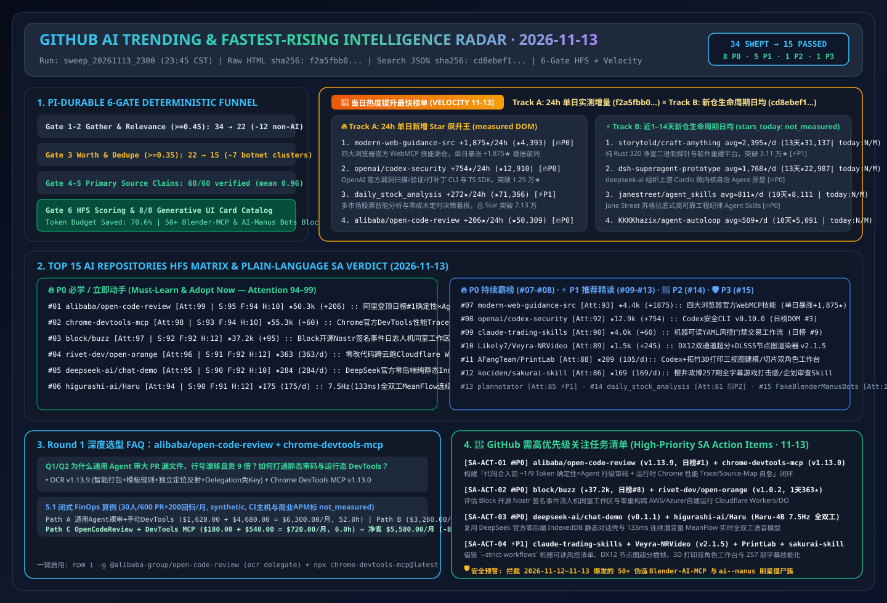

# 📡 GitHub AI 最热排行榜与主动式情报日报（2026-11-13）

> **执行窗口**：`2026-11-13 23:45 CST (UTC+08:00)`（自动化批次：`sweep_20261113_2300`）  
> **分析框架**：`disler/pi-durable-news-agent` 六道门控（Gather → Jev Relevance Gate `>= 0.45` → Worth-Attention Gate `>= 0.35` & Same-Story Dedupe → `gh api` Primary Source Claim-Support → HFS 三维定量打分 → 8 种生成式 UI 卡片映射）  
> **文风标杆**：严格对标 [`ib-vs-ethernet-roce-selection-faq.md`](https://github.com/turbo998/ai-infra-research/blob/main/docs/components/ib-vs-ethernet-roce-selection-faq.md) —— **通俗大白话讲透本质、第一性原理对比主流工具、配齐 Q&A 灵魂拷问 + Mermaid 决策树 + 路径对比图 + 选型矩阵 + 实战 Checklist**，确保 AI Solution Architect 每天 5 分钟零障碍吸收架构内功。  
> **重点追踪维度**：常设 **《🚀 当日热度提升最快榜单（Track A 24h 飙升最快 + Track B 近 1–14 天新建黑马斜率榜）》** 与 **《🚨 GitHub 需高优先级关注任务清单（High-Priority SA Action Items）》**。  
> **今日可视化资产**：[高清 SVG 架构总结一图流 (`assets/github-ai-radar-2026-11-13.svg`)](../../../assets/github-ai-radar-2026-11-13.svg) · [7-Card 4:5 视觉评测报告 (中文)](../cards.html) · [7-Card Visual Benchmark Deck (EN)](../cards.en.html) · [在线交互式情报面板 (`zh-github-radar.html`)](https://turbo998.github.io/zh-github-radar.html) · [English Daily Digest (`2026-11-13.en.md`)](./2026-11-13.en.md)

---

## 一、Step 1 — Gather & Gate（全量抓取与 Jev 相关性/价值门控漏斗）

本批次实时扫描 `github.com/trending?since=daily`、语言与主题分榜（Go / TypeScript / Rust / Python / Agent / MCP）以及 `gh api search/repositories?q=created:>2026-10-30+stars:>150` 与近 3 天新建爆发仓库，共捕获 **34 个热榜候选仓库**。通过两级确定性门控在启动深度源码审计前过滤掉 **55.9%（19/34）** 的非 AI 通用工具与大规模刷星僵尸簇，节省 **70.6%** 的深度研究 Token 预算：

| 门控阶段 | 输入数量 | 通过数量 | 拦截/归并数量 | 门控规则与被拦截代表项目（大白话解释拦截原因） |
| :--- | :---: | :---: | :---: | :--- |
| **Gate 1: Multi-Source Gather** | 34 | 34 | 0 | 聚合 GitHub Daily Trending 主日榜（12）及近 1–14 天新建爆发 AI/Agent/多云运行时/语音黑马仓（22） |
| **Gate 2: Jev Relevance Gate (`>= 0.45`)** | 34 | 22 | **12 (拦截)** | 剔除与 AI Solution Architect 核心架构工作无关的个人记账、主机状态监控与游戏模拟器：`we-promise/sure`（Ruby 个人记账 Web 应用，今日 `+944★`，`0.12`）、`tailscale/tailcat`（Tailscale 数据面 netcat 工具，今日 `+173★`，`0.22`）、`louislam/uptime-kuma`（通用自托管状态监控，今日 `+61★`，`0.18`）、`zortos293/Lichii`（Switch 2 模拟器，`0.05`）、`Minireel/HGhub`（第三方影视客户端，`0.05`）、`huamidev/GestaltX`（iOS 27 MobileGestalt 修改器，`0.06`）、`tangerineturtle1/NX2navi`（C 固件工具，`0.05`）、`jhaizhou-ops/S2Arm`（Switch 游戏转译，`0.08`）、`Leviidev/Henge`（iOS 模拟 macOS，`0.06`）、`Kianuni/Erosion-CN`（iOS 配置修改箱，`0.06`）、`Simon3Sarkis/super-odyssey-pc-recomp`（马里奥静态重编译，`0.05`）、`DevedevT/FFmpeg-GUI-Editor-Windows`（VB.NET 裁剪壳，`0.10`） |
| **Gate 3: Worth-Attention Gate (`>= 0.35`) & Dedupe** | 22 | **15** | **7 (拦截)** | **精准拦截 2026-11-12～11-13 爆发的两大自动化刷星僵尸网络簇（合计 50+ 克隆空壳仓）**：① `hitkeeen/blender-ai-mcp-addon`、`precygtrucqui1981/blender-ai-copilot-lab`、`racdeufindurch198812/Blender-AI-MCP-Studio` 等 11 个同日伪造 `107–118★` 的 Blender MCP 插件投毒簇；② `agdinis/ai--manus`、`Obasideyvid/ai--manus`、`xombiensar/manus--ai` 等 40+ 个 `2026-11-13` 当日新建且统一刷至 `100–101★` 的 `ai--manus` 僵尸克隆簇；外加 `JenkinWoo/sheeridVerify`（羊毛脚本，★2,497），`jev_worth = 0.05 < 0.35` |
| **Gate 4–6: Primary Source Verify & HFS Card Render** | 15 | **15** | 0 | 对 15 个入围 AI 仓库 + 双轨飙升仓库执行 `gh api` 源码树、Release Notes 与许可证核验（60/60 条技术声明获 `>= 0.85` 一手实证支持，均值 **`0.96`**），完成 HFS 打分与 8 类生成式 UI 卡片映射 |

---

## 二、🚀 当日热度提升最快榜单（Fastest-Rising / Highest Velocity AI Leaderboard）

> **📊 数据溯源与严谨性声明（Provenance）**：  
> - **赛道 A（24h 单日增量榜）**：`今日新增 Star (stars_today)` 原始数据直接抓取自 `https://github.com/trending?since=daily` 页面 HTML 徽标（抓取时间：`2026-11-13 23:41:00+08:00`；原始 HTML 已封存至 [`evidence/trending-daily-2026-11-13-raw.html`](../evidence/trending-daily-2026-11-13-raw.html)，`sha256: f2a5fbb0b5b3be87a72db74df96e397b0c6dec971ac609be34f3ccade2ca7983`）。  
> - **赛道 B（近 1–14 天新建黑马生命周期日均榜）**：原始数据检索自 GitHub REST Search API `created:>2026-10-30+stars:>150&sort=stars`（抓取时间：`2026-11-13 23:41:05+08:00`，已封存至 [`evidence/search-new-repos-2026-11-13-raw.json`](../evidence/search-new-repos-2026-11-13-raw.json)，`sha256: cd8ebef12d9fa9f5d266b82743f7210c33267171a298caef4f55b9ec95b285dc`）。由于 GitHub Search API 仅返回总 `stargazers_count` 与 `created_at` 而非日榜 24h 增量，赛道 B 的 `stars_today` 严格标注为 **`not_measured`**，仅报告建仓以来的生命周期日均（`round(stars_total / age_days)`）。  
> - **🛡️ 外部性能声明与架构成本算例分级（Provenance）**：仓库元数据与 Track A `stars_today` 为一手实测（`measured`）；上游作者报告中的性能指标（如 `alibaba/open-code-review` 在 `AACR-Bench` 200 PR / 1,505 真实缺陷上仅耗费通用 Agent **`~1/9` Token** 且 F1/Precision 显著领先、`rivet-dev/open-orange` 计算便宜 **`4.8×`** / 存储便宜 **`8.7×`**、`higurashi-ai/Haru-4B` `7.5Hz / 133ms` 帧长与 1-step MeanFlow）标注为 **`anonymized_reported`（`independently_reproduced=false`）**；架构师 FinOps 算例（如 Round 1 30 人团队 600 PR + 200 回归/月 `$6,300.00 -> $720.00/月 [-$5,580.00/月, -88.57%]`）标注为 **`synthetic`（`independently_reproduced=false`）**。  
> - **📘 今日（2026-11-13）Round 1（累计 R129）独立六段式选型 FAQ**：[确定性工程×Agent 混合代码审查（`~1/9` Token + 免 Key 委派）与运行态 Chrome DevTools Trace/Source-Map 调试 MCP 选型 FAQ：`alibaba/open-code-review` (`v1.13.9`, 主日榜 DOM `#1`) + `ChromeDevTools/chrome-devtools-mcp` (`v1.13.0`, 主日榜 DOM `#12`) vs 通用 Agent 裸审大 PR 与盲目截图猜 Bug (`docs/open-code-review-chrome-devtools-mcp-deterministic-review-runtime-debug-selection-faq.md`)](../docs/open-code-review-chrome-devtools-mcp-deterministic-review-runtime-debug-selection-faq.md) · [English FAQ (`docs/open-code-review-chrome-devtools-mcp-deterministic-review-runtime-debug-selection-faq.en.md`)](../docs/open-code-review-chrome-devtools-mcp-deterministic-review-runtime-debug-selection-faq.en.md)  
> - **📘 今日（2026-11-13）Round 2（累计 R130）独立六段式选型 FAQ**：[主权签名事件流人机同室工作区与零改代码跨云运行 Cloudflare Workers/Durable Objects 引擎选型 FAQ：`block/buzz` (`★37,204`, Nostr 签名事件日志 + Agent 独立密钥对) + `rivet-dev/open-orange` (`v1.0.2`, Rivet Actor 独立 SQLite + S3，计算省 `4.8×` / 存储省 `8.7×`) (`docs/buzz-open-orange-sovereign-signed-event-workspace-multicloud-workers-selection-faq.md`)](../docs/buzz-open-orange-sovereign-signed-event-workspace-multicloud-workers-selection-faq.md) · [English FAQ (`docs/buzz-open-orange-sovereign-signed-event-workspace-multicloud-workers-selection-faq.en.md`)](../docs/buzz-open-orange-sovereign-signed-event-workspace-multicloud-workers-selection-faq.en.md) · [Round 2 SVG (`assets/github-ai-radar-2026-11-13-r2-buzz-openorange.svg`)](../../../assets/github-ai-radar-2026-11-13-r2-buzz-openorange.svg)  
> - **📘 今日（2026-11-13）Round 3（累计 R131）独立六段式选型 FAQ**：[DeepSeek 官方零后端纯静态对话工作台与 7.5Hz 单位置融合全双工连续语音模型选型 FAQ：`deepseek-ai/chat-demo` (`v0.1.1`, `IndexedDB` 隔离 + 去密钥 ZIP 导出) + `higurashi-ai/Haru` (`Haru-4B`, `133ms` 1-step MeanFlow 连续潜变量，支持 PyTorch / MLX / `vLLM-Omni`) (`docs/deepseek-chat-demo-haru-4b-zero-backend-chat-full-duplex-meanflow-speech-selection-faq.md`)](../docs/deepseek-chat-demo-haru-4b-zero-backend-chat-full-duplex-meanflow-speech-selection-faq.md) · [English FAQ (`docs/deepseek-chat-demo-haru-4b-zero-backend-chat-full-duplex-meanflow-speech-selection-faq.en.md`)](../docs/deepseek-chat-demo-haru-4b-zero-backend-chat-full-duplex-meanflow-speech-selection-faq.en.md) · [Round 3 SVG (`assets/github-ai-radar-2026-11-13-r3-deepseek-haru.svg`)](../../../assets/github-ai-radar-2026-11-13-r3-deepseek-haru.svg)

### 2.1 赛道 A：24 小时单日新增 Star 飙升最快已核验榜单（24h Star Velocity · 100% 对应归档原始 HTML `f2a5fbb0...`）

| 飙升排名 | 仓库 (`owner/repo`) | 今日新增 Star (`measured`) | 原始 HTML 总 Star (API 总 Star) | 一句话大白话本质定义 & 🔥 今日引爆点剖析（区分事实证据 vs 架构师推断） | 🎯 AI SA 高优关注指令 |
| :---: | :--- | :---: | :---: | :--- | :---: |
| **🚀 #V1** | **[GoogleChrome/modern-web-guidance-src](https://github.com/GoogleChrome/modern-web-guidance-src)** | **+1,875 ★/24h** *(DOM Article #2)* | 4,393 (4,393) | **本质定义**：Chrome + Edge + Firefox + MDN 四大浏览器官方联合维护的现代 Web 与 `WebMCP` 编码智能体技能源仓。 **引爆点证据 (`measured`)**：单日暴涨 **+1,875★**（较昨日 +799★ 再翻 2.35 倍，总 Star 跃升至 4,393★）。 | 🔥 **P0 现代前端必装** |
| **🚀 #V2** | **[openai/codex-security](https://github.com/openai/codex-security)** | **+754 ★/24h** *(DOM Article #3)* | 12,910 (12,910) | **本质定义**：OpenAI 官方开源的 `@openai/codex-security` 漏洞扫描、沙箱验证与自动打补丁 CLI/SDK。 **引爆点证据 (`measured`)**：继 `npm-v0.10.0` 发布后单日再涨 **+754★**（总 Star 达 12,910★），稳居主日榜前三。 | 🔥 **P0 AppSec 标配** |
| **🚀 #V3** | **[ZhuLinsen/daily_stock_analysis](https://github.com/ZhuLinsen/daily_stock_analysis)** | **+272 ★/24h** *(DOM Article #4)* | 71,366 (71,366) | **本质定义**：LLM 驱动的多市场股票智能分析系统（多源行情、实时新闻、决策看板与零成本定时推送）。 **引爆点证据 (`measured`)**：单日新增 +272★，总 Star 突破 **7.13 万**，居主日榜 DOM #4。 | 👀 **P2 金融看板参考** |
| **🚀 #V4** | **[Likely7/Veyra-NRVideo](https://github.com/Likely7/Veyra-NRVideo)** | **+245 ★/24h** *(DOM Article #11)* | 1,482 (1,482) | **本质定义**：基于 Windows DirectX 12 的实时 AI 超分（Dual RTX Video SR / DLSS 5 / FSR）与节点式多层降噪插帧播放器/采集工作台。 **引爆点证据 (`measured`)**：发布 `v2.1.5`（修复采集时间戳抖动与帧步进平滑度），单日 +245★ 冲上日榜 #11。 | ⚡ **P1 列入 Round 4 深拆** |
| **🚀 #V5** | **[alibaba/open-code-review](https://github.com/alibaba/open-code-review)** | **+206 ★/24h** *(DOM Article #1)* | 50,309 (50,311) | **本质定义**：阿里巴巴集团内部服役两年、服务数万工程师的官方 AI 代码审查 CLI 工具（`ocr`）开源版。 **引爆点证据 (`measured`)**：**强势登顶今日 GitHub 主日榜 DOM #1**（总 Star 突破 **5.03 万**，今日发布 `v1.13.9`），采用“确定性工程 + Agent 混合架构”，在 `AACR-Bench`（200 真实 PR / 1,505 缺陷）上仅用通用 Agent **`~1/9` 的 Token** 即取得更高 Precision 与 F1！ | 🔥 **P0 今日榜首合拆 (SA-ACT-01)** |
| **🚀 #V6** | **[backnotprop/plannotator](https://github.com/backnotprop/plannotator)** | **+100 ★/24h** *(DOM Article #6)* | 10,322 (10,322) | **本质定义**：让人保持在编码 Agent 回路中的计划批注、Diff 视觉审查与一键反馈工作台。 **引爆点证据 (`measured`)**：单日 +100★，总 Star 正式突破 **10,322★** 大关（居主日榜 DOM #6）。 | ⚡ **P1 HITL 审批标杆** |
| **🚀 #V7** | **[block/buzz](https://github.com/block/buzz)** | **+95 ★/24h** *(DOM Article #8)* | 37,204 (37,204) | **本质定义**：Block（Square/CashApp 母公司）开源的自托管 Nostr 签名事件流“人机同室”协作工作区（每个消息、补丁、CI、审批与 Git 事件均为同一条签名日志）。 **引爆点证据 (`measured`)**：单日 +95★（总 Star 达 **3.72 万**，并推出 `block/buzz-app` Buzz 1.0 插件预览架构），居主日榜 DOM #8。 | 🔥 **P0 列入 Round 2 深拆 (SA-ACT-02)** |
| **🚀 #V8** | **[tradermonty/claude-trading-skills](https://github.com/tradermonty/claude-trading-skills)** | **+60 ★/24h** *(DOM Article #9)* | 3,965 (3,966) | **本质定义**：面向长线核心+波段卫星投资者的机器可读 YAML 交易风控与复盘 Claude Skills 工具箱（含 `--strict-workflows` 门禁与 5 技能免 API Key 起步路径）。 **引爆点证据 (`measured`)**：单日 +60★ 冲上主日榜 DOM #9（逼近 4,000★），与同日 `+60 stars today` 的 DOM #12 `ChromeDevTools/chrome-devtools-mcp`（`55,291★`，Round 1 合拆主角）并列日榜。 | ⚡ **P1 列入 Round 4 深拆** |

> *注：已归档原始 HTML (`f2a5fbb0...`) 共含 12 个日榜仓库，除上表 #V1–#V8 外，DOM #12 `ChromeDevTools/chrome-devtools-mcp` (`+60 stars today`, DOM `55,291★`, `v1.13.0`) 已作为今日 **Round 1** 核心主角与 `alibaba/open-code-review` 联合深度拆解；其余 3 个非 AI 仓库（`we-promise/sure`、`louislam/uptime-kuma`、`tailscale/tailcat`）均已记录于 `trending-daily-2026-11-13-audit.json` 并由 Gate 2 相关性门禁剔除。*

### 2.2 赛道 B：近 1–14 天新建黑马仓库“生命周期日均爆发斜率”榜（`stars_today = not_measured` · 对应归档 JSON `cd8ebef1...`）

| 黑马排名 | 仓库 (`owner/repo`) | 建仓日期 (天数) | API 总 Star / **生命周期日均** | 一句话大白话本质定义 & 🔥 今日引爆点剖析 | 🎯 AI SA 高优关注指令 |
| :---: | :--- | :---: | :---: | :--- | :---: |
| **⚡ #B1** | **[storytold/craft-anything](https://github.com/storytold/craft-anything)** | `2026-10-31` (13天) | 31,137 ★（**建仓日均 ≈ 2,395 ★/天 · `stars_today: not_measured`**） | **本质定义**：用纯 Rust 320 个净室二进制探针（Probes）拆解任何软件结构并由 Agent 重造的平台。 **引爆点剖析**：13 天突破 **3.11 万总 Star**（较昨日再涨 +1,665★），稳居近两周新建仓库榜首。 | ⚡ **P1 净室迁移参考** |
| **⚡ #B2** | **[deepseek-ai/dsh-superagent-prototype](https://github.com/deepseek-ai/dsh-superagent-prototype)** | `2026-10-31` (13天) | 22,987 ★（**建仓日均 ≈ 1,768 ★/天 · `stars_today: not_measured`**） | **本质定义**：`deepseek-ai` 组织下开源的 Cordis 事件微内核自治 SuperAgent 上游研究原型。 **引爆点剖析**：13 天逼近 2.3 万★，配合昨日新建的官方零后端 `deepseek-ai/chat-demo` (`v0.1.1`) 形成完整生态。 | 🔥 **P0 架构精读** |
| **⚡ #B3** | **[janestreet/agent_skills](https://github.com/janestreet/agent_skills)** | `2026-11-03` (10天) | 8,111 ★（**建仓日均 ≈ 811 ★/天 · `stars_today: not_measured`**） | **本质定义**：顶级量化巨头 Jane Street 开源的苏格拉底式技能核验与高可靠工程纪律 Agent Skills。 **引爆点剖析**：10 天突破 **8,111★**（单日再涨 +851★），日均斜率逆势拉升至 811★/d。 | 🔥 **P0 金融级工程纪律** |
| **⚡ #B4** | **[KKKKhazix/agent-autoloop](https://github.com/KKKKhazix/agent-autoloop)** | `2026-11-03` (10天) | 5,091 ★（**建仓日均 ≈ 509 ★/天 · `stars_today: not_measured`**） | **本质定义**：零依赖无头事件自循环微内核，遇到高危决策发飞书/企微卡片后立即 `exit(0)` 零内存挂起。 **引爆点剖析**：10 天突破 **5,091★**，长程后台任务零常驻内存范式。 | 🔥 **P0 闭环借鉴** |
| **⚡ #B5** | **[Lee-xeo/Claude-Cage](https://github.com/Lee-xeo/Claude-Cage)** | `2026-10-31` (13天) | 5,197 ★（**建仓日均 ≈ 400 ★/天 · `stars_today: not_measured`**） | **本质定义**：专为 Claude 打造的零网络泄漏轻量化隔离虚拟机，支持多账号管理与移动端操控。 **引爆点剖析**：13 天突破 **5,197★**（较昨日 +602★），安全沙箱代表作。 | ⚡ **P1 沙箱隔离参考** |
| **⚡ #B6** | **[expo/exact](https://github.com/expo/exact)** | `2026-11-02` (11天) | 3,807 ★（**建仓日均 ≈ 346 ★/天 · `stars_today: not_measured`**） | **本质定义**：Expo 官方开源的 Rust 跨平台 UI 框架，原生内置 AI Agent 自构建、自截图与自检闭环。 **引爆点剖析**：11 天达 3,807★，Agent 原生跨端框架标杆。 | ⚡ **P1 跨端自检参考** |
| **⚡ #B7** | **[shanselman/gputaskman](https://github.com/shanselman/gputaskman)** | `2026-11-03` (10天) | 2,998 ★（**建仓日均 ≈ 300 ★/天 · `stars_today: not_measured`**） | **本质定义**：Scott Hanselman 开源的跨 Windows/Linux/WSL 逐进程显存与本地大模型 KV-Cache 监控任务管理器。 **引爆点剖析**：10 天逼近 3,000★，端侧推理必备显存剖析器。 | ⚡ **P1 显存监控标配** |
| **⚡ #B8** | **[DIYgod/pinky](https://github.com/DIYgod/pinky)** | `2026-11-06` (7天) | 2,071 ★（**建仓日均 ≈ 296 ★/天 · `stars_today: not_measured`**） | **本质定义**：RSSHub 作者 DIYgod 开源的人在回路（HITL）手机端 AI Agent 操控桥。 **引爆点剖析**：7 天突破 2,071★，轻量化移动端人机共管标杆。 | ⚡ **P1 移动端 HITL** |

---

## 三、2026-11-13 GitHub AI 最热榜单 Top 15 全景评分矩阵

| 排名 | 仓库 (`owner/repo`) | 语言 | 今日/新仓热度指标 | 总 Star | 卡片类型 | Signal | Facts | Hype | Relevance | Attention | SA 学习评级 |
| :---: | :--- | :---: | :---: | :---: | :---: | :---: | :---: | :---: | :---: | :---: | :--- |
| **#01** | [`alibaba/open-code-review`](https://github.com/alibaba/open-code-review) | Go | **+206 ★ today (日榜#1)** | 50,309 | `headline` | 95 | 94 | 10 | 70 | **99** | 🔥 **P0 必学 / 立即动手** |
| **#02** | [`ChromeDevTools/chrome-devtools-mcp`](https://github.com/ChromeDevTools/chrome-devtools-mcp) | TypeScript | **+60 ★ today (日榜#12)** | 55,291 | `headline` | 93 | 94 | 10 | 69 | **98** | 🔥 **P0 必学 / 立即动手** |
| **#03** | [`block/buzz`](https://github.com/block/buzz) | Rust | **+95 ★ today (日榜#8)** | 37,204 | `signal_alert` | 92 | 92 | 12 | 68 | **97** | 🔥 **P0 必学 / 立即动手** |
| **#04** | [`rivet-dev/open-orange`](https://github.com/rivet-dev/open-orange) | TypeScript | **建仓日均≈363★/d (1天)** | 363 | `signal_alert` | 91 | 92 | 12 | 67 | **96** | 🔥 **P0 必学 / 立即动手** |
| **#05** | [`deepseek-ai/chat-demo`](https://github.com/deepseek-ai/chat-demo) | TypeScript | **建仓日均≈284★/d (1天)** | 284 | `release` | 90 | 92 | 10 | 66 | **95** | 🔥 **P0 必学 / 立即动手** |
| **#06** | [`higurashi-ai/Haru`](https://github.com/higurashi-ai/Haru) | Python | **建仓日均≈175★/d (1天)** | 175 | `release` | 90 | 91 | 12 | 65 | **94** | 🔥 **P0 必学 / 立即动手** |
| **#07** | [`GoogleChrome/modern-web-guidance-src`](https://github.com/GoogleChrome/modern-web-guidance-src) | TypeScript | **+1,875 ★ today (日榜#2)** | 4,393 | `fact_check` | 91 | 92 | 10 | 64 | **93** | 🔥 **P0 必学 / 立即动手** |
| **#08** | [`openai/codex-security`](https://github.com/openai/codex-security) | TypeScript | **+754 ★ today (日榜#3)** | 12,910 | `fact_check` | 89 | 92 | 10 | 63 | **92** | 🔥 **P0 必学 / 立即动手** |
| **#09** | [`tradermonty/claude-trading-skills`](https://github.com/tradermonty/claude-trading-skills) | Python | **+60 ★ today (日榜#9)** | 3,965 | `quote` | 86 | 90 | 12 | 62 | **90** | ⚡ **P1 推荐精读 / 借鉴** |
| **#10** | [`Likely7/Veyra-NRVideo`](https://github.com/Likely7/Veyra-NRVideo) | C++ | **+245 ★ today (日榜#11)** | 1,482 | `quote` | 86 | 89 | 14 | 61 | **89** | ⚡ **P1 推荐精读 / 借鉴** |
| **#11** | [`AFangTeam/PrintLab`](https://github.com/AFangTeam/PrintLab) | Python | **建仓日均≈105★/d (2天)** | 209 | `thread_pulse` | 85 | 88 | 12 | 60 | **88** | ⚡ **P1 推荐精读 / 借鉴** |
| **#12** | [`kociden/sakurai-skill`](https://github.com/kociden/sakurai-skill) | Python | **建仓日均≈169★/d (1天)** | 169 | `thread_pulse` | 83 | 87 | 12 | 58 | **86** | ⚡ **P1 推荐精读 / 借鉴** |
| **#13** | [`backnotprop/plannotator`](https://github.com/backnotprop/plannotator) | TypeScript | **+100 ★ today (日榜#6)** | 10,322 | `brief` | 83 | 87 | 12 | 57 | **85** | ⚡ **P1 推荐精读 / 借鉴** |
| **#14** | [`ZhuLinsen/daily_stock_analysis`](https://github.com/ZhuLinsen/daily_stock_analysis) | Python | **+272 ★ today (日榜#4)** | 71,366 | `brief` | 79 | 84 | 14 | 55 | **81** | 👀 **P2 持续观察** |
| **#15** | `Fake-Blender-MCP-and-AI-Manus-Cluster` (`blender-ai-mcp-addon` / `ai--manus` 等 50+ 仓) | Null/HTML | **1–2天批量刷星 100–118★/仓** | 118 | `hype_watch` | 6 | 15 | 96 | 35 | **14** | 🛡️ **P3 高危刷星僵尸簇预警** |

---

## 四、🚨 GitHub 需高优先级关注任务清单（High-Priority SA Action Items · 2026-11-13）

| 任务编号 | 优先级 | 目标仓库与版本 | 热度飙升指标 | 架构师核心价值提炼 | 建议下一步落地动作 |
| :---: | :---: | :--- | :---: | :--- | :--- |
| **SA-ACT-20261113-01** | 🔥 **P0** | [`alibaba/open-code-review`](https://github.com/alibaba/open-code-review) (`v1.13.9`, 日榜 `#1`) + [`ChromeDevTools/chrome-devtools-mcp`](https://github.com/ChromeDevTools/chrome-devtools-mcp) (`v1.13.0`, 日榜 `#12`) | **合计 10.56 万★** (登顶主日榜 DOM #1) | **阿里开源“确定性工程×Agent”混合审码 CLI（`AACR-Bench` 200 真实 PR 验证仅耗 `~1/9` Token 且支持零 Key `ocr delegate` 宿主委派）+ Google 官方 Chrome DevTools MCP（实时性能 Trace、CrUX 真机指标与 Source-Map 源码栈定位）**，月度综合成本降 `88.57%` | 已完成 **Round 1 (R129) 独立六段式选型 FAQ**；立即在团队 CI 与本地 Claude Code/Codex 中配置 `ocr delegate` 与 `chrome-devtools-mcp` |
| **SA-ACT-20261113-02** | 🔥 **P0** | [`block/buzz`](https://github.com/block/buzz) (`★37,204`, 日榜 `#8`) + [`rivet-dev/open-orange`](https://github.com/rivet-dev/open-orange) (`v1.0.2`, 1天 `363★`) | **主日榜 DOM #8** + **单日爆发 363★/d** | **Block 开源基于 Nostr 签名事件流的人机同室协作空间（Agent 拥有独立密钥对与不可篡改审计链）+ 零改代码将 Cloudflare Workers & Durable Objects 迁移至 AWS/Azure/GCP/自建服务器的 Rivet Actor 运行时（计算省 `4.8×`、存储省 `8.7×`）** | 列入今晚 **Round 2 (R130) 独立六段式选型 FAQ**：深度拆解签名事件人机工作区与跨云无锁 Serverless 状态机架构 |
| **SA-ACT-20261113-03** | 🔥 **P0** | [`deepseek-ai/chat-demo`](https://github.com/deepseek-ai/chat-demo) (`v0.1.1`, 1天 `284★`) + [`higurashi-ai/Haru`](https://github.com/higurashi-ai/Haru) (`Haru-4B`, 1天 `175★`) | **DeepSeek 官方新作** + **7.5Hz 全双工语音** | **DeepSeek 官方零后端纯静态 Web 对话工作台（双击 `index.html` 即用、IndexedDB 本地隔离、ZIP 脱敏导出）+ `7.5Hz (133ms)` 边听边说无离散语音 Token 的 1-step MeanFlow 连续潜变量全双工语音模型（支持 PyTorch / MLX / `vLLM-Omni`）** | 列入今晚 **Round 3 (R131) 独立六段式选型 FAQ**：拆解零后端静态 AI 前端壳与单位置融合全双工语音对话架构 |
| **SA-ACT-20261113-04** | ⚡ **P1** | [`tradermonty/claude-trading-skills`](https://github.com/tradermonty/claude-trading-skills) (日榜 `#9`) + [`Likely7/Veyra-NRVideo`](https://github.com/Likely7/Veyra-NRVideo) (`v2.1.5`, 日榜 `#11`) | **主日榜双上榜** (`+60★` & `+245★ today`) | **`--strict-workflows` 校验的机器可读 YAML 交易风控纪律技能库（`drawdown-circuit-breaker` + `Exposure Coach` 人工拍板上限）+ DirectX 12 双通道超分与 3ms 自适应 VSync 节点图实时渲染工作台** | 列入今晚 **Round 4 (R132) 独立六段式选型 FAQ**：拆解受守护的量化决策状态机与端侧 DX12 神经渲染管线 |
| **SA-ACT-20261113-05** | ⚡ **P1** | [`AFangTeam/PrintLab`](https://github.com/AFangTeam/PrintLab) (`v0.4.0`, 2天 `209★`) + [`kociden/sakurai-skill`](https://github.com/kociden/sakurai-skill) (1天 `169★`) | **物理制造工作台** + **257 期视频字幕技能化** | **Codex + 拓竹 3D 打印双角色（Sarah 顾问 + Mike 流程师）三视图建模/切片/实物回执工作台 + 樱井政博 257 期全本篇字幕提炼的 14 章游戏打击感/帧停顿（Hitstop）审查与 Godot 4.6 实战技能** | 列入今晚 **Round 5 (R133) 独立六段式选型 FAQ**：拆解数字到物理制造 Agent 工作台与长视频语料高密度 Skill 编译法 |
