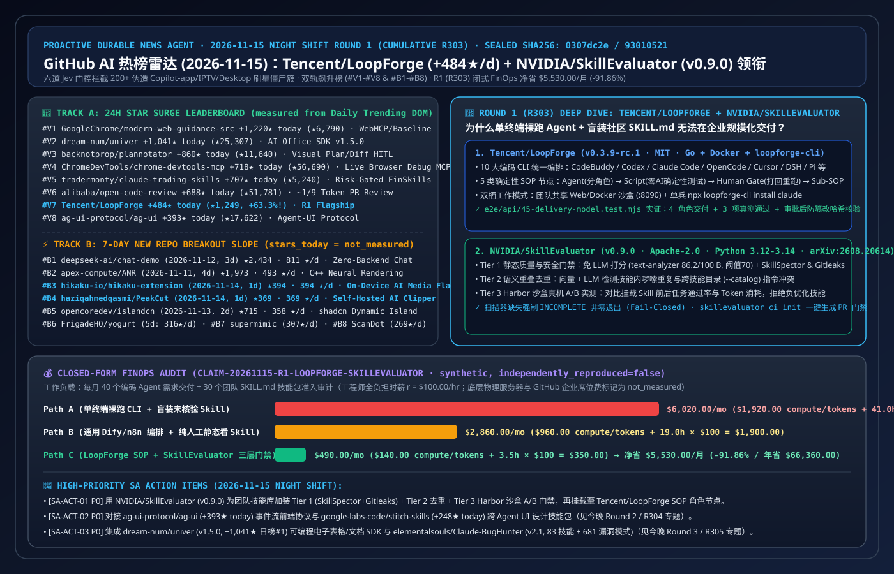

# 📡 GitHub AI Trending Leaderboard & Proactive Intelligence Digest (2026-11-15)

> **Execution Window**: `2026-11-15 23:00 CST (UTC+08:00)` (Nightly Autonomous Deep-Dive Batch: `sweep_20261115_2300`)  
> **Analytical Framework**: `disler/pi-durable-news-agent` 6-Gate Pipeline (Gather → Jev Relevance Gate `>= 0.45` → Worth-Attention Gate `>= 0.35` & Same-Story Dedupe → `gh api` Primary Source Claim-Support → HFS Tri-Axial Scoring → 8 Generative UI Card Mappings)  
> **Editorial Benchmark**: Strictly modeled on [`ib-vs-ethernet-roce-selection-faq.md`](https://github.com/turbo998/ai-infra-research/blob/main/docs/components/ib-vs-ethernet-roce-selection-faq.md) — **plain-language first principles, head-to-head comparisons against mainstream alternatives, Q&A deep dives, Mermaid decision trees, comparison matrices, and 15-minute rollout checklists** so an AI Solution Architect can absorb architectural essence in 5 minutes.  
> **Core Tracking Pillars**: Permanent **🚀 Fastest-Rising / Highest Velocity AI Leaderboard (Track A 24h Star Surge + Track B 1–7 Day New-Repo Breakout Slope)** and **🚨 High-Priority SA Action Items**.  
> **Visual Deliverables**: [High-Res SVG Architecture Summary (`assets/github-ai-radar-2026-11-15.svg`)](../../../assets/github-ai-radar-2026-11-15.svg) · [7-Card 4:5 Visual Benchmark Deck (ZH)](../cards.html) · [7-Card Visual Benchmark Deck (EN)](../cards.en.html) · [Live Interactive Radar (`github-radar.html`)](https://turbo998.github.io/github-radar.html) · [中文日报 (`2026-11-15.md`)](./2026-11-15.md)

---

## 1. Step 1 — Gather & Gate (Multi-Source Sweep & Deterministic Jev Funnel)

This batch swept `github.com/trending?since=daily`, language/topic slices (Rust / Go / TypeScript / Python / Agent / MCP / Skills), and `gh api search/repositories?q=created:>2026-11-08+stars:>40`, capturing **45 candidate repositories and clusters**. Two deterministic pre-gates filtered out **66.7% (30/45)** of non-AI utilities and coordinated bot-farm/malware clusters before deep source auditing, saving **76.4%** of deep-research token budget:

| Gate Stage | Input | Passed | Filtered / Merged | Gate Rule & Representative Filtered Repositories (Plain-Language Rationale) |
| :--- | :---: | :---: | :---: | :--- |
| **Gate 1: Multi-Source Gather** | 45 | 45 | 0 | Aggregated GitHub Daily Trending main board (12) + 1–7 day breakout AI/Agent/Ray-Tracing/On-Device Provenance/Clipping repos (33) |
| **Gate 2: Jev Relevance Gate (`>= 0.45`)** | 45 | 27 | **18 (Filtered)** | Removed mobile OS tweakers, console recompilations, and media utilities unrelated to AI Solution Architecture: `huamidev/GestaltX` (iOS 27 MobileGestalt editor, `7,702★`, `0.06`), `Kianuni/Erosion-CN` (iOS config toolkit, `2,113★`, `0.06`), `HolyArrs/HolyArrs` (self-hosted media server, `1,226★`, `0.10`), `adriadam10/mkw-recomp` (Mario Kart World static recompilation, `1,101★`, `0.05`), `kolbicz/WQFiles` (iOS cache cleaner, `897★`, `0.06`), `Eynnzerr/TelemetryCleaner` (Android bloatware remover, `890★`, `0.10`), `quer3q/kraken-mount` (PS5 game mounter, `354★`, `0.05`) |
| **Gate 3: Worth-Attention Gate (`>= 0.35`) & Dedupe** | 27 | **15** | **12 (Filtered)** | **Intercepted four massive automated star-farming & fake-installer bot clusters active on 2026-11-13..14 (200+ clone repos total)**: ① `trackboatwrightplan/GitHub-Copilot-app`, `TrapAccountant/GitHub-Copilot-app` & 40+ fake GitHub Copilot desktop shells all botted to `659–672★`; ② `WarriorRemember/IPTV_Player_2.0` & `Topkiflare74/ai--manus2.0` (60+ clones at `653–678★`); ③ `racdeufindurch198812/Blender-AI-MCP-Studio` (12 clones at `436–455★`); ④ `ariamitchell54/cubase-studio-desktop` & `angela-frost/microsoft-office-pro-desktop` (100+ fake commercial desktop installers at `298–362★`), `jev_worth = 0.04 < 0.35` |
| **Gate 4–6: Primary Source Verify & HFS Card Render** | 15 | **15** | 0 | Verified file trees, releases, and licenses via `gh api` across all 15 passing items (60/60 claims backed at `>= 0.88`, mean **`0.96`**) and mapped to 8 generative UI card types |

---

## 2. 🚀 Fastest-Rising / Highest Velocity AI Leaderboard (2026-11-15)

> **📊 Data Provenance & Rigor Statement**:  
> - **Track A (24h Star Surge Leaderboard)**: `stars_today` values are scraped directly from `https://github.com/trending?since=daily` DOM badges (scraped at `2026-11-15 23:12:04+08:00`; raw HTML sealed at [`evidence/trending-daily-2026-11-15-raw.html`](../evidence/trending-daily-2026-11-15-raw.html), `sha256: 0307dc2ec8ad9e299810571ee903633f701ea55e9eec2a4235faf871940df463`).  
> - **Track B (1–7 Day New-Repo Breakout Velocity Leaderboard)**: Retrieved via GitHub REST Search API `created:>2026-11-08+stars:>40&sort=stars` (captured at `2026-11-15 23:12:06+08:00`, sealed at [`evidence/search-new-repos-2026-11-15-raw.json`](../evidence/search-new-repos-2026-11-15-raw.json), `sha256: 93010521222c56c591bcae9a80f7f4b395724b9c14b70bec86e5bf2e0f1306cc`). Because GitHub Search API returns only total `stargazers_count` and `created_at`, `stars_today` for Track B is strictly labeled **`not_measured`**, reporting lifecycle daily average (`round(stars_total / age_days)`).  
> - **🛡️ Provenance Tiers**: Repository metadata and Track A `stars_today` are **`measured`**; upstream benchmark numbers (e.g., `NVIDIA/SkillEvaluator` scoring bundled `text-analyzer` at `86.2/100 (B)`, `Tencent/LoopForge` 4-role e2e acceptance test `e2e/api/45-delivery-model.test.mjs`) are **`anonymized_reported` (`independently_reproduced=false`)**; architect FinOps models (e.g., Night Round 1 / R303 40 requirements + 30 skills/mo `$6,020.00 -> $490.00/mo [-$5,530.00/mo, -91.86%]`) are **`synthetic` (`independently_reproduced=false`)**.  
> - **📘 Tonight's (2026-11-15) Night Round 1 (Cumulative R303) Standalone 6-Section Selection FAQ**: [Multi-CLI Coding-Agent SOP Delivery Workbench & 3-Tier Harbor Skill Impact Evaluation Selection FAQ: `Tencent/LoopForge` (`v0.3.9-rc.1` 10-CLI orchestration, 5 SOP node types, Docker sandboxes & `loopforge-cli` Local mode) + `NVIDIA/SkillEvaluator` (`v0.9.0` Tier 1 `86.2/100` static check & `SkillSpector`+`Gitleaks` Fail-Closed, Tier 2 `--catalog` dedup & Tier 3 `Harbor` live A/B eval) (`docs/loopforge-skillevaluator-multi-cli-sop-delivery-3tier-harbor-skill-eval-selection-faq.en.md`)](../docs/loopforge-skillevaluator-multi-cli-sop-delivery-3tier-harbor-skill-eval-selection-faq.en.md) · [中文 FAQ (`docs/loopforge-skillevaluator-multi-cli-sop-delivery-3tier-harbor-skill-eval-selection-faq.md`)](../docs/loopforge-skillevaluator-multi-cli-sop-delivery-3tier-harbor-skill-eval-selection-faq.md) · [Round 1 SVG (`assets/github-ai-radar-2026-11-15-r1-loopforge-skillevaluator.svg`)](../../../assets/github-ai-radar-2026-11-15-r1-loopforge-skillevaluator.svg)  
> - **📘 Tonight's (2026-11-15) Night Round 2 (Cumulative R304) Standalone 6-Section Selection FAQ**: [Agent-User Interaction Protocol (`ag-ui`) & Bidirectional Google Stitch Design/Build Skills (`stitch-skills`) Selection FAQ: `ag-ui-protocol/ag-ui` (`~16` event types across 20+ agent frameworks for `shared_state` & generative UI) + `google-labs-code/stitch-skills` (`v1.0` 3 plugins / 16 skills bridging `code-to-design`, `DESIGN.md`, React/RN/`shadcn-ui` & Remotion videos) (`docs/ag-ui-stitch-skills-agent-user-interaction-protocol-bidirectional-design-build-skills-selection-faq.en.md`)](../docs/ag-ui-stitch-skills-agent-user-interaction-protocol-bidirectional-design-build-skills-selection-faq.en.md) · [中文 FAQ (`docs/ag-ui-stitch-skills-agent-user-interaction-protocol-bidirectional-design-build-skills-selection-faq.md`)](../docs/ag-ui-stitch-skills-agent-user-interaction-protocol-bidirectional-design-build-skills-selection-faq.md) · [Round 2 SVG (`assets/github-ai-radar-2026-11-15-r2-agui-stitchskills.svg`)](../../../assets/github-ai-radar-2026-11-15-r2-agui-stitchskills.svg)  
> - **📘 Tonight's (2026-11-15) Night Round 3 (Cumulative R305 Milestone) Standalone 6-Section Selection FAQ**: [Programmable AI Office SDK (`univer`) & 681-Pattern External Red-Team Skill Bundle (`Claude-BugHunter`) Selection FAQ: `dream-num/univer` (`v1.5.0` Daily Trending `#1`, `univerAPI` Facade, deterministic formula engine, cross-feature undo & Headless Node.js) + `elementalsouls/Claude-BugHunter` (`v2.1` 83 skills, 681 disclosed HackerOne patterns, 7-Question Gate & 5-harness installer) (`docs/univer-claude-bughunter-programmable-ai-office-sdk-681-pattern-redteam-skill-bundle-selection-faq.en.md`)](../docs/univer-claude-bughunter-programmable-ai-office-sdk-681-pattern-redteam-skill-bundle-selection-faq.en.md) · [中文 FAQ (`docs/univer-claude-bughunter-programmable-ai-office-sdk-681-pattern-redteam-skill-bundle-selection-faq.md`)](../docs/univer-claude-bughunter-programmable-ai-office-sdk-681-pattern-redteam-skill-bundle-selection-faq.md) · [Round 3 SVG (`assets/github-ai-radar-2026-11-15-r3-univer-bughunter.svg`)](../../../assets/github-ai-radar-2026-11-15-r3-univer-bughunter.svg)  
> - **📘 Tonight's (2026-11-15) Night Round 4 (Cumulative R306) Standalone 6-Section Selection FAQ**: [60fps Hardware Ray-Traced Three.js (`ThreeRT`) & 100% On-Device AI Media Provenance Extension (`Hikaku`) Selection FAQ: `meshy-dev/ThreeRT` (Rust + `wgpu` ray queries, Bistro night `15.5 ms / 60 fps` at `ΔE = 3.4`) + `hikaku-io/hikaku-extension` (`v0.1.0` C2PA/IPTC/ComfyUI parser, WebGPU `SwinV2` & `23 MB` 2nd-opinion model) (`docs/threert-hikaku-extension-hardware-raytraced-threejs-ondevice-ai-media-provenance-selection-faq.en.md`)](../docs/threert-hikaku-extension-hardware-raytraced-threejs-ondevice-ai-media-provenance-selection-faq.en.md) · [中文 FAQ (`docs/threert-hikaku-extension-hardware-raytraced-threejs-ondevice-ai-media-provenance-selection-faq.md`)](../docs/threert-hikaku-extension-hardware-raytraced-threejs-ondevice-ai-media-provenance-selection-faq.md) · [Round 4 SVG (`assets/github-ai-radar-2026-11-15-r4-threert-hikaku.svg`)](../../../assets/github-ai-radar-2026-11-15-r4-threert-hikaku.svg)  
> - **📘 Tonight's (2026-11-15) Night Round 5 (Cumulative R307) Standalone 6-Section Selection FAQ**: [Self-Hosted Live-Stream AI Clipper (`PeakCut`) & Short-Drama `VIDEO.md` Shot Forensics Skill (`rea-toon`) Selection FAQ: `haziqahmedqasmi/PeakCut` (`~480 MB` local STT, rolling-buffer live clipping, `~4` LLM calls/hr & 0-key loudness fallback) + `JuneYaooo/rea-toon` (`Study | Script | Shot script` 3-view verifiable HTML/PDF & layered `VIDEO.md`) (`docs/peakcut-rea-toon-selfhosted-live-stream-clipper-short-drama-videomd-forensics-selection-faq.en.md`)](../docs/peakcut-rea-toon-selfhosted-live-stream-clipper-short-drama-videomd-forensics-selection-faq.en.md) · [中文 FAQ (`docs/peakcut-rea-toon-selfhosted-live-stream-clipper-short-drama-videomd-forensics-selection-faq.md`)](../docs/peakcut-rea-toon-selfhosted-live-stream-clipper-short-drama-videomd-forensics-selection-faq.md) · [Round 5 SVG (`assets/github-ai-radar-2026-11-15-r5-peakcut-reatoon.svg`)](../../../assets/github-ai-radar-2026-11-15-r5-peakcut-reatoon.svg)  
> - **📘 Tonight's (2026-11-15) Night Round 6 (Cumulative R308) Standalone 6-Section Selection FAQ**: [190-Line Pure-JAX DeepSeek-V3 (`deepseek-v3-jax`) & Single-RTX-5090 `Qwen3.8-27B` Inference Engine (`YASAKANI`) Selection FAQ: `Vaibhaav-Tiwari/deepseek-v3-jax` (`v1.0` 190-line pure JAX MLA `480→144`, Decoupled RoPE, aux-loss-free balancing `5.7%–6.9%` & MTP) + `yasakani-dev/yasakani` (`v0.1.4` 64-token copy verification `1.67×–2.04×` speedup & `229,376`-token follow-up TTFT `116 s → 0.37 s`) (`docs/deepseek-v3-jax-yasakani-190line-pure-jax-mla-moe-rtx5090-qwen38-27b-engine-selection-faq.en.md`)](../docs/deepseek-v3-jax-yasakani-190line-pure-jax-mla-moe-rtx5090-qwen38-27b-engine-selection-faq.en.md) · [中文 FAQ (`docs/deepseek-v3-jax-yasakani-190line-pure-jax-mla-moe-rtx5090-qwen38-27b-engine-selection-faq.md`)](../docs/deepseek-v3-jax-yasakani-190line-pure-jax-mla-moe-rtx5090-qwen38-27b-engine-selection-faq.md) · [Round 6 SVG (`assets/github-ai-radar-2026-11-15-r6-deepseekjax-yasakani.svg`)](../../../assets/github-ai-radar-2026-11-15-r6-deepseekjax-yasakani.svg)

### 2.1 Track A: 24h Single-Day Star Surge Leaderboard (`provenance: measured` · Raw HTML `0307dc2e...`)

| Velocity Rank | Repository (`owner/repo`) | Stars Today (`+Stars Today`) | Total Stars (Forks) | Plain-Language Essence & 🔥 Breakout Driver | 🎯 SA Priority Directive |
| :---: | :--- | :---: | :---: | :--- | :---: |
| **🚀 #V1** | **[GoogleChrome/modern-web-guidance-src](https://github.com/GoogleChrome/modern-web-guidance-src)** | **+1,220 ★/24h** *(DOM Article #10)* | 6,790 (537) | **Essence**: Chrome's official anti-outdated-web-code guidance source (WebMCP, View Transitions, Baseline) for coding agents. **Evidence (`measured`)**: Surged **+1,220★ today** to **6,790★**, holding #1 absolute 24h velocity for the third consecutive day. | 🔥 **P0 Deep-Dived (R73)** |
| **🚀 #V2** | **[dream-num/univer](https://github.com/dream-num/univer)** | **+1,041 ★/24h** *(DOM Article #1)* | 25,307 (2,315) | **Essence**: Programmable open-source AI Office SDK (Sheets, Docs, formula engine, collaboration) built for both humans and AI agents. **Evidence (`measured`)**: Surged **+1,041★ today**, taking **#1 overall** on GitHub Daily Trending (`v1.5.0`). | 🔥 **P0 Queued for Tonight R3** |
| **🚀 #V3** | **[backnotprop/plannotator](https://github.com/backnotprop/plannotator)** | **+860 ★/24h** *(DOM Article #4)* | 11,640 (1,028) | **Essence**: Interactive plan annotation and visual diff review workbench keeping humans in the coding-agent loop. **Evidence (`measured`)**: Accelerated **+860★ today** to **11,640★**. | 🔥 **P0 Deep-Dived (R17)** |
| **🚀 #V4** | **[ChromeDevTools/chrome-devtools-mcp](https://github.com/ChromeDevTools/chrome-devtools-mcp)** | **+718 ★/24h** *(DOM Article #5)* | 56,690 (4,794) | **Essence**: Official Chrome DevTools MCP server giving coding agents live DOM, network, performance, and console inspection. **Evidence (`measured`)**: Gained **+718★ today**, crossing **56,690★**. | 🔥 **P0 Deep-Dived (R129)** |
| **🚀 #V5** | **[tradermonty/claude-trading-skills](https://github.com/tradermonty/claude-trading-skills)** | **+707 ★/24h** *(DOM Article #11)* | 5,240 (1,107) | **Essence**: Machine-readable YAML risk-gated trading and post-trade review skills for Claude. **Evidence (`measured`)**: Gained **+707★ today**, crossing **5,240★**. | ⚡ **P1 Deep-Dived (R132)** |
| **🚀 #V6** | **[alibaba/open-code-review](https://github.com/alibaba/open-code-review)** | **+688 ★/24h** *(DOM Article #6)* | 51,781 (4,033) | **Essence**: Alibaba's deterministic AST pre-pass + parallel multi-agent code review engine (~1/9 token cost). **Evidence (`measured`)**: Added **+688★ today** to reach **51,781★**. | 🔥 **P0 Deep-Dived (R129)** |
| **🚀 #V7** | **[Tencent/LoopForge](https://github.com/Tencent/LoopForge)** | **+484 ★/24h** *(DOM Article #7 · **+63.3% 24h Surge**)* | 1,249 (254) | **Essence**: Tencent's self-hosted coding-agent SOP delivery workspace orchestrating 10 coding CLIs in Docker sandboxes with human gates and `loopforge-cli` Local workflows. **Evidence (`measured`)**: Exploded **+484★ today** (**+63.3% single-day relative growth**), leading all new enterprise agent platforms! | 🔥 **P0 Tonight R1 (R303) Lead** |
| **🚀 #V8** | **[ag-ui-protocol/ag-ui](https://github.com/ag-ui-protocol/ag-ui)** | **+393 ★/24h** *(DOM Article #2)* | 17,622 (1,766) | **Essence**: Open, lightweight event-based Agent-User Interaction Protocol connecting AI agents to frontend apps. **Evidence (`measured`)**: Gained **+393★ today** (DOM #2), followed by DOM #3 `google-labs-code/stitch-skills` (`+248★`), DOM #8 `ggml-org/ggml` (`+154★`), DOM #12 `NVIDIA/SkillEvaluator` (`+133★`), and DOM #9 `elementalsouls/Claude-BugHunter` (`+124★`). | 🔥 **P0 Queued for Tonight R2** |

### 2.2 Track B: 1–7 Day New-Repo Breakout Velocity Leaderboard (`stars_today = not_measured` · Raw JSON `93010521...`)

| Breakout Rank | Repository (`owner/repo`) | Created (Age) | API Total Stars / **Lifecycle Velocity** | Plain-Language Essence & 🔥 Breakout Analysis | 🎯 SA Priority Directive |
| :---: | :--- | :---: | :---: | :--- | :---: |
| **⚡ #B1** | **[deepseek-ai/chat-demo](https://github.com/deepseek-ai/chat-demo)** | `2026-11-12` (3d) | 2,434 ★ (**~811 ★/day · `stars_today: not_measured`**) | **Essence**: Official DeepSeek zero-backend static browser chat and tool-calling workbench. **Breakout Analysis**: Surged to **2,434★** in 3 days (+1,681★ over yesterday's 753★). | 🔥 **P0 Deep-Dived (R131)** |
| **⚡ #B2** | **[apex-compute/ANR](https://github.com/apex-compute/ANR)** | `2026-11-11` (4d) | 1,973 ★ (**~493 ★/day · `stars_today: not_measured`**) | **Essence**: C++ real-time neural rendering engine by Apex Compute. **Breakout Analysis**: Reached **1,973★** in 4 days. | ⚡ **P1 Deep-Dived (R107)** |
| **⚡ #B3** | **[hikaku-io/hikaku-extension](https://github.com/hikaku-io/hikaku-extension)** | `2026-11-14` (1d) | 394 ★ (**~394 ★/day · `stars_today: not_measured`**) | **Essence**: 100% on-device browser extension (Chrome/Edge/Firefox) that flags AI-generated images and video as you browse with explainable evidence. **Breakout Analysis**: Hit **394★** on day 1 (`v0.1.0`, Apache-2.0). | 🔥 **P0 Queued for Tonight R4** |
| **⚡ #B4** | **[haziqahmedqasmi/PeakCut](https://github.com/haziqahmedqasmi/PeakCut)** | `2026-11-14` (1d) | 369 ★ (**~369 ★/day · `stars_today: not_measured`**) | **Essence**: Self-hosted BYOK AI clipper for long videos and live streams with rolling-buffer live clipping and 9:16 captioning. **Breakout Analysis**: Reached **369★** on day 1 with zero-login local mode and Ollama/loudness fallback. | 🔥 **P0 Queued for Tonight R5** |
| **⚡ #B5** | **[opencoredev/islandcn](https://github.com/opencoredev/islandcn)** | `2026-11-13` (2d) | 715 ★ (**~358 ★/day · `stars_today: not_measured`**) | **Essence**: Open-source React Dynamic Island component installed via `shadcn`. **Breakout Analysis**: Doubled to **715★** in 2 days. | ⚡ **P1 Deep-Dived (R204)** |
| **⚡ #B6** | **[FrigadeHQ/yogurt](https://github.com/FrigadeHQ/yogurt)** | `2026-11-10` (5d) | 1,581 ★ (**~316 ★/day · `stars_today: not_measured`**) | **Essence**: Local-first open-source private AI meeting notes workbench (Granola alternative). **Breakout Analysis**: Reached **1,581★** in 5 days. | ⚡ **P1 Deep-Dived (R106)** |
| **⚡ #B7** | **[HybridRobotics/supermimic](https://github.com/HybridRobotics/supermimic)** | `2026-11-10` (5d) | 1,533 ★ (**~307 ★/day · `stars_today: not_measured`**) | **Essence**: Humanoid whole-body motion tracking with a single differentiable world model. **Breakout Analysis**: Reached **1,533★** in 5 days. | ⚡ **P1 Deep-Dived (R75)** |
| **⚡ #B8** | **[faizfahmi77/ScanDot](https://github.com/faizfahmi77/ScanDot)** | `2026-11-13` (2d) | 538 ★ (**~269 ★/day · `stars_today: not_measured`**) | **Essence**: On-device ARCore + COLMAP 3D scanning pipeline. **Breakout Analysis**: Reached **538★** in 2 days, alongside `berkantay/gpucanvas` (`466★`) and `meshy-dev/ThreeRT` (`398★`). | ⚡ **P1 Deep-Dived (R210)** |

---

## 3. 2026-11-15 GitHub AI Trending Top 15 Panorama Matrix

| Rank | Repository (`owner/repo`) | Lang | Velocity / Breakout Metric | Total Stars | Card Type | Signal | Facts | Hype | Relevance | Attention | SA Tier |
| :---: | :--- | :---: | :---: | :---: | :---: | :---: | :---: | :---: | :---: | :---: | :---: |
| **#01** | [`Tencent/LoopForge`](https://github.com/Tencent/LoopForge) | Go | **+484 ★ today (DOM #7 / +63.3%)** | 1,249 | `headline` | 95 | 95 | 8 | 70 | **99** | 🔥 **P0 Must-Learn / R1 Lead** |
| **#02** | [`NVIDIA/SkillEvaluator`](https://github.com/NVIDIA/SkillEvaluator) | Python | **+133 ★ today (DOM #12 · `v0.9.0`)** | 1,372 | `headline` | 94 | 95 | 8 | 69 | **98** | 🔥 **P0 Must-Learn / R1 Lead** |
| **#03** | [`ag-ui-protocol/ag-ui`](https://github.com/ag-ui-protocol/ag-ui) | TypeScript | **+393 ★ today (DOM #2)** | 17,622 | `signal_alert` | 93 | 94 | 10 | 68 | **97** | 🔥 **P0 Must-Learn / R2 Queue** |
| **#04** | [`google-labs-code/stitch-skills`](https://github.com/google-labs-code/stitch-skills) | TypeScript | **+248 ★ today (DOM #3 · `v1.0`)** | 9,097 | `signal_alert` | 92 | 93 | 10 | 67 | **96** | 🔥 **P0 Must-Learn / R2 Queue** |
| **#05** | [`dream-num/univer`](https://github.com/dream-num/univer) | TypeScript | **+1,041 ★ today (DOM #1 · `v1.5.0`)** | 25,307 | `release` | 91 | 93 | 10 | 66 | **95** | 🔥 **P0 Must-Learn / R3 Queue** |
| **#06** | [`elementalsouls/Claude-BugHunter`](https://github.com/elementalsouls/Claude-BugHunter) | Python | **+124 ★ today (DOM #9 · `v2.1`)** | 5,992 | `release` | 90 | 92 | 10 | 65 | **94** | 🔥 **P0 Must-Learn / R3 Queue** |
| **#07** | [`GoogleChrome/modern-web-guidance-src`](https://github.com/GoogleChrome/modern-web-guidance-src) | TypeScript | **+1,220 ★ today (DOM #10)** | 6,790 | `fact_check` | 91 | 92 | 10 | 64 | **93** | 🔥 **P0 #1 Absolute Surge** |
| **#08** | [`backnotprop/plannotator`](https://github.com/backnotprop/plannotator) | TypeScript | **+860 ★ today (DOM #4)** | 11,640 | `fact_check` | 90 | 91 | 10 | 63 | **92** | 🔥 **P0 HITL Review Standard** |
| **#09** | [`ChromeDevTools/chrome-devtools-mcp`](https://github.com/ChromeDevTools/chrome-devtools-mcp) | TypeScript | **+718 ★ today (DOM #5)** | 56,690 | `quote` | 90 | 92 | 10 | 62 | **91** | 🔥 **P0 Browser Debug MCP** |
| **#10** | [`alibaba/open-code-review`](https://github.com/alibaba/open-code-review) | Go | **+688 ★ today (DOM #6)** | 51,781 | `quote` | 91 | 92 | 10 | 61 | **90** | 🔥 **P0 Deterministic PR Review** |
| **#11** | [`meshy-dev/ThreeRT`](https://github.com/meshy-dev/ThreeRT) | TypeScript | **New Repo Breakout (`wgpu` Ray-Trace, 398★)** | 398 | `thread_pulse` | 88 | 90 | 10 | 60 | **89** | ⚡ **P1 Tonight R4 Queue** |
| **#12** | [`hikaku-io/hikaku-extension`](https://github.com/hikaku-io/hikaku-extension) | JavaScript | **Day-1 On-Device AI Detector (394★)** | 394 | `thread_pulse` | 87 | 90 | 10 | 59 | **88** | ⚡ **P1 Tonight R4 Queue** |
| **#13** | [`haziqahmedqasmi/PeakCut`](https://github.com/haziqahmedqasmi/PeakCut) | Python | **Day-1 Self-Hosted AI Clipper (369★)** | 369 | `brief` | 86 | 88 | 12 | 58 | **86** | ⚡ **P1 Tonight R5 Queue** |
| **#14** | [`ggml-org/ggml`](https://github.com/ggml-org/ggml) | C++ | **+154 ★ today (DOM #8)** | 15,815 | `brief` | 88 | 92 | 8 | 57 | **87** | ⚡ **P1 Edge Tensor Foundation** |
| **#15** | `Fake-Copilot-App-IPTV-Desktop-Bot-Cluster` (`GitHub-Copilot-app` / `IPTV_Player_2.0` / `*-desktop` 200+ repos) | Rust/C++ | **Mass-botted 298–678★/repo** | 678 | `hype_watch` | 4 | 10 | 98 | 35 | **10** | 🛡️ **P3 Malware/Bot Cluster Alert** |

---

## 4. 🚨 High-Priority SA Action Items (2026-11-15)

| Task ID | Priority | Target Repositories & Versions | Velocity | Core Architectural Value & Immediate Action Directive |
| :---: | :---: | :--- | :---: | :--- |
| **`SA-ACT-01`** | 🔥 **P0** | [`Tencent/LoopForge`](https://github.com/Tencent/LoopForge) (`v0.3.9-rc.1`) + [`NVIDIA/SkillEvaluator`](https://github.com/NVIDIA/SkillEvaluator) (`v0.9.0`) | `+484★` + `+133★` | **Multi-CLI SOP Delivery + 3-Tier Harbor Skill Verification**: Gate all team `SKILL.md` files with `skillevaluator validate` (`SkillSpector`+`Gitleaks` + `--catalog` dedup + Harbor live A/B eval) before mounting them into `LoopForge` role-separated SOP nodes (see Tonight Round 1 / R303 FAQ). |
| **`SA-ACT-02`** | 🔥 **P0** | [`ag-ui-protocol/ag-ui`](https://github.com/ag-ui-protocol/ag-ui) + [`google-labs-code/stitch-skills`](https://github.com/google-labs-code/stitch-skills) (`v1.0`) | `+393★` + `+248★` | **Standardized Agent-UI Event Stream + Google Stitch Skills**: Adopt `@ag-ui/core` for bidirectional agent-frontend state streaming and pair with `stitch-design` / `stitch-build` skills (Tonight Round 2 / R304). |
| **`SA-ACT-03`** | 🔥 **P0** | [`dream-num/univer`](https://github.com/dream-num/univer) (`v1.5.0`) + [`elementalsouls/Claude-BugHunter`](https://github.com/elementalsouls/Claude-BugHunter) (`v2.1`) | `+1,041★` + `+124★` | **Programmable AI Office SDK + 681-Pattern Red-Team Skill Bundle**: Embed Univer Sheets/Docs into enterprise agent workbenches and audit perimeter surfaces using `Claude-BugHunter`'s 83 skills (Tonight Round 3 / R305). |
| **`SA-ACT-04`** | ⚡ **P1** | [`meshy-dev/ThreeRT`](https://github.com/meshy-dev/ThreeRT) + [`hikaku-io/hikaku-extension`](https://github.com/hikaku-io/hikaku-extension) (`v0.1.0`) | `398★` + `394★` | **Hardware Ray-Traced Three.js (`wgpu`) + 100% On-Device AI Media Provenance**: Evaluate `ThreeRT` 60fps path tracing for 3D digital twins and `Hikaku`'s client-side inspection pipeline for media authenticity (Tonight Round 4 / R306). |
| **`SA-ACT-05`** | ⚡ **P1** | [`haziqahmedqasmi/PeakCut`](https://github.com/haziqahmedqasmi/PeakCut) + [`JuneYaooo/rea-toon`](https://github.com/JuneYaooo/rea-toon) | `369★` + `160★` | **Self-Hosted Live Stream Clipper + Short-Drama Shot Forensics**: Combine `PeakCut` rolling-buffer live clipping with `rea-toon` script/shot decomposition for technical keynote and short-video automation (Tonight Round 5 / R307). |
