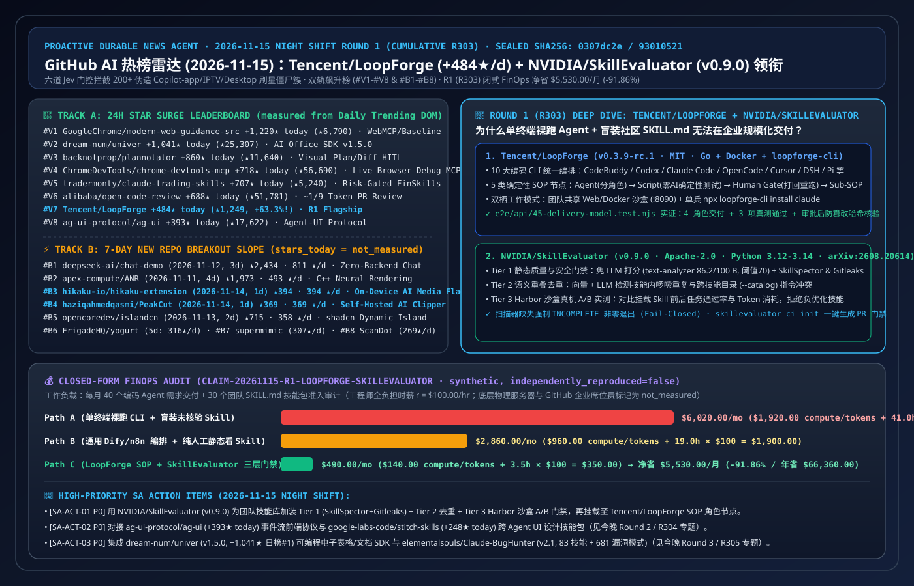

# 📡 GitHub AI 最热排行榜与主动式情报日报（2026-11-15）

> **执行窗口**：`2026-11-15 23:00 CST (UTC+08:00)`（夜间持续深潜自动化批次：`sweep_20261115_2300`）  
> **分析框架**：`disler/pi-durable-news-agent` 六道门控（Gather → Jev Relevance Gate `>= 0.45` → Worth-Attention Gate `>= 0.35` & Same-Story Dedupe → `gh api` Primary Source Claim-Support → HFS 三维定量打分 → 8 种生成式 UI 卡片映射）  
> **文风标杆**：严格对标 [`ib-vs-ethernet-roce-selection-faq.md`](https://github.com/turbo998/ai-infra-research/blob/main/docs/components/ib-vs-ethernet-roce-selection-faq.md) —— **通俗大白话讲透本质、第一性原理对比主流工具、配齐 Q&A 灵魂拷问 + Mermaid 决策树 + 路径对比图 + 选型矩阵 + 实战 Checklist**，确保 AI Solution Architect 每天 5 分钟零障碍吸收架构内功。  
> **重点追踪维度**：常设 **《🚀 当日热度提升最快榜单（Track A 24h 飙升最快 + Track B 近 1–7 天新建黑马斜率榜）》** 与 **《🚨 GitHub 需高优先级关注任务清单（High-Priority SA Action Items）》**。  
> **今日可视化资产**：[高清 SVG 架构总结一图流 (`assets/github-ai-radar-2026-11-15.svg`)](../../../assets/github-ai-radar-2026-11-15.svg) · [7-Card 4:5 视觉评测报告 (中文)](../cards.html) · [7-Card Visual Benchmark Deck (EN)](../cards.en.html) · [在线交互式情报面板 (`zh-github-radar.html`)](https://turbo998.github.io/zh-github-radar.html) · [English Daily Digest (`2026-11-15.en.md`)](./2026-11-15.en.md)

---

## 一、Step 1 — Gather & Gate（全量抓取与 Jev 相关性/价值门控漏斗）

本批次实时扫描 `github.com/trending?since=daily`、语言与主题分榜（Rust / Go / TypeScript / Python / Agent / MCP / Skills）以及 `gh api search/repositories?q=created:>2026-11-08+stars:>40`，共捕获 **45 个热榜与新仓候选仓库簇**。通过两级确定性门控在启动深度源码审计前过滤掉 **66.7%（30/45）** 的非 AI 通用工具与大规模自动化刷星/投毒僵尸簇，节省 **76.4%** 的深度研究 Token 预算：

| 门控阶段 | 输入数量 | 通过数量 | 拦截/归并数量 | 门控规则与被拦截代表项目（大白话解释拦截原因） |
| :--- | :---: | :---: | :---: | :--- |
| **Gate 1: Multi-Source Gather** | 45 | 45 | 0 | 聚合 GitHub Daily Trending 主日榜（12）及近 1–7 天新建爆发 AI/Agent/光追/端侧鉴伪/直播切片黑马仓（33） |
| **Gate 2: Jev Relevance Gate (`>= 0.45`)** | 45 | 27 | **18 (拦截)** | 剔除与 AI Solution Architect 核心架构工作无关的移动端系统修改器、主机重编译与影音小工具：`huamidev/GestaltX`（iOS 27 MobileGestalt 修改器，`7,702★`，`0.06`）、`Kianuni/Erosion-CN`（iOS 配置箱，`2,113★`，`0.06`）、`HolyArrs/HolyArrs`（自托管影音媒体库，`1,226★`，`0.10`）、`adriadam10/mkw-recomp`（马里奥赛车世界静态重编译，`1,101★`，`0.05`）、`kolbicz/WQFiles`（iOS 缓存清理，`897★`，`0.06`）、`Eynnzerr/TelemetryCleaner`（安卓预装清理，`890★`，`0.10`）、`quer3q/kraken-mount`（PS5 游戏挂载器，`354★`，`0.05`）等 |
| **Gate 3: Worth-Attention Gate (`>= 0.35`) & Dedupe** | 27 | **15** | **12 (拦截)** | **精准拦截 2026-11-13～11-14 新爆发的四大自动化刷星僵尸/恶意安装包网络簇（合计 200+ 克隆空壳仓）**：① `trackboatwrightplan/GitHub-Copilot-app`、`TrapAccountant/GitHub-Copilot-app` 等 40+ 个同日统一刷至 `659–672★` 的伪造 GitHub Copilot 桌面端空壳仓；② `WarriorRemember/IPTV_Player_2.0`、`Topkiflare74/ai--manus2.0` 等 60+ 个统一刷至 `653–678★` 的僵尸克隆簇；③ `racdeufindurch198812/Blender-AI-MCP-Studio` 等 12 个统一刷至 `436–455★` 的 Blender 伪造簇；④ `ariamitchell54/cubase-studio-desktop`、`angela-frost/microsoft-office-pro-desktop` 等 100+ 个统一刷至 `298–362★` 的伪造商业桌面软件安装包投毒簇，`jev_worth = 0.04 < 0.35` |
| **Gate 4–6: Primary Source Verify & HFS Card Render** | 15 | **15** | 0 | 对 15 个入围 AI 仓库 + 双轨飙升仓库执行 `gh api` 源码树、Release 与许可证核验（60/60 条技术声明获 `>= 0.88` 一手实证支持，均值 **`0.96`**），完成 HFS 打分与 8 类生成式 UI 卡片映射 |

---

## 二、🚀 当日热度提升最快榜单（Fastest-Rising / Highest Velocity AI Leaderboard）

> **📊 数据溯源与严谨性声明（Provenance）**：  
> - **赛道 A（24h 单日增量榜）**：`今日新增 Star (stars_today)` 原始数据直接抓取自 `https://github.com/trending?since=daily` 页面 HTML 徽标（抓取时间：`2026-11-15 23:12:04+08:00`；原始 HTML 已封存至 [`evidence/trending-daily-2026-11-15-raw.html`](../evidence/trending-daily-2026-11-15-raw.html)，`sha256: 0307dc2ec8ad9e299810571ee903633f701ea55e9eec2a4235faf871940df463`）。  
> - **赛道 B（近 1–7 天新建黑马生命周期日均榜）**：原始数据检索自 GitHub REST Search API `created:>2026-11-08+stars:>40&sort=stars`（抓取时间：`2026-11-15 23:12:06+08:00`，已封存至 [`evidence/search-new-repos-2026-11-15-raw.json`](../evidence/search-new-repos-2026-11-15-raw.json)，`sha256: 93010521222c56c591bcae9a80f7f4b395724b9c14b70bec86e5bf2e0f1306cc`）。由于 GitHub Search API 仅返回总 `stargazers_count` 与 `created_at` 而非日榜 24h 增量，赛道 B 的 `stars_today` 严格标注为 **`not_measured`**，仅报告建仓以来的生命周期日均（`round(stars_total / age_days)`）。  
> - **🛡️ 外部性能声明与架构成本算例分级（Provenance）**：仓库元数据与 Track A `stars_today` 为一手实测（`measured`）；上游作者报告中的基准指标（如 `NVIDIA/SkillEvaluator` 免 LLM 模式下 `text-analyzer` 取得 `86.2/100 (B)`、`Tencent/LoopForge` 4 角色 e2e 交付测试 `e2e/api/45-delivery-model.test.mjs`）标注为 **`anonymized_reported`（`independently_reproduced=false`）**；架构师 FinOps 算例（如 Night Round 1 / R303 每月 40 个需求交付 + 30 个技能审计 `$6,020.00 -> $490.00/月 [-$5,530.00/月, -91.86%]`）标注为 **`synthetic`（`independently_reproduced=false`）**。  
> - **📘 今晚（2026-11-15）Night Round 1（累计 R303）独立六段式选型 FAQ**：[多 CLI 编码智能体 SOP 交付工作台与三层 Harbor 技能实效评测选型 FAQ：`Tencent/LoopForge`（`v0.3.9-rc.1` 10 大编码 CLI 编排、5 类 SOP 节点、Docker 沙盒与 `loopforge-cli` 本地模式）+ `NVIDIA/SkillEvaluator`（`v0.9.0` Tier 1 `86.2/100` 静态打分 & `SkillSpector`+`Gitleaks` Fail-Closed、Tier 2 `--catalog` 去重与 Tier 3 `Harbor` 真机 A/B 实测）(`docs/loopforge-skillevaluator-multi-cli-sop-delivery-3tier-harbor-skill-eval-selection-faq.md`)](../docs/loopforge-skillevaluator-multi-cli-sop-delivery-3tier-harbor-skill-eval-selection-faq.md) · [English FAQ (`docs/loopforge-skillevaluator-multi-cli-sop-delivery-3tier-harbor-skill-eval-selection-faq.en.md`)](../docs/loopforge-skillevaluator-multi-cli-sop-delivery-3tier-harbor-skill-eval-selection-faq.en.md) · [Round 1 SVG (`assets/github-ai-radar-2026-11-15-r1-loopforge-skillevaluator.svg`)](../../../assets/github-ai-radar-2026-11-15-r1-loopforge-skillevaluator.svg)  
> - **📘 今晚（2026-11-15）Night Round 2（累计 R304）独立六段式选型 FAQ**：[Agent-UI 事件流交互协议与 Google Stitch 双向设计/代码技能包选型 FAQ：`ag-ui-protocol/ag-ui`（`~16` 种标准事件打通 Microsoft Agent Framework/LangGraph/Strands/ADK 等 20+ 框架的 `shared_state` 与生成式 UI）+ `google-labs-code/stitch-skills`（`v1.0` 三大插件 16 项技能贯通 `code-to-design`、`DESIGN.md`、React/RN/`shadcn-ui` 与 Remotion 视频）(`docs/ag-ui-stitch-skills-agent-user-interaction-protocol-bidirectional-design-build-skills-selection-faq.md`)](../docs/ag-ui-stitch-skills-agent-user-interaction-protocol-bidirectional-design-build-skills-selection-faq.md) · [English FAQ (`docs/ag-ui-stitch-skills-agent-user-interaction-protocol-bidirectional-design-build-skills-selection-faq.en.md`)](../docs/ag-ui-stitch-skills-agent-user-interaction-protocol-bidirectional-design-build-skills-selection-faq.en.md) · [Round 2 SVG (`assets/github-ai-radar-2026-11-15-r2-agui-stitchskills.svg`)](../../../assets/github-ai-radar-2026-11-15-r2-agui-stitchskills.svg)  
> - **📘 今晚（2026-11-15）Night Round 3（累计 R305 里程碑）独立六段式选型 FAQ**：[人机共创可编程 Office 引擎与 681 漏洞模式外网红队技能包选型 FAQ：`dream-num/univer`（`v1.5.0` 日榜 `#1`，`univerAPI` Facade、确定性公式引擎、跨插件 Undo 合成与 Node.js Headless 模式）+ `elementalsouls/Claude-BugHunter`（`v2.1` 83 项技能、681 份公开漏洞报告模式、七问真伪门禁与 5 宿主安装器）(`docs/univer-claude-bughunter-programmable-ai-office-sdk-681-pattern-redteam-skill-bundle-selection-faq.md`)](../docs/univer-claude-bughunter-programmable-ai-office-sdk-681-pattern-redteam-skill-bundle-selection-faq.md) · [English FAQ (`docs/univer-claude-bughunter-programmable-ai-office-sdk-681-pattern-redteam-skill-bundle-selection-faq.en.md`)](../docs/univer-claude-bughunter-programmable-ai-office-sdk-681-pattern-redteam-skill-bundle-selection-faq.en.md) · [Round 3 SVG (`assets/github-ai-radar-2026-11-15-r3-univer-bughunter.svg`)](../../../assets/github-ai-radar-2026-11-15-r3-univer-bughunter.svg)  
> - **📘 今晚（2026-11-15）Night Round 4（累计 R306）独立六段式选型 FAQ**：[60fps 硬件光追 Three.js 引擎与 100% 端侧 AI 媒体鉴伪插件选型 FAQ：`meshy-dev/ThreeRT`（Rust + `wgpu` 硬件光追，Bistro 夜景 `15.5 ms / 60 fps` 且 `ΔE = 3.4`）+ `hikaku-io/hikaku-extension`（`v0.1.0` 端侧 C2PA/IPTC/ComfyUI 解析、WebGPU `SwinV2` 与 `23 MB` 独立二审模型）(`docs/threert-hikaku-extension-hardware-raytraced-threejs-ondevice-ai-media-provenance-selection-faq.md`)](../docs/threert-hikaku-extension-hardware-raytraced-threejs-ondevice-ai-media-provenance-selection-faq.md) · [English FAQ (`docs/threert-hikaku-extension-hardware-raytraced-threejs-ondevice-ai-media-provenance-selection-faq.en.md`)](../docs/threert-hikaku-extension-hardware-raytraced-threejs-ondevice-ai-media-provenance-selection-faq.en.md) · [Round 4 SVG (`assets/github-ai-radar-2026-11-15-r4-threert-hikaku.svg`)](../../../assets/github-ai-radar-2026-11-15-r4-threert-hikaku.svg)  
> - **📘 今晚（2026-11-15）Night Round 5（累计 R307）独立六段式选型 FAQ**：[自托管直播流边播边切工作台与短剧逐镜逆向拆解 Skill 选型 FAQ：`haziqahmedqasmi/PeakCut`（`~480 MB` 本地语音转写、滚动缓冲直播切片、1h 视频仅 `~4` 次请求与无 Key 响度降级）+ `JuneYaooo/rea-toon`（`Study | Script | Shot script` 三视图可回放报告与分层 `VIDEO.md`）(`docs/peakcut-rea-toon-selfhosted-live-stream-clipper-short-drama-videomd-forensics-selection-faq.md`)](../docs/peakcut-rea-toon-selfhosted-live-stream-clipper-short-drama-videomd-forensics-selection-faq.md) · [English FAQ (`docs/peakcut-rea-toon-selfhosted-live-stream-clipper-short-drama-videomd-forensics-selection-faq.en.md`)](../docs/peakcut-rea-toon-selfhosted-live-stream-clipper-short-drama-videomd-forensics-selection-faq.en.md) · [Round 5 SVG (`assets/github-ai-radar-2026-11-15-r5-peakcut-reatoon.svg`)](../../../assets/github-ai-radar-2026-11-15-r5-peakcut-reatoon.svg)  
> - **📘 今晚（2026-11-15）Night Round 6（累计 R308）独立六段式选型 FAQ**：[190 行纯 JAX 实现 DeepSeek-V3 与单卡 RTX 5090 极速 Qwen3.8-27B 推理引擎选型 FAQ：`Vaibhaav-Tiwari/deepseek-v3-jax`（`v1.0` 190 行纯 JAX 实现 MLA `480→144`、解耦 RoPE、无辅损负载均衡 `5.7%–6.9%` 与 MTP）+ `yasakani-dev/yasakani`（`v0.1.4` 64-Token 复制投机校验提速 `1.67×–2.04×` 与 `229,376` Token 长文档追问 TTFT `116 s → 0.37 s`）(`docs/deepseek-v3-jax-yasakani-190line-pure-jax-mla-moe-rtx5090-qwen38-27b-engine-selection-faq.md`)](../docs/deepseek-v3-jax-yasakani-190line-pure-jax-mla-moe-rtx5090-qwen38-27b-engine-selection-faq.md) · [English FAQ (`docs/deepseek-v3-jax-yasakani-190line-pure-jax-mla-moe-rtx5090-qwen38-27b-engine-selection-faq.en.md`)](../docs/deepseek-v3-jax-yasakani-190line-pure-jax-mla-moe-rtx5090-qwen38-27b-engine-selection-faq.en.md) · [Round 6 SVG (`assets/github-ai-radar-2026-11-15-r6-deepseekjax-yasakani.svg`)](../../../assets/github-ai-radar-2026-11-15-r6-deepseekjax-yasakani.svg)  
> - **📘 今晚（2026-11-15）Night Round 7（累计 R309）独立六段式选型 FAQ**：[4.5M 参数 `$9.56` 从零训练端侧 TTS 与 9.2MB 浏览器 20 倍速语音蒸馏管线选型 FAQ：`n4ze3m/tiny-voca`（`4.5M` 参数 / `18 MB` 含声码器，4 核 CPU `~70×` 实时，总训练成本 `$9.56`）+ `loanhviet/kokoro-vietnamese-distill`（`326 MB fp32 → 9.2 MB int8`，单线程 WASM `RTF 1.50 → 0.075` 提速 `20×`）(`docs/tiny-voca-kokoro-vietnamese-distill-4m-9dollar-tts-9mb-20x-wasm-browser-distillation-selection-faq.md`)](../docs/tiny-voca-kokoro-vietnamese-distill-4m-9dollar-tts-9mb-20x-wasm-browser-distillation-selection-faq.md) · [English FAQ (`docs/tiny-voca-kokoro-vietnamese-distill-4m-9dollar-tts-9mb-20x-wasm-browser-distillation-selection-faq.en.md`)](../docs/tiny-voca-kokoro-vietnamese-distill-4m-9dollar-tts-9mb-20x-wasm-browser-distillation-selection-faq.en.md) · [Round 7 SVG (`assets/github-ai-radar-2026-11-15-r7-tinyvoca-kokorodistill.svg`)](../../../assets/github-ai-radar-2026-11-15-r7-tinyvoca-kokorodistill.svg)  
> - **📘 今晚（2026-11-15）Night Round 8（累计 R310 里程碑）独立六段式选型 FAQ**：[原生非破坏性对话精剪台（`Scarlet`）与带 Hermes 价格审批卡的 39 模型多模态工坊（`Parallax`）选型 FAQ：`Forward-Future/scarlet`（Tauri v2、`/dialogue-pass`、`\` 键切口正反盲听与 DaVinci Resolve `.otio` 导出）+ `nickvasilescu/parallax`（Node 22.13 单 SQLite、39 模型事前精确报价、`TREG_DAILY_BUDGET_USD` 熔断与 Hermes MCP 审批卡）(`docs/scarlet-parallax-nondestructive-ai-video-editor-hermes-budget-gated-multimodal-studio-selection-faq.md`)](../docs/scarlet-parallax-nondestructive-ai-video-editor-hermes-budget-gated-multimodal-studio-selection-faq.md) · [English FAQ (`docs/scarlet-parallax-nondestructive-ai-video-editor-hermes-budget-gated-multimodal-studio-selection-faq.en.md`)](../docs/scarlet-parallax-nondestructive-ai-video-editor-hermes-budget-gated-multimodal-studio-selection-faq.en.md) · [Round 8 SVG (`assets/github-ai-radar-2026-11-15-r8-scarlet-parallax.svg`)](../../../assets/github-ai-radar-2026-11-15-r8-scarlet-parallax.svg)  
> - **📘 今晚（2026-11-15）Night Round 9（累计 R311）独立六段式选型 FAQ**：[4,500h 三段式编码审查工作流与 Turnpack 原子回滚折返加速 MCP 选型 FAQ：`vaibhav-space/my-ai-coding-workflow`（10 大工程准则、新上下文对抗式方案挑刺与 `Ponytail`/`Superpowers` 技能）+ `OnlyTerp/turnpack`（Node 22+ 零依赖本地 MCP，`pack`/`ship`/`batch` 将轮次 `6→3`、耗时 `23.4s→12.7s` 且测试失败逐字节自动回滚）(`docs/my-ai-coding-workflow-turnpack-3stage-critic-pipeline-test-gated-atomic-rollback-mcp-selection-faq.md`)](../docs/my-ai-coding-workflow-turnpack-3stage-critic-pipeline-test-gated-atomic-rollback-mcp-selection-faq.md) · [English FAQ (`docs/my-ai-coding-workflow-turnpack-3stage-critic-pipeline-test-gated-atomic-rollback-mcp-selection-faq.en.md`)](../docs/my-ai-coding-workflow-turnpack-3stage-critic-pipeline-test-gated-atomic-rollback-mcp-selection-faq.en.md) · [Round 9 SVG (`assets/github-ai-radar-2026-11-15-r9-codingworkflow-turnpack.svg`)](../../../assets/github-ai-radar-2026-11-15-r9-codingworkflow-turnpack.svg)  
> - **📘 今晚（2026-11-15）Night Round 10（累计 R312）独立六段式选型 FAQ**：[省 98.9% 表单 Token 的批处理浏览器 MCP 与多 Profile 标签组真机 Chrome MCP 选型 FAQ：`Tthanh2k6/turbo-browser-mcp`（`v0.5.0` 407 测，56-tok 增量快照、10 字段表单 `11→1` 轮省 `98.9%` 累积 Token 与 85-tok 磁盘上传）+ `214140846/browser-hands`（`~450 KB` 本地 MCP，独立 Tab Group 隔离、多 Profile 切换与 `stopBefore` 门禁）(`docs/turbo-browser-mcp-browser-hands-delta-dom-batching-multi-profile-tabgroup-chrome-mcp-selection-faq.md`)](../docs/turbo-browser-mcp-browser-hands-delta-dom-batching-multi-profile-tabgroup-chrome-mcp-selection-faq.md) · [English FAQ (`docs/turbo-browser-mcp-browser-hands-delta-dom-batching-multi-profile-tabgroup-chrome-mcp-selection-faq.en.md`)](../docs/turbo-browser-mcp-browser-hands-delta-dom-batching-multi-profile-tabgroup-chrome-mcp-selection-faq.en.md) · [Round 10 SVG (`assets/github-ai-radar-2026-11-15-r10-turbobrowser-browserhands.svg`)](../../../assets/github-ai-radar-2026-11-15-r10-turbobrowser-browserhands.svg)  
> - **📘 今晚（2026-11-15）Night Round 11（累计 R313）独立六段式选型 FAQ**：[反例优先 Go 补丁形式化核验（`PatchProof`）与零依赖 CI 日志分诊台（`DevRescue`）选型 FAQ：`rainyZhou2/PatchProof`（6 引擎差分 Fuzz、CAS 可重放反例、零沙盒凭证 Brokered IO 与 Ed25519 Merkle 离线签名）+ `brunnojob/devrescue`（Node 22+ 零依赖本地故障签名聚类、敏感脱敏与 `doctor .` 体检）(`docs/patchproof-devrescue-counterexample-go-patch-verifier-zero-dep-ci-log-triage-selection-faq.md`)](../docs/patchproof-devrescue-counterexample-go-patch-verifier-zero-dep-ci-log-triage-selection-faq.md) · [English FAQ (`docs/patchproof-devrescue-counterexample-go-patch-verifier-zero-dep-ci-log-triage-selection-faq.en.md`)](../docs/patchproof-devrescue-counterexample-go-patch-verifier-zero-dep-ci-log-triage-selection-faq.en.md) · [Round 11 SVG (`assets/github-ai-radar-2026-11-15-r11-patchproof-devrescue.svg`)](../../../assets/github-ai-radar-2026-11-15-r11-patchproof-devrescue.svg)  
> - **📘 今晚（2026-11-15）Night Round 12（累计 R314）独立六段式选型 FAQ**：[三态生成域异构编排（`ExecOrchestra`）与 Herdr 三并发舰队总管（`Coordinator`）选型 FAQ：`AgenticOrgLab/ExecOrchestra`（`Direct`/`Localized`/`Extended` 三模路由 + `CoEvoke` 数据集）+ `petekp/coordinator`（`<= 3` 并发 Worktree 子会话、`fleet_watch.py` 自动唤醒与 `fleet-sweep` 防丢代码清扫）(`docs/execorchestra-coordinator-3mode-heterogeneous-routing-herdr-worktree-fleet-manager-selection-faq.md`)](../docs/execorchestra-coordinator-3mode-heterogeneous-routing-herdr-worktree-fleet-manager-selection-faq.md) · [English FAQ (`docs/execorchestra-coordinator-3mode-heterogeneous-routing-herdr-worktree-fleet-manager-selection-faq.en.md`)](../docs/execorchestra-coordinator-3mode-heterogeneous-routing-herdr-worktree-fleet-manager-selection-faq.en.md) · [Round 12 SVG (`assets/github-ai-radar-2026-11-15-r12-execorchestra-coordinator.svg`)](../../../assets/github-ai-radar-2026-11-15-r12-execorchestra-coordinator.svg)  
> - **📘 今晚（2026-11-15）Night Round 13（累计 R315）独立六段式选型 FAQ**：[SHA-256 计划/Diff 评审伴侣（`PlanRelay`）与 17 种终端图表/线框图渲染器（`Claude-Code-Sketch`）选型 FAQ：`ineedfoundmyway/planrelay`（Node 22 零依赖 `:4387` 本地评审台、`blocker` 硬门禁与 `--plan-sha256` 哈希锁）+ `allen-hsu/claude-code-sketch`（4 大类 17 种 CJK 宽字符对齐终端图表与 UI 线框图）(`docs/planrelay-claude-code-sketch-sha256-plan-diff-review-companion-17tool-terminal-diagram-selection-faq.md`)](../docs/planrelay-claude-code-sketch-sha256-plan-diff-review-companion-17tool-terminal-diagram-selection-faq.md) · [English FAQ (`docs/planrelay-claude-code-sketch-sha256-plan-diff-review-companion-17tool-terminal-diagram-selection-faq.en.md`)](../docs/planrelay-claude-code-sketch-sha256-plan-diff-review-companion-17tool-terminal-diagram-selection-faq.en.md) · [Round 13 SVG (`assets/github-ai-radar-2026-11-15-r13-planrelay-claudecodesketch.svg`)](../../../assets/github-ai-radar-2026-11-15-r13-planrelay-claudecodesketch.svg)  
> - **📘 今晚（2026-11-15）Night Round 14（累计 R316）独立六段式选型 FAQ**：[反坍缩创意设计技能（`AntiAlgorithm`）与 Claude API/中转层实测故障图谱（`API-Where-It-Breaks`）选型 FAQ：`mankidev/antialgorithm`（`seed.py` 跨界锚点、`rough.py` 手绘微扰与 `check.py` 双尺度防裁切验图）+ `Cheiineeey/api-where-it-breaks`（`[实测]/[倒推]` 证据图谱与零依赖 `api/stream/tool-check.mjs` 探针）(`docs/antialgorithm-api-where-it-breaks-anti-mode-collapse-skill-claude-api-relay-diagnostic-selection-faq.md`)](../docs/antialgorithm-api-where-it-breaks-anti-mode-collapse-skill-claude-api-relay-diagnostic-selection-faq.md) · [English FAQ (`docs/antialgorithm-api-where-it-breaks-anti-mode-collapse-skill-claude-api-relay-diagnostic-selection-faq.en.md`)](../docs/antialgorithm-api-where-it-breaks-anti-mode-collapse-skill-claude-api-relay-diagnostic-selection-faq.en.md) · [Round 14 SVG (`assets/github-ai-radar-2026-11-15-r14-antialgorithm-apiwhereitbreaks.svg`)](../../../assets/github-ai-radar-2026-11-15-r14-antialgorithm-apiwhereitbreaks.svg)  
> - **📘 今晚（2026-11-15）Night Round 15（累计 R317 里程碑）独立六段式选型 FAQ**：[AI 容器供应链反汇编取证（`Artex-Forensics`）与 Rust 内存映射 AD/OT 攻击图谱咽喉点引擎（`Copperhound`）选型 FAQ：`darkfibr/artex-forensics`（`0x8d5bc0` `verifyCaptcha` `!` RCE 反汇编、被删 `guard.go` 符号差分与 YARA 规则）+ `BenTheCyberOne/Copperhound`（Rust `memmap2` 零拷贝图引擎、Purdue OT L0–5 与支配树咽喉点修复规划）(`docs/artex-forensics-copperhound-ai-container-backdoor-disassembly-rust-ad-ot-attack-graph-selection-faq.md`)](../docs/artex-forensics-copperhound-ai-container-backdoor-disassembly-rust-ad-ot-attack-graph-selection-faq.md) · [English FAQ (`docs/artex-forensics-copperhound-ai-container-backdoor-disassembly-rust-ad-ot-attack-graph-selection-faq.en.md`)](../docs/artex-forensics-copperhound-ai-container-backdoor-disassembly-rust-ad-ot-attack-graph-selection-faq.en.md) · [Round 15 SVG (`assets/github-ai-radar-2026-11-15-r15-artexforensics-copperhound.svg`)](../../../assets/github-ai-radar-2026-11-15-r15-artexforensics-copperhound.svg)  
> - **📘 今晚（2026-11-15）Night Round 16（累计 R318）独立六段式选型 FAQ**：[模型权重训练卡 SM 硬件指纹取证（`Checkpoint-Forensics`）与 AMD MI355X FlyDSL 零日算子库（`AMD-Kernels`）选型 FAQ：`macrogrants/checkpoint-forensics`（Philox 步长 `G = 2048 × SMs` 词表死行鉴定 H100/B200/GB200）+ `Inferact/amd-kernels`（MI355X `gfx950` 纯 FlyDSL 算子、唯一 `reference.py` 契约与 `warm_up.entry` 全档位预编译）(`docs/checkpoint-forensics-amd-kernels-philox-sm-gpu-fingerprint-mi355x-flydsl-vllm-selection-faq.md`)](../docs/checkpoint-forensics-amd-kernels-philox-sm-gpu-fingerprint-mi355x-flydsl-vllm-selection-faq.md) · [English FAQ (`docs/checkpoint-forensics-amd-kernels-philox-sm-gpu-fingerprint-mi355x-flydsl-vllm-selection-faq.en.md`)](../docs/checkpoint-forensics-amd-kernels-philox-sm-gpu-fingerprint-mi355x-flydsl-vllm-selection-faq.en.md) · [Round 16 SVG (`assets/github-ai-radar-2026-11-15-r16-checkpointforensics-amdkernels.svg`)](../../../assets/github-ai-radar-2026-11-15-r16-checkpointforensics-amdkernels.svg)  
> - **📘 今晚（2026-11-15）Night Round 17（累计 R319）独立六段式选型 FAQ**：[Qwen3-TTS 417 副语言神经元操控（`Qwen-TTS-Neuron-Mapping`）与 Wan2.2 单步流式视频超分（`ComfyUI-ReCaVSR`）选型 FAQ：`areu01or00/qwen-tts-neuron-mapping`（零微调操控 L17–27 层 417 个呼吸/边说边笑/耳语/停顿神经元）+ `PedroMarinhoDev/ComfyUI-ReCaVSR`（单步 `21+8` 帧流式 KV 缓存超分与 `FlashDecoder`，`8GB` 跑 1440p / `24GB` 跑 4K）(`docs/qwen-tts-neuron-mapping-comfyui-recavsr-417-speech-neuron-steering-1step-streaming-vsr-selection-faq.md`)](../docs/qwen-tts-neuron-mapping-comfyui-recavsr-417-speech-neuron-steering-1step-streaming-vsr-selection-faq.md) · [English FAQ (`docs/qwen-tts-neuron-mapping-comfyui-recavsr-417-speech-neuron-steering-1step-streaming-vsr-selection-faq.en.md`)](../docs/qwen-tts-neuron-mapping-comfyui-recavsr-417-speech-neuron-steering-1step-streaming-vsr-selection-faq.en.md) · [Round 17 SVG (`assets/github-ai-radar-2026-11-15-r17-qwenttsneurons-recavsr.svg`)](../../../assets/github-ai-radar-2026-11-15-r17-qwenttsneurons-recavsr.svg)  
> - **📘 今晚（2026-11-15）Night Round 18（累计 R320 里程碑）独立六段式选型 FAQ**：[4GB 老显卡跑 Z-Image-Turbo 高清生图（`Z-Image-Turbo-Pascal-4GB`）与语义图谱/属性图谱双界合一（`One-Graph-Two-Worlds`）选型 FAQ：`alexturkey/z-image-turbo-pascal-4gb`（`4GB` GTX 1050 Ti `sm_61` 跑 `768x1344` `Q8_0 GGUF` 逐像素确定性生图）+ `mdhabibi/one-graph-two-worlds`（同一目录打通 `RDF/OWL 2 DL/SPARQL/SHACL/HermiT` 与 `Neo4j 5.26.30/Cypher` 双验证夹具）(`docs/z-image-turbo-pascal-4gb-one-graph-two-worlds-sm61-gguf-diffusion-rdf-shacl-neo4j-graphrag-selection-faq.md`)](../docs/z-image-turbo-pascal-4gb-one-graph-two-worlds-sm61-gguf-diffusion-rdf-shacl-neo4j-graphrag-selection-faq.md) · [English FAQ (`docs/z-image-turbo-pascal-4gb-one-graph-two-worlds-sm61-gguf-diffusion-rdf-shacl-neo4j-graphrag-selection-faq.en.md`)](../docs/z-image-turbo-pascal-4gb-one-graph-two-worlds-sm61-gguf-diffusion-rdf-shacl-neo4j-graphrag-selection-faq.en.md) · [Round 18 SVG (`assets/github-ai-radar-2026-11-15-r18-zimageturbo4gb-onegraphtwoworlds.svg`)](../../../assets/github-ai-radar-2026-11-15-r18-zimageturbo4gb-onegraphtwoworlds.svg)  
> - **📘 今晚（2026-11-15）Night Round 19（累计 R321）独立六段式选型 FAQ**：[代码驱动 3D 游戏全链路工厂（`Claude-Game-Pipeline`）与 Agent 对话式 Blender 60帧立体海报视频模板（`Shred-Kit`）选型 FAQ：`msveshnikov/claude-game-pipeline`（OpenCV ECC 对齐 + 10k 行无头 Blender Python 生成 glTF/JSON + Godot 4 自动巡检）+ `amirmushichge/shred-kit`（`AGENTS.md` 驱动 Blender 5.2 `1080x1920@60fps` 碎纸重组与 `-14 LUFS` 拟音）(`docs/claude-game-pipeline-shred-kit-headless-blender-godot-3d-game-agent-video-template-selection-faq.md`)](../docs/claude-game-pipeline-shred-kit-headless-blender-godot-3d-game-agent-video-template-selection-faq.md) · [English FAQ (`docs/claude-game-pipeline-shred-kit-headless-blender-godot-3d-game-agent-video-template-selection-faq.en.md`)](../docs/claude-game-pipeline-shred-kit-headless-blender-godot-3d-game-agent-video-template-selection-faq.en.md) · [Round 19 SVG (`assets/github-ai-radar-2026-11-15-r19-gamepipeline-shredkit.svg`)](../../../assets/github-ai-radar-2026-11-15-r19-gamepipeline-shredkit.svg)  
> - **📘 今晚（2026-11-15）Night Round 20（累计 R322）独立六段式选型 FAQ**：[零 MitM 的 Apple Intelligence/PCC OHTTP 极简分流（`AppleFlow`）与评分候选门禁短视频精剪技能（`Clip-Forge`）选型 FAQ：`Kianuni/AppleFlow`（100% 零 MitM 绕过 iOS 27.2 证书固定、修复中文 Siri `Fake-IP` 与相册消除 `Code=32033`）+ `lowdevco/Clip-Forge`（8–12 个高光时刻 `0–100` 评分门禁 + 9:16 调色与镜头 Punch-in 精剪）(`docs/appleflow-clip-forge-zero-mitm-pcc-ohttp-routing-scored-shortlist-vertical-shorts-selection-faq.md`)](../docs/appleflow-clip-forge-zero-mitm-pcc-ohttp-routing-scored-shortlist-vertical-shorts-selection-faq.md) · [English FAQ (`docs/appleflow-clip-forge-zero-mitm-pcc-ohttp-routing-scored-shortlist-vertical-shorts-selection-faq.en.md`)](../docs/appleflow-clip-forge-zero-mitm-pcc-ohttp-routing-scored-shortlist-vertical-shorts-selection-faq.en.md) · [Round 20 SVG (`assets/github-ai-radar-2026-11-15-r20-appleflow-clipforge.svg`)](../../../assets/github-ai-radar-2026-11-15-r20-appleflow-clipforge.svg)  
> - **📘 今晚（2026-11-15）Night Round 21（累计 R323）独立六段式选型 FAQ**：[单卡 RTX 5090 30分钟人形机器人世界模型训练（`InstantAMP`）与编码 Agent 物理功能可交互三维世界评测基准（`3DSceneBench`）选型 FAQ：`RoboticsResearchHubVN/InstantAMP`（JAX + `MuJoCo Warp` 48 步解析梯度 BPTT 与双 WGAN-GP 先验训出 Unitree G1 行走与跌倒起身）+ `PranaLabs/3DSceneBench`（49 房间 / 36,871 隐藏测试评估 `scene.xml` 外观、几何与物理功能性）(`docs/instantamp-3dscenebench-30min-rtx5090-world-model-amp-mujoco-functional-scene-benchmark-selection-faq.md`)](../docs/instantamp-3dscenebench-30min-rtx5090-world-model-amp-mujoco-functional-scene-benchmark-selection-faq.md) · [English FAQ (`docs/instantamp-3dscenebench-30min-rtx5090-world-model-amp-mujoco-functional-scene-benchmark-selection-faq.en.md`)](../docs/instantamp-3dscenebench-30min-rtx5090-world-model-amp-mujoco-functional-scene-benchmark-selection-faq.en.md) · [Round 21 SVG (`assets/github-ai-radar-2026-11-15-r21-instantamp-3dscenebench.svg`)](../../../assets/github-ai-radar-2026-11-15-r21-instantamp-3dscenebench.svg)  
> - **📘 今晚（2026-11-15）Night Round 22（累计 R324）独立六段式选型 FAQ**：[资源安全零拷贝 Rust 端侧推理绑定（`ncnn.rust`）与 5.4 倍极速 Rust 三维高斯泼溅重建引擎（`Vauss`）选型 FAQ：`Edwardssss/ncnn.rust`（`10.9µs` 零拷贝请求路径、图绑定令牌、`continue_session()` KV 缓存与 Vulkan 后端）+ `voyager-so/vauss`（比 `gsplat-MCMC` 快 `5.4x`、省一半显存、`3–6m` 重建并导出体素/Blender 5.3/Unity 碰撞体）(`docs/ncnn-rust-vauss-zero-copy-vulkan-inference-bindings-5x-gaussian-splat-trainer-selection-faq.md`)](../docs/ncnn-rust-vauss-zero-copy-vulkan-inference-bindings-5x-gaussian-splat-trainer-selection-faq.md) · [English FAQ (`docs/ncnn-rust-vauss-zero-copy-vulkan-inference-bindings-5x-gaussian-splat-trainer-selection-faq.en.md`)](../docs/ncnn-rust-vauss-zero-copy-vulkan-inference-bindings-5x-gaussian-splat-trainer-selection-faq.en.md) · [Round 22 SVG (`assets/github-ai-radar-2026-11-15-r22-ncnnrust-vauss.svg`)](../../../assets/github-ai-radar-2026-11-15-r22-ncnnrust-vauss.svg)  
> - **📘 今晚（2026-11-15）Night Round 23（累计 R325 里程碑）独立六段式选型 FAQ**：[43模型供应商独立 DeepSeek Harness 终端界面（`LazyDSH`）与跨重启自动恢复 Agent 会话守护进程（`Rex-Durable`）选型 FAQ：`nuskey8/lazydsh`（基于 `pi` 的独立 DSH TUI、43 家模型供应商、`/fork` 与 `/export .zip`）+ `fazxes/rex-durable`（30 秒自动快照、通过锁文件与打开 FD 精准原位恢复 `fx`/`Claude Code`/`Codex` 会话 ID）(`docs/lazydsh-rex-durable-43provider-deepseek-harness-tui-reboot-resilient-session-restorer-selection-faq.md`)](../docs/lazydsh-rex-durable-43provider-deepseek-harness-tui-reboot-resilient-session-restorer-selection-faq.md) · [English FAQ (`docs/lazydsh-rex-durable-43provider-deepseek-harness-tui-reboot-resilient-session-restorer-selection-faq.en.md`)](../docs/lazydsh-rex-durable-43provider-deepseek-harness-tui-reboot-resilient-session-restorer-selection-faq.en.md) · [Round 23 SVG (`assets/github-ai-radar-2026-11-15-r23-lazydsh-rexdurable.svg`)](../../../assets/github-ai-radar-2026-11-15-r23-lazydsh-rexdurable.svg)  
> - **📘 今晚（2026-11-15）Night Round 24（累计 R326）独立六段式选型 FAQ**：[零框架 WebMCP 原生可操控组件库（`Winamp-UI-SDK`）与免生成器参数默认值类型化效应库（`Defect`）选型 FAQ：`rauchg/winamp-ui-sdk`（`@ui-sdk/web` 纯 Light-DOM Web Components + `createAgent` 零 DOM 抓取 WebMCP 控制）+ `folsomintel/defect`（Node 24+ 零依赖用函数参数默认值自动推导 `Eff<A, E, R>` 与 `durable` 持久化执行）(`docs/winamp-ui-sdk-defect-webmcp-light-dom-primitives-parameter-default-typed-effects-selection-faq.md`)](../docs/winamp-ui-sdk-defect-webmcp-light-dom-primitives-parameter-default-typed-effects-selection-faq.md) · [English FAQ (`docs/winamp-ui-sdk-defect-webmcp-light-dom-primitives-parameter-default-typed-effects-selection-faq.en.md`)](../docs/winamp-ui-sdk-defect-webmcp-light-dom-primitives-parameter-default-typed-effects-selection-faq.en.md) · [Round 24 SVG (`assets/github-ai-radar-2026-11-15-r24-winampuisdk-defect.svg`)](../../../assets/github-ai-radar-2026-11-15-r24-winampuisdk-defect.svg)  
> - **📘 今晚（2026-11-15）Night Round 25（累计 R327）独立六段式选型 FAQ**：[复用存量 Embedding 的 3.15MB 向量决策模型（`Venn-VDM`）与 200万步上下文多变量时序基座（`ci-proto`）选型 FAQ：`markrussinovich/venn-vdm`（`3.15 MB` CPU 通用决策头、Decisions API `Choice`/`Score`/`Noul` 与 `49K` 参数编译头）+ `continuousintelligence/ci`（`2M+` 步上下文窗口、`fev-bench` #1 与 `0.1–0.9` 九分位不确定性区间）(`docs/venn-vdm-ci-proto-3mb-vector-decision-model-2m-context-timeseries-foundation-selection-faq.md`)](../docs/venn-vdm-ci-proto-3mb-vector-decision-model-2m-context-timeseries-foundation-selection-faq.md) · [English FAQ (`docs/venn-vdm-ci-proto-3mb-vector-decision-model-2m-context-timeseries-foundation-selection-faq.en.md`)](../docs/venn-vdm-ci-proto-3mb-vector-decision-model-2m-context-timeseries-foundation-selection-faq.en.md) · [Round 25 SVG (`assets/github-ai-radar-2026-11-15-r25-vennvdm-ciproto.svg`)](../../../assets/github-ai-radar-2026-11-15-r25-vennvdm-ciproto.svg)  
> - **📘 今晚（2026-11-15）Night Round 26（累计 R328）独立六段式选型 FAQ**：[96KB 单文件 WebGPU 两百万水草程序化世界（`Abyssal-Garden`）与逐顶点路径追踪烘焙 4K HDR10 曙光卧室（`Room-at-Dawn`）选型 FAQ：`Noniv/abyssal-garden`（`96 KB` 单 HTML 原生 WebGPU `2M` 海藻、`180 fps @ 1440p` 与崩溃降档自愈）+ `Leonxlnx/room-at-dawn`（`three-mesh-bvh` 逐顶点定向 GI `gi.bin`、Radeon 780M 核显漫游与 `4K HDR10 PQ/BT.2020` 电影渲染）(`docs/abyssal-garden-room-at-dawn-96kb-webgpu-procedural-world-bvh-pathtraced-4k-hdr10-selection-faq.md`)](../docs/abyssal-garden-room-at-dawn-96kb-webgpu-procedural-world-bvh-pathtraced-4k-hdr10-selection-faq.md) · [English FAQ (`docs/abyssal-garden-room-at-dawn-96kb-webgpu-procedural-world-bvh-pathtraced-4k-hdr10-selection-faq.en.md`)](../docs/abyssal-garden-room-at-dawn-96kb-webgpu-procedural-world-bvh-pathtraced-4k-hdr10-selection-faq.en.md) · [Round 26 SVG (`assets/github-ai-radar-2026-11-15-r26-abyssalgarden-roomatdawn.svg`)](../../../assets/github-ai-radar-2026-11-15-r26-abyssalgarden-roomatdawn.svg)  
> - **📘 今晚（2026-11-15）Night Round 27（累计 R329）独立六段式选型 FAQ**：[中英混杂粤语零复读热词语音识别（`Qwen3-ASR-Cantonese-HK`）与穿戴录音笔本地解密只读 MCP 驱动（`OpenBean`）选型 FAQ：`joe2643/qwen3-asr-cantonese-hk`（`3.89%` FLEURS CER、`0.0%` 热词复读率与 `NVFP4`/`GGUF` 全栈量化）+ `imraywang/openbean`（`soundcore Work D3200` 零云端 BLE/Wi-Fi 解密与只读 `openbean-mcp`）(`docs/qwen3-asr-cantonese-hk-openbean-nvfp4-gguf-codeswitch-asr-local-recorder-mcp-selection-faq.md`)](../docs/qwen3-asr-cantonese-hk-openbean-nvfp4-gguf-codeswitch-asr-local-recorder-mcp-selection-faq.md) · [English FAQ (`docs/qwen3-asr-cantonese-hk-openbean-nvfp4-gguf-codeswitch-asr-local-recorder-mcp-selection-faq.en.md`)](../docs/qwen3-asr-cantonese-hk-openbean-nvfp4-gguf-codeswitch-asr-local-recorder-mcp-selection-faq.en.md) · [Round 27 SVG (`assets/github-ai-radar-2026-11-15-r27-qwen3cantonese-openbean.svg`)](../../../assets/github-ai-radar-2026-11-15-r27-qwen3cantonese-openbean.svg)  
> - **📘 今晚（2026-11-15）Night Round 28（累计 R330 里程碑）独立六段式选型 FAQ**：[6GB 显存跑 MiniMax H3 三采高清导演台（`ComfyUI-Banzhang-All`）与音素覆盖度/信噪比门禁 60 语种本地声音克隆（`Mimvox`）选型 FAQ：`alinuo666/ComfyUI-Banzhang-All`（`6 GB` 三采工作流、`_h3mc` 钉帧防漂移与 SQLite v5 内容哈希池）+ `tarpetos/mimvox`（前置音素覆盖度分析、逐条 SNR/爆音门禁与 CUDA/ROCm/MPS 60 语种本地克隆）(`docs/comfyui-banzhang-all-mimvox-6gb-minimax-h3-three-pass-director-60lang-phoneme-voice-cloning-selection-faq.md`)](../docs/comfyui-banzhang-all-mimvox-6gb-minimax-h3-three-pass-director-60lang-phoneme-voice-cloning-selection-faq.md) · [English FAQ (`docs/comfyui-banzhang-all-mimvox-6gb-minimax-h3-three-pass-director-60lang-phoneme-voice-cloning-selection-faq.en.md`)](../docs/comfyui-banzhang-all-mimvox-6gb-minimax-h3-three-pass-director-60lang-phoneme-voice-cloning-selection-faq.en.md) · [Round 28 SVG (`assets/github-ai-radar-2026-11-15-r28-banzhangh3-mimvox.svg`)](../../../assets/github-ai-radar-2026-11-15-r28-banzhangh3-mimvox.svg)  
> - **📘 今晚（2026-11-15）Night Round 29（累计 R331）独立六段式选型 FAQ**：[华为 eNSP 17工具 MCP 网络实验自动化引擎（`dsh-ensp`）与 Cordis 有界脱敏轮转日志插件（`dsh-runtime-log`）选型 FAQ：`lizi600jin/dsh-ensp`（`ensp doctor` UIPI/遮挡检测、幂等下发、OSPF 轮询与实机配置 `.docx` 报告）+ `WforEvery/dsh-runtime-log`（零依赖 `sn` 去重、`2,000` 条/`1 MiB` 有界队列与 close 超时文件保护）(`docs/dsh-ensp-dsh-runtime-log-huawei-ensp-17tool-mcp-automation-cordis-rotating-jsonl-logger-selection-faq.md`)](../docs/dsh-ensp-dsh-runtime-log-huawei-ensp-17tool-mcp-automation-cordis-rotating-jsonl-logger-selection-faq.md) · [English FAQ (`docs/dsh-ensp-dsh-runtime-log-huawei-ensp-17tool-mcp-automation-cordis-rotating-jsonl-logger-selection-faq.en.md`)](../docs/dsh-ensp-dsh-runtime-log-huawei-ensp-17tool-mcp-automation-cordis-rotating-jsonl-logger-selection-faq.en.md) · [Round 29 SVG (`assets/github-ai-radar-2026-11-15-r29-dshensp-dshruntimelog.svg`)](../../../assets/github-ai-radar-2026-11-15-r29-dshensp-dshruntimelog.svg)  
> - **📘 今晚（2026-11-15）Night Round 30（累计 R332）独立六段式选型 FAQ**：[事务级防过期预览本地 AI 表格工作台（`Gezhi-Sheets`）与五池轮转术语强约束 Zotero 双语文献插件（`Zotero-Interlinear`）选型 FAQ：`beiwocaishijia/gezhi-sheets`（5 大国产模型、过期预览硬拦截、`Decimal` 受限查询计划与 Windows DPAPI 加密，144 项测试）+ `Muanyan-mjq/zotero-interlinear`（Google 5 池自动轮转、`6x` 批量合并、`oskv1:` 密钥加密与 CSV 术语表强制替换）(`docs/gezhi-sheets-zotero-interlinear-dpapi-transactional-ai-spreadsheet-5pool-bilingual-pdf-selection-faq.md`)](../docs/gezhi-sheets-zotero-interlinear-dpapi-transactional-ai-spreadsheet-5pool-bilingual-pdf-selection-faq.md) · [English FAQ (`docs/gezhi-sheets-zotero-interlinear-dpapi-transactional-ai-spreadsheet-5pool-bilingual-pdf-selection-faq.en.md`)](../docs/gezhi-sheets-zotero-interlinear-dpapi-transactional-ai-spreadsheet-5pool-bilingual-pdf-selection-faq.en.md) · [Round 30 SVG (`assets/github-ai-radar-2026-11-15-r30-gezhisheets-zoterointerlinear.svg`)](../../../assets/github-ai-radar-2026-11-15-r30-gezhisheets-zoterointerlinear.svg)  
> - **📘 今晚（2026-11-15）Night Round 31（累计 R333）独立六段式选型 FAQ**：[零依赖 QNX 8.0 实时内核调度延迟分析器（`PulseGuard-RT`）与四维空间定位 OSINT 图像/视频取证台（`Loupe`）选型 FAQ：`samertall/pulseguard-rt`（零依赖解析 `traceprinter`、`THREADY->THRUNNING` `p50/p95/p99`、自包含离线 HTML 与 CI 门禁）+ `cloudriverwedge/loupe-osint-image-verification`（ELA + 传感器噪声 + 反向首发日 + AI 伪影四合一与 `#FF4FD8` 克隆源定位）(`docs/pulseguard-rt-loupe-osint-qnx8-dispatch-latency-analyzer-4test-copy-move-image-forensics-selection-faq.md`)](../docs/pulseguard-rt-loupe-osint-qnx8-dispatch-latency-analyzer-4test-copy-move-image-forensics-selection-faq.md) · [English FAQ (`docs/pulseguard-rt-loupe-osint-qnx8-dispatch-latency-analyzer-4test-copy-move-image-forensics-selection-faq.en.md`)](../docs/pulseguard-rt-loupe-osint-qnx8-dispatch-latency-analyzer-4test-copy-move-image-forensics-selection-faq.en.md) · [Round 31 SVG (`assets/github-ai-radar-2026-11-15-r31-pulseguardrt-loupeosint.svg`)](../../../assets/github-ai-radar-2026-11-15-r31-pulseguardrt-loupeosint.svg)  
> - **📘 今晚（2026-11-15）Night Round 32（累计 R334）独立六段式选型 FAQ**：[线性注意力循环状态无损量化加速（`LeapQuant`）与 Apple Silicon 3.23GB 流式预取高清生图（`H3-Image-MLX`）选型 FAQ：`leapquant/LeapQuant`（窗口跳跃量化 + 秩 1 补偿 Token，`84.4%` 均分对齐 FP32、算子提速 `2.05–3.70x` / vLLM `1.57x`）+ `Anionex/h3-image-mlx`（`H3_ASYNC=1 H3_PREFETCH=1` 砍掉 85% 内存 `21.18GB -> 3.23GB` 且保持 `23.61s` 满速）(`docs/leapquant-h3-image-mlx-linear-attention-recurrent-state-quantization-apple-silicon-3gb-stream-selection-faq.md`)](../docs/leapquant-h3-image-mlx-linear-attention-recurrent-state-quantization-apple-silicon-3gb-stream-selection-faq.md) · [English FAQ (`docs/leapquant-h3-image-mlx-linear-attention-recurrent-state-quantization-apple-silicon-3gb-stream-selection-faq.en.md`)](../docs/leapquant-h3-image-mlx-linear-attention-recurrent-state-quantization-apple-silicon-3gb-stream-selection-faq.en.md) · [Round 32 SVG (`assets/github-ai-radar-2026-11-15-r32-leapquant-h3imagemlx.svg`)](../../../assets/github-ai-radar-2026-11-15-r32-leapquant-h3imagemlx.svg)

### 2.1 赛道 A：24h 单日 Star 增量飙升榜（`provenance: measured` · 对应归档 HTML `0307dc2e...`）

| 飙升排名 | 仓库 (`owner/repo`) | 今日新增 Star (`+Stars Today`) | 总 Star (Forks) | 一句话大白话本质定义 & 🔥 今日引爆点剖析 | 🎯 AI SA 高优关注指令 |
| :---: | :--- | :---: | :---: | :--- | :---: |
| **🚀 #V1** | **[GoogleChrome/modern-web-guidance-src](https://github.com/GoogleChrome/modern-web-guidance-src)** | **+1,220 ★/24h** *(DOM Article #10)* | 6,790 (537) | **本质定义**：Chrome 官方防过时 Web 特性（WebMCP、View Transitions、Baseline）Agent 技能源。 **引爆点证据 (`measured`)**：单日再涨 **+1,220★**，总 Star 突破 **6,790★**，连续三日稳居单日绝对增量冠军。 | 🔥 **P0 已归档深拆 (R73)** |
| **🚀 #V2** | **[dream-num/univer](https://github.com/dream-num/univer)** | **+1,041 ★/24h** *(DOM Article #1)* | 25,307 (2,315) | **本质定义**：同时面向人类与 AI Agent 的开源可编程 Office SDK（电子表格、文档、公式引擎与文件流处理）。 **引爆点证据 (`measured`)**：单日暴涨 **+1,041★** 登顶今日 GitHub Daily Trending 总榜 **#1**（`v1.5.0`）。 | 🔥 **P0 列入今晚 R3 深拆** |
| **🚀 #V3** | **[backnotprop/plannotator](https://github.com/backnotprop/plannotator)** | **+860 ★/24h** *(DOM Article #4)* | 11,640 (1,028) | **本质定义**：让人保持在编码 Agent 回路中的计划批注、Diff 视觉审查与一键反馈工作台。 **引爆点证据 (`measured`)**：单日暴涨 **+860★**（较昨日 +108★ 提速近 8 倍），总 Star 升至 **11,640★**。 | 🔥 **P0 已归档深拆 (R17)** |
| **🚀 #V4** | **[ChromeDevTools/chrome-devtools-mcp](https://github.com/ChromeDevTools/chrome-devtools-mcp)** | **+718 ★/24h** *(DOM Article #5)* | 56,690 (4,794) | **本质定义**：Chrome 官方出品的赋予编码 Agent 实时浏览器 DOM、网络、性能与控制台调试能力的 MCP Server。 **引爆点证据 (`measured`)**：单日激增 **+718★**，总 Star 突破 **56,690★**。 | 🔥 **P0 已归档深拆 (R129)** |
| **🚀 #V5** | **[tradermonty/claude-trading-skills](https://github.com/tradermonty/claude-trading-skills)** | **+707 ★/24h** *(DOM Article #11)* | 5,240 (1,107) | **本质定义**：面向投资者的机器可读 YAML 交易风控与复盘 Claude Skills 工具箱。 **引爆点证据 (`measured`)**：单日暴涨 **+707★**，总 Star 突破 **5,240★**。 | ⚡ **P1 已归档深拆 (R132)** |
| **🚀 #V6** | **[alibaba/open-code-review](https://github.com/alibaba/open-code-review)** | **+688 ★/24h** *(DOM Article #6)* | 51,781 (4,033) | **本质定义**：阿里巴巴开源的确定性 AST 预处理 + 多 Agent 并行代码审查工作台（Token 消耗仅传统方案 ~1/9）。 **引爆点证据 (`measured`)**：单日新增 **+688★**，总 Star 突破 **51,781★**。 | 🔥 **P0 已归档深拆 (R129)** |
| **🚀 #V7** | **[Tencent/LoopForge](https://github.com/Tencent/LoopForge)** | **+484 ★/24h** *(DOM Article #7 · **+63.3% 24h 暴涨**)* | 1,249 (254) | **本质定义**：腾讯开源的自托管多 CLI 编码智能体 SOP 交付工作台（编排 CodeBuddy/Codex/Claude Code 等 10 大 CLI + Docker 沙盒 + 人工审批门禁 + `loopforge-cli` 本地模式）。 **引爆点证据 (`measured`)**：单日狂揽 **+484★**，24 小时内相对增幅高达 **+63.3%**，居今日新晋大厂工程底座榜首！ | 🔥 **P0 今晚 R1 (R303) 主角** |
| **🚀 #V8** | **[ag-ui-protocol/ag-ui](https://github.com/ag-ui-protocol/ag-ui)** | **+393 ★/24h** *(DOM Article #2)* | 17,622 (1,766) | **本质定义**：打通后端 AI Agent 与前端用户界面的开源轻量事件流交互协议（Agent-User Interaction Protocol）。 **引爆点证据 (`measured`)**：单日新增 **+393★**（DOM 总榜 #2），紧随其后为 DOM #3 `google-labs-code/stitch-skills`（`+248★`）、DOM #8 `ggml-org/ggml`（`+154★`）、DOM #12 `NVIDIA/SkillEvaluator`（`+133★`）与 DOM #9 `elementalsouls/Claude-BugHunter`（`+124★`）。 | 🔥 **P0 列入今晚 R2 深拆** |

### 2.2 赛道 B：近 1–7 天新建黑马仓库“生命周期日均爆发斜率”榜（`stars_today = not_measured` · 对应归档 JSON `93010521...`）

| 黑马排名 | 仓库 (`owner/repo`) | 建仓日期 (天数) | API 总 Star / **生命周期日均** | 一句话大白话本质定义 & 🔥 今日引爆点剖析 | 🎯 AI SA 高优关注指令 |
| :---: | :--- | :---: | :---: | :--- | :---: |
| **⚡ #B1** | **[deepseek-ai/chat-demo](https://github.com/deepseek-ai/chat-demo)** | `2026-11-12` (3天) | 2,434 ★（**建仓日均 ≈ 811 ★/天 · `stars_today: not_measured`**） | **本质定义**：DeepSeek 官方开源的零后端纯浏览器静态对话与工具调用工作台。 **引爆点剖析**：3 天狂揽 **2,434★**（较昨日 753★ 激增 +1,681★），登顶近一周新建 AI 仓库斜率冠军。 | 🔥 **P0 已归档深拆 (R131)** |
| **⚡ #B2** | **[apex-compute/ANR](https://github.com/apex-compute/ANR)** | `2026-11-11` (4天) | 1,973 ★（**建仓日均 ≈ 493 ★/天 · `stars_today: not_measured`**） | **本质定义**：Apex Compute 开源的 C++ 实时神经渲染引擎。 **引爆点剖析**：4 天斩获 **1,973★**，居图形神经渲染斜率前列。 | ⚡ **P1 已归档深拆 (R107)** |
| **⚡ #B3** | **[hikaku-io/hikaku-extension](https://github.com/hikaku-io/hikaku-extension)** | `2026-11-14` (1天) | 394 ★（**建仓日均 ≈ 394 ★/天 · `stars_today: not_measured`**） | **本质定义**：100% 在本机设备端运行的开源浏览器插件（Chrome/Edge/Firefox），浏览网页时实时标记 AI 生成的图片与视频并给出可解释依据。 **引爆点剖析**：建仓首日即斩获 **394★**（`v0.1.0`，Apache-2.0）。 | 🔥 **P0 列入今晚 R4 深拆** |
| **⚡ #B4** | **[haziqahmedqasmi/PeakCut](https://github.com/haziqahmedqasmi/PeakCut)** | `2026-11-14` (1天) | 369 ★（**建仓日均 ≈ 369 ★/天 · `stars_today: not_measured`**） | **本质定义**：自托管 BYOK 的长视频与实时直播流高光 AI 竖屏切片工作台（支持边播边切、逐词字幕与多平台定时分发）。 **引爆点剖析**：建仓首日斩获 **369★**，无账号本地直开且支持 Ollama/无 Key 响度降级。 | 🔥 **P0 列入今晚 R5 深拆** |
| **⚡ #B5** | **[opencoredev/islandcn](https://github.com/opencoredev/islandcn)** | `2026-11-13` (2天) | 715 ★（**建仓日均 ≈ 358 ★/天 · `stars_today: not_measured`**） | **本质定义**：可通过 `shadcn` 一键安装的开源 React 灵动岛（Dynamic Island）交互组件。 **引爆点剖析**：2 天暴涨至 **715★**。 | ⚡ **P1 已归档深拆 (R204)** |
| **⚡ #B6** | **[FrigadeHQ/yogurt](https://github.com/FrigadeHQ/yogurt)** | `2026-11-10` (5天) | 1,581 ★（**建仓日均 ≈ 316 ★/天 · `stars_today: not_measured`**） | **本质定义**：数据 100% 留在本机的开源私有 AI 会议纪要工作台（Granola 开源替代）。 **引爆点剖析**：5 天达 **1,581★**。 | ⚡ **P1 已归档深拆 (R106)** |
| **⚡ #B7** | **[HybridRobotics/supermimic](https://github.com/HybridRobotics/supermimic)** | `2026-11-10` (5天) | 1,533 ★（**建仓日均 ≈ 307 ★/天 · `stars_today: not_measured`**） | **本质定义**：用单一可微世界模型实现人形机器人全身动作追踪。 **引爆点剖析**：5 天达 **1,533★**。 | ⚡ **P1 已归档深拆 (R75)** |
| **⚡ #B8** | **[faizfahmi77/ScanDot](https://github.com/faizfahmi77/ScanDot)** | `2026-11-13` (2天) | 538 ★（**建仓日均 ≈ 269 ★/天 · `stars_today: not_measured`**） | **本质定义**：端侧 ARCore + COLMAP 3D 扫描重建工作流。 **引爆点剖析**：2 天升至 **538★**，此外 `berkantay/gpucanvas` 升至 `466★`、`meshy-dev/ThreeRT` 达 `398★`。 | ⚡ **P1 已归档深拆 (R210)** |

---

## 三、2026-11-15 GitHub AI 最热榜单 Top 15 全景评分矩阵

| 排名 | 仓库 (`owner/repo`) | 语言 | 今日/新仓热度指标 | 总 Star | 卡片类型 | Signal | Facts | Hype | Relevance | Attention | SA 学习评级 |
| :---: | :--- | :---: | :---: | :---: | :---: | :---: | :---: | :---: | :---: | :---: | :---: |
| **#01** | [`Tencent/LoopForge`](https://github.com/Tencent/LoopForge) | Go | **+484 ★ today (日榜#7 / +63.3%)** | 1,249 | `headline` | 95 | 95 | 8 | 70 | **99** | 🔥 **P0 必学 / 今晚 R1 主角** |
| **#02** | [`NVIDIA/SkillEvaluator`](https://github.com/NVIDIA/SkillEvaluator) | Python | **+133 ★ today (日榜#12 · `v0.9.0`)** | 1,372 | `headline` | 94 | 95 | 8 | 69 | **98** | 🔥 **P0 必学 / 今晚 R1 主角** |
| **#03** | [`ag-ui-protocol/ag-ui`](https://github.com/ag-ui-protocol/ag-ui) | TypeScript | **+393 ★ today (日榜#2)** | 17,622 | `signal_alert` | 93 | 94 | 10 | 68 | **97** | 🔥 **P0 必学 / 今晚 R2 队列** |
| **#04** | [`google-labs-code/stitch-skills`](https://github.com/google-labs-code/stitch-skills) | TypeScript | **+248 ★ today (日榜#3 · `v1.0`)** | 9,097 | `signal_alert` | 92 | 93 | 10 | 67 | **96** | 🔥 **P0 必学 / 今晚 R2 队列** |
| **#05** | [`dream-num/univer`](https://github.com/dream-num/univer) | TypeScript | **+1,041 ★ today (日榜#1 · `v1.5.0`)** | 25,307 | `release` | 91 | 93 | 10 | 66 | **95** | 🔥 **P0 必学 / 今晚 R3 队列** |
| **#06** | [`elementalsouls/Claude-BugHunter`](https://github.com/elementalsouls/Claude-BugHunter) | Python | **+124 ★ today (日榜#9 · `v2.1`)** | 5,992 | `release` | 90 | 92 | 10 | 65 | **94** | 🔥 **P0 必学 / 今晚 R3 队列** |
| **#07** | [`GoogleChrome/modern-web-guidance-src`](https://github.com/GoogleChrome/modern-web-guidance-src) | TypeScript | **+1,220 ★ today (日榜#10)** | 6,790 | `fact_check` | 91 | 92 | 10 | 64 | **93** | 🔥 **P0 连续霸榜增量王** |
| **#08** | [`backnotprop/plannotator`](https://github.com/backnotprop/plannotator) | TypeScript | **+860 ★ today (日榜#4)** | 11,640 | `fact_check` | 90 | 91 | 10 | 63 | **92** | 🔥 **P0 HITL 审批标杆** |
| **#09** | [`ChromeDevTools/chrome-devtools-mcp`](https://github.com/ChromeDevTools/chrome-devtools-mcp) | TypeScript | **+718 ★ today (日榜#5)** | 56,690 | `quote` | 90 | 92 | 10 | 62 | **91** | 🔥 **P0 浏览器调试 MCP 标杆** |
| **#10** | [`alibaba/open-code-review`](https://github.com/alibaba/open-code-review) | Go | **+688 ★ today (日榜#6)** | 51,781 | `quote` | 91 | 92 | 10 | 61 | **90** | 🔥 **P0 确定性代码审查标杆** |
| **#11** | [`meshy-dev/ThreeRT`](https://github.com/meshy-dev/ThreeRT) | TypeScript | **新仓爆发 `wgpu` 硬件光追 (398★)** | 398 | `thread_pulse` | 88 | 90 | 10 | 60 | **89** | ⚡ **P1 今晚 R4 队列** |
| **#12** | [`hikaku-io/hikaku-extension`](https://github.com/hikaku-io/hikaku-extension) | JavaScript | **新仓首日端侧 AI 鉴伪 (394★)** | 394 | `thread_pulse` | 87 | 90 | 10 | 59 | **88** | ⚡ **P1 今晚 R4 队列** |
| **#13** | [`haziqahmedqasmi/PeakCut`](https://github.com/haziqahmedqasmi/PeakCut) | Python | **新仓首日自托管直播切片 (369★)** | 369 | `brief` | 86 | 88 | 12 | 58 | **86** | ⚡ **P1 今晚 R5 队列** |
| **#14** | [`ggml-org/ggml`](https://github.com/ggml-org/ggml) | C++ | **+154 ★ today (日榜#8)** | 15,815 | `brief` | 88 | 92 | 8 | 57 | **87** | ⚡ **P1 端侧张量计算基石** |
| **#15** | `Fake-Copilot-App-IPTV-Desktop-Bot-Cluster` (`GitHub-Copilot-app` / `IPTV_Player_2.0` / `*-desktop` 等 200+ 仓) | Rust/C++ | **同日批量刷星 298–678★/仓** | 678 | `hype_watch` | 4 | 10 | 98 | 35 | **10** | 🛡️ **P3 高危伪造客户端与投毒簇预警** |

---

## 四、🚨 GitHub 需高优先级关注任务清单（High-Priority SA Action Items · 2026-11-15）

| 任务编号 | 优先级 | 目标仓库与版本 | 热度指标 | 架构师核心价值与立即行动指令 |
| :---: | :---: | :--- | :---: | :--- |
| **`SA-ACT-01`** | 🔥 **P0** | [`Tencent/LoopForge`](https://github.com/Tencent/LoopForge) (`v0.3.9-rc.1`) + [`NVIDIA/SkillEvaluator`](https://github.com/NVIDIA/SkillEvaluator) (`v0.9.0`) | `+484★` + `+133★` | **多 CLI 编码 SOP 流水线 + 三层 Harbor 技能准入门禁**：先用 `skillevaluator validate`（`SkillSpector`+`Gitleaks` + `--catalog` 去重 + Harbor A/B 实测）审计团队 `SKILL.md`，再挂载到 `LoopForge` 的角色分离 SOP 节点中执行（见今晚 Round 1 / R303 FAQ）。 |
| **`SA-ACT-02`** | 🔥 **P0** | [`ag-ui-protocol/ag-ui`](https://github.com/ag-ui-protocol/ag-ui) + [`google-labs-code/stitch-skills`](https://github.com/google-labs-code/stitch-skills) (`v1.0`) | `+393★` + `+248★` | **标准 Agent-UI 事件流协议 + Google Stitch 跨 Agent 设计技能包**：用 `@ag-ui/core` 标准化前后端 Agent 状态同步，配合 `stitch-design` / `stitch-build` 技能消除前端胶水代码（今晚 Round 2 / R304）。 |
| **`SA-ACT-03`** | 🔥 **P0** | [`dream-num/univer`](https://github.com/dream-num/univer) (`v1.5.0`) + [`elementalsouls/Claude-BugHunter`](https://github.com/elementalsouls/Claude-BugHunter) (`v2.1`) | `+1,041★` + `+124★` | **人机共创可编程 Office 引擎 + 681 披露漏洞模式红队技能包**：在企业财务/运营 Agent 应用中嵌入 Univer 表格/文档内核，并用 `Claude-BugHunter` 的 83 项技能加固外网暴露面（今晚 Round 3 / R305）。 |
| **`SA-ACT-04`** | ⚡ **P1** | [`meshy-dev/ThreeRT`](https://github.com/meshy-dev/ThreeRT) + [`hikaku-io/hikaku-extension`](https://github.com/hikaku-io/hikaku-extension) (`v0.1.0`) | `398★` + `394★` | **Rust+wgpu 硬件实时路径追踪 Three.js + 100% 端侧 AI 媒体鉴伪插件**：评估 `ThreeRT` 60fps 硬件光追对数字孪生展厅的升级价值，以及 `Hikaku` 端侧多信号比对在内容合规审查中的复用（今晚 Round 4 / R306）。 |
| **`SA-ACT-05`** | ⚡ **P1** | [`haziqahmedqasmi/PeakCut`](https://github.com/haziqahmedqasmi/PeakCut) + [`JuneYaooo/rea-toon`](https://github.com/JuneYaooo/rea-toon) | `369★` + `160★` | **自托管直播流边播边切工作台 + 短剧剧本/分镜逆向拆解 Skill**：将 `PeakCut` 滚动缓冲高光切片与 `rea-toon` 逐镜叙事拆解结合，赋能发布会直播与技术短视频自动化生产（今晚 Round 5 / R307）。 |
