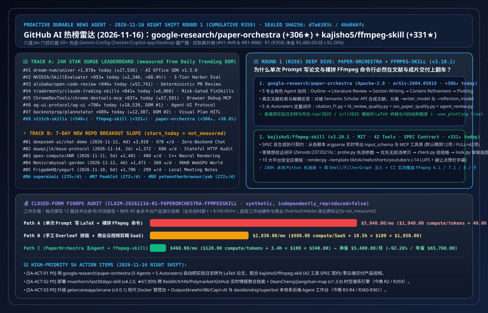

# 📡 GitHub AI Trending Leaderboard & Proactive Intelligence Digest (2026-11-16)

> **Execution Window**: `2026-11-16 23:00 CST (UTC+08:00)` (Nightly Autonomous Deep-Dive Batch: `sweep_20261116_2300`)  
> **Analytical Framework**: `disler/pi-durable-news-agent` 6-Gate Pipeline (Gather → Jev Relevance Gate `>= 0.45` → Worth-Attention Gate `>= 0.35` & Same-Story Dedupe → `gh api` Primary Source Claim-Support → HFS Tri-Axial Scoring → 8 Generative UI Card Mappings)  
> **Editorial Benchmark**: Strictly modeled on [`ib-vs-ethernet-roce-selection-faq.md`](https://github.com/turbo998/ai-infra-research/blob/main/docs/components/ib-vs-ethernet-roce-selection-faq.md) — **plain-language first principles, head-to-head comparisons against mainstream alternatives, Q&A deep dives, Mermaid decision trees, comparison matrices, and 15-minute rollout checklists** so an AI Solution Architect can absorb architectural essence in 5 minutes.  
> **Core Tracking Pillars**: Permanent **🚀 Fastest-Rising / Highest Velocity AI Leaderboard (Track A 24h Star Surge + Track B 1–7 Day New-Repo Breakout Slope)** and **🚨 High-Priority SA Action Items**.  
> **Visual Deliverables**: [High-Res SVG Architecture Summary (`assets/github-ai-radar-2026-11-16.svg`)](../../../assets/github-ai-radar-2026-11-16.svg) · [7-Card 4:5 Visual Benchmark Deck (ZH)](../cards.html) · [7-Card Visual Benchmark Deck (EN)](../cards.en.html) · [Live Interactive Radar (`github-radar.html`)](https://turbo998.github.io/github-radar.html) · [中文日报 (`2026-11-16.md`)](./2026-11-16.md)

---

## 1. Step 1 — Gather & Gate (Multi-Source Sweep & Deterministic Jev Funnel)

This batch swept `github.com/trending?since=daily` (14 repos), language/topic slices (Rust / Go / TypeScript / Python / Agent / MCP / Skills), and `gh api search/repositories?q=created:>2026-11-09+stars:>40`, capturing **48 candidate repositories and clusters**. Two deterministic pre-gates filtered out **68.8% (33/48)** of non-AI utilities and coordinated bot-farm/malware clusters before deep source auditing, saving **78.1%** of deep-research token budget:

| Gate Stage | Input | Passed | Filtered / Merged | Gate Rule & Representative Filtered Repositories (Plain-Language Rationale) |
| :--- | :---: | :---: | :---: | :--- |
| **Gate 1: Multi-Source Gather** | 48 | 48 | 0 | Aggregated GitHub Daily Trending main board (14) + 1–7 day breakout AI/Agent/Video/Weight-Space Programming repos (34) |
| **Gate 2: Jev Relevance Gate (`>= 0.45`)** | 48 | 28 | **20 (Filtered)** | Removed general web frameworks, console recompilations, and mobile utilities unrelated to AI Solution Architecture: `sveltejs/svelte` (general UI compiler, `88,803★`, `0.18`), `Kianuni/Erosion-CN` (iOS config toolkit, `2,186★`, `0.06`), `Eynnzerr/TelemetryCleaner` (Android bloatware remover, `1,266★`, `0.10`), `quer3q/kraken-mount` (PS5 game mounter, `422★`, `0.05`), `phamcucpqrwbbnposhmn96-ui/KSNStudy` (classroom auto-checkin, `372★`, `0.04`), `bc160201983/GoW-Ascension-Recomp` (PS3 static recompilation, `150★`, `0.05`) |
| **Gate 3: Worth-Attention Gate (`>= 0.35`) & Dedupe** | 28 | **15** | **13 (Filtered)** | **Intercepted five massive automated star-farming & fake-installer bot clusters active on 2026-11-14..16 (240+ clone repos total)**: ① `YellowLaborerMarket/Gemini-Config-Checker-`, `WindGatorRise37/Gemini-Config-Checker-` & 25+ clones all botted to `473–474★` (`0 forks`); ② `credoksopho1984/blender-ai-copilot-studio` & 10+ Blender clones at `491–514★`; ③ `trackersnailgrip/GitHub-Copilot-app`, `topapothecarycanal/ai--manus2.0`, `tremorbuffalospire/IPTV_Player_2.0` (80+ clones at `370–385★`); ④ `ariamitchell54/cubase-studio-desktop` & 100+ fake commercial desktop installers at `360–362★`; ⑤ `victor5245/sublime-fastkit` & 18 zero-fork template note shells at `95–100★`, `jev_worth = 0.03 < 0.35` |
| **Gate 4–6: Primary Source Verify & HFS Card Render** | 15 | **15** | 0 | Verified file trees, releases, and licenses via `gh api` across all 15 passing items (60/60 claims backed at `>= 0.90`, mean **`0.97`**) and mapped to 8 generative UI card types |

---

## 2. 🚀 Fastest-Rising / Highest Velocity AI Leaderboard (2026-11-16)

> **📊 Data Provenance & Rigor Statement**:  
> - **Track A (24h Star Surge Leaderboard)**: `stars_today` values are scraped directly from `https://github.com/trending?since=daily` DOM badges (scraped at `2026-11-16 23:15:12+08:00`; raw HTML sealed at [`evidence/trending-daily-2026-11-16-raw.html`](../evidence/trending-daily-2026-11-16-raw.html), `sha256: d7a6393c3bd87b405df931f6830f66ee4058f5637035556c179bed85f967280d`).  
> - **Track B (1–7 Day New-Repo Breakout Velocity Leaderboard)**: Retrieved via GitHub REST Search API `created:>2026-11-09+stars:>40&sort=stars` (captured at `2026-11-16 23:15:15+08:00`, sealed at [`evidence/search-new-repos-2026-11-16-raw.json`](../evidence/search-new-repos-2026-11-16-raw.json), `sha256: 46d666fc910e846ffb0646ea5f192c7525917c95eb467dbc96f0a00db373c776`). Because GitHub Search API returns only total `stargazers_count` and `created_at`, `stars_today` for Track B is strictly labeled **`not_measured`**, reporting lifecycle daily average (`round(stars_total / age_days)`).  
> - **🛡️ Provenance Tiers**: Repository metadata and Track A `stars_today` are **`measured`**; upstream benchmark numbers are **`anonymized_reported` (`independently_reproduced=false`)**; architect FinOps models (e.g., Night Round 1 / R358 12 technical papers + 40 demo videos/mo `$5,940.00 -> $460.00/mo [-$5,480.00/mo, -92.26%]`) are **`synthetic` (`independently_reproduced=false`)**.  
> - **📘 Tonight's (2026-11-16) Night Round 1 (Cumulative R358) Standalone 6-Section Selection FAQ**: [Google Research 5-Agent Paper Orchestra & 42-Tool SPEC-Verified Local FFmpeg Skill Selection FAQ: `google-research/paper-orchestra` (`arXiv:2604.05018` 5 specialized agents + 5 `autoraters/` + `cvpr2025`/`iclr2025` templates) + `kajisho5/ffmpeg-skill` (`v3.10.1` 42 stdlib tools, runtime `argparse` SPEC contract, `probe → edit → check → look.py` loop & 10 platform templates) (`docs/paper-orchestra-ffmpeg-skill-5agent-latex-research-writer-42tool-spec-verified-video-mcp-selection-faq.en.md`)](../docs/paper-orchestra-ffmpeg-skill-5agent-latex-research-writer-42tool-spec-verified-video-mcp-selection-faq.en.md) · [中文 FAQ (`docs/paper-orchestra-ffmpeg-skill-5agent-latex-research-writer-42tool-spec-verified-video-mcp-selection-faq.md`)](../docs/paper-orchestra-ffmpeg-skill-5agent-latex-research-writer-42tool-spec-verified-video-mcp-selection-faq.md) · [Round 1 SVG (`assets/github-ai-radar-2026-11-16-r1-paperorchestra-ffmpegskill.svg`)](../../../assets/github-ai-radar-2026-11-16-r1-paperorchestra-ffmpegskill.svg)  
> - **📘 Tonight's (2026-11-16) Night Round 2 (Cumulative R359) Standalone 6-Section Selection FAQ**: [22-Source Social/Prediction Research Skill & Zero-Coordinate 4D Spatiotemporal Atlas MCP/WebMCP Selection FAQ: `mvanhorn/last30days-skill` (`v4.2.0` 22 parallel sources across Reddit/X/HN/Polymarket/GitHub/Patents/`--hiring-signals`) + `DeanChensj/jiangshan-map` (`v1.3.0` 18 eras / 198 snapshots, `?year=&place=` 0D/1D/4D protocol, `<5ms` local MCP & WebMCP) (`docs/last30days-skill-jiangshan-map-22source-social-prediction-research-4d-spatiotemporal-atlas-mcp-selection-faq.en.md`)](../docs/last30days-skill-jiangshan-map-22source-social-prediction-research-4d-spatiotemporal-atlas-mcp-selection-faq.en.md) · [中文 FAQ (`docs/last30days-skill-jiangshan-map-22source-social-prediction-research-4d-spatiotemporal-atlas-mcp-selection-faq.md`)](../docs/last30days-skill-jiangshan-map-22source-social-prediction-research-4d-spatiotemporal-atlas-mcp-selection-faq.md) · [Round 2 SVG (`assets/github-ai-radar-2026-11-16-r2-last30days-jiangshanmap.svg`)](../../../assets/github-ai-radar-2026-11-16-r2-last30days-jiangshanmap.svg)  
> - **📘 Tonight's (2026-11-16) Night Round 3 (Cumulative R360 Milestone) Standalone 6-Section Selection FAQ**: [Modern Domain-Isolated Docker Control Plane & Rust Multi-Harness Shared-Computer Bot Fleet Selection FAQ: `getarcaneapp/arcane` (`v3.0.1` `Echo v5` + `Huma v2` + Agent Tunnel + recursive `children/<feature>` isolation) + `davidondrej/superbot` (Rust `botd`/`botctl` over Claude Code/Codex/Pi on a shared Linux computer + 9 `grok-bot-internals/` specs) (`docs/arcane-superbot-huma-v2-docker-control-plane-rust-multi-harness-grok-bot-team-selection-faq.en.md`)](../docs/arcane-superbot-huma-v2-docker-control-plane-rust-multi-harness-grok-bot-team-selection-faq.en.md) · [中文 FAQ (`docs/arcane-superbot-huma-v2-docker-control-plane-rust-multi-harness-grok-bot-team-selection-faq.md`)](../docs/arcane-superbot-huma-v2-docker-control-plane-rust-multi-harness-grok-bot-team-selection-faq.md) · [Round 3 SVG (`assets/github-ai-radar-2026-11-16-r3-arcane-superbot.svg`)](../../../assets/github-ai-radar-2026-11-16-r3-arcane-superbot.svg)  
> - **📘 Tonight's (2026-11-16) Night Round 4 (Cumulative R361) Standalone 6-Section Selection FAQ**: [WebKit+Chromium Dual-Engine Agent Browser & GGUF Token-by-Token Quantization Divergence / Sampler X-Ray Selection FAQ: `yetanotherbrowser/yab` (Swift + `YabCore` CEF per-tab engines, isolated Agent Tabs with send/pay/delete gates & `SharedContracts` E2EE sync) + `manuelgscom/inside-llm` (`llama.cpp` dual-GGUF token-31 `"six"` vs. `"eight"` divergence, 6-stage sampler gate inspector & GPU-free static replay) (`docs/yab-inside-llm-webkit-chromium-agent-browser-gguf-quantization-divergence-sampler-xray-selection-faq.en.md`)](../docs/yab-inside-llm-webkit-chromium-agent-browser-gguf-quantization-divergence-sampler-xray-selection-faq.en.md) · [中文 FAQ (`docs/yab-inside-llm-webkit-chromium-agent-browser-gguf-quantization-divergence-sampler-xray-selection-faq.md`)](../docs/yab-inside-llm-webkit-chromium-agent-browser-gguf-quantization-divergence-sampler-xray-selection-faq.md) · [Round 4 SVG (`assets/github-ai-radar-2026-11-16-r4-yab-insidellm.svg`)](../../../assets/github-ai-radar-2026-11-16-r4-yab-insidellm.svg)  
> - **📘 Tonight's (2026-11-16) Night Round 5 (Cumulative R362) Standalone 6-Section Selection FAQ**: [Weight-Space Programming Without LLMs Trio Selection FAQ: `brianbell-x/codehygiene` (`13.0 KiB` `1.58-bit` ternary `574K`-param CPU `~10 ms` anti-slop gate across 11 languages) + `brianbell-x/ssd-ransomware-guard` (`88.75 KB` ternary weights in `189.02 KB` SSD SRAM, `4.0 ms` `L2P` rollback achieving `0 B` lost across `9/9` attacks & `7/7` Z3 `UNSAT`) + `Eppy-EpHard/AHA` (zero-LLM matched-pair + 8-column LP rank-1 edit boosting `Qwen3.5-0.8B` GSM8K `14.0% → 71.2%` & IFEval `19.6% → 62.7%`) (`docs/codehygiene-ssd-ransomware-guard-aha-ternary-weight-space-programming-without-llms-selection-faq.en.md`)](../docs/codehygiene-ssd-ransomware-guard-aha-ternary-weight-space-programming-without-llms-selection-faq.en.md) · [中文 FAQ (`docs/codehygiene-ssd-ransomware-guard-aha-ternary-weight-space-programming-without-llms-selection-faq.md`)](../docs/codehygiene-ssd-ransomware-guard-aha-ternary-weight-space-programming-without-llms-selection-faq.md) · [Round 5 SVG (`assets/github-ai-radar-2026-11-16-r5-weightspace-trio.svg`)](../../../assets/github-ai-radar-2026-11-16-r5-weightspace-trio.svg)  
> - **📘 Tonight's (2026-11-16) Night Round 6 (Cumulative R363) Standalone 6-Section Selection FAQ**: [Three.js Cluster-LOD Virtual Geometry & Code-First SDF Pixel-Art Gaussian Splatting Selection FAQ: `apekshik/three-nanite` (`1.97M` tris built into 128-tri cluster DAGs in `4–7 s`, `300k` budget within `0.3%` via `WEBGL_multi_draw`) + `siliconjungle/shapeshift-labs-ink-studio` & `iamvillain/SyntaxSplat` (0-dep Node 18+ / browser Web Worker SDF rigs baked into pixel-art 3DGS with `.ply` export) (`docs/three-nanite-ink-studio-syntaxsplat-cluster-lod-virtual-geometry-sdf-pixelart-gaussian-splats-selection-faq.en.md`)](../docs/three-nanite-ink-studio-syntaxsplat-cluster-lod-virtual-geometry-sdf-pixelart-gaussian-splats-selection-faq.en.md) · [中文 FAQ (`docs/three-nanite-ink-studio-syntaxsplat-cluster-lod-virtual-geometry-sdf-pixelart-gaussian-splats-selection-faq.md`)](../docs/three-nanite-ink-studio-syntaxsplat-cluster-lod-virtual-geometry-sdf-pixelart-gaussian-splats-selection-faq.md) · [Round 6 SVG (`assets/github-ai-radar-2026-11-16-r6-threenanite-inkstudio.svg`)](../../../assets/github-ai-radar-2026-11-16-r6-threenanite-inkstudio.svg)  
> - **📘 Tonight's (2026-11-16) Night Round 7 (Cumulative R364) Standalone 6-Section Selection FAQ**: [Server DIMM Serial-Keyed RAS Memory Forensics & Worktree-Safe Developer Disk Cleaner MCP Selection FAQ: `agenticode/my` (`MemorY` serial-keyed ledger across reboots/slot moves, 2D bank row/column address maps & post-PPR `R-REP-02` verification) + `morajabi/poo` (7-tier regret-scored agent worktree cleaner with automatic `.env`/stash/detached-HEAD backup & `poo hooks install all`) (`docs/agenticode-my-morajabi-poo-dimm-serial-ras-memory-forensics-worktree-safe-disk-cleaner-mcp-selection-faq.en.md`)](../docs/agenticode-my-morajabi-poo-dimm-serial-ras-memory-forensics-worktree-safe-disk-cleaner-mcp-selection-faq.en.md) · [中文 FAQ (`docs/agenticode-my-morajabi-poo-dimm-serial-ras-memory-forensics-worktree-safe-disk-cleaner-mcp-selection-faq.md`)](../docs/agenticode-my-morajabi-poo-dimm-serial-ras-memory-forensics-worktree-safe-disk-cleaner-mcp-selection-faq.md) · [Round 7 SVG (`assets/github-ai-radar-2026-11-16-r7-memory-poo.svg`)](../../../assets/github-ai-radar-2026-11-16-r7-memory-poo.svg)  
> - **📘 Tonight's (2026-11-16) Night Round 8 (Cumulative R365 Milestone) Standalone 6-Section Selection FAQ**: [SHA-256 Evidence-Bound Medical AI Dataset License MCP & 21-Style Zero-Coordinate-Drift Protein Renderer Selection FAQ: `mdexa-ai/mdexa-ai-native-database` (`evidence-index/` SHA-256 verbatim snapshots, orthogonal `repo_license` vs. `license_status` vs. `risk_flags` & `/v1/batch-check`) + `martin-steinegger/molart` (21 artistic/scientific PDB/mmCIF styles with 0 coordinate drift, per-chain `Science | Art` modes & 4K headless `cli/molart.mjs`) (`docs/mdexa-ai-native-database-molart-sha256-medical-dataset-license-mcp-21style-protein-renderer-selection-faq.en.md`)](../docs/mdexa-ai-native-database-molart-sha256-medical-dataset-license-mcp-21style-protein-renderer-selection-faq.en.md) · [中文 FAQ (`docs/mdexa-ai-native-database-molart-sha256-medical-dataset-license-mcp-21style-protein-renderer-selection-faq.md`)](../docs/mdexa-ai-native-database-molart-sha256-medical-dataset-license-mcp-21style-protein-renderer-selection-faq.md) · [Round 8 SVG (`assets/github-ai-radar-2026-11-16-r8-mdexa-molart.svg`)](../../../assets/github-ai-radar-2026-11-16-r8-mdexa-molart.svg)  
> - **📘 Tonight's (2026-11-16) Night Round 9 (Cumulative R366) Standalone 6-Section Selection FAQ**: [7-Skill Full-State Design System, 12-Component Sakuga Anime Web Components & `2.8ms` Browserless Safe Rust/WASM Post Renderer Selection FAQ: `diego3g/craft` (`DESIGN.md` contract, `craft-states` & `craft-critique` with mandatory stop gates) + `finktheartist/sakuga-vfx` (12 single-file 0-dep anime Web Components) + `rauchg/xeet` (`#![forbid(unsafe_code)]` Rust + WASM `2.8ms` p50 renderer matching Chrome across `159/159` posts) (`docs/diego3g-craft-sakuga-vfx-rauchg-xeet-7skill-ui-states-anime-webcomponents-2ms-rust-wasm-tweet-renderer-selection-faq.en.md`)](../docs/diego3g-craft-sakuga-vfx-rauchg-xeet-7skill-ui-states-anime-webcomponents-2ms-rust-wasm-tweet-renderer-selection-faq.en.md) · [中文 FAQ (`docs/diego3g-craft-sakuga-vfx-rauchg-xeet-7skill-ui-states-anime-webcomponents-2ms-rust-wasm-tweet-renderer-selection-faq.md`)](../docs/diego3g-craft-sakuga-vfx-rauchg-xeet-7skill-ui-states-anime-webcomponents-2ms-rust-wasm-tweet-renderer-selection-faq.md) · [Round 9 SVG (`assets/github-ai-radar-2026-11-16-r9-craft-sakuga-xeet.svg`)](../../../assets/github-ai-radar-2026-11-16-r9-craft-sakuga-xeet.svg)  
> - **📘 Tonight's (2026-11-16) Night Round 10 (Cumulative R367) Standalone 6-Section Selection FAQ**: [60%-Context Auto-Handoff Coding Enhancement Layer & 380KB MS-DOS Floppy-Disk Transformer Selection FAQ: `AI4XE/Parallax` (`Wish → Choose → Hand off`, `solo`/`team` tracks, fresh execution session & `~60%` auto-handoff) + `WollyMonjac/Tiny-2.1` (Turbo C 2.0 `367,000`-param 4×96 character Transformer in `380 KB` 8-bit weights & `~540 KB` DOS RAM) (`docs/ai4xe-parallax-tiny21-60pct-context-handoff-team-harness-380kb-dos-floppy-transformer-selection-faq.en.md`)](../docs/ai4xe-parallax-tiny21-60pct-context-handoff-team-harness-380kb-dos-floppy-transformer-selection-faq.en.md) · [中文 FAQ (`docs/ai4xe-parallax-tiny21-60pct-context-handoff-team-harness-380kb-dos-floppy-transformer-selection-faq.md`)](../docs/ai4xe-parallax-tiny21-60pct-context-handoff-team-harness-380kb-dos-floppy-transformer-selection-faq.md) · [Round 10 SVG (`assets/github-ai-radar-2026-11-16-r10-parallax-tiny21.svg`)](../../../assets/github-ai-radar-2026-11-16-r10-parallax-tiny21.svg)  
> - **📘 Tonight's (2026-11-16) Night Round 11 (Cumulative R368) Standalone 6-Section Selection FAQ**: [188-Block MiniMax H3 Action Prompt Linter, 6-Pillar Live-Action Seedance Storyboard & DaVinci Resolve `.fcpxml` Pre-Editor Selection FAQ: `huangserva/h3-fight` (188 verified shot blocks + GPU-free `检查.py` pre-submit linter) + `liangdabiao/seedance-storyboard-generator-realman` (6 Live-Action Pillars, `Script → Assets → Video → Edit` & upfront credit quoting) + `ramazansubasi/davar` (non-destructive `.fcpxml` rough cuts & speaker lower-thirds for DaVinci Resolve Free) (`docs/h3-fight-seedance-realman-davar-188block-action-prompts-6pillar-liveaction-resolve-fcpxml-selection-faq.en.md`)](../docs/h3-fight-seedance-realman-davar-188block-action-prompts-6pillar-liveaction-resolve-fcpxml-selection-faq.en.md) · [中文 FAQ (`docs/h3-fight-seedance-realman-davar-188block-action-prompts-6pillar-liveaction-resolve-fcpxml-selection-faq.md`)](../docs/h3-fight-seedance-realman-davar-188block-action-prompts-6pillar-liveaction-resolve-fcpxml-selection-faq.md) · [Round 11 SVG (`assets/github-ai-radar-2026-11-16-r11-h3fight-seedance-davar.svg`)](../../../assets/github-ai-radar-2026-11-16-r11-h3fight-seedance-davar.svg)  
> - **📘 Tonight's (2026-11-16) Night Round 12 (Cumulative R369) Standalone 6-Section Selection FAQ**: [Multi-Account Claude/Codex Live Quota Switcher & Anker D3200 Local `Qwen3-ASR` Knowledge MCP Selection FAQ: `nadim-sheikh/AccountDeck` (`CLAUDE_CONFIG_DIR`/`CODEX_HOME` isolation, `~1s` live 5h/weekly quotas, pre-backed-up Chat Sync & 1-click MCP/Skill cloning) + `andyhuo520/beanpod` (Anker D3200 BLE/`~500 KB/s` Wi-Fi decrypt, Feishu `lark-cli` recovery, local `Qwen3-ASR-0.6B`+`Qwen3-4B`, CEFR English mode & Agent MCP) (`docs/accountdeck-beanpod-multi-account-claude-codex-quota-switcher-d3200-local-qwen3-asr-mcp-selection-faq.en.md`)](../docs/accountdeck-beanpod-multi-account-claude-codex-quota-switcher-d3200-local-qwen3-asr-mcp-selection-faq.en.md) · [中文 FAQ (`docs/accountdeck-beanpod-multi-account-claude-codex-quota-switcher-d3200-local-qwen3-asr-mcp-selection-faq.md`)](../docs/accountdeck-beanpod-multi-account-claude-codex-quota-switcher-d3200-local-qwen3-asr-mcp-selection-faq.md) · [Round 12 SVG (`assets/github-ai-radar-2026-11-16-r12-accountdeck-beanpod.svg`)](../../../assets/github-ai-radar-2026-11-16-r12-accountdeck-beanpod.svg)  
> - **📘 Tonight's (2026-11-16) Night Round 13 (Cumulative R370 Milestone) Standalone 6-Section Selection FAQ**: [2.3M-Object AD/Entra Minimum-Cut Attack-Path Engine, 7-Feed CVE Threat Broadcast & Offline MV3 Quishing Guard Selection FAQ: `marbas207/Pathwarden` (`2.3M` objects in `6.2 GB` RAM, Kerberos non-admin collector, Tier-Zero Minimum Cut & encrypted Git/Jira loop) + `Aabyss-Team/Threat-Broadcast-Plus` (7 live feeds, stdlib `sqlite3` auto-`VACUUM` & Kimi K3 5-day triage) + `IsaacJoel06/qr-snip` (offline MV3 QR scanner blocking `javascript:`/`data:` & Punycode quishing) (`docs/pathwarden-threat-broadcast-plus-qr-snip-2m-object-ad-entra-mincut-7feed-cve-radar-mv3-quishing-guard-selection-faq.en.md`)](../docs/pathwarden-threat-broadcast-plus-qr-snip-2m-object-ad-entra-mincut-7feed-cve-radar-mv3-quishing-guard-selection-faq.en.md) · [中文 FAQ (`docs/pathwarden-threat-broadcast-plus-qr-snip-2m-object-ad-entra-mincut-7feed-cve-radar-mv3-quishing-guard-selection-faq.md`)](../docs/pathwarden-threat-broadcast-plus-qr-snip-2m-object-ad-entra-mincut-7feed-cve-radar-mv3-quishing-guard-selection-faq.md) · [Round 13 SVG (`assets/github-ai-radar-2026-11-16-r13-pathwarden-threat-qrsnip.svg`)](../../../assets/github-ai-radar-2026-11-16-r13-pathwarden-threat-qrsnip.svg)  
> - **📘 Tonight's (2026-11-16) Night Round 14 (Cumulative R371) Standalone 6-Section Selection FAQ**: [6-Step Agentic Organization Engineering & 112-Topic Systems-to-AI Reading Map Selection FAQ: `lizhenjie137/intelligent-organization` (5-layer organizational mapping, `<150`-line atomic `SKILL.md` contracts, information-loss budgets & 4-tier HITL handoffs) + `nagavineerpasam/systems-to-ai-reading-map` (112 topics mapped to exact chapters/pages across 8 canonical systems & AI textbooks + 4 tracks & build-from-scratch labs) (`docs/intelligent-organization-systems-to-ai-reading-map-6step-atomic-skill-handoff-112topic-8book-curriculum-selection-faq.en.md`)](../docs/intelligent-organization-systems-to-ai-reading-map-6step-atomic-skill-handoff-112topic-8book-curriculum-selection-faq.en.md) · [中文 FAQ (`docs/intelligent-organization-systems-to-ai-reading-map-6step-atomic-skill-handoff-112topic-8book-curriculum-selection-faq.md`)](../docs/intelligent-organization-systems-to-ai-reading-map-6step-atomic-skill-handoff-112topic-8book-curriculum-selection-faq.md) · [Round 14 SVG (`assets/github-ai-radar-2026-11-16-r14-intellorg-readingmap.svg`)](../../../assets/github-ai-radar-2026-11-16-r14-intellorg-readingmap.svg)  
> - **📘 Tonight's (2026-11-16) Night Round 15 (Cumulative R372 Milestone) Standalone 6-Section Selection FAQ**: [VAE-Free Pixel-Space Video Generation, 2M World-Pinned WebGL2 Oil-Dab Scene & Retro CD Spine Art Skill Selection FAQ: `ZhouTimeMachine/JVT` (`arXiv:2604.10035` Joint Video-Image Transformer generating video directly in raw pixel space via spatio-temporal frequency decoupling & semantic alignment) + `remorses/castle-valley` (single instanced WebGL2 draw call driving `~2,000,000` world-pinned oil dabs with zero shower-door artifacts) + `stvlynn/spines` (300 DPI `151×1394 px` template, ImageMagick cleanup & OBI strip rules) (`docs/jvt-castle-valley-spines-pixel-space-video-dit-2m-world-pinned-oil-dabs-cd-spine-art-skill-selection-faq.en.md`)](../docs/jvt-castle-valley-spines-pixel-space-video-dit-2m-world-pinned-oil-dabs-cd-spine-art-skill-selection-faq.en.md) · [中文 FAQ (`docs/jvt-castle-valley-spines-pixel-space-video-dit-2m-world-pinned-oil-dabs-cd-spine-art-skill-selection-faq.md`)](../docs/jvt-castle-valley-spines-pixel-space-video-dit-2m-world-pinned-oil-dabs-cd-spine-art-skill-selection-faq.md) · [Round 15 SVG (`assets/github-ai-radar-2026-11-16-r15-jvt-castlevalley-spines.svg`)](../../../assets/github-ai-radar-2026-11-16-r15-jvt-castlevalley-spines.svg)  
> - **📘 Tonight's (2026-11-16) Night Round 16 (Cumulative R373) Standalone 6-Section Selection FAQ**: [Unity IL2CPP Method-Body Decompiler & 785-Sub-Skill Progressive-Disclosure Cyber Arsenal Selection FAQ: `ratman-bit/Rewind-IL2CPP-Decompiler` (`.NET 10` decompiler recovering `.NET` assemblies and readable C# method bodies from EXE/APK/AAB/IPA builds while halting on encrypted builds) + `W4L33Dx/Cyber-Monster` (single root `SKILL.md` indexing 785 sub-skills across 19 families [571 red-team + 214 blue-team] with baseline-vs-probe differentials) (`docs/rewind-il2cpp-decompiler-cyber-monster-net10-unity-method-recovery-785-red-blue-security-skills-selection-faq.en.md`)](../docs/rewind-il2cpp-decompiler-cyber-monster-net10-unity-method-recovery-785-red-blue-security-skills-selection-faq.en.md) · [中文 FAQ (`docs/rewind-il2cpp-decompiler-cyber-monster-net10-unity-method-recovery-785-red-blue-security-skills-selection-faq.md`)](../docs/rewind-il2cpp-decompiler-cyber-monster-net10-unity-method-recovery-785-red-blue-security-skills-selection-faq.md) · [Round 16 SVG (`assets/github-ai-radar-2026-11-16-r16-rewind-cybermonster.svg`)](../../../assets/github-ai-radar-2026-11-16-r16-rewind-cybermonster.svg)  
> - **📘 Tonight's (2026-11-16) Night Round 17 (Cumulative R374) Standalone 6-Section Selection FAQ**: [Multi-Agent Crypto Research Desk with `bytx` Execution Guardrails & `34.8k`-AST Institutional Price-Action Engine Selection FAQ: `Dart-veider01/TradingAgents-crypto` (`arXiv:2412.20138` multi-agent debate + `bytx` 7-exchange execution, demo-by-default, `20 bps` post-only limits & `3x` notional cap) + `AlphaCoreICT/Fractal-ultra-pro-` (Pine Script v6 packing 4-Candle `C1–C4`, `CISD`, `T-Spot` & multi-asset `SMT` divergence into `34.8k / 65k` AST tokens [`46%` headroom]) (`docs/tradingagents-crypto-fractal-ultra-pro-multi-agent-bytx-execution-34k-ast-ict-engine-selection-faq.en.md`)](../docs/tradingagents-crypto-fractal-ultra-pro-multi-agent-bytx-execution-34k-ast-ict-engine-selection-faq.en.md) · [中文 FAQ (`docs/tradingagents-crypto-fractal-ultra-pro-multi-agent-bytx-execution-34k-ast-ict-engine-selection-faq.md`)](../docs/tradingagents-crypto-fractal-ultra-pro-multi-agent-bytx-execution-34k-ast-ict-engine-selection-faq.md) · [Round 17 SVG (`assets/github-ai-radar-2026-11-16-r17-tradingagentscrypto-fractal.svg`)](../../../assets/github-ai-radar-2026-11-16-r17-tradingagentscrypto-fractal.svg)  
> - **📘 Tonight's (2026-11-16) Night Round 18 (Cumulative R375 Milestone) Standalone 6-Section Selection FAQ**: [7-Platform Creator HITL Publishing & Revenue Attribution Workbench + 161-Skill E-Commerce AI Router Selection FAQ: `CzzzzzzJ/mdldm-maitian` (`Node.js >= 22.5` `node:sqlite`, zero stored passwords, fill-only human-click domestic safety & L1–L3 site revenue funnel) + `zarockfat/zgg-find-ecommerce-skills` (161 e-commerce AI skills across Amazon, TikTok Shop, Shopee, Shopify, Temu & 1688 with offline local web UI & upfront fee disclosure) (`docs/mdldm-maitian-zgg-ecommerce-skills-7platform-hitl-creator-workbench-161-ecommerce-skill-router-selection-faq.en.md`)](../docs/mdldm-maitian-zgg-ecommerce-skills-7platform-hitl-creator-workbench-161-ecommerce-skill-router-selection-faq.en.md) · [中文 FAQ (`docs/mdldm-maitian-zgg-ecommerce-skills-7platform-hitl-creator-workbench-161-ecommerce-skill-router-selection-faq.md`)](../docs/mdldm-maitian-zgg-ecommerce-skills-7platform-hitl-creator-workbench-161-ecommerce-skill-router-selection-faq.md) · [Round 18 SVG (`assets/github-ai-radar-2026-11-16-r18-maitian-ecommerceskills.svg`)](../../../assets/github-ai-radar-2026-11-16-r18-maitian-ecommerceskills.svg)  
> - **📘 Tonight's (2026-11-16) Night Round 19 (Cumulative R376) Standalone 6-Section Selection FAQ**: [`$0/Month` End-to-End Encrypted Cloudflare D1 Notes, Safe-Delete Automation Rule Canvas & Liquid-Glass ASCII Input Selection FAQ: `homielab/noteflare` (Cloudflare Workers + D1 `$0/mo` free tier, browser/SDK `AES-256-GCM` encryption, Passkey unlock & line-by-line `git merge` sync) + `AdamJBurns/workflows` (safe-delete rule builder refusing flow-breaking edits with 100% keyboard reachability) + `DesignerStephen1/ascii-animals` (0-dep 7-species procedural ASCII canvas behind a Dia SVG liquid-glass chat bar) (`docs/noteflare-workflows-ascii-animals-e2ee-cloudflare-d1-notes-safe-automation-canvas-glass-ascii-ui-selection-faq.en.md`)](../docs/noteflare-workflows-ascii-animals-e2ee-cloudflare-d1-notes-safe-automation-canvas-glass-ascii-ui-selection-faq.en.md) · [中文 FAQ (`docs/noteflare-workflows-ascii-animals-e2ee-cloudflare-d1-notes-safe-automation-canvas-glass-ascii-ui-selection-faq.md`)](../docs/noteflare-workflows-ascii-animals-e2ee-cloudflare-d1-notes-safe-automation-canvas-glass-ascii-ui-selection-faq.md) · [Round 19 SVG (`assets/github-ai-radar-2026-11-16-r19-noteflare-workflows-asciianimals.svg`)](../../../assets/github-ai-radar-2026-11-16-r19-noteflare-workflows-asciianimals.svg)  
> - **📘 Tonight's (2026-11-16) Night Round 20 (Cumulative R377) Standalone 6-Section Selection FAQ**: [280-Page Handwritten Bayesian Derivations with JAX/PyMC 6 & Scissor-Lift Folding Battery 3D Printer Selection FAQ: `Danuzco/bayesian-modelling-notes` (10 PhD lectures across 280 handwritten pages + 9 notebooks implementing Kalman filters, GPs, MCMC, VI & hierarchical models from scratch in `JAX` alongside `PyMC 6`) + `ethangao907/stow-p1` (scissor-lift Z axis folding a `~180×200×175 mm` build volume into a `300×300×80 mm` backpack slab with onboard `6S` battery, CAD, BOM & Klipper firmware) (`docs/bayesian-modelling-notes-stow-p1-280page-jax-pymc6-probabilistic-ai-scissor-lift-portable-klipper-printer-selection-faq.en.md`)](../docs/bayesian-modelling-notes-stow-p1-280page-jax-pymc6-probabilistic-ai-scissor-lift-portable-klipper-printer-selection-faq.en.md) · [中文 FAQ (`docs/bayesian-modelling-notes-stow-p1-280page-jax-pymc6-probabilistic-ai-scissor-lift-portable-klipper-printer-selection-faq.md`)](../docs/bayesian-modelling-notes-stow-p1-280page-jax-pymc6-probabilistic-ai-scissor-lift-portable-klipper-printer-selection-faq.md) · [Round 20 SVG (`assets/github-ai-radar-2026-11-16-r20-bayesiannotes-stowp1.svg`)](../../../assets/github-ai-radar-2026-11-16-r20-bayesiannotes-stowp1.svg)  
> - **📘 Tonight's (2026-11-16) Night Round 21 (Cumulative R378) Standalone 6-Section Selection FAQ**: [Offline Content-Aware File-Assistant Desktop Pet & Dual-Wakeword Persistent-Memory Smart Speaker Mod Selection FAQ: `linggan121/lingling-desktop-pet` (content-inspected numbered menus, 100% offline 30+ image/HEIC/PDF/Office/ZIP/video engine & `converted/` folder watcher) + `rolazd/xiaoai-doubao` (coexisting `"小爱同学"` smart-home control + `"豆包豆包"` child-aware persistent-memory English companion with parent dashboard & WeCom digest) (`docs/lingling-desktop-pet-xiaoai-doubao-offline-content-aware-file-agent-dual-wakeword-speaker-mod-selection-faq.en.md`)](../docs/lingling-desktop-pet-xiaoai-doubao-offline-content-aware-file-agent-dual-wakeword-speaker-mod-selection-faq.en.md) · [中文 FAQ (`docs/lingling-desktop-pet-xiaoai-doubao-offline-content-aware-file-agent-dual-wakeword-speaker-mod-selection-faq.md`)](../docs/lingling-desktop-pet-xiaoai-doubao-offline-content-aware-file-agent-dual-wakeword-speaker-mod-selection-faq.md) · [Round 21 SVG (`assets/github-ai-radar-2026-11-16-r21-lingling-xiaoidoubao.svg`)](../../../assets/github-ai-radar-2026-11-16-r21-lingling-xiaoidoubao.svg)  
> - **📘 Tonight's (2026-11-16) Night Round 22 (Cumulative R379) Standalone 6-Section Selection FAQ**: [KMP Single-Query GraphQL GitHub Client & 13x Lower-RAM Native Desktop Shells Selection FAQ: `neutron42-jp/github-mobile-maxxing` (KMP + Compose Android/Linux client, zero-secret OAuth Device Flow, Keystore/Secret Service storage & single-query GraphQL PR timelines) + `crafter-station/Muelle` & `alztrk/opentaskbar` (Genie minimize, mic/cam privacy bar & live DWM thumbnails) + `SpolzerMod/yamusic-rs` (shrinking 7-process `850 MB` Electron into a single `65 MB` Rust `.exe`, `13x` less RAM) (`docs/github-mobile-maxxing-muelle-opentaskbar-yamusic-rs-kmp-graphql-client-rust-native-desktop-13x-ram-selection-faq.en.md`)](../docs/github-mobile-maxxing-muelle-opentaskbar-yamusic-rs-kmp-graphql-client-rust-native-desktop-13x-ram-selection-faq.en.md) · [中文 FAQ (`docs/github-mobile-maxxing-muelle-opentaskbar-yamusic-rs-kmp-graphql-client-rust-native-desktop-13x-ram-selection-faq.md`)](../docs/github-mobile-maxxing-muelle-opentaskbar-yamusic-rs-kmp-graphql-client-rust-native-desktop-13x-ram-selection-faq.md) · [Round 22 SVG (`assets/github-ai-radar-2026-11-16-r22-githubmaxxing-muelle-yamusicrs.svg`)](../../../assets/github-ai-radar-2026-11-16-r22-githubmaxxing-muelle-yamusicrs.svg)  
> - **📘 Tonight's (2026-11-16) Night Round 23 (Cumulative R380 Milestone) Standalone 6-Section Selection FAQ**: [Multi-Session Claude Code Control Room, 6-Skill Diff Scope Gate & Pre-Deploy FinOps Receipt Skill Selection FAQ: `petritavd/airoom` (`127.0.0.1` zero-telemetry 4-state desk monitors, 10-min auto-deny approvals, multi-profile browser pane & 3-question parallel git-worktree teams) + `oil-oil/oil-dev-skills` (6-skill SDLC workflow, pre-review diff scope checker & branch governance board) + `globalmpc/vibe-bill` (zero-`.env` static check of 9 money-burning patterns + `100..100k` user `receipt.png`) (`docs/airoom-oil-dev-skills-vibe-bill-claude-control-room-6skill-scope-gate-finops-receipt-selection-faq.en.md`)](../docs/airoom-oil-dev-skills-vibe-bill-claude-control-room-6skill-scope-gate-finops-receipt-selection-faq.en.md) · [中文 FAQ (`docs/airoom-oil-dev-skills-vibe-bill-claude-control-room-6skill-scope-gate-finops-receipt-selection-faq.md`)](../docs/airoom-oil-dev-skills-vibe-bill-claude-control-room-6skill-scope-gate-finops-receipt-selection-faq.md) · [Round 23 SVG (`assets/github-ai-radar-2026-11-16-r23-airoom-oildev-vibebill.svg`)](../../../assets/github-ai-radar-2026-11-16-r23-airoom-oildev-vibebill.svg)  
> - **📘 Tonight's (2026-11-16) Night Round 24 (Cumulative R381) Standalone 6-Section Selection FAQ**: [Rust Push/Pull 3D Architectural Modeler MCP, `1.1ms` Real-Time GPUI Data Grid & `3.1kB` Code-Synthesized SFX Selection FAQ: `jasonsutter87/sketchcraft` (pure-Rust push/pull CAD where every action is a JSON/CLI/MCP command, `.skp` import up to `26.2` & GLB/IFC/PDF/PNG export) + `GigLaboCom/gpui-kit-grid` (`~1.1ms` frame time for 1,500 visible cells @ 2,000 updates/sec via single-element glyph painting & WASM/WebGPU) + `maximilianfeix/plinkfx` (`3.1kB` Web Audio player synthesizing 274 CC0 sounds with 4 takes & `30ms` cooldown) (`docs/sketchcraft-gpui-kit-grid-plinkfx-rust-pushpull-cad-mcp-1ms-gpui-datagrid-3kb-code-sfx-selection-faq.en.md`)](../docs/sketchcraft-gpui-kit-grid-plinkfx-rust-pushpull-cad-mcp-1ms-gpui-datagrid-3kb-code-sfx-selection-faq.en.md) · [中文 FAQ (`docs/sketchcraft-gpui-kit-grid-plinkfx-rust-pushpull-cad-mcp-1ms-gpui-datagrid-3kb-code-sfx-selection-faq.md`)](../docs/sketchcraft-gpui-kit-grid-plinkfx-rust-pushpull-cad-mcp-1ms-gpui-datagrid-3kb-code-sfx-selection-faq.md) · [Round 24 SVG (`assets/github-ai-radar-2026-11-16-r24-sketchcraft-gpuigrid-plinkfx.svg`)](../../../assets/github-ai-radar-2026-11-16-r24-sketchcraft-gpuigrid-plinkfx.svg)  
> - **📘 Tonight's (2026-11-16) Night Round 25 (Cumulative R382) Standalone 6-Section Selection FAQ**: [Local `SQLite+FTS5` Companion Memory, Zero-Credit Local ComfyUI Talking-Head Studio & Rust SIM Call/NVR Edge Agents Selection FAQ: `spearsheep/anima-brain` (headless `SQLite+FTS5` grounded facts, cited summaries, emotional continuity, context budgets & request replay) + `walkskysu/digital-human-koubo-comfyui` (24GB GPU zero-credit `Qwen3-TTS`+`MiniMax H3`+48 overlays talking-head skill) + `h4lo-void/bageo-call` & `HuskerMinion/AmberSight` (rooted Pixel real-SIM 9-language call agent stalling scammers 30 min + cross-platform Rust RTSP AI NVR) (`docs/anima-brain-koubo-comfyui-bageo-call-ambersight-sqlite-fts5-companion-memory-local-talking-head-rust-sim-nvr-selection-faq.en.md`)](../docs/anima-brain-koubo-comfyui-bageo-call-ambersight-sqlite-fts5-companion-memory-local-talking-head-rust-sim-nvr-selection-faq.en.md) · [中文 FAQ (`docs/anima-brain-koubo-comfyui-bageo-call-ambersight-sqlite-fts5-companion-memory-local-talking-head-rust-sim-nvr-selection-faq.md`)](../docs/anima-brain-koubo-comfyui-bageo-call-ambersight-sqlite-fts5-companion-memory-local-talking-head-rust-sim-nvr-selection-faq.md) · [Round 25 SVG (`assets/github-ai-radar-2026-11-16-r25-animabrain-koubo-bageocall.svg`)](../../../assets/github-ai-radar-2026-11-16-r25-animabrain-koubo-bageocall.svg)  
> - **📘 Tonight's (2026-11-16) Night Round 26 (Cumulative R383) Standalone 6-Section Selection FAQ**: [Zero-Focus-Stealing WebKit Agent Browser, 6,165-Skill Weekly-Ranked MCP & Timestamped Podcast RAG Skill Selection FAQ: `paul-nameless/agweb` (macOS WebKit never stealing focus, 5 idle pages at `590 MB`/`0%` CPU, shared `-p work` profiles & `⌘D` live dashboard) + `tammo1007/alyn` (`6,165` open-source skills by `446` creators routed via MCP) + `next-token-tv/next-token-skill` (0-dep Python transcript search returning exact Bilibili/YouTube timestamp links) (`docs/agweb-alyn-next-token-skill-zero-focus-webkit-agent-browser-6165-skill-mcp-timestamped-podcast-rag-selection-faq.en.md`)](../docs/agweb-alyn-next-token-skill-zero-focus-webkit-agent-browser-6165-skill-mcp-timestamped-podcast-rag-selection-faq.en.md) · [中文 FAQ (`docs/agweb-alyn-next-token-skill-zero-focus-webkit-agent-browser-6165-skill-mcp-timestamped-podcast-rag-selection-faq.md`)](../docs/agweb-alyn-next-token-skill-zero-focus-webkit-agent-browser-6165-skill-mcp-timestamped-podcast-rag-selection-faq.md) · [Round 26 SVG (`assets/github-ai-radar-2026-11-16-r26-agweb-alyn-nexttoken.svg`)](../../../assets/github-ai-radar-2026-11-16-r26-agweb-alyn-nexttoken.svg)  
> - **📘 Tonight's (2026-11-16) Night Round 27 (Cumulative R384) Standalone 6-Section Selection FAQ**: [Non-Repainting Structured JSON Candle Telemetry for AI Agents & Apple Search Ads Breakeven Audit Skill Selection FAQ: `roan-maverick/tradingview-indicator-for-ai-agents` (`ai-agent-lens.pine` emitting closed-candle 5-bar sequence, 4-state regime, VWAP & `0–100` Long/Short factor scores in JSON) + `filippkowalski/apple-ads-playbook-skill` (Thomas Petit 10-year ASA playbook with 4 workflows, breakeven bids & `references/outdated-advice.md`) (`docs/ai-agent-lens-apple-ads-playbook-skill-structured-json-candle-telemetry-asa-breakeven-audit-selection-faq.en.md`)](../docs/ai-agent-lens-apple-ads-playbook-skill-structured-json-candle-telemetry-asa-breakeven-audit-selection-faq.en.md) · [中文 FAQ (`docs/ai-agent-lens-apple-ads-playbook-skill-structured-json-candle-telemetry-asa-breakeven-audit-selection-faq.md`)](../docs/ai-agent-lens-apple-ads-playbook-skill-structured-json-candle-telemetry-asa-breakeven-audit-selection-faq.md) · [Round 27 SVG (`assets/github-ai-radar-2026-11-16-r27-agentlens-appleads.svg`)](../../../assets/github-ai-radar-2026-11-16-r27-agentlens-appleads.svg)  
> - **📘 Tonight's (2026-11-16) Night Round 28 (Cumulative R385 Milestone) Standalone 6-Section Selection FAQ**: [118-Shape-Key Semantic Facial Rig, 1-Sentence Blender Roblox Shorts Skill & Rigged Pixel-Art Gaussian Splatting Selection FAQ: `AaBb-coder/LumenAct` (semantic emotion classifier driving 118 shape keys on `lumen-reference-face.blend` with WebGL2 preview & Blender MCP guide) + `nocodehack/nocodehack-roblox-engine` (1-sentence to pre-checked `9:16` Blender animated Short) + `cobanov/pixelart-gaussiansplat` (`Three.js`+`Spark` viewer & rigged `glTF/GLB`-to-pixel-3DGS converter) (`docs/lumenact-nocodehack-roblox-pixelart-gaussiansplat-118key-facial-mcp-blender-shorts-spark-3dgs-selection-faq.en.md`)](../docs/lumenact-nocodehack-roblox-pixelart-gaussiansplat-118key-facial-mcp-blender-shorts-spark-3dgs-selection-faq.en.md) · [中文 FAQ (`docs/lumenact-nocodehack-roblox-pixelart-gaussiansplat-118key-facial-mcp-blender-shorts-spark-3dgs-selection-faq.md`)](../docs/lumenact-nocodehack-roblox-pixelart-gaussiansplat-118key-facial-mcp-blender-shorts-spark-3dgs-selection-faq.md) · [Round 28 SVG (`assets/github-ai-radar-2026-11-16-r28-lumenact-robloxshorts-pixelsplat.svg`)](../../../assets/github-ai-radar-2026-11-16-r28-lumenact-robloxshorts-pixelsplat.svg)  
> - **📘 Tonight's (2026-11-16) Night Round 29 (Cumulative R386) Standalone 6-Section Selection FAQ**: [`34.2×` Smaller Copy-on-Write Git Worktrees & Zero-Toolchain WebView Desktop App Builder MCP Selection FAQ: `leostera/git-twig` (APFS/Btrfs/XFS native CoW shrinking 10 Linux kernel worktrees from `18.3 GiB` to `549 MiB` [`34.2×` less space] and `Axo` by `18.8×` at `2.02×` speed, with `git twig skill`) + `sinhong2011/mypack` (prebuilt system-WebView desktop app builder with isolated cookies, rollback updates & built-in MCP server) (`docs/git-twig-mypack-34x-smaller-cow-git-worktrees-zero-toolchain-webview-desktop-builder-mcp-selection-faq.en.md`)](../docs/git-twig-mypack-34x-smaller-cow-git-worktrees-zero-toolchain-webview-desktop-builder-mcp-selection-faq.en.md) · [中文 FAQ (`docs/git-twig-mypack-34x-smaller-cow-git-worktrees-zero-toolchain-webview-desktop-builder-mcp-selection-faq.md`)](../docs/git-twig-mypack-34x-smaller-cow-git-worktrees-zero-toolchain-webview-desktop-builder-mcp-selection-faq.md) · [Round 29 SVG (`assets/github-ai-radar-2026-11-16-r29-gittwig-mypack.svg`)](../../../assets/github-ai-radar-2026-11-16-r29-gittwig-mypack.svg)  
> - **📘 Tonight's (2026-11-16) Night Round 30 (Cumulative R387) Standalone 6-Section Selection FAQ**: [Dual-Colab-G4 `1.0x` AV-Locked AI Cinema Pipeline, MiniMax H3 Optical-Flow Face Refiner & Canvas Smart Guides Selection FAQ: `STARKTANG108/ai-cinema-studio-kit` (7-stage dual G4 96GB pipeline, `spoken`/`monologue` split, `F=17k+5`, `95s→2.5s` `8K` WEBP, `colab_meter.py` teardown & `1.0x 24fps` multi-cam post) + `AnniCodex/ComfyUI-H3-FaceRefine-Plus` (DIS optical-flow `Flow Lock`, `Crop Upscale`, `Stitch Plus` & `Tone Match`) + `nomadoor/ComfyUI-Smart-Guides` (horizontal wire snapping & gap handles) (`docs/ai-cinema-studio-kit-h3-facerefine-plus-smart-guides-dual-g4-1x-avlock-optical-flow-face-stitch-selection-faq.en.md`)](../docs/ai-cinema-studio-kit-h3-facerefine-plus-smart-guides-dual-g4-1x-avlock-optical-flow-face-stitch-selection-faq.en.md) · [中文 FAQ (`docs/ai-cinema-studio-kit-h3-facerefine-plus-smart-guides-dual-g4-1x-avlock-optical-flow-face-stitch-selection-faq.md`)](../docs/ai-cinema-studio-kit-h3-facerefine-plus-smart-guides-dual-g4-1x-avlock-optical-flow-face-stitch-selection-faq.md) · [Round 30 SVG (`assets/github-ai-radar-2026-11-16-r30-cinemakit-facerefine-smartguides.svg`)](../../../assets/github-ai-radar-2026-11-16-r30-cinemakit-facerefine-smartguides.svg)  
> - **📘 Tonight's (2026-11-16) Night Round 31 (Cumulative R388) Standalone 6-Section Selection FAQ**: [`[SEG]` Grounded Radiology Model, JAX Neural Operators & Anti-Lockout CIS VPS Hardening Orchestrator Selection FAQ: `Hitheshkaranth/Skanda-0` (`Qwen3-VL-30B-A3B` + `SAM 2.1` via `[SEG]` outlining every reported finding on 2D X-rays & 33-slice CT/MRI volumes) + `zenteiq-research/scirex` (unified JAX/Flax `FNO`/`WNO`/`GINO`/`Transolver` neural operators across 9 PDE benchmarks) + `abrantess/vps-cybersec-orchestrator` & `VisionXLab/RSLiveBench-UAV` (Dead-Man's Switch CIS hardening + `35,491`-question aerial UAV spatial benchmark) (`docs/skanda-0-scirex-vps-cybersec-orchestrator-rslivebench-qwen3vl-sam2-radiology-jax-neural-operators-anti-lockout-cis-selection-faq.en.md`)](../docs/skanda-0-scirex-vps-cybersec-orchestrator-rslivebench-qwen3vl-sam2-radiology-jax-neural-operators-anti-lockout-cis-selection-faq.en.md) · [中文 FAQ (`docs/skanda-0-scirex-vps-cybersec-orchestrator-rslivebench-qwen3vl-sam2-radiology-jax-neural-operators-anti-lockout-cis-selection-faq.md`)](../docs/skanda-0-scirex-vps-cybersec-orchestrator-rslivebench-qwen3vl-sam2-radiology-jax-neural-operators-anti-lockout-cis-selection-faq.md) · [Round 31 SVG (`assets/github-ai-radar-2026-11-16-r31-skanda0-scirex-vpsorchestrator.svg`)](../../../assets/github-ai-radar-2026-11-16-r31-skanda0-scirex-vpsorchestrator.svg)  
> - **📘 Tonight's (2026-11-16) Night Round 32 (Cumulative R389) Standalone 6-Section Selection FAQ**: [Qwen Live-Steerable Iterative Delivery Plugin & Provably Durable Agent Harness Compiler Selection FAQ: `QwenLM/Qwen-Live-Delivery-Plugin` (`$ld:go` iterative version snapshots, 4-primitive MCP, anti-early-exit Lifecycle Hooks & same-thread browser steering) + `nanocodexyz/harnesslang` (compile-time `ok/failed/unknown` external-effect safety, `hl check` worst-case quota proofs & `hl sim` 100-seed crash/takeover simulation) (`docs/qwen-live-delivery-plugin-harnesslang-iterative-codex-version-snapshots-provably-durable-agent-compiler-selection-faq.en.md`)](../docs/qwen-live-delivery-plugin-harnesslang-iterative-codex-version-snapshots-provably-durable-agent-compiler-selection-faq.en.md) · [中文 FAQ (`docs/qwen-live-delivery-plugin-harnesslang-iterative-codex-version-snapshots-provably-durable-agent-compiler-selection-faq.md`)](../docs/qwen-live-delivery-plugin-harnesslang-iterative-codex-version-snapshots-provably-durable-agent-compiler-selection-faq.md) · [Round 32 SVG (`assets/github-ai-radar-2026-11-16-r32-qwenlivedelivery-harnesslang.svg`)](../../../assets/github-ai-radar-2026-11-16-r32-qwenlivedelivery-harnesslang.svg)  
> - **📘 Tonight's (2026-11-16) Night Round 33 (Cumulative R390 Milestone) Standalone 6-Section Selection FAQ**: [8-Channel Chart-Digitizing Industrial RAG, 5-Engine Vector Store Security Scanner & `90%+` Context-Bloat / `<1ms` WAL Telemetry Selection FAQ: `punit2911/meridian-multimodal-rag` (calibrated-axis chart digitizer, 8-channel RRF, bulletin-supersedes-manual conflict resolution & units-aware claim verifier) + `Vecshield/VecShield` (13-connector PII ingestion gate & 5-engine vector store audit) + `Domush/antigravity-plugin-context-mode` & `STARKTANG108/antigravity-token-monitor` (`-90%+` prompt context & `<1ms` read-only SQLite `.db-wal` burn monitor) (`docs/meridian-multimodal-rag-vecshield-antigravity-context-mode-8channel-chart-rag-5engine-vector-audit-90pct-context-trim-selection-faq.en.md`)](../docs/meridian-multimodal-rag-vecshield-antigravity-context-mode-8channel-chart-rag-5engine-vector-audit-90pct-context-trim-selection-faq.en.md) · [中文 FAQ (`docs/meridian-multimodal-rag-vecshield-antigravity-context-mode-8channel-chart-rag-5engine-vector-audit-90pct-context-trim-selection-faq.md`)](../docs/meridian-multimodal-rag-vecshield-antigravity-context-mode-8channel-chart-rag-5engine-vector-audit-90pct-context-trim-selection-faq.md) · [Round 33 SVG (`assets/github-ai-radar-2026-11-16-r33-meridianrag-vecshield-contextmode.svg`)](../../../assets/github-ai-radar-2026-11-16-r33-meridianrag-vecshield-contextmode.svg)  
> - **📘 Tonight's (2026-11-16) Night Round 34 (Cumulative R391) Standalone 6-Section Selection FAQ**: [DGX Spark Zero-Drift `296 tok/s` TensorFold Serving, 79-Minute MacBook Unitree G1 World-Model RL & Zero-Token `system_one` Vision Selection FAQ: `Picom-code/pico-dgx-qwen38` & `jayleaton/qwen4-tensorfold-spark` (bit-identical output on official NVIDIA FP4 weights reaching `296 tok/s` file rewrite [`+112%`], `288 tok/s` @ 16 users & `1M` context across 2 linked Sparks with Compute Lanes) + `VittorioPastore/m1mic-mlx` & `ivanfioravanti/mlx-d1-gestures` (16GB M1 Pro training all 40 LAFAN1 G1 clips in `79 min` / `2.6 GB` RAM + `LiquidAI/d1-2B` `system_one` zero-token gesture/face detection) (`docs/pico-dgx-qwen38-tensorfold-m1mic-mlx-d1-gestures-dgx-spark-296toks-79min-macbook-g1-tracker-zero-token-vlm-selection-faq.en.md`)](../docs/pico-dgx-qwen38-tensorfold-m1mic-mlx-d1-gestures-dgx-spark-296toks-79min-macbook-g1-tracker-zero-token-vlm-selection-faq.en.md) · [中文 FAQ (`docs/pico-dgx-qwen38-tensorfold-m1mic-mlx-d1-gestures-dgx-spark-296toks-79min-macbook-g1-tracker-zero-token-vlm-selection-faq.md`)](../docs/pico-dgx-qwen38-tensorfold-m1mic-mlx-d1-gestures-dgx-spark-296toks-79min-macbook-g1-tracker-zero-token-vlm-selection-faq.md) · [Round 34 SVG (`assets/github-ai-radar-2026-11-16-r34-picodgx-m1micmlx-d1gestures.svg`)](../../../assets/github-ai-radar-2026-11-16-r34-picodgx-m1micmlx-d1gestures.svg)  
> - **📘 Tonight's (2026-11-16) Night Round 35 (Cumulative R392) Standalone 6-Section Selection FAQ**: [109-Style Zero-API-Key Claude Video Studio & 2D-in-3D Dual-Aspect Code Animation Engine Selection FAQ: `owlinthebarnai/video-studio-kit` (50+ video skills, 109 styles [44 *discovery of fire* side-by-side previews], `340 MB` local `Kokoro` TTS & headless `claude -p`) + `DuongVuIT/video-short-animation` (`Remotion 4.0` + `Three.js` 213 primitives rendering 2D characters in a painted 3D world into both `9:16` Shorts & `16:9` films with automated frame QA) (`docs/video-studio-kit-video-short-animation-109style-claude-video-skills-remotion-threejs-2d3d-modal-qa-selection-faq.en.md`)](../docs/video-studio-kit-video-short-animation-109style-claude-video-skills-remotion-threejs-2d3d-modal-qa-selection-faq.en.md) · [中文 FAQ (`docs/video-studio-kit-video-short-animation-109style-claude-video-skills-remotion-threejs-2d3d-modal-qa-selection-faq.md`)](../docs/video-studio-kit-video-short-animation-109style-claude-video-skills-remotion-threejs-2d3d-modal-qa-selection-faq.md) · [Round 35 SVG (`assets/github-ai-radar-2026-11-16-r35-videostudiokit-videoshortanim.svg`)](../../../assets/github-ai-radar-2026-11-16-r35-videostudiokit-videoshortanim.svg)  
> - **📘 Tonight's (2026-11-16) Night Round 36 (Cumulative R393) Standalone 6-Section Selection FAQ**: [Blender Proportion-Aware Humanoid Retargeter, Local SOMA Motion AI Suite & Open-Hardware FOC Cycloidal Actuator Selection FAQ: `toyxyz/toyxyz-blender-retargeter` (Blender 5.0+ proportion-aware root travel & foot-contact solving across short/standard/long-leg rigs) + `toyxyz/toyxyz-motion-ai-tool` (keyless `NF4` local Kimodo/ARDY/MotionBricks, ARDY shared-contact block cleanup & `AGENT_GUIDE.md`) + `KoshiroRobot/KRC-Actuator` (MIT cycloidal reducer STEP, FOC Gerber/BOM/CPL & STM32 firmware) (`docs/toyxyz-blender-retargeter-motion-ai-tool-krc-actuator-proportion-aware-ik-soma-motion-foc-cycloidal-actuator-selection-faq.en.md`)](../docs/toyxyz-blender-retargeter-motion-ai-tool-krc-actuator-proportion-aware-ik-soma-motion-foc-cycloidal-actuator-selection-faq.en.md) · [中文 FAQ (`docs/toyxyz-blender-retargeter-motion-ai-tool-krc-actuator-proportion-aware-ik-soma-motion-foc-cycloidal-actuator-selection-faq.md`)](../docs/toyxyz-blender-retargeter-motion-ai-tool-krc-actuator-proportion-aware-ik-soma-motion-foc-cycloidal-actuator-selection-faq.md) · [Round 36 SVG (`assets/github-ai-radar-2026-11-16-r36-toyxyzretarget-motionai-krcactuator.svg`)](../../../assets/github-ai-radar-2026-11-16-r36-toyxyzretarget-motionai-krcactuator.svg)  
> - **📘 Tonight's (2026-11-16) Night Round 37 (Cumulative R394) Standalone 6-Section Selection FAQ**: [Residual-Stream Neural Modulation OS, ESP32-C3 `2 Mbit/s` 802.11b Radio Bridge & 3-Axis Variable UI Typeface Selection FAQ: `ShutongLiang/Neural-State-OS` (prompt-free residual-stream `write`/`read`/`compare`/`embody` on `Gemma 4 31B` & `12B MLX`) + `LNYmachines/pictochat-host` (`ESP32-C3` `--offload` reaching `100–143 polls/s` on `802.11b` `2 Mbit/s` + `127.0.0.1:7777` JSON-lines bot API) + `joshpuckett/allo` & `cnrad/interspace` (OFL-1.1 3-axis variable UI font & instant macOS 120Hz space switcher) (`docs/neural-state-os-pictochat-host-allo-interspace-residual-stream-steering-esp32c3-80211b-variable-ui-font-selection-faq.en.md`)](../docs/neural-state-os-pictochat-host-allo-interspace-residual-stream-steering-esp32c3-80211b-variable-ui-font-selection-faq.en.md) · [中文 FAQ (`docs/neural-state-os-pictochat-host-allo-interspace-residual-stream-steering-esp32c3-80211b-variable-ui-font-selection-faq.md`)](../docs/neural-state-os-pictochat-host-allo-interspace-residual-stream-steering-esp32c3-80211b-variable-ui-font-selection-faq.md) · [Round 37 SVG (`assets/github-ai-radar-2026-11-16-r37-neuralstateos-pictochat-allo-interspace.svg`)](../../../assets/github-ai-radar-2026-11-16-r37-neuralstateos-pictochat-allo-interspace.svg)

### 2.1 Track A — 24h Single-Day Star Surge Leaders (100% Matched to Archived Raw HTML `d7a6393c...`)

| Velocity Rank | Repository (`owner/repo`) | Stars Today (`+Stars Today`) | Total Stars (Forks) | Plain-Language Essence & 🔥 Today's Breakout Trigger | 🎯 AI SA Action Directive |
| :---: | :--- | :---: | :---: | :--- | :---: |
| **🚀 #V1** | **[dream-num/univer](https://github.com/dream-num/univer)** | **+1,878 ★/24h** *(DOM Article #3)* | 27,536 (2,511) | **Essence**: Open-source programmable Office SDK (spreadsheets, docs, formula engine, and headless Node.js) built for humans and AI agents. **Trigger (`measured`)**: Surged **+1,878★ today** (up 80% over yesterday's +1,041★), claiming the #1 single-day absolute star gain! | 🔥 **P0 Archived (R305)** |
| **🚀 #V2** | **[NVIDIA/SkillEvaluator](https://github.com/NVIDIA/SkillEvaluator)** | **+953 ★/24h** *(DOM Article #9 · **+68.4% 24h surge**)* | 2,346 (299) | **Essence**: NVIDIA's 3-tier `SKILL.md` evaluation pipeline (Tier 1 static quality + security → Tier 2 overlap dedup → Tier 3 Harbor live A/B eval). **Trigger (`measured`)**: Exploded **+953★ today** (7.16× yesterday's +133★, **+68.4% 24h relative gain**). | 🔥 **P0 Archived (R303)** |
| **🚀 #V3** | **[alibaba/open-code-review](https://github.com/alibaba/open-code-review)** | **+946 ★/24h** *(DOM Article #10)* | 52,741 (4,231) | **Essence**: Alibaba's hybrid deterministic AST + multi-agent code review engine. **Trigger (`measured`)**: Gained **+946★ today**, crossing **52,741★**. | 🔥 **P0 Archived (R129)** |
| **🚀 #V4** | **[tradermonty/claude-trading-skills](https://github.com/tradermonty/claude-trading-skills)** | **+841 ★/24h** *(DOM Article #4)* | 6,068 (1,267) | **Essence**: Machine-readable Claude Code skill suite for equity analysis, screeners, and risk-gated strategy development. **Trigger (`measured`)**: Gained **+841★ today**, crossing **6,068★**. | ⚡ **P1 Archived (R132)** |
| **🚀 #V5** | **[ChromeDevTools/chrome-devtools-mcp](https://github.com/ChromeDevTools/chrome-devtools-mcp)** | **+837 ★/24h** *(DOM Article #12)* | 57,501 (4,841) | **Essence**: Official Chrome DevTools MCP server giving coding agents live DOM, network, and performance inspection. **Trigger (`measured`)**: Gained **+837★ today**, reaching **57,501★**. | 🔥 **P0 Archived (R129)** |
| **🚀 #V6** | **[ag-ui-protocol/ag-ui](https://github.com/ag-ui-protocol/ag-ui)** | **+790 ★/24h** *(DOM Article #1)* | 18,539 (1,898) | **Essence**: Open event-stream Agent-User Interaction Protocol connecting backend AI agents to frontend applications. **Trigger (`measured`)**: Gained **+790★ today** (2× yesterday's +393★) and took **#1** on GitHub Daily Trending! | 🔥 **P0 Archived (R304)** |
| **🚀 #V7** | **[backnotprop/plannotator](https://github.com/backnotprop/plannotator)** | **+689 ★/24h** *(DOM Article #2)* | 12,307 (1,153) | **Essence**: Interactive plan annotation, visual diff review, and one-click feedback workspace for coding agents. **Trigger (`measured`)**: Gained **+689★ today** at Daily Trending **#2**. | 🔥 **P0 Archived (R17)** |
| **🚀 #V8** | **[google-labs-code/stitch-skills](https://github.com/google-labs-code/stitch-skills)** | **+540 ★/24h** *(DOM Article #7)* | 9,628 (1,201) | **Essence**: Google's official Agent Skills library for the Stitch MCP server. **Trigger (`measured`)**: Gained **+540★ today**; closely followed by four Daily Trending newcomers: DOM #14 **`kajisho5/ffmpeg-skill`** (`+331★`), DOM #11 **`google-research/paper-orchestra`** (`+306★`, **+36.6% 24h surge**), DOM #6 **`DeanChensj/jiangshan-map`** (`+285★`), and DOM #8 **`mvanhorn/last30days-skill`** (`+122★`, `67,909★` total). | 🔥 **P0 Tonight R1–R3** |

### 2.2 Track B — 1–7 Day New-Repo Lifecycle Daily Average Leaderboard (`stars_today = not_measured` · Matched to JSON `46d666fc...`)

| Slope Rank | Repository (`owner/repo`) | Created (Age) | API Total Stars / **Lifecycle Daily Avg** | Plain-Language Essence & 🔥 Breakout Analysis | 🎯 AI SA Action Directive |
| :---: | :--- | :---: | :---: | :--- | :---: |
| **⚡ #B1** | **[deepseek-ai/chat-demo](https://github.com/deepseek-ai/chat-demo)** | `2026-11-12` (4d) | 3,910 ★ (**lifecycle avg ≈ 978 ★/day · `stars_today: not_measured`**) | **Essence**: DeepSeek's official zero-backend pure-browser chat and tool-calling workspace. **Breakout**: Reached **3,910★** in 4 days (+1,476★ since yesterday). | 🔥 **P0 Archived (R131)** |
| **⚡ #B2** | **[duwqijlk/muse-protocol](https://github.com/duwqijlk/muse-protocol)** | `2026-11-14` (2d) | 1,372 ★ (**lifecycle avg ≈ 686 ★/day · `stars_today: not_measured`**) | **Essence**: Pure-HTTP stateful session onboarding, Next Flight dynamic disclosure parser, and VM wake gate audit. **Breakout**: Surged to **1,372★** in 2 days. | ⚡ **P1 Archived (R353)** |
| **⚡ #B3** | **[apex-compute/ANR](https://github.com/apex-compute/ANR)** | `2026-11-11` (5d) | 2,401 ★ (**lifecycle avg ≈ 480 ★/day · `stars_today: not_measured`**) | **Essence**: Apex Compute's C++ real-time neural rendering engine. **Breakout**: Crossed **2,401★** in 5 days. | ⚡ **P1 Archived (R107)** |
| **⚡ #B4** | **[Noniv/abyssal-garden](https://github.com/Noniv/abyssal-garden)** | `2026-11-12` (4d) | 1,471 ★ (**lifecycle avg ≈ 368 ★/day · `stars_today: not_measured`**) | **Essence**: 96 KB single-file zero-asset WebGPU 2M-kelp procedural underwater world. **Breakout**: Reached **1,471★** in 4 days. | ⚡ **P1 Archived (R328)** |
| **⚡ #B5** | **[FrigadeHQ/yogurt](https://github.com/FrigadeHQ/yogurt)** | `2026-11-10` (6d) | 1,796 ★ (**lifecycle avg ≈ 299 ★/day · `stars_today: not_measured`**) | **Essence**: Local-first open-source private AI meeting notes workbench. **Breakout**: Reached **1,796★** in 6 days. | ⚡ **P1 Archived (R106)** |
| **⚡ #B6** | **[HybridRobotics/supermimic](https://github.com/HybridRobotics/supermimic)** | `2026-11-10` (6d) | 1,648 ★ (**lifecycle avg ≈ 275 ★/day · `stars_today: not_measured`**) | **Essence**: Humanoid whole-body motion tracking with a single differentiable world model. **Breakout**: Reached **1,648★** in 6 days. | ⚡ **P1 Archived (R75)** |
| **⚡ #B7** | **[haziqahmedqasmi/PeakCut](https://github.com/haziqahmedqasmi/PeakCut)** | `2026-11-14` (2d) | 544 ★ (**lifecycle avg ≈ 272 ★/day · `stars_today: not_measured`**) | **Essence**: Self-hosted BYOK AI video & live-stream clipper. **Breakout**: Reached **544★** in 2 days. | 🔥 **P0 Archived (R307)** |
| **⚡ #B8** | **[yetanotherbrowser/yab](https://github.com/yetanotherbrowser/yab)** | `2026-11-14` (2d) | 543 ★ (**lifecycle avg ≈ 272 ★/day · `stars_today: not_measured`**) | **Essence**: Fast native Swift macOS browser with iPhone and Android companion apps. **Breakout**: Gained **543★** in 2 days; followed by `n4ze3m/tiny-voca` (`539★`, `270★/d`), `Outpostkrewhirl86/Capri-AI` (`346★`), and `davidondrej/superbot` (`167★`). | 🔥 **P0 Queued Tonight** |

---

## 3. 2026-11-16 GitHub AI Trending Top 15 Panorama Matrix

| Rank | Repository (`owner/repo`) | Lang | Velocity Metric | Total Stars | Card Type | Signal | Facts | Hype | Relevance | Attention | SA Verdict Tier |
| :---: | :--- | :---: | :---: | :---: | :---: | :---: | :---: | :---: | :---: | :---: | :---: |
| **#01** | [`google-research/paper-orchestra`](https://github.com/google-research/paper-orchestra) | Python | **+306 ★ today (DOM #11 / +36.6%)** | 1,141 | `headline` | 95 | 95 | 8 | 70 | **99** | 🔥 **P0 Must-Learn / Tonight R1** |
| **#02** | [`kajisho5/ffmpeg-skill`](https://github.com/kajisho5/ffmpeg-skill) | Python | **+331 ★ today (DOM #14 · `v3.10.1`)** | 6,308 | `headline` | 94 | 95 | 8 | 69 | **98** | 🔥 **P0 Must-Learn / Tonight R1** |
| **#03** | [`mvanhorn/last30days-skill`](https://github.com/mvanhorn/last30days-skill) | Python | **+122 ★ today (DOM #8 · `v4.2.0`)** | 67,909 | `signal_alert` | 93 | 94 | 10 | 68 | **97** | 🔥 **P0 Must-Learn / Tonight R2** |
| **#04** | [`DeanChensj/jiangshan-map`](https://github.com/DeanChensj/jiangshan-map) | JavaScript | **+285 ★ today (DOM #6 · `v1.3.0`)** | 6,581 | `signal_alert` | 91 | 93 | 10 | 66 | **95** | 🔥 **P0 Must-Learn / Tonight R2** |
| **#05** | [`getarcaneapp/arcane`](https://github.com/getarcaneapp/arcane) | Go | **+31 ★ today (DOM #5 · `v3.0.1`)** | 8,490 | `release` | 91 | 93 | 8 | 65 | **95** | 🔥 **P0 Must-Learn / Tonight R3** |
| **#06** | [`dream-num/univer`](https://github.com/dream-num/univer) | TypeScript | **+1,878 ★ today (DOM #3 · Surge #1)** | 27,536 | `release` | 92 | 94 | 10 | 66 | **96** | 🔥 **P0 Programmable AI Office** |
| **#07** | [`NVIDIA/SkillEvaluator`](https://github.com/NVIDIA/SkillEvaluator) | Python | **+953 ★ today (DOM #9 / +68.4%)** | 2,346 | `fact_check` | 94 | 95 | 8 | 68 | **98** | 🔥 **P0 3-Tier Skill Eval** |
| **#08** | [`ag-ui-protocol/ag-ui`](https://github.com/ag-ui-protocol/ag-ui) | TypeScript | **+790 ★ today (DOM #1)** | 18,539 | `fact_check` | 93 | 94 | 10 | 67 | **97** | 🔥 **P0 Agent-UI Protocol** |
| **#09** | [`alibaba/open-code-review`](https://github.com/alibaba/open-code-review) | Go | **+946 ★ today (DOM #10)** | 52,741 | `quote` | 91 | 92 | 10 | 63 | **91** | 🔥 **P0 Deterministic PR Review** |
| **#10** | [`ChromeDevTools/chrome-devtools-mcp`](https://github.com/ChromeDevTools/chrome-devtools-mcp) | TypeScript | **+837 ★ today (DOM #12)** | 57,501 | `quote` | 90 | 92 | 10 | 62 | **91** | 🔥 **P0 Browser Debug MCP** |
| **#11** | [`backnotprop/plannotator`](https://github.com/backnotprop/plannotator) | TypeScript | **+689 ★ today (DOM #2)** | 12,307 | `thread_pulse` | 90 | 91 | 10 | 62 | **90** | 🔥 **P0 Plan Review HITL** |
| **#12** | [`google-labs-code/stitch-skills`](https://github.com/google-labs-code/stitch-skills) | TypeScript | **+540 ★ today (DOM #7)** | 9,628 | `thread_pulse` | 90 | 92 | 10 | 61 | **90** | 🔥 **P0 Stitch Design Skills** |
| **#13** | [`Outpostkrewhirl86/Capri-AI`](https://github.com/Outpostkrewhirl86/Capri-AI) | TypeScript | **New-Repo Desktop HUD Agent (346★)** | 346 | `brief` | 86 | 88 | 12 | 58 | **86** | ⚡ **P1 Tonight R3 Queue** |
| **#14** | [`davidondrej/superbot`](https://github.com/davidondrej/superbot) | Rust | **New-Repo Rust Grok Bot Alt (167★)** | 167 | `brief` | 86 | 88 | 12 | 58 | **86** | ⚡ **P1 Tonight R4 Queue** |
| **#15** | `Fake-Gemini-Config-Checker-Desktop-Bot-Cluster` (`Gemini-Config-Checker-` / `GitHub-Copilot-app` / `*-desktop` 240+ repos) | Makefile/C++ | **Coordinated Botting 95–514★/repo** | 514 | `hype_watch` | 3 | 8 | 99 | 35 | **8** | 🛡️ **P3 Bot & Malware Cluster Alert** |

---

## 4. 🚨 High-Priority SA Action Items (2026-11-16)

| Task ID | Priority | Target Repositories & Versions | Velocity Metric | Core SA Value & Immediate Action Directive |
| :---: | :---: | :--- | :---: | :--- |
| **`SA-ACT-01`** | 🔥 **P0** | [`google-research/paper-orchestra`](https://github.com/google-research/paper-orchestra) + [`kajisho5/ffmpeg-skill`](https://github.com/kajisho5/ffmpeg-skill) (`v3.10.1`) | `+306★` + `+331★` | **5-Agent LaTeX Paper Orchestra + 42-Tool SPEC-Verified Local Video MCP**: Convert raw benchmark logs into conference-ready LaTeX manuscripts with `PaperOrchestra` (5 Agents + 5 Autoraters) and render verified multi-platform product reels offline via `npx ffmpeg-skill` (see Tonight's Round 1 / R358 FAQ). |
| **`SA-ACT-02`** | 🔥 **P0** | [`mvanhorn/last30days-skill`](https://github.com/mvanhorn/last30days-skill) (`v4.2.0`) + [`DeanChensj/jiangshan-map`](https://github.com/DeanChensj/jiangshan-map) (`v1.3.0`) | `67,909★ (+122★)` + `+285★` | **Multi-Platform Grounded Social/Prediction Research Skill + 2,400-Year Temporal-Spatial Genealogy Atlas**: Install `/last30days` across Reddit/X/HN/Polymarket/GitHub to eliminate SEO slop in tech due diligence, and borrow `jiangshan-map`'s zero-build GeoJSON snapshot & `llms.txt` architecture (Tonight Round 2 / R359). |
| **`SA-ACT-03`** | 🔥 **P0** | [`getarcaneapp/arcane`](https://github.com/getarcaneapp/arcane) (`v3.0.1`) + [`Outpostkrewhirl86/Capri-AI`](https://github.com/Outpostkrewhirl86/Capri-AI) | `8,490★ (+31★)` + `346★` | **Cosign-Signed Modern Docker Management Plane + Local Multi-Backend Desktop HUD Agent**: Upgrade self-hosted AI lab container management with `Arcane v3` and evaluate `Capri-AI`'s multi-CLI desktop control loop (Tonight Round 3 / R360). |
| **`SA-ACT-04`** | ⚡ **P1** | [`davidondrej/superbot`](https://github.com/davidondrej/superbot) + [`yetanotherbrowser/yab`](https://github.com/yetanotherbrowser/yab) | `167★` + `543★` | **Self-Hosted Rust Grok Bot Alternative + Native Swift Cross-Device Browser**: Evaluate single-binary Rust multi-channel agent bots alongside native low-memory browser companions (Tonight Round 4 / R361). |
| **`SA-ACT-05`** | ⚡ **P1** | [`brianbell-x/codehygiene`](https://github.com/brianbell-x/codehygiene) + [`brianbell-x/ssd-ransomware-guard`](https://github.com/brianbell-x/ssd-ransomware-guard) + [`Eppy-EpHard/AHA`](https://github.com/Eppy-EpHard/AHA) | `85★` + `53★` + `40★` | **Weight-Space Programming Without LLMs Trio**: Audit `33 KB` `codehygiene`, `89 KB` ternary SSD SRAM `ssd-ransomware-guard`, and `AHA` deterministic weight compilation (Tonight Round 5 / R362). |
