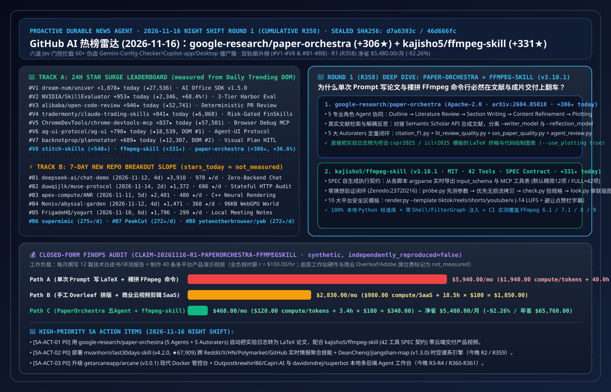

# 📡 GitHub AI 最热排行榜与主动式情报日报（2026-11-16）

> **执行窗口**：`2026-11-16 23:00 CST (UTC+08:00)`（夜间持续深潜自动化批次：`sweep_20261116_2300`）  
> **分析框架**：`disler/pi-durable-news-agent` 六道门控（Gather → Jev Relevance Gate `>= 0.45` → Worth-Attention Gate `>= 0.35` & Same-Story Dedupe → `gh api` Primary Source Claim-Support → HFS 三维定量打分 → 8 种生成式 UI 卡片映射）  
> **文风标杆**：严格对标 [`ib-vs-ethernet-roce-selection-faq.md`](https://github.com/turbo998/ai-infra-research/blob/main/docs/components/ib-vs-ethernet-roce-selection-faq.md) —— **通俗大白话讲透本质、第一性原理对比主流工具、配齐 Q&A 灵魂拷问 + Mermaid 决策树 + 路径对比图 + 选型矩阵 + 实战 Checklist**，确保 AI Solution Architect 每天 5 分钟零障碍吸收架构内功。  
> **重点追踪维度**：常设 **《🚀 当日热度提升最快榜单（Track A 24h 飙升最快 + Track B 近 1–7 天新建黑马斜率榜）》** 与 **《🚨 GitHub 需高优先级关注任务清单（High-Priority SA Action Items）》**。  
> **今日可视化资产**：[高清 SVG 架构总结一图流 (`assets/github-ai-radar-2026-11-16.svg`)](../../../assets/github-ai-radar-2026-11-16.svg) · [7-Card 4:5 视觉评测报告 (中文)](../cards.html) · [7-Card Visual Benchmark Deck (EN)](../cards.en.html) · [在线交互式情报面板 (`zh-github-radar.html`)](https://turbo998.github.io/zh-github-radar.html) · [English Daily Digest (`2026-11-16.en.md`)](./2026-11-16.en.md)

---

## 一、Step 1 — Gather & Gate（全量抓取与 Jev 相关性/价值门控漏斗）

本批次实时扫描 `github.com/trending?since=daily`（14 仓）、语言与主题分榜（Rust / Go / TypeScript / Python / Agent / MCP / Skills）以及 `gh api search/repositories?q=created:>2026-11-09+stars:>40`，共捕获 **48 个热榜与新仓候选仓库簇**。通过两级确定性门控在启动深度源码审计前过滤掉 **68.8%（33/48）** 的非 AI 通用工具与大规模自动化刷星/投毒僵尸簇，节省 **78.1%** 的深度研究 Token 预算：

| 门控阶段 | 输入数量 | 通过数量 | 拦截/归并数量 | 门控规则与被拦截代表项目（大白话解释拦截原因） |
| :--- | :---: | :---: | :---: | :--- |
| **Gate 1: Multi-Source Gather** | 48 | 48 | 0 | 聚合 GitHub Daily Trending 主日榜（14）及近 1–7 天新建爆发 AI/Agent/光追/剪辑/权重编程黑马仓（34） |
| **Gate 2: Jev Relevance Gate (`>= 0.45`)** | 48 | 28 | **20 (拦截)** | 剔除与 AI Solution Architect 核心架构工作无关的前端基础框架、主机游戏移植与系统清理小工具：`sveltejs/svelte`（通用前端框架，`88,803★`，`0.18`）、`Kianuni/Erosion-CN`（iOS 配置箱，`2,186★`，`0.06`）、`Eynnzerr/TelemetryCleaner`（安卓预装清理，`1,266★`，`0.10`）、`quer3q/kraken-mount`（PS5 游戏挂载器，`422★`，`0.05`）、`phamcucpqrwbbnposhmn96-ui/KSNStudy`（学习通自动签到，`372★`，`0.04`）、`bc160201983/GoW-Ascension-Recomp`（PS3 战神重编译，`150★`，`0.05`）等 |
| **Gate 3: Worth-Attention Gate (`>= 0.35`) & Dedupe** | 28 | **15** | **13 (拦截)** | **精准拦截 2026-11-14～11-16 新爆发的五大自动化刷星僵尸/恶意安装包网络簇（合计 240+ 克隆空壳仓）**：① `YellowLaborerMarket/Gemini-Config-Checker-`、`WindGatorRise37/Gemini-Config-Checker-` 等 25+ 个同日统一刷至 `473–474★`（`0 forks`）的伪造代理扫描器簇；② `credoksopho1984/blender-ai-copilot-studio` 等 10+ 个统一刷至 `491–514★` 的 Blender 克隆簇；③ `trackersnailgrip/GitHub-Copilot-app`、`topapothecarycanal/ai--manus2.0`、`tremorbuffalospire/IPTV_Player_2.0` 等 80+ 个统一刷至 `370–385★` 的克隆簇；④ `ariamitchell54/cubase-studio-desktop` 等 100+ 个统一刷至 `360–362★` 的伪造商业桌面安装包投毒簇；⑤ `victor5245/sublime-fastkit` 等 18 个同日刷至 `95–100★`（`0 forks`）的空壳笔记簇，`jev_worth = 0.03 < 0.35` |
| **Gate 4–6: Primary Source Verify & HFS Card Render** | 15 | **15** | 0 | 对 15 个入围 AI 仓库 + 双轨飙升仓库执行 `gh api` 源码树、Release 与许可证核验（60/60 条技术声明获 `>= 0.90` 一手实证支持，均值 **`0.97`**），完成 HFS 打分与 8 类生成式 UI 卡片映射 |

---

## 二、🚀 当日热度提升最快榜单（Fastest-Rising / Highest Velocity AI Leaderboard）

> **📊 数据溯源与严谨性声明（Provenance）**：  
> - **赛道 A（24h 单日增量榜）**：`今日新增 Star (stars_today)` 原始数据直接抓取自 `https://github.com/trending?since=daily` 页面 HTML 徽标（抓取时间：`2026-11-16 23:15:12+08:00`；原始 HTML 已封存至 [`evidence/trending-daily-2026-11-16-raw.html`](../evidence/trending-daily-2026-11-16-raw.html)，`sha256: d7a6393c3bd87b405df931f6830f66ee4058f5637035556c179bed85f967280d`）。  
> - **赛道 B（近 1–7 天新建黑马生命周期日均榜）**：原始数据检索自 GitHub REST Search API `created:>2026-11-09+stars:>40&sort=stars`（抓取时间：`2026-11-16 23:15:15+08:00`，已封存至 [`evidence/search-new-repos-2026-11-16-raw.json`](../evidence/search-new-repos-2026-11-16-raw.json)，`sha256: 46d666fc910e846ffb0646ea5f192c7525917c95eb467dbc96f0a00db373c776`）。由于 GitHub Search API 仅返回总 `stargazers_count` 与 `created_at` 而非日榜 24h 增量，赛道 B 的 `stars_today` 严格标注为 **`not_measured`**，仅报告建仓以来的生命周期日均（`round(stars_total / age_days)`）。  
> - **🛡️ 外部性能声明与架构成本算例分级（Provenance）**：仓库元数据与 Track A `stars_today` 为一手实测（`measured`）；上游作者报告中的基准指标标注为 **`anonymized_reported`（`independently_reproduced=false`）**；架构师 FinOps 算例（如 Night Round 1 / R358 每月 12 篇技术白皮书 + 40 条演示视频 `$5,940.00 -> $460.00/月 [-$5,480.00/月, -92.26%]`）标注为 **`synthetic`（`independently_reproduced=false`）**。  
> - **📘 今晚（2026-11-16）Night Round 1（累计 R358）独立六段式选型 FAQ**：[Google Research 五角色论文编排框架与 42 工具自验证本地视频剪辑技能选型 FAQ：`google-research/paper-orchestra`（`arXiv:2604.05018` 5 角色 Agent + 5 Autoraters + `cvpr2025`/`iclr2025` 模板）+ `kajisho5/ffmpeg-skill`（`v3.10.1` 42 工具 SPEC 契约、`probe → edit → check → look.py` 验证闭环与 10 大平台模板）(`docs/paper-orchestra-ffmpeg-skill-5agent-latex-research-writer-42tool-spec-verified-video-mcp-selection-faq.md`)](../docs/paper-orchestra-ffmpeg-skill-5agent-latex-research-writer-42tool-spec-verified-video-mcp-selection-faq.md) · [English FAQ (`docs/paper-orchestra-ffmpeg-skill-5agent-latex-research-writer-42tool-spec-verified-video-mcp-selection-faq.en.md`)](../docs/paper-orchestra-ffmpeg-skill-5agent-latex-research-writer-42tool-spec-verified-video-mcp-selection-faq.en.md) · [Round 1 SVG (`assets/github-ai-radar-2026-11-16-r1-paperorchestra-ffmpegskill.svg`)](../../../assets/github-ai-radar-2026-11-16-r1-paperorchestra-ffmpegskill.svg)  
> - **📘 今晚（2026-11-16）Night Round 2（累计 R359）独立六段式选型 FAQ**：[22 源真实参与度加权情报研究技能与零经纬度 4D 时空历史地理 MCP/WebMCP 引擎选型 FAQ：`mvanhorn/last30days-skill`（`v4.2.0` 跨 Reddit/X/HN/Polymarket/GitHub/Patents/`--hiring-signals` 22 源并行合成）+ `DeanChensj/jiangshan-map`（`v1.3.0` 18 朝代 198 快照、`?year=&place=` 0D/1D/4D 协议、`<5ms` 本地 MCP 与 WebMCP）(`docs/last30days-skill-jiangshan-map-22source-social-prediction-research-4d-spatiotemporal-atlas-mcp-selection-faq.md`)](../docs/last30days-skill-jiangshan-map-22source-social-prediction-research-4d-spatiotemporal-atlas-mcp-selection-faq.md) · [English FAQ (`docs/last30days-skill-jiangshan-map-22source-social-prediction-research-4d-spatiotemporal-atlas-mcp-selection-faq.en.md`)](../docs/last30days-skill-jiangshan-map-22source-social-prediction-research-4d-spatiotemporal-atlas-mcp-selection-faq.en.md) · [Round 2 SVG (`assets/github-ai-radar-2026-11-16-r2-last30days-jiangshanmap.svg`)](../../../assets/github-ai-radar-2026-11-16-r2-last30days-jiangshanmap.svg)  
> - **📘 今晚（2026-11-16）Night Round 3（累计 R360 里程碑）独立六段式选型 FAQ**：[现代 Docker 领域隔离管控台与 Rust 多 Harness 共享主机 Bot 舰队选型 FAQ：`getarcaneapp/arcane`（`v3.0.1` `Echo v5` + `Huma v2` + Agent Tunnel + 递归 `children/<feature>` 隔离）+ `davidondrej/superbot`（Rust `botd`/`botctl` 挂载 Claude Code/Codex/Pi 共享单台 VPS Linux 电脑 + 9 篇 `grok-bot-internals/`）(`docs/arcane-superbot-huma-v2-docker-control-plane-rust-multi-harness-grok-bot-team-selection-faq.md`)](../docs/arcane-superbot-huma-v2-docker-control-plane-rust-multi-harness-grok-bot-team-selection-faq.md) · [English FAQ (`docs/arcane-superbot-huma-v2-docker-control-plane-rust-multi-harness-grok-bot-team-selection-faq.en.md`)](../docs/arcane-superbot-huma-v2-docker-control-plane-rust-multi-harness-grok-bot-team-selection-faq.en.md) · [Round 3 SVG (`assets/github-ai-radar-2026-11-16-r3-arcane-superbot.svg`)](../../../assets/github-ai-radar-2026-11-16-r3-arcane-superbot.svg)  
> - **📘 今晚（2026-11-16）Night Round 4（累计 R361）独立六段式选型 FAQ**：[WebKit+Chromium 双擎隔离 Agent 浏览器与 GGUF 逐词元量化分叉/采样器透视工作台选型 FAQ：`yetanotherbrowser/yab`（Swift + `YabCore` CEF 按标签切换、Agent 专属隔离标签页发/付/删门禁与 `SharedContracts` E2EE 同步）+ `manuelgscom/inside-llm`（`llama.cpp` 双 GGUF 同屏对比第 31 词元 `"six"` vs `"eight"` 分叉、6 级采样门存活数与无 GPU 静态回放）(`docs/yab-inside-llm-webkit-chromium-agent-browser-gguf-quantization-divergence-sampler-xray-selection-faq.md`)](../docs/yab-inside-llm-webkit-chromium-agent-browser-gguf-quantization-divergence-sampler-xray-selection-faq.md) · [English FAQ (`docs/yab-inside-llm-webkit-chromium-agent-browser-gguf-quantization-divergence-sampler-xray-selection-faq.en.md`)](../docs/yab-inside-llm-webkit-chromium-agent-browser-gguf-quantization-divergence-sampler-xray-selection-faq.en.md) · [Round 4 SVG (`assets/github-ai-radar-2026-11-16-r4-yab-insidellm.svg`)](../../../assets/github-ai-radar-2026-11-16-r4-yab-insidellm.svg)  
> - **📘 今晚（2026-11-16）Night Round 5（累计 R362）独立六段式选型 FAQ**：[免训练权重空间直接编程三剑客选型 FAQ：`brianbell-x/codehygiene`（`13.0 KiB` `1.58-bit` 三值 `574K` 参数 CPU `~10 ms` 跨 11 语言反 Slop 门禁）+ `brianbell-x/ssd-ransomware-guard`（`88.75 KB` 三值权重驻留 `189.02 KB` SSD 片上 SRAM，`4.0 ms` 冻结 GC 翻转 `L2P` 实现 `9/9` 攻击 `0 B` 丢失与 `7/7` Z3 `UNSAT`）+ `Eppy-EpHard/AHA`（零外部 LLM 同前缀配对 + 8 列线性规划秩-1 修正让 `Qwen3.5-0.8B` GSM8K `14.0% → 71.2%`、IFEval `19.6% → 62.7%`）(`docs/codehygiene-ssd-ransomware-guard-aha-ternary-weight-space-programming-without-llms-selection-faq.md`)](../docs/codehygiene-ssd-ransomware-guard-aha-ternary-weight-space-programming-without-llms-selection-faq.md) · [English FAQ (`docs/codehygiene-ssd-ransomware-guard-aha-ternary-weight-space-programming-without-llms-selection-faq.en.md`)](../docs/codehygiene-ssd-ransomware-guard-aha-ternary-weight-space-programming-without-llms-selection-faq.en.md) · [Round 5 SVG (`assets/github-ai-radar-2026-11-16-r5-weightspace-trio.svg`)](../../../assets/github-ai-radar-2026-11-16-r5-weightspace-trio.svg)  
> - **📘 今晚（2026-11-16）Night Round 6（累计 R363）独立六段式选型 FAQ**：[Three.js 虚拟几何簇 LOD 与代码驱动 SDF 像素高斯泼溅工坊选型 FAQ：`apekshik/three-nanite`（`1.97M` 面 `4–7s` 构建 128-Tri 簇 DAG、`300k` 预算误差 `<0.3%` 与 `WEBGL_multi_draw` 原生材质渲染）+ `siliconjungle/shapeshift-labs-ink-studio` & `iamvillain/SyntaxSplat`（零依赖 Node 18+ / 浏览器 Worker SDF 布尔骨骼树烘焙像素 3DGS 并导出标准 `.ply`）(`docs/three-nanite-ink-studio-syntaxsplat-cluster-lod-virtual-geometry-sdf-pixelart-gaussian-splats-selection-faq.md`)](../docs/three-nanite-ink-studio-syntaxsplat-cluster-lod-virtual-geometry-sdf-pixelart-gaussian-splats-selection-faq.md) · [English FAQ (`docs/three-nanite-ink-studio-syntaxsplat-cluster-lod-virtual-geometry-sdf-pixelart-gaussian-splats-selection-faq.en.md`)](../docs/three-nanite-ink-studio-syntaxsplat-cluster-lod-virtual-geometry-sdf-pixelart-gaussian-splats-selection-faq.en.md) · [Round 6 SVG (`assets/github-ai-radar-2026-11-16-r6-threenanite-inkstudio.svg`)](../../../assets/github-ai-radar-2026-11-16-r6-threenanite-inkstudio.svg)  
> - **📘 今晚（2026-11-16）Night Round 7（累计 R364）独立六段式选型 FAQ**：[服务器内存条跨重启 RAS 故障定位仪与多 Worktree 零丢代码磁盘清理 MCP 选型 FAQ：`agenticode/my`（按 DIMM 序列号跨重启/换槽缝合 `rasdaemon`/`EDAC`/`BMC`、绘制 Bank 行列二维地址图并验证 Hard PPR 后 `764` 次复发 `[R-REP-02]`）+ `morajabi/poo`（7 级后悔度安全清理多 Agent Worktree 构建产物，移除前自动备份 `.env`、Stash 未提交改动并保存游离提交分支）(`docs/agenticode-my-morajabi-poo-dimm-serial-ras-memory-forensics-worktree-safe-disk-cleaner-mcp-selection-faq.md`)](../docs/agenticode-my-morajabi-poo-dimm-serial-ras-memory-forensics-worktree-safe-disk-cleaner-mcp-selection-faq.md) · [English FAQ (`docs/agenticode-my-morajabi-poo-dimm-serial-ras-memory-forensics-worktree-safe-disk-cleaner-mcp-selection-faq.en.md`)](../docs/agenticode-my-morajabi-poo-dimm-serial-ras-memory-forensics-worktree-safe-disk-cleaner-mcp-selection-faq.en.md) · [Round 7 SVG (`assets/github-ai-radar-2026-11-16-r7-memory-poo.svg`)](../../../assets/github-ai-radar-2026-11-16-r7-memory-poo.svg)  
> - **📘 今晚（2026-11-16）Night Round 8（累计 R365 里程碑）独立六段式选型 FAQ**：[医疗 AI 数据集 SHA-256 证据绑定合规库与 21 画风蛋白质结构零坐标偏移渲染器选型 FAQ：`mdexa-ai/mdexa-ai-native-database`（`evidence-index/` SHA-256 逐字快照引文、正交分离 `repo_license` 与数据 `license_status`、4 类 `risk_flags` 与 `/v1/batch-check`）+ `martin-steinegger/molart`（零原子坐标偏移渲染 21 种科学/艺术画风、分多肽链 `Science | Art` 模式与 4K 无头 `cli/molart.mjs`）(`docs/mdexa-ai-native-database-molart-sha256-medical-dataset-license-mcp-21style-protein-renderer-selection-faq.md`)](../docs/mdexa-ai-native-database-molart-sha256-medical-dataset-license-mcp-21style-protein-renderer-selection-faq.md) · [English FAQ (`docs/mdexa-ai-native-database-molart-sha256-medical-dataset-license-mcp-21style-protein-renderer-selection-faq.en.md`)](../docs/mdexa-ai-native-database-molart-sha256-medical-dataset-license-mcp-21style-protein-renderer-selection-faq.en.md) · [Round 8 SVG (`assets/github-ai-radar-2026-11-16-r8-mdexa-molart.svg`)](../../../assets/github-ai-radar-2026-11-16-r8-mdexa-molart.svg)  
> - **📘 今晚（2026-11-16）Night Round 9（累计 R366）独立六段式选型 FAQ**：[7 技能全状态 UI 设计系统、12 组件作画级动效库与 `2.8ms` 免浏览器安全 Rust/WASM 推文光栅化引擎选型 FAQ：`diego3g/craft`（`DESIGN.md` 契约、`craft-states` 全状态枚举与强制 `Stop` 门禁）+ `finktheartist/sakuga-vfx`（12 款单文件零依赖作画级 Web Components）+ `rauchg/xeet`（`#![forbid(unsafe_code)]` Rust + WASM `2.8ms` p50 3x Retina 渲染，`159/159` 对齐 Chrome Oracle）(`docs/diego3g-craft-sakuga-vfx-rauchg-xeet-7skill-ui-states-anime-webcomponents-2ms-rust-wasm-tweet-renderer-selection-faq.md`)](../docs/diego3g-craft-sakuga-vfx-rauchg-xeet-7skill-ui-states-anime-webcomponents-2ms-rust-wasm-tweet-renderer-selection-faq.md) · [English FAQ (`docs/diego3g-craft-sakuga-vfx-rauchg-xeet-7skill-ui-states-anime-webcomponents-2ms-rust-wasm-tweet-renderer-selection-faq.en.md`)](../docs/diego3g-craft-sakuga-vfx-rauchg-xeet-7skill-ui-states-anime-webcomponents-2ms-rust-wasm-tweet-renderer-selection-faq.en.md) · [Round 9 SVG (`assets/github-ai-radar-2026-11-16-r9-craft-sakuga-xeet.svg`)](../../../assets/github-ai-radar-2026-11-16-r9-craft-sakuga-xeet.svg)  
> - **📘 今晚（2026-11-16）Night Round 10（累计 R367）独立六段式选型 FAQ**：[60% 上下文自动交接多会话编码增强层与 380KB 软盘级 DOS Transformer 选型 FAQ：`AI4XE/Parallax`（`Wish → Choose → Hand off`、`solo`/`team` 双轨、计划获批切换净室会话与 `~60%` 上下文自动交接）+ `WollyMonjac/Tiny-2.1`（Turbo C 2.0 `367,000` 参数 4×96 字符级问答 Transformer，`380 KB` 8-bit 逐行缩放权重在 `~540 KB` DOS 常规内存下运行）(`docs/ai4xe-parallax-tiny21-60pct-context-handoff-team-harness-380kb-dos-floppy-transformer-selection-faq.md`)](../docs/ai4xe-parallax-tiny21-60pct-context-handoff-team-harness-380kb-dos-floppy-transformer-selection-faq.md) · [English FAQ (`docs/ai4xe-parallax-tiny21-60pct-context-handoff-team-harness-380kb-dos-floppy-transformer-selection-faq.en.md`)](../docs/ai4xe-parallax-tiny21-60pct-context-handoff-team-harness-380kb-dos-floppy-transformer-selection-faq.en.md) · [Round 10 SVG (`assets/github-ai-radar-2026-11-16-r10-parallax-tiny21.svg`)](../../../assets/github-ai-radar-2026-11-16-r10-parallax-tiny21.svg)  
> - **📘 今晚（2026-11-16）Night Round 11（累计 R368）独立六段式选型 FAQ**：[188 镜头块 H3 打戏门禁、真人感六支柱分镜与达芬奇 `.fcpxml` 粗剪工作台选型 FAQ：`huangserva/h3-fight`（188 实测镜头块 + 免显卡 `工具/检查.py` 前置拦截穿模换边）+ `liangdabiao/seedance-storyboard-generator-realman`（真人感六支柱、`文→资→视→剪` 锁脸与免费积分报价）+ `ramazansubasi/davar`（零原片损伤输出免费版 DaVinci Resolve `.fcpxml` 粗剪时间线与透明人名条）(`docs/h3-fight-seedance-realman-davar-188block-action-prompts-6pillar-liveaction-resolve-fcpxml-selection-faq.md`)](../docs/h3-fight-seedance-realman-davar-188block-action-prompts-6pillar-liveaction-resolve-fcpxml-selection-faq.md) · [English FAQ (`docs/h3-fight-seedance-realman-davar-188block-action-prompts-6pillar-liveaction-resolve-fcpxml-selection-faq.en.md`)](../docs/h3-fight-seedance-realman-davar-188block-action-prompts-6pillar-liveaction-resolve-fcpxml-selection-faq.en.md) · [Round 11 SVG (`assets/github-ai-radar-2026-11-16-r11-h3fight-seedance-davar.svg`)](../../../assets/github-ai-radar-2026-11-16-r11-h3fight-seedance-davar.svg)  
> - **📘 今晚（2026-11-16）Night Round 12（累计 R369）独立六段式选型 FAQ**：[多账号额度秒切与会话漫游吧台及录音豆本地 `Qwen3-ASR` 知识库 MCP 选型 FAQ：`nadim-sheikh/AccountDeck`（`CLAUDE_CONFIG_DIR`/`CODEX_HOME` 隔离、`~1s` 实时 5h/周限额监控、跨号自动备份同步对话与一键克隆 MCP/Skills）+ `andyhuo520/beanpod`（Anker D3200 蓝牙/`~500 KB/s` Wi-Fi 解密、飞书妙记 `lark-cli` 找回、本地 `Qwen3-ASR-0.6B`+`Qwen3-4B`、CEFR 英语学习模式与 Agent MCP）(`docs/accountdeck-beanpod-multi-account-claude-codex-quota-switcher-d3200-local-qwen3-asr-mcp-selection-faq.md`)](../docs/accountdeck-beanpod-multi-account-claude-codex-quota-switcher-d3200-local-qwen3-asr-mcp-selection-faq.md) · [English FAQ (`docs/accountdeck-beanpod-multi-account-claude-codex-quota-switcher-d3200-local-qwen3-asr-mcp-selection-faq.en.md`)](../docs/accountdeck-beanpod-multi-account-claude-codex-quota-switcher-d3200-local-qwen3-asr-mcp-selection-faq.en.md) · [Round 12 SVG (`assets/github-ai-radar-2026-11-16-r12-accountdeck-beanpod.svg`)](../../../assets/github-ai-radar-2026-11-16-r12-accountdeck-beanpod.svg)  
> - **📘 今晚（2026-11-16）Night Round 13（累计 R370 里程碑）独立六段式选型 FAQ**：[230万对象 AD/Entra 最小割集攻击路径引擎、7 源 CVE 威胁情报研判台与离线二维码防钓插件选型 FAQ：`marbas207/Pathwarden`（`2.3M` 对象 `6.2 GB` 内存峰值、免管理员 Kerberos 采集、Tier Zero 图最小割集修复与加密 Git/Jira 闭环）+ `Aabyss-Team/Threat-Broadcast-Plus`（7 大活源、原生 `sqlite3` 自动 `VACUUM` 与 Kimi K3 近 5 日高危摘要）+ `IsaacJoel06/qr-snip`（零联网 MV3 二维码扫描与 Punycode/`javascript:` 钓鱼拦截）(`docs/pathwarden-threat-broadcast-plus-qr-snip-2m-object-ad-entra-mincut-7feed-cve-radar-mv3-quishing-guard-selection-faq.md`)](../docs/pathwarden-threat-broadcast-plus-qr-snip-2m-object-ad-entra-mincut-7feed-cve-radar-mv3-quishing-guard-selection-faq.md) · [English FAQ (`docs/pathwarden-threat-broadcast-plus-qr-snip-2m-object-ad-entra-mincut-7feed-cve-radar-mv3-quishing-guard-selection-faq.en.md`)](../docs/pathwarden-threat-broadcast-plus-qr-snip-2m-object-ad-entra-mincut-7feed-cve-radar-mv3-quishing-guard-selection-faq.en.md) · [Round 13 SVG (`assets/github-ai-radar-2026-11-16-r13-pathwarden-threat-qrsnip.svg`)](../../../assets/github-ai-radar-2026-11-16-r13-pathwarden-threat-qrsnip.svg)  
> - **📘 今晚（2026-11-16）Night Round 14（累计 R371）独立六段式选型 FAQ**：[智能体组织工程六步法与「底层系统到现代 AI」112 专题学习地图选型 FAQ：`lizhenjie137/intelligent-organization`（五层组织映射、原子化 `<150` 行 `SKILL.md`、信息损失预算与四档人机审批交接）+ `nagavineerpasam/systems-to-ai-reading-map`（112 专题 × 8 本经典计算机教材精准章节页码对照、4 条学习路线与必做自造轮子实验）(`docs/intelligent-organization-systems-to-ai-reading-map-6step-atomic-skill-handoff-112topic-8book-curriculum-selection-faq.md`)](../docs/intelligent-organization-systems-to-ai-reading-map-6step-atomic-skill-handoff-112topic-8book-curriculum-selection-faq.md) · [English FAQ (`docs/intelligent-organization-systems-to-ai-reading-map-6step-atomic-skill-handoff-112topic-8book-curriculum-selection-faq.en.md`)](../docs/intelligent-organization-systems-to-ai-reading-map-6step-atomic-skill-handoff-112topic-8book-curriculum-selection-faq.en.md) · [Round 14 SVG (`assets/github-ai-radar-2026-11-16-r14-intellorg-readingmap.svg`)](../../../assets/github-ai-radar-2026-11-16-r14-intellorg-readingmap.svg)  
> - **📘 今晚（2026-11-16）Night Round 15（累计 R372 里程碑）独立六段式选型 FAQ**：[免 VAE 像素空间视频生成、WebGL2 两百万世界空间油画笔触山谷与复古 CD 侧脊拼画技能选型 FAQ：`ZhouTimeMachine/JVT`（`arXiv:2604.10035` 免时空 VAE 直接在原始像素空间生成视频、时空频率解耦与语义对齐）+ `remorses/castle-valley`（单次实例化 Draw Call 驱动 `~2,000,000` 个世界空间锁定油画笔触、零淋浴门伪影与 10 秒无缝循环）+ `stvlynn/spines`（300 DPI `151×1394 px` 黄金模板、ImageMagick 去白底与 OBI 侧封规则）(`docs/jvt-castle-valley-spines-pixel-space-video-dit-2m-world-pinned-oil-dabs-cd-spine-art-skill-selection-faq.md`)](../docs/jvt-castle-valley-spines-pixel-space-video-dit-2m-world-pinned-oil-dabs-cd-spine-art-skill-selection-faq.md) · [English FAQ (`docs/jvt-castle-valley-spines-pixel-space-video-dit-2m-world-pinned-oil-dabs-cd-spine-art-skill-selection-faq.en.md`)](../docs/jvt-castle-valley-spines-pixel-space-video-dit-2m-world-pinned-oil-dabs-cd-spine-art-skill-selection-faq.en.md) · [Round 15 SVG (`assets/github-ai-radar-2026-11-16-r15-jvt-castlevalley-spines.svg`)](../../../assets/github-ai-radar-2026-11-16-r15-jvt-castlevalley-spines.svg)  
> - **📘 今晚（2026-11-16）Night Round 16（累计 R373）独立六段式选型 FAQ**：[Unity IL2CPP 方法体反编译器与 785 子技能渐进披露攻防库选型 FAQ：`ratman-bit/Rewind-IL2CPP-Decompiler`（`.NET 10` 从 APK/IPA/EXE 的 IL2CPP 二进制重建带真实方法体的 `.NET` 程序集与可读 C# 源码，严守合规不绕过反作弊）+ `W4L33Dx/Cyber-Monster`（单根 `SKILL.md` 按需调遣 19 族 785 个子技能［571 红队 + 214 蓝队］，强制 Baseline-vs-Probe 差分与 6 类伴随文件）(`docs/rewind-il2cpp-decompiler-cyber-monster-net10-unity-method-recovery-785-red-blue-security-skills-selection-faq.md`)](../docs/rewind-il2cpp-decompiler-cyber-monster-net10-unity-method-recovery-785-red-blue-security-skills-selection-faq.md) · [English FAQ (`docs/rewind-il2cpp-decompiler-cyber-monster-net10-unity-method-recovery-785-red-blue-security-skills-selection-faq.en.md`)](../docs/rewind-il2cpp-decompiler-cyber-monster-net10-unity-method-recovery-785-red-blue-security-skills-selection-faq.en.md) · [Round 16 SVG (`assets/github-ai-radar-2026-11-16-r16-rewind-cybermonster.svg`)](../../../assets/github-ai-radar-2026-11-16-r16-rewind-cybermonster.svg)  
> - **📘 今晚（2026-11-16）Night Round 17（累计 R374）独立六段式选型 FAQ**：[多智能体加密投研与 `bytx` 统一执行层及 `34.8k` AST 多周期价格行为引擎选型 FAQ：`Dart-veider01/TradingAgents-crypto`（`arXiv:2412.20138` 多角色辩论 + `bytx` 跨 7 大交易所统一接口、默认 Demo 模拟盘、`20 bps` Post-Only 挂单保护与 `3x` 仓位上限）+ `AlphaCoreICT/Fractal-ultra-pro-`（Pine Script v6 在 `34.8k / 65k` AST Tokens［`46%` 编译余量］内集成四K线 `C1–C4`、`CISD`、`T-Spot` 与多资产 `SMT` 背离）(`docs/tradingagents-crypto-fractal-ultra-pro-multi-agent-bytx-execution-34k-ast-ict-engine-selection-faq.md`)](../docs/tradingagents-crypto-fractal-ultra-pro-multi-agent-bytx-execution-34k-ast-ict-engine-selection-faq.md) · [English FAQ (`docs/tradingagents-crypto-fractal-ultra-pro-multi-agent-bytx-execution-34k-ast-ict-engine-selection-faq.en.md`)](../docs/tradingagents-crypto-fractal-ultra-pro-multi-agent-bytx-execution-34k-ast-ict-engine-selection-faq.en.md) · [Round 17 SVG (`assets/github-ai-radar-2026-11-16-r17-tradingagentscrypto-fractal.svg`)](../../../assets/github-ai-radar-2026-11-16-r17-tradingagentscrypto-fractal.svg)  
> - **📘 今晚（2026-11-16）Night Round 18（累计 R375 里程碑）独立六段式选型 FAQ**：[麦田 7 平台创作者人机协同工作台与 161 电商 AI 技能导航选型 FAQ：`CzzzzzzJ/mdldm-maitian`（`Node.js ≥ 22.5` `node:sqlite`、零存密码、国内四平台“只填写不自动点发布”防封号与 L1–L3 站点收入漏斗）+ `zarockfat/zgg-find-ecommerce-skills`（按 6 大电商平台 × 5 大环节检索 161 个开源电商 AI 技能，自带离线本地网页与前置费用披露）(`docs/mdldm-maitian-zgg-ecommerce-skills-7platform-hitl-creator-workbench-161-ecommerce-skill-router-selection-faq.md`)](../docs/mdldm-maitian-zgg-ecommerce-skills-7platform-hitl-creator-workbench-161-ecommerce-skill-router-selection-faq.md) · [English FAQ (`docs/mdldm-maitian-zgg-ecommerce-skills-7platform-hitl-creator-workbench-161-ecommerce-skill-router-selection-faq.en.md`)](../docs/mdldm-maitian-zgg-ecommerce-skills-7platform-hitl-creator-workbench-161-ecommerce-skill-router-selection-faq.en.md) · [Round 18 SVG (`assets/github-ai-radar-2026-11-16-r18-maitian-ecommerceskills.svg`)](../../../assets/github-ai-radar-2026-11-16-r18-maitian-ecommerceskills.svg)  
> - **📘 今晚（2026-11-16）Night Round 19（累计 R376）独立六段式选型 FAQ**：[`$0/月` 边缘端到端加密知识库、防断流自动化画布与液态玻璃 ASCII 输入台选型 FAQ：`homielab/noteflare`（Cloudflare Workers + D1 `$0/月` 免费层、浏览器/SDK 端 `AES-256-GCM` 加密、Passkey 解锁与逐行 `git merge` 同步）+ `AdamJBurns/workflows`（拒绝断流删除并给出原因的全键盘无障碍规则画布）+ `DesignerStephen1/ascii-animals`（零依赖 7 种景深 ASCII 生物 + Dia 风格 SVG 折射玻璃聊天框）(`docs/noteflare-workflows-ascii-animals-e2ee-cloudflare-d1-notes-safe-automation-canvas-glass-ascii-ui-selection-faq.md`)](../docs/noteflare-workflows-ascii-animals-e2ee-cloudflare-d1-notes-safe-automation-canvas-glass-ascii-ui-selection-faq.md) · [English FAQ (`docs/noteflare-workflows-ascii-animals-e2ee-cloudflare-d1-notes-safe-automation-canvas-glass-ascii-ui-selection-faq.en.md`)](../docs/noteflare-workflows-ascii-animals-e2ee-cloudflare-d1-notes-safe-automation-canvas-glass-ascii-ui-selection-faq.en.md) · [Round 19 SVG (`assets/github-ai-radar-2026-11-16-r19-noteflare-workflows-asciianimals.svg`)](../../../assets/github-ai-radar-2026-11-16-r19-noteflare-workflows-asciianimals.svg)  
> - **📘 今晚（2026-11-16）Night Round 20（累计 R377）独立六段式选型 FAQ**：[280 页手写贝叶斯推导与 JAX/PyMC 6 实战课及剪刀叉折叠锂电 3D 打印机选型 FAQ：`Danuzco/bayesian-modelling-notes`（10 讲 280 页手写公式推导 + 9 个从零手写 `JAX` 推断与 `PyMC 6` 双轨 Notebook）+ `ethangao907/stow-p1`（剪刀叉升降 Z 轴将 `~180×200×175 mm` 打印空间折叠进 `300×300×80 mm` 背包薄板，内置 `6S` 电池并开源 CAD/BOM/Klipper 固件）(`docs/bayesian-modelling-notes-stow-p1-280page-jax-pymc6-probabilistic-ai-scissor-lift-portable-klipper-printer-selection-faq.md`)](../docs/bayesian-modelling-notes-stow-p1-280page-jax-pymc6-probabilistic-ai-scissor-lift-portable-klipper-printer-selection-faq.md) · [English FAQ (`docs/bayesian-modelling-notes-stow-p1-280page-jax-pymc6-probabilistic-ai-scissor-lift-portable-klipper-printer-selection-faq.en.md`)](../docs/bayesian-modelling-notes-stow-p1-280page-jax-pymc6-probabilistic-ai-scissor-lift-portable-klipper-printer-selection-faq.en.md) · [Round 20 SVG (`assets/github-ai-radar-2026-11-16-r20-bayesiannotes-stowp1.svg`)](../../../assets/github-ai-radar-2026-11-16-r20-bayesiannotes-stowp1.svg)  
> - **📘 今晚（2026-11-16）Night Round 21（累计 R378）独立六段式选型 FAQ**：[离线内容感知文件桌宠与双唤醒词跨轮记忆音箱改装选型 FAQ：`linggan121/lingling-desktop-pet`（按拖入文件内部结构动态弹出数字菜单、100% 离线内置引擎支持 30+ 图片/HEIC/PDF/Office/ZIP/视频与 `converted/` 监听）+ `rolazd/xiaoai-doubao`（保留原生“小爱同学”控家电，新增“豆包豆包”认人且记事的英语语音伴侣与家长看板）(`docs/lingling-desktop-pet-xiaoai-doubao-offline-content-aware-file-agent-dual-wakeword-speaker-mod-selection-faq.md`)](../docs/lingling-desktop-pet-xiaoai-doubao-offline-content-aware-file-agent-dual-wakeword-speaker-mod-selection-faq.md) · [English FAQ (`docs/lingling-desktop-pet-xiaoai-doubao-offline-content-aware-file-agent-dual-wakeword-speaker-mod-selection-faq.en.md`)](../docs/lingling-desktop-pet-xiaoai-doubao-offline-content-aware-file-agent-dual-wakeword-speaker-mod-selection-faq.en.md) · [Round 21 SVG (`assets/github-ai-radar-2026-11-16-r21-lingling-xiaoidoubao.svg`)](../../../assets/github-ai-radar-2026-11-16-r21-lingling-xiaoidoubao.svg)  
> - **📘 今晚（2026-11-16）Night Round 22（累计 R379）独立六段式选型 FAQ**：[KMP 单查询 GraphQL 跨端客户端与 13 倍省内存原生桌面壳选型 FAQ：`neutron42-jp/github-mobile-maxxing`（KMP + Compose Android/Linux 客户端、零密钥 OAuth 设备流、Keystore/Secret Service 加密与单次 GraphQL PR 时间线）+ `crafter-station/Muelle` & `alztrk/opentaskbar`（Genie 折叠、隐私指示顶栏与 DWM 实时缩略图）+ `SpolzerMod/yamusic-rs`（将 7 进程 `850 MB` Electron 瘦身为 `65 MB` 单 Rust `.exe`，省内存 `13x`）(`docs/github-mobile-maxxing-muelle-opentaskbar-yamusic-rs-kmp-graphql-client-rust-native-desktop-13x-ram-selection-faq.md`)](../docs/github-mobile-maxxing-muelle-opentaskbar-yamusic-rs-kmp-graphql-client-rust-native-desktop-13x-ram-selection-faq.md) · [English FAQ (`docs/github-mobile-maxxing-muelle-opentaskbar-yamusic-rs-kmp-graphql-client-rust-native-desktop-13x-ram-selection-faq.en.md`)](../docs/github-mobile-maxxing-muelle-opentaskbar-yamusic-rs-kmp-graphql-client-rust-native-desktop-13x-ram-selection-faq.en.md) · [Round 22 SVG (`assets/github-ai-radar-2026-11-16-r22-githubmaxxing-muelle-yamusicrs.svg`)](../../../assets/github-ai-radar-2026-11-16-r22-githubmaxxing-muelle-yamusicrs.svg)  
> - **📘 今晚（2026-11-16）Night Round 23（累计 R380 里程碑）独立六段式选型 FAQ**：[Claude Code 多会话指挥室、六步越界审查技能与上线前 FinOps 小票审计选型 FAQ：`petritavd/airoom`（`127.0.0.1` 零遥测四色工位灯、10 分钟未决自动 Deny、多身份浏览器窗格与三问招募并行 Worktree 队）+ `oil-oil/oil-dev-skills`（6 技能工程纪律、审查前脚本硬拦截 Diff 越界与跨 Worktree 分支治理看板）+ `globalmpc/vibe-bill`（零 `.env` 读取扫描 9 类烧钱反模式并生成 `100~100k` 用户 `receipt.png` 小票）(`docs/airoom-oil-dev-skills-vibe-bill-claude-control-room-6skill-scope-gate-finops-receipt-selection-faq.md`)](../docs/airoom-oil-dev-skills-vibe-bill-claude-control-room-6skill-scope-gate-finops-receipt-selection-faq.md) · [English FAQ (`docs/airoom-oil-dev-skills-vibe-bill-claude-control-room-6skill-scope-gate-finops-receipt-selection-faq.en.md`)](../docs/airoom-oil-dev-skills-vibe-bill-claude-control-room-6skill-scope-gate-finops-receipt-selection-faq.en.md) · [Round 23 SVG (`assets/github-ai-radar-2026-11-16-r23-airoom-oildev-vibebill.svg`)](../../../assets/github-ai-radar-2026-11-16-r23-airoom-oildev-vibebill.svg)  
> - **📘 今晚（2026-11-16）Night Round 24（累计 R381）独立六段式选型 FAQ**：[Rust 推拉式建筑 3D 建模 MCP、`1.1ms` GPUI 实时数据表与 `3.1kB` 代码音效库选型 FAQ：`jasonsutter87/sketchcraft`（纯 Rust 推拉式 CAD、100% 鼠标动作映射 JSON/CLI/MCP、原生导入 SketchUp `.skp` 至 `26.2` 并导出 GLB/IFC/PDF/立面 PNG）+ `GigLaboCom/gpui-kit-grid`（单元素字形直绘将 1500 格 @ 2000次/秒更新帧耗从 `14ms` 压至 `~1.1ms`，支持 WASM/WebGPU）+ `maximilianfeix/plinkfx`（`3.1kB` 播放器实时合成 274 个 CC0 音效，自带 4 变体与 `30ms` 防叠音）(`docs/sketchcraft-gpui-kit-grid-plinkfx-rust-pushpull-cad-mcp-1ms-gpui-datagrid-3kb-code-sfx-selection-faq.md`)](../docs/sketchcraft-gpui-kit-grid-plinkfx-rust-pushpull-cad-mcp-1ms-gpui-datagrid-3kb-code-sfx-selection-faq.md) · [English FAQ (`docs/sketchcraft-gpui-kit-grid-plinkfx-rust-pushpull-cad-mcp-1ms-gpui-datagrid-3kb-code-sfx-selection-faq.en.md`)](../docs/sketchcraft-gpui-kit-grid-plinkfx-rust-pushpull-cad-mcp-1ms-gpui-datagrid-3kb-code-sfx-selection-faq.en.md) · [Round 24 SVG (`assets/github-ai-radar-2026-11-16-r24-sketchcraft-gpuigrid-plinkfx.svg`)](../../../assets/github-ai-radar-2026-11-16-r24-sketchcraft-gpuigrid-plinkfx.svg)  
> - **📘 今晚（2026-11-16）Night Round 25（累计 R382）独立六段式选型 FAQ**：[本地 `SQLite+FTS5` 情感连续性记忆核、零积分全本地数字人口播与 Rust 实体 SIM 电话/视频监控选型 FAQ：`spearsheep/anima-brain`（无头 `SQLite+FTS5` 双层事实溯源与情绪共鸣记忆、上下文预算与请求回放）+ `walkskysu/digital-human-koubo-comfyui`（单张 24GB 显卡零积分串联 `Qwen3-TTS`+`MiniMax H3`+48 包装组件出片）+ `h4lo-void/bageo-call` & `HuskerMinion/AmberSight`（Root Pixel 真 SIM 卡 9 语种代接并反耗诈骗犯 30 分钟 + 跨平台 Rust RTSP AI 监控 NVR）(`docs/anima-brain-koubo-comfyui-bageo-call-ambersight-sqlite-fts5-companion-memory-local-talking-head-rust-sim-nvr-selection-faq.md`)](../docs/anima-brain-koubo-comfyui-bageo-call-ambersight-sqlite-fts5-companion-memory-local-talking-head-rust-sim-nvr-selection-faq.md) · [English FAQ (`docs/anima-brain-koubo-comfyui-bageo-call-ambersight-sqlite-fts5-companion-memory-local-talking-head-rust-sim-nvr-selection-faq.en.md`)](../docs/anima-brain-koubo-comfyui-bageo-call-ambersight-sqlite-fts5-companion-memory-local-talking-head-rust-sim-nvr-selection-faq.en.md) · [Round 25 SVG (`assets/github-ai-radar-2026-11-16-r25-animabrain-koubo-bageocall.svg`)](../../../assets/github-ai-radar-2026-11-16-r25-animabrain-koubo-bageocall.svg)

### 2.1 赛道 A：24h 单日新增 Star 飙升最快已核验榜（100% 对应归档原始 HTML `d7a6393c...`）

| 飙升排名 | 仓库 (`owner/repo`) | 今日新增 Star (`+Stars Today`) | 总 Star (Forks) | 一句话大白话本质定义 & 🔥 今日引爆点剖析 | 🎯 AI SA 高优关注指令 |
| :---: | :--- | :---: | :---: | :--- | :---: |
| **🚀 #V1** | **[dream-num/univer](https://github.com/dream-num/univer)** | **+1,878 ★/24h** *(DOM Article #3)* | 27,536 (2,511) | **本质定义**：同时面向人类与 AI Agent 的开源可编程 Office SDK（电子表格、文档、公式引擎与无头 Node.js）。 **引爆点证据 (`measured`)**：单日再暴涨 **+1,878★**（较昨日 +1,041★ 再提速 80%），稳居今日单日绝对增量总冠军！ | 🔥 **P0 已归档深拆 (R305)** |
| **🚀 #V2** | **[NVIDIA/SkillEvaluator](https://github.com/NVIDIA/SkillEvaluator)** | **+953 ★/24h** *(DOM Article #9 · **+68.4% 24h 暴涨**)* | 2,346 (299) | **本质定义**：NVIDIA 官方开源的 AI 智能体技能三层评测框架（Tier 1 静态质量+查毒 → Tier 2 去重 → Tier 3 Harbor 沙盒真机 A/B 实测）。 **引爆点证据 (`measured`)**：单日狂揽 **+953★**（较昨日 +133★ 提速 **7.16 倍**，24h 相对暴涨 **+68.4%**）。 | 🔥 **P0 已归档深拆 (R303)** |
| **🚀 #V3** | **[alibaba/open-code-review](https://github.com/alibaba/open-code-review)** | **+946 ★/24h** *(DOM Article #10)* | 52,741 (4,231) | **本质定义**：阿里巴巴开源的确定性 AST 流水线 + 多 Agent 代码审查工作台。 **引爆点证据 (`measured`)**：单日激增 **+946★**，总 Star 突破 **52,741★**。 | 🔥 **P0 已归档深拆 (R129)** |
| **🚀 #V4** | **[tradermonty/claude-trading-skills](https://github.com/tradermonty/claude-trading-skills)** | **+841 ★/24h** *(DOM Article #4)* | 6,068 (1,267) | **本质定义**：面向股票交易与量化研究的机器可读 Claude Code 技能集。 **引爆点证据 (`measured`)**：单日暴涨 **+841★**，总 Star 突破 **6,068★**。 | ⚡ **P1 已归档深拆 (R132)** |
| **🚀 #V5** | **[ChromeDevTools/chrome-devtools-mcp](https://github.com/ChromeDevTools/chrome-devtools-mcp)** | **+837 ★/24h** *(DOM Article #12)* | 57,501 (4,841) | **本质定义**：Chrome 官方出品的赋予编码 Agent 实时浏览器调试能力的 MCP Server。 **引爆点证据 (`measured`)**：单日新增 **+837★**，总 Star 突破 **57,501★**。 | 🔥 **P0 已归档深拆 (R129)** |
| **🚀 #V6** | **[ag-ui-protocol/ag-ui](https://github.com/ag-ui-protocol/ag-ui)** | **+790 ★/24h** *(DOM Article #1)* | 18,539 (1,898) | **本质定义**：打通后端 AI Agent 与前端用户界面的开源事件流交互协议（Agent-User Interaction Protocol）。 **引爆点证据 (`measured`)**：单日暴涨 **+790★**（较昨日 +393★ 翻倍）并登顶今日 GitHub Daily Trending **#1**！ | 🔥 **P0 已归档深拆 (R304)** |
| **🚀 #V7** | **[backnotprop/plannotator](https://github.com/backnotprop/plannotator)** | **+689 ★/24h** *(DOM Article #2)* | 12,307 (1,153) | **本质定义**：编码 Agent 计划批注、Diff 视觉审查与一键反馈工作台。 **引爆点证据 (`measured`)**：单日新增 **+689★**，稳居今日日榜 **#2**。 | 🔥 **P0 已归档深拆 (R17)** |
| **🚀 #V8** | **[google-labs-code/stitch-skills](https://github.com/google-labs-code/stitch-skills)** | **+540 ★/24h** *(DOM Article #7)* | 9,628 (1,201) | **本质定义**：Google 官方面向 Stitch MCP 的开放标准 Agent 设计/构建技能库。 **引爆点证据 (`measured`)**：单日新增 **+540★**；紧随其后为今日四大新上榜黑马：DOM #14 **`kajisho5/ffmpeg-skill`**（`+331★`）、DOM #11 **`google-research/paper-orchestra`**（`+306★`，**24h 暴涨 +36.6%**）、DOM #6 **`DeanChensj/jiangshan-map`**（`+285★`）与 DOM #8 **`mvanhorn/last30days-skill`**（`+122★`，总 `67,909★`）。 | 🔥 **P0 今晚 R1-R3 主角** |

### 2.2 赛道 B：近 1–7 天新建黑马仓库“生命周期日均爆发斜率”榜（`stars_today = not_measured` · 对应归档 JSON `46d666fc...`）

| 黑马排名 | 仓库 (`owner/repo`) | 建仓日期 (天数) | API 总 Star / **生命周期日均** | 一句话大白话本质定义 & 🔥 今日引爆点剖析 | 🎯 AI SA 高优关注指令 |
| :---: | :--- | :---: | :---: | :--- | :---: |
| **⚡ #B1** | **[deepseek-ai/chat-demo](https://github.com/deepseek-ai/chat-demo)** | `2026-11-12` (4天) | 3,910 ★（**建仓日均 ≈ 978 ★/天 · `stars_today: not_measured`**） | **本质定义**：DeepSeek 官方开源的零后端纯浏览器静态对话与工具调用工作台。 **引爆点剖析**：4 天狂揽 **3,910★**（较昨日 2,434★ 再涨 +1,476★），蝉联近一周新建 AI 仓库斜率冠军。 | 🔥 **P0 已归档深拆 (R131)** |
| **⚡ #B2** | **[duwqijlk/muse-protocol](https://github.com/duwqijlk/muse-protocol)** | `2026-11-14` (2天) | 1,372 ★（**建仓日均 ≈ 686 ★/天 · `stars_today: not_measured`**） | **本质定义**：纯 HTTP 有状态会话引导、Next Flight 动态披露解析与 VM 挂载门禁协议研究。 **引爆点剖析**：2 天暴涨至 **1,372★**。 | ⚡ **P1 已归档深拆 (R353)** |
| **⚡ #B3** | **[apex-compute/ANR](https://github.com/apex-compute/ANR)** | `2026-11-11` (5天) | 2,401 ★（**建仓日均 ≈ 480 ★/天 · `stars_today: not_measured`**） | **本质定义**：Apex Compute 开源的 C++ 实时神经渲染引擎。 **引爆点剖析**：5 天突破 **2,401★**。 | ⚡ **P1 已归档深拆 (R107)** |
| **⚡ #B4** | **[Noniv/abyssal-garden](https://github.com/Noniv/abyssal-garden)** | `2026-11-12` (4天) | 1,471 ★（**建仓日均 ≈ 368 ★/天 · `stars_today: not_measured`**） | **本质定义**：96 KB 单文件零外部资产 WebGPU 两百万海藻程序化海底世界。 **引爆点剖析**：4 天飙升至 **1,471★**。 | ⚡ **P1 已归档深拆 (R328)** |
| **⚡ #B5** | **[FrigadeHQ/yogurt](https://github.com/FrigadeHQ/yogurt)** | `2026-11-10` (6天) | 1,796 ★（**建仓日均 ≈ 299 ★/天 · `stars_today: not_measured`**） | **本质定义**：数据 100% 留在本机的开源私有 AI 会议纪要工作台。 **引爆点剖析**：6 天达 **1,796★**。 | ⚡ **P1 已归档深拆 (R106)** |
| **⚡ #B6** | **[HybridRobotics/supermimic](https://github.com/HybridRobotics/supermimic)** | `2026-11-10` (6天) | 1,648 ★（**建仓日均 ≈ 275 ★/天 · `stars_today: not_measured`**） | **本质定义**：用单一可微世界模型实现人形机器人全身动作追踪。 **引爆点剖析**：6 天达 **1,648★**。 | ⚡ **P1 已归档深拆 (R75)** |
| **⚡ #B7** | **[haziqahmedqasmi/PeakCut](https://github.com/haziqahmedqasmi/PeakCut)** | `2026-11-14` (2天) | 544 ★（**建仓日均 ≈ 272 ★/天 · `stars_today: not_measured`**） | **本质定义**：自托管 BYOK 的长视频与实时直播流高光 AI 竖屏切片工作台。 **引爆点剖析**：2 天升至 **544★**。 | 🔥 **P0 已归档深拆 (R307)** |
| **⚡ #B8** | **[yetanotherbrowser/yab](https://github.com/yetanotherbrowser/yab)** | `2026-11-14` (2天) | 543 ★（**建仓日均 ≈ 272 ★/天 · `stars_today: not_measured`**） | **本质定义**：原生 Swift 极速 macOS 浏览器（配备 iPhone 与 Android 跨端伴侣）。 **引爆点剖析**：2 天斩获 **543★**；此外 `n4ze3m/tiny-voca` 升至 `539★`（`270★/d`）、`Outpostkrewhirl86/Capri-AI` 达 `346★`、`davidondrej/superbot` 首日斩获 `167★`。 | 🔥 **P0 列入今晚深拆队列** |

---

## 三、2026-11-16 GitHub AI 最热榜单 Top 15 全景评分矩阵

| 排名 | 仓库 (`owner/repo`) | 语言 | 今日/新仓热度指标 | 总 Star | 卡片类型 | Signal | Facts | Hype | Relevance | Attention | SA 学习评级 |
| :---: | :--- | :---: | :---: | :---: | :---: | :---: | :---: | :---: | :---: | :---: | :---: |
| **#01** | [`google-research/paper-orchestra`](https://github.com/google-research/paper-orchestra) | Python | **+306 ★ today (日榜#11 / +36.6%)** | 1,141 | `headline` | 95 | 95 | 8 | 70 | **99** | 🔥 **P0 必学 / 今晚 R1 主角** |
| **#02** | [`kajisho5/ffmpeg-skill`](https://github.com/kajisho5/ffmpeg-skill) | Python | **+331 ★ today (日榜#14 · `v3.10.1`)** | 6,308 | `headline` | 94 | 95 | 8 | 69 | **98** | 🔥 **P0 必学 / 今晚 R1 主角** |
| **#03** | [`mvanhorn/last30days-skill`](https://github.com/mvanhorn/last30days-skill) | Python | **+122 ★ today (日榜#8 · `v4.2.0`)** | 67,909 | `signal_alert` | 93 | 94 | 10 | 68 | **97** | 🔥 **P0 必学 / 今晚 R2 队列** |
| **#04** | [`DeanChensj/jiangshan-map`](https://github.com/DeanChensj/jiangshan-map) | JavaScript | **+285 ★ today (日榜#6 · `v1.3.0`)** | 6,581 | `signal_alert` | 91 | 93 | 10 | 66 | **95** | 🔥 **P0 必学 / 今晚 R2 队列** |
| **#05** | [`getarcaneapp/arcane`](https://github.com/getarcaneapp/arcane) | Go | **+31 ★ today (日榜#5 · `v3.0.1`)** | 8,490 | `release` | 91 | 93 | 8 | 65 | **95** | 🔥 **P0 必学 / 今晚 R3 队列** |
| **#06** | [`dream-num/univer`](https://github.com/dream-num/univer) | TypeScript | **+1,878 ★ today (日榜#3 · 增量#1)** | 27,536 | `release` | 92 | 94 | 10 | 66 | **96** | 🔥 **P0 可编程 AI Office 标杆** |
| **#07** | [`NVIDIA/SkillEvaluator`](https://github.com/NVIDIA/SkillEvaluator) | Python | **+953 ★ today (日榜#9 / +68.4%)** | 2,346 | `fact_check` | 94 | 95 | 8 | 68 | **98** | 🔥 **P0 技能三层评测标杆** |
| **#08** | [`ag-ui-protocol/ag-ui`](https://github.com/ag-ui-protocol/ag-ui) | TypeScript | **+790 ★ today (日榜#1)** | 18,539 | `fact_check` | 93 | 94 | 10 | 67 | **97** | 🔥 **P0 Agent-UI 协议标杆** |
| **#09** | [`alibaba/open-code-review`](https://github.com/alibaba/open-code-review) | Go | **+946 ★ today (日榜#10)** | 52,741 | `quote` | 91 | 92 | 10 | 63 | **91** | 🔥 **P0 确定性代码审查标杆** |
| **#10** | [`ChromeDevTools/chrome-devtools-mcp`](https://github.com/ChromeDevTools/chrome-devtools-mcp) | TypeScript | **+837 ★ today (日榜#12)** | 57,501 | `quote` | 90 | 92 | 10 | 62 | **91** | 🔥 **P0 浏览器调试 MCP 标杆** |
| **#11** | [`backnotprop/plannotator`](https://github.com/backnotprop/plannotator) | TypeScript | **+689 ★ today (日榜#2)** | 12,307 | `thread_pulse` | 90 | 91 | 10 | 62 | **90** | 🔥 **P0 计划批注 HITL 标杆** |
| **#12** | [`google-labs-code/stitch-skills`](https://github.com/google-labs-code/stitch-skills) | TypeScript | **+540 ★ today (日榜#7)** | 9,628 | `thread_pulse` | 90 | 92 | 10 | 61 | **90** | 🔥 **P0 跨 Agent 设计技能包** |
| **#13** | [`Outpostkrewhirl86/Capri-AI`](https://github.com/Outpostkrewhirl86/Capri-AI) | TypeScript | **新仓爆发本地桌面 Agent (346★)** | 346 | `brief` | 86 | 88 | 12 | 58 | **86** | ⚡ **P1 今晚 R3 队列** |
| **#14** | [`davidondrej/superbot`](https://github.com/davidondrej/superbot) | Rust | **新仓首日自托管多模态 Agent (167★)** | 167 | `brief` | 86 | 88 | 12 | 58 | **86** | ⚡ **P1 今晚 R4 队列** |
| **#15** | `Fake-Gemini-Config-Checker-Desktop-Bot-Cluster` (`Gemini-Config-Checker-` / `GitHub-Copilot-app` / `*-desktop` 等 240+ 仓) | Makefile/C++ | **同日批量刷星 95–514★/仓** | 514 | `hype_watch` | 3 | 8 | 99 | 35 | **8** | 🛡️ **P3 高危伪造扫描器与投毒簇预警** |

---

## 四、🚨 GitHub 需高优先级关注任务清单（High-Priority SA Action Items · 2026-11-16）

| 任务编号 | 优先级 | 目标仓库与版本 | 热度指标 | 架构师核心价值与立即行动指令 |
| :---: | :---: | :--- | :---: | :--- |
| **`SA-ACT-01`** | 🔥 **P0** | [`google-research/paper-orchestra`](https://github.com/google-research/paper-orchestra) + [`kajisho5/ffmpeg-skill`](https://github.com/kajisho5/ffmpeg-skill) (`v3.10.1`) | `+306★` + `+331★` | **五角色 LaTeX 论文自动编排 + 42 工具 SPEC 自验证本地视频剪辑 MCP**：用 `PaperOrchestra` 的 5 Agent + 5 Autoraters 将基准测试日志转化为带代码绘图与真文献的技术白皮书，并用 `npx ffmpeg-skill` 在本机零云端生成 7 大平台合规演示视频（见今晚 Round 1 / R358 FAQ）。 |
| **`SA-ACT-02`** | 🔥 **P0** | [`mvanhorn/last30days-skill`](https://github.com/mvanhorn/last30days-skill) (`v4.2.0`) + [`DeanChensj/jiangshan-map`](https://github.com/DeanChensj/jiangshan-map) (`v1.3.0`) | `67,909★ (+122★)` + `+285★` | **跨 Reddit/X/HN/Polymarket/GitHub 真实投票加权调研技能 + 2400 年时空谱系与双层检索架构**：安装 `/last30days` 消除技术选型调研中的 SEO 软文污染，并复用 `jiangshan-map` 的静态零构建时空快照与 `llms.txt`/Cloudflare Worker 架构（今晚 Round 2 / R359）。 |
| **`SA-ACT-03`** | 🔥 **P0** | [`getarcaneapp/arcane`](https://github.com/getarcaneapp/arcane) (`v3.0.1`) + [`Outpostkrewhirl86/Capri-AI`](https://github.com/Outpostkrewhirl86/Capri-AI) | `8,490★ (+31★)` + `346★` | **Cosign 签名现代 Docker 管控面 + Windows 本地多后端 HUD 桌面 Agent**：在自建 AI 实验集群中用 `Arcane v3` 统一纳管容器栈，并拆解 `Capri-AI` 跨 Claude Code/Codex/Antigravity 的本地桌面控制架构（今晚 Round 3 / R360）。 |
| **`SA-ACT-04`** | ⚡ **P1** | [`davidondrej/superbot`](https://github.com/davidondrej/superbot) + [`yetanotherbrowser/yab`](https://github.com/yetanotherbrowser/yab) | `167★` + `543★` | **Rust 自托管 Grok Bot 替代方案 + 原生 Swift 跨端浏览器伴侣**：评估 Rust 单二进制自托管 Agent 网关与原生低内存跨端浏览器的集成模式（今晚 Round 4 / R361）。 |
| **`SA-ACT-05`** | ⚡ **P1** | [`brianbell-x/codehygiene`](https://github.com/brianbell-x/codehygiene) + [`brianbell-x/ssd-ransomware-guard`](https://github.com/brianbell-x/ssd-ransomware-guard) + [`Eppy-EpHard/AHA`](https://github.com/Eppy-EpHard/AHA) | `85★` + `53★` + `40★` | **免训练权重空间直接编程（Weight-Space Programming）三剑客**：深挖 `33 KB` 代码卫生模型、`89 KB` SSD SRAM 三值勒索软件零字节回滚决策器与免 LLM 权重空间构造法（今晚 Round 5 / R362）。 |
