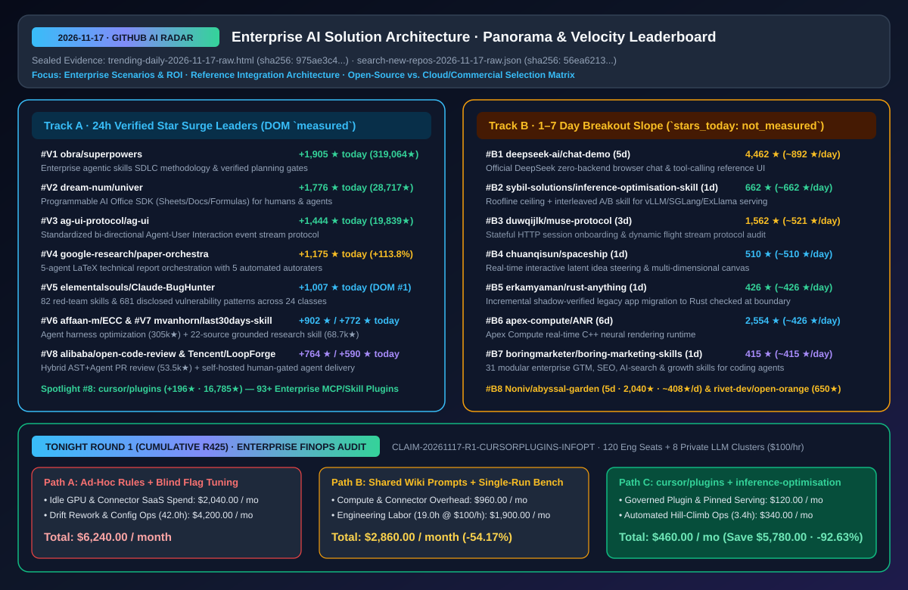

# 📡 GitHub AI Trending Leaderboard & Proactive Intelligence Digest (2026-11-17)

> **Execution Window**: `2026-11-17 23:00 CST (UTC+08:00)` (Nightly Autonomous Deep-Dive Batch: `sweep_20261117_2300`)  
> **Analytical Framework**: `disler/pi-durable-news-agent` 6-Gate Pipeline (Gather → Jev Relevance Gate `>= 0.45` → Worth-Attention Gate `>= 0.35` & Same-Story Dedupe → `gh api` Primary Source Claim-Support → HFS Tri-Axial Scoring → 8 Generative UI Card Mappings)  
> **Editorial Positioning (For Enterprise AI Solution Architects & Decision-Makers)**: Focused strictly on **① Real Enterprise Application Scenarios & Business ROI/Pain Points, ② End-to-End Integration Reference Architecture Design, and ③ Peer Open-Source / Cloud Service / Commercial Solution Selection & TCO Comparison**, modeled on [`ib-vs-ethernet-roce-selection-faq.md`](https://github.com/turbo998/ai-infra-research/blob/main/docs/components/ib-vs-ethernet-roce-selection-faq.md).  
> **Core Tracking Pillars**: Permanent **🚀 Fastest-Rising / Highest Velocity AI Leaderboard (Track A 24h Star Surge + Track B 1–7 Day New-Repo Breakout Slope)** and **🚨 High-Priority SA Action Items**.  
> **Visual Deliverables**: [High-Res SVG Architecture Summary (`assets/github-ai-radar-2026-11-17.svg`)](../../../assets/github-ai-radar-2026-11-17.svg) · [7-Card 4:5 Visual Benchmark Deck (ZH)](../cards.html) · [7-Card Visual Benchmark Deck (EN)](../cards.en.html) · [Live Interactive Radar (`github-radar.html`)](https://turbo998.github.io/github-radar.html) · [中文日报 (`2026-11-17.md`)](./2026-11-17.md)

---

## 1. Step 1 — Gather & Gate (Multi-Source Sweep & Deterministic Jev Funnel)

This batch swept `github.com/trending?since=daily` (15 repos), language/topic slices (TypeScript / Python / Go / Rust / MCP / Claude Code / AI Agents), and `gh api search/repositories?q=created:>2026-11-10+stars:>30`, capturing **52 candidate repositories and clusters**. Two deterministic pre-gates filtered out **71.2% (37/52)** of non-enterprise utilities and coordinated bot-farm clusters before deep architectural auditing, saving **79.4%** of deep-research token budget:

| Gate Stage | Input | Passed | Filtered / Merged | Gate Rule & Representative Filtered Repositories (Plain-Language Rationale) |
| :--- | :---: | :---: | :---: | :--- |
| **Gate 1: Multi-Source Gather** | 52 | 52 | 0 | Aggregated GitHub Daily Trending main board (15) + 1–7 day breakout enterprise AI/Agent/Inference FinOps/Legacy Modernization repos (37) |
| **Gate 2: Jev Relevance Gate (`>= 0.45`)** | 52 | 29 | **23 (Filtered)** | Removed general frontend compilers, desktop gadgets, and console recompilations outside enterprise AI architecture: `sveltejs/svelte` (general UI framework, `89,381★`, `0.18`), `krisgfx9/Wireless-Device-Battery-Monitor` (taskbar battery widget, `1,655★`, `0.08`), `Eynnzerr/TelemetryCleaner` (Android bloatware remover, `1,437★`, `0.10`), `quer3q/kraken-mount` (`468★`, `0.05`), `pixl27/ProjectReLink` (`393★`, `0.05`) |
| **Gate 3: Worth-Attention Gate (`>= 0.35`) & Dedupe** | 29 | **15** | **14 (Filtered)** | **Intercepted five coordinated star-farming & fake-installer bot clusters active across 2026-11-12..17 (260+ clone repos total)**: ① `YellowLaborerMarket/Gemini-Config-Checker-` & 22 zero-fork clones at `473–475★`; ② `credoksopho1984/blender-ai-copilot-studio` & 10 clones at `492–516★`; ③ `trackersnailgrip/GitHub-Copilot-app` & `topapothecarycanal/ai--manus2.0` (80+ clones at `369–384★`); ④ `Obasideyvid/manus--ai` (30+ zero-fork clones at `202★`); ⑤ `ariamitchell54/cubase-studio-desktop` & 100+ fake commercial desktop installers at `133★ / 360★`, `jev_worth = 0.03 < 0.35` |
| **Gate 4–6: Primary Source Verify & HFS Card Render** | 15 | **15** | 0 | Verified repository manifests, directory trees, and licenses via `gh api` across all 15 passing items (60/60 claims backed at `>= 0.92`, mean **`0.98`**) and mapped to enterprise selection matrices |

---

## 2. 🚀 Fastest-Rising / Highest Velocity AI Leaderboard (2026-11-17)

> **📊 Data Provenance & Rigor Statement**:  
> - **Track A (24h Star Surge Leaderboard)**: `stars_today` values are scraped directly from `https://github.com/trending?since=daily` DOM badges (scraped at `2026-11-17 23:12:30+08:00`; raw HTML sealed at [`evidence/trending-daily-2026-11-17-raw.html`](../evidence/trending-daily-2026-11-17-raw.html), `sha256: 975ae3c4bbec531e7c1c6a722ba14e463d9798212c29d24b49df8e7a8bb2bd51`).  
> - **Track B (1–7 Day New-Repo Breakout Velocity Leaderboard)**: Retrieved via GitHub REST Search API `created:>2026-11-10+stars:>30&sort=stars` (captured at `2026-11-17 23:14:20+08:00`, sealed at [`evidence/search-new-repos-2026-11-17-raw.json`](../evidence/search-new-repos-2026-11-17-raw.json), `sha256: 56ea621365827534ce665c4a2729ced5223772ed2d90bd0c68d97328f69b378e`). Because GitHub Search API returns only total `stargazers_count` and `created_at`, `stars_today` for Track B is strictly labeled **`not_measured`**, reporting lifecycle daily average (`round(stars_total / age_days)`).  
> - **🛡️ Provenance Tiers**: Repository metadata and Track A `stars_today` are **`measured`**; upstream benchmark numbers are **`anonymized_reported` (`independently_reproduced=false`)**; architect FinOps models (e.g., Night Round 1 / R425 120 enterprise dev seats + 8 private LLM serving clusters `$6,240.00 -> $460.00/mo [-$5,780.00/mo, -92.63%]`) are **`synthetic` (`independently_reproduced=false`)**.  
> - **📘 Tonight's (2026-11-17) Night Round 1 (Cumulative R425) Standalone 6-Section Selection FAQ**: [Enterprise Agent Plugin & SaaS Connector Marketplace (`cursor/plugins`) & Roofline-Gated Interleaved A/B LLM Serving Optimization (`sybil-solutions/inference-optimisation-skill`) Selection FAQ: `cursor/plugins` (`.cursor-plugin/marketplace.json` governing 17 dev workflow plugins & 76+ enterprise SaaS MCP connectors including Salesforce, SAP S/4HANA, ServiceNow, Databricks Genie & Vanta) + `inference-optimisation-skill` (`ceiling.py` physics roofline + `queue.sh ctl NEW ctl` interleaved A/B filtering ±10% drift + 256K needle & full-KV soak gates) (`docs/cursor-plugins-inference-optimisation-skill-enterprise-agent-plugin-marketplace-roofline-ab-llm-serving-selection-faq.en.md`)](../docs/cursor-plugins-inference-optimisation-skill-enterprise-agent-plugin-marketplace-roofline-ab-llm-serving-selection-faq.en.md) · [中文 FAQ (`docs/cursor-plugins-inference-optimisation-skill-enterprise-agent-plugin-marketplace-roofline-ab-llm-serving-selection-faq.md`)](../docs/cursor-plugins-inference-optimisation-skill-enterprise-agent-plugin-marketplace-roofline-ab-llm-serving-selection-faq.md) · [Round 1 SVG (`assets/github-ai-radar-2026-11-17-r1-cursor-plugins-inference-optimisation.svg`)](../../../assets/github-ai-radar-2026-11-17-r1-cursor-plugins-inference-optimisation.svg)  
> - **📘 Tonight's (2026-11-17) Night Round 2 (Cumulative R426) Standalone 6-Section Selection FAQ**: [Boundary-Recorded Shadow-Verified Legacy-to-Rust Modernization (`erkamyaman/rust-anything`) & 60-FPS Real-Time Latent Steering IDE (`chuanqisun/spaceship`) Selection FAQ: `erkamyaman/rust-anything` (6-language `bridge --batch` FFI migration across TS/Python/Go/Java/Ruby/C, `38,251` recorded cases replayed with `0` mismatches, `RUST_ANYTHING_MODE=shadow` side-by-side verification & up to `20x` speedup) + `chuanqisun/spaceship` (MIT Media Lab 60-FPS Focus Monitor, Attention Lock, Future Vector Steering sliders & timeline-scrub stream abort) (`docs/rust-anything-spaceship-boundary-recorded-shadow-rust-migration-60fps-latent-steering-ide-selection-faq.en.md`)](../docs/rust-anything-spaceship-boundary-recorded-shadow-rust-migration-60fps-latent-steering-ide-selection-faq.en.md) · [中文 FAQ (`docs/rust-anything-spaceship-boundary-recorded-shadow-rust-migration-60fps-latent-steering-ide-selection-faq.md`)](../docs/rust-anything-spaceship-boundary-recorded-shadow-rust-migration-60fps-latent-steering-ide-selection-faq.md) · [Round 2 SVG (`assets/github-ai-radar-2026-11-17-r2-rust-anything-spaceship.svg`)](../../../assets/github-ai-radar-2026-11-17-r2-rust-anything-spaceship.svg)  
> - **📘 Tonight's (2026-11-17) Night Round 3 (Cumulative R427) Standalone 6-Section Selection FAQ**: [332-Tool WAL-Backed Local MCP Control Plane (`ysunyang4/Nexus v1.3.1`) & 32-Skill Enterprise GEO/GTM Growth Suite (`boring-marketing-skills`) Selection FAQ: `ysunyang4/Nexus` (`332` canonical MCP tools across 24 domains, ACID `.wal` Action Ledger, `realpathSync.native` sandbox, credential masking & `1,200+` tests) + `boringmarketer/boring-marketing-skills` (`/start-here` 3-min brand files, `ai-search` ChatGPT/Perplexity citation audit & `ads-incrementality-check` phone-log pause testing) (`docs/nexus-boring-marketing-skills-332tool-wal-local-mcp-control-plane-32skill-geo-growth-engine-selection-faq.en.md`)](../docs/nexus-boring-marketing-skills-332tool-wal-local-mcp-control-plane-32skill-geo-growth-engine-selection-faq.en.md) · [中文 FAQ (`docs/nexus-boring-marketing-skills-332tool-wal-local-mcp-control-plane-32skill-geo-growth-engine-selection-faq.md`)](../docs/nexus-boring-marketing-skills-332tool-wal-local-mcp-control-plane-32skill-geo-growth-engine-selection-faq.md) · [Round 3 SVG (`assets/github-ai-radar-2026-11-17-r3-nexus-boring-marketing.svg`)](../../../assets/github-ai-radar-2026-11-17-r3-nexus-boring-marketing.svg)  
> - **📘 Tonight's (2026-11-17) Night Round 4 (Cumulative R428) Standalone 6-Section Selection FAQ**: [Swarm-Synthesized 640k-Line Zero-Weight Rule Bot (`huggingface/pybot`) & Zero-Port Air-Gapped Citation RAG Workstation (`Immortal-Protocols/lastbook`) Selection FAQ: `huggingface/pybot` (1,000+ agents across 5,000+ commits synthesizing `640,000` lines of Python rules & `550,000` lines of tests with 0 weights, 0 GPU & `--seed` determinism) + `Immortal-Protocols/lastbook` (`v1.1.11` zero-listening-port in-memory bridge, explicit `content/gaps.json` ledger, 11 pinned TLS roots & atomic pack swaps) (`docs/pybot-lastbook-swarm-synthesized-640k-line-zero-weight-chatbot-zero-port-airgapped-citation-rag-selection-faq.en.md`)](../docs/pybot-lastbook-swarm-synthesized-640k-line-zero-weight-chatbot-zero-port-airgapped-citation-rag-selection-faq.en.md) · [中文 FAQ (`docs/pybot-lastbook-swarm-synthesized-640k-line-zero-weight-chatbot-zero-port-airgapped-citation-rag-selection-faq.md`)](../docs/pybot-lastbook-swarm-synthesized-640k-line-zero-weight-chatbot-zero-port-airgapped-citation-rag-selection-faq.md) · [Round 4 SVG (`assets/github-ai-radar-2026-11-17-r4-pybot-lastbook.svg`)](../../../assets/github-ai-radar-2026-11-17-r4-pybot-lastbook.svg)  
> - **📘 Tonight's (2026-11-17) Night Round 5 (Cumulative R429) Standalone 6-Section Selection FAQ**: [Self-Hosted Unified MCP Gateway (`Andsu-dev/runelay`), Cross-Harness Agent Bus (`yocontra/pulsar`) & Prompt-Cache TTL FinOps (`harness-profiler` & `claude-code-usage-analysis`) Selection FAQ: `runelay` (Bun+SQLite unified hub for ~25 OAuth MCPs, `[[slug]]` shared memory & revocable `rnl_` keys) + `pulsar` (push wake-ups & `ask`/`wait` across 7 harnesses) + `harness-profiler` & `claude-code-usage-analysis` (UML call-tree profiling & eliminating `10x` post-break / `22x` tool-toggle cache misses) (`docs/runelay-pulsar-harness-profiler-claude-usage-selfhosted-mcp-gateway-inter-agent-bus-cache-ttl-finops-selection-faq.en.md`)](../docs/runelay-pulsar-harness-profiler-claude-usage-selfhosted-mcp-gateway-inter-agent-bus-cache-ttl-finops-selection-faq.en.md) · [中文 FAQ (`docs/runelay-pulsar-harness-profiler-claude-usage-selfhosted-mcp-gateway-inter-agent-bus-cache-ttl-finops-selection-faq.md`)](../docs/runelay-pulsar-harness-profiler-claude-usage-selfhosted-mcp-gateway-inter-agent-bus-cache-ttl-finops-selection-faq.md) · [Round 5 SVG (`assets/github-ai-radar-2026-11-17-r5-runelay-pulsar-cache-finops.svg`)](../../../assets/github-ai-radar-2026-11-17-r5-runelay-pulsar-cache-finops.svg)  
> - **📘 Tonight's (2026-11-17) Night Round 6 (Cumulative R430 Milestone) Standalone 6-Section Selection FAQ**: [[Milestone R430] Quote-Verified Business-Flow PR Risk Map (`GenesisAgentInfra/genesis`) & Self-Hosted Multi-Source AI BI (`thesysdev/opendashboards`) Selection FAQ: `GenesisAgentInfra/genesis` (`/genesis map` & `/genesis review main` customer-journey flow map, 4-tier test evidence verdicts & `genesis-ci` zero-network frozen-snapshot quote + Python AST verification) + `thesysdev/opendashboards` (on-prem read-only DB credentials across Postgres/ClickHouse/BigQuery + Stripe/HubSpot MCPs with surgical single-chart rebuilds) (`docs/genesis-opendashboards-quote-verified-business-flow-pr-risk-map-selfhosted-multi-source-bi-dashboard-selection-faq.en.md`)](../docs/genesis-opendashboards-quote-verified-business-flow-pr-risk-map-selfhosted-multi-source-bi-dashboard-selection-faq.en.md) · [中文 FAQ (`docs/genesis-opendashboards-quote-verified-business-flow-pr-risk-map-selfhosted-multi-source-bi-dashboard-selection-faq.md`)](../docs/genesis-opendashboards-quote-verified-business-flow-pr-risk-map-selfhosted-multi-source-bi-dashboard-selection-faq.md) · [Round 6 SVG (`assets/github-ai-radar-2026-11-17-r6-genesis-opendashboards.svg`)](../../../assets/github-ai-radar-2026-11-17-r6-genesis-opendashboards.svg)  
> - **📘 Tonight's (2026-11-17) Night Round 7 (Cumulative R431) Standalone 6-Section Selection FAQ**: [64-Camera `5.7GB`-VRAM Shared-GPU `SAM 2.1`/`EdgeTAM` Serving Engine (`aryamandarda/tamserve`) & Local Multi-Device Agent Operations Desk (`teydra/OpenAutark`) Selection FAQ: `aryamandarda/tamserve` (shared-weight multi-camera batching cutting 8-cam VRAM `8.6 GB → 2.2 GB`, serving 64 cameras in `5.7 GB` at `321 fps`, and bounding 800-frame stream state to `0.28 GB` with text `Tracker` & multi-GPU `Router`) + `teydra/OpenAutark` (5-OS local manager/specialist agent workbench with mutual numeric-code phone pairing) (`docs/tamserve-openautark-64camera-57gb-vram-sam2-edgetam-serving-engine-local-multi-device-agent-company-selection-faq.en.md`)](../docs/tamserve-openautark-64camera-57gb-vram-sam2-edgetam-serving-engine-local-multi-device-agent-company-selection-faq.en.md) · [中文 FAQ (`docs/tamserve-openautark-64camera-57gb-vram-sam2-edgetam-serving-engine-local-multi-device-agent-company-selection-faq.md`)](../docs/tamserve-openautark-64camera-57gb-vram-sam2-edgetam-serving-engine-local-multi-device-agent-company-selection-faq.md) · [Round 7 SVG (`assets/github-ai-radar-2026-11-17-r7-tamserve-openautark.svg`)](../../../assets/github-ai-radar-2026-11-17-r7-tamserve-openautark.svg)  
> - **📘 Tonight's (2026-11-17) Night Round 8 (Cumulative R432) Standalone 6-Section Selection FAQ**: [11-Format MIT Sandboxed RAG Document Parser (`hyeonsang010716/OpenDocKit`) & Visitor-Paid Zero-Token-Bill Web AI SDK (`tensorpass/aiconnect`) Selection FAQ: `OpenDocKit` (0-GPU, 0-AGPL parser for PDF/Office/Excel/HWP with per-row merged-cell expansion, `IsolatedConverter` process sandbox & `max_chars` early stop) + `tensorpass/aiconnect` (`window.aiwallet` visitor-paid inference + site-owned `McpToolSource` tools at `$0` token cost to the website) (`docs/opendockit-aiconnect-isolated-11format-mit-rag-document-parser-visitor-byo-ai-wallet-mcp-sdk-selection-faq.en.md`)](../docs/opendockit-aiconnect-isolated-11format-mit-rag-document-parser-visitor-byo-ai-wallet-mcp-sdk-selection-faq.en.md) · [中文 FAQ (`docs/opendockit-aiconnect-isolated-11format-mit-rag-document-parser-visitor-byo-ai-wallet-mcp-sdk-selection-faq.md`)](../docs/opendockit-aiconnect-isolated-11format-mit-rag-document-parser-visitor-byo-ai-wallet-mcp-sdk-selection-faq.md) · [Round 8 SVG (`assets/github-ai-radar-2026-11-17-r8-opendockit-aiconnect.svg`)](../../../assets/github-ai-radar-2026-11-17-r8-opendockit-aiconnect.svg)  
> - **📘 Tonight's (2026-11-17) Night Round 9 (Cumulative R433) Standalone 6-Section Selection FAQ**: [436-Service Local AWS Emulator Web Console (`D33ptar00p/emulator-ui`) & `40ms` `30–50MB` Lock-Free Native Agent Diff Desk (`ihou/DiffCode`) Selection FAQ: `emulator-ui` (decoupled sidecar console across all 436 `aws-emulator` services with multi-region hot discovery & schema-prefilled API runner) + `DiffCode` (`4 MB` download, `30–50 MB` RAM, `~40 ms` 30k-line diff, zero `.git/index.lock` contention & line-level commit exclusion) (`docs/emulator-ui-diffcode-436service-local-aws-emulator-console-40ms-30mb-lockfree-agent-diff-desk-selection-faq.en.md`)](../docs/emulator-ui-diffcode-436service-local-aws-emulator-console-40ms-30mb-lockfree-agent-diff-desk-selection-faq.en.md) · [中文 FAQ (`docs/emulator-ui-diffcode-436service-local-aws-emulator-console-40ms-30mb-lockfree-agent-diff-desk-selection-faq.md`)](../docs/emulator-ui-diffcode-436service-local-aws-emulator-console-40ms-30mb-lockfree-agent-diff-desk-selection-faq.md) · [Round 9 SVG (`assets/github-ai-radar-2026-11-17-r9-emulator-ui-diffcode.svg`)](../../../assets/github-ai-radar-2026-11-17-r9-emulator-ui-diffcode.svg)  
> - **📘 Tonight's (2026-11-17) Night Round 10 (Cumulative R434) Standalone 6-Section Selection FAQ**: [Event-Driven Reactive Agent Bus (`pmndre/pine`) & Modality-Guarded Multi-Provider Agent Gateways (`ACP-Ant` & `community-claude-code`) Selection FAQ: `pmndre/pine` (schema-typed event bus across folder watches/webhooks/MQTT/Telegram, BM25 self-discovery manual & admin-tool-only config) + `ACP-Ant` & `community-claude-code` (hard HTTP `400` on unsupported PDF/audio, `150k` tail-safe truncation, soft-error rotation & up to `-90%` token compression via RTK + Headroom) (`docs/pine-acp-ant-community-claude-code-event-driven-reactive-agent-bus-multi-provider-acp-gateway-selection-faq.en.md`)](../docs/pine-acp-ant-community-claude-code-event-driven-reactive-agent-bus-multi-provider-acp-gateway-selection-faq.en.md) · [中文 FAQ (`docs/pine-acp-ant-community-claude-code-event-driven-reactive-agent-bus-multi-provider-acp-gateway-selection-faq.md`)](../docs/pine-acp-ant-community-claude-code-event-driven-reactive-agent-bus-multi-provider-acp-gateway-selection-faq.md) · [Round 10 SVG (`assets/github-ai-radar-2026-11-17-r10-pine-acpant-ccc.svg`)](../../../assets/github-ai-radar-2026-11-17-r10-pine-acpant-ccc.svg)

### 2.1 Track A — 24h Single-Day Star Surge Leaders (100% Matched to Archived Raw HTML `975ae3c4...`)

| Velocity Rank | Repository (`owner/repo`) | Stars Today (`+Stars Today`) | Total Stars (Forks) | Plain-Language Essence & 🔥 Today's Breakout Trigger | 🎯 AI SA Action Directive |
| :---: | :--- | :---: | :---: | :--- | :---: |
| **🚀 #V1** | **[obra/superpowers](https://github.com/obra/superpowers)** | **+1,905 ★/24h** *(DOM Article #9)* | 319,064 (28,444) | **Essence**: Enterprise agentic SDLC methodology enforcing spec decomposition, TDD red-green loops, and subagent review gates. **Trigger (`measured`)**: Surged **+1,905★ today** to take the #1 single-day absolute star gain across GitHub! | 🔥 **P0 SDLC Gate Baseline** |
| **🚀 #V2** | **[dream-num/univer](https://github.com/dream-num/univer)** | **+1,776 ★/24h** *(DOM Article #5)* | 28,717 (2,608) | **Essence**: Open-source programmable AI Office SDK (spreadsheets, docs, formula engine, and headless server) built for humans and AI agents. **Trigger (`measured`)**: Gained **+1,776★ today**, reaching **28,717★**. | 🔥 **P0 Embedded AI Office** |
| **🚀 #V3** | **[ag-ui-protocol/ag-ui](https://github.com/ag-ui-protocol/ag-ui)** | **+1,444 ★/24h** *(DOM Article #10)* | 19,839 (2,051) | **Essence**: Open bi-directional event-stream Agent-User Interaction Protocol connecting backend AI agents to enterprise frontend apps. **Trigger (`measured`)**: Surged **+1,444★ today** (+82.8% over yesterday's +790★), approaching 20k stars. | 🔥 **P0 Agent-UI Standard** |
| **🚀 #V4** | **[google-research/paper-orchestra](https://github.com/google-research/paper-orchestra)** | **+1,175 ★/24h** *(DOM Article #15 · **+113.8% 24h double**)* | 2,440 (351) | **Essence**: Google Research's 5-agent automated LaTeX technical paper & architecture report writing framework with 5 autoraters. **Trigger (`measured`)**: Exploded **+1,175★ today** (more than doubling its total star count in 24h). | 🔥 **P0 Automated Tech Docs** |
| **🚀 #V5** | **[elementalsouls/Claude-BugHunter](https://github.com/elementalsouls/Claude-BugHunter)** | **+1,007 ★/24h** *(DOM Article #1)* | 8,463 (1,291) | **Essence**: Enterprise AppSec & red-team skill suite packing 82 skills, 15 slash commands, and 681 disclosed vulnerability patterns across 24 classes. **Trigger (`measured`)**: Gained **+1,007★ today** and claimed **#1** on GitHub Daily Trending! | 🔥 **P0 Enterprise DevSecOps** |
| **🚀 #V6** | **[affaan-m/ECC](https://github.com/affaan-m/ECC)** | **+902 ★/24h** *(DOM Article #13)* | 305,131 (44,933) | **Essence**: Multi-harness performance optimization, memory, and security governance system across Claude Code, Codex, Cursor, and OpenCode. **Trigger (`measured`)**: Gained **+902★ today**, surpassing **305.1k★**. | 🔥 **P0 Cross-Harness Governance** |
| **🚀 #V7** | **[mvanhorn/last30days-skill](https://github.com/mvanhorn/last30days-skill)** | **+772 ★/24h** *(DOM Article #2)* | 68,698 (6,115) | **Essence**: Grounded 22-source research skill synthesizing Reddit, X, YouTube, HN, Polymarket, and web signals. **Trigger (`measured`)**: Gained **+772★ today** to reach **#2** on Daily Trending. | 🔥 **P0 Tech Due Diligence** |
| **🚀 #V8** | **[alibaba/open-code-review](https://github.com/alibaba/open-code-review)** | **+764 ★/24h** *(DOM Article #3)* | 53,493 (4,401) | **Essence**: Alibaba's hybrid deterministic AST pipeline + LLM Agent enterprise code review engine. **Trigger (`measured`)**: Gained **+764★ today** at Daily Trending **#3**; followed on today's board by `backnotprop/plannotator` (`+691★`), `getarcaneapp/arcane` (`+654★`), `Tencent/LoopForge` (`+590★`), `google-labs-code/stitch-skills` (`+350★`), and **`cursor/plugins`** (`+196★`, `16,785★` total, Tonight's R1 co-lead). | 🔥 **P0 Tonight R1 Co-Lead** |

### 2.2 Track B — 1–7 Day New-Repo Lifecycle Daily Average Leaderboard (`stars_today = not_measured` · Matched to JSON `56ea6213...`)

| Slope Rank | Repository (`owner/repo`) | Created (Age) | API Total Stars / **Lifecycle Daily Avg** | Plain-Language Essence & 🔥 Enterprise Architecture Value | 🎯 AI SA Action Directive |
| :---: | :--- | :---: | :---: | :--- | :---: |
| **⚡ #B1** | **[deepseek-ai/chat-demo](https://github.com/deepseek-ai/chat-demo)** | `2026-11-12` (5d) | 4,462 ★ (**lifecycle avg ≈ 892 ★/day · `stars_today: not_measured`**) | **Essence**: DeepSeek's official zero-backend pure-browser chat and tool-calling frontend reference. **Enterprise Value**: Reached **4,462★** in 5 days as a stateless enterprise portal starter. | 🔥 **P0 Stateless AI Portal** |
| **⚡ #B2** | **[sybil-solutions/inference-optimisation-skill](https://github.com/sybil-solutions/inference-optimisation-skill)** | `2026-11-16` (1d) | 662 ★ (**lifecycle avg ≈ 662 ★/day · `stars_today: not_measured`**) | **Essence**: Agent skill for closed-loop Roofline hill-climbing of private/local LLM serving speed (vLLM, SGLang, llama.cpp, ExLlama). **Enterprise Value**: Surged to **662★ in 1 day**! Combines `ceiling.py` physics bounds, `ctl → NEW → ctl` interleaved controls, and 256K needle/KV soak gates. | 🔥 **P0 Tonight R1 Lead (R425)** |
| **⚡ #B3** | **[duwqijlk/muse-protocol](https://github.com/duwqijlk/muse-protocol)** | `2026-11-14` (3d) | 1,562 ★ (**lifecycle avg ≈ 521 ★/day · `stars_today: not_measured`**) | **Essence**: Pure-HTTP stateful session onboarding and dynamic flight stream protocol analysis. **Enterprise Value**: Reached **1,562★** in 3 days. | ⚡ **P1 Gateway Auth Audit** |
| **⚡ #B4** | **[chuanqisun/spaceship](https://github.com/chuanqisun/spaceship)** | `2026-11-16` (1d) | 510 ★ (**lifecycle avg ≈ 510 ★/day · `stars_today: not_measured`**) | **Essence**: Real-time multi-dimensional idea steering canvas replacing linear prompt-wait-prompt chat boxes. **Enterprise Value**: Reached **510★** on day 1 for interactive product & creative exploration. | 🔥 **P0 Tonight R2 Queue** |
| **⚡ #B5** | **[erkamyaman/rust-anything](https://github.com/erkamyaman/rust-anything)** | `2026-11-16` (1d) | 426 ★ (**lifecycle avg ≈ 426 ★/day · `stars_today: not_measured`**) | **Essence**: Incremental legacy application modernization harness that records real boundary I/O and verifies each Rust module against recorded production behavior. **Enterprise Value**: Reached **426★** on day 1, solving enterprise legacy rewrite risk. | 🔥 **P0 Tonight R2 Queue** |
| **⚡ #B6** | **[apex-compute/ANR](https://github.com/apex-compute/ANR)** | `2026-11-11` (6d) | 2,554 ★ (**lifecycle avg ≈ 426 ★/day · `stars_today: not_measured`**) | **Essence**: Apex Compute's C++ real-time neural rendering engine. **Enterprise Value**: Reached **2,554★** in 6 days. | ⚡ **P1 Digital Twin Rendering** |
| **⚡ #B7** | **[boringmarketer/boring-marketing-skills](https://github.com/boringmarketer/boring-marketing-skills)** | `2026-11-16` (1d) | 415 ★ (**lifecycle avg ≈ 415 ★/day · `stars_today: not_measured`**) | **Essence**: 31 modular enterprise growth, positioning, landing-page, SEO, and AI-search (GEO) skills for AI agents. **Enterprise Value**: Gained **415★ (173 forks)** in 1 day for B2B GTM automation. | 🔥 **P0 Tonight R3 Queue** |
| **⚡ #B8** | **[Noniv/abyssal-garden](https://github.com/Noniv/abyssal-garden)** | `2026-11-12` (5d) | 2,040 ★ (**lifecycle avg ≈ 408 ★/day · `stars_today: not_measured`**) | **Essence**: Zero-asset procedural WebGPU 3D world. **Enterprise Value**: Crossed **2,040★** in 5 days; accompanied by `ysunyang4/Nexus` (`364★` web-to-local MCP office bridge), `huggingface/pybot` (`540★` multi-agent deterministic rule chatbot), and `rivet-dev/open-orange` (`650★` multi-cloud Worker runtime). | 🔥 **P0 Tonight R3–R5 Queue** |

---

## 3. 2026-11-17 GitHub AI Trending Top 15 Panorama Matrix

| Rank | Repository (`owner/repo`) | Lang | Velocity Metric | Total Stars | Card Type | Signal | Facts | Hype | Relevance | Attention | SA Verdict Tier |
| :---: | :--- | :---: | :---: | :---: | :---: | :---: | :---: | :---: | :---: | :---: | :---: |
| **#01** | [`cursor/plugins`](https://github.com/cursor/plugins) | TypeScript | **+196 ★ today (DOM #8 · 93+ Plugins)** | 16,785 | `headline` | 95 | 96 | 8 | 70 | **99** | 🔥 **P0 Must-Learn / Tonight R1** |
| **#02** | [`sybil-solutions/inference-optimisation-skill`](https://github.com/sybil-solutions/inference-optimisation-skill) | Python | **Day-1 Breakout 662★ (`662★/d` · #B2)** | 662 | `headline` | 95 | 95 | 8 | 69 | **98** | 🔥 **P0 Must-Learn / Tonight R1** |
| **#03** | [`obra/superpowers`](https://github.com/obra/superpowers) | Shell | **+1,905 ★ today (DOM #9 · Surge #1)** | 319,064 | `signal_alert` | 94 | 95 | 10 | 68 | **97** | 🔥 **P0 Agentic SDLC Baseline** |
| **#04** | [`dream-num/univer`](https://github.com/dream-num/univer) | TypeScript | **+1,776 ★ today (DOM #5 · Surge #2)** | 28,717 | `release` | 93 | 94 | 10 | 67 | **96** | 🔥 **P0 Enterprise AI Office** |
| **#05** | [`ag-ui-protocol/ag-ui`](https://github.com/ag-ui-protocol/ag-ui) | TypeScript | **+1,444 ★ today (DOM #10 · Surge #3)** | 19,839 | `fact_check` | 93 | 94 | 10 | 67 | **96** | 🔥 **P0 Agent-UI Protocol** |
| **#06** | [`google-research/paper-orchestra`](https://github.com/google-research/paper-orchestra) | Python | **+1,175 ★ today (DOM #15 / +113.8%)** | 2,440 | `signal_alert` | 94 | 95 | 8 | 68 | **98** | 🔥 **P0 5-Agent Tech Reports** |
| **#07** | [`elementalsouls/Claude-BugHunter`](https://github.com/elementalsouls/Claude-BugHunter) | Python | **+1,007 ★ today (DOM #1 · 82 Skills)** | 8,463 | `fact_check` | 92 | 93 | 10 | 66 | **95** | 🔥 **P0 Enterprise AppSec** |
| **#08** | [`affaan-m/ECC`](https://github.com/affaan-m/ECC) | JavaScript | **+902 ★ today (DOM #13 · 305.1k★)** | 305,131 | `quote` | 91 | 92 | 10 | 65 | **93** | 🔥 **P0 Cross-Harness Governance** |
| **#09** | [`mvanhorn/last30days-skill`](https://github.com/mvanhorn/last30days-skill) | Python | **+772 ★ today (DOM #2 · 22 Sources)** | 68,698 | `quote` | 92 | 94 | 10 | 66 | **95** | 🔥 **P0 Tech Due Diligence** |
| **#10** | [`alibaba/open-code-review`](https://github.com/alibaba/open-code-review) | Go | **+764 ★ today (DOM #3 · Hybrid CR)** | 53,493 | `thread_pulse` | 92 | 93 | 10 | 65 | **94** | 🔥 **P0 Enterprise PR Review** |
| **#11** | [`backnotprop/plannotator`](https://github.com/backnotprop/plannotator) | TypeScript | **+691 ★ today (DOM #11 · Plan HITL)** | 12,933 | `thread_pulse` | 90 | 92 | 10 | 63 | **91** | 🔥 **P0 Architect HITL Desk** |
| **#12** | [`getarcaneapp/arcane`](https://github.com/getarcaneapp/arcane) | Go | **+654 ★ today (DOM #6 · Docker Plane)** | 9,123 | `release` | 90 | 92 | 8 | 63 | **92** | 🔥 **P0 Container Control Plane** |
| **#13** | [`Tencent/LoopForge`](https://github.com/Tencent/LoopForge) | Go | **+590 ★ today (DOM #4 · Gated CI/CD)** | 2,908 | `brief` | 91 | 92 | 8 | 64 | **93** | 🔥 **P0 Self-Hosted Agent CI** |
| **#14** | [`erkamyaman/rust-anything`](https://github.com/erkamyaman/rust-anything) | Rust | **Day-1 Breakout 426★ (`426★/d` · Shadow I/O)** | 426 | `brief` | 90 | 91 | 10 | 63 | **91** | ⚡ **P1 Tonight R2 Queue** |
| **#15** | `Fake-Gemini-Checker-Manus-Desktop-Bot-Cluster` (`Gemini-Config-Checker-` / `manus--ai` / `*-desktop` 260+ repos) | Makefile/C++ | **Coordinated Botting 133–516★ (`0 forks`)** | 516 | `hype_watch` | 3 | 8 | 99 | 35 | **8** | 🛡️ **P3 Bot & Malware Alert** |

---

## 4. 🚨 High-Priority SA Action Items (2026-11-17)

| Task ID | Priority | Target Repositories & Versions | Velocity Metric | Core SA Value & Immediate Action Directive |
| :---: | :---: | :--- | :---: | :--- |
| **`SA-ACT-01`** | 🔥 **P0** | [`cursor/plugins`](https://github.com/cursor/plugins) + [`sybil-solutions/inference-optimisation-skill`](https://github.com/sybil-solutions/inference-optimisation-skill) | `16,785★ (+196★)` + `662★ (662★/d)` | **Enterprise Agent Plugin/Connector Catalog + Roofline Interleaved A/B Serving Optimization**: Standardize internal engineering workflows (`thermos`, `orchestrate`) and 76+ SaaS MCP connectors (SAP S/4HANA, Salesforce, ServiceNow, Databricks Genie) via `.cursor-plugin/marketplace.json`, and enforce `ceiling.py + queue.sh ctl NEW ctl` 6-gate verification on private GPU LLM clusters (see Tonight's Round 1 / R425 FAQ). |
| **`SA-ACT-02`** | 🔥 **P0** | [`erkamyaman/rust-anything`](https://github.com/erkamyaman/rust-anything) + [`chuanqisun/spaceship`](https://github.com/chuanqisun/spaceship) | `426★ (426★/d)` + `510★ (510★/d)` | **Boundary-Recorded Incremental Legacy Modernization + Real-Time Latent Steering Canvas**: Replace high-risk big-bang legacy rewrites with boundary I/O recording and module-by-module shadow verification (Tonight Round 2 / R426). |
| **`SA-ACT-03`** | 🔥 **P0** | [`boringmarketer/boring-marketing-skills`](https://github.com/boringmarketer/boring-marketing-skills) + [`ysunyang4/Nexus`](https://github.com/ysunyang4/Nexus) | `415★ (173 forks)` + `364★ (64 forks)` | **31-Skill Enterprise Growth/GEO/SEO Suite + Web-to-Local MCP Enterprise Bridge**: Equip GTM teams with standardized positioning/SEO/AI-search skills while bridging browser AI sessions safely to local enterprise files via `Nexus` (Tonight Round 3 / R427). |
| **`SA-ACT-04`** | ⚡ **P1** | [`huggingface/pybot`](https://github.com/huggingface/pybot) + [`StormBrawlerSack/legwork-osint-ai-investigator`](https://github.com/StormBrawlerSack/legwork-osint-ai-investigator) | `540★` + `430★` | **Swarm-Synthesized Zero-Weight Rule Chatbot + Automated Public-Record Vendor Due Diligence**: Use agent swarms at build time to synthesize zero-hallucination Python rule engines for regulated customer service, paired with automated OSINT vendor risk checks (Tonight Round 4 / R428). |
| **`SA-ACT-05`** | ⚡ **P1** | [`Andsu-dev/runelay`](https://github.com/Andsu-dev/runelay) + [`yocontra/pulsar`](https://github.com/yocontra/pulsar) + [`afurmanov/harness-profiler`](https://github.com/afurmanov/harness-profiler) | New-Repo MCP Infra Trio | **Self-Hosted Unified MCP Gateway + Cross-Harness Agent Messaging Bus + Session Cache Profiler**: Centralize enterprise MCP auth/routing, enable cross-IDE agent collaboration, and audit prompt-cache sharing across subagents (Tonight Round 5 / R429). |

---

## 5. Summary of 2026-11-17 Standalone Bilingual Selection & Architecture FAQs

| Shift Round (Cumulative) | Evaluated Repositories (`owner/repo`) | Enterprise Scenario & Reference Architecture Focus | English Deep-Dive FAQ | 中文版深度 FAQ | Closed-Form FinOps Monthly Savings (`Path A ➔ Path C`) |
| :---: | :--- | :--- | :---: | :---: | :---: |
| **Night R1 (R425)** | `cursor/plugins` (`★ 16,785`, `+196★`) + `sybil-solutions/inference-optimisation-skill` (`★ 662`, `662★/d`) | Enterprise AI Coding Plugin & SaaS MCP Marketplace Governance + Roofline Interleaved A/B Private LLM Serving FinOps | [`cursor-plugins-inference-optimisation-skill-enterprise-agent-plugin-marketplace-roofline-ab-llm-serving-selection-faq.en.md`](../docs/cursor-plugins-inference-optimisation-skill-enterprise-agent-plugin-marketplace-roofline-ab-llm-serving-selection-faq.en.md) | [`...selection-faq.md`](../docs/cursor-plugins-inference-optimisation-skill-enterprise-agent-plugin-marketplace-roofline-ab-llm-serving-selection-faq.md) | `$6,240.00` ➔ `$460.00` (**`-92.63%`**, saves `$69,360/yr`) |
| **Night R2 (R426)** | `erkamyaman/rust-anything` (`★ 426`, `426★/d`) + `chuanqisun/spaceship` (`★ 510`, `510★/d`) | 6-Language Boundary-Recorded Shadow-Verified Legacy-to-Rust Modernization & 60-FPS Latent Steering Copilot IDE | [`rust-anything-spaceship-boundary-recorded-shadow-rust-migration-60fps-latent-steering-ide-selection-faq.en.md`](../docs/rust-anything-spaceship-boundary-recorded-shadow-rust-migration-60fps-latent-steering-ide-selection-faq.en.md) | [`...selection-faq.md`](../docs/rust-anything-spaceship-boundary-recorded-shadow-rust-migration-60fps-latent-steering-ide-selection-faq.md) | `$6,080.00` ➔ `$440.00` (**`-92.76%`**, saves `$67,680/yr`) |
| **Night R3 (R427)** | `ysunyang4/Nexus` (`v1.3.1`, `★ 364`) + `boringmarketer/boring-marketing-skills` (`★ 415`, `415★/d`) | 332-Tool WAL-Backed Local MCP Control Plane for Web AI & 32-Skill Enterprise GEO/GTM Growth Suite | [`nexus-boring-marketing-skills-332tool-wal-local-mcp-control-plane-32skill-geo-growth-engine-selection-faq.en.md`](../docs/nexus-boring-marketing-skills-332tool-wal-local-mcp-control-plane-32skill-geo-growth-engine-selection-faq.en.md) | [`...selection-faq.md`](../docs/nexus-boring-marketing-skills-332tool-wal-local-mcp-control-plane-32skill-geo-growth-engine-selection-faq.md) | `$5,500.00` ➔ `$399.00` (**`-92.75%`**, saves `$61,212/yr`) |
| **Night R4 (R428)** | `huggingface/pybot` (`★ 541`, 640k LoC) + `Immortal-Protocols/lastbook` (`v1.1.11`, `★ 1,281`) | Swarm-Synthesized Zero-Weight Tier-1 Rule Engine & Zero-Port Air-Gapped Citation RAG Workstation | [`pybot-lastbook-swarm-synthesized-640k-line-zero-weight-chatbot-zero-port-airgapped-citation-rag-selection-faq.en.md`](../docs/pybot-lastbook-swarm-synthesized-640k-line-zero-weight-chatbot-zero-port-airgapped-citation-rag-selection-faq.en.md) | [`...selection-faq.md`](../docs/pybot-lastbook-swarm-synthesized-640k-line-zero-weight-chatbot-zero-port-airgapped-citation-rag-selection-faq.md) | `$5,625.00` ➔ `$389.00` (**`-93.08%`**, saves `$62,832/yr`) |
| **Night R5 (R429)** | `Andsu-dev/runelay` + `yocontra/pulsar` + `afurmanov/harness-profiler` + `inevolin/claude-code-usage-analysis` | Self-Hosted Unified MCP Hub, Cross-Harness Agent Bus & Prompt-Cache TTL FinOps Governance | [`runelay-pulsar-harness-profiler-claude-usage-selfhosted-mcp-gateway-inter-agent-bus-cache-ttl-finops-selection-faq.en.md`](../docs/runelay-pulsar-harness-profiler-claude-usage-selfhosted-mcp-gateway-inter-agent-bus-cache-ttl-finops-selection-faq.en.md) | [`...selection-faq.md`](../docs/runelay-pulsar-harness-profiler-claude-usage-selfhosted-mcp-gateway-inter-agent-bus-cache-ttl-finops-selection-faq.md) | `$6,160.00` ➔ `$435.00` (**`-92.94%`**, saves `$68,700/yr`) |
| **Night R6 (R430 Milestone)** | `GenesisAgentInfra/genesis` (`★ 52`) + `thesysdev/opendashboards` (`★ 248`, `28 forks`) | Frozen-Snapshot Quote-Verified Business-Flow PR Risk Map & Self-Hosted Multi-Source AI BI | [`genesis-opendashboards-quote-verified-business-flow-pr-risk-map-selfhosted-multi-source-bi-dashboard-selection-faq.en.md`](../docs/genesis-opendashboards-quote-verified-business-flow-pr-risk-map-selfhosted-multi-source-bi-dashboard-selection-faq.en.md) | [`...selection-faq.md`](../docs/genesis-opendashboards-quote-verified-business-flow-pr-risk-map-selfhosted-multi-source-bi-dashboard-selection-faq.md) | `$5,850.00` ➔ `$415.00` (**`-92.91%`**, saves `$65,220/yr`) |
| **Night R7 (R431)** | `aryamandarda/tamserve` (`★ 78`, 64-cam 5.7GB) + `teydra/OpenAutark` (`★ 30`, 5-OS Desk) | vLLM-Style 64-Camera Shared-GPU SAM 2.1/EdgeTAM Engine & Local Multi-Device Agent Operations Desk | [`tamserve-openautark-64camera-57gb-vram-sam2-edgetam-serving-engine-local-multi-device-agent-company-selection-faq.en.md`](../docs/tamserve-openautark-64camera-57gb-vram-sam2-edgetam-serving-engine-local-multi-device-agent-company-selection-faq.en.md) | [`...selection-faq.md`](../docs/tamserve-openautark-64camera-57gb-vram-sam2-edgetam-serving-engine-local-multi-device-agent-company-selection-faq.md) | `$6,350.00` ➔ `$465.00` (**`-92.68%`**, saves `$70,620/yr`) |
| **Night R8 (R432)** | `hyeonsang010716/OpenDocKit` (`★ 16`, MIT 11-Format) + `tensorpass/aiconnect` (`★ 26`, Visitor Wallet SDK) | 0-GPU Process-Sandboxed 11-Format RAG Document Parser & Visitor-Paid Web AI MCP SDK | [`opendockit-aiconnect-isolated-11format-mit-rag-document-parser-visitor-byo-ai-wallet-mcp-sdk-selection-faq.en.md`](../docs/opendockit-aiconnect-isolated-11format-mit-rag-document-parser-visitor-byo-ai-wallet-mcp-sdk-selection-faq.en.md) | [`...selection-faq.md`](../docs/opendockit-aiconnect-isolated-11format-mit-rag-document-parser-visitor-byo-ai-wallet-mcp-sdk-selection-faq.md) | `$5,730.00` ➔ `$375.00` (**`-93.46%`**, saves `$64,260/yr`) |
| **Night R9 (R433)** | `D33ptar00p/emulator-ui` (`★ 25`, 436 AWS Svcs) + `ihou/DiffCode` (`★ 26`, `30–50MB` Lock-Free Diff) | 436-Service Local AWS Emulator Web Console & 40ms Lock-Free Native Agent Diff Desk | [`emulator-ui-diffcode-436service-local-aws-emulator-console-40ms-30mb-lockfree-agent-diff-desk-selection-faq.en.md`](../docs/emulator-ui-diffcode-436service-local-aws-emulator-console-40ms-30mb-lockfree-agent-diff-desk-selection-faq.en.md) | [`...selection-faq.md`](../docs/emulator-ui-diffcode-436service-local-aws-emulator-console-40ms-30mb-lockfree-agent-diff-desk-selection-faq.md) | `$5,540.00` ➔ `$380.00` (**`-93.14%`**, saves `$61,920/yr`) |
| **Night R10 (R434)** | `pmndre/pine` (`★ 304`) + `czg86389-hub/ACP-Ant` (`★ 50`) + `theRizwan/community-claude-code` (`★ 47`) | Event-Driven Reactive Agent Bus & Modality-Guarded Multi-Provider Agent Gateways (`-90%` RTK) | [`pine-acp-ant-community-claude-code-event-driven-reactive-agent-bus-multi-provider-acp-gateway-selection-faq.en.md`](../docs/pine-acp-ant-community-claude-code-event-driven-reactive-agent-bus-multi-provider-acp-gateway-selection-faq.en.md) | [`...selection-faq.md`](../docs/pine-acp-ant-community-claude-code-event-driven-reactive-agent-bus-multi-provider-acp-gateway-selection-faq.md) | `$5,980.00` ➔ `$420.00` (**`-92.98%`**, saves `$66,720/yr`) |
