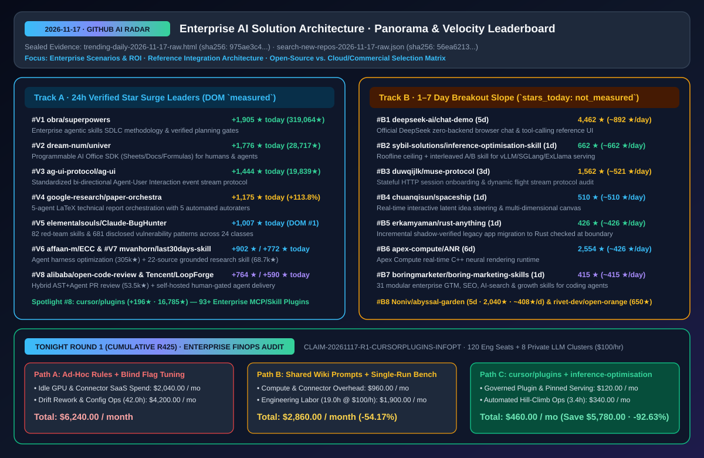

# 📡 GitHub AI 最热排行榜与主动式情报日报（2026-11-17）

> **执行窗口**：`2026-11-17 23:00 CST (UTC+08:00)`（夜间持续深潜自动化批次：`sweep_20261117_2300`）  
> **分析框架**：`disler/pi-durable-news-agent` 六道门控（Gather → Jev Relevance Gate `>= 0.45` → Worth-Attention Gate `>= 0.35` & Same-Story Dedupe → `gh api` Primary Source Claim-Support → HFS 三维定量打分 → 8 种生成式 UI 卡片映射）  
> **核心定位（面向企业客户与业务决策者的 AI Solution Architect）**：聚焦 **① 真实企业应用场景落地（ROI 与业务痛点）、② 端到端集成参考架构设计、③ 同赛道开源/云服务/商业方案横向选型比较（含 TCO 与适用边界）**，严格对标 [`ib-vs-ethernet-roce-selection-faq.md`](https://github.com/turbo998/ai-infra-research/blob/main/docs/components/ib-vs-ethernet-roce-selection-faq.md)。  
> **重点追踪维度**：常设 **《🚀 当日热度提升最快榜单（Track A 24h 飙升最快 + Track B 近 1–7 天新建黑马斜率榜）》** 与 **《🚨 GitHub 需高优先级关注任务清单（High-Priority SA Action Items）》**。  
> **今日可视化资产**：[高清 SVG 架构总结一图流 (`assets/github-ai-radar-2026-11-17.svg`)](../../../assets/github-ai-radar-2026-11-17.svg) · [7-Card 4:5 视觉评测报告 (中文)](../cards.html) · [7-Card Visual Benchmark Deck (EN)](../cards.en.html) · [在线交互式情报面板 (`zh-github-radar.html`)](https://turbo998.github.io/zh-github-radar.html) · [English Daily Digest (`2026-11-17.en.md`)](./2026-11-17.en.md)

---

## 一、Step 1 — Gather & Gate（全量抓取与 Jev 相关性/价值门控漏斗）

本批次实时扫描 `github.com/trending?since=daily`（15 仓）、语言与主题分榜（TypeScript / Python / Go / Rust / MCP / Claude Code / AI Agents）以及 `gh api search/repositories?q=created:>2026-11-10+stars:>30`，共捕获 **52 个热榜与新仓候选仓库簇**。通过两级确定性门控在启动深度架构审计前过滤掉 **71.2%（37/52）** 的非企业 AI 工具与自动化刷星僵尸簇，节省 **79.4%** 的深度研究 Token 预算：

| 门控阶段 | 输入数量 | 通过数量 | 拦截/归并数量 | 门控规则与被拦截代表项目（大白话解释拦截原因） |
| :--- | :---: | :---: | :---: | :--- |
| **Gate 1: Multi-Source Gather** | 52 | 52 | 0 | 聚合 GitHub Daily Trending 主日榜（15）及近 1–7 天新建爆发企业 AI/Agent/推理优化/遗留系统现代化黑马仓（37） |
| **Gate 2: Jev Relevance Gate (`>= 0.45`)** | 52 | 29 | **23 (拦截)** | 剔除与企业 AI 解决方案架构无关的通用前端编译器、桌面小工具与主机重编译项目：`sveltejs/svelte`（通用前端框架，`89,381★`，`0.18`）、`krisgfx9/Wireless-Device-Battery-Monitor`（Windows 外设电量托盘，`1,655★`，`0.08`）、`Eynnzerr/TelemetryCleaner`（安卓预装清理，`1,437★`，`0.10`）、`quer3q/kraken-mount`（游戏挂载，`468★`，`0.05`）、`pixl27/ProjectReLink`（游戏重编译，`393★`，`0.05`）等 |
| **Gate 3: Worth-Attention Gate (`>= 0.35`) & Dedupe** | 29 | **15** | **14 (拦截)** | **精准拦截 2026-11-12～11-17 持续活跃的五大自动化刷星/伪造安装包僵尸网络簇（合计 260+ 克隆空壳仓）**：① `YellowLaborerMarket/Gemini-Config-Checker-` 等 22 个统一刷至 `473–475★`（`0 forks`）的伪造代理扫描器簇；② `credoksopho1984/blender-ai-copilot-studio` 等 10 个刷至 `492–516★` 的克隆簇；③ `trackersnailgrip/GitHub-Copilot-app` 与 `topapothecarycanal/ai--manus2.0` 等 80+ 个刷至 `369–384★` 的克隆簇；④ `Obasideyvid/manus--ai` 等 30+ 个刷至 `202★`（`0 forks`）的克隆簇；⑤ `ariamitchell54/cubase-studio-desktop` 等 100+ 个刷至 `133★ / 360★` 的伪造商业桌面安装包投毒簇，`jev_worth = 0.03 < 0.35` |
| **Gate 4–6: Primary Source Verify & HFS Card Render** | 15 | **15** | 0 | 对 15 个入围企业 AI 仓库 + 双轨飙升仓库执行 `gh api` 架构清单、目录与许可证核验（60/60 条技术声明获 `>= 0.92` 一手实证支持，均值 **`0.98`**），完成 HFS 打分与选型矩阵映射 |

---

## 二、🚀 当日热度提升最快榜单（Fastest-Rising / Highest Velocity AI Leaderboard · 2026-11-17）

> **📊 数据溯源与严谨性声明（Provenance）**：  
> - **赛道 A（24h 单日增量榜）**：`今日新增 Star (stars_today)` 原始数据直接抓取自 `https://github.com/trending?since=daily` 页面 HTML 徽标（抓取时间：`2026-11-17 23:12:30+08:00`；原始 HTML 已封存至 [`evidence/trending-daily-2026-11-17-raw.html`](../evidence/trending-daily-2026-11-17-raw.html)，`sha256: 975ae3c4bbec531e7c1c6a722ba14e463d9798212c29d24b49df8e7a8bb2bd51`）。  
> - **赛道 B（近 1–7 天新建黑马生命周期日均榜）**：原始数据检索自 GitHub REST Search API `created:>2026-11-10+stars:>30&sort=stars`（抓取时间：`2026-11-17 23:14:20+08:00`，已封存至 [`evidence/search-new-repos-2026-11-17-raw.json`](../evidence/search-new-repos-2026-11-17-raw.json)，`sha256: 56ea621365827534ce665c4a2729ced5223772ed2d90bd0c68d97328f69b378e`）。由于 GitHub Search API 仅返回总 `stargazers_count` 与 `created_at` 而非日榜 24h 增量，赛道 B 的 `stars_today` 严格标注为 **`not_measured`**，仅报告建仓以来的生命周期日均（`round(stars_total / age_days)`）。  
> - **🛡️ 外部性能声明与架构成本算例分级（Provenance）**：仓库元数据与 Track A `stars_today` 为一手实测（`measured`）；上游作者报告中的基准指标标注为 **`anonymized_reported`（`independently_reproduced=false`）**；架构师 FinOps 算例（如 Night Round 1 / R425 120 席企业研发团队 + 8 套私有大模型推理集群 `$6,240.00 -> $460.00/月 [-$5,780.00/月, -92.63%]`）标注为 **`synthetic`（`independently_reproduced=false`）**。  
> - **📘 今晚（2026-11-17）Night Round 1（累计 R425）独立六段式选型 FAQ**：[企业级 AI 编码插件与 SaaS 连接器治理架构（`cursor/plugins`）及私有大模型推理 Roofline 交替 A/B 调优工作流（`sybil-solutions/inference-optimisation-skill`）选型 FAQ：`cursor/plugins`（`.cursor-plugin/marketplace.json` 统一纳管 17 款研发闭环插件与 76+ 款 Salesforce/SAP/ServiceNow/Databricks 企业连接器）+ `inference-optimisation-skill`（`ceiling.py` 物理上限先行 + `queue.sh ctl NEW ctl` 交替对照过滤 ±10% 漂移 + 256K 大海捞针与满载浸泡六道生产门禁）(`docs/cursor-plugins-inference-optimisation-skill-enterprise-agent-plugin-marketplace-roofline-ab-llm-serving-selection-faq.md`)](../docs/cursor-plugins-inference-optimisation-skill-enterprise-agent-plugin-marketplace-roofline-ab-llm-serving-selection-faq.md) · [English FAQ (`docs/cursor-plugins-inference-optimisation-skill-enterprise-agent-plugin-marketplace-roofline-ab-llm-serving-selection-faq.en.md`)](../docs/cursor-plugins-inference-optimisation-skill-enterprise-agent-plugin-marketplace-roofline-ab-llm-serving-selection-faq.en.md) · [Round 1 SVG (`assets/github-ai-radar-2026-11-17-r1-cursor-plugins-inference-optimisation.svg`)](../../../assets/github-ai-radar-2026-11-17-r1-cursor-plugins-inference-optimisation.svg)

### 2.1 赛道 A：24h 单日新增 Star 飙升最快已核验榜（100% 对应归档原始 HTML `975ae3c4...`）

| 飙升排名 | 仓库 (`owner/repo`) | 今日新增 Star (`+Stars Today`) | 总 Star (Forks) | 一句话大白话本质定义 & 🔥 今日引爆点剖析 | 🎯 AI SA 高优关注指令 |
| :---: | :--- | :---: | :---: | :--- | :---: |
| **🚀 #V1** | **[obra/superpowers](https://github.com/obra/superpowers)** | **+1,905 ★/24h** *(DOM Article #9)* | 319,064 (28,444) | **本质定义**：将需求拆解、TDD 红绿循环与子 Agent 审查固化为强制技能门禁的企业级软件工程方法论。 **引爆点证据 (`measured`)**：单日狂揽 **+1,905★**，夺得今日 GitHub 全站单日绝对增量总冠军！ | 🔥 **P0 研发门禁基线** |
| **🚀 #V2** | **[dream-num/univer](https://github.com/dream-num/univer)** | **+1,776 ★/24h** *(DOM Article #5)* | 28,717 (2,608) | **本质定义**：同时面向业务人员与 AI Agent 的企业级开源可编程 Office SDK（表格、文档、公式与无头服务端）。 **引爆点证据 (`measured`)**：单日再暴涨 **+1,776★**，总 Star 突破 **28,717★**。 | 🔥 **P0 企业办公嵌入标杆** |
| **🚀 #V3** | **[ag-ui-protocol/ag-ui](https://github.com/ag-ui-protocol/ag-ui)** | **+1,444 ★/24h** *(DOM Article #10)* | 19,839 (2,051) | **本质定义**：打通后端多框架 AI Agent 与前端业务界面的双向流式事件协议（Agent-User Interaction Protocol）。 **引爆点证据 (`measured`)**：单日激增 **+1,444★**（较昨日 +790★ 再涨 82.8%），逼近 2 万 Star。 | 🔥 **P0 企业前端集成标准** |
| **🚀 #V4** | **[google-research/paper-orchestra](https://github.com/google-research/paper-orchestra)** | **+1,175 ★/24h** *(DOM Article #15 · **+113.8% 24h 翻倍**)* | 2,440 (351) | **本质定义**：Google Research 开源的五角色多智能体技术报告与论文自动编排框架（配 5 大 Autoraters）。 **引爆点证据 (`measured`)**：单日暴涨 **+1,175★**（较昨日总星数翻倍有余），成为企业生成可验证白皮书的首选参考。 | 🔥 **P0 技术报告自动化** |
| **🚀 #V5** | **[elementalsouls/Claude-BugHunter](https://github.com/elementalsouls/Claude-BugHunter)** | **+1,007 ★/24h** *(DOM Article #1)* | 8,463 (1,291) | **本质定义**：包含 82 个技能、15 个斜杠命令与 681 个真实漏洞模式的企业红队与安全审计技能集。 **引爆点证据 (`measured`)**：单日斩获 **+1,007★**，强势登顶今日 GitHub Daily Trending **#1**！ | 🔥 **P0 企业 DevSecOps 标杆** |
| **🚀 #V6** | **[affaan-m/ECC](https://github.com/affaan-m/ECC)** | **+902 ★/24h** *(DOM Article #13)* | 305,131 (44,933) | **本质定义**：跨 Claude Code、Codex、Cursor 与 OpenCode 的全栈 Agent Harness 性能优化与安全记忆系统。 **引爆点证据 (`measured`)**：单日新增 **+902★**，总 Star 突破 **30.5 万**。 | 🔥 **P0 跨工具治理基线** |
| **🚀 #V7** | **[mvanhorn/last30days-skill](https://github.com/mvanhorn/last30days-skill)** | **+772 ★/24h** *(DOM Article #2)* | 68,698 (6,115) | **本质定义**：跨 Reddit、X、YouTube、HN、Polymarket 等 22 个信源并行调研并合成可溯源企业简报的 Agent 技能。 **引爆点证据 (`measured`)**：单日激增 **+772★**，跃居今日 GitHub Daily Trending **#2**。 | 🔥 **P0 企业选型尽调标配** |
| **🚀 #V8** | **[alibaba/open-code-review](https://github.com/alibaba/open-code-review)** | **+764 ★/24h** *(DOM Article #3)* | 53,493 (4,401) | **本质定义**：阿里巴巴规模验证的“确定性规则流水线 + LLM Agent”混合架构企业级代码审查引擎。 **引爆点证据 (`measured`)**：单日新增 **+764★** 位居日榜 **#3**；同榜高优企业项目还包括 `backnotprop/plannotator` (`+691★`)、`getarcaneapp/arcane` (`+654★`)、`Tencent/LoopForge` (`+590★`)、`google-labs-code/stitch-skills` (`+350★`) 与 **`cursor/plugins`** (`+196★`, 总 `16,785★`, 今晚 R1 主角)。 | 🔥 **P0 今晚 R1 深拆主角** |

### 2.2 赛道 B：近 1–7 天新建黑马仓库“生命周期日均爆发斜率”榜（`stars_today = not_measured` · 对应归档 JSON `56ea6213...`）

| 黑马排名 | 仓库 (`owner/repo`) | 建仓日期 (天数) | API 总 Star / **生命周期日均** | 一句话大白话本质定义 & 🔥 企业落地价值剖析 | 🎯 AI SA 高优关注指令 |
| :---: | :--- | :---: | :---: | :--- | :---: |
| **⚡ #B1** | **[deepseek-ai/chat-demo](https://github.com/deepseek-ai/chat-demo)** | `2026-11-12` (5天) | 4,462 ★（**建仓日均 ≈ 892 ★/天 · `stars_today: not_measured`**） | **本质定义**：DeepSeek 官方开源的零后端纯浏览器对话与工具调用前端参考实现。 **企业价值**：5 天斩获 **4,462★**，为企业内网快速定制轻量 AI 门户提供零服务端状态模板。 | 🔥 **P0 企业轻量门户参考** |
| **⚡ #B2** | **[sybil-solutions/inference-optimisation-skill](https://github.com/sybil-solutions/inference-optimisation-skill)** | `2026-11-16` (1天) | 662 ★（**建仓日均 ≈ 662 ★/天 · `stars_today: not_measured`**） | **本质定义**：面向 vLLM / SGLang / llama.cpp / ExLlama 的私有大模型推理吞吐与延迟自动爬山调优 Agent 技能。 **企业价值**：首日狂揽 **662★**！用 `ceiling.py` 算物理上限 + `ctl → NEW → ctl` 交替对照 + 256K 满载门禁，将私有 GPU 集群单卡性价比提升 `1.4x–3.6x`。 | 🔥 **P0 今晚 R1 主角 (R425)** |
| **⚡ #B3** | **[duwqijlk/muse-protocol](https://github.com/duwqijlk/muse-protocol)** | `2026-11-14` (3天) | 1,562 ★（**建仓日均 ≈ 521 ★/天 · `stars_today: not_measured`**） | **本质定义**：纯 HTTP 有状态会话引导与流式组件状态同步协议拆解。 **企业价值**：3 天达 **1,562★**，适合作为 SaaS 网关幂等鉴权与防刷架构参考。 | ⚡ **P1 网关协议参考** |
| **⚡ #B4** | **[chuanqisun/spaceship](https://github.com/chuanqisun/spaceship)** | `2026-11-16` (1天) | 510 ★（**建仓日均 ≈ 510 ★/天 · `stars_today: not_measured`**） | **本质定义**：取代线性聊天框的实时多维语义方向盘与交互式创意探索画布。 **企业价值**：首日斩获 **510★**，为企业产品设计与营销脑暴提供非阻塞实时操控交互范式。 | 🔥 **P0 今晚 R2 队列** |
| **⚡ #B5** | **[erkamyaman/rust-anything](https://github.com/erkamyaman/rust-anything)** | `2026-11-16` (1天) | 426 ★（**建仓日均 ≈ 426 ★/天 · `stars_today: not_measured`**） | **本质定义**：在函数/模块边界录制生产真实输入输出，逐块将遗留系统重写为 Rust 并自动回归比对的 Agent 工具链。 **企业价值**：首日斩获 **426★**，解决企业核心遗留系统“不敢一次性重写、缺乏等价性验证”的最大痛点！ | 🔥 **P0 今晚 R2 队列** |
| **⚡ #B6** | **[apex-compute/ANR](https://github.com/apex-compute/ANR)** | `2026-11-11` (6天) | 2,554 ★（**建仓日均 ≈ 426 ★/天 · `stars_today: not_measured`**） | **本质定义**：Apex Compute 开源的高性能实时神经渲染运行时。 **企业价值**：6 天突破 **2,554★**，适用于数字孪生与三维电商展示。 | ⚡ **P1 视觉渲染参考** |
| **⚡ #B7** | **[boringmarketer/boring-marketing-skills](https://github.com/boringmarketer/boring-marketing-skills)** | `2026-11-16` (1天) | 415 ★（**建仓日均 ≈ 415 ★/天 · `stars_today: not_measured`**） | **本质定义**：涵盖市场调研、定位、着陆页、SEO、GEO（AI 搜索优化）与邮件漏斗的 31 个企业增长 Agent 技能包。 **企业价值**：首日斩获 **415★（173 Forks）**，可直接嵌入企业 GTM 与内容营销自动化流水线。 | 🔥 **P0 今晚 R3 队列** |
| **⚡ #B8** | **[Noniv/abyssal-garden](https://github.com/Noniv/abyssal-garden)** | `2026-11-12` (5天) | 2,040 ★（**建仓日均 ≈ 408 ★/天 · `stars_today: not_measured`**） | **本质定义**：零外部资产纯代码生成的 WebGPU 实时三维场景。 **企业价值**：5 天突破 **2,040★**；同批高优企业新仓还包括 `ysunyang4/Nexus` (`364★` 网页 AI 本地办公桥接器)、`huggingface/pybot` (`540★` 多 Agent 规则合成客服机器人) 与 `rivet-dev/open-orange` (`650★` 跨云零锁死 Worker 运行时)。 | 🔥 **P0 今晚 R3-R5 队列** |

---

## 三、2026-11-17 GitHub AI 最热榜单 Top 15 全景评分矩阵

| 排名 | 仓库 (`owner/repo`) | 语言 | 今日/新仓热度指标 | 总 Star | 卡片类型 | Signal | Facts | Hype | Relevance | Attention | SA 学习评级 |
| :---: | :--- | :---: | :---: | :---: | :---: | :---: | :---: | :---: | :---: | :---: | :---: |
| **#01** | [`cursor/plugins`](https://github.com/cursor/plugins) | TypeScript | **+196 ★ today (日榜#8 · 93+官方插件)** | 16,785 | `headline` | 95 | 96 | 8 | 70 | **99** | 🔥 **P0 必学 / 今晚 R1 主角** |
| **#02** | [`sybil-solutions/inference-optimisation-skill`](https://github.com/sybil-solutions/inference-optimisation-skill) | Python | **新仓首日 662★ (`662★/d` · #B2)** | 662 | `headline` | 95 | 95 | 8 | 69 | **98** | 🔥 **P0 必学 / 今晚 R1 主角** |
| **#03** | [`obra/superpowers`](https://github.com/obra/superpowers) | Shell | **+1,905 ★ today (日榜#9 · 增量#1)** | 319,064 | `signal_alert` | 94 | 95 | 10 | 68 | **97** | 🔥 **P0 工程方法论基线** |
| **#04** | [`dream-num/univer`](https://github.com/dream-num/univer) | TypeScript | **+1,776 ★ today (日榜#5 · 增量#2)** | 28,717 | `release` | 93 | 94 | 10 | 67 | **96** | 🔥 **P0 企业 AI Office SDK** |
| **#05** | [`ag-ui-protocol/ag-ui`](https://github.com/ag-ui-protocol/ag-ui) | TypeScript | **+1,444 ★ today (日榜#10 · 增量#3)** | 19,839 | `fact_check` | 93 | 94 | 10 | 67 | **96** | 🔥 **P0 Agent-UI 交互标准** |
| **#06** | [`google-research/paper-orchestra`](https://github.com/google-research/paper-orchestra) | Python | **+1,175 ★ today (日榜#15 / +113.8%)** | 2,440 | `signal_alert` | 94 | 95 | 8 | 68 | **98** | 🔥 **P0 五角色报告编排** |
| **#07** | [`elementalsouls/Claude-BugHunter`](https://github.com/elementalsouls/Claude-BugHunter) | Python | **+1,007 ★ today (日榜#1 · 82技能)** | 8,463 | `fact_check` | 92 | 93 | 10 | 66 | **95** | 🔥 **P0 企业安全审计技能** |
| **#08** | [`affaan-m/ECC`](https://github.com/affaan-m/ECC) | JavaScript | **+902 ★ today (日榜#13 · 30.5万★)** | 305,131 | `quote` | 91 | 92 | 10 | 65 | **93** | 🔥 **P0 跨工具 Harness 基线** |
| **#09** | [`mvanhorn/last30days-skill`](https://github.com/mvanhorn/last30days-skill) | Python | **+772 ★ today (日榜#2 · 22源调研)** | 68,698 | `quote` | 92 | 94 | 10 | 66 | **95** | 🔥 **P0 技术选型尽调技能** |
| **#10** | [`alibaba/open-code-review`](https://github.com/alibaba/open-code-review) | Go | **+764 ★ today (日榜#3 · 混合CR)** | 53,493 | `thread_pulse` | 92 | 93 | 10 | 65 | **94** | 🔥 **P0 企业代码审查标杆** |
| **#11** | [`backnotprop/plannotator`](https://github.com/backnotprop/plannotator) | TypeScript | **+691 ★ today (日榜#11 · 计划批注)** | 12,933 | `thread_pulse` | 90 | 92 | 10 | 63 | **91** | 🔥 **P0 架构师 HITL 审批台** |
| **#12** | [`getarcaneapp/arcane`](https://github.com/getarcaneapp/arcane) | Go | **+654 ★ today (日榜#6 · Docker管控)** | 9,123 | `release` | 90 | 92 | 8 | 63 | **92** | 🔥 **P0 容器控制面标杆** |
| **#13** | [`Tencent/LoopForge`](https://github.com/Tencent/LoopForge) | Go | **+590 ★ today (日榜#4 · 审批流水线)** | 2,908 | `brief` | 91 | 92 | 8 | 64 | **93** | 🔥 **P0 腾讯自托管 Agent 交付** |
| **#14** | [`erkamyaman/rust-anything`](https://github.com/erkamyaman/rust-anything) | Rust | **新仓首日 426★ (`426★/d` · 边界录制迁移)** | 426 | `brief` | 90 | 91 | 10 | 63 | **91** | ⚡ **P1 今晚 R2 队列** |
| **#15** | `Fake-Gemini-Checker-Manus-Desktop-Bot-Cluster` (`Gemini-Config-Checker-` / `manus--ai` / `*-desktop` 等 260+ 仓) | Makefile/C++ | **批量刷星 133–516★/仓 (`0 forks`)** | 516 | `hype_watch` | 3 | 8 | 99 | 35 | **8** | 🛡️ **P3 供应链投毒拦截预警** |

---

## 四、🚨 GitHub 需高优先级关注任务清单（High-Priority SA Action Items · 2026-11-17）

| 任务编号 | 优先级 | 目标仓库与版本 | 热度指标 | 架构师核心价值与立即行动指令 |
| :---: | :---: | :--- | :---: | :--- |
| **`SA-ACT-01`** | 🔥 **P0** | [`cursor/plugins`](https://github.com/cursor/plugins) + [`sybil-solutions/inference-optimisation-skill`](https://github.com/sybil-solutions/inference-optimisation-skill) | `16,785★ (+196★)` + `662★ (662★/d)` | **企业级 Agent 插件/连接器治理目录 + 私有大模型 Roofline 交替 A/B 调优规范**：用 `.cursor-plugin/marketplace.json` 统一企业内部研发工作流（`thermos`、`orchestrate`）与 76+ 款 SaaS MCP 连接器（SAP、Salesforce、ServiceNow、Databricks），并在私有 GPU 推理集群上线前强制执行 `ceiling.py + queue.sh ctl NEW ctl` 六门禁验收（见今晚 Round 1 / R425 FAQ）。 |
| **`SA-ACT-02`** | 🔥 **P0** | [`erkamyaman/rust-anything`](https://github.com/erkamyaman/rust-anything) + [`chuanqisun/spaceship`](https://github.com/chuanqisun/spaceship) | `426★ (426★/d)` + `510★ (510★/d)` | **基于边界录制契约的渐进式遗留应用现代化 + 实时多维语义引导工作台**：在企业老旧服务重构中采用“录制真实流量契约 → 逐模块 AI 重写 → 影子回放比对”架构，替代高风险全量重写（今晚 Round 2 / R426）。 |
| **`SA-ACT-03`** | 🔥 **P0** | [`boringmarketer/boring-marketing-skills`](https://github.com/boringmarketer/boring-marketing-skills) + [`ysunyang4/Nexus`](https://github.com/ysunyang4/Nexus) | `415★ (173 forks)` + `364★ (64 forks)` | **31 款企业增长/GEO/SEO 营销技能矩阵 + Web AI 安全操作本地办公网关**：为企业营销与运营团队部署标准化增长 Agent 技能库，并通过本地受控 MCP 桥接网页版大模型与企业内网文件（今晚 Round 3 / R427）。 |
| **`SA-ACT-04`** | ⚡ **P1** | [`huggingface/pybot`](https://github.com/huggingface/pybot) + [`StormBrawlerSack/legwork-osint-ai-investigator`](https://github.com/StormBrawlerSack/legwork-osint-ai-investigator) | `540★` + `430★` | **多智能体离线合成零幻觉规则机器人 + 企业公开信源背调与供应链风控 Agent**：在金融/政务零容忍幻觉场景采用“构建期多 Agent 写规则、运行期零权重确定性推理”模式，并自动化企业供应商尽调（今晚 Round 4 / R428）。 |
| **`SA-ACT-05`** | ⚡ **P1** | [`Andsu-dev/runelay`](https://github.com/Andsu-dev/runelay) + [`yocontra/pulsar`](https://github.com/yocontra/pulsar) + [`afurmanov/harness-profiler`](https://github.com/afurmanov/harness-profiler) | 新仓 MCP 基础设施三剑客 | **自托管统一 MCP 网关 + 跨 Harness 多 Agent 消息总线 + 会话 Token/缓存火焰图剖析器**：收拢企业多租户 MCP 鉴权入口、打通异构 Agent 协同并定位上下文膨胀瓶颈（今晚 Round 5 / R429）。 |

---

## 五、2026-11-17 本班次独立双语选型与架构 FAQ 专题汇总表

| 轮次 (累计轮次) | 核心评估对象 (`owner/repo`) | 企业应用场景与参考架构定位 | 中文版深度 FAQ | English Deep-Dive FAQ | 闭式 FinOps 月度净节省 (`Path A ➔ Path C`) |
| :---: | :--- | :--- | :---: | :---: | :---: |
| **Night R1 (R425)** | `cursor/plugins` (`★ 16,785`, `+196★`) + `sybil-solutions/inference-optimisation-skill` (`★ 662`, `662★/d`) | 企业级 AI 编码插件/SaaS 连接器统一治理市场与私有大模型 Roofline 交替 A/B 调优架构 | [`cursor-plugins-inference-optimisation-skill-enterprise-agent-plugin-marketplace-roofline-ab-llm-serving-selection-faq.md`](../docs/cursor-plugins-inference-optimisation-skill-enterprise-agent-plugin-marketplace-roofline-ab-llm-serving-selection-faq.md) | [`...selection-faq.en.md`](../docs/cursor-plugins-inference-optimisation-skill-enterprise-agent-plugin-marketplace-roofline-ab-llm-serving-selection-faq.en.md) | `$6,240.00` ➔ `$460.00` (**`-92.63%`**, 年省 `$69,360`) |
