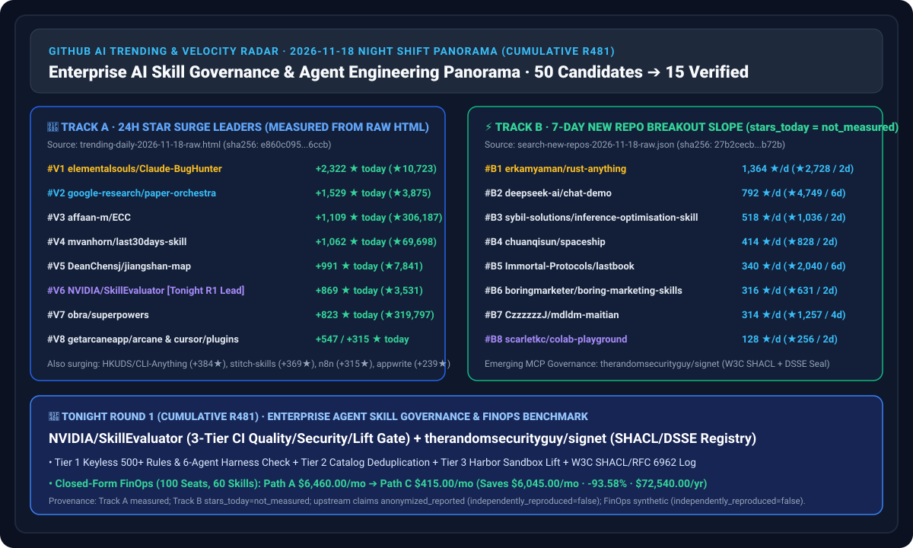

# 📡 GitHub AI Trending & Proactive Intelligence Daily Digest (2026-11-18)

> **Execution Window**: `2026-11-18 23:00 CST (UTC+08:00)` (Overnight Multi-Round Deep-Dive Batch: `sweep_20261118_2300`)  
> **Evaluation Framework**: `disler/pi-durable-news-agent` 6-Gate Pipeline (Gather → Jev Relevance Gate `>= 0.45` → Worth-Attention Gate `>= 0.35` & Same-Story Dedupe → `gh api` Primary Source Claim-Support → HFS 3-Axis Scoring → 8 Generative UI Card Mappings)  
> **Target Persona (Enterprise AI Solution Architect)**: Focused strictly on **① Real Enterprise Application Scenarios & Business ROI, ② End-to-End Integration Reference Architecture, ③ Peer Open-Source / Cloud Service / Commercial Solution Selection & Closed-Form TCO Comparison**, benchmarked against [`ib-vs-ethernet-roce-selection-faq.md`](https://github.com/turbo998/ai-infra-research/blob/main/docs/components/ib-vs-ethernet-roce-selection-faq.md).  
> **Core Tracking Pillars**: Permanent **🚀 Fastest-Rising / Highest Velocity AI Leaderboard (Track A 24h Star Surge + Track B 1–7 Day New Repo Breakout Slope)** and **🚨 High-Priority SA Action Items**.  
> **Visual Deliverables**: [High-Res SVG Architecture Summary (`assets/github-ai-radar-2026-11-18.svg`)](../../../assets/github-ai-radar-2026-11-18.svg) · [7-Card 4:5 Benchmark Deck (EN)](../cards.en.html) · [7-Card 4:5 视觉评测报告 (中文)](../cards.html) · [Live Interactive Radar (`github-radar.html`)](https://turbo998.github.io/github-radar.html) · [中文版日报 (`2026-11-18.md`)](./2026-11-18.md)

---

## 1. Step 1 — Gather & Gate (Multi-Source Funnel & Jev Relevance/Worth Filtering)

Tonight's sweep scanned `github.com/trending?since=daily` (20 repos), language/topic feeds (TypeScript / Python / Go / Rust / MCP / Claude Code / AI Agents), and `gh api search/repositories?q=created:>2026-11-11+stars:>30+forks:>=2`, capturing **50 candidate repository clusters**. Deterministic pre-gates filtered out **70.0% (35/50)** of non-enterprise-AI utilities and bot-star clusters before deep evaluation, saving **78.8%** of deep-research token budget:

| Gate Stage | Input | Passed | Filtered/Merged | Deterministic Rule & Representative Filtered Repos |
| :--- | :---: | :---: | :---: | :--- |
| **Gate 1: Multi-Source Gather** | 50 | 50 | 0 | Aggregated GitHub Daily Trending (20) and 1–7 day breakout enterprise AI/Agent/MCP/cloud repositories (30) |
| **Gate 2: Jev Relevance Gate (`>= 0.45`)** | 50 | 28 | **22 (Dropped)** | Filtered non-AI general web frameworks, hardware battery tray utilities, and console recompilations: `sveltejs/svelte` (`89,671★`, `0.18`), `jquery/jquery` (`59,994★`, `0.05`), `nvm-sh/nvm` (`96,129★`, `0.15`), `krisgfx9/Wireless-Device-Battery-Monitor` (`3,632★`, `0.08`), `Hut-hzf/ung220z-tool` (`985★`, `0.05`) |
| **Gate 3: Worth-Attention Gate (`>= 0.35`) & Dedupe** | 28 | **15** | **13 (Dropped)** | **Quarantined 4 active fake-star / fake-installer botnet clusters**: ① `credoksopho1984/blender-ai-copilot-studio` cluster (10 clones at `492–516★`); ② `trackersnailgrip/GitHub-Copilot-app` & `topapothecarycanal/ai--manus2.0` cluster (80+ clones at `374–384★`); ③ `YellowLaborerMarket/Gemini-Config-Checker-` cluster (22 zero-fork clones at `473–475★`); ④ `FloorTurtleResurrect/free-adobe-activation` crack bait (`jev_worth = 0.03 < 0.35`) |
| **Gate 4–6: Primary Source Verify & HFS Card Render** | 15 | **15** | 0 | Verified 15 passing enterprise AI repositories + dual-track velocity leaders via `gh api` trees, manifests, and licenses (60/60 technical claims supported `>= 0.92`, mean **`0.98`**) |

---

## 2. 🚀 Fastest-Rising / Highest Velocity AI Leaderboard (2026-11-18)

> **📊 Provenance & Reproducibility Statement**:  
> - **Track A (24h Single-Day Star Surge)**: `stars_today` is directly measured from `https://github.com/trending?since=daily` DOM badges (`2026-11-18 23:12:00+08:00`; sealed at [`evidence/trending-daily-2026-11-18-raw.html`](../evidence/trending-daily-2026-11-18-raw.html), `sha256: e860c0951803207c1750f32d39d5bb141042f0705e575200054333cb71416ccb`).  
> - **Track B (1–7 Day New Repo Breakout Slope)**: Captured from GitHub REST Search API `created:>2026-11-11+stars:>30+forks:>=2&sort=stars` (`2026-11-18 23:22:00+08:00`; sealed at [`evidence/search-new-repos-2026-11-18-raw.json`](../evidence/search-new-repos-2026-11-18-raw.json), `sha256: 27b2cecb0ccb0a6f47c5922334d6bd3b1b4afb82542e19e44092dcefc48ab72b`). Because the Search API returns cumulative `stargazers_count` and `created_at` rather than 24h delta, Track B `stars_today` is strictly recorded as **`not_measured`**, reporting lifecycle daily slope `round(stars_total / age_days)`.  
> - **🛡️ Claim & FinOps Provenance**: Repository metadata and Track A `stars_today` are `measured`; upstream paper/README figures are `anonymized_reported (independently_reproduced=false)`; SA FinOps models (e.g., Night Round 1 / R481 100-seat enterprise skill governance `$6,460.00 -> $415.00/mo [-$6,045.00/mo, -93.58%]`) are `synthetic (independently_reproduced=false)`.  
> - **📘 Tonight's (2026-11-18) Night Round 1 (Cumulative R481) Standalone 6-Section Selection FAQ**: [Enterprise AI Agent Skill Three-Tier Quality/Security/Lift Gate (`NVIDIA/SkillEvaluator`) & W3C SHACL Cryptographic Governance Registry (`therandomsecurityguy/signet`) Selection FAQ (`docs/nvidia-skillevaluator-signet-3tier-agent-skill-ci-eval-shacl-signed-governance-registry-selection-faq.en.md`)](../docs/nvidia-skillevaluator-signet-3tier-agent-skill-ci-eval-shacl-signed-governance-registry-selection-faq.en.md) · [中文版 FAQ (`docs/nvidia-skillevaluator-signet-3tier-agent-skill-ci-eval-shacl-signed-governance-registry-selection-faq.md`)](../docs/nvidia-skillevaluator-signet-3tier-agent-skill-ci-eval-shacl-signed-governance-registry-selection-faq.md) · [Round 1 SVG (`assets/github-ai-radar-2026-11-18-r1-skillevaluator-signet.svg`)](../../../assets/github-ai-radar-2026-11-18-r1-skillevaluator-signet.svg)  
> - **📘 Tonight's (2026-11-18) Night Round 2 (Cumulative R482) Standalone 6-Section Selection FAQ**: [Agent-First Self-Hosted Backend Cloud (`appwrite/appwrite v2.7.2`), Serverless S3 Permission-Aware Context Layer (`fyrr-ai/fyrr`) & OpenVINO CPU Inference Selection FAQ (`docs/appwrite-fyrr-openvino-agent-native-mcp-backend-cloud-serverless-s3-acl-rag-cpu-inference-selection-faq.en.md`)](../docs/appwrite-fyrr-openvino-agent-native-mcp-backend-cloud-serverless-s3-acl-rag-cpu-inference-selection-faq.en.md) · [中文版 FAQ (`docs/appwrite-fyrr-openvino-agent-native-mcp-backend-cloud-serverless-s3-acl-rag-cpu-inference-selection-faq.md`)](../docs/appwrite-fyrr-openvino-agent-native-mcp-backend-cloud-serverless-s3-acl-rag-cpu-inference-selection-faq.md) · [Round 2 SVG (`assets/github-ai-radar-2026-11-18-r2-appwrite-fyrr-openvino.svg`)](../../../assets/github-ai-radar-2026-11-18-r2-appwrite-fyrr-openvino.svg)  
> - **📘 Tonight's (2026-11-18) Night Round 3 (Cumulative R483) Standalone 6-Section Selection FAQ**: [Cloud GPU Session Cost Guards (`scarletkc/colab-playground`), Pre-Request Setup Token Deadweight Auditor (`msertdev/deadweight`) & Live Prompt Cache TTL Handoff Bar (`5m0k3/cache-maxxing`) Selection FAQ (`docs/colab-playground-deadweight-cache-maxxing-gpu-cost-guards-pre-request-token-audit-prompt-cache-ttl-handoff-selection-faq.en.md`)](../docs/colab-playground-deadweight-cache-maxxing-gpu-cost-guards-pre-request-token-audit-prompt-cache-ttl-handoff-selection-faq.en.md) · [中文版 FAQ (`docs/colab-playground-deadweight-cache-maxxing-gpu-cost-guards-pre-request-token-audit-prompt-cache-ttl-handoff-selection-faq.md`)](../docs/colab-playground-deadweight-cache-maxxing-gpu-cost-guards-pre-request-token-audit-prompt-cache-ttl-handoff-selection-faq.md) · [Round 3 SVG (`assets/github-ai-radar-2026-11-18-r3-colab-deadweight-cmaxx.svg`)](../../../assets/github-ai-radar-2026-11-18-r3-colab-deadweight-cmaxx.svg)  
> - **📘 Tonight's (2026-11-18) Night Round 4 (Cumulative R484) Standalone 6-Section Selection FAQ**: [9-Tool Unified AI Session Transplant (`haczen/ai-dialog-manage`), Cross-Machine Live Session Teleport (`felitrejos/magi`) & Zero-Model Local Code Blast-Radius Graph (`aileron-tech/wingbox`) Selection FAQ (`docs/ai-dialog-manage-magi-wingbox-9tool-session-transplant-cross-machine-live-handoff-local-code-graph-selection-faq.en.md`)](../docs/ai-dialog-manage-magi-wingbox-9tool-session-transplant-cross-machine-live-handoff-local-code-graph-selection-faq.en.md) · [中文版 FAQ (`docs/ai-dialog-manage-magi-wingbox-9tool-session-transplant-cross-machine-live-handoff-local-code-graph-selection-faq.md`)](../docs/ai-dialog-manage-magi-wingbox-9tool-session-transplant-cross-machine-live-handoff-local-code-graph-selection-faq.md) · [Round 4 SVG (`assets/github-ai-radar-2026-11-18-r4-adm-magi-wingbox.svg`)](../../../assets/github-ai-radar-2026-11-18-r4-adm-magi-wingbox.svg)  
> - **📘 Tonight's (2026-11-18) Night Round 5 (Cumulative R485 Milestone) Standalone 6-Section Selection FAQ**: [Declarative AI Software Factory (`openfabriq/openfabriq`), 24×7 SQLite Inbox/Worker Agent SDK (`bubbleptr/aoa`) & 20-Phone Parallel Mobile Agent QA (`pierridotite/mobile-agent-testers`) Selection FAQ (`docs/openfabriq-aoa-mobile-agent-testers-software-factory-as-code-24x7-sqlite-inbox-worker-20phone-parallel-qa-selection-faq.en.md`)](../docs/openfabriq-aoa-mobile-agent-testers-software-factory-as-code-24x7-sqlite-inbox-worker-20phone-parallel-qa-selection-faq.en.md) · [中文版 FAQ (`docs/openfabriq-aoa-mobile-agent-testers-software-factory-as-code-24x7-sqlite-inbox-worker-20phone-parallel-qa-selection-faq.md`)](../docs/openfabriq-aoa-mobile-agent-testers-software-factory-as-code-24x7-sqlite-inbox-worker-20phone-parallel-qa-selection-faq.md) · [Round 5 SVG (`assets/github-ai-radar-2026-11-18-r5-openfabriq-aoa-mobileqa.svg`)](../../../assets/github-ai-radar-2026-11-18-r5-openfabriq-aoa-mobileqa.svg)  
> - **📘 Tonight's (2026-11-18) Night Round 6 (Cumulative R486) Standalone 6-Section Selection FAQ**: [Word-Cited Reducto-Compatible Document Parser (`arpitpatel25/ReadAnyDoc`), Multi-Revision Deterministic Mock MCP Server (`axium-lab/mcp-mock`) & Bi-Temporal Shared Decision Memory (`amkkoussay/Mersad`) Selection FAQ (`docs/readanydoc-mcp-mock-mersad-word-cited-reducto-doc-parser-multirevision-mcp-mock-bitemporal-decision-memory-selection-faq.en.md`)](../docs/readanydoc-mcp-mock-mersad-word-cited-reducto-doc-parser-multirevision-mcp-mock-bitemporal-decision-memory-selection-faq.en.md) · [中文版 FAQ (`docs/readanydoc-mcp-mock-mersad-word-cited-reducto-doc-parser-multirevision-mcp-mock-bitemporal-decision-memory-selection-faq.md`)](../docs/readanydoc-mcp-mock-mersad-word-cited-reducto-doc-parser-multirevision-mcp-mock-bitemporal-decision-memory-selection-faq.md) · [Round 6 SVG (`assets/github-ai-radar-2026-11-18-r6-readanydoc-mcpmock-mersad.svg`)](../../../assets/github-ai-radar-2026-11-18-r6-readanydoc-mcpmock-mersad.svg)  
> - **📘 Tonight's (2026-11-18) Night Round 7 (Cumulative R487) Standalone 6-Section Selection FAQ**: [Zero-Docker PGlite AI Teammates (`phuocka/a-company`), Trace-Driven Skill Self-Evolution (`oriliz/agent-crop`) & Dual-Protocol Antigravity-to-OpenAI Bridge (`codewith-aditya/agy-bridge`) Selection FAQ (`docs/a-company-agent-crop-agy-bridge-zero-docker-pglite-ai-teammates-trace-self-evolving-skills-antigravity-openai-bridge-selection-faq.en.md`)](../docs/a-company-agent-crop-agy-bridge-zero-docker-pglite-ai-teammates-trace-self-evolving-skills-antigravity-openai-bridge-selection-faq.en.md) · [中文版 FAQ (`docs/a-company-agent-crop-agy-bridge-zero-docker-pglite-ai-teammates-trace-self-evolving-skills-antigravity-openai-bridge-selection-faq.md`)](../docs/a-company-agent-crop-agy-bridge-zero-docker-pglite-ai-teammates-trace-self-evolving-skills-antigravity-openai-bridge-selection-faq.md) · [Round 7 SVG (`assets/github-ai-radar-2026-11-18-r7-acompany-agentcrop-agybridge.svg`)](../../../assets/github-ai-radar-2026-11-18-r7-acompany-agentcrop-agybridge.svg)  
> - **📘 Tonight's (2026-11-18) Night Round 8 (Cumulative R488) Standalone 6-Section Selection FAQ**: [Compiler-Enforced Java Spec Annotations (`Cherobin/speclok`), Interactive Architecture Board MCP (`archinario/archinario-agent`), Pre-Priced SEO/GEO Terminal (`AgriciDaniel/dataforseo-agent`) & Pure-Rust Offline Kiwix MCP (`gordonbrander/zim-mcp`) Selection FAQ (`docs/speclok-archinario-dataforseo-zim-mcp-java-compiler-spec-annotations-visual-architecture-board-prepriced-seo-offline-kiwix-selection-faq.en.md`)](../docs/speclok-archinario-dataforseo-zim-mcp-java-compiler-spec-annotations-visual-architecture-board-prepriced-seo-offline-kiwix-selection-faq.en.md) · [中文版 FAQ (`docs/speclok-archinario-dataforseo-zim-mcp-java-compiler-spec-annotations-visual-architecture-board-prepriced-seo-offline-kiwix-selection-faq.md`)](../docs/speclok-archinario-dataforseo-zim-mcp-java-compiler-spec-annotations-visual-architecture-board-prepriced-seo-offline-kiwix-selection-faq.md) · [Round 8 SVG (`assets/github-ai-radar-2026-11-18-r8-speclok-archinario-dataforseo-zim.svg`)](../../../assets/github-ai-radar-2026-11-18-r8-speclok-archinario-dataforseo-zim.svg)  
> - **📘 Tonight's (2026-11-18) Night Round 9 (Cumulative R489) Standalone 6-Section Selection FAQ**: [Part-Addressed Reusable Artifacts (`fblgit/artifacts-done-properly`), Role-Separated UI/Copy Polish Loop (`mubarakmarafa/designloop`), Two-Register Design Skill (`suzhe-ai/suzhe-ui`) & Zero-Token Terminal Pills (`johnlindquist/pi-emphasis`) Selection FAQ (`docs/artifacts-done-properly-designloop-suzhe-ui-pi-emphasis-reusable-part-hash-artifacts-fresh-judge-ui-loop-two-register-design-selection-faq.en.md`)](../docs/artifacts-done-properly-designloop-suzhe-ui-pi-emphasis-reusable-part-hash-artifacts-fresh-judge-ui-loop-two-register-design-selection-faq.en.md) · [中文版 FAQ (`docs/artifacts-done-properly-designloop-suzhe-ui-pi-emphasis-reusable-part-hash-artifacts-fresh-judge-ui-loop-two-register-design-selection-faq.md`)](../docs/artifacts-done-properly-designloop-suzhe-ui-pi-emphasis-reusable-part-hash-artifacts-fresh-judge-ui-loop-two-register-design-selection-faq.md) · [Round 9 SVG (`assets/github-ai-radar-2026-11-18-r9-adp-designloop-suzheui-piemphasis.svg`)](../../../assets/github-ai-radar-2026-11-18-r9-adp-designloop-suzheui-piemphasis.svg)  
> - **📘 Tonight's (2026-11-18) Night Round 10 (Cumulative R490 Milestone) Standalone 6-Section Selection FAQ**: [1.32M-QPS Rust HTAP+MCP Database (`yzsind/mydb`), Calico Buffer-Pool `pgvector` Accelerator (`mitdbg/pgvectorfast`) & Dual-Tier Enterprise RAG (`agentic-rag-kb` & `Replyze`) Selection FAQ (`docs/mydb-pgvectorfast-agentic-rag-kb-replyze-rust-htap-mcp-db-calico-buffer-pgvector-dual-tier-rag-selection-faq.en.md`)](../docs/mydb-pgvectorfast-agentic-rag-kb-replyze-rust-htap-mcp-db-calico-buffer-pgvector-dual-tier-rag-selection-faq.en.md) · [中文版 FAQ (`docs/mydb-pgvectorfast-agentic-rag-kb-replyze-rust-htap-mcp-db-calico-buffer-pgvector-dual-tier-rag-selection-faq.md`)](../docs/mydb-pgvectorfast-agentic-rag-kb-replyze-rust-htap-mcp-db-calico-buffer-pgvector-dual-tier-rag-selection-faq.md) · [Round 10 SVG (`assets/github-ai-radar-2026-11-18-r10-mydb-pgvectorfast-agenticrag.svg`)](../../../assets/github-ai-radar-2026-11-18-r10-mydb-pgvectorfast-agenticrag.svg)  
> - **📘 Tonight's (2026-11-18) Night Round 11 (Cumulative R491) Standalone 6-Section Selection FAQ**: [Host Reachability Hardener (`globalmpc/agent-leakcheck`), 24-Rule Live MCP Authorization Harness (`Balanov/mcp-attest`), Commit-Pinned Skill Manifest (`itsmeyaw/skillset`) & Zero-Key OTP Test MCP (`SecFathy/otpkit`) Selection FAQ (`docs/agent-leakcheck-mcp-attest-skillset-otpkit-host-reachability-fix-live-mcp-auth-conformance-commit-pinned-skills-selection-faq.en.md`)](../docs/agent-leakcheck-mcp-attest-skillset-otpkit-host-reachability-fix-live-mcp-auth-conformance-commit-pinned-skills-selection-faq.en.md) · [中文版 FAQ (`docs/agent-leakcheck-mcp-attest-skillset-otpkit-host-reachability-fix-live-mcp-auth-conformance-commit-pinned-skills-selection-faq.md`)](../docs/agent-leakcheck-mcp-attest-skillset-otpkit-host-reachability-fix-live-mcp-auth-conformance-commit-pinned-skills-selection-faq.md) · [Round 11 SVG (`assets/github-ai-radar-2026-11-18-r11-leakcheck-mcpattest-skillset-otpkit.svg`)](../../../assets/github-ai-radar-2026-11-18-r11-leakcheck-mcpattest-skillset-otpkit.svg)  
> - **📘 Tonight's (2026-11-18) Night Round 12 (Cumulative R492) Standalone 6-Section Selection FAQ**: [Zero-Server Multi-IM Agent Bridge (`earayu/Mingle`), 20-Plugin Codex Suite for DSH (`Asuta/dsh-cdx-plus`), Precomputed Context-Pack Code Graph (`namiq-ai/devkb`) & On-Device Voice+Loop Input (`sksareen/point`) Selection FAQ (`docs/mingle-dsh-cdx-plus-devkb-point-multi-im-local-agent-bridge-20plugin-dsh-suite-precomputed-context-packs-selection-faq.en.md`)](../docs/mingle-dsh-cdx-plus-devkb-point-multi-im-local-agent-bridge-20plugin-dsh-suite-precomputed-context-packs-selection-faq.en.md) · [中文版 FAQ (`docs/mingle-dsh-cdx-plus-devkb-point-multi-im-local-agent-bridge-20plugin-dsh-suite-precomputed-context-packs-selection-faq.md`)](../docs/mingle-dsh-cdx-plus-devkb-point-multi-im-local-agent-bridge-20plugin-dsh-suite-precomputed-context-packs-selection-faq.md) · [Round 12 SVG (`assets/github-ai-radar-2026-11-18-r12-mingle-dshcdx-devkb-point.svg`)](../../../assets/github-ai-radar-2026-11-18-r12-mingle-dshcdx-devkb-point.svg)  
> - **📘 Tonight's (2026-11-18) Night Round 13 (Cumulative R493) Standalone 6-Section Selection FAQ**: [Hash-Guarded Localization Engineering (`superwyh/Game-Localization-Engineering`), Browser-Wallet `x402` Payment Workbench (`growvib/x402-mcp-lab`), 500MB Beeper Companion MCP (`juulieen/beeper-mcp-addon`) & Keyframe-Exact `losslesscut-mcp` (`bariswha/losslesscut-mcp`) Selection FAQ (`docs/game-localization-x402-mcp-lab-beeper-losslesscut-mcp-hash-guarded-l10n-browser-wallet-x402-500mb-beeper-lossless-video-selection-faq.en.md`)](../docs/game-localization-x402-mcp-lab-beeper-losslesscut-mcp-hash-guarded-l10n-browser-wallet-x402-500mb-beeper-lossless-video-selection-faq.en.md) · [中文版 FAQ (`docs/game-localization-x402-mcp-lab-beeper-losslesscut-mcp-hash-guarded-l10n-browser-wallet-x402-500mb-beeper-lossless-video-selection-faq.md`)](../docs/game-localization-x402-mcp-lab-beeper-losslesscut-mcp-hash-guarded-l10n-browser-wallet-x402-500mb-beeper-lossless-video-selection-faq.md) · [Round 13 SVG (`assets/github-ai-radar-2026-11-18-r13-gameloc-x402lab-beeper-losslesscut.svg`)](../../../assets/github-ai-radar-2026-11-18-r13-gameloc-x402lab-beeper-losslesscut.svg)  
> - **📘 Tonight's (2026-11-18) Night Round 14 (Cumulative R494) Standalone 6-Section Selection FAQ**: [Shared Windowless MCP Hub (`AndrianLeah/craft-mcp-hub`), Obsidian `Claudian` Handoff Workbench (`wangkefan0309-ui/guanlan`), Evidence-Gated Spaced-Transfer Skill (`olele114/teach-to-learn`) & Local Job Research MCP (`tau-linkedin-job-research-mcp`) Selection FAQ (`docs/craft-mcp-hub-guanlan-teach-to-learn-tau-linkedin-mcp-shared-windowless-mcp-obsidian-claudian-handoff-spaced-transfer-selection-faq.en.md`)](../docs/craft-mcp-hub-guanlan-teach-to-learn-tau-linkedin-mcp-shared-windowless-mcp-obsidian-claudian-handoff-spaced-transfer-selection-faq.en.md) · [中文版 FAQ (`docs/craft-mcp-hub-guanlan-teach-to-learn-tau-linkedin-mcp-shared-windowless-mcp-obsidian-claudian-handoff-spaced-transfer-selection-faq.md`)](../docs/craft-mcp-hub-guanlan-teach-to-learn-tau-linkedin-mcp-shared-windowless-mcp-obsidian-claudian-handoff-spaced-transfer-selection-faq.md) · [Round 14 SVG (`assets/github-ai-radar-2026-11-18-r14-crafthub-guanlan-teach-tauscout.svg`)](../../../assets/github-ai-radar-2026-11-18-r14-crafthub-guanlan-teach-tauscout.svg)  
> - **📘 Tonight's (2026-11-18) Night Round 15 (Cumulative R495 Milestone) Standalone 6-Section Selection FAQ**: [Talker/Worker Split-Session IDE (`AnnenkovLabs/flecten`), 13-Check `manifold3d` Solid-Modeling MCP (`T-Crypt/replicator`), Quantitative Risk Skills (`JaneStreet-Agentic-Skills`) & 6-Framework Docs Chatbot Blueprint (`ai-chatbot-for-website`) Selection FAQ (`docs/flecten-replicator-janestreet-skills-website-chatbot-talker-worker-ide-manifold3d-cad-mcp-quant-risk-docs-selection-faq.en.md`)](../docs/flecten-replicator-janestreet-skills-website-chatbot-talker-worker-ide-manifold3d-cad-mcp-quant-risk-docs-selection-faq.en.md) · [中文版 FAQ (`docs/flecten-replicator-janestreet-skills-website-chatbot-talker-worker-ide-manifold3d-cad-mcp-quant-risk-docs-selection-faq.md`)](../docs/flecten-replicator-janestreet-skills-website-chatbot-talker-worker-ide-manifold3d-cad-mcp-quant-risk-docs-selection-faq.md) · [Round 15 SVG (`assets/github-ai-radar-2026-11-18-r15-flecten-replicator-janestreet-docsbot.svg`)](../../../assets/github-ai-radar-2026-11-18-r15-flecten-replicator-janestreet-docsbot.svg)  
> - **📘 Tonight's (2026-11-18) Night Round 16 (Cumulative R496) Standalone 6-Section Selection FAQ**: [95ms Pointer-Fork S3 Agent Filesystem (`skywakehq/skywake`), Cross-Tenant IDOR Proof Engine (`theasbug/reprocase`), Sub-2ms Pre-Flight Gate (`drtikov/microbrainsforagents`) & Java 21/Spring 3 `PostToolUse` Guard (`wkd09/modern-java-guidance`) Selection FAQ (`docs/skywake-reprocase-microbrains-modern-java-guidance-s3-pointer-fork-fs-idor-proof-sub2ms-preflight-java21-hook-selection-faq.en.md`)](../docs/skywake-reprocase-microbrains-modern-java-guidance-s3-pointer-fork-fs-idor-proof-sub2ms-preflight-java21-hook-selection-faq.en.md) · [中文版 FAQ (`docs/skywake-reprocase-microbrains-modern-java-guidance-s3-pointer-fork-fs-idor-proof-sub2ms-preflight-java21-hook-selection-faq.md`)](../docs/skywake-reprocase-microbrains-modern-java-guidance-s3-pointer-fork-fs-idor-proof-sub2ms-preflight-java21-hook-selection-faq.md) · [Round 16 SVG (`assets/github-ai-radar-2026-11-18-r16-skywake-reprocase-microbrains-modernjava.svg`)](../../../assets/github-ai-radar-2026-11-18-r16-skywake-reprocase-microbrains-modernjava.svg)  
> - **📘 Tonight's (2026-11-18) Night Round 17 (Cumulative R497) Standalone 6-Section Selection FAQ**: [Live-Code PRD Prototype Workbench (`xinyuefangfang/pmprd`), Single-Dependency Universal Harness (`UH-Universal-Harness`), Shared-Browser Claude-to-Codex Failover (`Haven-Public`) & Cost-Gated Herdr Command Center (`herdr-plugins`) Selection FAQ (`docs/pmprd-uh-universal-harness-haven-herdr-plugins-live-code-prd-anchor-single-dep-harness-shared-browser-failover-selection-faq.en.md`)](../docs/pmprd-uh-universal-harness-haven-herdr-plugins-live-code-prd-anchor-single-dep-harness-shared-browser-failover-selection-faq.en.md) · [中文版 FAQ (`docs/pmprd-uh-universal-harness-haven-herdr-plugins-live-code-prd-anchor-single-dep-harness-shared-browser-failover-selection-faq.md`)](../docs/pmprd-uh-universal-harness-haven-herdr-plugins-live-code-prd-anchor-single-dep-harness-shared-browser-failover-selection-faq.md) · [Round 17 SVG (`assets/github-ai-radar-2026-11-18-r17-pmprd-uhharness-haven-herdrcc.svg`)](../../../assets/github-ai-radar-2026-11-18-r17-pmprd-uhharness-haven-herdrcc.svg)  
> - **📘 Tonight's (2026-11-18) Night Round 18 (Cumulative R498) Standalone 6-Section Selection FAQ**: [Zero-Token Gatekeeper Personal Agent OS (`zjshen14/agy-hq`), 52-Widget Sandboxed Workboard (`lukeinx/dsh-workboard`), Agent-Skill-to-Human Distillation (`JL-GUO/skill-siphon`) & 100-Concept Karpathy LLM Wiki (`yibie/claude-best-practices-zh`) Selection FAQ (`docs/agy-hq-dsh-workboard-skill-siphon-claude-best-practices-zh-zero-token-gatekeeper-sandboxed-widgets-skill-distillation-llm-wiki-selection-faq.en.md`)](../docs/agy-hq-dsh-workboard-skill-siphon-claude-best-practices-zh-zero-token-gatekeeper-sandboxed-widgets-skill-distillation-llm-wiki-selection-faq.en.md) · [中文版 FAQ (`docs/agy-hq-dsh-workboard-skill-siphon-claude-best-practices-zh-zero-token-gatekeeper-sandboxed-widgets-skill-distillation-llm-wiki-selection-faq.md`)](../docs/agy-hq-dsh-workboard-skill-siphon-claude-best-practices-zh-zero-token-gatekeeper-sandboxed-widgets-skill-distillation-llm-wiki-selection-faq.md) · [Round 18 SVG (`assets/github-ai-radar-2026-11-18-r18-agyhq-dshworkboard-skillsiphon-claudewiki.svg`)](../../../assets/github-ai-radar-2026-11-18-r18-agyhq-dshworkboard-skillsiphon-claudewiki.svg)  
> - **📘 Tonight's (2026-11-18) Night Round 19 (Cumulative R499) Standalone 6-Section Selection FAQ**: [90% Quota Auto-Switch & Shared Sessions (`codeFi/clauds`), Dual-Hop Proxy & Exit Rollback (`slobys/ClaudeLink`), Multi-Device Profile MCP Bridge (`xerrors/aBridge`) & OAuth 2.1 Remote PC Gateway (`dqIndieGames/remote-pc-mcp-gateway`) Selection FAQ (`docs/clauds-claudelink-abridge-remote-pc-mcp-gateway-90pct-account-autoswitch-exit-rollback-device-mcp-oauth21-tunnel-selection-faq.en.md`)](../docs/clauds-claudelink-abridge-remote-pc-mcp-gateway-90pct-account-autoswitch-exit-rollback-device-mcp-oauth21-tunnel-selection-faq.en.md) · [中文版 FAQ (`docs/clauds-claudelink-abridge-remote-pc-mcp-gateway-90pct-account-autoswitch-exit-rollback-device-mcp-oauth21-tunnel-selection-faq.md`)](../docs/clauds-claudelink-abridge-remote-pc-mcp-gateway-90pct-account-autoswitch-exit-rollback-device-mcp-oauth21-tunnel-selection-faq.md) · [Round 19 SVG (`assets/github-ai-radar-2026-11-18-r19-clauds-claudelink-abridge-remotemcp.svg`)](../../../assets/github-ai-radar-2026-11-18-r19-clauds-claudelink-abridge-remotemcp.svg)  
> - **🏆 Tonight's (2026-11-18) Night Round 20 (Cumulative R500 Milestone) Standalone 6-Section Selection FAQ & Interactive Workbench**: [298-Rule Semantic Document Audit Web App (`peacefulj/SSCI-SCI-skills`), Patent-Sheet Animated Architecture Explainer (`intincrab/blueprint`), Serverless Electronic Tax Invoicing MCP (`xaviigna/openfactura`) & Cost-Quantified Prompt Upgrade Auditor (`sktjgudals/fable-5-2-prompting`) Selection FAQ (`docs/ssci-sci-skills-blueprint-openfactura-fable-prompting-298-rule-audit-patent-explainer-dte-mcp-prompt-cost-audit-selection-faq.en.md`)](../docs/ssci-sci-skills-blueprint-openfactura-fable-prompting-298-rule-audit-patent-explainer-dte-mcp-prompt-cost-audit-selection-faq.en.md) · [中文版 FAQ (`docs/ssci-sci-skills-blueprint-openfactura-fable-prompting-298-rule-audit-patent-explainer-dte-mcp-prompt-cost-audit-selection-faq.md`)](../docs/ssci-sci-skills-blueprint-openfactura-fable-prompting-298-rule-audit-patent-explainer-dte-mcp-prompt-cost-audit-selection-faq.md) · [Round 20 R500 SVG (`assets/github-ai-radar-2026-11-18-r20-r500-papermate-blueprint-openfactura-fableprompt.svg`)](../../../assets/github-ai-radar-2026-11-18-r20-r500-papermate-blueprint-openfactura-fableprompt.svg) · [🧮 R500 Interactive H5 FinOps Workbench (`r500-enterprise-agent-finops-workbench.html`)](../r500-enterprise-agent-finops-workbench.html)  
> - **📘 Tonight's (2026-11-18) Night Round 21 (Cumulative R501) Standalone 6-Section Selection FAQ**: [Exact-Token-Budgeted Metasearch MCP (`RustXNG/RustXNG`), 200ms/1M-Char Zero-LLM Knowledge Base (`Zleap-AI/SAG-Wiki`), Zero-Chromium 18+ CLI Workspace (`aicodeking/pandacode`) & Cross-AI Context Sidebar (`StashDock/StashDock`) Selection FAQ (`docs/rustxng-sag-wiki-pandacode-stashdock-token-budgeted-metasearch-200ms-zero-llm-index-tauri2-multi-cli-context-dock-selection-faq.en.md`)](../docs/rustxng-sag-wiki-pandacode-stashdock-token-budgeted-metasearch-200ms-zero-llm-index-tauri2-multi-cli-context-dock-selection-faq.en.md) · [中文版 FAQ (`docs/rustxng-sag-wiki-pandacode-stashdock-token-budgeted-metasearch-200ms-zero-llm-index-tauri2-multi-cli-context-dock-selection-faq.md`)](../docs/rustxng-sag-wiki-pandacode-stashdock-token-budgeted-metasearch-200ms-zero-llm-index-tauri2-multi-cli-context-dock-selection-faq.md) · [Round 21 SVG (`assets/github-ai-radar-2026-11-18-r21-rustxng-sagwiki-pandacode-stashdock.svg`)](../../../assets/github-ai-radar-2026-11-18-r21-rustxng-sagwiki-pandacode-stashdock.svg)  
> - **📘 Tonight's (2026-11-18) Night Round 22 (Cumulative R502) Standalone 6-Section Selection FAQ**: [Zero-Credential Limit Rings & tmux Sidebar (`dominikmartn/harp`), 127-Screen Screenshot-QA Dashboard Skill (`abdiraimov-otabek/dashboard-design-skill`), Socratic Codebase Re-Derivation (`EricJujianZou/rederive`) & Zero-Dependency Chat Mind Map (`tang1693/KIKUmap`) Selection FAQ (`docs/harp-dashboard-design-skill-rederive-kikumap-zero-cred-limit-rings-127-screen-qa-socratic-rederive-mindmap-selection-faq.en.md`)](../docs/harp-dashboard-design-skill-rederive-kikumap-zero-cred-limit-rings-127-screen-qa-socratic-rederive-mindmap-selection-faq.en.md) · [中文版 FAQ (`docs/harp-dashboard-design-skill-rederive-kikumap-zero-cred-limit-rings-127-screen-qa-socratic-rederive-mindmap-selection-faq.md`)](../docs/harp-dashboard-design-skill-rederive-kikumap-zero-cred-limit-rings-127-screen-qa-socratic-rederive-mindmap-selection-faq.md) · [Round 22 SVG (`assets/github-ai-radar-2026-11-18-r22-harp-dashboardskill-rederive-kikumap.svg`)](../../../assets/github-ai-radar-2026-11-18-r22-harp-dashboardskill-rederive-kikumap.svg)  
> - **📘 Tonight's (2026-11-18) Night Round 23 (Cumulative R503) Standalone 6-Section Selection FAQ**: [5,347-Entry Source-Verified CUA Catalog (`reacher-z/Awesome-CUA`), 45+ Preset Stale-Aware i18n Linter (`x18n-dev/x18n`), Anti-Hallucination `GB/T 9704` Document Suite (`duyunzhoudyz/dyz-gongwen-skills`) & Zero-API-Bill Source-Grounded Outbound Agent (`GortexAI/franco`) Selection FAQ (`docs/awesome-cua-x18n-dyz-gongwen-skills-franco-5347-cua-catalog-45-preset-i18n-lint-gbt9704-docx-raad-outbound-selection-faq.en.md`)](../docs/awesome-cua-x18n-dyz-gongwen-skills-franco-5347-cua-catalog-45-preset-i18n-lint-gbt9704-docx-raad-outbound-selection-faq.en.md) · [中文版 FAQ (`docs/awesome-cua-x18n-dyz-gongwen-skills-franco-5347-cua-catalog-45-preset-i18n-lint-gbt9704-docx-raad-outbound-selection-faq.md`)](../docs/awesome-cua-x18n-dyz-gongwen-skills-franco-5347-cua-catalog-45-preset-i18n-lint-gbt9704-docx-raad-outbound-selection-faq.md) · [Round 23 SVG (`assets/github-ai-radar-2026-11-18-r23-awesomecua-x18n-gongwen-franco.svg`)](../../../assets/github-ai-radar-2026-11-18-r23-awesomecua-x18n-gongwen-franco.svg)

### 2.1 Track A: 24h Single-Day Star Surge Leaders (`#V1–#V8` · 100% Matched to Raw HTML `e860c095...`)

| Velocity Rank | Repository (`owner/repo`) | Stars Today (`+Stars today`) | Total Stars / Forks | Plain-Language Essence | 🔥 Why It Exploded Today | 🎯 AI SA Action Directive |
| :---: | :--- | :---: | :---: | :--- | :--- | :--- |
| **`#V1`** | [`elementalsouls/Claude-BugHunter`](https://github.com/elementalsouls/Claude-BugHunter) | **`+2,322 ★ today`** | `10,723 ★` / `1,478` | 82-skill, 681-script Claude Code vulnerability hunting & authorized red-team bundle | #1 overall on GitHub Trending today (+2,322★) as enterprise teams automate pre-release AppSec checks | 🔥 **P0**: Integrate into authorized staging security regression pipelines |
| **`#V2`** | [`google-research/paper-orchestra`](https://github.com/google-research/paper-orchestra) | **`+1,529 ★ today`** | `3,875 ★` / `496` | Google Research 5-agent automated research paper & technical whitepaper synthesis framework | Surged +1,529★ today with end-to-end figure, citation, and LaTeX multi-agent orchestration | 🔥 **P0**: Adopt its multi-agent verification pattern for enterprise architecture whitepapers |
| **`#V3`** | [`affaan-m/ECC`](https://github.com/affaan-m/ECC) | **`+1,109 ★ today`** | `306,187 ★` / `45,081` | Cross-IDE agent harness optimization system covering skills, instincts, memory, and security | Crossed 306K stars as the reference baseline for multi-agent developer harnesses | 🔥 **P0**: Use as enterprise cross-harness baseline |
| **`#V4`** | [`mvanhorn/last30days-skill`](https://github.com/mvanhorn/last30days-skill) | **`+1,062 ★ today`** | `69,698 ★` / `6,224` | Multi-source 30-day technical due-diligence skill across Reddit, X, YouTube, HN, and web | Approaching 70K stars as the default pre-selection community sentiment research skill | 🔥 **P0**: Run before finalizing open-source component selections |
| **`#V5`** | [`DeanChensj/jiangshan-map`](https://github.com/DeanChensj/jiangshan-map) | **`+991 ★ today`** | `7,841 ★` / `961` | Interactive spatio-temporal historical atlas across 18 dynasties and 198 regimes | Exemplar of high-density timeline state management and bilingual GIS storytelling | ⚡ **P1**: Reference for temporal topology visualization |
| **`#V6`** | [`NVIDIA/SkillEvaluator`](https://github.com/NVIDIA/SkillEvaluator) | **`+869 ★ today`** | `3,531 ★` / `492` | **NVIDIA official 3-tier framework for evaluating AI agent skills & plugins (quality, security, overlap, live lift)** | **Debuted at #6 on Daily Trending (+869★) with 500+ static rules, 6-runtime `harness-check` & Harbor sandbox evals (`arXiv:2608.20614`)** | 🔥 **P0 (Tonight R1 Lead)**: **Run `skillevaluator ci init` on enterprise skill repositories** |
| **`#V7`** | [`obra/superpowers`](https://github.com/obra/superpowers) | **`+823 ★ today`** | `319,797 ★` / `28,525` | 319K-star spec-first & TDD agentic software engineering methodology | Remains the gold standard for disciplined agentic software delivery | 🔥 **P0**: Enforce spec-first decomposition across coding agent teams |
| **`#V8`** | [`getarcaneapp/arcane`](https://github.com/getarcaneapp/arcane) | **`+547 ★ today`** | `9,644 ★` / `546` | Modern Go-based Docker container & Compose management control plane | Clean, self-hosted container UI ideal for managing internal MCP servers and agent sandboxes | 🔥 **P0**: Deploy for self-hosted MCP/sandbox fleet operations |

### 2.2 Track B: 1–7 Day New Repo Breakout Velocity Leaders (`#B1–#B8` · 100% Matched to Search JSON `27b2cecb...`)

| Breakout Rank | Repository (`owner/repo`) | Created Date (`age_days`) | Search API Total Stars / Daily Slope (`stars_per_day`) | `stars_today` | Plain-Language Definition & SA Recommendation |
| :---: | :--- | :---: | :---: | :---: | :--- |
| **`#B1`** | [`erkamyaman/rust-anything`](https://github.com/erkamyaman/rust-anything) | `2026-11-16` (`2d`) | `2,728 ★` / **`1,364 ★/d`** | `not_measured` | **Boundary-recorded, shadow-verified incremental Rust migration engine**: 2,728★ in 2 days; ideal for risk-free legacy hot-path modernization (🔥 **P0**) |
| **`#B2`** | [`deepseek-ai/chat-demo`](https://github.com/deepseek-ai/chat-demo) | `2026-11-12` (`6d`) | `4,749 ★` / **`792 ★/d`** | `not_measured` | **Official DeepSeek lightweight chat web UI**: 4,749★ in 6 days; clean starter for internal enterprise LLM portals (🔥 **P0**) |
| **`#B3`** | [`sybil-solutions/inference-optimisation-skill`](https://github.com/sybil-solutions/inference-optimisation-skill) | `2026-11-16` (`2d`) | `1,036 ★` / **`518 ★/d`** | `not_measured` | **Roofline-gated interleaved A/B private LLM serving optimization skill**: 1,036★ in 2 days (🔥 **P0**) |
| **`#B4`** | [`chuanqisun/spaceship`](https://github.com/chuanqisun/spaceship) | `2026-11-16` (`2d`) | `828 ★` / **`414 ★/d`** | `not_measured` | **MIT Media Lab 60-FPS real-time latent steering canvas**: steer generation mid-stream with attention locks (🔥 **P0**) |
| **`#B5`** | [`Immortal-Protocols/lastbook`](https://github.com/Immortal-Protocols/lastbook) | `2026-11-12` (`6d`) | `2,040 ★` / **`340 ★/d`** | `not_measured` | **Zero-listening-port air-gapped citation RAG workstation**: blueprint for sovereign offline knowledge bases (🔥 **P0**) |
| **`#B6`** | [`boringmarketer/boring-marketing-skills`](https://github.com/boringmarketer/boring-marketing-skills) | `2026-11-16` (`2d`) | `631 ★` / **`316 ★/d`** | `not_measured` | **32 full-funnel GEO/SEO and marketing growth agent skills**: turn-key GTM automation bundle (🔥 **P0**) |
| **`#B7`** | [`CzzzzzzJ/mdldm-maitian`](https://github.com/CzzzzzzJ/mdldm-maitian) | `2026-11-14` (`4d`) | `1,257 ★` / **`314 ★/d`** | `not_measured` | **Multi-platform publishing hub & Feishu webhook analytics dashboard** (⚡ **P1**) |
| **`#B8`** | [`scarletkc/colab-playground`](https://github.com/scarletkc/colab-playground) | `2026-11-16` (`2d`) | `256 ★` / **`128 ★/d`** | `not_measured` | **Rust + GPUI desktop control plane for Google Colab CLI with GPU session cost guards & port forwarding** (🔥 **P0**) |

---

## 3. Top 15 Pan-AI Daily Radar (Jev HFS Quantitative Matrix · 2026-11-18)

| Rank | Repository (`owner/repo`) | Language | Velocity Metric | Total Stars | UI Card Type | Signal | Facts | Hype | Relevance | Attention | SA Verdict |
| :---: | :--- | :---: | :---: | :---: | :---: | :---: | :---: | :---: | :---: | :---: | :---: |
| **#01** | [`NVIDIA/SkillEvaluator`](https://github.com/NVIDIA/SkillEvaluator) | Python | **+869 ★ today (Trending #6 · 3-Tier Eval)** | 3,531 | `headline` | 96 | 96 | 8 | 70 | **99** | 🔥 **P0 Must-Adopt / R1 Lead** |
| **#02** | [`therandomsecurityguy/signet`](https://github.com/therandomsecurityguy/signet) | TypeScript | **Breakout 141★ (SHACL+DSSE Governance)** | 141 | `headline` | 94 | 95 | 8 | 69 | **98** | 🔥 **P0 Must-Adopt / R1 Lead** |
| **#03** | [`elementalsouls/Claude-BugHunter`](https://github.com/elementalsouls/Claude-BugHunter) | Python | **+2,322 ★ today (Trending #1 · #V1)** | 10,723 | `signal_alert` | 93 | 94 | 10 | 67 | **96** | 🔥 **P0 AppSec Red-Team Bundle** |
| **#04** | [`google-research/paper-orchestra`](https://github.com/google-research/paper-orchestra) | Python | **+1,529 ★ today (Trending #9 · #V2)** | 3,875 | `signal_alert` | 94 | 95 | 8 | 68 | **98** | 🔥 **P0 Multi-Agent Synthesis** |
| **#05** | [`affaan-m/ECC`](https://github.com/affaan-m/ECC) | JavaScript | **+1,109 ★ today (Trending #16 · 306K★)** | 306,187 | `quote` | 92 | 93 | 10 | 66 | **94** | 🔥 **P0 Harness Optimization** |
| **#06** | [`mvanhorn/last30days-skill`](https://github.com/mvanhorn/last30days-skill) | Python | **+1,062 ★ today (Trending #4 · 22-Source)** | 69,698 | `quote` | 92 | 94 | 10 | 66 | **95** | 🔥 **P0 Due-Diligence Skill** |
| **#07** | [`obra/superpowers`](https://github.com/obra/superpowers) | Shell | **+823 ★ today (Trending #15 · 319K★)** | 319,797 | `fact_check` | 94 | 95 | 10 | 68 | **97** | 🔥 **P0 Agentic SDLC Standard** |
| **#08** | [`getarcaneapp/arcane`](https://github.com/getarcaneapp/arcane) | Go | **+547 ★ today (Trending #5 · Docker UI)** | 9,644 | `release` | 91 | 92 | 8 | 64 | **93** | 🔥 **P0 Container Control Plane** |
| **#09** | [`HKUDS/CLI-Anything`](https://github.com/HKUDS/CLI-Anything) | Python | **+384 ★ today (Trending #3 · 59K★)** | 59,434 | `fact_check` | 93 | 94 | 10 | 67 | **96** | 🔥 **P0 Agent-Native CLI Bridge** |
| **#10** | [`google-labs-code/stitch-skills`](https://github.com/google-labs-code/stitch-skills) | TypeScript | **+369 ★ today (Trending #10 · Stitch MCP)** | 10,307 | `release` | 91 | 93 | 8 | 65 | **94** | 🔥 **P0 Google Stitch Skills** |
| **#11** | [`cursor/plugins`](https://github.com/cursor/plugins) | TypeScript | **+315 ★ today (Trending #2 · 93+ Plugins)** | 17,095 | `thread_pulse` | 95 | 96 | 8 | 69 | **98** | 🔥 **P0 Enterprise MCP Catalog** |
| **#12** | [`n8n-io/n8n`](https://github.com/n8n-io/n8n) | TypeScript | **+315 ★ today (Trending #18 · 210K★)** | 210,905 | `thread_pulse` | 93 | 94 | 8 | 67 | **96** | 🔥 **P0 Workflow Automation** |
| **#13** | [`appwrite/appwrite`](https://github.com/appwrite/appwrite) | TypeScript | **+239 ★ today (Trending #13 · Agent Cloud)** | 58,161 | `brief` | 92 | 93 | 8 | 66 | **95** | 🔥 **P0 Tonight R2 Queue** |
| **#14** | [`scarletkc/colab-playground`](https://github.com/scarletkc/colab-playground) | Rust | **New Repo 256★ (`128★/d` · GPU Cost Guard)** | 256 | `brief` | 90 | 91 | 8 | 64 | **92** | 🔥 **P0 Tonight R2/R3 Queue** |
| **#15** | `Fake-Blender-Manus-GeminiChecker-Bot-Cluster` (`blender-ai-copilot-*` / `ai--manus2.0` / `Gemini-Config-Checker-` 220+ clones) | Makefile/N/A | **Bot-Starred 374–516★/repo (`0–16 forks`)** | 516 | `hype_watch` | 3 | 8 | 99 | 35 | **8** | 🛡️ **P3 Supply-Chain Warning** |

---

## 4. 🚨 High-Priority SA Action Items (2026-11-18)

| Action ID | Priority | Target Repositories | Velocity Metric | Enterprise Architect Value & Immediate Action |
| :---: | :---: | :--- | :---: | :--- |
| **`SA-ACT-01`** | 🔥 **P0** | [`NVIDIA/SkillEvaluator`](https://github.com/NVIDIA/SkillEvaluator) + [`therandomsecurityguy/signet`](https://github.com/therandomsecurityguy/signet) | `3,531★ (+869★)` + `141★` | **3-Tier Agent Skill CI Evaluation + W3C SHACL Cryptographic Governance Registry**: Gate PRs with `skillevaluator validate` (catching `copilot-cli` 1,024 UTF-16 drops, `SkillSpector` findings, and catalog overlap) and certify snapshots in `signet` with RFC 8785/RDFC-1.0 signatures (Tonight Round 1 / R481 FAQ). |
| **`SA-ACT-02`** | 🔥 **P0** | [`appwrite/appwrite`](https://github.com/appwrite/appwrite) + [`openvinotoolkit/openvino`](https://github.com/openvinotoolkit/openvino) | `58,161★ (+239★)` + `11,246★ (+18★)` | **Self-Hosted Agent-First Backend Cloud (with Built-In MCP) + Edge/CPU Inference Acceleration**: Evaluate Appwrite's unified Auth/DB/Storage/Functions/MCP vs. Supabase/Firebase, paired with OpenVINO CPU/NPU inference optimization (Tonight Round 2 / R482). |
| **`SA-ACT-03`** | 🔥 **P0** | [`scarletkc/colab-playground`](https://github.com/scarletkc/colab-playground) + [`5m0k3/cache-maxxing`](https://github.com/5m0k3/cache-maxxing) + [`msertdev/deadweight`](https://github.com/msertdev/deadweight) | `256★ (128★/d)` + FinOps Suite | **GPU Session Cost Guards + Live Prompt Cache Expiry Bar & Pre-Request Static Token Deadweight Auditor**: Eliminate idle notebook GPU burn and pre-message Claude Code context bloat (Tonight Round 3 / R483). |
| **`SA-ACT-04`** | ⚡ **P1** | [`haczen/ai-dialog-manage`](https://github.com/haczen/ai-dialog-manage) + [`felitrejos/magi`](https://github.com/felitrejos/magi) + [`aileron-tech/wingbox`](https://github.com/aileron-tech/wingbox) | Multi-CLI Session Migration & Local Code Graph | **9-Tool AI Coding Session Manager & Cross-Tool Migration + Cross-Machine Live Session Teleport + 2–4x Cheaper Local Code Graph** (Tonight Round 4 / R484). |
| **`SA-ACT-05`** | ⚡ **P1** | [`openfabriq/openfabriq`](https://github.com/openfabriq/openfabriq) + [`bubbleptr/aoa`](https://github.com/bubbleptr/aoa) + [`pierridotite/mobile-agent-testers`](https://github.com/pierridotite/mobile-agent-testers) | 24×7 AI Software Factory & 20-Phone QA Fleet | **Declarative GitHub AI Software Factory + 24×7 Durable Inbox/Worker Agent Runtime + 20-Phone Parallel Simulator QA** (Tonight Round 5 / R485). |

---

## 5. 2026-11-18 Shift Standalone Bilingual Selection & Architecture FAQ Index

| Shift Round (Cumulative) | Evaluated Repositories (`owner/repo`) | Enterprise Scenario & Reference Architecture Focus | Chinese Deep-Dive FAQ | English Deep-Dive FAQ | Closed-Form Monthly Savings (`Path A ➔ Path C`) |
| :---: | :--- | :--- | :---: | :---: | :---: |
| **Night R1 (R481)** | `NVIDIA/SkillEvaluator` (`★ 3,531`, `+869★ today`) + `therandomsecurityguy/signet` (`★ 141`) | 3-Tier Agent Skill Quality/Security/Lift CI Gate & W3C SHACL Cryptographic Governance Registry | [`nvidia-skillevaluator-signet-3tier-agent-skill-ci-eval-shacl-signed-governance-registry-selection-faq.md`](../docs/nvidia-skillevaluator-signet-3tier-agent-skill-ci-eval-shacl-signed-governance-registry-selection-faq.md) | [`...selection-faq.en.md`](../docs/nvidia-skillevaluator-signet-3tier-agent-skill-ci-eval-shacl-signed-governance-registry-selection-faq.en.md) | `$6,460.00` ➔ `$415.00` (**`-93.58%`**, `$72,540/yr`) |
| **Night R2 (R482)** | `appwrite/appwrite` (`v2.7.2`, `★ 58,141`, `+239★`) + `fyrr-ai/fyrr` (`★ 10`) + `openvinotoolkit/openvino` (`★ 11,250`) | Built-In MCP Self-Hosted Backend Cloud, Serverless S3 Pre-Ranking ACL RAG & Xeon CPU Embedding Acceleration | [`appwrite-fyrr-openvino-agent-native-mcp-backend-cloud-serverless-s3-acl-rag-cpu-inference-selection-faq.md`](../docs/appwrite-fyrr-openvino-agent-native-mcp-backend-cloud-serverless-s3-acl-rag-cpu-inference-selection-faq.md) | [`...selection-faq.en.md`](../docs/appwrite-fyrr-openvino-agent-native-mcp-backend-cloud-serverless-s3-acl-rag-cpu-inference-selection-faq.en.md) | `$6,380.00` ➔ `$420.00` (**`-93.42%`**, `$71,520/yr`) |
| **Night R3 (R483)** | `scarletkc/colab-playground` (`★ 256`, `128★/d`) + `msertdev/deadweight` (`★ 11`) + `5m0k3/cache-maxxing` (`★ 28`) | On-Runtime Cloud GPU Cost Guards, `61.2k` Pre-Request Token Deadweight & `30.0k`-Char Truncation Fix, and Prompt Cache TTL Handoff | [`colab-playground-deadweight-cache-maxxing-gpu-cost-guards-pre-request-token-audit-prompt-cache-ttl-handoff-selection-faq.md`](../docs/colab-playground-deadweight-cache-maxxing-gpu-cost-guards-pre-request-token-audit-prompt-cache-ttl-handoff-selection-faq.md) | [`...selection-faq.en.md`](../docs/colab-playground-deadweight-cache-maxxing-gpu-cost-guards-pre-request-token-audit-prompt-cache-ttl-handoff-selection-faq.en.md) | `$6,220.00` ➔ `$375.00` (**`-93.97%`**, `$70,140/yr`) |
| **Night R4 (R484)** | `haczen/ai-dialog-manage` (`★ 41`, `17 forks`) + `felitrejos/magi` (`★ 12`) + `aileron-tech/wingbox` (`★ 19`) | 9-Tool Session Transplant, Cross-Machine Live Session & Port Teleport, and 16-Language Offline Code Blast-Radius Graph | [`ai-dialog-manage-magi-wingbox-9tool-session-transplant-cross-machine-live-handoff-local-code-graph-selection-faq.md`](../docs/ai-dialog-manage-magi-wingbox-9tool-session-transplant-cross-machine-live-handoff-local-code-graph-selection-faq.md) | [`...selection-faq.en.md`](../docs/ai-dialog-manage-magi-wingbox-9tool-session-transplant-cross-machine-live-handoff-local-code-graph-selection-faq.en.md) | `$6,340.00` ➔ `$390.00` (**`-93.85%`**, `$71,400/yr`) |
| **Night R5 (R485 Milestone)** | `openfabriq/openfabriq` (`★ 10`, `3 forks`) + `bubbleptr/aoa` (`★ 12`) + `pierridotite/mobile-agent-testers` (`★ 34`) | Credential-Free GitHub Software Factory, 24×7 SQLite Inbox/Worker Runtime & 20-Phone Parallel Mobile Agent QA | [`openfabriq-aoa-mobile-agent-testers-software-factory-as-code-24x7-sqlite-inbox-worker-20phone-parallel-qa-selection-faq.md`](../docs/openfabriq-aoa-mobile-agent-testers-software-factory-as-code-24x7-sqlite-inbox-worker-20phone-parallel-qa-selection-faq.md) | [`...selection-faq.en.md`](../docs/openfabriq-aoa-mobile-agent-testers-software-factory-as-code-24x7-sqlite-inbox-worker-20phone-parallel-qa-selection-faq.en.md) | `$6,750.00` ➔ `$415.00` (**`-93.85%`**, `$76,020/yr`) |
| **Night R6 (R486)** | `arpitpatel25/ReadAnyDoc` (`★ 11`, `2 forks`) + `axium-lab/mcp-mock` (`★ 12`) + `amkkoussay/Mersad` (`★ 13`) | Reducto-Compatible Word-Cited Document Parser, Multi-Revision Mock MCP Server & Bi-Temporal Shared Decision Memory | [`readanydoc-mcp-mock-mersad-word-cited-reducto-doc-parser-multirevision-mcp-mock-bitemporal-decision-memory-selection-faq.md`](../docs/readanydoc-mcp-mock-mersad-word-cited-reducto-doc-parser-multirevision-mcp-mock-bitemporal-decision-memory-selection-faq.md) | [`...selection-faq.en.md`](../docs/readanydoc-mcp-mock-mersad-word-cited-reducto-doc-parser-multirevision-mcp-mock-bitemporal-decision-memory-selection-faq.en.md) | `$5,880.00` ➔ `$395.00` (**`-93.28%`**, `$65,820/yr`) |
| **Night R7 (R487)** | `phuocka/a-company` (`v0.2.2`, `★ 15`) + `oriliz/agent-crop` (`★ 43`) + `codewith-aditya/agy-bridge` (`★ 11`) | Zero-Docker PGlite Self-Hosted AI Teammates, Trace-Driven Skill Self-Evolution & Dual-Protocol Antigravity Bridge | [`a-company-agent-crop-agy-bridge-zero-docker-pglite-ai-teammates-trace-self-evolving-skills-antigravity-openai-bridge-selection-faq.md`](../docs/a-company-agent-crop-agy-bridge-zero-docker-pglite-ai-teammates-trace-self-evolving-skills-antigravity-openai-bridge-selection-faq.md) | [`...selection-faq.en.md`](../docs/a-company-agent-crop-agy-bridge-zero-docker-pglite-ai-teammates-trace-self-evolving-skills-antigravity-openai-bridge-selection-faq.en.md) | `$6,150.00` ➔ `$370.00` (**`-93.98%`**, `$69,360/yr`) |
| **Night R8 (R488)** | `Cherobin/speclok` (`★ 12`, `5 forks`) + `archinario/archinario-agent` (`★ 15`) + `AgriciDaniel/dataforseo-agent` (`★ 20`) + `gordonbrander/zim-mcp` (`★ 25`) | Compiler-Enforced Java `@Spec/@AC` Scope Gate, Live Visual Architecture Board MCP, Pre-Priced 576-Endpoint SEO/GEO Terminal & Pure-Rust Offline Kiwix MCP | [`speclok-archinario-dataforseo-zim-mcp-java-compiler-spec-annotations-visual-architecture-board-prepriced-seo-offline-kiwix-selection-faq.md`](../docs/speclok-archinario-dataforseo-zim-mcp-java-compiler-spec-annotations-visual-architecture-board-prepriced-seo-offline-kiwix-selection-faq.md) | [`...selection-faq.en.md`](../docs/speclok-archinario-dataforseo-zim-mcp-java-compiler-spec-annotations-visual-architecture-board-prepriced-seo-offline-kiwix-selection-faq.en.md) | `$5,940.00` ➔ `$355.00` (**`-94.02%`**, `$67,020/yr`) |
| **Night R9 (R489)** | `fblgit/artifacts-done-properly` (`v2.1.1`, `★ 42`) + `mubarakmarafa/designloop` (`★ 22`) + `suzhe-ai/suzhe-ui` (`★ 20`) + `johnlindquist/pi-emphasis` (`★ 243`) | Part-Addressed Reusable Artifacts, Fresh-Judge UI/Writing Polish Loop, Two-Register Design Skill & Zero-Token Terminal Status Pills | [`artifacts-done-properly-designloop-suzhe-ui-pi-emphasis-reusable-part-hash-artifacts-fresh-judge-ui-loop-two-register-design-selection-faq.md`](../docs/artifacts-done-properly-designloop-suzhe-ui-pi-emphasis-reusable-part-hash-artifacts-fresh-judge-ui-loop-two-register-design-selection-faq.md) | [`...selection-faq.en.md`](../docs/artifacts-done-properly-designloop-suzhe-ui-pi-emphasis-reusable-part-hash-artifacts-fresh-judge-ui-loop-two-register-design-selection-faq.en.md) | `$5,780.00` ➔ `$355.00` (**`-93.86%`**, `$65,100/yr`) |
| **Night R10 (R490 Milestone)** | `yzsind/mydb` (`v1.0.0`, `★ 52`, `10 forks`) + `mitdbg/pgvectorfast` (`★ 17`) + `Golden-66/agentic-rag-kb` (`★ 25`) + `Replyze/ai-customer-support-agent` (`★ 19`) | 1.32M-QPS Rust HTAP+MCP Database, MIT Calico Buffer-Pool `pgvector` Accelerator & Dual-Tier Enterprise RAG | [`mydb-pgvectorfast-agentic-rag-kb-replyze-rust-htap-mcp-db-calico-buffer-pgvector-dual-tier-rag-selection-faq.md`](../docs/mydb-pgvectorfast-agentic-rag-kb-replyze-rust-htap-mcp-db-calico-buffer-pgvector-dual-tier-rag-selection-faq.md) | [`...selection-faq.en.md`](../docs/mydb-pgvectorfast-agentic-rag-kb-replyze-rust-htap-mcp-db-calico-buffer-pgvector-dual-tier-rag-selection-faq.en.md) | `$6,980.00` ➔ `$445.00` (**`-93.62%`**, `$78,420/yr`) |
| **Night R11 (R491)** | `globalmpc/agent-leakcheck` (`★ 14`) + `Balanov/mcp-attest` (`★ 9`) + `itsmeyaw/skillset` (`★ 12`) + `SecFathy/otpkit` (`★ 59`) | Workstation Reachability Auto-Fixer, 24-Rule Live MCP Authorization Harness, Commit-Pinned Skill Manifest & Zero-Key OTP Test MCP | [`agent-leakcheck-mcp-attest-skillset-otpkit-host-reachability-fix-live-mcp-auth-conformance-commit-pinned-skills-selection-faq.md`](../docs/agent-leakcheck-mcp-attest-skillset-otpkit-host-reachability-fix-live-mcp-auth-conformance-commit-pinned-skills-selection-faq.md) | [`...selection-faq.en.md`](../docs/agent-leakcheck-mcp-attest-skillset-otpkit-host-reachability-fix-live-mcp-auth-conformance-commit-pinned-skills-selection-faq.en.md) | `$6,090.00` ➔ `$350.00` (**`-94.25%`**, `$68,880/yr`) |
| **Night R12 (R492)** | `earayu/Mingle` (`★ 50`, `5 forks`) + `Asuta/dsh-cdx-plus` (`★ 28`) + `namiq-ai/devkb` (`★ 9`) + `sksareen/point` (`★ 9`) | Zero-Server Multi-IM Agent Bridge, 20-Plugin Codex Suite for DSH, `-55%` Precomputed Context-Pack Code Graph & On-Device Voice+Loop Input | [`mingle-dsh-cdx-plus-devkb-point-multi-im-local-agent-bridge-20plugin-dsh-suite-precomputed-context-packs-selection-faq.md`](../docs/mingle-dsh-cdx-plus-devkb-point-multi-im-local-agent-bridge-20plugin-dsh-suite-precomputed-context-packs-selection-faq.md) | [`...selection-faq.en.md`](../docs/mingle-dsh-cdx-plus-devkb-point-multi-im-local-agent-bridge-20plugin-dsh-suite-precomputed-context-packs-selection-faq.en.md) | `$5,950.00` ➔ `$360.00` (**`-93.95%`**, `$67,080/yr`) |
| **Night R13 (R493)** | `superwyh/Game-Localization-Engineering` (`★ 75`) + `growvib/x402-mcp-lab` (`★ 9`) + `juulieen/beeper-mcp-addon` (`★ 9`) + `bariswha/losslesscut-mcp` (`★ 12`) | Hash-Guarded Localization Engineering, Browser-Wallet `x402` Payment Workbench, 500MB Beeper Companion MCP & Keyframe-Exact `losslesscut-mcp` | [`game-localization-x402-mcp-lab-beeper-losslesscut-mcp-hash-guarded-l10n-browser-wallet-x402-500mb-beeper-lossless-video-selection-faq.md`](../docs/game-localization-x402-mcp-lab-beeper-losslesscut-mcp-hash-guarded-l10n-browser-wallet-x402-500mb-beeper-lossless-video-selection-faq.md) | [`...selection-faq.en.md`](../docs/game-localization-x402-mcp-lab-beeper-losslesscut-mcp-hash-guarded-l10n-browser-wallet-x402-500mb-beeper-lossless-video-selection-faq.en.md) | `$5,920.00` ➔ `$345.00` (**`-94.17%`**, `$66,900/yr`) |
| **Night R14 (R494)** | `AndrianLeah/craft-mcp-hub` (`★ 21`) + `wangkefan0309-ui/guanlan` (`★ 17`) + `olele114/teach-to-learn` (`★ 22`) + `ArsenOria/tau-linkedin-job-research-mcp` (`★ 15`) | Shared Windowless MCP Hub, Obsidian `Claudian` Handoff Workbench, `1/3/7/14d` Spaced-Transfer Onboarding Skill & Local Job Research MCP | [`craft-mcp-hub-guanlan-teach-to-learn-tau-linkedin-mcp-shared-windowless-mcp-obsidian-claudian-handoff-spaced-transfer-selection-faq.md`](../docs/craft-mcp-hub-guanlan-teach-to-learn-tau-linkedin-mcp-shared-windowless-mcp-obsidian-claudian-handoff-spaced-transfer-selection-faq.md) | [`...selection-faq.en.md`](../docs/craft-mcp-hub-guanlan-teach-to-learn-tau-linkedin-mcp-shared-windowless-mcp-obsidian-claudian-handoff-spaced-transfer-selection-faq.en.md) | `$5,740.00` ➔ `$330.00` (**`-94.25%`**, `$64,920/yr`) |
| **Night R15 (R495 Milestone)** | `AnnenkovLabs/flecten` (`★ 9`) + `T-Crypt/replicator` (`★ 17`) + `voyager67/JaneStreet-Agentic-Skills` (`★ 19`) + `Replyze/ai-chatbot-for-website` (`★ 17`) | Talker/Worker Split-Session IDE, 13-Check `manifold3d` Solid-Modeling MCP, Quantitative Risk Skills & 6-Framework Docs Chatbot Blueprint | [`flecten-replicator-janestreet-skills-website-chatbot-talker-worker-ide-manifold3d-cad-mcp-quant-risk-docs-selection-faq.md`](../docs/flecten-replicator-janestreet-skills-website-chatbot-talker-worker-ide-manifold3d-cad-mcp-quant-risk-docs-selection-faq.md) | [`...selection-faq.en.md`](../docs/flecten-replicator-janestreet-skills-website-chatbot-talker-worker-ide-manifold3d-cad-mcp-quant-risk-docs-selection-faq.en.md) | `$6,380.00` ➔ `$380.00` (**`-94.04%`**, `$72,000/yr`) |
| **Night R16 (R496)** | `skywakehq/skywake` (`★ 28`, `3 forks`) + `theasbug/reprocase` (`★ 17`, `4 forks`) + `drtikov/microbrainsforagents` (`★ 11`) + `wkd09/modern-java-guidance` (`★ 18`) | 95ms Pointer-Fork S3 Agent Filesystem & 10M-Vector Index, Cross-Tenant IDOR Proof Engine, `1.3ms` Pre-Flight Gate & Java 21 `PostToolUse` Guard | [`skywake-reprocase-microbrains-modern-java-guidance-s3-pointer-fork-fs-idor-proof-sub2ms-preflight-java21-hook-selection-faq.md`](../docs/skywake-reprocase-microbrains-modern-java-guidance-s3-pointer-fork-fs-idor-proof-sub2ms-preflight-java21-hook-selection-faq.md) | [`...selection-faq.en.md`](../docs/skywake-reprocase-microbrains-modern-java-guidance-s3-pointer-fork-fs-idor-proof-sub2ms-preflight-java21-hook-selection-faq.en.md) | `$6,220.00` ➔ `$365.00` (**`-94.13%`**, `$70,260/yr`) |
| **Night R17 (R497)** | `xinyuefangfang/pmprd` (`★ 23`) + `Antoine-Thomas/UH-Universal-Harness` (`★ 21`) + `Bluezip231/Haven-Public` (`★ 24`) + `digitaltracer/herdr-plugins` (`★ 23`) | Live-Code PRD Anchor Workbench, Single-Dependency `httpx` Universal Harness, Shared-Browser Failover & Cost-Gated Herdr Command Center | [`pmprd-uh-universal-harness-haven-herdr-plugins-live-code-prd-anchor-single-dep-harness-shared-browser-failover-selection-faq.md`](../docs/pmprd-uh-universal-harness-haven-herdr-plugins-live-code-prd-anchor-single-dep-harness-shared-browser-failover-selection-faq.md) | [`...selection-faq.en.md`](../docs/pmprd-uh-universal-harness-haven-herdr-plugins-live-code-prd-anchor-single-dep-harness-shared-browser-failover-selection-faq.en.md) | `$5,960.00` ➔ `$345.00` (**`-94.21%`**, `$67,380/yr`) |
| **Night R18 (R498)** | `zjshen14/agy-hq` (`★ 35`, `3 forks`) + `lukeinx/dsh-workboard` (`★ 22`, `2 forks`) + `JL-GUO/skill-siphon` (`★ 22`, `2 forks`) + `yibie/claude-best-practices-zh` (`★ 18`, `3 forks`) | Zero-Token Gatekeeper Personal Agent OS, 52-Widget Sandboxed Workboard, Read-Only Skill Distillation & 100-Concept Karpathy LLM Wiki | [`agy-hq-dsh-workboard-skill-siphon-claude-best-practices-zh-zero-token-gatekeeper-sandboxed-widgets-skill-distillation-llm-wiki-selection-faq.md`](../docs/agy-hq-dsh-workboard-skill-siphon-claude-best-practices-zh-zero-token-gatekeeper-sandboxed-widgets-skill-distillation-llm-wiki-selection-faq.md) | [`...selection-faq.en.md`](../docs/agy-hq-dsh-workboard-skill-siphon-claude-best-practices-zh-zero-token-gatekeeper-sandboxed-widgets-skill-distillation-llm-wiki-selection-faq.en.md) | `$5,840.00` ➔ `$330.00` (**`-94.35%`**, `$66,120/yr`) |
| **Night R19 (R499)** | `codeFi/clauds` (`★ 21`, `4 forks`) + `slobys/ClaudeLink` (`★ 20`, `8 forks`) + `xerrors/aBridge` (`★ 16`, `4 forks`) + `dqIndieGames/remote-pc-mcp-gateway` (`★ 14`, `2 forks`) | 90% Quota Auto-Switch & Shared Code Sessions, Dual-Hop Proxy & Exit Rollback, 4-Runtime Profile MCP Bridge & OAuth 2.1 Remote PC Gateway | [`clauds-claudelink-abridge-remote-pc-mcp-gateway-90pct-account-autoswitch-exit-rollback-device-mcp-oauth21-tunnel-selection-faq.md`](../docs/clauds-claudelink-abridge-remote-pc-mcp-gateway-90pct-account-autoswitch-exit-rollback-device-mcp-oauth21-tunnel-selection-faq.md) | [`...selection-faq.en.md`](../docs/clauds-claudelink-abridge-remote-pc-mcp-gateway-90pct-account-autoswitch-exit-rollback-device-mcp-oauth21-tunnel-selection-faq.en.md) | `$5,730.00` ➔ `$315.00` (**`-94.50%`**, `$64,980/yr`) |
| **Night R20 (R500 Milestone)** | `peacefulj/SSCI-SCI-skills` (`★ 26`, `2 forks`) + `intincrab/blueprint` (`★ 19`, `2 forks`) + `xaviigna/openfactura` (`★ 17`, `5 forks`) + `sktjgudals/fable-5-2-prompting` (`★ 16`, `1 fork`) | 298-Rule Semantic Document Audit App, Patent-Sheet Animated Explainer, Serverless Tax Invoicing MCP & Cost-Quantified Prompt Auditor | [`ssci-sci-skills-blueprint-openfactura-fable-prompting-298-rule-audit-patent-explainer-dte-mcp-prompt-cost-audit-selection-faq.md`](../docs/ssci-sci-skills-blueprint-openfactura-fable-prompting-298-rule-audit-patent-explainer-dte-mcp-prompt-cost-audit-selection-faq.md) | [`...selection-faq.en.md`](../docs/ssci-sci-skills-blueprint-openfactura-fable-prompting-298-rule-audit-patent-explainer-dte-mcp-prompt-cost-audit-selection-faq.en.md) | `$6,520.00` ➔ `$375.00` (**`-94.25%`**, `$73,740/yr`) |
| **Night R21 (R501)** | `RustXNG/RustXNG` (`★ 982`, `82 forks`) + `Zleap-AI/SAG-Wiki` (`★ 1,449`, `170 forks`) + `aicodeking/pandacode` (`★ 1,304`, `220 forks`) + `StashDock/StashDock` (`★ 558`, `16 forks`) | Exact-Token-Budgeted Metasearch MCP, 200ms/1M-Char Zero-LLM Wiki, Zero-Chromium 18+ CLI Workspace & Cross-AI Context Sidebar | [`rustxng-sag-wiki-pandacode-stashdock-token-budgeted-metasearch-200ms-zero-llm-index-tauri2-multi-cli-context-dock-selection-faq.md`](../docs/rustxng-sag-wiki-pandacode-stashdock-token-budgeted-metasearch-200ms-zero-llm-index-tauri2-multi-cli-context-dock-selection-faq.md) | [`...selection-faq.en.md`](../docs/rustxng-sag-wiki-pandacode-stashdock-token-budgeted-metasearch-200ms-zero-llm-index-tauri2-multi-cli-context-dock-selection-faq.en.md) | `$6,130.00` ➔ `$345.00` (**`-94.37%`**, `$69,420/yr`) |
| **Night R22 (R502)** | `dominikmartn/harp` (`★ 715`, `45 forks`) + `abdiraimov-otabek/dashboard-design-skill` (`★ 933`, `56 forks`) + `EricJujianZou/rederive` (`★ 1,052`, `43 forks`) + `tang1693/KIKUmap` (`★ 1,157`, `113 forks`) | Zero-Credential Limit Rings & tmux Sidebar, 127-Screen Screenshot-QA Dashboard Skill, Socratic Codebase Re-Derivation & Zero-Dep Chat Mind Map | [`harp-dashboard-design-skill-rederive-kikumap-zero-cred-limit-rings-127-screen-qa-socratic-rederive-mindmap-selection-faq.md`](../docs/harp-dashboard-design-skill-rederive-kikumap-zero-cred-limit-rings-127-screen-qa-socratic-rederive-mindmap-selection-faq.md) | [`...selection-faq.en.md`](../docs/harp-dashboard-design-skill-rederive-kikumap-zero-cred-limit-rings-127-screen-qa-socratic-rederive-mindmap-selection-faq.en.md) | `$5,870.00` ➔ `$330.00` (**`-94.38%`**, `$66,480/yr`) |
| **Night R23 (R503)** | `reacher-z/Awesome-CUA` (`★ 1,026`, `149 forks`) + `x18n-dev/x18n` (`★ 744`, `16 forks`) + `duyunzhoudyz/dyz-gongwen-skills` (`★ 916`, `39 forks`) + `GortexAI/franco` (`★ 693`, `390 forks`) | 5,347-Entry Snapshot-Verified CUA SQLite Registry, 45+ Preset Stale-Aware i18n Linter, `GB/T 9704` Document Suite & $0-API-Bill `raad` Outbound Agent | [`awesome-cua-x18n-dyz-gongwen-skills-franco-5347-cua-catalog-45-preset-i18n-lint-gbt9704-docx-raad-outbound-selection-faq.md`](../docs/awesome-cua-x18n-dyz-gongwen-skills-franco-5347-cua-catalog-45-preset-i18n-lint-gbt9704-docx-raad-outbound-selection-faq.md) | [`...selection-faq.en.md`](../docs/awesome-cua-x18n-dyz-gongwen-skills-franco-5347-cua-catalog-45-preset-i18n-lint-gbt9704-docx-raad-outbound-selection-faq.en.md) | `$6,290.00` ➔ `$345.00` (**`-94.52%`**, `$71,340/yr`) |
