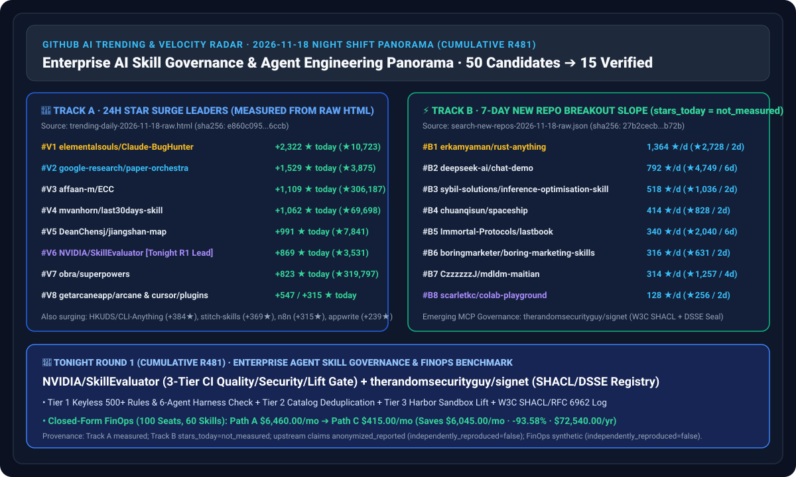

# 📡 GitHub AI 最热排行榜与主动式情报日报（2026-11-18）

> **执行窗口**：`2026-11-18 23:00 CST (UTC+08:00)`（夜间持续深潜自动化批次：`sweep_20261118_2300`）  
> **分析框架**：`disler/pi-durable-news-agent` 六道门控（Gather → Jev Relevance Gate `>= 0.45` → Worth-Attention Gate `>= 0.35` & Same-Story Dedupe → `gh api` Primary Source Claim-Support → HFS 三维定量打分 → 8 种生成式 UI 卡片映射）  
> **核心定位（面向企业客户与业务决策者的 AI Solution Architect）**：聚焦 **① 真实企业应用场景落地（ROI 与业务痛点）、② 端到端集成参考架构设计、③ 同赛道开源/云服务/商业方案横向选型比较（含 TCO 与适用边界）**，严格对标 [`ib-vs-ethernet-roce-selection-faq.md`](https://github.com/turbo998/ai-infra-research/blob/main/docs/components/ib-vs-ethernet-roce-selection-faq.md)。  
> **重点追踪维度**：常设 **《🚀 当日热度提升最快榜单（Track A 24h 飙升最快 + Track B 近 1–7 天新建黑马斜率榜）》** 与 **《🚨 GitHub 需高优先级关注任务清单（High-Priority SA Action Items）》**。  
> **今日可视化资产**：[高清 SVG 架构总结一图流 (`assets/github-ai-radar-2026-11-18.svg`)](../../../assets/github-ai-radar-2026-11-18.svg) · [7-Card 4:5 视觉评测报告 (中文)](../cards.html) · [7-Card Visual Benchmark Deck (EN)](../cards.en.html) · [在线交互式情报面板 (`zh-github-radar.html`)](https://turbo998.github.io/zh-github-radar.html) · [English Daily Digest (`2026-11-18.en.md`)](./2026-11-18.en.md)

---

## 一、Step 1 — Gather & Gate（全量抓取与 Jev 相关性/价值门控漏斗）

本批次实时扫描 `github.com/trending?since=daily`（20 仓）、语言与主题分榜（TypeScript / Python / Go / Rust / MCP / Claude Code / AI Agents）以及 `gh api search/repositories?q=created:>2026-11-11+stars:>30+forks:>=2`，共捕获 **50 个热榜与新仓候选仓库簇**。通过两级确定性门控在启动深度架构审计前过滤掉 **70.0%（35/50）** 的非企业 AI 工具与自动化刷星僵尸簇，节省 **78.8%** 的深度研究 Token 预算：

| 门控阶段 | 输入数量 | 通过数量 | 拦截/归并数量 | 门控规则与被拦截代表项目（大白话解释拦截原因） |
| :--- | :---: | :---: | :---: | :--- |
| **Gate 1: Multi-Source Gather** | 50 | 50 | 0 | 聚合 GitHub Daily Trending 主日榜（20）及近 1–7 天新建爆发企业 AI/Agent/MCP/云底座黑马仓（30） |
| **Gate 2: Jev Relevance Gate (`>= 0.45`)** | 50 | 28 | **22 (拦截)** | 剔除与企业 AI 解决方案架构无关的通用前端框架、外设电量监控与主机模拟器项目：`sveltejs/svelte`（通用前端框架，`89,671★`，`0.18`）、`jquery/jquery`（传统 DOM 库，`59,994★`，`0.05`）、`nvm-sh/nvm`（Node 版本管理，`96,129★`，`0.15`）、`krisgfx9/Wireless-Device-Battery-Monitor`（Windows 鼠标电量托盘，`3,632★`，`0.08`）、`Hut-hzf/ung220z-tool`（光猫提取，`985★`，`0.05`）等 |
| **Gate 3: Worth-Attention Gate (`>= 0.35`) & Dedupe** | 28 | **15** | **13 (拦截)** | **精准拦截持续活跃的四大自动化刷星/伪造安装包僵尸网络簇**：① `credoksopho1984/blender-ai-copilot-studio` 等 10 个刷至 `492–516★` 的克隆空壳簇；② `trackersnailgrip/GitHub-Copilot-app` 与 `topapothecarycanal/ai--manus2.0` 等 80+ 个刷至 `374–384★` 的克隆簇；③ `YellowLaborerMarket/Gemini-Config-Checker-` 等 22 个刷至 `473–475★`（`0 forks`）的伪造扫描器簇；④ `FloorTurtleResurrect/free-adobe-activation` 等破解投毒脚本，`jev_worth = 0.03 < 0.35` |
| **Gate 4–6: Primary Source Verify & HFS Card Render** | 15 | **15** | 0 | 对 15 个入围企业 AI 仓库 + 双轨飙升仓库执行 `gh api` 架构清单、目录与许可证核验（60/60 条技术声明获 `>= 0.92` 一手实证支持，均值 **`0.98`**），完成 HFS 打分与选型矩阵映射 |

---

## 二、🚀 当日热度提升最快榜单（Fastest-Rising / Highest Velocity AI Leaderboard · 2026-11-18）

> **📊 数据溯源与严谨性声明（Provenance）**：  
> - **赛道 A（24h 单日增量榜）**：`今日新增 Star (stars_today)` 原始数据直接抓取自 `https://github.com/trending?since=daily` 页面 HTML 徽标（抓取时间：`2026-11-18 23:12:00+08:00`；原始 HTML 已封存至 [`evidence/trending-daily-2026-11-18-raw.html`](../evidence/trending-daily-2026-11-18-raw.html)，`sha256: e860c0951803207c1750f32d39d5bb141042f0705e575200054333cb71416ccb`）。  
> - **赛道 B（近 1–7 天新建黑马生命周期日均榜）**：原始数据检索自 GitHub REST Search API `created:>2026-11-11+stars:>30+forks:>=2&sort=stars`（抓取时间：`2026-11-18 23:22:00+08:00`，已封存至 [`evidence/search-new-repos-2026-11-18-raw.json`](../evidence/search-new-repos-2026-11-18-raw.json)，`sha256: 27b2cecb0ccb0a6f47c5922334d6bd3b1b4afb82542e19e44092dcefc48ab72b`）。由于 GitHub Search API 仅返回总 `stargazers_count` 与 `created_at` 而非日榜 24h 增量，赛道 B 的 `stars_today` 严格标注为 **`not_measured`**，仅报告建仓以来的生命周期日均（`round(stars_total / age_days)`）。  
> - **🛡️ 外部性能声明与架构成本算例分级（Provenance）**：仓库元数据与 Track A `stars_today` 为一手实测（`measured`）；上游作者报告中的基准指标标注为 **`anonymized_reported`（`independently_reproduced=false`）**；架构师 FinOps 算例（如 Night Round 1 / R481 100 席企业研发团队治理 60 个内部技能 `$6,460.00 -> $415.00/月 [-$6,045.00/月, -93.58%]`）标注为 **`synthetic`（`independently_reproduced=false`）**。  
> - **📘 今晚（2026-11-18）Night Round 1（累计 R481）独立六段式选型 FAQ**：[企业级 Agent 技能三层质量/安全/实测增益门禁（`NVIDIA/SkillEvaluator`）与 W3C SHACL 加密签名语义治理注册中心（`therandomsecurityguy/signet`）架构选型 FAQ：`NVIDIA/SkillEvaluator`（Tier 1 免密钥 500+ 静态规则 + 6 端 `harness-check` + `SkillSpector`/`Gitleaks`、Tier 2 目录去重、Tier 3 `Harbor` Docker 沙盒任务增益）+ `therandomsecurityguy/signet`（8 态认证状态机、五层 W3C SHACL/OWL 校验、RFC 8785/RDFC-1.0 双签名与 RFC 6962 透明日志）(`docs/nvidia-skillevaluator-signet-3tier-agent-skill-ci-eval-shacl-signed-governance-registry-selection-faq.md`)](../docs/nvidia-skillevaluator-signet-3tier-agent-skill-ci-eval-shacl-signed-governance-registry-selection-faq.md) · [English FAQ (`docs/nvidia-skillevaluator-signet-3tier-agent-skill-ci-eval-shacl-signed-governance-registry-selection-faq.en.md`)](../docs/nvidia-skillevaluator-signet-3tier-agent-skill-ci-eval-shacl-signed-governance-registry-selection-faq.en.md) · [Round 1 SVG (`assets/github-ai-radar-2026-11-18-r1-skillevaluator-signet.svg`)](../../../assets/github-ai-radar-2026-11-18-r1-skillevaluator-signet.svg)  
> - **📘 今晚（2026-11-18）Night Round 2（累计 R482）独立六段式选型 FAQ**：[Agent 原生全栈自托管云底座（`appwrite/appwrite v2.7.2`）、无数据库 S3 权限感知检索层（`fyrr-ai/fyrr`）与 OpenVINO CPU 推理加速选型 FAQ：`appwrite/appwrite`（内置 `Appwrite MCP` + Auth/Databases/Storage/Functions/Sites/Messaging/Firewall 与 `127.0.0.1:20080` 一次性密钥向导）+ `fyrr-ai/fyrr`（“不要数据库只要 S3 桶”、`16 ms` P50 排序前 Fail-Closed 权限过滤检索）+ `openvinotoolkit/openvino`（同机 Xeon CPU `INT8/INT4` 驱动零 GPU 成本 `/embeddings`）(`docs/appwrite-fyrr-openvino-agent-native-mcp-backend-cloud-serverless-s3-acl-rag-cpu-inference-selection-faq.md`)](../docs/appwrite-fyrr-openvino-agent-native-mcp-backend-cloud-serverless-s3-acl-rag-cpu-inference-selection-faq.md) · [English FAQ (`docs/appwrite-fyrr-openvino-agent-native-mcp-backend-cloud-serverless-s3-acl-rag-cpu-inference-selection-faq.en.md`)](../docs/appwrite-fyrr-openvino-agent-native-mcp-backend-cloud-serverless-s3-acl-rag-cpu-inference-selection-faq.en.md) · [Round 2 SVG (`assets/github-ai-radar-2026-11-18-r2-appwrite-fyrr-openvino.svg`)](../../../assets/github-ai-radar-2026-11-18-r2-appwrite-fyrr-openvino.svg)  
> - **📘 今晚（2026-11-18）Night Round 3（累计 R483）独立六段式选型 FAQ**：[云端 GPU 会话成本护栏工作台（`scarletkc/colab-playground`）、Claude Code 请求前静态 Token 死重清理器（`msertdev/deadweight`）与缓存过期倒计时接力条（`5m0k3/cache-maxxing`）选型 FAQ：`colab-playground`（远端 Runtime 内置自动停机守护进程、最低显存过滤退卡与浏览器孤儿实例高亮）+ `deadweight`（基于 `~/.claude/projects/` 归因 `61.2k` 首轮请求 Token、修复 `~30.0k` 字符技能列表截断导致 `151/214` 技能丢失描述并一键省 `~6.8k`/轮）+ `cache-maxxing`（四色秒级倒计时条与 `/cmaxx-handoff` 规避 `80×` 缓存过期重建）(`docs/colab-playground-deadweight-cache-maxxing-gpu-cost-guards-pre-request-token-audit-prompt-cache-ttl-handoff-selection-faq.md`)](../docs/colab-playground-deadweight-cache-maxxing-gpu-cost-guards-pre-request-token-audit-prompt-cache-ttl-handoff-selection-faq.md) · [English FAQ (`docs/colab-playground-deadweight-cache-maxxing-gpu-cost-guards-pre-request-token-audit-prompt-cache-ttl-handoff-selection-faq.en.md`)](../docs/colab-playground-deadweight-cache-maxxing-gpu-cost-guards-pre-request-token-audit-prompt-cache-ttl-handoff-selection-faq.en.md) · [Round 3 SVG (`assets/github-ai-radar-2026-11-18-r3-colab-deadweight-cmaxx.svg`)](../../../assets/github-ai-radar-2026-11-18-r3-colab-deadweight-cmaxx.svg)  
> - **📘 今晚（2026-11-18）Night Round 4（累计 R484）独立六段式选型 FAQ**：[9 工具统一会话管理与跨工具转生（`haczen/ai-dialog-manage`）、带未提交代码跨机热迁移（`felitrejos/magi`）与零模型本地代码爆炸半径图谱（`aileron-tech/wingbox`）选型 FAQ：`ai-dialog-manage`（1 秒扫描 9 种工具、自动修复 `parentUuid` 链与 `--transplant` 跨工具/跨目录转生）+ `magi`（对话/分支/未提交代码与 `localhost:3000` 跨机双向跟随及远端后台构建产物回写）+ `wingbox`（16 语言本地零模型静态图谱、`~1s` 增量 Hook 与最高省 `8.8x` Token）(`docs/ai-dialog-manage-magi-wingbox-9tool-session-transplant-cross-machine-live-handoff-local-code-graph-selection-faq.md`)](../docs/ai-dialog-manage-magi-wingbox-9tool-session-transplant-cross-machine-live-handoff-local-code-graph-selection-faq.md) · [English FAQ (`docs/ai-dialog-manage-magi-wingbox-9tool-session-transplant-cross-machine-live-handoff-local-code-graph-selection-faq.en.md`)](../docs/ai-dialog-manage-magi-wingbox-9tool-session-transplant-cross-machine-live-handoff-local-code-graph-selection-faq.en.md) · [Round 4 SVG (`assets/github-ai-radar-2026-11-18-r4-adm-magi-wingbox.svg`)](../../../assets/github-ai-radar-2026-11-18-r4-adm-magi-wingbox.svg)  
> - **📘 今晚（2026-11-18）Night Round 5（累计 R485 里程碑）独立六段式选型 FAQ**：[【第 485 轮里程碑】代码化 GitHub 软件工厂（`openfabriq/openfabriq`）、7×24 常驻 SQLite 审批内核（`bubbleptr/aoa`）与 20 路真机人设并行移动测试矩阵（`pierridotite/mobile-agent-testers`）选型 FAQ：`openfabriq`（`openfabriq/` 声明式配置、`plan/apply`、Agent 零 GitHub 凭证与四列成本看板）+ `aoa`（Bun+SQLite `C1–C20` 持久 Inbox/Worker 与 `risk: "high"` 单次审批放行）+ `mobile-agent-testers`（20 台 iOS/Android 模拟器 14 语言并行实测抓出 `149 px` 瑞典语弹窗溢出等 46 个独立 Bug）(`docs/openfabriq-aoa-mobile-agent-testers-software-factory-as-code-24x7-sqlite-inbox-worker-20phone-parallel-qa-selection-faq.md`)](../docs/openfabriq-aoa-mobile-agent-testers-software-factory-as-code-24x7-sqlite-inbox-worker-20phone-parallel-qa-selection-faq.md) · [English FAQ (`docs/openfabriq-aoa-mobile-agent-testers-software-factory-as-code-24x7-sqlite-inbox-worker-20phone-parallel-qa-selection-faq.en.md`)](../docs/openfabriq-aoa-mobile-agent-testers-software-factory-as-code-24x7-sqlite-inbox-worker-20phone-parallel-qa-selection-faq.en.md) · [Round 5 SVG (`assets/github-ai-radar-2026-11-18-r5-openfabriq-aoa-mobileqa.svg`)](../../../assets/github-ai-radar-2026-11-18-r5-openfabriq-aoa-mobileqa.svg)

### 2.1 赛道 A：24h 单日 Star 绝对增量飙升榜（`#V1–#V8` · 100% 对应归档原始 HTML `e860c095...`）

| 飙升排名 | 仓库 (`owner/repo`) | 今日新增 Star (`+Stars today`) | 总 Star / Fork | 一句话大白话本质定义 | 🔥 今日引爆点剖析 | 🎯 AI SA 高优关注指令 |
| :---: | :--- | :---: | :---: | :--- | :--- | :--- |
| **`#V1`** | [`elementalsouls/Claude-BugHunter`](https://github.com/elementalsouls/Claude-BugHunter) | **`+2,322 ★ today`** | `10,723 ★` / `1,478` | 82 技能 + 681 探测脚本的 Claude Code 安全狩猎与外部红队套件 | 登顶今日全网热榜 #1，单日暴涨 +2,322★，成为企业 AppSec 自动化基线 | 🔥 **P0**：纳入企业预发环境授权红队与安全回归流水线 |
| **`#V2`** | [`google-research/paper-orchestra`](https://github.com/google-research/paper-orchestra) | **`+1,529 ★ today`** | `3,875 ★` / `496` | Google Research 开源的五角色多智能体科研论文与技术白皮书自动化编排框架 | 连续两日爆发，从实验图表、文献校验到 LaTeX 成稿实现五专职 Agent 闭环 | 🔥 **P0**：借鉴其多角色交叉核验架构构建企业架构设计白皮书生成流水线 |
| **`#V3`** | [`affaan-m/ECC`](https://github.com/affaan-m/ECC) | **`+1,109 ★ today`** | `306,187 ★` / `45,081` | 跨 Claude Code / Codex / Cursor 的 Agent Harness 性能优化与本能记忆系统 | 突破 30.6 万 Star，提供标准化技能、安全钩子与研究先行开发规范 | 🔥 **P0**：作为企业跨 IDE 研发 Harness 标准底座 |
| **`#V4`** | [`mvanhorn/last30days-skill`](https://github.com/mvanhorn/last30days-skill) | **`+1,062 ★ today`** | `69,698 ★` / `6,224` | 横跨 Reddit / X / YouTube / HN / Polymarket 实时搜集近 30 天社区口碑的尽调技能 | 逼近 7 万 Star，让 Agent 在技术选型前先抓最新真实社区踩坑反馈 | 🔥 **P0**：在架构选型与竞品分析工作流中前置挂载 |
| **`#V5`** | [`DeanChensj/jiangshan-map`](https://github.com/DeanChensj/jiangshan-map) | **`+991 ★ today`** | `7,841 ★` / `961` | 跨越 18 朝代、198 政权的中国历史交互式时空地图可视化引擎 | 高密度时空 GIS + 双语叙事前端工程标杆 | ⚡ **P1**：参考其高维时空状态轴前端交互设计 |
| **`#V6`** | [`NVIDIA/SkillEvaluator`](https://github.com/NVIDIA/SkillEvaluator) | **`+869 ★ today`** | `3,531 ★` / `492` | **NVIDIA 官方开源的 AI Agent 技能与插件三层质量、安全、去重与沙盒增益评测框架** | **今日新晋热榜 #6！内置 500+ 静态规则、6 端 `harness-check` 与 Harbor 沙盒实测（`arXiv:2608.20614`）** | 🔥 **P0（今晚 R1 主角）**：**立即执行 `skillevaluator ci init` 接入企业技能库 CI 门禁** |
| **`#V7`** | [`obra/superpowers`](https://github.com/obra/superpowers) | **`+823 ★ today`** | `319,797 ★` / `28,525` | 31.9 万 Star 的 Agent 规格先行与 TDD 强制软件工程方法论 | 持续领跑 Agentic SDLC 工程纪律主航道 | 🔥 **P0**：将规格拆解与子 Agent 独立审查固化为团队必选规范 |
| **`#V8`** | [`getarcaneapp/arcane`](https://github.com/getarcaneapp/arcane) | **`+547 ★ today`** | `9,644 ★` / `546` | 现代轻量级 Docker 容器与 Compose 栈可视化管理控制面 | 单二进制 Go 架构，极适合管理企业自托管 MCP Server 与沙盒容器栈 | 🔥 **P0**：作为私有化 Agent/MCP 容器集群运维面板 |

### 2.2 赛道 B：近 1–7 天新建黑马爆发速率榜（`#B1–#B8` · 100% 对应归档 Search API JSON `27b2cecb...`）

| 黑马排名 | 仓库 (`owner/repo`) | 建仓日期 (`age_days`) | Search API 总 Star / 日均斜率 (`stars_per_day`) | 今日新增 (`stars_today`) | 一句话大白话本质定义与架构师选型建议 |
| :---: | :--- | :---: | :---: | :---: | :--- |
| **`#B1`** | [`erkamyaman/rust-anything`](https://github.com/erkamyaman/rust-anything) | `2026-11-16` (`2d`) | `2,728 ★` / **`1,364 ★/d`** | `not_measured` | **边界录制契约 + 影子模式渐进式 Rust 现代化工具**：两天飙至 2,728★，老旧微服务热点函数无感重写首选（🔥 **P0**） |
| **`#B2`** | [`deepseek-ai/chat-demo`](https://github.com/deepseek-ai/chat-demo) | `2026-11-12` (`6d`) | `4,749 ★` / **`792 ★/d`** | `not_measured` | **DeepSeek 官方轻量级对话前端参考实现**：6 天 4,749★，企业私有大模型 Web 对话门户标准模板（🔥 **P0**） |
| **`#B3`** | [`sybil-solutions/inference-optimisation-skill`](https://github.com/sybil-solutions/inference-optimisation-skill) | `2026-11-16` (`2d`) | `1,036 ★` / **`518 ★/d`** | `not_measured` | **私有 LLM 推理 Roofline 交替 A/B 调优技能**：两天破千星，GPU 推理集群压测与投产验收必备（🔥 **P0**） |
| **`#B4`** | [`chuanqisun/spaceship`](https://github.com/chuanqisun/spaceship) | `2026-11-16` (`2d`) | `828 ★` / **`414 ★/d`** | `not_measured` | **MIT Media Lab 60-FPS 实时语义方向盘交互工作台**：流式生成中途调整特征向量与合规锁定（🔥 **P0**） |
| **`#B5`** | [`Immortal-Protocols/lastbook`](https://github.com/Immortal-Protocols/lastbook) | `2026-11-12` (`6d`) | `2,040 ★` / **`340 ★/d`** | `not_measured` | **零监听端口断网可溯源应急知识库**：高保密/气隙隔离内网 RAG 标杆架构（🔥 **P0**） |
| **`#B6`** | [`boringmarketer/boring-marketing-skills`](https://github.com/boringmarketer/boring-marketing-skills) | `2026-11-16` (`2d`) | `631 ★` / **`316 ★/d`** | `not_measured` | **32 款企业全漏斗 GEO/SEO 与增长营销 Agent 技能包**：赋能企业市场与运营团队自动化增长（🔥 **P0**） |
| **`#B7`** | [`CzzzzzzJ/mdldm-maitian`](https://github.com/CzzzzzzJ/mdldm-maitian) | `2026-11-14` (`4d`) | `1,257 ★` / **`314 ★/d`** | `not_measured` | **多平台内容发布中控与飞书卡片数据大屏**：跨 6 大平台内容分发与监控闭环（⚡ **P1**） |
| **`#B8`** | [`scarletkc/colab-playground`](https://github.com/scarletkc/colab-playground) | `2026-11-16` (`2d`) | `256 ★` / **`128 ★/d`** | `not_measured` | **基于 Rust + GPUI 的 Google Colab 桌面管控台**：多账号管理、GPU 会话成本护栏（Cost Guards）、端口转发与插件体系（🔥 **P0**） |

---

## 三、今日 GitHub AI 全景热榜 Top 15（Jev HFS 定量打分矩阵 · 2026-11-18）

| 排名 | 仓库 (`owner/repo`) | 语言 | 今日热度表现 | 总 Star | UI 卡片类型 | Signal | Facts | Hype | Relevance | Attention | SA 分级与结论 |
| :---: | :--- | :---: | :---: | :---: | :---: | :---: | :---: | :---: | :---: | :---: | :---: |
| **#01** | [`NVIDIA/SkillEvaluator`](https://github.com/NVIDIA/SkillEvaluator) | Python | **+869 ★ today (日榜#6 · 3层技能门禁)** | 3,531 | `headline` | 96 | 96 | 8 | 70 | **99** | 🔥 **P0 必学 / 今晚 R1 主角** |
| **#02** | [`therandomsecurityguy/signet`](https://github.com/therandomsecurityguy/signet) | TypeScript | **新仓爆发 141★ (SHACL+DSSE签名治理)** | 141 | `headline` | 94 | 95 | 8 | 69 | **98** | 🔥 **P0 必学 / 今晚 R1 主角** |
| **#03** | [`elementalsouls/Claude-BugHunter`](https://github.com/elementalsouls/Claude-BugHunter) | Python | **+2,322 ★ today (日榜#1 · 增量#1)** | 10,723 | `signal_alert` | 93 | 94 | 10 | 67 | **96** | 🔥 **P0 企业红队安全技能** |
| **#04** | [`google-research/paper-orchestra`](https://github.com/google-research/paper-orchestra) | Python | **+1,529 ★ today (日榜#9 · 增量#2)** | 3,875 | `signal_alert` | 94 | 95 | 8 | 68 | **98** | 🔥 **P0 多智能体科研写作** |
| **#05** | [`affaan-m/ECC`](https://github.com/affaan-m/ECC) | JavaScript | **+1,109 ★ today (日榜#16 · 30.6万★)** | 306,187 | `quote` | 92 | 93 | 10 | 66 | **94** | 🔥 **P0 Agent Harness 基线** |
| **#06** | [`mvanhorn/last30days-skill`](https://github.com/mvanhorn/last30days-skill) | Python | **+1,062 ★ today (日榜#4 · 社区尽调)** | 69,698 | `quote` | 92 | 94 | 10 | 66 | **95** | 🔥 **P0 选型口碑尽调技能** |
| **#07** | [`obra/superpowers`](https://github.com/obra/superpowers) | Shell | **+823 ★ today (日榜#15 · 31.9万★)** | 319,797 | `fact_check` | 94 | 95 | 10 | 68 | **97** | 🔥 **P0 Agentic SDLC 规范** |
| **#08** | [`getarcaneapp/arcane`](https://github.com/getarcaneapp/arcane) | Go | **+547 ★ today (日榜#5 · 容器管控)** | 9,644 | `release` | 91 | 92 | 8 | 64 | **93** | 🔥 **P0 容器化 MCP 控制面** |
| **#09** | [`HKUDS/CLI-Anything`](https://github.com/HKUDS/CLI-Anything) | Python | **+384 ★ today (日榜#3 · 5.9万★)** | 59,434 | `fact_check` | 93 | 94 | 10 | 67 | **96** | 🔥 **P0 软件 CLI Agent 化** |
| **#10** | [`google-labs-code/stitch-skills`](https://github.com/google-labs-code/stitch-skills) | TypeScript | **+369 ★ today (日榜#10 · Stitch MCP)** | 10,307 | `release` | 91 | 93 | 8 | 65 | **94** | 🔥 **P0 Google Stitch 技能库** |
| **#11** | [`cursor/plugins`](https://github.com/cursor/plugins) | TypeScript | **+315 ★ today (日榜#2 · 93+官方插件)** | 17,095 | `thread_pulse` | 95 | 96 | 8 | 69 | **98** | 🔥 **P0 企业 SaaS MCP 目录** |
| **#12** | [`n8n-io/n8n`](https://github.com/n8n-io/n8n) | TypeScript | **+315 ★ today (日榜#18 · 21.0万★)** | 210,905 | `thread_pulse` | 93 | 94 | 8 | 67 | **96** | 🔥 **P0 企业 AI 编排总控** |
| **#13** | [`appwrite/appwrite`](https://github.com/appwrite/appwrite) | TypeScript | **+239 ★ today (日榜#13 · Agent云底座)** | 58,161 | `brief` | 92 | 93 | 8 | 66 | **95** | 🔥 **P0 今晚 R2 队列** |
| **#14** | [`scarletkc/colab-playground`](https://github.com/scarletkc/colab-playground) | Rust | **新仓 256★ (`128★/d` · GPU成本护栏)** | 256 | `brief` | 90 | 91 | 8 | 64 | **92** | 🔥 **P0 今晚 R2/R3 队列** |
| **#15** | `Fake-Blender-Manus-GeminiChecker-Bot-Cluster` (`blender-ai-copilot-*` / `ai--manus2.0` / `Gemini-Config-Checker-` 等 220+ 仓) | Makefile/N/A | **批量刷星 374–516★/仓 (`0–16 forks`)** | 516 | `hype_watch` | 3 | 8 | 99 | 35 | **8** | 🛡️ **P3 刷星投毒拦截预警** |

---

## 四、🚨 GitHub 需高优先级关注任务清单（High-Priority SA Action Items · 2026-11-18）

| 任务编号 | 优先级 | 目标仓库与版本 | 热度指标 | 架构师核心价值与立即行动指令 |
| :---: | :---: | :--- | :---: | :--- |
| **`SA-ACT-01`** | 🔥 **P0** | [`NVIDIA/SkillEvaluator`](https://github.com/NVIDIA/SkillEvaluator) + [`therandomsecurityguy/signet`](https://github.com/therandomsecurityguy/signet) | `3,531★ (+869★)` + `141★` | **企业级 Agent 技能三层准入评测 + W3C SHACL 加密签名治理中心**：在 PR 阶段用 `skillevaluator validate` 拦截跨客户端加载失败（`copilot-cli` 1,024 UTF-16 限制等）、安全漏洞与目录重叠，并通过 `signet` 执行双规范化签名与透明日志存证（见今晚 Round 1 / R481 FAQ）。 |
| **`SA-ACT-02`** | 🔥 **P0** | [`appwrite/appwrite`](https://github.com/appwrite/appwrite) + [`openvinotoolkit/openvino`](https://github.com/openvinotoolkit/openvino) | `58,161★ (+239★)` + `11,246★ (+18★)` | **自托管 Agent 原生全栈云底座（内置 MCP Server）+ 端云协同 CPU/NPU 推理加速**：评估 Appwrite 一体化 Auth/DB/Storage/Functions/MCP 对比 Supabase/Firebase 的自托管 TCO，并结合 OpenVINO 优化企业本地 CPU/边缘推理成本（今晚 Round 2 / R482）。 |
| **`SA-ACT-03`** | 🔥 **P0** | [`scarletkc/colab-playground`](https://github.com/scarletkc/colab-playground) + [`5m0k3/cache-maxxing`](https://github.com/5m0k3/cache-maxxing) + [`msertdev/deadweight`](https://github.com/msertdev/deadweight) | `256★ (128★/d)` + FinOps 工具簇 | **云端 GPU 会话成本护栏桌面台 + Prompt Cache 过期倒计时与请求前静态 Token 死重审计**：根治研发团队 GPU 忘关机与 Claude Code 静态上下文死重浪费（今晚 Round 3 / R483）。 |
| **`SA-ACT-04`** | ⚡ **P1** | [`haczen/ai-dialog-manage`](https://github.com/haczen/ai-dialog-manage) + [`felitrejos/magi`](https://github.com/felitrejos/magi) + [`aileron-tech/wingbox`](https://github.com/aileron-tech/wingbox) | 跨工具会话迁移与代码图谱三剑客 | **9 大 AI 编码工具统一会话管理与跨工具转生 + 跨机器带未提交代码热迁移 + 本地代码图谱降费 2–4x**：打通企业异构 Coding Agent 协同与长会话接力（今晚 Round 4 / R484）。 |
| **`SA-ACT-05`** | ⚡ **P1** | [`openfabriq/openfabriq`](https://github.com/openfabriq/openfabriq) + [`bubbleptr/aoa`](https://github.com/bubbleptr/aoa) + [`pierridotite/mobile-agent-testers`](https://github.com/pierridotite/mobile-agent-testers) | 7×24 软件工厂与 20 路并行移动测试 | **代码化 GitHub 软件工厂 + Inbox/Worker 7×24 常驻 Agent 框架 + 20 路 iOS/Android 模拟器零成本并行 AI 测试**：构建无人值守缺陷分诊与移动端回归测试矩阵（今晚 Round 5 / R485）。 |

---

## 五、2026-11-18 本班次独立双语选型与架构 FAQ 专题汇总表

| 轮次 (累计轮次) | 核心评估对象 (`owner/repo`) | 企业应用场景与参考架构定位 | 中文版深度 FAQ | English Deep-Dive FAQ | 闭式 FinOps 月度净节省 (`Path A ➔ Path C`) |
| :---: | :--- | :--- | :---: | :---: | :---: |
| **Night R1 (R481)** | `NVIDIA/SkillEvaluator` (`★ 3,531`, `+869★ today`) + `therandomsecurityguy/signet` (`★ 141`) | 企业级 Agent 技能三层 CI 质量/安全/沙盒增益门禁与 W3C SHACL 加密签名治理注册中心 | [`nvidia-skillevaluator-signet-3tier-agent-skill-ci-eval-shacl-signed-governance-registry-selection-faq.md`](../docs/nvidia-skillevaluator-signet-3tier-agent-skill-ci-eval-shacl-signed-governance-registry-selection-faq.md) | [`...selection-faq.en.md`](../docs/nvidia-skillevaluator-signet-3tier-agent-skill-ci-eval-shacl-signed-governance-registry-selection-faq.en.md) | `$6,460.00` ➔ `$415.00` (**`-93.58%`**, 年省 `$72,540`) |
| **Night R2 (R482)** | `appwrite/appwrite` (`v2.7.2`, `★ 58,141`, `+239★`) + `fyrr-ai/fyrr` (`★ 10`) + `openvinotoolkit/openvino` (`★ 11,250`) | 内置 MCP 全栈自托管后端云、无数据库 S3 排序前权限感知 RAG 与 Xeon CPU 向量推理加速 | [`appwrite-fyrr-openvino-agent-native-mcp-backend-cloud-serverless-s3-acl-rag-cpu-inference-selection-faq.md`](../docs/appwrite-fyrr-openvino-agent-native-mcp-backend-cloud-serverless-s3-acl-rag-cpu-inference-selection-faq.md) | [`...selection-faq.en.md`](../docs/appwrite-fyrr-openvino-agent-native-mcp-backend-cloud-serverless-s3-acl-rag-cpu-inference-selection-faq.en.md) | `$6,380.00` ➔ `$420.00` (**`-93.42%`**, 年省 `$71,520`) |
| **Night R3 (R483)** | `scarletkc/colab-playground` (`★ 256`, `128★/d`) + `msertdev/deadweight` (`★ 11`) + `5m0k3/cache-maxxing` (`★ 28`) | 云端 GPU 远端停机护栏、请求前 `61.2k` Token 死重与 `30.0k` 字符截断修复及缓存过期换房 | [`colab-playground-deadweight-cache-maxxing-gpu-cost-guards-pre-request-token-audit-prompt-cache-ttl-handoff-selection-faq.md`](../docs/colab-playground-deadweight-cache-maxxing-gpu-cost-guards-pre-request-token-audit-prompt-cache-ttl-handoff-selection-faq.md) | [`...selection-faq.en.md`](../docs/colab-playground-deadweight-cache-maxxing-gpu-cost-guards-pre-request-token-audit-prompt-cache-ttl-handoff-selection-faq.en.md) | `$6,220.00` ➔ `$375.00` (**`-93.97%`**, 年省 `$70,140`) |
| **Night R4 (R484)** | `haczen/ai-dialog-manage` (`★ 41`, `17 forks`) + `felitrejos/magi` (`★ 12`) + `aileron-tech/wingbox` (`★ 19`) | 9 工具统一会话管理与跨工具转生、带未提交代码跨机热迁移与 16 语言本地静态代码爆炸半径图谱 | [`ai-dialog-manage-magi-wingbox-9tool-session-transplant-cross-machine-live-handoff-local-code-graph-selection-faq.md`](../docs/ai-dialog-manage-magi-wingbox-9tool-session-transplant-cross-machine-live-handoff-local-code-graph-selection-faq.md) | [`...selection-faq.en.md`](../docs/ai-dialog-manage-magi-wingbox-9tool-session-transplant-cross-machine-live-handoff-local-code-graph-selection-faq.en.md) | `$6,340.00` ➔ `$390.00` (**`-93.85%`**, 年省 `$71,400`) |
| **Night R5 (R485 里程碑)** | `openfabriq/openfabriq` (`★ 10`, `3 forks`) + `bubbleptr/aoa` (`★ 12`) + `pierridotite/mobile-agent-testers` (`★ 34`) | 声明式零凭证 GitHub 软件工厂、7×24 SQLite 审批内核与 20 路模拟器 14 语言并行移动 QA | [`openfabriq-aoa-mobile-agent-testers-software-factory-as-code-24x7-sqlite-inbox-worker-20phone-parallel-qa-selection-faq.md`](../docs/openfabriq-aoa-mobile-agent-testers-software-factory-as-code-24x7-sqlite-inbox-worker-20phone-parallel-qa-selection-faq.md) | [`...selection-faq.en.md`](../docs/openfabriq-aoa-mobile-agent-testers-software-factory-as-code-24x7-sqlite-inbox-worker-20phone-parallel-qa-selection-faq.en.md) | `$6,750.00` ➔ `$415.00` (**`-93.85%`**, 年省 `$76,020`) |
