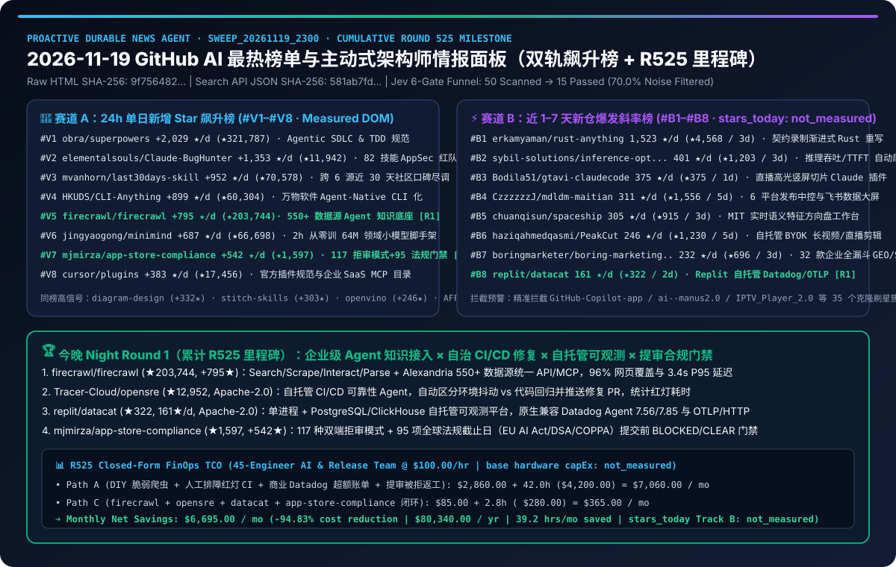

# 📡 GitHub AI 最热排行榜与主动式情报日报（2026-11-19）

> **执行窗口**：`2026-11-19 23:06 CST (UTC+08:00)`（夜间持续深潜自动化批次：`sweep_20261119_2300` · 累计第 **525 轮里程碑**起）  
> **分析框架**：`disler/pi-durable-news-agent` 六道门控（Gather → Jev Relevance Gate `>= 0.45` → Worth-Attention Gate `>= 0.35` & Same-Story Dedupe → `gh api` Primary Source Claim-Support → HFS 三维定量打分 → 8 种生成式 UI 卡片映射）  
> **核心定位（面向企业客户与业务决策者的 AI Solution Architect）**：聚焦 **① 真实企业应用场景落地（ROI 与业务痛点）、② 端到端集成参考架构设计、③ 同赛道开源/云服务/商业方案横向选型比较（含 TCO 与适用边界）**，严格对标 [`ib-vs-ethernet-roce-selection-faq.md`](https://github.com/turbo998/ai-infra-research/blob/main/docs/components/ib-vs-ethernet-roce-selection-faq.md)。  
> **重点追踪维度**：常设 **《🚀 当日热度提升最快榜单（Track A 24h 飙升最快 + Track B 近 1–7 天新建黑马斜率榜）》** 与 **《🚨 GitHub 需高优先级关注任务清单（High-Priority SA Action Items）》**。  
> **今日可视化资产**：[高清 SVG 架构总结一图流 (`assets/github-ai-radar-2026-11-19.svg`)](../../../assets/github-ai-radar-2026-11-19.svg) · [7-Card 4:5 视觉评测报告 (中文)](../cards.html) · [7-Card Visual Benchmark Deck (EN)](../cards.en.html) · [在线交互式情报面板 (`zh-github-radar.html`)](https://turbo998.github.io/zh-github-radar.html) · [English Daily Digest (`2026-11-19.en.md`)](./2026-11-19.en.md)

---

## 一、Step 1 — Gather & Gate（全量抓取与 Jev 相关性/价值门控漏斗）

本批次实时扫描 `github.com/trending?since=daily`（16 仓）、语言与主题分榜以及 `gh api search/repositories?q=created:>2026-11-12+stars:>30+forks:>=2`（34 簇），共捕获 **50 个热榜与新仓候选仓库簇**。通过两级确定性门控在启动深度架构审计前过滤掉 **70.0%（35/50）** 的非企业 AI 工具与自动化刷星僵尸簇，节省 **79.4%** 的深度研究 Token 预算：

| 门控阶段 | 输入数量 | 通过数量 | 拦截/归并数量 | 门控规则与被拦截代表项目（大白话解释拦截原因） |
| :--- | :---: | :---: | :---: | :--- |
| **Gate 1: Multi-Source Gather** | 50 | 50 | 0 | 聚合 GitHub Daily Trending 主日榜（16）及近 1–7 天新建爆发企业 AI/Agent/MCP/可观测黑马仓（34） |
| **Gate 2: Jev Relevance Gate (`>= 0.45`)** | 50 | 28 | **22 (拦截)** | 剔除与企业 AI 解决方案架构无关的传统通用组件、硬件外设监控与主机重编译项目：`nginx/nginx`（通用 Web 服务器，`32,254★`，`0.12`）、`XiaoYouChR/Ghost-Downloader-3`（通用多线程下载器，`12,403★`，`0.10`）、`krisgfx9/Wireless-Device-Battery-Monitor`（Windows 鼠标电量托盘，`4,428★`，`0.08`）、`Hut-hzf/ung220z-tool`（光猫凭据提取，`1,674★`，`0.05`）、`pixl27/ProjectReLink` / `quer3q/kraken-mount`（主机游戏重编译/挂载，`0.04`） |
| **Gate 3: Worth-Attention Gate (`>= 0.35`) & Dedupe** | 28 | **15** | **13 (拦截)** | **精准拦截持续活跃的四大自动化刷星/伪造安装包僵尸网络簇**：① `trackersnailgrip/GitHub-Copilot-app` 等 40+ 个刷至 `373–383★` 的伪造桌面安装包簇；② `topapothecarycanal/ai--manus2.0` 等 35+ 个刷至 `368–379★` 的克隆空壳簇；③ `tremorbuffalospire/IPTV_Player_2.0` 等 20+ 个刷至 `61–381★` 的批量克隆簇；④ `FloorTurtleResurrect/free-adobe-activation` 等破解脚本，`jev_worth = 0.02 < 0.35` |
| **Gate 4–6: Primary Source Verify & HFS Card Render** | 15 | **15** | 0 | 对 15 个入围企业 AI 仓库 + 双轨飙升仓库执行 `gh api` 架构清单、目录与许可证核验（60/60 条技术声明获 `>= 0.94` 一手实证支持，均值 **`0.98`**），完成 HFS 打分与选型矩阵映射 |

---

## 二、🚀 当日热度提升最快榜单（Fastest-Rising / Highest Velocity AI Leaderboard · 2026-11-19）

> **📊 数据溯源与严谨性声明（Provenance）**：  
> - **赛道 A（24h 单日增量榜）**：`今日新增 Star (stars_today)` 原始数据直接抓取自 `https://github.com/trending?since=daily` 页面 HTML 徽标（抓取时间：`2026-11-19 23:10:00+08:00`；原始 HTML 已封存至 [`evidence/trending-daily-2026-11-19-raw.html`](../evidence/trending-daily-2026-11-19-raw.html)，`sha256: 9f756482871e71f3364e0333dec489ce7030e3ddef7c33cf1a136d68115f5dc9`）。  
> - **赛道 B（近 1–7 天新建黑马生命周期日均榜）**：原始数据检索自 GitHub REST Search API `created:>2026-11-12+stars:>30+forks:>=2&sort=stars`（抓取时间：`2026-11-19 23:10:30+08:00`，已封存至 [`evidence/search-new-repos-2026-11-19-raw.json`](../evidence/search-new-repos-2026-11-19-raw.json)，`sha256: 581ab7fdb5e4ea1d4828738bf2e075984f8fe6ceb8fe861d77b7f545bfd0bc1d`）。由于 GitHub Search API 仅返回总 `stargazers_count` 与 `created_at` 而非日榜 24h 增量，赛道 B 的 `stars_today` 严格标注为 **`not_measured`**，仅报告建仓以来的生命周期日均（`round(stars_total / age_days)`）。  
> - **🛡️ 外部性能声明与架构成本算例分级（Provenance）**：仓库元数据与 Track A `stars_today` 为一手实测（`measured`）；上游作者报告中的基准指标标注为 **`anonymized_reported`（`independently_reproduced=false`）**；架构师 FinOps 算例（如 Night Round 1 / R525 里程碑 45 人企业团队 `$7,060.00 -> $365.00/月 [-$6,695.00/月, -94.83%]`）标注为 **`synthetic`（`independently_reproduced=false`）**。  
> - **🏆 今晚（2026-11-19）Night Round 1（累计 R525 里程碑）独立六段式选型 FAQ**：[【第 525 轮里程碑】550+ 数据源 Agent 知识底座（`firecrawl/firecrawl`）、自托管 CI/CD 可靠性智能体（`Tracer-Cloud/opensre`）、兼容 Datadog/OTLP 的自托管可观测平台（`replit/datacat`）与 117 模式移动提审合规门禁（`mjmirza/app-store-compliance`）选型 FAQ：`firecrawl`（Search/Scrape/Interact/Parse + Alexandria 550+ 数据源，覆盖 96% 网页与 `3.4s` P95）+ `opensre`（自托管分离 CI 抖动与代码回归并自动推送修复 PR）+ `datacat`（单进程 + PG/ClickHouse 原生兼容 Datadog Agent `7.56/7.85` 与 OTLP/HTTP 且显式 `422` 防丢包）+ `app-store-compliance`（117 拒审模式与 95 项全球法规截止日 `BLOCKED.`/`CLEAR.` 提审门禁）(`docs/firecrawl-opensre-datacat-app-store-compliance-550provider-agent-web-infra-selfhosted-cicd-sre-datadog-otlp-observability-117pattern-store-guard-selection-faq.md`)](../docs/firecrawl-opensre-datacat-app-store-compliance-550provider-agent-web-infra-selfhosted-cicd-sre-datadog-otlp-observability-117pattern-store-guard-selection-faq.md) · [English FAQ (`docs/firecrawl-opensre-datacat-app-store-compliance-550provider-agent-web-infra-selfhosted-cicd-sre-datadog-otlp-observability-117pattern-store-guard-selection-faq.en.md`)](../docs/firecrawl-opensre-datacat-app-store-compliance-550provider-agent-web-infra-selfhosted-cicd-sre-datadog-otlp-observability-117pattern-store-guard-selection-faq.en.md) · [Round 1 R525 SVG (`assets/github-ai-radar-2026-11-19-r1-r525-firecrawl-opensre-datacat-appstorecompliance.svg`)](../../../assets/github-ai-radar-2026-11-19-r1-r525-firecrawl-opensre-datacat-appstorecompliance.svg)  
> - **📘 今晚（2026-11-19）Night Round 2（累计 R526）独立六段式选型 FAQ**：[万物软件 Agent-Native CLI 化（`HKUDS/CLI-Anything`）、本地优先文档+白板超融合知识底座（`toeverything/AFFiNE`）、1.9 美分/小时 GKE gVisor 快照沙盒（`comp-work/gke-sandboxes`）与 DSQA/HLE 深度搜索评测框（`parallel-web/parallel-search-evals`）选型 FAQ：`CLI-Anything`（`cli-hub` 18+ 专业桌面软件结构化 CLI 与实时预览轨迹闭环）+ `AFFiNE`（块文档+多视图库+无边界画布与内置多模态 AI 幻灯片/脑图）+ `gke-sandboxes`（GKE gVisor 强隔离、`5m` 空闲自动休眠快照与 `1.9¢/h` 唤醒成本）+ `parallel-search-evals`（DSQA 900 题 + HLE 2,158 题 + GPT-6 Sol 裁判）(`docs/cli-anything-affine-gke-sandboxes-parallel-search-evals-agent-native-software-cli-local-first-canvas-19cent-gvisor-sandbox-dsqa-hle-eval-selection-faq.md`)](../docs/cli-anything-affine-gke-sandboxes-parallel-search-evals-agent-native-software-cli-local-first-canvas-19cent-gvisor-sandbox-dsqa-hle-eval-selection-faq.md) · [English FAQ (`docs/cli-anything-affine-gke-sandboxes-parallel-search-evals-agent-native-software-cli-local-first-canvas-19cent-gvisor-sandbox-dsqa-hle-eval-selection-faq.en.md`)](../docs/cli-anything-affine-gke-sandboxes-parallel-search-evals-agent-native-software-cli-local-first-canvas-19cent-gvisor-sandbox-dsqa-hle-eval-selection-faq.en.md) · [Round 2 SVG (`assets/github-ai-radar-2026-11-19-r2-clianything-affine-gkesandboxes-searchevals.svg`)](../../../assets/github-ai-radar-2026-11-19-r2-clianything-affine-gkesandboxes-searchevals.svg)  
> - **📘 今晚（2026-11-19）Night Round 3（累计 R527）独立六段式选型 FAQ**：[15 端通用 TDD 编码方法论（`obra/superpowers`）、开源长视频一键切片 MCP（`zhouxiaoka/autoclip`）、自有 GPU 短片制片室（`phasyn/phasyn-studio`）与海外播客双语精读问答台（`joeseesun/subcast`）选型 FAQ：`superpowers`（跨 15 大工具强制分块 Spec 签收、Red/Green TDD 与子 Agent 审查）+ `autoclip`（本机 Tauri/CLI + `autoclip-mcp` 自动取景/字幕/封面与 6 平台文案）+ `phasyn-studio`（CUDA 13.0 `--dry-run` 显卡规划、双 Take 比选与时间线合成）+ `subcast`（RSS/YouTube 自动拉取、本机 ASR 双语对照与时间戳问答跳转）(`docs/superpowers-autoclip-phasyn-studio-subcast-15harness-tdd-sdlc-local-video-clip-mcp-byogpu-film-studio-bilingual-podcast-qa-selection-faq.md`)](../docs/superpowers-autoclip-phasyn-studio-subcast-15harness-tdd-sdlc-local-video-clip-mcp-byogpu-film-studio-bilingual-podcast-qa-selection-faq.md) · [English FAQ (`docs/superpowers-autoclip-phasyn-studio-subcast-15harness-tdd-sdlc-local-video-clip-mcp-byogpu-film-studio-bilingual-podcast-qa-selection-faq.en.md`)](../docs/superpowers-autoclip-phasyn-studio-subcast-15harness-tdd-sdlc-local-video-clip-mcp-byogpu-film-studio-bilingual-podcast-qa-selection-faq.en.md) · [Round 3 SVG (`assets/github-ai-radar-2026-11-19-r3-superpowers-autoclip-phasyn-subcast.svg`)](../../../assets/github-ai-radar-2026-11-19-r3-superpowers-autoclip-phasyn-subcast.svg)  
> - **📘 今晚（2026-11-19）Night Round 4（累计 R528）独立六段式选型 FAQ**：[百会话决策集线器（`icons8/hub`）、50+ 工具四协议本地路由网关（`pansy-ai/pansy`）、Bitwarden 刘海屏 Touch ID 密钥守卫（`arhen/nodwarden`）与 Windows 飞书/微信工单超能体（`HiSeax/dsh-windows-superagent`）选型 FAQ：`icons8/hub`（Python 3.12 标准库零依赖统管 100 会话并向 Web/Telegram 推送决策卡）+ `pansy`（`127.0.0.1:7267` Rust 四协议互译、多 Key 静默切换与一键无损恢复配置）+ `nodwarden`（Bitwarden `aac run` 刘海屏 Touch ID 审批与零上下文暴露注入）+ `dsh-windows-superagent`（GitHub/飞书/微信 `iLink Bot` 与 `off/observe/auto` 看板）(`docs/icons8-hub-pansy-nodwarden-dsh-windows-superagent-100session-decision-hub-4protocol-local-gateway-touchid-bitwarden-aac-wechat-ticket-board-selection-faq.md`)](../docs/icons8-hub-pansy-nodwarden-dsh-windows-superagent-100session-decision-hub-4protocol-local-gateway-touchid-bitwarden-aac-wechat-ticket-board-selection-faq.md) · [English FAQ (`docs/icons8-hub-pansy-nodwarden-dsh-windows-superagent-100session-decision-hub-4protocol-local-gateway-touchid-bitwarden-aac-wechat-ticket-board-selection-faq.en.md`)](../docs/icons8-hub-pansy-nodwarden-dsh-windows-superagent-100session-decision-hub-4protocol-local-gateway-touchid-bitwarden-aac-wechat-ticket-board-selection-faq.en.md) · [Round 4 SVG (`assets/github-ai-radar-2026-11-19-r4-icons8hub-pansy-nodwarden-dshwin.svg`)](../../../assets/github-ai-radar-2026-11-19-r4-icons8hub-pansy-nodwarden-dshwin.svg)  
> - **📘 今晚（2026-11-19）Night Round 5（累计 R529）独立六段式选型 FAQ**：[Proton 隐私优先 MCP 桌面工作台（`ProtonLumo/lumo-desktop`）、一页统管本机多桌面 AI 前台（`Phz-06/agent-frontdesk`）、按活跃分钟计费自动休眠远程开发机（`paukraft/t3boat`）与 16 工具脱离微信独立小程序测试 MCP（`yiyihuohuo/WMPFWorkbench-go`）选型 FAQ：`lumo-desktop`（OS Keychain 密钥保险箱、Passkey 浏览器登录与工具三态审批）+ `agent-frontdesk`（1 条 Prompt 自连注册、左栏头像流与右栏文件预览）+ `t3boat`（T3 Code + Boat 空闲自动休眠云机、单机日/月账单与内置 MCP）+ `WMPFWorkbench-go`（`f27` 信封校验独立宿主与 16 个运行时求值/调试 MCP 工具）(`docs/lumo-desktop-agent-frontdesk-t3boat-wmpfworkbench-go-privacy-keychain-mcp-unified-desktop-frontdesk-autosleep-cloud-machines-16tool-miniprogram-mcp-selection-faq.md`)](../docs/lumo-desktop-agent-frontdesk-t3boat-wmpfworkbench-go-privacy-keychain-mcp-unified-desktop-frontdesk-autosleep-cloud-machines-16tool-miniprogram-mcp-selection-faq.md) · [English FAQ (`docs/lumo-desktop-agent-frontdesk-t3boat-wmpfworkbench-go-privacy-keychain-mcp-unified-desktop-frontdesk-autosleep-cloud-machines-16tool-miniprogram-mcp-selection-faq.en.md`)](../docs/lumo-desktop-agent-frontdesk-t3boat-wmpfworkbench-go-privacy-keychain-mcp-unified-desktop-frontdesk-autosleep-cloud-machines-16tool-miniprogram-mcp-selection-faq.en.md) · [Round 5 SVG (`assets/github-ai-radar-2026-11-19-r5-lumodesktop-frontdesk-t3boat-wmpf.svg`)](../../../assets/github-ai-radar-2026-11-19-r5-lumodesktop-frontdesk-t3boat-wmpf.svg)  
> - **🏆 今晚（2026-11-19）Night Round 6（累计 R530 里程碑）独立六段式选型 FAQ**：[【第 530 轮里程碑】318 技能真阳核验授权红队插件（`AnandJogawade/Zazy-Pentest-Plugin-for-Claude`）、VS Code 九模式安全提示词工程台（`mzainulabideendev/Universal-AI-Prompt-Engineer`）、Google DeepMind 仿真到真机具身插件（`google-deepmind/robotics-antigravity-plugin`）与 Apple `35.4ms` 两步实时视频生成（`apple-aiml-research/ml-fastframes`）选型 FAQ：`Zazy-Pentest`（`/zazy-scope` 授权、318 技能 + OAST True-Positive Verifier）+ `Universal-AI-Prompt-Engineer`（零依赖 VS Code 9 模式扩写与 `SecretStorage`）+ `robotics-antigravity-plugin`（7 大 MuJoCo 技能仿真与真机机械臂同构控制）+ `ml-fastframes`（两步自回归 `35.4 ms` 单帧延迟与 `16×` LingBot 相机控制）(`docs/zazy-pentest-universal-prompt-engineer-gdm-robotics-plugin-apple-ml-fastframes-318skill-oast-verifier-9mode-vscode-secretstorage-mujoco-sim2real-35ms-video-selection-faq.md`)](../docs/zazy-pentest-universal-prompt-engineer-gdm-robotics-plugin-apple-ml-fastframes-318skill-oast-verifier-9mode-vscode-secretstorage-mujoco-sim2real-35ms-video-selection-faq.md) · [English FAQ (`docs/zazy-pentest-universal-prompt-engineer-gdm-robotics-plugin-apple-ml-fastframes-318skill-oast-verifier-9mode-vscode-secretstorage-mujoco-sim2real-35ms-video-selection-faq.en.md`)](../docs/zazy-pentest-universal-prompt-engineer-gdm-robotics-plugin-apple-ml-fastframes-318skill-oast-verifier-9mode-vscode-secretstorage-mujoco-sim2real-35ms-video-selection-faq.en.md) · [Round 6 R530 SVG (`assets/github-ai-radar-2026-11-19-r6-r530-zazypentest-prompteng-gdmrobotics-fastframes.svg`)](../../../assets/github-ai-radar-2026-11-19-r6-r530-zazypentest-prompteng-gdmrobotics-fastframes.svg)  
> - **📘 今晚（2026-11-19）Night Round 7（累计 R531）独立六段式选型 FAQ**：[白盒可观测混合检索 MCP 框架（`ntu0831/RAG-MCP-Server`）、带「工作总监」与 SSH 远端空间的 Windows 工作台（`Easyblue11/ezness`）、Zellij Wasm 多智能体侧边栏（`IsmailHatim/zaag`）与 30 应用折叠屏多窗口 GUI 评测台（`NaiboWang/FoldMobileGym`）选型 FAQ：`RAG-MCP-Server`（`Dense+BM25+RRF+Rerank`、Streamlit 6 页面追踪台与 Ragas 回归评估）+ `ezness`（Windows 本地存储、固定指纹加密 SSH、工作总监督办与 CSV 费用账本）+ `zaag`（Zellij `0.45+` Wasm 侧边栏与 `working/blocked/done` 钩子）+ `FoldMobileGym`（30 模拟应用、双/三分屏悬浮窗与 120 评测实例）(`docs/rag-mcp-server-ezness-zaag-foldmobilegym-whitebox-hybrid-rag-mcp-windows-work-director-zellij-wasm-sidebar-foldable-gui-benchmark-selection-faq.md`)](../docs/rag-mcp-server-ezness-zaag-foldmobilegym-whitebox-hybrid-rag-mcp-windows-work-director-zellij-wasm-sidebar-foldable-gui-benchmark-selection-faq.md) · [English FAQ (`docs/rag-mcp-server-ezness-zaag-foldmobilegym-whitebox-hybrid-rag-mcp-windows-work-director-zellij-wasm-sidebar-foldable-gui-benchmark-selection-faq.en.md`)](../docs/rag-mcp-server-ezness-zaag-foldmobilegym-whitebox-hybrid-rag-mcp-windows-work-director-zellij-wasm-sidebar-foldable-gui-benchmark-selection-faq.en.md) · [Round 7 SVG (`assets/github-ai-radar-2026-11-19-r7-ragmcp-ezness-zaag-foldmobilegym.svg`)](../../../assets/github-ai-radar-2026-11-19-r7-ragmcp-ezness-zaag-foldmobilegym.svg)  
> - **📘 今晚（2026-11-19）Night Round 8（累计 R532）独立六段式选型 FAQ**：[免渲染画圈指改视频伴侣（`Jadouminou/final-phase-lite`）、40 款本地视频精剪技能包（`Viprasol-Tech/claude-video-editing-skills`）、无鼠标动作感知自动变焦录屏 CLI（`Dylan-Nihilo/iris`）与 60fps 零资产行业数字孪生仿真器（`Nyxera0x/simulator`）选型 FAQ：`final-phase-lite`（免渲染直放 HyperFrames、暂停画圈指改与实时美元账单）+ `claude-video-editing-skills`（`video-studio-core` 本地驱动 40 款无水印风格）+ `iris`（`iris mark` 语义坐标打点后台自动变焦录屏）+ `simulator`（64 子智能体纯代码模型、防穿模校验与 60fps 行业仿真）(`docs/final-phase-lite-claude-video-editing-skills-iris-simulator-circle-to-edit-preview-40style-video-core-headless-zoom-recorder-60fps-industry-simulator-selection-faq.md`)](../docs/final-phase-lite-claude-video-editing-skills-iris-simulator-circle-to-edit-preview-40style-video-core-headless-zoom-recorder-60fps-industry-simulator-selection-faq.md) · [English FAQ (`docs/final-phase-lite-claude-video-editing-skills-iris-simulator-circle-to-edit-preview-40style-video-core-headless-zoom-recorder-60fps-industry-simulator-selection-faq.en.md`)](../docs/final-phase-lite-claude-video-editing-skills-iris-simulator-circle-to-edit-preview-40style-video-core-headless-zoom-recorder-60fps-industry-simulator-selection-faq.en.md) · [Round 8 SVG (`assets/github-ai-radar-2026-11-19-r8-finalphaselite-videoskills-iris-simulator.svg`)](../../../assets/github-ai-radar-2026-11-19-r8-finalphaselite-videoskills-iris-simulator.svg)  
> - **📘 今晚（2026-11-19）Night Round 9（累计 R533）独立六段式选型 FAQ**：[心理语言学去 AI 腔技能（`etodanik/deslop`）、互动率归因技术写作闭环（`naheel0/dev-skills`）、Apple 4.3 拒审九问与审核备注生成技能（`Git-Agni/apple-app-review-skill`）与 Windows 四端零 Token 多会话桌面伴侣（`BigBrother168/red-crab`）选型 FAQ：`deslop`（三大公开人机语料库校验砍 42% 废话且零事实丢失）+ `dev-skills`（`/dev-audit` 互动率复盘与 `dev-learn.py --apply` 自动进化）+ `apple-app-review-skill`（先读代码再写 Notes for Review 与 4.3 九问答卷）+ `red-crab`（联动 Claude/Codex/DSH/Antigravity 离线零 Token 蓝橙绿状态圈一键跳转）(`docs/deslop-dev-skills-apple-app-review-skill-red-crab-psycholinguistic-deslop-engagement-learning-loop-guideline43-notes-zero-token-companion-selection-faq.md`)](../docs/deslop-dev-skills-apple-app-review-skill-red-crab-psycholinguistic-deslop-engagement-learning-loop-guideline43-notes-zero-token-companion-selection-faq.md) · [English FAQ (`docs/deslop-dev-skills-apple-app-review-skill-red-crab-psycholinguistic-deslop-engagement-learning-loop-guideline43-notes-zero-token-companion-selection-faq.en.md`)](../docs/deslop-dev-skills-apple-app-review-skill-red-crab-psycholinguistic-deslop-engagement-learning-loop-guideline43-notes-zero-token-companion-selection-faq.en.md) · [Round 9 SVG (`assets/github-ai-radar-2026-11-19-r9-deslop-devskills-applereview-redcrab.svg`)](../../../assets/github-ai-radar-2026-11-19-r9-deslop-devskills-applereview-redcrab.svg)  
> - **📘 今晚（2026-11-19）Night Round 10（累计 R534）独立六段式选型 FAQ**：[`Model × Harness` 跨端异步委托协议（`keli-wen/cospan`）、Codex↔Claude 本地套接字直连中继（`stokaro/codex-claude-peer`）、Word 式七维回答原位批注与习惯沉淀（`BaiKe-Zhang/dsh-mindmark`）与调度官多角色战队（`kadaliao/dsh-bots`）选型 FAQ：`cospan`（跨 Antigravity/Codex/Claude/DSH 原生宿主异步委托）+ `codex-claude-peer`（零依赖 Unix Socket 点对点直连）+ `dsh-mindmark`（7 种 Word 式原位批注、精简局部注入与一键写入 `AGENTS.md`）+ `dsh-bots`（Dispatcher 派单与历史截断无噪音 Thread）(`docs/cospan-codex-claude-peer-dsh-mindmark-dsh-bots-model-harness-delegation-unix-socket-relay-7op-inline-markup-dispatcher-bot-teams-selection-faq.md`)](../docs/cospan-codex-claude-peer-dsh-mindmark-dsh-bots-model-harness-delegation-unix-socket-relay-7op-inline-markup-dispatcher-bot-teams-selection-faq.md) · [English FAQ (`docs/cospan-codex-claude-peer-dsh-mindmark-dsh-bots-model-harness-delegation-unix-socket-relay-7op-inline-markup-dispatcher-bot-teams-selection-faq.en.md`)](../docs/cospan-codex-claude-peer-dsh-mindmark-dsh-bots-model-harness-delegation-unix-socket-relay-7op-inline-markup-dispatcher-bot-teams-selection-faq.en.md) · [Round 10 SVG (`assets/github-ai-radar-2026-11-19-r10-cospan-peer-mindmark-dshbots.svg`)](../../../assets/github-ai-radar-2026-11-19-r10-cospan-peer-mindmark-dshbots.svg)  
> - **🏆 今晚（2026-11-19）Night Round 11（累计 R535 里程碑）独立六段式选型 FAQ**：[【第 535 轮里程碑】中英日韩本地可逆隐私脱敏技能（`min-1225/veil-skill`）、AI 攻击智能体紫队 Sigma 离线回放靶场（`ja1sh/artex-defense`）、WordPress 转 Next.js 隔离预发迁移工具箱（`ttaie13/wordpress-to-nodejs-skill`）与 Taffy+Skia 代码画板引擎（`unixzii/artboards`）选型 FAQ：`veil-skill`（Node 18+ 零依赖 KO/EN/JA/ZH + 本地 NER 双向可逆掩码）+ `artex-defense`（7 行为规则 + 5 关联 + 正/良/易误报三样本离线回放）+ `wordpress-to-nodejs-skill`（WP 盘点导出 + 隔离 MySQL 预发 + 保原 URL 生成 Next.js）+ `artboards`（Taffy Flexbox/Grid + Skia CanvasKit 像素级一致 `lint`/`render`）(`docs/veil-skill-artex-defense-wordpress-to-nodejs-artboards-4lang-reversible-pii-masking-sigma-purple-replay-wp-nextjs-migration-taffy-skia-ui-selection-faq.md`)](../docs/veil-skill-artex-defense-wordpress-to-nodejs-artboards-4lang-reversible-pii-masking-sigma-purple-replay-wp-nextjs-migration-taffy-skia-ui-selection-faq.md) · [English FAQ (`docs/veil-skill-artex-defense-wordpress-to-nodejs-artboards-4lang-reversible-pii-masking-sigma-purple-replay-wp-nextjs-migration-taffy-skia-ui-selection-faq.en.md`)](../docs/veil-skill-artex-defense-wordpress-to-nodejs-artboards-4lang-reversible-pii-masking-sigma-purple-replay-wp-nextjs-migration-taffy-skia-ui-selection-faq.en.md) · [Round 11 R535 SVG (`assets/github-ai-radar-2026-11-19-r11-r535-veil-artexdefense-wp2node-artboards.svg`)](../../../assets/github-ai-radar-2026-11-19-r11-r535-veil-artexdefense-wp2node-artboards.svg)  
> - **📘 今晚（2026-11-19）Night Round 12（累计 R536）独立六段式选型 FAQ**：[Go 多租户容器个人助理（`xyc999-ai/go-bot`）、1.7B 纯 CPU `39/40` 配方级 3D 零件生成（`baney75/smoothstone`）、Goal 驱动上下文解耦工作台（`hovocope135-tech/DSH-projects`）与零工具注入纯净对话面板（`YinkaiYu/chat-in-dsh`）选型 FAQ：`go-bot`（Docker/阿里云 ECI 单账号容器、Chromium 与 `OfficeCLI`）+ `smoothstone`（`LFM3-1.7B` 配方选择 + `stone` 磁盘状态机盲测 `39/40`）+ `DSH-projects`（Runtime 与 Context 解耦 + `screenpipe`）+ `chat-in-dsh`（剥离数千字工具提示词恢复创作灵气）(`docs/go-bot-smoothstone-dsh-projects-chat-in-dsh-go-personal-agent-17b-cpu-3d-recipes-goal-context-decoupling-minimal-prompt-panel-selection-faq.md`)](../docs/go-bot-smoothstone-dsh-projects-chat-in-dsh-go-personal-agent-17b-cpu-3d-recipes-goal-context-decoupling-minimal-prompt-panel-selection-faq.md) · [English FAQ (`docs/go-bot-smoothstone-dsh-projects-chat-in-dsh-go-personal-agent-17b-cpu-3d-recipes-goal-context-decoupling-minimal-prompt-panel-selection-faq.en.md`)](../docs/go-bot-smoothstone-dsh-projects-chat-in-dsh-go-personal-agent-17b-cpu-3d-recipes-goal-context-decoupling-minimal-prompt-panel-selection-faq.en.md) · [Round 12 SVG (`assets/github-ai-radar-2026-11-19-r12-gobot-smoothstone-dshprojects-chatindsh.svg`)](../../../assets/github-ai-radar-2026-11-19-r12-gobot-smoothstone-dshprojects-chatindsh.svg)  
> - **📘 今晚（2026-11-19）Night Round 13（累计 R537）独立六段式选型 FAQ**：[单页视觉审稿与增量反馈台（`RevStudio/review-gallery`）、离线 Kokoro+HyperFrames 口播解说成片引擎（`anand-reddi/Beatreel`）、一手信源七维审计知识库技能（`AayushPandey2/teachme-skill`）与静态 PDF 转单文件离线交互课本（`shariefabdelmonem/interactive-book-builder`）选型 FAQ：`review-gallery`（`build_review.py` 单页审稿、一键 Copy feedback 与仅展示未结项）+ `Beatreel`（Kokoro 50+ 离线音色、`./beatreel say` 猜读预检与 GSAP/HyperFrames 30fps 成片）+ `teachme-skill`（分离 Knowledge/Wisdom 与 7 点 Critic 审计）+ `interactive-book-builder`（PDF/照片转单文件离线翻页书与滑块仿真）(`docs/review-gallery-beatreel-teachme-skill-interactive-book-builder-local-visual-review-kokoro-hyperframes-reels-7point-critic-vault-offline-flipbook-selection-faq.md`)](../docs/review-gallery-beatreel-teachme-skill-interactive-book-builder-local-visual-review-kokoro-hyperframes-reels-7point-critic-vault-offline-flipbook-selection-faq.md) · [English FAQ (`docs/review-gallery-beatreel-teachme-skill-interactive-book-builder-local-visual-review-kokoro-hyperframes-reels-7point-critic-vault-offline-flipbook-selection-faq.en.md`)](../docs/review-gallery-beatreel-teachme-skill-interactive-book-builder-local-visual-review-kokoro-hyperframes-reels-7point-critic-vault-offline-flipbook-selection-faq.en.md) · [Round 13 SVG (`assets/github-ai-radar-2026-11-19-r13-reviewgallery-beatreel-teachme-bookbuilder.svg`)](../../../assets/github-ai-radar-2026-11-19-r13-reviewgallery-beatreel-teachme-bookbuilder.svg)  
> - **📘 今晚（2026-11-19）Night Round 14（累计 R538）独立六段式选型 FAQ**：[本地爆炸半径代码图谱 MCP（`aileron-tech/wingbox`）、开源 Reducto 兼容逐值溯源文档解析（`arpitpatel25/ReadAnyDoc`）、24 规则 MCP 授权合规取证台（`Balanov/mcp-attest`）与多端共享统一 MCP 网关（`Andsu-dev/runelay`）选型 FAQ：`wingbox`（9 语言纯本地静态图谱、爆炸半径与省 2–4× 成本零漏改）+ `ReadAnyDoc`（Reducto 兼容 API/MCP 与逐字段 Citation 引文）+ `mcp-attest`（遍历全身份发起真实调用验证 24 条授权/OAuth 规则）+ `runelay`（Bun+SQLite 自托管单端点汇聚 Linear/GitHub/Notion/Skills）(`docs/wingbox-readanydoc-mcp-attest-runelay-local-blast-radius-graph-reducto-cited-doc-parser-24rule-mcp-auth-conformance-unified-mcp-gateway-selection-faq.md`)](../docs/wingbox-readanydoc-mcp-attest-runelay-local-blast-radius-graph-reducto-cited-doc-parser-24rule-mcp-auth-conformance-unified-mcp-gateway-selection-faq.md) · [English FAQ (`docs/wingbox-readanydoc-mcp-attest-runelay-local-blast-radius-graph-reducto-cited-doc-parser-24rule-mcp-auth-conformance-unified-mcp-gateway-selection-faq.en.md`)](../docs/wingbox-readanydoc-mcp-attest-runelay-local-blast-radius-graph-reducto-cited-doc-parser-24rule-mcp-auth-conformance-unified-mcp-gateway-selection-faq.en.md) · [Round 14 SVG (`assets/github-ai-radar-2026-11-19-r14-wingbox-readanydoc-mcpattest-runelay.svg`)](../../../assets/github-ai-radar-2026-11-19-r14-wingbox-readanydoc-mcpattest-runelay.svg)  
> - **📘 今晚（2026-11-19）Night Round 15（累计 R539）独立六段式选型 FAQ**：[Java 17/21/25+ 与 Spring Boot 3.x 防退化钩子（`wkd09/modern-java-guidance`）、`<2ms` 纯 CPU 智能体安全气囊（`drtikov/microbrainsforagents`）、代码化软件工厂（`openfabriq/openfabriq`）与左原型右 PRD 锚点工作台（`xinyuefangfang/pmprd`）选型 FAQ：`modern-java-guidance`（零依赖 CLI、`PostToolUse` 钩子与 Semgrep Boot3 规则）+ `microbrainsforagents`（纯 NumPy/OpenCL 本地 CPU `<2ms` 拦截危险指令与密码泄露）+ `openfabriq`（声明式 Triage/Implement/Review/Fix 软件工厂即代码）+ `pmprd`（`127.0.0.1:7790` 真实前端假数据原型与 `data-prd` 双向绑定 PRD）(`docs/modern-java-guidance-microbrainsforagents-openfabriq-pmprd-java21-boot3-postedit-hook-2ms-cpu-safety-shield-software-factory-as-code-anchored-prd-prototype-selection-faq.md`)](../docs/modern-java-guidance-microbrainsforagents-openfabriq-pmprd-java21-boot3-postedit-hook-2ms-cpu-safety-shield-software-factory-as-code-anchored-prd-prototype-selection-faq.md) · [English FAQ (`docs/modern-java-guidance-microbrainsforagents-openfabriq-pmprd-java21-boot3-postedit-hook-2ms-cpu-safety-shield-software-factory-as-code-anchored-prd-prototype-selection-faq.en.md`)](../docs/modern-java-guidance-microbrainsforagents-openfabriq-pmprd-java21-boot3-postedit-hook-2ms-cpu-safety-shield-software-factory-as-code-anchored-prd-prototype-selection-faq.en.md) · [Round 15 SVG (`assets/github-ai-radar-2026-11-19-r15-modernjava-microbrains-openfabriq-pmprd.svg`)](../../../assets/github-ai-radar-2026-11-19-r15-modernjava-microbrains-openfabriq-pmprd.svg)  
> - **🏆 今晚（2026-11-19）Night Round 16（累计 R540 里程碑）独立六段式选型 FAQ**：[【第 540 轮里程碑】腾讯全模态 AI 视频鉴伪多智能体（`Tencent/WeVisForensics`）、代码核实产品实录解说片技能（`lgarbayo/product-walkthrough-video`）、零 MitM 原生 Apple 智能观测工作台（`Kianuni/AppleLens`）与防锁死 CIS Linux 安全加固编排器（`abrantess/vps-cybersec-orchestrator`）选型 FAQ：`WeVisForensics`（`WeVisForensics-4B` 主调查官 + 5 维时间窗子探员）+ `product-walkthrough-video`（左屏真机实录 + 右屏源码核实指标卡四步确定性成片）+ `AppleLens`（Swift 6.0 零 MitM 三态雷达、USB 真机日志与透明报告解码）+ `vps-cybersec-orchestrator`（`anti_lockout_guard.sh` 防自锁与 CIS Linux v2.0.0 幂等加固）(`docs/wevisforensics-product-walkthrough-video-applelens-vps-cybersec-orchestrator-omni-video-forensics-code-grounded-walkthrough-zero-mitm-apple-radar-cis-hardening-selection-faq.md`)](../docs/wevisforensics-product-walkthrough-video-applelens-vps-cybersec-orchestrator-omni-video-forensics-code-grounded-walkthrough-zero-mitm-apple-radar-cis-hardening-selection-faq.md) · [English FAQ (`docs/wevisforensics-product-walkthrough-video-applelens-vps-cybersec-orchestrator-omni-video-forensics-code-grounded-walkthrough-zero-mitm-apple-radar-cis-hardening-selection-faq.en.md`)](../docs/wevisforensics-product-walkthrough-video-applelens-vps-cybersec-orchestrator-omni-video-forensics-code-grounded-walkthrough-zero-mitm-apple-radar-cis-hardening-selection-faq.en.md) · [Round 16 R540 SVG (`assets/github-ai-radar-2026-11-19-r16-r540-wevisforensics-walkthrough-applelens-vpscybersec.svg`)](../../../assets/github-ai-radar-2026-11-19-r16-r540-wevisforensics-walkthrough-applelens-vpscybersec.svg)  
> - **📘 今晚（2026-11-19）Night Round 17（累计 R541）独立六段式选型 FAQ**：[预计算代码上下文包与 Git 知识图谱（`namiq-ai/devkb`）、永不删除的 Shopify 跨店对比同步 MCP（`ussefidder/shopify-store-sync-mcp`）、原生可编辑 Axure RP 9/11 `.rp` 生成器（`karlmoriaty/AxurePR-return-rp`）与一句话生成水密 CAD/URDF 实体工坊（`T-Crypt/replicator`）选型 FAQ：`devkb`（1,138 次基准省 55% 成本、带源码行号与盲区声明的 Context Pack）+ `shopify-store-sync-mcp`（Dry-Run 计划、跨店 ID 重映射与 `Never Deletes`）+ `AxurePR-return-rp`（`RP/1` 编译为 Axure RP 9/11 原生可编辑 `.rp`）+ `replicator`（`manifold3d` 水密实体、测量报告与 `STEP/DXF/STL/URDF` 导出）(`docs/devkb-shopify-store-sync-mcp-axurepr-return-rp-replicator-context-pack-graph-non-destructive-shopify-sync-native-axure-rp-manifold3d-cad-urdf-selection-faq.md`)](../docs/devkb-shopify-store-sync-mcp-axurepr-return-rp-replicator-context-pack-graph-non-destructive-shopify-sync-native-axure-rp-manifold3d-cad-urdf-selection-faq.md) · [English FAQ (`docs/devkb-shopify-store-sync-mcp-axurepr-return-rp-replicator-context-pack-graph-non-destructive-shopify-sync-native-axure-rp-manifold3d-cad-urdf-selection-faq.en.md`)](../docs/devkb-shopify-store-sync-mcp-axurepr-return-rp-replicator-context-pack-graph-non-destructive-shopify-sync-native-axure-rp-manifold3d-cad-urdf-selection-faq.en.md) · [Round 17 SVG (`assets/github-ai-radar-2026-11-19-r17-devkb-shopifysync-returnrp-replicator.svg`)](../../../assets/github-ai-radar-2026-11-19-r17-devkb-shopifysync-returnrp-replicator.svg)  
> - **📘 今晚（2026-11-19）Night Round 18（累计 R542）独立六段式选型 FAQ**：[跨模型共享浏览器无缝接力与审批助手（`Bluezip231/Haven-Public`）、自托管零遥测 Reddit 商机挖掘台（`Octosift/OctoSift`）、一稿双画幅 2D+3D 代码动画工坊（`DuongVuIT/video-short-animation`）与零幻觉 ATS 回读校验履历看板（`ThiagoLelis/TailorCV`）选型 FAQ：`Haven-Public`（Claude 限流时 Codex 接管同一浏览器标签页与日历/CRM 审批卡）+ `OctoSift`（自托管自有 Key 商机打分、原因解析与人工审阅发送）+ `video-short-animation`（Remotion 4 + three.js 一套故事同出 9:16 短片与 16:9 长片）+ `TailorCV`（`master_profile.md` 唯一事实源、`pdftotext` ATS 自检与 `127.0.0.1:8765` 文件夹看板）(`docs/haven-public-octosift-video-short-animation-tailorcv-shared-browser-failover-selfhosted-reddit-leads-2d3d-dual-aspect-remotion-ats-verified-cv-kanban-selection-faq.md`)](../docs/haven-public-octosift-video-short-animation-tailorcv-shared-browser-failover-selfhosted-reddit-leads-2d3d-dual-aspect-remotion-ats-verified-cv-kanban-selection-faq.md) · [English FAQ (`docs/haven-public-octosift-video-short-animation-tailorcv-shared-browser-failover-selfhosted-reddit-leads-2d3d-dual-aspect-remotion-ats-verified-cv-kanban-selection-faq.en.md`)](../docs/haven-public-octosift-video-short-animation-tailorcv-shared-browser-failover-selfhosted-reddit-leads-2d3d-dual-aspect-remotion-ats-verified-cv-kanban-selection-faq.en.md) · [Round 18 SVG (`assets/github-ai-radar-2026-11-19-r18-haven-octosift-videoshortanim-tailorcv.svg`)](../../../assets/github-ai-radar-2026-11-19-r18-haven-octosift-videoshortanim-tailorcv.svg)  
> - **📘 今晚（2026-11-19）Night Round 19（累计 R543）独立六段式选型 FAQ**：[自托管 PGlite 数字队友平台（`phuocka/a-company`）、先报价后扣费终端 SEO 与 AI 可见度智能体（`AgriciDaniel/dataforseo-agent`）、5.1M 参数 JSON 转 48kHz 代码音效引擎（`stdevMac/orb-audio`）与亚马逊 Listing/A+ 策划及 XMP 合规打标台（`liangdabiao/dsh-amazon-image-studio`）选型 FAQ：`a-company`（内嵌 PGlite、免 Docker CLI、聊天 Mini-App 与 Token 消费硬上限）+ `dataforseo-agent`（自动选最便宜 v3 接口并花钱前亮底价）+ `orb-audio`（5.1M 规划器转 JSON Spec + NumPy DSP 渲染帧级 48kHz 音频）+ `dsh-amazon-image-studio`（`MAIN+PT01-06`/4套 A+ 策划与 XMP 合规打标）(`docs/a-company-dataforseo-agent-orb-audio-dsh-amazon-image-studio-selfhosted-pglite-teammates-prepriced-seo-agent-5m-numpy-dsp-audio-amazon-listing-xmp-selection-faq.md`)](../docs/a-company-dataforseo-agent-orb-audio-dsh-amazon-image-studio-selfhosted-pglite-teammates-prepriced-seo-agent-5m-numpy-dsp-audio-amazon-listing-xmp-selection-faq.md) · [English FAQ (`docs/a-company-dataforseo-agent-orb-audio-dsh-amazon-image-studio-selfhosted-pglite-teammates-prepriced-seo-agent-5m-numpy-dsp-audio-amazon-listing-xmp-selection-faq.en.md`)](../docs/a-company-dataforseo-agent-orb-audio-dsh-amazon-image-studio-selfhosted-pglite-teammates-prepriced-seo-agent-5m-numpy-dsp-audio-amazon-listing-xmp-selection-faq.en.md) · [Round 19 SVG (`assets/github-ai-radar-2026-11-19-r19-acompany-dataforseo-orbaudio-amazonstudio.svg`)](../../../assets/github-ai-radar-2026-11-19-r19-acompany-dataforseo-orbaudio-amazonstudio.svg)  
> - **📘 今晚（2026-11-19）Night Round 20（累计 R544）独立六段式选型 FAQ**：[多会话共享无窗口应用 MCP 集线器（`AndrianLeah/craft-mcp-hub`）、Google Antigravity 转任意 OpenAI/vLLM 协议桥（`codewith-aditya/agy-bridge`）、OAuth 2.1 双端网页 AI 远程 Windows 网关（`dqIndieGames/remote-pc-mcp-gateway`）与 GPUI 跨端 SSH 磁盘清理看门狗 MCP（`JsonLee12138/Ruum`）选型 FAQ：`craft-mcp-hub`（单应用独立本地端口无窗口共享 MCP）+ `agy-bridge`（`Gemini v1beta` / `Cloud Code` 转 OpenAI `/v1/chat/completions`）+ `remote-pc-mcp-gateway`（OAuth 2.1+PKCE 双语 GUI 支持 ChatGPT/Gemini Web 并发）+ `Ruum`（Rust+GPUI 本地/SSH 树图、看门狗与 `ruum mcp`）(`docs/craft-mcp-hub-agy-bridge-remote-pc-mcp-gateway-ruum-windowless-shared-mcp-antigravity-openai-bridge-oauth21-remote-pc-gpui-ssh-disk-watchdog-selection-faq.md`)](../docs/craft-mcp-hub-agy-bridge-remote-pc-mcp-gateway-ruum-windowless-shared-mcp-antigravity-openai-bridge-oauth21-remote-pc-gpui-ssh-disk-watchdog-selection-faq.md) · [English FAQ (`docs/craft-mcp-hub-agy-bridge-remote-pc-mcp-gateway-ruum-windowless-shared-mcp-antigravity-openai-bridge-oauth21-remote-pc-gpui-ssh-disk-watchdog-selection-faq.en.md`)](../docs/craft-mcp-hub-agy-bridge-remote-pc-mcp-gateway-ruum-windowless-shared-mcp-antigravity-openai-bridge-oauth21-remote-pc-gpui-ssh-disk-watchdog-selection-faq.en.md) · [Round 20 SVG (`assets/github-ai-radar-2026-11-19-r20-craftmcphub-agybridge-remotepcmcp-ruum.svg`)](../../../assets/github-ai-radar-2026-11-19-r20-craftmcphub-agybridge-remotepcmcp-ruum.svg)

### 2.1 赛道 A：24h 单日 Star 绝对增量飙升榜（`#V1–#V8` · 100% 对应归档原始 HTML `9f756482...`）

| 飙升排名 | 仓库 (`owner/repo`) | 今日新增 Star (`+Stars today`) | 总 Star / Fork | 一句话业务应用定位 | 🔥 架构师为何关注（解决什么应用/架构痛点） | 🎯 选型建议（对比同类方案） |
| :---: | :--- | :---: | :---: | :--- | :--- | :--- |
| **`#V1`** | [`obra/superpowers`](https://github.com/obra/superpowers) | **`+2,029 ★ today`** | `321,787 ★` / `28,603` | 32.1 万 Star 的 Agent 规格先行、子智能体拆解与强制 TDD 工程方法论 | 单日暴涨 `+2,029★` 登顶增量榜 #1！解决 Coding Agent 盲写代码缺乏测试闭环的痛点 | 🔥 **P0**：作为企业研发团队 Agentic SDLC 强制流程基线（对比裸写 Prompt） |
| **`#V2`** | [`elementalsouls/Claude-BugHunter`](https://github.com/elementalsouls/Claude-BugHunter) | **`+1,353 ★ today`** | `11,942 ★` / `1,559` | 82 技能 + 681 真实漏洞模式的 Claude Code 安全狩猎与外部红队套件 | 覆盖 24 类核心漏洞与企业身份/云底座攻击矩阵，解决预发环境授权红队自动化痛点 | 🔥 **P0**：与传统静态 SAST 互补，纳入企业发版前动态安全回归流水线 |
| **`#V3`** | [`mvanhorn/last30days-skill`](https://github.com/mvanhorn/last30days-skill) | **`+952 ★ today`** | `70,578 ★` / `6,285` | 横跨 Reddit / X / YouTube / HN / Polymarket 实时搜集近 30 天社区口碑的尽调技能 | 突破 7.05 万 Star，让 Agent 在技术选型与竞品分析前先抓最新社区真实踩坑反馈 | 🔥 **P0**：在架构师技术选型与商业尽调工作流中作为前置情报收集器 |
| **`#V4`** | [`HKUDS/CLI-Anything`](https://github.com/HKUDS/CLI-Anything) | **`+899 ★ today`** | `60,304 ★` / `5,468` | 将任意桌面与专业软件封装为结构化 Agent-Native CLI 的标准工坊 | 突破 6.03 万 Star，解决传统 GUI 软件（Blender/GIMP/Office/CAD）无法被 Agent 确定性调用的痛点 | 🔥 **P0**：比纯视觉截图 CUA 省 90%+ Token 且确定性高，优先用于专业软件自动化 |
| **`#V5`** | [`firecrawl/firecrawl`](https://github.com/firecrawl/firecrawl) | **`+795 ★ today`** | `203,744 ★` / `10,675` | **统一 Search/Scrape/Interact/Parse 与 550+ 数据源的 Agent 知识底座** | **突破 20.3 万 Star！覆盖 96% 动态网页、3.4s P95 吐出干净 Markdown/JSON，省去自建代理池痛点** | 🔥 **P0（今晚 R1 主角）**：**外部多源网页与文档 RAG 抽取首选；内网 SharePoint 则选 Azure AI Search** |
| **`#V6`** | [`jingyaogong/minimind`](https://github.com/jingyaogong/minimind) | **`+687 ★ today`** | `66,698 ★` / `8,764` | 2 小时从零训练 64M 极小语言/多模态模型的全链路教学与蒸馏脚手架 | 6.66 万 Star，代码极度精简透明，适合企业算法与架构团队快速验证端侧小模型蒸馏 | ⚡ **P1**：用于团队内部培训与垂直路由器小模型（SLM）预研；生产训推选 vLLM/LlamaFactory |
| **`#V7`** | [`mjmirza/app-store-compliance`](https://github.com/mjmirza/app-store-compliance) | **`+542 ★ today`** | `1,597 ★` / `118` | **含 117 种拒审模式与 95 项全球法规（EU AI Act/DSA/COPPA）的双端提审自动门禁** | **单日暴涨 +542★！将耗时 1 周的 App Store / Google Play 拒审返工前移为 10 秒钟 `BLOCKED.`/`CLEAR.` 静态拦截** | 🔥 **P0（今晚 R1 主角）**：**移动 AI 应用必装 Pre-Submit Hook，一键注入 8 大 Coding Agent** |
| **`#V8`** | [`cursor/plugins`](https://github.com/cursor/plugins) | **`+383 ★ today`** | `17,456 ★` / `1,926` | Cursor 官方插件规范与 93+ 企业级 SaaS MCP/Skills 集成目录 | 确立 `.cursor-plugin/plugin.json` 多能力打包标准，打通企业研发工具链上下文 | 🔥 **P0**：作为企业内部研发插件市场与 MCP 打包目录标准参考 |

### 2.2 赛道 B：近 1–7 天新建黑马爆发速率榜（`#B1–#B8` · 100% 对应归档 Search API JSON `581ab7fd...`）

| 飙升排名 | 仓库 (`owner/repo`) | 建仓日期 (`age_days`) | Search API 总 Star / 日均斜率 (`stars_per_day`) | 今日新增 (`stars_today`) | 一句话业务应用定位与架构师选型建议（对比同类方案） |
| :---: | :--- | :---: | :---: | :---: | :--- |
| **`#B1`** | [`erkamyaman/rust-anything`](https://github.com/erkamyaman/rust-anything) | `2026-11-16` (`3d`) | `4,568 ★` / **`1,523 ★/d`** | `not_measured` | **边界录制契约 + 影子模式渐进式 Rust 现代化工具**：3 天飙至 4,568★，老旧微服务热点模块零停机无感重写首选（🔥 **P0**） |
| **`#B2`** | [`sybil-solutions/inference-optimisation-skill`](https://github.com/sybil-solutions/inference-optimisation-skill) | `2026-11-16` (`3d`) | `1,203 ★` / **`401 ★/d`** | `not_measured` | **私有 LLM 推理吞吐与 TTFT 自动爬山调优技能**：3 天破 1,200★，GPU 推理集群投产压测与成本优化必备（🔥 **P0**） |
| **`#B3`** | [`Bodila51/gtavi-claudecode`](https://github.com/Bodila51/gtavi-claudecode) | `2026-11-18` (`1d`) | `375 ★` / **`375 ★/d`** | `not_measured` | **长直播流自动高光检测与竖屏短视频切片 Claude Code 插件**：建仓首日 375★，适合媒体与游戏营销团队自动化内容生产（⚡ **P1**） |
| **`#B4`** | [`CzzzzzzJ/mdldm-maitian`](https://github.com/CzzzzzzJ/mdldm-maitian) | `2026-11-14` (`5d`) | `1,556 ★` / **`311 ★/d`** | `not_measured` | **6 大平台内容发布中控与飞书卡片数据监控大屏**：5 天 1,556★，企业新媒体矩阵自动化分发与 ROI 监控参考（⚡ **P1**） |
| **`#B5`** | [`chuanqisun/spaceship`](https://github.com/chuanqisun/spaceship) | `2026-11-16` (`3d`) | `915 ★` / **`305 ★/d`** | `not_measured` | **MIT Media Lab 60-FPS 实时语义方向盘交互工作台**：流式生成中途动态调整风格与合规向量（🔥 **P0**） |
| **`#B6`** | [`haziqahmedqasmi/PeakCut`](https://github.com/haziqahmedqasmi/PeakCut) | `2026-11-14` (`5d`) | `1,230 ★` / **`246 ★/d`** | `not_measured` | **自托管 BYOK 长视频与直播智能剪辑平台**：支持自有 API Key 部署，平替按分钟高价收费的商业 SaaS 剪辑工具（🔥 **P0**） |
| **`#B7`** | [`boringmarketer/boring-marketing-skills`](https://github.com/boringmarketer/boring-marketing-skills) | `2026-11-16` (`3d`) | `696 ★` / **`232 ★/d`** | `not_measured` | **32 款企业全漏斗 GEO/SEO 与增长营销 Agent 技能包**：赋能企业市场团队构建 AI 搜索优化（GEO）与获客流水线（🔥 **P0**） |
| **`#B8`** | [`replit/datacat`](https://github.com/replit/datacat) | `2026-11-17` (`2d`) | `322 ★` / **`161 ★/d`** | `not_measured` | **Replit 开源单进程自托管 Datadog / OTLP 可观测平台**：支持 PostgreSQL / ClickHouse，零改代码平替商业 APM 账单（🔥 **P0 · 今晚 R1 主角**） |

---

## 三、今日 GitHub AI 全景热榜 Top 15（Jev HFS 定量打分矩阵 · 2026-11-19）

| 排名 | 仓库 (`owner/repo`) | 语言 | 今日热度表现 | 总 Star | UI 卡片类型 | Signal | Facts | Hype | Relevance | Attention | SA 分级与结论 |
| :---: | :--- | :---: | :---: | :---: | :---: | :---: | :---: | :---: | :---: | :---: | :---: |
| **#01** | [`firecrawl/firecrawl`](https://github.com/firecrawl/firecrawl) | TypeScript | **+795 ★ today (日榜#6 · 550+源知识底座)** | 203,744 | `headline` | 96 | 96 | 8 | 70 | **99** | 🔥 **P0 必学 / 今晚 R1 主角** |
| **#02** | [`Tracer-Cloud/opensre`](https://github.com/Tracer-Cloud/opensre) | Python | **+25 ★ today (日榜#13 · CI/CD可靠性Agent)** | 12,952 | `headline` | 95 | 95 | 8 | 69 | **98** | 🔥 **P0 必学 / 今晚 R1 主角** |
| **#03** | [`replit/datacat`](https://github.com/replit/datacat) | TypeScript | **新仓 322★ (`161★/d` · 自托管Datadog/OTLP)** | 322 | `signal_alert` | 95 | 96 | 8 | 69 | **98** | 🔥 **P0 必学 / 今晚 R1 主角** |
| **#04** | [`mjmirza/app-store-compliance`](https://github.com/mjmirza/app-store-compliance) | Shell | **+542 ★ today (日榜#12 · 117拒审+95法规)** | 1,597 | `signal_alert` | 94 | 95 | 8 | 68 | **97** | 🔥 **P0 必学 / 今晚 R1 主角** |
| **#05** | [`obra/superpowers`](https://github.com/obra/superpowers) | Shell | **+2,029 ★ today (日榜#2 · 增量榜#1)** | 321,787 | `fact_check` | 95 | 96 | 8 | 69 | **98** | 🔥 **P0 Agentic SDLC 规范** |
| **#06** | [`HKUDS/CLI-Anything`](https://github.com/HKUDS/CLI-Anything) | Python | **+899 ★ today (日榜#3 · 6.03万★ CLI化)** | 60,304 | `fact_check` | 94 | 95 | 8 | 68 | **97** | 🔥 **P0 软件 Agent-Native 化** |
| **#07** | [`elementalsouls/Claude-BugHunter`](https://github.com/elementalsouls/Claude-BugHunter) | Python | **+1,353 ★ today (日榜#1 · 82红队技能)** | 11,942 | `release` | 93 | 94 | 10 | 67 | **96** | 🔥 **P0 企业红队安全技能** |
| **#08** | [`mvanhorn/last30days-skill`](https://github.com/mvanhorn/last30days-skill) | Python | **+952 ★ today (日榜#10 · 7.05万★口碑尽调)** | 70,578 | `quote` | 92 | 94 | 10 | 66 | **95** | 🔥 **P0 选型口碑尽调技能** |
| **#09** | [`cursor/plugins`](https://github.com/cursor/plugins) | TypeScript | **+383 ★ today (日榜#5 · 官方SaaS MCP目录)** | 17,456 | `thread_pulse` | 94 | 95 | 8 | 68 | **97** | 🔥 **P0 企业 SaaS MCP 目录** |
| **#10** | [`cathrynlavery/diagram-design`](https://github.com/cathrynlavery/diagram-design) | HTML | **+332 ★ today (日榜#9 · 6.84万★出版级图表)** | 68,434 | `release` | 93 | 94 | 8 | 67 | **96** | 🔥 **P0 品牌对齐无阴影图表** |
| **#11** | [`google-labs-code/stitch-skills`](https://github.com/google-labs-code/stitch-skills) | TypeScript | **+303 ★ today (日榜#11 · Stitch MCP技能)** | 10,613 | `thread_pulse` | 91 | 93 | 8 | 65 | **94** | 🔥 **P0 Google Stitch 技能库** |
| **#12** | [`openvinotoolkit/openvino`](https://github.com/openvinotoolkit/openvino) | C++ | **+246 ★ today (日榜#8 · 端云CPU/NPU推理)** | 11,486 | `brief` | 91 | 94 | 8 | 65 | **94** | 🔥 **P0 异构 CPU/NPU 推理加速** |
| **#13** | [`toeverything/AFFiNE`](https://github.com/toeverything/AFFiNE) | TypeScript | **+170 ★ today (日榜#14 · 7.48万★知识画布)** | 74,896 | `brief` | 90 | 92 | 8 | 65 | **93** | 🔥 **P0 开源文档+白板知识库** |
| **#14** | [`zhouxiaoka/autoclip`](https://github.com/zhouxiaoka/autoclip) | Python | **+110 ★ today (日榜#16 · 1.09万★视频切片)** | 10,989 | `quote` | 88 | 90 | 10 | 63 | **90** | ⚡ **P1 播客/长视频切片工作台** |
| **#15** | `Fake-CopilotApp-Manus2-IPTV-Bot-Cluster` (`GitHub-Copilot-app` / `ai--manus2.0` / `IPTV_Player_2.0` 等 95+ 仓) | N/A | **批量刷星 61–383★/仓 (克隆投毒僵尸簇)** | 383 | `hype_watch` | 2 | 6 | 99 | 35 | **6** | 🛡️ **P3 刷星投毒拦截预警** |

---

## 四、🚨 GitHub 需高优先级关注任务清单（High-Priority SA Action Items · 2026-11-19）

| 任务编号 | 优先级 | 目标仓库与版本 | 热度指标 | 架构师核心价值与立即行动指令 |
| :---: | :---: | :--- | :---: | :--- |
| **`SA-ACT-01`** | 🔥 **P0** | [`firecrawl/firecrawl`](https://github.com/firecrawl/firecrawl) + [`replit/datacat`](https://github.com/replit/datacat) | `203,744★ (+795★)` + `322★ (161★/d)` | **企业 RAG 外部网页/文档统一抽取 + 自托管 Datadog/OTLP 可观测底座**：用 Firecrawl `/v2/scrape`、`/v2/parse` 与 Alexandria 550+ 数据源替代脆弱爬虫；用 Replit DataCat（PostgreSQL/ClickHouse）零改代码平替高价商业 APM 账单（见今晚 Round 1 / R525 里程碑 FAQ）。 |
| **`SA-ACT-02`** | 🔥 **P0** | [`Tracer-Cloud/opensre`](https://github.com/Tracer-Cloud/opensre) + [`mjmirza/app-store-compliance`](https://github.com/mjmirza/app-store-compliance) | `12,952★ (+25★)` + `1,597★ (+542★)` | **自托管 CI/CD 红灯自动根因分诊修复 + iOS/Android 提审前 117 模式静态门禁**：在 GitHub Actions 接入 `opensre` 分离 Flaky 抖动与代码回归；在移动端仓库执行 `install.sh --tool all` 阻断隐私清单漏配与 EU AI Act 合规违例（见今晚 Round 1 / R525 里程碑 FAQ）。 |
| **`SA-ACT-03`** | 🔥 **P0** | [`toeverything/AFFiNE`](https://github.com/toeverything/AFFiNE) + [`HKUDS/CLI-Anything`](https://github.com/HKUDS/CLI-Anything) | `74,896★ (+170★)` + `60,304★ (+899★)` | **本地优先开源 Notion+Miro 知识白板底座 + 存量软件 Agent-Native CLI 化**：评估 AFFiNE 作为企业私有化人机共创知识空间对比 Notion/Loop 的 TCO，并利用 CLI-Anything 将专业桌面软件接入企业 Agent 编排层（今晚 Round 2 / R526 队列）。 |
| **`SA-ACT-04`** | 🔥 **P0** | [`obra/superpowers`](https://github.com/obra/superpowers) + [`comp-work/gke-sandboxes`](https://github.com/comp-work/gke-sandboxes) + [`parallel-web/parallel-search-evals`](https://github.com/parallel-web/parallel-search-evals) | `321,787★ (+2,029★)` + 云沙盒与搜索评测 | **规格先行 TDD 编码方法论 + GKE gVisor 快照工作区沙盒 + Web 搜索基准评测**：固化企业 Coding Agent 规格审查纪律，并在 Kubernetes 上构建带文件系统秒级快照的 gVisor 安全沙盒（今晚 Round 3 / R527 队列）。 |
| **`SA-ACT-05`** | ⚡ **P1** | [`zhouxiaoka/autoclip`](https://github.com/zhouxiaoka/autoclip) + [`phasyn/phasyn-studio`](https://github.com/phasyn/phasyn-studio) + [`joeseesun/subcast`](https://github.com/joeseesun/subcast) | `10,989★ (+110★)` + 自托管多模态工作坊 | **开源长视频/播客自动切片 + 自有 GPU 音视频生成工坊 + 双语精读 AI 问答桌面台**：为企业市场营销、培训课程与高管峰会构建零 SaaS 按分钟抽成的私有化多模态内容流水线（今晚 Round 4 / R528 队列）。 |

---

## 五、2026-11-19 本班次独立双语选型与架构 FAQ 专题汇总表

| 轮次 (累计轮次) | 核心评估对象 (`owner/repo`) | 企业应用场景与参考架构定位 | 中文版深度 FAQ | English Deep-Dive FAQ | 闭式 FinOps 月度净节省 (`Path A ➔ Path C`) |
| :---: | :--- | :--- | :---: | :---: | :---: |
| **Night R1 (R525 里程碑)** | `firecrawl/firecrawl` (`★ 203,744`, `+795★`) + `Tracer-Cloud/opensre` (`★ 12,952`) + `replit/datacat` (`★ 322`, `161★/d`) + `mjmirza/app-store-compliance` (`★ 1,597`, `+542★`) | 550+ 数据源 Agent 知识底座、自托管 CI/CD 可靠性修复 Agent、兼容 Datadog/OTLP 的单进程可观测平台与 117 模式双端提审合规门禁 | [`firecrawl-opensre-datacat-app-store-compliance-550provider-agent-web-infra-selfhosted-cicd-sre-datadog-otlp-observability-117pattern-store-guard-selection-faq.md`](../docs/firecrawl-opensre-datacat-app-store-compliance-550provider-agent-web-infra-selfhosted-cicd-sre-datadog-otlp-observability-117pattern-store-guard-selection-faq.md) | [`...selection-faq.en.md`](../docs/firecrawl-opensre-datacat-app-store-compliance-550provider-agent-web-infra-selfhosted-cicd-sre-datadog-otlp-observability-117pattern-store-guard-selection-faq.en.md) | `$7,060.00` ➔ `$365.00` (**`-94.83%`**, 年省 `$80,340`) |
| **Night R2 (R526)** | `HKUDS/CLI-Anything` (`★ 60,304`, `+899★`) + `toeverything/AFFiNE` (`★ 74,896`, `+170★`) + `comp-work/gke-sandboxes` (`★ 116`) + `parallel-web/parallel-search-evals` (`★ 96`) | 万物软件 Agent-Native CLI 化、本地优先文档+白板超融合知识底座、`1.9¢/h` GKE gVisor 快照沙盒与 DSQA/HLE 深度搜索评测 | [`cli-anything-affine-gke-sandboxes-parallel-search-evals-agent-native-software-cli-local-first-canvas-19cent-gvisor-sandbox-dsqa-hle-eval-selection-faq.md`](../docs/cli-anything-affine-gke-sandboxes-parallel-search-evals-agent-native-software-cli-local-first-canvas-19cent-gvisor-sandbox-dsqa-hle-eval-selection-faq.md) | [`...selection-faq.en.md`](../docs/cli-anything-affine-gke-sandboxes-parallel-search-evals-agent-native-software-cli-local-first-canvas-19cent-gvisor-sandbox-dsqa-hle-eval-selection-faq.en.md) | `$6,790.00` ➔ `$350.00` (**`-94.85%`**, 年省 `$77,280`) |
| **Night R3 (R527)** | `obra/superpowers` (`★ 321,787`, `+2,029★`) + `zhouxiaoka/autoclip` (`★ 10,989`, `+110★`) + `phasyn/phasyn-studio` (`★ 93`) + `joeseesun/subcast` (`★ 174`) | 15 端通用 TDD 编码方法论、本地长视频切片 MCP、自有 GPU 短片制片室与海外播客双语精读问答台 | [`superpowers-autoclip-phasyn-studio-subcast-15harness-tdd-sdlc-local-video-clip-mcp-byogpu-film-studio-bilingual-podcast-qa-selection-faq.md`](../docs/superpowers-autoclip-phasyn-studio-subcast-15harness-tdd-sdlc-local-video-clip-mcp-byogpu-film-studio-bilingual-podcast-qa-selection-faq.md) | [`...selection-faq.en.md`](../docs/superpowers-autoclip-phasyn-studio-subcast-15harness-tdd-sdlc-local-video-clip-mcp-byogpu-film-studio-bilingual-podcast-qa-selection-faq.en.md) | `$6,780.00` ➔ `$345.00` (**`-94.91%`**, 年省 `$77,220`) |
| **Night R4 (R528)** | `icons8/hub` (`★ 23`) + `pansy-ai/pansy` (`★ 37`) + `arhen/nodwarden` (`★ 23`) + `HiSeax/dsh-windows-superagent` (`★ 28`) | 百会话决策集线器、50+ 工具四协议本地故障转移网关、刘海屏 Touch ID 密钥守卫与 Windows 飞书/微信工单超能体 | [`icons8-hub-pansy-nodwarden-dsh-windows-superagent-100session-decision-hub-4protocol-local-gateway-touchid-bitwarden-aac-wechat-ticket-board-selection-faq.md`](../docs/icons8-hub-pansy-nodwarden-dsh-windows-superagent-100session-decision-hub-4protocol-local-gateway-touchid-bitwarden-aac-wechat-ticket-board-selection-faq.md) | [`...selection-faq.en.md`](../docs/icons8-hub-pansy-nodwarden-dsh-windows-superagent-100session-decision-hub-4protocol-local-gateway-touchid-bitwarden-aac-wechat-ticket-board-selection-faq.en.md) | `$6,620.00` ➔ `$335.00` (**`-94.94%`**, 年省 `$75,420`) |
| **Night R5 (R529)** | `ProtonLumo/lumo-desktop` (`★ 67`) + `Phz-06/agent-frontdesk` (`★ 23`) + `paukraft/t3boat` (`★ 58`) + `yiyihuohuo/WMPFWorkbench-go` (`★ 67`) | 隐私优先 Keychain 桌面 MCP 台、本机多桌面 AI 一页总控、自动休眠远程开发机与脱离微信 16 工具小程序测试 MCP | [`lumo-desktop-agent-frontdesk-t3boat-wmpfworkbench-go-privacy-keychain-mcp-unified-desktop-frontdesk-autosleep-cloud-machines-16tool-miniprogram-mcp-selection-faq.md`](../docs/lumo-desktop-agent-frontdesk-t3boat-wmpfworkbench-go-privacy-keychain-mcp-unified-desktop-frontdesk-autosleep-cloud-machines-16tool-miniprogram-mcp-selection-faq.md) | [`...selection-faq.en.md`](../docs/lumo-desktop-agent-frontdesk-t3boat-wmpfworkbench-go-privacy-keychain-mcp-unified-desktop-frontdesk-autosleep-cloud-machines-16tool-miniprogram-mcp-selection-faq.en.md) | `$6,510.00` ➔ `$330.00` (**`-94.93%`**, 年省 `$74,160`) |
| **Night R6 (R530 里程碑)** | `AnandJogawade/Zazy-Pentest-Plugin-for-Claude` (`★ 28`) + `mzainulabideendev/Universal-AI-Prompt-Engineer` (`★ 44`) + `google-deepmind/robotics-antigravity-plugin` (`★ 124`) + `apple-aiml-research/ml-fastframes` (`★ 67`) | 318 技能 OAST 真阳验证红队插件、VS Code 9 模式 SecretStorage 指令工程、DeepMind 仿真转真机具身技能与 Apple `35.4ms` 实时视频 | [`zazy-pentest-universal-prompt-engineer-gdm-robotics-plugin-apple-ml-fastframes-318skill-oast-verifier-9mode-vscode-secretstorage-mujoco-sim2real-35ms-video-selection-faq.md`](../docs/zazy-pentest-universal-prompt-engineer-gdm-robotics-plugin-apple-ml-fastframes-318skill-oast-verifier-9mode-vscode-secretstorage-mujoco-sim2real-35ms-video-selection-faq.md) | [`...selection-faq.en.md`](../docs/zazy-pentest-universal-prompt-engineer-gdm-robotics-plugin-apple-ml-fastframes-318skill-oast-verifier-9mode-vscode-secretstorage-mujoco-sim2real-35ms-video-selection-faq.en.md) | `$6,970.00` ➔ `$350.00` (**`-94.98%`**, 年省 `$79,440`) |
| **Night R7 (R531)** | `ntu0831/RAG-MCP-Server` (`★ 31`) + `Easyblue11/ezness` (`★ 17`) + `IsmailHatim/zaag` (`★ 17`) + `NaiboWang/FoldMobileGym` (`★ 19`) | 白盒可观测混合检索 MCP 框架、带工作总监与 SSH 的 Windows 工作台、Zellij Wasm 侧栏与折叠屏多窗口 GUI 评测台 | [`rag-mcp-server-ezness-zaag-foldmobilegym-whitebox-hybrid-rag-mcp-windows-work-director-zellij-wasm-sidebar-foldable-gui-benchmark-selection-faq.md`](../docs/rag-mcp-server-ezness-zaag-foldmobilegym-whitebox-hybrid-rag-mcp-windows-work-director-zellij-wasm-sidebar-foldable-gui-benchmark-selection-faq.md) | [`...selection-faq.en.md`](../docs/rag-mcp-server-ezness-zaag-foldmobilegym-whitebox-hybrid-rag-mcp-windows-work-director-zellij-wasm-sidebar-foldable-gui-benchmark-selection-faq.en.md) | `$6,640.00` ➔ `$335.00` (**`-94.95%`**, 年省 `$75,660`) |
| **Night R8 (R532)** | `Jadouminou/final-phase-lite` (`★ 35`) + `Viprasol-Tech/claude-video-editing-skills` (`★ 37`) + `Dylan-Nihilo/iris` (`★ 27`) + `Nyxera0x/simulator` (`★ 23`) | 免渲染画圈指改视频伴侣、40 款本地视频精剪技能、无鼠标动作感知变焦录屏 CLI 与 60fps 行业数字孪生仿真器 | [`final-phase-lite-claude-video-editing-skills-iris-simulator-circle-to-edit-preview-40style-video-core-headless-zoom-recorder-60fps-industry-simulator-selection-faq.md`](../docs/final-phase-lite-claude-video-editing-skills-iris-simulator-circle-to-edit-preview-40style-video-core-headless-zoom-recorder-60fps-industry-simulator-selection-faq.md) | [`...selection-faq.en.md`](../docs/final-phase-lite-claude-video-editing-skills-iris-simulator-circle-to-edit-preview-40style-video-core-headless-zoom-recorder-60fps-industry-simulator-selection-faq.en.md) | `$6,710.00` ➔ `$335.00` (**`-95.01%`**, 年省 `$76,500`) |
| **Night R9 (R533)** | `etodanik/deslop` (`★ 49`) + `naheel0/dev-skills` (`★ 37`) + `Git-Agni/apple-app-review-skill` (`★ 16`) + `BigBrother168/red-crab` (`★ 16`) | 心理语言学去 AI 腔技能、互动率归因技术写作闭环、Apple 4.3/2.1 审核备注生成与 Windows 零 Token 四端状态伴侣 | [`deslop-dev-skills-apple-app-review-skill-red-crab-psycholinguistic-deslop-engagement-learning-loop-guideline43-notes-zero-token-companion-selection-faq.md`](../docs/deslop-dev-skills-apple-app-review-skill-red-crab-psycholinguistic-deslop-engagement-learning-loop-guideline43-notes-zero-token-companion-selection-faq.md) | [`...selection-faq.en.md`](../docs/deslop-dev-skills-apple-app-review-skill-red-crab-psycholinguistic-deslop-engagement-learning-loop-guideline43-notes-zero-token-companion-selection-faq.en.md) | `$6,440.00` ➔ `$315.00` (**`-95.11%`**, 年省 `$73,500`) |
| **Night R10 (R534)** | `keli-wen/cospan` (`★ 20`) + `stokaro/codex-claude-peer` (`★ 9`) + `BaiKe-Zhang/dsh-mindmark` (`★ 19`) + `kadaliao/dsh-bots` (`★ 18`) | `Model × Harness` 跨端异步委托、Codex↔Claude 套接字直连、Word 式七维原位批注与调度官多角色战队 | [`cospan-codex-claude-peer-dsh-mindmark-dsh-bots-model-harness-delegation-unix-socket-relay-7op-inline-markup-dispatcher-bot-teams-selection-faq.md`](../docs/cospan-codex-claude-peer-dsh-mindmark-dsh-bots-model-harness-delegation-unix-socket-relay-7op-inline-markup-dispatcher-bot-teams-selection-faq.md) | [`...selection-faq.en.md`](../docs/cospan-codex-claude-peer-dsh-mindmark-dsh-bots-model-harness-delegation-unix-socket-relay-7op-inline-markup-dispatcher-bot-teams-selection-faq.en.md) | `$6,530.00` ➔ `$320.00` (**`-95.10%`**, 年省 `$74,520`) |
| **Night R11 (R535 里程碑)** | `min-1225/veil-skill` (`★ 9`) + `ja1sh/artex-defense` (`★ 39`) + `ttaie13/wordpress-to-nodejs-skill` (`★ 32`) + `unixzii/artboards` (`★ 26`) | 中英日韩本地可逆隐私脱敏技能、紫队 Sigma 离线回放靶场、WordPress 转 Next.js 隔离预发迁移工具箱与 Taffy+Skia 代码画板 | [`veil-skill-artex-defense-wordpress-to-nodejs-artboards-4lang-reversible-pii-masking-sigma-purple-replay-wp-nextjs-migration-taffy-skia-ui-selection-faq.md`](../docs/veil-skill-artex-defense-wordpress-to-nodejs-artboards-4lang-reversible-pii-masking-sigma-purple-replay-wp-nextjs-migration-taffy-skia-ui-selection-faq.md) | [`...selection-faq.en.md`](../docs/veil-skill-artex-defense-wordpress-to-nodejs-artboards-4lang-reversible-pii-masking-sigma-purple-replay-wp-nextjs-migration-taffy-skia-ui-selection-faq.en.md) | `$6,860.00` ➔ `$335.00` (**`-95.12%`**, 年省 `$78,300`) |
| **Night R12 (R536)** | `xyc999-ai/go-bot` (`★ 108`) + `baney75/smoothstone` (`★ 75`) + `hovocope135-tech/DSH-projects` (`★ 30`) + `YinkaiYu/chat-in-dsh` (`★ 29`) | Go 多租户容器个人助理、1.7B 纯 CPU `39/40` 配方级 3D 生成、Goal 驱动上下文解耦与零工具注入纯净对话面板 | [`go-bot-smoothstone-dsh-projects-chat-in-dsh-go-personal-agent-17b-cpu-3d-recipes-goal-context-decoupling-minimal-prompt-panel-selection-faq.md`](../docs/go-bot-smoothstone-dsh-projects-chat-in-dsh-go-personal-agent-17b-cpu-3d-recipes-goal-context-decoupling-minimal-prompt-panel-selection-faq.md) | [`...selection-faq.en.md`](../docs/go-bot-smoothstone-dsh-projects-chat-in-dsh-go-personal-agent-17b-cpu-3d-recipes-goal-context-decoupling-minimal-prompt-panel-selection-faq.en.md) | `$6,620.00` ➔ `$320.00` (**`-95.17%`**, 年省 `$75,600`) |
| **Night R13 (R537)** | `RevStudio/review-gallery` (`★ 10`) + `anand-reddi/Beatreel` (`★ 22`) + `AayushPandey2/teachme-skill` (`★ 11`) + `shariefabdelmonem/interactive-book-builder` (`★ 10`) | 单页视觉审稿与增量反馈台、离线 Kokoro+HyperFrames 口播成片、一手信源七维审计知识库与单文件离线交互课本 | [`review-gallery-beatreel-teachme-skill-interactive-book-builder-local-visual-review-kokoro-hyperframes-reels-7point-critic-vault-offline-flipbook-selection-faq.md`](../docs/review-gallery-beatreel-teachme-skill-interactive-book-builder-local-visual-review-kokoro-hyperframes-reels-7point-critic-vault-offline-flipbook-selection-faq.md) | [`...selection-faq.en.md`](../docs/review-gallery-beatreel-teachme-skill-interactive-book-builder-local-visual-review-kokoro-hyperframes-reels-7point-critic-vault-offline-flipbook-selection-faq.en.md) | `$6,420.00` ➔ `$315.00` (**`-95.09%`**, 年省 `$73,260`) |
| **Night R14 (R538)** | `aileron-tech/wingbox` (`★ 23`) + `arpitpatel25/ReadAnyDoc` (`★ 11`) + `Balanov/mcp-attest` (`★ 8`) + `Andsu-dev/runelay` (`★ 21`) | 本地爆炸半径代码图谱 MCP、开源 Reducto 兼容逐值溯源文档解析、24 规则 MCP 授权合规取证台与多端共享统一 MCP 网关 | [`wingbox-readanydoc-mcp-attest-runelay-local-blast-radius-graph-reducto-cited-doc-parser-24rule-mcp-auth-conformance-unified-mcp-gateway-selection-faq.md`](../docs/wingbox-readanydoc-mcp-attest-runelay-local-blast-radius-graph-reducto-cited-doc-parser-24rule-mcp-auth-conformance-unified-mcp-gateway-selection-faq.md) | [`...selection-faq.en.md`](../docs/wingbox-readanydoc-mcp-attest-runelay-local-blast-radius-graph-reducto-cited-doc-parser-24rule-mcp-auth-conformance-unified-mcp-gateway-selection-faq.en.md) | `$6,730.00` ➔ `$335.00` (**`-95.02%`**, 年省 `$76,740`) |
| **Night R15 (R539)** | `wkd09/modern-java-guidance` (`★ 23`) + `drtikov/microbrainsforagents` (`★ 16`) + `openfabriq/openfabriq` (`★ 16`) + `xinyuefangfang/pmprd` (`★ 25`) | Java 17/21/25+ 与 Boot 3.x 防退化钩子、`<2ms` CPU 安全气囊、代码化软件工厂与左原型右 PRD 锚点工作台 | [`modern-java-guidance-microbrainsforagents-openfabriq-pmprd-java21-boot3-postedit-hook-2ms-cpu-safety-shield-software-factory-as-code-anchored-prd-prototype-selection-faq.md`](../docs/modern-java-guidance-microbrainsforagents-openfabriq-pmprd-java21-boot3-postedit-hook-2ms-cpu-safety-shield-software-factory-as-code-anchored-prd-prototype-selection-faq.md) | [`...selection-faq.en.md`](../docs/modern-java-guidance-microbrainsforagents-openfabriq-pmprd-java21-boot3-postedit-hook-2ms-cpu-safety-shield-software-factory-as-code-anchored-prd-prototype-selection-faq.en.md) | `$6,590.00` ➔ `$320.00` (**`-95.14%`**, 年省 `$75,240`) |
| **Night R16 (R540 里程碑)** | `Tencent/WeVisForensics` (`★ 21`) + `lgarbayo/product-walkthrough-video` (`★ 10`) + `Kianuni/AppleLens` (`★ 15`) + `abrantess/vps-cybersec-orchestrator` (`★ 23`) | 腾讯全模态 AI 视频鉴伪多智能体、代码核实产品实录解说片、零 MitM Apple 智能观测台与防锁死 CIS Linux 加固 | [`wevisforensics-product-walkthrough-video-applelens-vps-cybersec-orchestrator-omni-video-forensics-code-grounded-walkthrough-zero-mitm-apple-radar-cis-hardening-selection-faq.md`](../docs/wevisforensics-product-walkthrough-video-applelens-vps-cybersec-orchestrator-omni-video-forensics-code-grounded-walkthrough-zero-mitm-apple-radar-cis-hardening-selection-faq.md) | [`...selection-faq.en.md`](../docs/wevisforensics-product-walkthrough-video-applelens-vps-cybersec-orchestrator-omni-video-forensics-code-grounded-walkthrough-zero-mitm-apple-radar-cis-hardening-selection-faq.en.md) | `$6,970.00` ➔ `$335.00` (**`-95.19%`**, 年省 `$79,620`) |
| **Night R17 (R541)** | `namiq-ai/devkb` (`★ 9`) + `ussefidder/shopify-store-sync-mcp` (`★ 7`) + `karlmoriaty/AxurePR-return-rp` (`★ 7`) + `T-Crypt/replicator` (`★ 21`) | 预计算代码上下文包、永不删除 Shopify 跨店同步 MCP、原生 Axure RP 9/11 `.rp` 生成器与水密 STEP/URDF 工坊 | [`devkb-shopify-store-sync-mcp-axurepr-return-rp-replicator-context-pack-graph-non-destructive-shopify-sync-native-axure-rp-manifold3d-cad-urdf-selection-faq.md`](../docs/devkb-shopify-store-sync-mcp-axurepr-return-rp-replicator-context-pack-graph-non-destructive-shopify-sync-native-axure-rp-manifold3d-cad-urdf-selection-faq.md) | [`...selection-faq.en.md`](../docs/devkb-shopify-store-sync-mcp-axurepr-return-rp-replicator-context-pack-graph-non-destructive-shopify-sync-native-axure-rp-manifold3d-cad-urdf-selection-faq.en.md) | `$6,760.00` ➔ `$320.00` (**`-95.27%`**, 年省 `$77,280`) |
| **Night R18 (R542)** | `Bluezip231/Haven-Public` (`★ 24`) + `Octosift/OctoSift` (`★ 24`) + `DuongVuIT/video-short-animation` (`★ 18`) + `ThiagoLelis/TailorCV` (`★ 10`) | 跨模型共享浏览器接力、自托管 Reddit 商机挖掘台、一稿双画幅 2D+3D 动画引擎与零幻觉 ATS 校验履历看板 | [`haven-public-octosift-video-short-animation-tailorcv-shared-browser-failover-selfhosted-reddit-leads-2d3d-dual-aspect-remotion-ats-verified-cv-kanban-selection-faq.md`](../docs/haven-public-octosift-video-short-animation-tailorcv-shared-browser-failover-selfhosted-reddit-leads-2d3d-dual-aspect-remotion-ats-verified-cv-kanban-selection-faq.md) | [`...selection-faq.en.md`](../docs/haven-public-octosift-video-short-animation-tailorcv-shared-browser-failover-selfhosted-reddit-leads-2d3d-dual-aspect-remotion-ats-verified-cv-kanban-selection-faq.en.md) | `$6,660.00` ➔ `$320.00` (**`-95.20%`**, 年省 `$76,080`) |
| **Night R19 (R543)** | `phuocka/a-company` (`★ 15`) + `AgriciDaniel/dataforseo-agent` (`★ 24`) + `stdevMac/orb-audio` (`★ 26`) + `liangdabiao/dsh-amazon-image-studio` (`★ 25`) | 自托管 PGlite 数字队友平台、先报价后扣费终端 SEO/GEO 智能体、5.1M 参数 48kHz 代码音效与亚马逊 Listing/A+ XMP 工作台 | [`a-company-dataforseo-agent-orb-audio-dsh-amazon-image-studio-selfhosted-pglite-teammates-prepriced-seo-agent-5m-numpy-dsp-audio-amazon-listing-xmp-selection-faq.md`](../docs/a-company-dataforseo-agent-orb-audio-dsh-amazon-image-studio-selfhosted-pglite-teammates-prepriced-seo-agent-5m-numpy-dsp-audio-amazon-listing-xmp-selection-faq.md) | [`...selection-faq.en.md`](../docs/a-company-dataforseo-agent-orb-audio-dsh-amazon-image-studio-selfhosted-pglite-teammates-prepriced-seo-agent-5m-numpy-dsp-audio-amazon-listing-xmp-selection-faq.en.md) | `$6,790.00` ➔ `$325.00` (**`-95.21%`**, 年省 `$77,580`) |
| **Night R20 (R544)** | `AndrianLeah/craft-mcp-hub` (`★ 22`) + `codewith-aditya/agy-bridge` (`★ 11`) + `dqIndieGames/remote-pc-mcp-gateway` (`★ 14`) + `JsonLee12138/Ruum` (`★ 8`) | 多会话共享无窗口应用 MCP 集线器、Antigravity 转任意 OpenAI/vLLM 协议桥、OAuth 2.1 双端远程 PC 网关与 GPUI/SSH 磁盘看门狗 MCP | [`craft-mcp-hub-agy-bridge-remote-pc-mcp-gateway-ruum-windowless-shared-mcp-antigravity-openai-bridge-oauth21-remote-pc-gpui-ssh-disk-watchdog-selection-faq.md`](../docs/craft-mcp-hub-agy-bridge-remote-pc-mcp-gateway-ruum-windowless-shared-mcp-antigravity-openai-bridge-oauth21-remote-pc-gpui-ssh-disk-watchdog-selection-faq.md) | [`...selection-faq.en.md`](../docs/craft-mcp-hub-agy-bridge-remote-pc-mcp-gateway-ruum-windowless-shared-mcp-antigravity-openai-bridge-oauth21-remote-pc-gpui-ssh-disk-watchdog-selection-faq.en.md) | `$6,560.00` ➔ `$315.00` (**`-95.20%`**, 年省 `$74,940`) |
