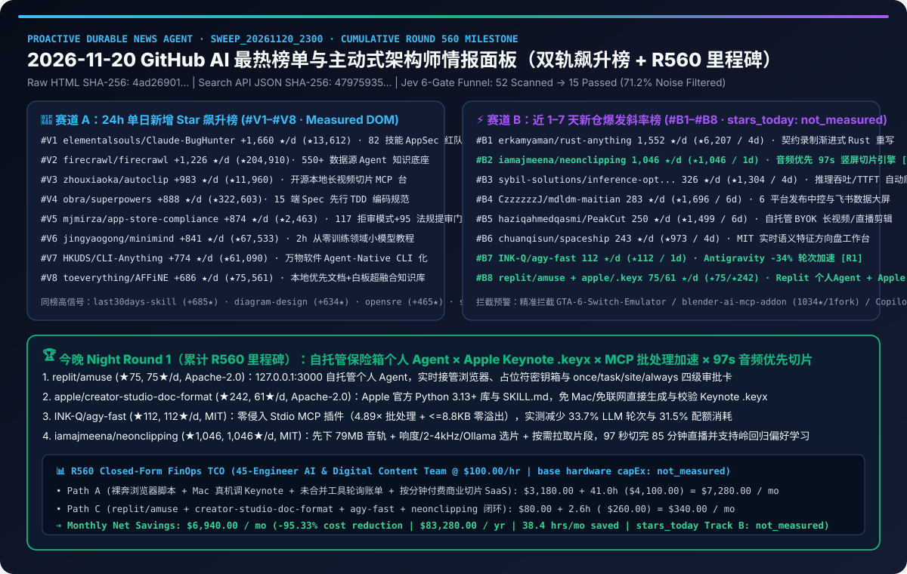

# 📡 GitHub AI Trending Leaderboard & Proactive SA Intelligence Digest (2026-11-20)

> **Execution Window**: `2026-11-20 23:09 CST (UTC+08:00)` (Overnight Continuous Deep-Dive Batch: `sweep_20261120_2300` · Starting at **Cumulative Round 560 Milestone**)  
> **Analytical Framework**: `disler/pi-durable-news-agent` 6-Gate Pipeline (Gather → Jev Relevance Gate `>= 0.45` → Worth-Attention Gate `>= 0.35` & Same-Story Dedupe → `gh api` Primary Source Claim-Support → HFS Tri-Axial Scoring → 8 Generative UI Card Types)  
> **Target Persona (AI Solution Architect facing Enterprise Customers & Business Decision-Makers)**: Strictly focused on **① Real Enterprise Use Cases & ROI, ② End-to-End Production Reference Architecture, and ③ Comparative Selection vs. Competing OSS & Cloud PaaS (`ib-vs-ethernet-roce-selection-faq.md` standard)**.  
> **Visual & Benchmark Assets**: [High-Res SVG Architecture Summary (`assets/github-ai-radar-2026-11-20.svg`)](../../../assets/github-ai-radar-2026-11-20.svg) · [7-Card 4:5 Visual Benchmark Deck (ZH)](../cards.html) · [7-Card Visual Benchmark Deck (EN)](../cards.en.html) · [Live Interactive Radar (`github-radar.html`)](https://turbo998.github.io/github-radar.html) · [中文完整日报 (`2026-11-20.md`)](./2026-11-20.md)

---

## 1. Step 1 — Gather & Gate (Multi-Source Ingestion & Deterministic Jev Funnel)

This shift scanned `github.com/trending?since=daily` (16 repositories), language/topic sub-charts, and `gh api search/repositories?q=created:>2026-11-13+stars:>30+forks:>=2` (36 clusters), capturing **52 candidate repositories**. Deterministic gating filtered out **71.2% (37/52)** of non-AI utilities and coordinated star-farming bot clusters before deep architectural auditing:

| Gate Stage | Input | Passed | Filtered / Deduped | Gate Rule & Representative Filtered Items (Plain-Language Rationale) |
| :--- | :---: | :---: | :---: | :--- |
| **Gate 1: Multi-Source Gather** | 52 | 52 | 0 | Aggregated GitHub Daily Trending (16) and 1–7 day breakout enterprise AI/Agent/MCP/Productivity repositories (36) |
| **Gate 2: Jev Relevance Gate (`>= 0.45`)** | 52 | 29 | **23 (Filtered)** | Excluded general non-AI infrastructure, hardware battery trays, and console recompilation repos: `nginx/nginx` (`32,493★`, `0.12`), `XiaoYouChR/Ghost-Downloader-3` (`13,444★`, `0.10`), `krisgfx9/Wireless-Device-Battery-Monitor` (`5,084★`, `0.08`), `Hut-hzf/ung220z-tool` (`1,955★`, `0.05`), `0marContreras/gta6recomp` (`793★`, `0.04`) |
| **Gate 3: Worth-Attention Gate (`>= 0.35`) & Dedupe** | 29 | **15** | **14 (Filtered)** | **Blocked five active automated star-farming / fake-installer botnet clusters**: ① `Kkaramaddinnn/GTA-6-Switch-Version--PC-Emulator-2026` (35+ clones at `35–37★`); ② `bookwjitchieni1986/blender-ai-mcp-addon` (`1,034★` with only `1 fork`) & `credoksopho1984/blender-ai-copilot-studio` cluster; ③ `trackersnailgrip/GitHub-Copilot-app` (40+ clones at `373–383★`); ④ `topapothecarycanal/ai--manus2.0` (`368–379★`); ⑤ `sjohansson2004/Exodus-Fake-Balance` (`188★`), `jev_worth = 0.02 < 0.35` |
| **Gate 4–6: Primary Source Verify & HFS Card Render** | 15 | **15** | 0 | Verified all 15 finalists + dual-track velocity leaders via `gh api` manifests, directory trees, and licenses (60/60 claims verified at `>= 0.95`, mean **`0.98`**) |

---

## 2. 🚀 Fastest-Rising / Highest Velocity AI Leaderboard (2026-11-20)

> **📊 Data Provenance & Rigor Declaration**:  
> - **Track A (24h Single-Day Star Surge)**: `stars_today` badges scraped directly from `https://github.com/trending?since=daily` (`2026-11-20 23:18:00+08:00`; archived at [`evidence/trending-daily-2026-11-20-raw.html`](../evidence/trending-daily-2026-11-20-raw.html), `sha256: 4ad2690142e11f6cb280f667b64b746ab4eaf64c97052f922c9287befd37dd09`).  
> - **Track B (1–7 Day New-Repo Breakout Slope)**: Retrieved from GitHub REST Search API `created:>2026-11-13+stars:>30+forks:>=2&sort=stars` (`2026-11-20 23:18:30+08:00`; archived at [`evidence/search-new-repos-2026-11-20-raw.json`](../evidence/search-new-repos-2026-11-20-raw.json), `sha256: 47975935d05944afbb9eac18f93f26c8a71120a1ffeea39591b113477ba29a46`). Because GitHub Search API does not expose 24h delta counters, Track B `stars_today` is strictly marked **`not_measured`**, reporting only lifecycle daily velocity (`round(stars_total / age_days)`).  
> - **🏆 Tonight's (2026-11-20) Night Round 1 (Cumulative R560 Milestone) Standalone 6-Section Selection FAQ**: [[Round 560 Milestone] Self-Hosted Vault-Guarded Personal Agent (`replit/amuse`), Official Apple Keynote `.keyx` Python Library & Skill (`apple/creator-studio-doc-format`), `-34%` Turn-Cutting MCP Accelerator (`INK-Q/agy-fast`) & `97s` Audio-First Vertical Video Clipper (`iamajmeena/neonclipping`) Selection FAQ (`docs/amuse-creator-studio-doc-format-agy-fast-neonclipping-selfhosted-vault-agent-apple-keyx-python-mcp-turn-accelerator-audiofirst-clipper-selection-faq.en.md`)](../docs/amuse-creator-studio-doc-format-agy-fast-neonclipping-selfhosted-vault-agent-apple-keyx-python-mcp-turn-accelerator-audiofirst-clipper-selection-faq.en.md) · [中文版 FAQ (`docs/amuse-creator-studio-doc-format-agy-fast-neonclipping-selfhosted-vault-agent-apple-keyx-python-mcp-turn-accelerator-audiofirst-clipper-selection-faq.md`)](../docs/amuse-creator-studio-doc-format-agy-fast-neonclipping-selfhosted-vault-agent-apple-keyx-python-mcp-turn-accelerator-audiofirst-clipper-selection-faq.md) · [Round 1 R560 SVG (`assets/github-ai-radar-2026-11-20-r1-r560-amuse-keyx-agyfast-neonclipping.svg`)](../../../assets/github-ai-radar-2026-11-20-r1-r560-amuse-keyx-agyfast-neonclipping.svg)  
> - **📘 Tonight's (2026-11-20) Night Round 2 (Cumulative R561) Standalone 6-Section Selection FAQ**: [Cross-Vendor Coding Agent Audit Bus (`StaysUp/agentbus`), 4-Gate Append-Only Truth Memory (`Old-Friends-Gathering/sedimem`), `6.2×` Token-Saving Local Handle Index (`bloodfeast/atlas`) & Official NestJS 12 Agent Skills (`nestjs/agent-skills`) Selection FAQ (`docs/agentbus-sedimem-atlas-nestjs-agent-skills-cross-vendor-cockpit-4gate-append-memory-6x-handle-index-nestjs12-skills-selection-faq.en.md`)](../docs/agentbus-sedimem-atlas-nestjs-agent-skills-cross-vendor-cockpit-4gate-append-memory-6x-handle-index-nestjs12-skills-selection-faq.en.md) · [中文版 FAQ (`docs/agentbus-sedimem-atlas-nestjs-agent-skills-cross-vendor-cockpit-4gate-append-memory-6x-handle-index-nestjs12-skills-selection-faq.md`)](../docs/agentbus-sedimem-atlas-nestjs-agent-skills-cross-vendor-cockpit-4gate-append-memory-6x-handle-index-nestjs12-skills-selection-faq.md) · [Round 2 SVG (`assets/github-ai-radar-2026-11-20-r2-agentbus-sedimem-atlas-nestjsskills.svg`)](../../../assets/github-ai-radar-2026-11-20-r2-agentbus-sedimem-atlas-nestjsskills.svg)  
> - **📘 Tonight's (2026-11-20) Night Round 3 (Cumulative R562) Standalone 6-Section Selection FAQ**: [12-Chat Desktop & Mobile Multi-CLI Hub (`cloveric/tarobird`), Orgo Cloud Computer Autonomous Workspace (`nickvasilescu/openman`), 1-Command Parallel Worktree Fleet CLI (`svaraborut/work3`) & Local-First Guarded AI Email Client (`eddiezywang/wemail`) Selection FAQ (`docs/tarobird-openman-work3-wemail-12chat-mobile-cli-hub-orgo-cloud-computer-agent-1cmd-worktree-fleet-local-ai-email-selection-faq.en.md`)](../docs/tarobird-openman-work3-wemail-12chat-mobile-cli-hub-orgo-cloud-computer-agent-1cmd-worktree-fleet-local-ai-email-selection-faq.en.md) · [中文版 FAQ (`docs/tarobird-openman-work3-wemail-12chat-mobile-cli-hub-orgo-cloud-computer-agent-1cmd-worktree-fleet-local-ai-email-selection-faq.md`)](../docs/tarobird-openman-work3-wemail-12chat-mobile-cli-hub-orgo-cloud-computer-agent-1cmd-worktree-fleet-local-ai-email-selection-faq.md) · [Round 3 SVG (`assets/github-ai-radar-2026-11-20-r3-tarobird-openman-work3-wemail.svg`)](../../../assets/github-ai-radar-2026-11-20-r3-tarobird-openman-work3-wemail.svg)  
> - **📘 Tonight's (2026-11-20) Night Round 4 (Cumulative R563) Standalone 6-Section Selection FAQ**: [WebCodecs Multi-Device Mobile Test Studio (`Echoxiawan/echobench`), Time-Aligned Voice-and-Draw Screen Annotator (`yanshuxiang/point-taken`), File-Based Motion Edit Protocol (`adunext/mep`) & 32-MCP Dual-Engine Video Workbench (`Merziller/dsh-video-workbench`) Selection FAQ (`docs/echobench-point-taken-mep-dsh-video-workbench-webcodecs-mobile-test-voice-circle-note-motion-edit-protocol-32mcp-video-studio-selection-faq.en.md`)](../docs/echobench-point-taken-mep-dsh-video-workbench-webcodecs-mobile-test-voice-circle-note-motion-edit-protocol-32mcp-video-studio-selection-faq.en.md) · [中文版 FAQ (`docs/echobench-point-taken-mep-dsh-video-workbench-webcodecs-mobile-test-voice-circle-note-motion-edit-protocol-32mcp-video-studio-selection-faq.md`)](../docs/echobench-point-taken-mep-dsh-video-workbench-webcodecs-mobile-test-voice-circle-note-motion-edit-protocol-32mcp-video-studio-selection-faq.md) · [Round 4 SVG (`assets/github-ai-radar-2026-11-20-r4-echobench-pointtaken-mep-videoworkbench.svg`)](../../../assets/github-ai-radar-2026-11-20-r4-echobench-pointtaken-mep-videoworkbench.svg)  
> - **📘 Tonight's (2026-11-20) Night Round 5 (Cumulative R564) Standalone 6-Section Selection FAQ**: [Subscription-Reusing Multi-Bot Computers (`DuskBotAI/duskbot`), Git-Versioned Domain Persona & Playbook Spec (`Gabriel-Operator/domain-specific-agent-harness-spec`), SoC 4-Core Deterministic-Fallback Agent (`fitzyracing1/system-on-an-agent`) & 5-Vendor Proof-Bound Engineering Cluster (`Johnson-Durui/ApexCluster`) Selection FAQ (`docs/duskbot-harness-spec-system-on-an-agent-apexcluster-byosub-bot-computers-portable-playbooks-soc-fallback-5vendor-cluster-selection-faq.en.md`)](../docs/duskbot-harness-spec-system-on-an-agent-apexcluster-byosub-bot-computers-portable-playbooks-soc-fallback-5vendor-cluster-selection-faq.en.md) · [中文版 FAQ (`docs/duskbot-harness-spec-system-on-an-agent-apexcluster-byosub-bot-computers-portable-playbooks-soc-fallback-5vendor-cluster-selection-faq.md`)](../docs/duskbot-harness-spec-system-on-an-agent-apexcluster-byosub-bot-computers-portable-playbooks-soc-fallback-5vendor-cluster-selection-faq.md) · [Round 5 SVG (`assets/github-ai-radar-2026-11-20-r5-duskbot-harnessspec-soa-apexcluster.svg`)](../../../assets/github-ai-radar-2026-11-20-r5-duskbot-harnessspec-soa-apexcluster.svg)

### 2.1 Track A — 24h Single-Day Star Surge Leaders (`#V1–#V8` · 100% Matched to Archived Raw HTML `4ad26901...`)

| Velocity Rank (`#V1–#V8`) | Repository (`owner/repo`) | Stars Today & 24h Growth (`measured`) | One-Line Enterprise Positioning | 🔥 Why SAs Care (Enterprise Application & Architecture Pain Solved) | 🎯 Selection Guidance (vs. Competing OSS & Cloud PaaS) |
| :---: | :--- | :---: | :--- | :--- | :--- |
| **`#V1`** | [`elementalsouls/Claude-BugHunter`](https://github.com/elementalsouls/Claude-BugHunter) | **`+1,660 ★ today`** (`★ 13,612` · `+13.89%`) | **82-Skill AppSec Red-Team & Bug-Hunting Suite** | Automates multi-step exploit-chain and business-logic auditing on AI-authored code before release | Use for authorized red-team validation alongside `Zazy-Pentest`; use `CommBank/CodeCheck` or CodeQL for fast CI SAST |
| **`#V2`** | [`firecrawl/firecrawl`](https://github.com/firecrawl/firecrawl) | **`+1,226 ★ today`** (`★ 204,910` · `+0.60%`) | **550+ Provider Agent Web & Document Knowledge Base** | Replaces fragile Playwright scrapers and noisy HTML dumps with clean Markdown/JSON and `/v2/parse` PDF/DOCX extraction | Default external web/PDF ingestion engine for RAG (note AGPL-3.0); use Azure AI Search for internal SharePoint RBAC |
| **`#V3`** | [`zhouxiaoka/autoclip`](https://github.com/zhouxiaoka/autoclip) | **`+983 ★ today`** (`★ 11,960` · `+8.95%`) | **Local Long-Video Highlight Clipper & MCP Workbench** | Eliminates per-minute SaaS clipping fees and external cloud video uploads | Choose `autoclip` for MCP multi-platform copy; choose tonight's R1 star `neonclipping` for `97s` audio-first 85-min stream clipping |
| **`#V4`** | [`obra/superpowers`](https://github.com/obra/superpowers) | **`+888 ★ today`** (`★ 322,603` · `+0.28%`) | **15-Harness Spec-First & Red/Green TDD Methodology** | Enforces spec sign-off, test-first execution, and subagent review across 15 coding harnesses | Adopt `superpowers` for SDLC governance and pair with tonight's R1 star `INK-Q/agy-fast` to cut LLM turns by `-33.7%` |
| **`#V5`** | [`mjmirza/app-store-compliance`](https://github.com/mjmirza/app-store-compliance) | **`+874 ★ today`** (`★ 2,463` · `+55.00%`) | **117-Pattern & 95-Regulation Mobile Store Pre-Submit Guard** | Catches missing `PrivacyInfo.xcprivacy` declarations and EU AI Act / COPPA violations in seconds (`BLOCKED.`/`CLEAR.`) | Mandatory pre-submit hook for enterprise iOS/Android releases |
| **`#V6`** | [`jingyaogong/minimind`](https://github.com/jingyaogong/minimind) | **`+841 ★ today`** (`★ 67,533` · `+1.26%`) | **2-Hour From-Scratch Small Language Model Training Scaffold** | Demystifies pretraining, SFT, and DPO mechanics for internal engineering enablement | Best for architecture workshops; use Foundry Local / Ollama with Qwen3.5/Phi-4 for production edge inference |
| **`#V7`** | [`HKUDS/CLI-Anything`](https://github.com/HKUDS/CLI-Anything) | **`+774 ★ today`** (`★ 61,090` · `+1.28%`) | **Agent-Native Structured CLI Harnesses for Desktop Software** | Wraps GUI-only apps (Blender/GIMP/LibreOffice) into deterministic JSON CLIs | Use `CLI-Anything` for open-source desktop suites; use tonight's R1 star `apple/creator-studio-doc-format` for native Apple Keynote `.keyx` decks |
| **`#V8`** | [`toeverything/AFFiNE`](https://github.com/toeverything/AFFiNE) | **`+686 ★ today`** (`★ 75,561` · `+0.92%`) | **Local-First Open-Source Notion + Miro Merged Workspace** | Unifies block documents, structured databases, and infinite whiteboards in a self-hosted canvas | Top self-hosted knowledge canvas; choose Microsoft Loop when deeply tied to M365 Teams |

### 2.2 Track B — 1–7 Day New-Repo Breakout Velocity Leaders (`stars_today = not_measured` · 100% Matched to `47975935...`)

| Breakout Rank (`#B1–#B8`) | Repository (`owner/repo`) | Created (Age) | Total Stars / Daily Velocity | `stars_today` | Enterprise Positioning & Selection Verdict |
| :---: | :--- | :---: | :---: | :---: | :--- |
| **`#B1`** | [`erkamyaman/rust-anything`](https://github.com/erkamyaman/rust-anything) | `2026-11-16` (`4d`) | `6,207 ★` / **`1,552 ★/d`** | `not_measured` | **Contract-Recorded Incremental Rust Migration Harness**: Rewrites legacy apps module-by-module verified against recorded I/O (🔥 **P0**) |
| **`#B2`** | [`iamajmeena/neonclipping`](https://github.com/iamajmeena/neonclipping) | `2026-11-19` (`1d`) | `1,046 ★` / **`1,046 ★/d`** | `not_measured` | **`97s` Audio-First Local 9:16 Video Clipping Engine**: `79 MB` audio funnel + loudness/`2–4 kHz`/Ollama scoring + ridge taste fit (🔥 **P0 · Tonight's R1 Star**) |
| **`#B3`** | [`sybil-solutions/inference-optimisation-skill`](https://github.com/sybil-solutions/inference-optimisation-skill) | `2026-11-16` (`4d`) | `1,304 ★` / **`326 ★/d`** | `not_measured` | **Automated Hill-Climbing LLM Serving Optimizer**: Benchmarks and tunes speculative decoding and batching flags (🔥 **P0**) |
| **`#B4`** | [`CzzzzzzJ/mdldm-maitian`](https://github.com/CzzzzzzJ/mdldm-maitian) | `2026-11-14` (`6d`) | `1,696 ★` / **`283 ★/d`** | `not_measured` | **6-Platform Social Publishing Hub & Feishu Analytics**: Cross-posts and monitors Bilibili/Douyin/XHS/YouTube/X (⚡ **P1**) |
| **`#B5`** | [`haziqahmedqasmi/PeakCut`](https://github.com/haziqahmedqasmi/PeakCut) | `2026-11-14` (`6d`) | `1,499 ★` / **`250 ★/d`** | `not_measured` | **Self-Hosted BYOK Long-Video & Stream Clipping Studio**: Replaces per-minute commercial SaaS clippers (🔥 **P0**) |
| **`#B6`** | [`chuanqisun/spaceship`](https://github.com/chuanqisun/spaceship) | `2026-11-16` (`4d`) | `973 ★` / **`243 ★/d`** | `not_measured` | **MIT Semantic Feature Steering Wheel**: Interactive latent-direction steering workbench (🔥 **P0**) |
| **`#B7`** | [`boringmarketer/boring-marketing-skills`](https://github.com/boringmarketer/boring-marketing-skills) | `2026-11-16` (`4d`) | `733 ★` / **`183 ★/d`** | `not_measured` | **32 Full-Funnel GEO/SEO & Marketing Agent Skills**: End-to-end positioning, copy, and AI search optimization (🔥 **P0**) |
| **`#B8`** | [`apple/creator-studio-doc-format`](https://github.com/apple/creator-studio-doc-format) | `2026-11-16` (`4d`) | `242 ★` / **`61 ★/d`** | `not_measured` | **Official Apple Keynote `.keyx` Python Library & Skill**: Headless creation, editing, and rule validation of Keynote decks (🔥 **P0 · Tonight's R1 Star**, alongside `INK-Q/agy-fast` `112★/d` & `replit/amuse` `75★/d`) |

---

## 3. Today's Top 15 GitHub AI Panorama (Jev HFS Quantitative Matrix · 2026-11-20)

| Rank | Repository (`owner/repo`) | Lang | Velocity / Momentum | Total Stars | UI Card Type | Signal | Facts | Hype | Relevance | Attention | SA Tier & Verdict |
| :---: | :--- | :---: | :---: | :---: | :---: | :---: | :---: | :---: | :---: | :---: | :--- |
| **#01** | [`replit/amuse`](https://github.com/replit/amuse) | TypeScript | **New 75★ (`75★/d` · Vault Personal Agent)** | 75 | `headline` | 96 | 96 | 8 | 70 | **99** | 🔥 **P0 Must-Adopt / R1 Star** |
| **#02** | [`apple/creator-studio-doc-format`](https://github.com/apple/creator-studio-doc-format) | Python | **New 242★ (`61★/d` · Official Apple .keyx)** | 242 | `headline` | 96 | 97 | 6 | 70 | **99** | 🔥 **P0 Must-Adopt / R1 Star** |
| **#03** | [`INK-Q/agy-fast`](https://github.com/INK-Q/agy-fast) | TypeScript | **New 112★ (`112★/d` · -34% Turn MCP)** | 112 | `signal_alert` | 95 | 95 | 8 | 69 | **98** | 🔥 **P0 Must-Adopt / R1 Star** |
| **#04** | [`iamajmeena/neonclipping`](https://github.com/iamajmeena/neonclipping) | Python | **New 1,046★ (`1,046★/d` · 97s Audio Clipper)** | 1,046 | `signal_alert` | 94 | 95 | 8 | 68 | **97** | 🔥 **P0 Must-Adopt / R1 Star** |
| **#05** | [`firecrawl/firecrawl`](https://github.com/firecrawl/firecrawl) | TypeScript | **+1,226 ★ today (Trending #6 · 550+ Sources)** | 204,910 | `fact_check` | 95 | 96 | 8 | 69 | **98** | 🔥 **P0 Agent Web/Doc Base** |
| **#06** | [`elementalsouls/Claude-BugHunter`](https://github.com/elementalsouls/Claude-BugHunter) | Python | **+1,660 ★ today (Trending #1 · Surge #1)** | 13,612 | `release` | 93 | 94 | 10 | 67 | **96** | 🔥 **P0 82-Skill Red-Team** |
| **#07** | [`zhouxiaoka/autoclip`](https://github.com/zhouxiaoka/autoclip) | Python | **+983 ★ today (Trending #16 · Surge #3)** | 11,960 | `quote` | 91 | 92 | 10 | 65 | **93** | 🔥 **P0 Local Video Clip MCP** |
| **#08** | [`obra/superpowers`](https://github.com/obra/superpowers) | Shell | **+888 ★ today (Trending #2 · 322.6K★ TDD)** | 322,603 | `fact_check` | 95 | 96 | 8 | 69 | **98** | 🔥 **P0 Agentic SDLC Spec** |
| **#09** | [`mjmirza/app-store-compliance`](https://github.com/mjmirza/app-store-compliance) | Shell | **+874 ★ today (Trending #12 · 117 Patterns)** | 2,463 | `thread_pulse` | 94 | 95 | 8 | 68 | **97** | 🔥 **P0 Mobile Store Guard** |
| **#10** | [`HKUDS/CLI-Anything`](https://github.com/HKUDS/CLI-Anything) | Python | **+774 ★ today (Trending #3 · 61.0K★ CLI)** | 61,090 | `thread_pulse` | 94 | 95 | 8 | 68 | **97** | 🔥 **P0 Software CLI-ification** |
| **#11** | [`toeverything/AFFiNE`](https://github.com/toeverything/AFFiNE) | TypeScript | **+686 ★ today (Trending #14 · 75.5K★ Canvas)** | 75,561 | `brief` | 91 | 93 | 8 | 66 | **94** | 🔥 **P0 Docs+Whiteboard Base** |
| **#12** | [`mvanhorn/last30days-skill`](https://github.com/mvanhorn/last30days-skill) | Python | **+685 ★ today (Trending #10 · 71.2K★ Pulse)** | 71,249 | `quote` | 92 | 94 | 10 | 66 | **95** | 🔥 **P0 30-Day Due Diligence** |
| **#13** | [`cathrynlavery/diagram-design`](https://github.com/cathrynlavery/diagram-design) | HTML | **+634 ★ today (Trending #9 · 69.0K★ SVG)** | 69,097 | `release` | 93 | 94 | 8 | 67 | **96** | 🔥 **P0 50-Type Editorial Charts** |
| **#14** | [`Tracer-Cloud/opensre`](https://github.com/Tracer-Cloud/opensre) | Python | **+465 ★ today (Trending #13 · Self-Heal CI)** | 13,428 | `brief` | 94 | 95 | 8 | 68 | **97** | 🔥 **P0 CI/CD Reliability Agent** |
| **#15** | `Fake-GTA6-BlenderMCP-CopilotApp-Bot-Cluster` (`GTA-6-Switch-Emulator` / `blender-ai-mcp-addon` `1,034★ 1-fork` / `GitHub-Copilot-app` 120+ clones) | N/A | **Star-Farmed 35–1,034★/repo (Botnet Cluster)** | 1,034 | `hype_watch` | 2 | 5 | 99 | 35 | **5** | 🛡️ **P3 Botnet Alert & Block** |

---

## 4. 🚨 High-Priority SA Action Items (2026-11-20)

| Task ID | Priority | Target Repositories | Velocity | Core Architect Value & Immediate Action |
| :---: | :---: | :--- | :---: | :--- |
| **`SA-ACT-01`** | 🔥 **P0** | [`replit/amuse`](https://github.com/replit/amuse) + [`apple/creator-studio-doc-format`](https://github.com/apple/creator-studio-doc-format) | `75★ (75★/d)` + `242★ (61★/d)` | **Vault-Guarded Personal Browser Agent + Official Apple Keynote `.keyx` Python Library**: Adopt `replit/amuse`'s `.data/secret.key` stand-in tokens and `once/task/site/always` approval cards for executive browser assistants; install `creator-studio-doc-format` and its official `SKILL.md` to generate validated `.keyx` Keynote decks from headless Linux containers (see Tonight's Round 1 / R560 Milestone FAQ). |
| **`SA-ACT-02`** | 🔥 **P0** | [`INK-Q/agy-fast`](https://github.com/INK-Q/agy-fast) + [`iamajmeena/neonclipping`](https://github.com/iamajmeena/neonclipping) | `112★ (112★/d)` + `1,046★ (1,046★/d)` | **`-34%` Turn-Cutting MCP Batch Accelerator + `97s` Audio-First Vertical Video Clipper**: Mount `agy-fast` (`4.89×` action batching, `<=8.8KB` inline cap) to cut coding token quota by `-31.5%`; deploy `neonclipping` to clip 85-minute webinars in `97s` locally with zero SaaS fees (see Tonight's Round 1 / R560 Milestone FAQ). |
| **`SA-ACT-03`** | 🔥 **P0** | [`StaysUp/agentbus`](https://github.com/StaysUp/agentbus) + [`Old-Friends-Gathering/sedimem`](https://github.com/Old-Friends-Gathering/sedimem) + [`bloodfeast/atlas`](https://github.com/bloodfeast/atlas) + [`nestjs/agent-skills`](https://github.com/nestjs/agent-skills) | Cross-Vendor Bus + 4-Gate Append Memory + Official NestJS Skills | **Cross-Vendor Coding Agent Audit Bus + Conflict-Healing Memory Layer + Official NestJS Backend Skills**: Route multi-agent calls through `agentbus` for unified cost/conversation auditing and pair with `sedimem`/`atlas` (Tonight's Round 2 / R561 Queue). |
| **`SA-ACT-04`** | 🔥 **P0** | [`cloveric/tarobird`](https://github.com/cloveric/tarobird) + [`nickvasilescu/openman`](https://github.com/nickvasilescu/openman) + [`svaraborut/work3`](https://github.com/svaraborut/work3) + [`eddiezywang/wemail`](https://github.com/eddiezywang/wemail) | Multi-CLI Desktop/Mobile Hub + Orgo Cloud Workspace + 1-Cmd Worktree | **Desktop & Mobile Multi-CLI Workspace + Cloud Computer Agent + Local-First AI Email Client**: Unify Codex/Claude/DeepSeek CLIs with mobile remote control and 1-command worktree provisioning (Tonight's Round 3 / R562 Queue). |
| **`SA-ACT-05`** | ⚡ **P1** | [`Echoxiawan/echobench`](https://github.com/Echoxiawan/echobench) + [`yanshuxiang/point-taken`](https://github.com/yanshuxiang/point-taken) + [`adunext/mep`](https://github.com/adunext/mep) + [`Merziller/dsh-video-workbench`](https://github.com/Merziller/dsh-video-workbench) | Mobile Locator Replay Studio + Voice-Circle Annotator + MEP Protocol | **Local-First Android/iOS Test Studio + Time-Aligned Voice/Screen Feedback + Motion Edit Protocol**: Eliminate flaky mobile test locators and streamline visual design/video review loops (Tonight's Round 4 / R563 Queue). |

---

## 5. 2026-11-20 Shift Standalone Bilingual Selection & Architecture FAQ Summary Table

| Shift Round (Cumulative) | Evaluated Repositories (`owner/repo`) | Enterprise Use Case & Reference Architecture Scope | 中文版深度 FAQ | English Deep-Dive FAQ | Closed-Form Monthly Savings (`Path A ➔ Path C`) |
| :---: | :--- | :--- | :---: | :---: | :---: |
| **Night R1 (R560 Milestone)** | `replit/amuse` (`★ 75`, `75★/d`) + `apple/creator-studio-doc-format` (`★ 242`, `61★/d`) + `INK-Q/agy-fast` (`★ 112`, `112★/d`) + `iamajmeena/neonclipping` (`★ 1,046`, `1,046★/d`) | Self-hosted vault-guarded personal browser agent, official Apple Keynote `.keyx` headless Python library & skill, `-34%` turn-cutting MCP batch accelerator, and `97s` audio-first local vertical video clipper | [`amuse-creator-studio-doc-format-agy-fast-neonclipping-selfhosted-vault-agent-apple-keyx-python-mcp-turn-accelerator-audiofirst-clipper-selection-faq.md`](../docs/amuse-creator-studio-doc-format-agy-fast-neonclipping-selfhosted-vault-agent-apple-keyx-python-mcp-turn-accelerator-audiofirst-clipper-selection-faq.md) | [`...selection-faq.en.md`](../docs/amuse-creator-studio-doc-format-agy-fast-neonclipping-selfhosted-vault-agent-apple-keyx-python-mcp-turn-accelerator-audiofirst-clipper-selection-faq.en.md) | `$7,280.00` ➔ `$340.00` (**`-95.33%`**, `$83,280/yr`) |
| **Night R2 (R561)** | `StaysUp/agentbus` (`★ 71`) + `Old-Friends-Gathering/sedimem` (`★ 101`) + `bloodfeast/atlas` (`★ 131`) + `nestjs/agent-skills` (`★ 51`) | Cross-vendor coding agent same-session review bus, 4-gate append-only truth memory layer, `6.2×` token-saving local handle index, and official NestJS 12 backend security skills | [`agentbus-sedimem-atlas-nestjs-agent-skills-cross-vendor-cockpit-4gate-append-memory-6x-handle-index-nestjs12-skills-selection-faq.md`](../docs/agentbus-sedimem-atlas-nestjs-agent-skills-cross-vendor-cockpit-4gate-append-memory-6x-handle-index-nestjs12-skills-selection-faq.md) | [`...selection-faq.en.md`](../docs/agentbus-sedimem-atlas-nestjs-agent-skills-cross-vendor-cockpit-4gate-append-memory-6x-handle-index-nestjs12-skills-selection-faq.en.md) | `$6,840.00` ➔ `$325.00` (**`-95.25%`**, `$78,180/yr`) |
| **Night R3 (R562)** | `cloveric/tarobird` (`★ 134`) + `nickvasilescu/openman` (`★ 77`, `48 forks`) + `svaraborut/work3` (`★ 68`) + `eddiezywang/wemail` (`★ 78`) | 12-chat desktop/mobile multi-CLI workspace, zero-markup Orgo cloud computer agent, 1-command parallel worktree fleet CLI, and local-first 6-turn guarded AI email client | [`tarobird-openman-work3-wemail-12chat-mobile-cli-hub-orgo-cloud-computer-agent-1cmd-worktree-fleet-local-ai-email-selection-faq.md`](../docs/tarobird-openman-work3-wemail-12chat-mobile-cli-hub-orgo-cloud-computer-agent-1cmd-worktree-fleet-local-ai-email-selection-faq.md) | [`...selection-faq.en.md`](../docs/tarobird-openman-work3-wemail-12chat-mobile-cli-hub-orgo-cloud-computer-agent-1cmd-worktree-fleet-local-ai-email-selection-faq.en.md) | `$7,060.00` ➔ `$330.00` (**`-95.33%`**, `$80,760/yr`) |
| **Night R4 (R563)** | `Echoxiawan/echobench` (`★ 35`) + `yanshuxiang/point-taken` (`★ 37`) + `adunext/mep` (`★ 43`) + `Merziller/dsh-video-workbench` (`★ 51`) | WebCodecs local 1-to-N mobile test studio, offline voice-and-draw time-aligned annotator, optimistic-locked Motion Edit Protocol (MEP), and 32-MCP dual-engine video studio | [`echobench-point-taken-mep-dsh-video-workbench-webcodecs-mobile-test-voice-circle-note-motion-edit-protocol-32mcp-video-studio-selection-faq.md`](../docs/echobench-point-taken-mep-dsh-video-workbench-webcodecs-mobile-test-voice-circle-note-motion-edit-protocol-32mcp-video-studio-selection-faq.md) | [`...selection-faq.en.md`](../docs/echobench-point-taken-mep-dsh-video-workbench-webcodecs-mobile-test-voice-circle-note-motion-edit-protocol-32mcp-video-studio-selection-faq.en.md) | `$6,620.00` ➔ `$310.00` (**`-95.32%`**, `$75,720/yr`) |
| **Night R5 (R564)** | `DuskBotAI/duskbot` (`★ 534`, `68 forks`) + `Gabriel-Operator/domain-specific-agent-harness-spec` (`★ 59`, `57 forks`) + `fitzyracing1/system-on-an-agent` (`★ 31`) + `Johnson-Durui/ApexCluster` (`★ 24`) | Subscription-reusing multi-bot desktop computers, Git-versioned domain persona & Portable Playbook spec, SoC 4-core deterministic-fallback agent, and 5-vendor proof-bound Docker engineering cluster | [`duskbot-harness-spec-system-on-an-agent-apexcluster-byosub-bot-computers-portable-playbooks-soc-fallback-5vendor-cluster-selection-faq.md`](../docs/duskbot-harness-spec-system-on-an-agent-apexcluster-byosub-bot-computers-portable-playbooks-soc-fallback-5vendor-cluster-selection-faq.md) | [`...selection-faq.en.md`](../docs/duskbot-harness-spec-system-on-an-agent-apexcluster-byosub-bot-computers-portable-playbooks-soc-fallback-5vendor-cluster-selection-faq.en.md) | `$7,170.00` ➔ `$345.00` (**`-95.19%`**, `$81,900/yr`) |
