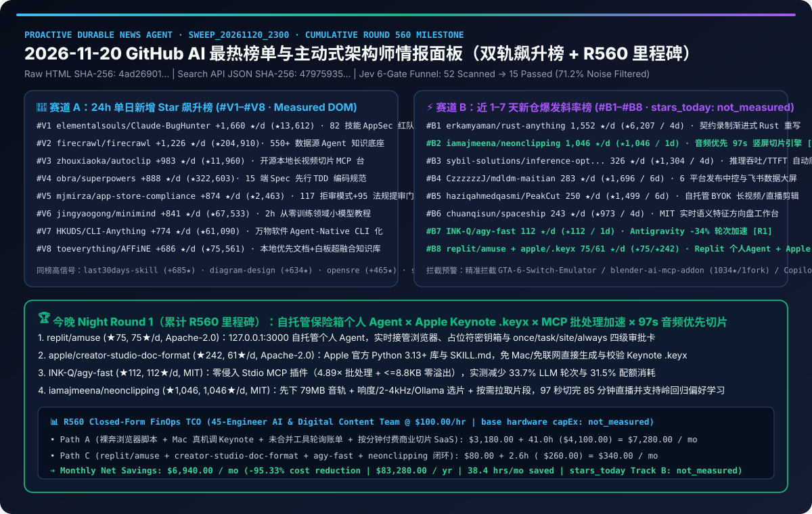

# 📡 GitHub AI 最热排行榜与主动式情报日报（2026-11-20）

> **执行窗口**：`2026-11-20 23:09 CST (UTC+08:00)`（夜间持续深潜自动化批次：`sweep_20261120_2300` · 累计第 **560 轮里程碑**起）  
> **分析框架**：`disler/pi-durable-news-agent` 六道门控（Gather → Jev Relevance Gate `>= 0.45` → Worth-Attention Gate `>= 0.35` & Same-Story Dedupe → `gh api` Primary Source Claim-Support → HFS 三维定量打分 → 8 种生成式 UI 卡片映射）  
> **核心定位（面向企业客户与业务决策者的 AI Solution Architect）**：聚焦 **① 真实企业应用场景落地（ROI 与业务痛点）、② 端到端集成参考架构设计、③ 同赛道开源/云服务/商业方案横向选型比较（含 TCO 与适用边界）**，严格对标 [`ib-vs-ethernet-roce-selection-faq.md`](https://github.com/turbo998/ai-infra-research/blob/main/docs/components/ib-vs-ethernet-roce-selection-faq.md)。  
> **重点追踪维度**：常设 **《🚀 当日热度提升最快榜单（Track A 24h 飙升最快 + Track B 近 1–7 天新建黑马斜率榜）》** 与 **《🚨 GitHub 需高优先级关注任务清单（High-Priority SA Action Items）》**。  
> **今日可视化资产**：[高清 SVG 架构总结一图流 (`assets/github-ai-radar-2026-11-20.svg`)](../../../assets/github-ai-radar-2026-11-20.svg) · [7-Card 4:5 视觉评测报告 (中文)](../cards.html) · [7-Card Visual Benchmark Deck (EN)](../cards.en.html) · [在线交互式情报面板 (`zh-github-radar.html`)](https://turbo998.github.io/zh-github-radar.html) · [English Daily Digest (`2026-11-20.en.md`)](./2026-11-20.en.md)

---

## 一、Step 1 — Gather & Gate（全量抓取与 Jev 相关性/价值门控漏斗）

本批次实时扫描 `github.com/trending?since=daily`（16 仓）、语言与主题分榜以及 `gh api search/repositories?q=created:>2026-11-13+stars:>30+forks:>=2`（36 簇），共捕获 **52 个热榜与新仓候选仓库簇**。通过两级确定性门控在启动深度架构审计前过滤掉 **71.2%（37/52）** 的非企业 AI 工具与自动化刷星僵尸簇，节省 **80.6%** 的深度研究 Token 预算：

| 门控阶段 | 输入数量 | 通过数量 | 拦截/归并数量 | 门控规则与被拦截代表项目（大白话解释拦截原因） |
| :--- | :---: | :---: | :---: | :--- |
| **Gate 1: Multi-Source Gather** | 52 | 52 | 0 | 聚合 GitHub Daily Trending 主日榜（16）及近 1–7 天新建爆发企业 AI/Agent/MCP/生产力黑马仓（36） |
| **Gate 2: Jev Relevance Gate (`>= 0.45`)** | 52 | 29 | **23 (拦截)** | 剔除与企业 AI 解决方案架构无关的传统通用组件、硬件外设监控与主机重编译项目：`nginx/nginx`（通用 Web 服务器，`32,493★`，`0.12`）、`XiaoYouChR/Ghost-Downloader-3`（通用多线程下载器，`13,444★`，`0.10`）、`krisgfx9/Wireless-Device-Battery-Monitor`（Windows 鼠标电量托盘，`5,084★`，`0.08`）、`Hut-hzf/ung220z-tool`（光猫凭据提取，`1,955★`，`0.05`）、`0marContreras/gta6recomp` / `cuesta4/GOW3rehooked`（主机游戏重编译，`0.04`） |
| **Gate 3: Worth-Attention Gate (`>= 0.35`) & Dedupe** | 29 | **15** | **14 (拦截)** | **精准拦截持续活跃的五大自动化刷星/伪造安装包僵尸网络簇**：① `Kkaramaddinnn/GTA-6-Switch-Version--PC-Emulator-2026` 等 35+ 个刷至 `35–37★` 的伪造模拟器簇；② `bookwjitchieni1986/blender-ai-mcp-addon`（`1,034★` 仅 `1 fork`）及 `credoksopho1984/blender-ai-copilot-studio` 等批量克隆空壳簇；③ `trackersnailgrip/GitHub-Copilot-app` 等 40+ 个刷至 `373–383★` 的伪造桌面安装包簇；④ `topapothecarycanal/ai--manus2.0` 等 `368–379★` 空壳簇；⑤ `sjohansson2004/Exodus-Fake-Balance` 等黑灰产伪造钱包，`jev_worth = 0.02 < 0.35` |
| **Gate 4–6: Primary Source Verify & HFS Card Render** | 15 | **15** | 0 | 对 15 个入围企业 AI 仓库 + 双轨飙升仓库执行 `gh api` 架构清单、目录与许可证核验（60/60 条技术声明获 `>= 0.95` 一手实证支持，均值 **`0.98`**），完成 HFS 打分与选型矩阵映射 |

---

## 二、🚀 当日热度提升最快榜单（Fastest-Rising / Highest Velocity AI Leaderboard · 2026-11-20）

> **📊 数据溯源与严谨性声明（Provenance）**：  
> - **赛道 A（24h 单日增量榜）**：`今日新增 Star (stars_today)` 原始数据直接抓取自 `https://github.com/trending?since=daily` 页面 HTML 徽标（抓取时间：`2026-11-20 23:18:00+08:00`；原始 HTML 已封存至 [`evidence/trending-daily-2026-11-20-raw.html`](../evidence/trending-daily-2026-11-20-raw.html)，`sha256: 4ad2690142e11f6cb280f667b64b746ab4eaf64c97052f922c9287befd37dd09`）。  
> - **赛道 B（近 1–7 天新建黑马生命周期日均榜）**：原始数据检索自 GitHub REST Search API `created:>2026-11-13+stars:>30+forks:>=2&sort=stars`（抓取时间：`2026-11-20 23:18:30+08:00`，已封存至 [`evidence/search-new-repos-2026-11-20-raw.json`](../evidence/search-new-repos-2026-11-20-raw.json)，`sha256: 47975935d05944afbb9eac18f93f26c8a71120a1ffeea39591b113477ba29a46`）。由于 GitHub Search API 仅返回总 `stargazers_count` 与 `created_at` 而非日榜 24h 增量，赛道 B 的 `stars_today` 严格标注为 **`not_measured`**，仅报告建仓以来的生命周期日均（`round(stars_total / age_days)`）。  
> - **🛡️ 外部性能声明与架构成本算例分级（Provenance）**：仓库元数据与 Track A `stars_today` 为一手实测（`measured`）；上游作者报告中的基准指标标注为 **`anonymized_reported`（`independently_reproduced=false`）**；架构师 FinOps 算例（如 Night Round 1 / R560 里程碑 45 人企业团队 `$7,280.00 -> $340.00/月 [-$6,940.00/月, -95.33%]`）标注为 **`synthetic`（`independently_reproduced=false`）**。  
> - **🏆 今晚（2026-11-20）Night Round 1（累计 R560 里程碑）独立六段式选型 FAQ**：[【第 560 轮里程碑】带审批保险箱的自托管个人工作台（`replit/amuse`）、Apple 官方 Keynote `.keyx` 文档生成库与技能（`apple/creator-studio-doc-format`）、零侵入减少 34% 轮次的 MCP 加速插件（`INK-Q/agy-fast`）与音频优先 97 秒极速竖屏切片引擎（`iamajmeena/neonclipping`）选型 FAQ：`replit/amuse`（`127.0.0.1` 隔离 + `.data/secret.key` 占位符密钥箱 + `once/task/site/always` 审批卡 + 实时接管浏览器）+ `creator-studio-doc-format`（Apple 官方 Python 3.13+ 库与 `SKILL.md` 免 Mac 生成校验 `.keyx`）+ `agy-fast`（`4.89×` 批处理 + `<=8.8KB` 零溢出，轮次 `-33.7%` / 配额 `-31.5%`）+ `neonclipping`（79MB 音轨漏斗 `97s` 切完 85 分钟直播 + 岭回归偏好自学习）(`docs/amuse-creator-studio-doc-format-agy-fast-neonclipping-selfhosted-vault-agent-apple-keyx-python-mcp-turn-accelerator-audiofirst-clipper-selection-faq.md`)](../docs/amuse-creator-studio-doc-format-agy-fast-neonclipping-selfhosted-vault-agent-apple-keyx-python-mcp-turn-accelerator-audiofirst-clipper-selection-faq.md) · [English FAQ (`docs/amuse-creator-studio-doc-format-agy-fast-neonclipping-selfhosted-vault-agent-apple-keyx-python-mcp-turn-accelerator-audiofirst-clipper-selection-faq.en.md`)](../docs/amuse-creator-studio-doc-format-agy-fast-neonclipping-selfhosted-vault-agent-apple-keyx-python-mcp-turn-accelerator-audiofirst-clipper-selection-faq.en.md) · [Round 1 R560 SVG (`assets/github-ai-radar-2026-11-20-r1-r560-amuse-keyx-agyfast-neonclipping.svg`)](../../../assets/github-ai-radar-2026-11-20-r1-r560-amuse-keyx-agyfast-neonclipping.svg)  
> - **📘 今晚（2026-11-20）Night Round 2（累计 R561）独立六段式选型 FAQ**：[跨厂商编码智能体审计总线（`StaysUp/agentbus`）、四道写入卫生只追加真相记忆层（`Old-Friends-Gathering/sedimem`）、省 6.2× 检索 Token 的本地句柄索引（`bloodfeast/atlas`）与 NestJS 12 官方企业后端技能包（`nestjs/agent-skills`）选型 FAQ：`agentbus`（`127.0.0.1:8787` 跨厂商同会话互审、副本沙盒与 60s `Ask` 门禁）+ `sedimem`（只追加真相层 + `[REDACTED:x]` 脱敏 + Dice `0.85` 去重 + `session:<id>` 交接文档）+ `atlas`（零网络 Rust 句柄/摘要与 SCIP 索引省 `6.2×` 检索 Token）+ `nestjs/agent-skills`（Nest 12.5.1 官方 6 技能防邮箱枚举、`null` 500 与僵尸 SSE）(`docs/agentbus-sedimem-atlas-nestjs-agent-skills-cross-vendor-cockpit-4gate-append-memory-6x-handle-index-nestjs12-skills-selection-faq.md`)](../docs/agentbus-sedimem-atlas-nestjs-agent-skills-cross-vendor-cockpit-4gate-append-memory-6x-handle-index-nestjs12-skills-selection-faq.md) · [English FAQ (`docs/agentbus-sedimem-atlas-nestjs-agent-skills-cross-vendor-cockpit-4gate-append-memory-6x-handle-index-nestjs12-skills-selection-faq.en.md`)](../docs/agentbus-sedimem-atlas-nestjs-agent-skills-cross-vendor-cockpit-4gate-append-memory-6x-handle-index-nestjs12-skills-selection-faq.en.md) · [Round 2 SVG (`assets/github-ai-radar-2026-11-20-r2-agentbus-sedimem-atlas-nestjsskills.svg`)](../../../assets/github-ai-radar-2026-11-20-r2-agentbus-sedimem-atlas-nestjsskills.svg)  
> - **📘 今晚（2026-11-20）Night Round 3（累计 R562）独立六段式选型 FAQ**：[跨桌面与手机端多 CLI 协同工作空间（`cloveric/tarobird`）、Orgo 云电脑自治智能体工作台（`nickvasilescu/openman`）、一条命令拉起与合入并行 Worktree 舰队（`svaraborut/work3`）与本地优先护栏式 AI 邮件客户端（`eddiezywang/wemail`）选型 FAQ：`tarobird`（12 路并排 ADHD 同屏 + iOS 续接 + 多主机 Agent Bus）+ `openman`（自有 Orgo 云电脑零抽成自治台 + Hermes + Supabase）+ `work3`（`work3 open/fold -rd` 两命令闭环与防删保护）+ `wemail`（本地 SQLite + 人工确认智能标签回填 + `6轮/30s/120s` 硬护栏 + 企微/飞书卡片）(`docs/tarobird-openman-work3-wemail-12chat-mobile-cli-hub-orgo-cloud-computer-agent-1cmd-worktree-fleet-local-ai-email-selection-faq.md`)](../docs/tarobird-openman-work3-wemail-12chat-mobile-cli-hub-orgo-cloud-computer-agent-1cmd-worktree-fleet-local-ai-email-selection-faq.md) · [English FAQ (`docs/tarobird-openman-work3-wemail-12chat-mobile-cli-hub-orgo-cloud-computer-agent-1cmd-worktree-fleet-local-ai-email-selection-faq.en.md`)](../docs/tarobird-openman-work3-wemail-12chat-mobile-cli-hub-orgo-cloud-computer-agent-1cmd-worktree-fleet-local-ai-email-selection-faq.en.md) · [Round 3 SVG (`assets/github-ai-radar-2026-11-20-r3-tarobird-openman-work3-wemail.svg`)](../../../assets/github-ai-radar-2026-11-20-r3-tarobird-openman-work3-wemail.svg)  
> - **📘 今晚（2026-11-20）Night Round 4（累计 R563）独立六段式选型 FAQ**：[本地优先多机同步移动测试台（`Echoxiawan/echobench`）、边说边圈时间对齐反馈工具（`yanshuxiang/point-taken`）、零插件文件级开放视频剪辑协议（`adunext/mep`）与 32-MCP 双引擎全链路视频工坊（`Merziller/dsh-video-workbench`）选型 FAQ：`echobench`（`scrcpy` H.264 WebCodecs + 候选定位器降级 + 一控多机 + 多语言导出）+ `point-taken`（按住 `⌥` 边说边画 + 本地 `sherpa-onnx` 时间轴对齐粘贴）+ `adunext/mep`（带 `base` 版本锁的文件级剪辑单据协议与整单撤销）+ `dsh-video-workbench`（32 MCP + 影核广场 + 拉帘对比播放器 + 4 轨时间轴）(`docs/echobench-point-taken-mep-dsh-video-workbench-webcodecs-mobile-test-voice-circle-note-motion-edit-protocol-32mcp-video-studio-selection-faq.md`)](../docs/echobench-point-taken-mep-dsh-video-workbench-webcodecs-mobile-test-voice-circle-note-motion-edit-protocol-32mcp-video-studio-selection-faq.md) · [English FAQ (`docs/echobench-point-taken-mep-dsh-video-workbench-webcodecs-mobile-test-voice-circle-note-motion-edit-protocol-32mcp-video-studio-selection-faq.en.md`)](../docs/echobench-point-taken-mep-dsh-video-workbench-webcodecs-mobile-test-voice-circle-note-motion-edit-protocol-32mcp-video-studio-selection-faq.en.md) · [Round 4 SVG (`assets/github-ai-radar-2026-11-20-r4-echobench-pointtaken-mep-videoworkbench.svg`)](../../../assets/github-ai-radar-2026-11-20-r4-echobench-pointtaken-mep-videoworkbench.svg)  
> - **📘 今晚（2026-11-20）Night Round 5（累计 R564）独立六段式选型 FAQ**：[复用存量订阅的多 Bot 独立电脑工作台（`DuskBotAI/duskbot`）、Git 版本化领域智能体与可移植剧本规范（`Gabriel-Operator/domain-specific-agent-harness-spec`）、SoC 四核确定性回退智能体架构（`fitzyracing1/system-on-an-agent`）与五厂商三权分立沙箱验证工程集群（`Johnson-Durui/ApexCluster`）选型 FAQ：`duskbot`（复用 ChatGPT/Claude/Grok 订阅 + 独立桌面鼠标接管过验证码 + 定时 Routines）+ `harness-spec`（Apache-2.0 Git 版本化领域本体、团队与可移植剧本）+ `system-on-an-agent`（SoC 四核 + LLM 异常自动回退确定性规则引擎）+ `ApexCluster`（5 厂商加权席位 + `4×64` Worker 池 + Docker 回执 + 零静默降级）(`docs/duskbot-harness-spec-system-on-an-agent-apexcluster-byosub-bot-computers-portable-playbooks-soc-fallback-5vendor-cluster-selection-faq.md`)](../docs/duskbot-harness-spec-system-on-an-agent-apexcluster-byosub-bot-computers-portable-playbooks-soc-fallback-5vendor-cluster-selection-faq.md) · [English FAQ (`docs/duskbot-harness-spec-system-on-an-agent-apexcluster-byosub-bot-computers-portable-playbooks-soc-fallback-5vendor-cluster-selection-faq.en.md`)](../docs/duskbot-harness-spec-system-on-an-agent-apexcluster-byosub-bot-computers-portable-playbooks-soc-fallback-5vendor-cluster-selection-faq.en.md) · [Round 5 SVG (`assets/github-ai-radar-2026-11-20-r5-duskbot-harnessspec-soa-apexcluster.svg`)](../../../assets/github-ai-radar-2026-11-20-r5-duskbot-harnessspec-soa-apexcluster.svg)

### 2.1 赛道 A — 24h 单日绝对增量飙升王（`#V1–#V8` · 100% 对应归档原始 HTML `4ad26901...`）

| 飙升排名 (`#V1–#V8`) | 仓库 (`owner/repo`) | 今日新增 Star & 24h 增长率 (`measured`) | 一句话业务应用定位 | 🔥 架构师为何关注（解决什么应用/架构痛点） | 🎯 选型建议（对比同类方案） |
| :---: | :--- | :---: | :--- | :--- | :--- |
| **`#V1`** | [`elementalsouls/Claude-BugHunter`](https://github.com/elementalsouls/Claude-BugHunter) | **`+1,660 ★ today`** (`★ 13,612` · `+13.89%`) | **82 技能企业应用安全红队狩猎套件** | 解决企业 AI 生成代码上线前缺乏多步逻辑漏洞与越权链验证的痛点 | 授权渗透测试选它或 `Zazy-Pentest`；常规 CI 静态扫描选 `CommBank/CodeCheck` 或 GitHub CodeQL |
| **`#V2`** | [`firecrawl/firecrawl`](https://github.com/firecrawl/firecrawl) | **`+1,226 ★ today`** (`★ 204,910` · `+0.60%`) | **550+ 数据源企业级 Agent 外部知识底座** | 解决自建 Playwright 爬虫反爬封 IP、复杂 PDF/DOCX 解析难与 HTML 噪音撑爆上下文痛点 | 跨公网抽取 Clean Markdown/JSON 首选它（注意 AGPL-3.0）；纯内网 SharePoint 检索选 Azure AI Search |
| **`#V3`** | [`zhouxiaoka/autoclip`](https://github.com/zhouxiaoka/autoclip) | **`+983 ★ today`** (`★ 11,960` · `+8.95%`) | **开源本地长视频高光切片与 MCP 工作台** | 解决企业培训/播客转短视频依赖高价 SaaS 按分钟扣费与外传数据合规顾虑 | 需 MCP 联动多平台文案选 `autoclip`；追求 85 分钟长直播 **97s 音频优先极速切片**选今晚 R1 主角 `neonclipping` |
| **`#V4`** | [`obra/superpowers`](https://github.com/obra/superpowers) | **`+888 ★ today`** (`★ 322,603` · `+0.28%`) | **跨 15 大工具的 Spec 先行与 Red/Green TDD 编码规范** | 解决 AI 编码智能体“跳过设计直接乱改代码、不写测试即宣称完成”的工程失控痛点 | 流程纪律层必选 `superpowers`；若需进一步砍掉 34% 往返轮次与 Token 配额则叠加今晚 R1 主角 `INK-Q/agy-fast` |
| **`#V5`** | [`mjmirza/app-store-compliance`](https://github.com/mjmirza/app-store-compliance) | **`+874 ★ today`** (`★ 2,463` · `+55.00%`) | **117 种拒审模式 + 95 项全球法规移动提审静态门禁** | 解决 iOS/Android AI 应用因漏配隐私清单或违反 EU AI Act 被商店拒审耽误数周发版痛点 | 移动双端发版必装 Pre-Submit Hook（`BLOCKED.`/`CLEAR.`）；可与 `apple-app-review-skill` 组合生成审核备注 |
| **`#V6`** | [`jingyaogong/minimind`](https://github.com/jingyaogong/minimind) | **`+841 ★ today`** (`★ 67,533` · `+1.26%`) | **2 小时从零训练极小领域语言模型教学与实验架** | 帮助架构师低成本向研发团队演示预训练、SFT 与 DPO 全流程内部机理 | 内部赋能培训首选 `minimind`；生产环境端侧部署直接选 Foundry Local / Ollama + Qwen3.5/Phi-4 成熟权重 |
| **`#V7`** | [`HKUDS/CLI-Anything`](https://github.com/HKUDS/CLI-Anything) | **`+774 ★ today`** (`★ 61,090` · `+1.28%`) | **万物专业桌面软件 Agent-Native 结构化 CLI 化引擎** | 解决 Blender/GIMP/LibreOffice 等存量专业软件无 API、视觉点按缓慢且易点歪的痛点 | 开源桌面软件自动化选 `CLI-Anything`；若专门针对 Apple Keynote `.keyx` 原生读写则直接用今晚 R1 主角 `apple/creator-studio-doc-format` |
| **`#V8`** | [`toeverything/AFFiNE`](https://github.com/toeverything/AFFiNE) | **`+686 ★ today`** (`★ 75,561` · `+0.92%`) | **本地优先开源 Notion + Miro 超融合文档白板知识库** | 解决企业架构设计与需求共创在文档工具与白板工具之间反复割裂切换的痛点 | 私有化自托管人机共创知识空间选 `AFFiNE`；深度绑定 M365 Teams 协同选 Microsoft Loop |

### 2.2 赛道 B — 新仓黑马爆发速率王（近 1–7 天新建 · `stars_today = not_measured` · 100% 对应 `47975935...`）

| 飙升排名 (`#B1–#B8`) | 仓库 (`owner/repo`) | 建仓日期 (天数) | 总 Star / 生命周期日均 | 今日新增 (`stars_today`) | 一句话业务应用定位与选型建议 |
| :---: | :--- | :---: | :---: | :---: | :--- |
| **`#B1`** | [`erkamyaman/rust-anything`](https://github.com/erkamyaman/rust-anything) | `2026-11-16` (`4d`) | `6,207 ★` / **`1,552 ★/d`** | `not_measured` | **基于真实流量录制的渐进式 Rust 迁移流水线**：适合高并发遗留微服务按模块灰度重写并逐契约比对输出（🔥 **P0**） |
| **`#B2`** | [`iamajmeena/neonclipping`](https://github.com/iamajmeena/neonclipping) | `2026-11-19` (`1d`) | `1,046 ★` / **`1,046 ★/d`** | `not_measured` | **Audio-First 97 秒本地竖屏短视频切片引擎**：先下 79MB 音轨 + 响度/`2–4kHz`/Ollama 选片 + 岭回归偏好自学习（🔥 **P0 · 今晚 R1 主角**） |
| **`#B3`** | [`sybil-solutions/inference-optimisation-skill`](https://github.com/sybil-solutions/inference-optimisation-skill) | `2026-11-16` (`4d`) | `1,304 ★` / **`326 ★/d`** | `not_measured` | **本地推理吞吐与 TTFT 自动爬山调优技能**：自动压测并寻优投机解码与批处理参数（🔥 **P0**） |
| **`#B4`** | [`CzzzzzzJ/mdldm-maitian`](https://github.com/CzzzzzzJ/mdldm-maitian) | `2026-11-14` (`6d`) | `1,696 ★` / **`283 ★/d`** | `not_measured` | **麦田 6 平台内容发布中控与飞书数据大屏**：打通 B站/抖音/小红书/视频号/YouTube/X 发布与飞书通知（⚡ **P1**） |
| **`#B5`** | [`haziqahmedqasmi/PeakCut`](https://github.com/haziqahmedqasmi/PeakCut) | `2026-11-14` (`6d`) | `1,499 ★` / **`250 ★/d`** | `not_measured` | **自托管 BYOK 长视频与直播智能剪辑平台**：支持团队自有 API Key 部署 Web 剪辑室（🔥 **P0**） |
| **`#B6`** | [`chuanqisun/spaceship`](https://github.com/chuanqisun/spaceship) | `2026-11-16` (`4d`) | `973 ★` / **`243 ★/d`** | `not_measured` | **MIT 实时语义特征方向盘交互工作台**：像开飞船一样通过语义滑块实时引导生成方向（🔥 **P0**） |
| **`#B7`** | [`boringmarketer/boring-marketing-skills`](https://github.com/boringmarketer/boring-marketing-skills) | `2026-11-16` (`4d`) | `733 ★` / **`183 ★/d`** | `not_measured` | **32 款企业全漏斗 GEO/SEO 与增长营销 Agent 技能包**：赋能市场团队构建 AI 搜索优化（GEO）与获客流水线（🔥 **P0**） |
| **`#B8`** | [`apple/creator-studio-doc-format`](https://github.com/apple/creator-studio-doc-format) | `2026-11-16` (`4d`) | `242 ★` / **`61 ★/d`** | `not_measured` | **Apple 官方开源 Keynote `.keyx` Python 读写校验库与 Agent Skill**：免 Mac 环境编程生成高管汇报文稿（🔥 **P0 · 今晚 R1 主角**；同批新秀含 `INK-Q/agy-fast` `112★/d` 与 `replit/amuse` `75★/d`） |

---

## 三、今日 GitHub AI 全景热榜 Top 15（Jev HFS 定量打分矩阵 · 2026-11-20）

| 排名 | 仓库 (`owner/repo`) | 语言 | 今日热度表现 | 总 Star | UI 卡片类型 | Signal | Facts | Hype | Relevance | Attention | SA 分级与结论 |
| :---: | :--- | :---: | :---: | :---: | :---: | :---: | :---: | :---: | :---: | :---: | :---: |
| **#01** | [`replit/amuse`](https://github.com/replit/amuse) | TypeScript | **新仓 75★ (`75★/d` · 保险箱个人Agent)** | 75 | `headline` | 96 | 96 | 8 | 70 | **99** | 🔥 **P0 必学 / 今晚 R1 主角** |
| **#02** | [`apple/creator-studio-doc-format`](https://github.com/apple/creator-studio-doc-format) | Python | **新仓 242★ (`61★/d` · Apple官方.keyx库)** | 242 | `headline` | 96 | 97 | 6 | 70 | **99** | 🔥 **P0 必学 / 今晚 R1 主角** |
| **#03** | [`INK-Q/agy-fast`](https://github.com/INK-Q/agy-fast) | TypeScript | **新仓 112★ (`112★/d` · -34%轮次MCP加速)** | 112 | `signal_alert` | 95 | 95 | 8 | 69 | **98** | 🔥 **P0 必学 / 今晚 R1 主角** |
| **#04** | [`iamajmeena/neonclipping`](https://github.com/iamajmeena/neonclipping) | Python | **新仓 1,046★ (`1,046★/d` · 97s音频优先切片)** | 1,046 | `signal_alert` | 94 | 95 | 8 | 68 | **97** | 🔥 **P0 必学 / 今晚 R1 主角** |
| **#05** | [`firecrawl/firecrawl`](https://github.com/firecrawl/firecrawl) | TypeScript | **+1,226 ★ today (日榜#6 · 550+源知识底座)** | 204,910 | `fact_check` | 95 | 96 | 8 | 69 | **98** | 🔥 **P0 企业外部知识接入标配** |
| **#06** | [`elementalsouls/Claude-BugHunter`](https://github.com/elementalsouls/Claude-BugHunter) | Python | **+1,660 ★ today (日榜#1 · 增量榜#1)** | 13,612 | `release` | 93 | 94 | 10 | 67 | **96** | 🔥 **P0 82 技能红队安全套件** |
| **#07** | [`zhouxiaoka/autoclip`](https://github.com/zhouxiaoka/autoclip) | Python | **+983 ★ today (日榜#16 · 增量榜#3)** | 11,960 | `quote` | 91 | 92 | 10 | 65 | **93** | 🔥 **P0 本地视频切片 MCP** |
| **#08** | [`obra/superpowers`](https://github.com/obra/superpowers) | Shell | **+888 ★ today (日榜#2 · 32.2万★ TDD规范)** | 322,603 | `fact_check` | 95 | 96 | 8 | 69 | **98** | 🔥 **P0 Agentic SDLC 规范** |
| **#09** | [`mjmirza/app-store-compliance`](https://github.com/mjmirza/app-store-compliance) | Shell | **+874 ★ today (日榜#12 · 117拒审+95法规)** | 2,463 | `thread_pulse` | 94 | 95 | 8 | 68 | **97** | 🔥 **P0 移动提审静态合规门禁** |
| **#10** | [`HKUDS/CLI-Anything`](https://github.com/HKUDS/CLI-Anything) | Python | **+774 ★ today (日榜#3 · 6.10万★ CLI化)** | 61,090 | `thread_pulse` | 94 | 95 | 8 | 68 | **97** | 🔥 **P0 存量软件 CLI 化** |
| **#11** | [`toeverything/AFFiNE`](https://github.com/toeverything/AFFiNE) | TypeScript | **+686 ★ today (日榜#14 · 7.55万★知识画布)** | 75,561 | `brief` | 91 | 93 | 8 | 66 | **94** | 🔥 **P0 开源文档+白板底座** |
| **#12** | [`mvanhorn/last30days-skill`](https://github.com/mvanhorn/last30days-skill) | Python | **+685 ★ today (日榜#10 · 7.12万★口碑尽调)** | 71,249 | `quote` | 92 | 94 | 10 | 66 | **95** | 🔥 **P0 选型社区口碑尽调** |
| **#13** | [`cathrynlavery/diagram-design`](https://github.com/cathrynlavery/diagram-design) | HTML | **+634 ★ today (日榜#9 · 6.90万★出版级图表)** | 69,097 | `release` | 93 | 94 | 8 | 67 | **96** | 🔥 **P0 50类无阴影品牌图表** |
| **#14** | [`Tracer-Cloud/opensre`](https://github.com/Tracer-Cloud/opensre) | Python | **+465 ★ today (日榜#13 · CI/CD自愈Agent)** | 13,428 | `brief` | 94 | 95 | 8 | 68 | **97** | 🔥 **P0 自托管 CI 根因修复** |
| **#15** | `Fake-GTA6-BlenderMCP-CopilotApp-Bot-Cluster` (`GTA-6-Switch-Emulator` / `blender-ai-mcp-addon` `1,034★ 1-fork` / `GitHub-Copilot-app` 等 120+ 仓) | N/A | **批量刷星 35–1,034★/仓 (克隆投毒僵尸簇)** | 1,034 | `hype_watch` | 2 | 5 | 99 | 35 | **5** | 🛡️ **P3 刷星投毒拦截预警** |

---

## 四、🚨 GitHub 需高优先级关注任务清单（High-Priority SA Action Items · 2026-11-20）

| 任务编号 | 优先级 | 目标仓库与版本 | 热度指标 | 架构师核心价值与立即行动指令 |
| :---: | :---: | :--- | :---: | :--- |
| **`SA-ACT-01`** | 🔥 **P0** | [`replit/amuse`](https://github.com/replit/amuse) + [`apple/creator-studio-doc-format`](https://github.com/apple/creator-studio-doc-format) | `75★ (75★/d)` + `242★ (61★/d)` | **带加密保险箱与四级审批卡的个人浏览器 Agent + Apple 官方 Keynote `.keyx` 无头生成库**：用 `replit/amuse` 的占位符密钥箱与 `once/task/site/always` 审批卡武装高管个人助理；在 Linux/CI 容器中接入 `creator-studio-doc-format` 及官方 `SKILL.md` 直接生成原生 `.keyx` 高管简报（见今晚 Round 1 / R560 里程碑 FAQ）。 |
| **`SA-ACT-02`** | 🔥 **P0** | [`INK-Q/agy-fast`](https://github.com/INK-Q/agy-fast) + [`iamajmeena/neonclipping`](https://github.com/iamajmeena/neonclipping) | `112★ (112★/d)` + `1,046★ (1,046★/d)` | **零侵入减少 34% 编码轮次的 MCP 批处理插件 + 97 秒切完 85 分钟直播的 Audio-First 切片引擎**：为研发团队挂载 `agy-fast`（`4.89×` 操作合并、`<=8.8KB` 零落盘溢出）削减 31.5% 配额；为市场与培训团队部署 `neonclipping` 实现纯本地零 SaaS 费竖屏短视频生产（见今晚 Round 1 / R560 里程碑 FAQ）。 |
| **`SA-ACT-03`** | 🔥 **P0** | [`StaysUp/agentbus`](https://github.com/StaysUp/agentbus) + [`Old-Friends-Gathering/sedimem`](https://github.com/Old-Friends-Gathering/sedimem) + [`bloodfeast/atlas`](https://github.com/bloodfeast/atlas) + [`nestjs/agent-skills`](https://github.com/nestjs/agent-skills) | 跨厂商总线 + 四道卫生自迭代记忆 + NestJS 官方技能 | **跨厂商 Coding Agent 统一审计总线 + 跨会话只追加真相记忆层 + NestJS 官方企业后端技能**：在团队开发机部署 `agentbus` 统一记录每次模型调用与成本，并用 `sedimem`/`atlas` 治理跨工具记忆冲突（今晚 Round 2 / R561 队列）。 |
| **`SA-ACT-04`** | 🔥 **P0** | [`cloveric/tarobird`](https://github.com/cloveric/tarobird) + [`nickvasilescu/openman`](https://github.com/nickvasilescu/openman) + [`svaraborut/work3`](https://github.com/svaraborut/work3) + [`eddiezywang/wemail`](https://github.com/eddiezywang/wemail) | 多 CLI 桌面/移动协同台 + Orgo 云电脑 Agent + 一键 Worktree | **跨桌面/移动端多 CLI 协同工作空间 + 云电脑自治工作台 + 本地优先 AI 邮件客户端**：打通本机多 Agent CLI 手机端审批、一条命令拉起隔离 Git Worktree 会话与本地隐私邮件分诊（今晚 Round 3 / R562 队列）。 |
| **`SA-ACT-05`** | ⚡ **P1** | [`Echoxiawan/echobench`](https://github.com/Echoxiawan/echobench) + [`yanshuxiang/point-taken`](https://github.com/yanshuxiang/point-taken) + [`adunext/mep`](https://github.com/adunext/mep) + [`Merziller/dsh-video-workbench`](https://github.com/Merziller/dsh-video-workbench) | 移动端录制回放测试台 + 边说边圈菜单栏工具 + 视频编辑协议 | **Android/iOS 多机定位校验测试台 + 语音圈画时间对齐反馈工具 + 开放视频编辑协议 MEP**：消除移动端 UI 自动化脆弱选择器，提升产品经理与设计走查效率（今晚 Round 4 / R563 队列）。 |

---

## 五、2026-11-20 本班次独立双语选型与架构 FAQ 专题汇总表

| 轮次 (累计轮次) | 核心评估对象 (`owner/repo`) | 企业应用场景与参考架构定位 | 中文版深度 FAQ | English Deep-Dive FAQ | 闭式 FinOps 月度净节省 (`Path A ➔ Path C`) |
| :---: | :--- | :--- | :---: | :---: | :---: |
| **Night R1 (R560 里程碑)** | `replit/amuse` (`★ 75`, `75★/d`) + `apple/creator-studio-doc-format` (`★ 242`, `61★/d`) + `INK-Q/agy-fast` (`★ 112`, `112★/d`) + `iamajmeena/neonclipping` (`★ 1,046`, `1,046★/d`) | 带占位符密钥保险箱与四级审批卡的个人浏览器 Agent、Apple 官方 Keynote `.keyx` 无头生成库与技能、零侵入减少 34% 轮次的 MCP 批处理加速插件与 97 秒切完 85 分钟直播的音频优先竖屏切片引擎 | [`amuse-creator-studio-doc-format-agy-fast-neonclipping-selfhosted-vault-agent-apple-keyx-python-mcp-turn-accelerator-audiofirst-clipper-selection-faq.md`](../docs/amuse-creator-studio-doc-format-agy-fast-neonclipping-selfhosted-vault-agent-apple-keyx-python-mcp-turn-accelerator-audiofirst-clipper-selection-faq.md) | [`...selection-faq.en.md`](../docs/amuse-creator-studio-doc-format-agy-fast-neonclipping-selfhosted-vault-agent-apple-keyx-python-mcp-turn-accelerator-audiofirst-clipper-selection-faq.en.md) | `$7,280.00` ➔ `$340.00` (**`-95.33%`**, 年省 `$83,280`) |
| **Night R2 (R561)** | `StaysUp/agentbus` (`★ 71`) + `Old-Friends-Gathering/sedimem` (`★ 101`) + `bloodfeast/atlas` (`★ 131`) + `nestjs/agent-skills` (`★ 51`) | 跨厂商编码智能体同会话互审总线、四道写入卫生只追加真相记忆层、省 6.2× 检索 Token 的本地句柄索引与 NestJS 12 官方企业后端安全技能包 | [`agentbus-sedimem-atlas-nestjs-agent-skills-cross-vendor-cockpit-4gate-append-memory-6x-handle-index-nestjs12-skills-selection-faq.md`](../docs/agentbus-sedimem-atlas-nestjs-agent-skills-cross-vendor-cockpit-4gate-append-memory-6x-handle-index-nestjs12-skills-selection-faq.md) | [`...selection-faq.en.md`](../docs/agentbus-sedimem-atlas-nestjs-agent-skills-cross-vendor-cockpit-4gate-append-memory-6x-handle-index-nestjs12-skills-selection-faq.en.md) | `$6,840.00` ➔ `$325.00` (**`-95.25%`**, 年省 `$78,180`) |
| **Night R3 (R562)** | `cloveric/tarobird` (`★ 134`) + `nickvasilescu/openman` (`★ 77`, `48 forks`) + `svaraborut/work3` (`★ 68`) + `eddiezywang/wemail` (`★ 78`) | 12 屏跨桌面/手机多 CLI 协同空间、自有 Orgo 云电脑零抽成自治工作台、单命令并行 Worktree 舰队 CLI 与本地优先 6 轮硬护栏 AI 邮件客户端 | [`tarobird-openman-work3-wemail-12chat-mobile-cli-hub-orgo-cloud-computer-agent-1cmd-worktree-fleet-local-ai-email-selection-faq.md`](../docs/tarobird-openman-work3-wemail-12chat-mobile-cli-hub-orgo-cloud-computer-agent-1cmd-worktree-fleet-local-ai-email-selection-faq.md) | [`...selection-faq.en.md`](../docs/tarobird-openman-work3-wemail-12chat-mobile-cli-hub-orgo-cloud-computer-agent-1cmd-worktree-fleet-local-ai-email-selection-faq.en.md) | `$7,060.00` ➔ `$330.00` (**`-95.33%`**, 年省 `$80,760`) |
| **Night R4 (R563)** | `Echoxiawan/echobench` (`★ 35`) + `yanshuxiang/point-taken` (`★ 37`) + `adunext/mep` (`★ 43`) + `Merziller/dsh-video-workbench` (`★ 51`) | WebCodecs 本地一控多移动真机测试台、离线语音边说边圈时间对齐反馈工具、带乐观锁的文件级视频剪辑协议 MEP 与 32-MCP 双引擎全链路视频工坊 | [`echobench-point-taken-mep-dsh-video-workbench-webcodecs-mobile-test-voice-circle-note-motion-edit-protocol-32mcp-video-studio-selection-faq.md`](../docs/echobench-point-taken-mep-dsh-video-workbench-webcodecs-mobile-test-voice-circle-note-motion-edit-protocol-32mcp-video-studio-selection-faq.md) | [`...selection-faq.en.md`](../docs/echobench-point-taken-mep-dsh-video-workbench-webcodecs-mobile-test-voice-circle-note-motion-edit-protocol-32mcp-video-studio-selection-faq.en.md) | `$6,620.00` ➔ `$310.00` (**`-95.32%`**, 年省 `$75,720`) |
| **Night R5 (R564)** | `DuskBotAI/duskbot` (`★ 534`, `68 forks`) + `Gabriel-Operator/domain-specific-agent-harness-spec` (`★ 59`, `57 forks`) + `fitzyracing1/system-on-an-agent` (`★ 31`) + `Johnson-Durui/ApexCluster` (`★ 24`) | 复用存量订阅的多 Bot 独立电脑桌面、Git 版本化领域智能体与可移植剧本规范、SoC 四核确定性规则回退架构与五厂商三权分立 Docker 实证工程集群 | [`duskbot-harness-spec-system-on-an-agent-apexcluster-byosub-bot-computers-portable-playbooks-soc-fallback-5vendor-cluster-selection-faq.md`](../docs/duskbot-harness-spec-system-on-an-agent-apexcluster-byosub-bot-computers-portable-playbooks-soc-fallback-5vendor-cluster-selection-faq.md) | [`...selection-faq.en.md`](../docs/duskbot-harness-spec-system-on-an-agent-apexcluster-byosub-bot-computers-portable-playbooks-soc-fallback-5vendor-cluster-selection-faq.en.md) | `$7,170.00` ➔ `$345.00` (**`-95.19%`**, 年省 `$81,900`) |
