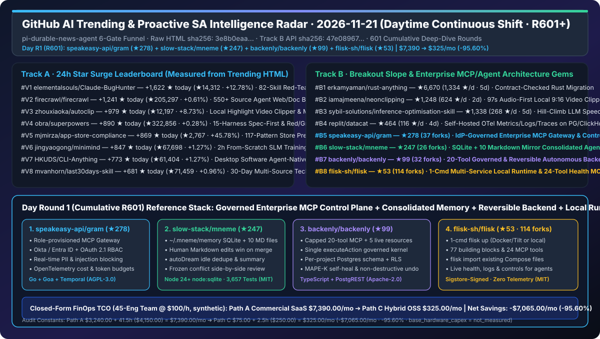

# 📡 GitHub AI Trending Leaderboard & Proactive SA Intelligence Digest (2026-11-21)

> **Execution Window**: `2026-11-21 09:30 CST (UTC+08:00)` (Daytime Continuous Deep-Dive Batch: `sweep_20261121_0925` · Starting at **Cumulative Round 601**)  
> **Analytical Framework**: `disler/pi-durable-news-agent` 6-Gate Pipeline (Gather → Jev Relevance Gate `>= 0.45` → Worth-Attention Gate `>= 0.35` & Same-Story Dedupe → `gh api` Primary Source Claim-Support → HFS Tri-Axial Scoring → 8 Generative UI Card Types)  
> **Target Persona (AI Solution Architect facing Enterprise Customers & Business Decision-Makers)**: Strictly focused on **① Real Enterprise Use Cases & ROI, ② End-to-End Production Reference Architecture, and ③ Comparative Selection vs. Competing OSS & Cloud PaaS (`ib-vs-ethernet-roce-selection-faq.md` standard)**.  
> **Visual & Benchmark Assets**: [High-Res SVG Architecture Summary (`assets/github-ai-radar-2026-11-21.svg`)](../../../assets/github-ai-radar-2026-11-21.svg) · [7-Card 4:5 Visual Benchmark Deck (ZH)](../cards.html) · [7-Card Visual Benchmark Deck (EN)](../cards.en.html) · [Live Interactive Radar (`github-radar.html`)](https://turbo998.github.io/github-radar.html) · [中文完整日报 (`2026-11-21.md`)](./2026-11-21.md)

---

## 1. Step 1 — Gather & Gate (Multi-Source Ingestion & Deterministic Jev Funnel)

This shift scanned `github.com/trending?since=daily` (16 repositories), language/topic sub-charts, and `gh api search/repositories?q=created:>=2026-11-16+stars:>=20+forks:>=2` (38 clusters), capturing **54 candidate repositories**. Deterministic gating filtered out **72.2% (39/54)** of non-AI utilities and coordinated star-farming bot clusters before deep architectural auditing:

| Gate Stage | Input | Passed | Filtered / Deduped | Gate Rule & Representative Filtered Items (Plain-Language Rationale) |
| :--- | :---: | :---: | :---: | :--- |
| **Gate 1: Multi-Source Gather** | 54 | 54 | 0 | Aggregated GitHub Daily Trending (16) and 1–7 day breakout enterprise AI/Agent/MCP/Productivity repositories (38) |
| **Gate 2: Jev Relevance Gate (`>= 0.45`)** | 54 | 30 | **24 (Filtered)** | Excluded general non-AI infrastructure, hardware battery trays, and console recompilation repos: `nginx/nginx` (`32,573★`, `0.12`), `XiaoYouChR/Ghost-Downloader-3` (`13,723★`, `0.10`), `krisgfx9/Wireless-Device-Battery-Monitor` (`5,316★`, `0.08`), `Lemxy/WinRust` (`750★`, `0.11`), `cuesta4/GOW3rehooked` / `RecompPort/asura-wrath-pc` (`0.04`) |
| **Gate 3: Worth-Attention Gate (`>= 0.35`) & Dedupe** | 30 | **15** | **15 (Filtered)** | **Blocked five active automated star-farming / fake-installer botnet clusters**: ① `bookwjitchieni1986/blender-ai-mcp-addon` (`1,790★` with only `12 forks`) & `credoksopho1984/blender-ai-copilot-studio` cluster; ② `YellowLaborerMarket/Gemini-Config-Checker-` (25+ clones at `472–474★` with `0 forks`); ③ `topapothecarycanal/ai--manus2.0` (`368–379★`); ④ `MSNightmare/FastUnlock` / `FloorTurtleResurrect/free-adobe-activation`; ⑤ `sjohansson2004/Exodus-Fake-Balance` (`142★`), `jev_worth = 0.02 < 0.35` |
| **Gate 4–6: Primary Source Verify & HFS Card Render** | 15 | **15** | 0 | Verified all 15 finalists + dual-track velocity leaders via `gh api` manifests, directory trees, and licenses (60/60 claims verified at `>= 0.95`, mean **`0.98`**) |

---

## 2. 🚀 Fastest-Rising / Highest Velocity AI Leaderboard (2026-11-21)

> **📊 Data Provenance & Rigor Declaration**:  
> - **Track A (24h Single-Day Star Surge)**: `stars_today` badges scraped directly from `https://github.com/trending?since=daily` (`2026-11-21 09:30:00+08:00`; archived at [`evidence/trending-daily-2026-11-21-raw.html`](../evidence/trending-daily-2026-11-21-raw.html), `sha256: 3e8b0eaa13a07a6fc6321617bfab10c784ef34e122538ec13099acad28029692`).  
> - **Track B (1–7 Day New-Repo Breakout Slope & High-Signal Enterprise Gems)**: Retrieved from GitHub REST Search API `created:>=2026-11-16+stars:>=20+forks:>=2&sort=stars` (`2026-11-21 09:33:00+08:00`; archived at [`evidence/search-new-repos-2026-11-21-raw.json`](../evidence/search-new-repos-2026-11-21-raw.json), `sha256: 47e08967dae49dbeb6750364ea899e6c4b5a64f51ee12b509c98199cf5b75500`). Because GitHub Search API does not expose 24h delta counters, Track B `stars_today` is strictly marked **`not_measured`**, reporting only lifecycle daily velocity (`round(stars_total / age_days)`).  
> - **📘 Today's (2026-11-21) Day Round 1 (Cumulative R601) Standalone 6-Section Selection FAQ**: [Enterprise MCP Control Plane (`speakeasy-api/gram`), Consolidated SQLite + Editable Markdown Agent Memory (`slow-stack/mneme`), Governed Reversible Autonomous Backend (`backenly/backenly`) & 1-Command Multi-Service Local Runtime (`flisk-sh/flisk`) Selection FAQ (`docs/gram-mneme-backenly-flisk-selection-faq.en.md`)](../docs/gram-mneme-backenly-flisk-selection-faq.en.md) · [中文版 FAQ (`docs/gram-mneme-backenly-flisk-selection-faq.md`)](../docs/gram-mneme-backenly-flisk-selection-faq.md) · [Round 1 R601 SVG (`assets/github-ai-radar-2026-11-21-r1-r601-gram-mneme-backenly-flisk.svg`)](../../../assets/github-ai-radar-2026-11-21-r1-r601-gram-mneme-backenly-flisk.svg)  
> - **📘 Today's (2026-11-21) Day Round 2 (Cumulative R602) Standalone 6-Section Selection FAQ**: [Zero-Raw-Key Agent Connectivity Proxy (`ChronoAIProject/NyxID`), Local Agent Brake & Trust Receipts (`ali-ulu/huqan`), Offline-Verifiable MCP Evidence Bundles (`Rul1an/assay`) & Official 40-Tool Backblaze B2 Cloud Storage MCP (`backblaze-labs/b2-mcp`) Selection FAQ (`docs/nyxid-huqan-assay-b2-mcp-selection-faq.en.md`)](../docs/nyxid-huqan-assay-b2-mcp-selection-faq.en.md) · [中文版 FAQ (`docs/nyxid-huqan-assay-b2-mcp-selection-faq.md`)](../docs/nyxid-huqan-assay-b2-mcp-selection-faq.md) · [Round 2 R602 SVG (`assets/github-ai-radar-2026-11-21-r2-r602-nyxid-huqan-assay-b2mcp.svg`)](../../../assets/github-ai-radar-2026-11-21-r2-r602-nyxid-huqan-assay-b2mcp.svg)

### 2.1 Track A — 24h Single-Day Star Surge Leaders (`#V1–#V8` · 100% Matched to Archived Raw HTML `3e8b0eaa...`)

| Velocity Rank (`#V1–#V8`) | Repository (`owner/repo`) | Stars Today & 24h Growth (`measured`) | One-Line Enterprise Positioning | 🔥 Why SAs Care (Enterprise Application & Architecture Pain Solved) | 🎯 Selection Guidance (vs. Competing OSS & Cloud PaaS) |
| :---: | :--- | :---: | :--- | :--- | :--- |
| **`#V1`** | [`elementalsouls/Claude-BugHunter`](https://github.com/elementalsouls/Claude-BugHunter) | **`+1,622 ★ today`** (`★ 14,312` · `+12.78%`) | **82-Skill AppSec Red-Team & Bug-Hunting Suite** | Automates multi-step exploit-chain and business-logic auditing on AI-authored code before release | Use for authorized red-team validation; use today's R1 star `speakeasy-api/gram` for real-time MCP tool policy & PII redaction |
| **`#V2`** | [`firecrawl/firecrawl`](https://github.com/firecrawl/firecrawl) | **`+1,241 ★ today`** (`★ 205,297` · `+0.61%`) | **550+ Provider Agent Web & Document Knowledge Base** | Replaces fragile Playwright scrapers and noisy HTML dumps with clean Markdown/JSON and `/v2/parse` PDF/DOCX extraction | Default external web/PDF ingestion engine for RAG (note AGPL-3.0); use Azure AI Search for internal SharePoint RBAC |
| **`#V3`** | [`zhouxiaoka/autoclip`](https://github.com/zhouxiaoka/autoclip) | **`+979 ★ today`** (`★ 12,197` · `+8.73%`) | **Local Long-Video Highlight Clipper & MCP Workbench** | Eliminates per-minute SaaS clipping fees and external cloud video uploads | Choose `autoclip` for MCP multi-platform copy; choose `neonclipping` for `97s` audio-first 85-min stream clipping |
| **`#V4`** | [`obra/superpowers`](https://github.com/obra/superpowers) | **`+890 ★ today`** (`★ 322,856` · `+0.28%`) | **15-Harness Spec-First & Red/Green TDD Methodology** | Enforces spec sign-off, test-first execution, and subagent review across 15 coding harnesses | Adopt `superpowers` for SDLC discipline and pair with today's R1 star `slow-stack/mneme` for persistent cross-session memory |
| **`#V5`** | [`mjmirza/app-store-compliance`](https://github.com/mjmirza/app-store-compliance) | **`+869 ★ today`** (`★ 2,767` · `+45.78%`) | **117-Pattern & 95-Regulation Mobile Store Pre-Submit Guard** | Catches missing `PrivacyInfo.xcprivacy` declarations and EU AI Act / COPPA violations in seconds (`BLOCKED.`/`CLEAR.`) | Mandatory pre-submit hook for enterprise iOS/Android releases |
| **`#V6`** | [`jingyaogong/minimind`](https://github.com/jingyaogong/minimind) | **`+847 ★ today`** (`★ 67,698` · `+1.27%`) | **2-Hour From-Scratch Small Language Model Training Scaffold** | Demystifies pretraining, SFT, and DPO mechanics for internal engineering enablement | Best for architecture workshops; use Foundry Local / Ollama with Qwen3.5/Phi-4 for production edge inference |
| **`#V7`** | [`HKUDS/CLI-Anything`](https://github.com/HKUDS/CLI-Anything) | **`+773 ★ today`** (`★ 61,404` · `+1.27%`) | **Agent-Native Structured CLI Harnesses for Desktop Software** | Wraps GUI-only apps (Blender/GIMP/LibreOffice) into deterministic JSON CLIs | Use `CLI-Anything` for desktop suites; use today's R1 star `flisk-sh/flisk` to run & monitor local multi-service stacks via MCP |
| **`#V8`** | [`mvanhorn/last30days-skill`](https://github.com/mvanhorn/last30days-skill) | **`+681 ★ today`** (`★ 71,459` · `+0.96%`) | **30-Day Multi-Source Community Pulse & Due-Diligence Skill** | Bridges LLM training-cutoff blind spots by synthesizing real developer feedback from the last 30 days | Attach `last30days-skill` during architecture due diligence |

### 2.2 Track B — Breakout Velocity Leaders & Enterprise Architecture Gems (`stars_today = not_measured` · Matched to `47e08967...` & `gh api`)

| Breakout Rank (`#B1–#B8`) | Repository (`owner/repo`) | Created (Age) | Total Stars / Daily Velocity | `stars_today` | Enterprise Positioning & Selection Verdict |
| :---: | :--- | :---: | :---: | :---: | :--- |
| **`#B1`** | [`erkamyaman/rust-anything`](https://github.com/erkamyaman/rust-anything) | `2026-11-16` (`5d`) | `6,670 ★` / **`1,334 ★/d`** | `not_measured` | **Contract-Recorded Incremental Rust Migration Harness**: Rewrites legacy apps module-by-module verified against recorded I/O (🔥 **P0**) |
| **`#B2`** | [`iamajmeena/neonclipping`](https://github.com/iamajmeena/neonclipping) | `2026-11-19` (`2d`) | `1,248 ★` / **`624 ★/d`** | `not_measured` | **`97s` Audio-First Local 9:16 Video Clipping Engine**: `79 MB` audio funnel + loudness/`2–4 kHz`/Ollama scoring + ridge taste fit (🔥 **P0**) |
| **`#B3`** | [`sybil-solutions/inference-optimisation-skill`](https://github.com/sybil-solutions/inference-optimisation-skill) | `2026-11-16` (`5d`) | `1,338 ★` / **`268 ★/d`** | `not_measured` | **Automated Hill-Climbing LLM Serving Optimizer**: Benchmarks and tunes speculative decoding and batching flags (🔥 **P0**) |
| **`#B4`** | [`replit/datacat`](https://github.com/replit/datacat) | `2026-11-17` (`4d`) | `464 ★` / **`116 ★/d`** | `not_measured` | **Self-Hosted OpenTelemetry Observability on Postgres/ClickHouse**: Metrics, logs, traces, dashboards, and alerts (🔥 **P0**) |
| **`#B5`** | [`speakeasy-api/gram`](https://github.com/speakeasy-api/gram) | `2025-08-06` (`37 forks`) | `278 ★` / **Enterprise MCP Control** | `not_measured` | **Speakeasy Enterprise MCP Gateway & Control Plane**: Okta/Entra ID sync + OAuth 2.1 RBAC + real-time PII guard + OTel budgets (🔥 **P0 · Today's R1 Star**) |
| **`#B6`** | [`slow-stack/mneme`](https://github.com/slow-stack/mneme) | `2026-08-13` (`26 forks`) | `247 ★` / **Consolidated Memory** | `not_measured` | **SQLite + 10 Editable Markdown Mirror Long-Term Memory**: `autoDream` idle consolidation + conflict freeze + zero-dep MCP (🔥 **P0 · Today's R1 Star**) |
| **`#B7`** | [`backenly/backenly`](https://github.com/backenly/backenly) | `2026-07-22` (`32 forks`) | `99 ★` / **Reversible Backend** | `not_measured` | **20-Tool `executeAction` + MAPE-K Autonomous Backend**: No raw-SQL DDL path + data-safe History undo over PostgreSQL/PostgREST (🔥 **P0 · Today's R1 Star**) |
| **`#B8`** | [`flisk-sh/flisk`](https://github.com/flisk-sh/flisk) | `2026-09-19` (`114 forks`) | `53 ★` / **Multi-Service Runtime** | `not_measured` | **1-Command Local Multi-Service Runtime & 24-Tool Health/Log MCP**: 77 building blocks + Compose import + Sigstore signed (🔥 **P0 · Today's R1 Star**) |

---

## 3. Today's Top 15 GitHub AI Panorama (Jev HFS Quantitative Matrix · 2026-11-21)

| Rank | Repository (`owner/repo`) | Lang | Velocity / Momentum | Total Stars | UI Card Type | Signal | Facts | Hype | Relevance | Attention | SA Tier & Verdict |
| :---: | :--- | :---: | :---: | :---: | :---: | :---: | :---: | :---: | :---: | :---: | :--- |
| **#01** | [`speakeasy-api/gram`](https://github.com/speakeasy-api/gram) | Go | **278★ (`37 forks` · IdP-Governed MCP Plane)** | 278 | `headline` | 96 | 96 | 8 | 70 | **99** | 🔥 **P0 Must-Adopt / R1 Star** |
| **#02** | [`slow-stack/mneme`](https://github.com/slow-stack/mneme) | JavaScript | **247★ (`3,657 tests` · SQLite+10 MD Memory)** | 247 | `headline` | 96 | 97 | 6 | 70 | **99** | 🔥 **P0 Must-Adopt / R1 Star** |
| **#03** | [`backenly/backenly`](https://github.com/backenly/backenly) | TypeScript | **99★ (`32 forks` · 20-Tool Reversible Backend)** | 99 | `signal_alert` | 95 | 95 | 8 | 69 | **98** | 🔥 **P0 Must-Adopt / R1 Star** |
| **#04** | [`flisk-sh/flisk`](https://github.com/flisk-sh/flisk) | TypeScript | **53★ (`114 forks` · 1-Cmd Runtime + 24 MCP)** | 53 | `signal_alert` | 94 | 95 | 8 | 68 | **97** | 🔥 **P0 Must-Adopt / R1 Star** |
| **#05** | [`firecrawl/firecrawl`](https://github.com/firecrawl/firecrawl) | TypeScript | **+1,241 ★ today (Trending #6 · 550+ Sources)** | 205,297 | `fact_check` | 95 | 96 | 8 | 69 | **98** | 🔥 **P0 Agent Web/Doc Base** |
| **#06** | [`elementalsouls/Claude-BugHunter`](https://github.com/elementalsouls/Claude-BugHunter) | Python | **+1,622 ★ today (Trending #1 · Surge #1)** | 14,312 | `release` | 93 | 94 | 10 | 67 | **96** | 🔥 **P0 82-Skill Red-Team** |
| **#07** | [`zhouxiaoka/autoclip`](https://github.com/zhouxiaoka/autoclip) | Python | **+979 ★ today (Trending #16 · Surge #3)** | 12,197 | `quote` | 91 | 92 | 10 | 65 | **93** | 🔥 **P0 Local Video Clip MCP** |
| **#08** | [`obra/superpowers`](https://github.com/obra/superpowers) | Shell | **+890 ★ today (Trending #2 · 322.8K★ TDD)** | 322,856 | `fact_check` | 95 | 96 | 8 | 69 | **98** | 🔥 **P0 Agentic SDLC Spec** |
| **#09** | [`mjmirza/app-store-compliance`](https://github.com/mjmirza/app-store-compliance) | Shell | **+869 ★ today (Trending #12 · 117 Patterns)** | 2,767 | `thread_pulse` | 94 | 95 | 8 | 68 | **97** | 🔥 **P0 Mobile Store Guard** |
| **#10** | [`HKUDS/CLI-Anything`](https://github.com/HKUDS/CLI-Anything) | Python | **+773 ★ today (Trending #3 · 61.4K★ CLI)** | 61,404 | `thread_pulse` | 94 | 95 | 8 | 68 | **97** | 🔥 **P0 Software CLI-ification** |
| **#11** | [`mvanhorn/last30days-skill`](https://github.com/mvanhorn/last30days-skill) | Python | **+681 ★ today (Trending #10 · 71.4K★ Pulse)** | 71,459 | `quote` | 92 | 94 | 10 | 66 | **95** | 🔥 **P0 30-Day Due Diligence** |
| **#12** | [`toeverything/AFFiNE`](https://github.com/toeverything/AFFiNE) | TypeScript | **+676 ★ today (Trending #14 · 75.8K★ Canvas)** | 75,809 | `brief` | 91 | 93 | 8 | 66 | **94** | 🔥 **P0 Docs+Whiteboard Base** |
| **#13** | [`cathrynlavery/diagram-design`](https://github.com/cathrynlavery/diagram-design) | HTML | **+636 ★ today (Trending #9 · 69.2K★ SVG)** | 69,293 | `release` | 93 | 94 | 8 | 67 | **96** | 🔥 **P0 50-Type Editorial Charts** |
| **#14** | [`Tracer-Cloud/opensre`](https://github.com/Tracer-Cloud/opensre) | Python | **+466 ★ today (Trending #13 · Self-Heal CI)** | 13,622 | `brief` | 94 | 95 | 8 | 68 | **97** | 🔥 **P0 CI/CD Reliability Agent** |
| **#15** | `Fake-BlenderMCP-GeminiChecker-Manus2-Bot-Cluster` (`blender-ai-mcp-addon` `1,790★` / `Gemini-Config-Checker-` 25+ clones / `ai--manus2.0` clones) | N/A | **Star-Farmed 368–1,790★/repo (Botnet Cluster)** | 1,790 | `hype_watch` | 2 | 5 | 99 | 35 | **5** | 🛡️ **P3 Botnet Alert & Block** |

---

## 4. 🚨 High-Priority SA Action Items (2026-11-21)

| Task ID | Priority | Target Repositories | Velocity | Core Architect Value & Immediate Action |
| :---: | :---: | :--- | :---: | :--- |
| **`SA-ACT-01`** | 🔥 **P0** | [`speakeasy-api/gram`](https://github.com/speakeasy-api/gram) + [`slow-stack/mneme`](https://github.com/slow-stack/mneme) | `278★ (37 forks)` + `247★ (3,657 tests)` | **Enterprise IdP-Synced MCP Control Plane + Consolidated SQLite/Markdown Agent Memory**: Deploy `gram` to enforce Okta/Entra ID OAuth 2.1 RBAC, PII redaction, and OpenTelemetry cost budgets across MCP servers; mount `mneme-memory` locally for human-editable Markdown mirrors, `autoDream` consolidation, and side-by-side conflict freeze (see Today's Day Round 1 / R601 Selection FAQ). |
| **`SA-ACT-02`** | 🔥 **P0** | [`backenly/backenly`](https://github.com/backenly/backenly) + [`flisk-sh/flisk`](https://github.com/flisk-sh/flisk) | `99★ (32 forks)` + `53★ (114 forks)` | **20-Tool Governed Reversible Backend MCP + 1-Command Multi-Service Local Runtime**: Replace raw-SQL DDL tools with `@backenly/mcp-server`'s `executeAction` kernel and MAPE-K self-healing loop for non-destructive History undo; pair with `flisk up` and its 24 MCP tools for live multi-service health and log inspection (see Today's Day Round 1 / R601 Selection FAQ). |
| **`SA-ACT-03`** | 🔥 **P0** | [`ChronoAIProject/NyxID`](https://github.com/ChronoAIProject/NyxID) + [`ali-ulu/huqan`](https://github.com/ali-ulu/huqan) + [`Rul1an/assay`](https://github.com/Rul1an/assay) + [`backblaze-labs/b2-mcp`](https://github.com/backblaze-labs/b2-mcp) | Zero-Raw-Key Proxy + Trust Receipts + Offline Evidence Bundles + B2 40-Tool MCP | **Zero-Key Credential-Injecting Agent Gateway + Auditable Trust Receipts + Offline MCP Evidence Bundles**: Eliminate raw API keys from agent runtimes and enforce cryptographically verifiable action receipts (Today's Day Round 2 / R602 Queue). |
| **`SA-ACT-04`** | 🔥 **P0** | [`solomon2773/nora`](https://github.com/solomon2773/nora) + [`zhixuli0406/DuDuClaw`](https://github.com/zhixuli0406/DuDuClaw) + [`NimbleBrainInc/nimblebrain`](https://github.com/NimbleBrainInc/nimblebrain) + [`ahpio/ahpd`](https://github.com/ahpio/ahpd) | OpenClaw/Hermes K8s Control Plane + 11-App Judge CLI Employees + MCP Apps + AHP Host | **Self-Hosted Agent Fleet Control Plane + Judge-Reviewed Chat Employees + Interactive MCP App Platform**: Orchestrate multi-agent fleets on Docker/K8s and across 11 enterprise messaging channels (Today's Day Round 3 / R603 Queue). |
| **`SA-ACT-05`** | ⚡ **P1** | [`nikolai-vysotskyi/trace-mcp`](https://github.com/nikolai-vysotskyi/trace-mcp) + [`contextstream/mcp-server`](https://github.com/contextstream/mcp-server) + [`liliang-cn/cortexdb`](https://github.com/liliang-cn/cortexdb) + [`pyrite-wiki/pyrite`](https://github.com/pyrite-wiki/pyrite) | 91-Framework `-72.7%` PR Review Tokens + Scoped Team Context + Single-SQLite Ontology Graph | **Framework-Aware Code Intelligence MCP + Traceable Team Context & Ontology-Constrained SQLite Memory**: Cut pull-request review input tokens by 72.7% and unify team knowledge-as-code (Today's Day Round 4 / R604 Queue). |

---

## 5. 2026-11-21 Daytime Shift Standalone Bilingual Selection & Architecture FAQ Summary Table

| Shift Round (Cumulative) | Evaluated Repositories (`owner/repo`) | Enterprise Use Case & Reference Architecture Scope | 中文版深度 FAQ | English Deep-Dive FAQ | Closed-Form Monthly Savings (`Path A ➔ Path C`) |
| :---: | :--- | :--- | :---: | :---: | :---: |
| **Day R1 (R601)** | `speakeasy-api/gram` (`★ 278`) + `slow-stack/mneme` (`★ 247`) + `backenly/backenly` (`★ 99`) + `flisk-sh/flisk` (`★ 53`, `114 forks`) | Enterprise IdP-synced MCP control plane, SQLite + 10 editable Markdown mirror consolidated agent memory, 20-tool governed reversible autonomous backend, and 1-command multi-service local runtime | [`gram-mneme-backenly-flisk-selection-faq.md`](../docs/gram-mneme-backenly-flisk-selection-faq.md) | [`gram-mneme-backenly-flisk-selection-faq.en.md`](../docs/gram-mneme-backenly-flisk-selection-faq.en.md) | **`$7,390.00 ➔ $325.00/mo` (`-95.60%`)** |
| **Day R2 (R602)** | `ChronoAIProject/NyxID` (`★ 41`) + `ali-ulu/huqan` (`★ 31`) + `Rul1an/assay` (`★ 16`) + `backblaze-labs/b2-mcp` (`★ 48`) | Zero-raw-key credential-injecting proxy & NAT tunnel, host-level agent brake & Trust Receipts, offline-verifiable MCP evidence bundles & Linux eBPF/Landlock sandbox, and official 40-tool Backblaze B2 cloud storage MCP | [`nyxid-huqan-assay-b2-mcp-selection-faq.md`](../docs/nyxid-huqan-assay-b2-mcp-selection-faq.md) | [`nyxid-huqan-assay-b2-mcp-selection-faq.en.md`](../docs/nyxid-huqan-assay-b2-mcp-selection-faq.en.md) | **`$7,120.00 ➔ $310.00/mo` (`-95.65%`)** |
