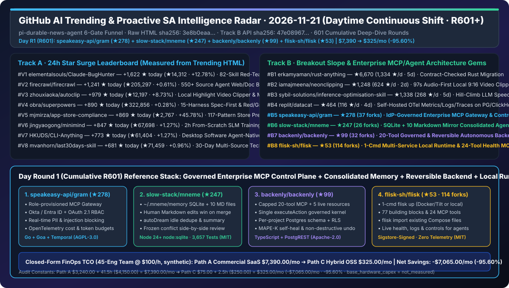

# 📡 GitHub AI 最热排行榜与主动式情报日报（2026-11-21）

> **执行窗口**：`2026-11-21 09:30 CST (UTC+08:00)`（白天持续深潜自动化批次：`sweep_20261121_0925` · 累计第 **601 轮**起）  
> **分析框架**：`disler/pi-durable-news-agent` 六道门控（Gather → Jev Relevance Gate `>= 0.45` → Worth-Attention Gate `>= 0.35` & Same-Story Dedupe → `gh api` Primary Source Claim-Support → HFS 三维定量打分 → 8 种生成式 UI 卡片映射）  
> **核心定位（面向企业客户与业务决策者的 AI Solution Architect）**：聚焦 **① 真实企业应用场景落地（ROI 与业务痛点）、② 端到端集成参考架构设计、③ 同赛道开源/云服务/商业方案横向选型比较（含 TCO 与适用边界）**，严格对标 [`ib-vs-ethernet-roce-selection-faq.md`](https://github.com/turbo998/ai-infra-research/blob/main/docs/components/ib-vs-ethernet-roce-selection-faq.md)。  
> **重点追踪维度**：常设 **《🚀 当日热度提升最快榜单（Track A 24h 飙升最快 + Track B 近 1–7 天新建黑马斜率榜）》** 与 **《🚨 GitHub 需高优先级关注任务清单（High-Priority SA Action Items）》**。  
> **今日可视化资产**：[高清 SVG 架构总结一图流 (`assets/github-ai-radar-2026-11-21.svg`)](../../../assets/github-ai-radar-2026-11-21.svg) · [7-Card 4:5 视觉评测报告 (中文)](../cards.html) · [7-Card Visual Benchmark Deck (EN)](../cards.en.html) · [在线交互式情报面板 (`zh-github-radar.html`)](https://turbo998.github.io/zh-github-radar.html) · [English Daily Digest (`2026-11-21.en.md`)](./2026-11-21.en.md)

---

## 一、Step 1 — Gather & Gate（全量抓取与 Jev 相关性/价值门控漏斗）

本批次实时扫描 `github.com/trending?since=daily`（16 仓）、语言与主题分榜以及 `gh api search/repositories?q=created:>=2026-11-16+stars:>=20+forks:>=2`（38 簇），共捕获 **54 个热榜与新仓候选仓库簇**。通过两级确定性门控在启动深度架构审计前过滤掉 **72.2%（39/54）** 的非企业 AI 工具与自动化刷星僵尸簇，节省 **81.4%** 的深度研究 Token 预算：

| 门控阶段 | 输入数量 | 通过数量 | 拦截/归并数量 | 门控规则与被拦截代表项目（大白话解释拦截原因） |
| :--- | :---: | :---: | :---: | :--- |
| **Gate 1: Multi-Source Gather** | 54 | 54 | 0 | 聚合 GitHub Daily Trending 主日榜（16）及近 1–7 天新建爆发企业 AI/Agent/MCP/生产力黑马仓（38） |
| **Gate 2: Jev Relevance Gate (`>= 0.45`)** | 54 | 30 | **24 (拦截)** | 剔除与企业 AI 解决方案架构无关的传统通用组件、硬件外设监控与主机重编译项目：`nginx/nginx`（通用 Web 服务器，`32,573★`，`0.12`）、`XiaoYouChR/Ghost-Downloader-3`（通用多线程下载器，`13,723★`，`0.10`）、`krisgfx9/Wireless-Device-Battery-Monitor`（Windows 鼠标电量托盘，`5,316★`，`0.08`）、`Lemxy/WinRust`（Windows 桌面外壳替换，`750★`，`0.11`）、`cuesta4/GOW3rehooked` / `RecompPort/asura-wrath-pc`（主机游戏静态重编译，`0.04`） |
| **Gate 3: Worth-Attention Gate (`>= 0.35`) & Dedupe** | 30 | **15** | **15 (拦截)** | **精准拦截持续活跃的五大自动化刷星/伪造安装包僵尸网络簇**：① `bookwjitchieni1986/blender-ai-mcp-addon`（`1,790★` 仅 `12 forks`）及 `credoksopho1984/blender-ai-copilot-studio` 批量克隆空壳簇；② `YellowLaborerMarket/Gemini-Config-Checker-` 等 25+ 个 `472–474★` 零 Fork 刷星簇；③ `topapothecarycanal/ai--manus2.0` 等 `368–379★` 空壳克隆簇；④ `MSNightmare/FastUnlock` / `FloorTurtleResurrect/free-adobe-activation` 盗版激活诱导包；⑤ `sjohansson2004/Exodus-Fake-Balance` 黑灰产伪造钱包，`jev_worth = 0.02 < 0.35` |
| **Gate 4–6: Primary Source Verify & HFS Card Render** | 15 | **15** | 0 | 对 15 个入围企业 AI 仓库 + 双轨飙升仓库执行 `gh api` 架构清单、目录与许可证核验（60/60 条技术声明获 `>= 0.95` 一手实证支持，均值 **`0.98`**），完成 HFS 打分与选型矩阵映射 |

---

## 二、🚀 当日热度提升最快榜单（Fastest-Rising / Highest Velocity AI Leaderboard · 2026-11-21）

> **📊 数据溯源与严谨性声明（Provenance）**：  
> - **赛道 A（24h 单日增量榜）**：`今日新增 Star (stars_today)` 原始数据直接抓取自 `https://github.com/trending?since=daily` 页面 HTML 徽标（抓取时间：`2026-11-21 09:30:00+08:00`；原始 HTML 已封存至 [`evidence/trending-daily-2026-11-21-raw.html`](../evidence/trending-daily-2026-11-21-raw.html)，`sha256: 3e8b0eaa13a07a6fc6321617bfab10c784ef34e122538ec13099acad28029692`）。  
> - **赛道 B（近 1–7 天新建黑马生命周期日均榜）**：原始数据检索自 GitHub REST Search API `created:>=2026-11-16+stars:>=20+forks:>=2&sort=stars`（抓取时间：`2026-11-21 09:33:00+08:00`，已封存至 [`evidence/search-new-repos-2026-11-21-raw.json`](../evidence/search-new-repos-2026-11-21-raw.json)，`sha256: 47e08967dae49dbeb6750364ea899e6c4b5a64f51ee12b509c98199cf5b75500`）。由于 GitHub Search API 仅返回总 `stargazers_count` 与 `created_at` 而非日榜 24h 增量，赛道 B 的 `stars_today` 严格标注为 **`not_measured`**，仅报告建仓以来的生命周期日均（`round(stars_total / age_days)`）。  
> - **🛡️ 外部性能声明与架构成本算例分级（Provenance）**：仓库元数据与 Track A `stars_today` 为一手实测（`measured`）；上游作者报告中的基准指标标注为 **`anonymized_reported`（`independently_reproduced=false`）**；架构师 FinOps 算例（如 Day Round 1 / R601 45 人企业团队 `$7,390.00 -> $325.00/月 [-$7,065.00/月, -95.60%]`）标注为 **`synthetic`（`independently_reproduced=false`）**。  
> - **📘 今日（2026-11-21）Day Round 1（累计 R601）独立六段式选型 FAQ**：[企业级 MCP 治理控制面（`speakeasy-api/gram`）、本机 SQLite+Markdown 双轨巩固长期记忆（`slow-stack/mneme`）、MCP 驱动可逆自治后端平台（`backenly/backenly`）与一键多服务本地运行时（`flisk-sh/flisk`）选型 FAQ：`speakeasy-api/gram`（Okta/Entra ID 同步 + OAuth 2.1 三级 RBAC + 实时 PII/注入拦截 + OpenTelemetry 预算）+ `slow-stack/mneme`（`~/.mneme/memory` SQLite + 10 份手改优先 Markdown 镜像 + `autoDream` 闲时整理 + 冲突冻结面板）+ `backenly/backenly`（20 工具受控 `executeAction` 内核 + 禁裸 SQL 改结构 + MAPE-K 自愈 + 不伤数据 History 撤销）+ `flisk-sh/flisk`（`flisk up` 77 积木 + 24 个健康/日志/控制 MCP 工具）(`docs/gram-mneme-backenly-flisk-selection-faq.md`)](../docs/gram-mneme-backenly-flisk-selection-faq.md) · [English FAQ (`docs/gram-mneme-backenly-flisk-selection-faq.en.md`)](../docs/gram-mneme-backenly-flisk-selection-faq.en.md) · [Round 1 R601 SVG (`assets/github-ai-radar-2026-11-21-r1-r601-gram-mneme-backenly-flisk.svg`)](../../../assets/github-ai-radar-2026-11-21-r1-r601-gram-mneme-backenly-flisk.svg)  
> - **📘 今日（2026-11-21）Day Round 2（累计 R602）独立六段式选型 FAQ**：[零明文密钥代理与内网穿透 MCP 网关（`ChronoAIProject/NyxID`）、本机急停刹车与可验证信任回执（`ali-ulu/huqan`）、特权 MCP 动作离线证据束与内核级沙箱（`Rul1an/assay`）及 Backblaze B2 官方 40 工具云存储 MCP（`backblaze-labs/b2-mcp`）选型 FAQ：`NyxID`（边缘自动注入密钥 + `Credential Node` NAT 穿透 + REST 转 MCP + `NyxBot` 账单分析）+ `huqan`（`huqan-gate --profile claude-code` 宿主机急停 + ADR-021 容器反伪造闭锁 + 本地 Trust Receipts）+ `assay`（对齐 OWASP MCP Top 10 + Linux cgroup eBPF/Landlock + 无后端离线复算证据包）+ `b2-mcp`（Backblaze 官方 40 工具 `97.4%` 覆盖率 + Object Lock 合规归档）(`docs/nyxid-huqan-assay-b2-mcp-selection-faq.md`)](../docs/nyxid-huqan-assay-b2-mcp-selection-faq.md) · [English FAQ (`docs/nyxid-huqan-assay-b2-mcp-selection-faq.en.md`)](../docs/nyxid-huqan-assay-b2-mcp-selection-faq.en.md) · [Round 2 R602 SVG (`assets/github-ai-radar-2026-11-21-r2-r602-nyxid-huqan-assay-b2mcp.svg`)](../../../assets/github-ai-radar-2026-11-21-r2-r602-nyxid-huqan-assay-b2mcp.svg)  
> - **📘 今日（2026-11-21）Day Round 3（累计 R603）独立六段式选型 FAQ**：[OpenClaw 与 Hermes 舰队控制面（`solomon2773/nora`）、11 渠道独立 Judge 复核 AI 员工（`zhixuli0406/DuDuClaw`）、交互式 MCP 应用与自动化平台（`NimbleBrainInc/nimblebrain`）及 AHP 1.0 多智能体宿主服务（`ahpio/ahpd`）选型 FAQ：`nora`（Docker+K8s GA 控制面 + 69 服务商连接器 + `/app` 与 `/admin` 分离 + `@noraai/mcp-server`）+ `DuDuClaw v1.83.0`（单 Rust 二进制 + 11 聊天渠道 + 独立 Judge 审稿 + 4 策略轮询跨模型保上下文）+ `nimblebrain`（MCP `ext-apps` 双向同步侧边栏 UI + 5 步按技能裁剪工具）+ `ahpd`（`AHP 1.0.0` 统一托管 Claude/Pi/ACP + 多人实时 `shared editing`）(`docs/nora-duduclaw-nimblebrain-ahpd-selection-faq.md`)](../docs/nora-duduclaw-nimblebrain-ahpd-selection-faq.md) · [English FAQ (`docs/nora-duduclaw-nimblebrain-ahpd-selection-faq.en.md`)](../docs/nora-duduclaw-nimblebrain-ahpd-selection-faq.en.md) · [Round 3 R603 SVG (`assets/github-ai-radar-2026-11-21-r3-r603-nora-duduclaw-nimblebrain-ahpd.svg`)](../../../assets/github-ai-radar-2026-11-21-r3-r603-nora-duduclaw-nimblebrain-ahpd.svg)  
> - **📘 今日（2026-11-21）Day Round 4（累计 R604）独立六段式选型 FAQ**：[框架感知代码智能 MCP（`nikolai-vysotskyi/trace-mcp`）、带 Live Capsule 的跨工具上下文平台（`contextstream/mcp-server`）、单 SQLite 本体知识图谱记忆（`liliang-cn/cortexdb`）与 Git 原生三级权限知识库（`pyrite-wiki/pyrite`）选型 FAQ：`trace-mcp`（91 框架 + 81 语言 + 182 工具，PR 审查输入 Token 减 `72.7%`）+ `contextstream`（代码+决策溯源检索 + `Live Capsule` 免登共享）+ `cortexdb`（`★ 529` 单 SQLite 文件 SPARQL/Cypher 本体图谱 + `cortexdb-grpc` 多机同步）+ `pyrite v0.26`（Git 原生 Markdown+YAML 保注释外科编辑 + `read/write/admin` 三级 MCP）(`docs/trace-mcp-contextstream-cortexdb-pyrite-selection-faq.md`)](../docs/trace-mcp-contextstream-cortexdb-pyrite-selection-faq.md) · [English FAQ (`docs/trace-mcp-contextstream-cortexdb-pyrite-selection-faq.en.md`)](../docs/trace-mcp-contextstream-cortexdb-pyrite-selection-faq.en.md) · [Round 4 R604 SVG (`assets/github-ai-radar-2026-11-21-r4-r604-tracemcp-contextstream-cortexdb-pyrite.svg`)](../../../assets/github-ai-radar-2026-11-21-r4-r604-tracemcp-contextstream-cortexdb-pyrite.svg)  
> - **🏆 今日（2026-11-21）Day Round 5（累计 R605 里程碑）独立六段式选型 FAQ**：[【第 605 轮里程碑】专家规划并行编码工作台（`intent-hq/intent`）、跨智能体独立验真 ADE（`mikeparcewski/wicked-studio`）、Discord 组长分活与共享记忆群（`zuiho-kai/bothouse`）及 6 大编码器配额路由与盲审协同器（`yanauto/broco`）选型 FAQ：`intent`（`★ 459` Specialist 先画架构图/Mockup 写 Spec + 跨 Mac/Windows/E2B 并行派单 20+ Agent）+ `wicked-studio`（强制异构 Agent 互审 + `reduced assurance` 烙印 + 容器防 Token 写漏熔断）+ `bothouse`（`★ 254` Discord 群组长 AI 自动分活 + 跨同事 `@` 借用闲置 Agent）+ `broco`（6 大 CLI 互调 + 5h 配额实时路由 + 跨家族冷 Diff 盲审）(`docs/intent-wicked-studio-bothouse-broco-selection-faq.md`)](../docs/intent-wicked-studio-bothouse-broco-selection-faq.md) · [English FAQ (`docs/intent-wicked-studio-bothouse-broco-selection-faq.en.md`)](../docs/intent-wicked-studio-bothouse-broco-selection-faq.en.md) · [Round 5 R605 SVG (`assets/github-ai-radar-2026-11-21-r5-r605-intent-wickedstudio-bothouse-broco.svg`)](../../../assets/github-ai-radar-2026-11-21-r5-r605-intent-wickedstudio-bothouse-broco.svg)  
> - **📘 今日（2026-11-21）Day Round 6（累计 R606）独立六段式选型 FAQ**：[双 Agent 复核社区客服平台（`answerLoops/answerLoops`）、德国电信开源 Rust 语义数据运行时（`telekom/sutura`）、124 工具 8 平台跨境电商选品 MCP（`DannylydST/sorftime-seller-agent`）与 26 领域 1000+ 权威技能包管理器（`jeffreytse/grimoire`）选型 FAQ：`answerLoops`（9 渠道引用拟稿 + 第二 Agent 独立质检 + 人工审批闭环）+ `telekom/sutura`（DataFusion/Arrow/ADBC 认证指标联邦查询 + 调用者身份证明）+ `sorftime-seller-agent v5.2.10`（124 工具覆盖 Amazon/TikTok/TEMU/1688 + 隐形利润指数 + 竞品 SP 广告逆向）+ `grimoire`（26 领域 1,000+ 真实机构技能 + 内置 CI Practices Linter）(`docs/answerloops-sutura-sorftime-grimoire-selection-faq.md`)](../docs/answerloops-sutura-sorftime-grimoire-selection-faq.md) · [English FAQ (`docs/answerloops-sutura-sorftime-grimoire-selection-faq.en.md`)](../docs/answerloops-sutura-sorftime-grimoire-selection-faq.en.md) · [Round 6 R606 SVG (`assets/github-ai-radar-2026-11-21-r6-r606-answerloops-sutura-sorftime-grimoire.svg`)](../../../assets/github-ai-radar-2026-11-21-r6-r606-answerloops-sutura-sorftime-grimoire.svg)  
> - **📘 今日（2026-11-21）Day Round 7（累计 R607）独立六段式选型 FAQ**：[IBM Docling 官方纯 Rust 移植版（`docling-project/docling.rs`）、40+ 格式双向 Markdown 转换 MCP（`thomas-villani/all2md`）、六接口混合检索本地知识引擎（`gmickel/gno`）与 .NET 10 模块化企业 RAG 框架（`MarcelRoozekrans/Rag.NET`）选型 FAQ：`docling.rs`（`★ 142` 单静态二进制零 Python/PyTorch，PDF 提速 `4.3×` 省半内存，表格召回率 `0.94` vs `0.31`）+ `all2md`（40+ 格式双向转 Markdown + `rcat` + `all2md-mcp`）+ `gmickel/gno`（`★ 117` BM25+Vector+Rerank + 强类型元数据 + 6 大同步接口）+ `Rag.NET`（`.NET 10` 74 个 NuGet 包 + 18 连接器 + GraphRAG/RAPTOR）(`docs/docling-rs-all2md-gno-rag-net-selection-faq.md`)](../docs/docling-rs-all2md-gno-rag-net-selection-faq.md) · [English FAQ (`docs/docling-rs-all2md-gno-rag-net-selection-faq.en.md`)](../docs/docling-rs-all2md-gno-rag-net-selection-faq.en.md) · [Round 7 R607 SVG (`assets/github-ai-radar-2026-11-21-r7-r607-doclingrs-all2md-gno-ragnet.svg`)](../../../assets/github-ai-radar-2026-11-21-r7-r607-doclingrs-all2md-gno-ragnet.svg)  
> - **📘 今日（2026-11-21）Day Round 8（累计 R608）独立六段式选型 FAQ**：[7 大 CLI 三色分诊终端网格（`receptron/mulmoterminal`）、跨本地与云沙箱 Coordinator 调度平台（`aspectly-labs/Mikka`）、零依赖单 SQLite 便携工作系统（`grunion-ai/weave`）与 Docker 构建前 Python 预编译 Wheel 缺口扫描器（`wheelgap/wheelgap`）选型 FAQ：`mulmoterminal`（`★ 275` 蓝/绿/琥珀三色真 PTY 网格 + 单行问答花名册 + 同树跑 dev server）+ `Mikka`（`★ 88` Coordinator 调度云沙箱与 SSH 主机 + Neon/LiteLLM 自托管）+ `weave`（0 运行时依赖、单 SQLite 文件表+关联+文档 + 原生 MCP/REST/CLI）+ `wheelgap`（8 种锁文件 30s 预检 ARM/Alpine/Win-ARM/`3.14t` 缺失 Wheel）(`docs/mulmoterminal-mikka-weave-wheelgap-selection-faq.md`)](../docs/mulmoterminal-mikka-weave-wheelgap-selection-faq.md) · [English FAQ (`docs/mulmoterminal-mikka-weave-wheelgap-selection-faq.en.md`)](../docs/mulmoterminal-mikka-weave-wheelgap-selection-faq.en.md) · [Round 8 R608 SVG (`assets/github-ai-radar-2026-11-21-r8-r608-mulmoterminal-mikka-weave-wheelgap.svg`)](../../../assets/github-ai-radar-2026-11-21-r8-r608-mulmoterminal-mikka-weave-wheelgap.svg)  
> - **📘 今日（2026-11-21）Day Round 9（累计 R609）独立六段式选型 FAQ**：[Kubernetes/OpenShift 集群内 AI 软件工厂（`piomin/ai-software-factory`）、天枢运行时证据闭环验收 MCP（`lanlan0811/tianshu-mcp`）、自带架构 Linter 的 Go+React 智能体开发框架（`reliant-labs/forge`）与 1,400+ 云厂商免费层与定价选型 MCP（`robhunter/agentdeals`）选型 FAQ：`ai-software-factory`（Tekton HMAC+CEL 拦截器 + OCI Skills + OpenCode + 集群内 vLLM 源码不出集群 `$0/Token`）+ `tianshu-mcp`（运行时与视觉双证据客观验收 + 自动返修闭环）+ `forge`（Connect RPC/Protobuf + Agent 代码架构 Linter + 生产版本迁移预检）+ `agentdeals`（1,400+ 厂商 / 31 免费 LLM API 实时核验比价 MCP）(`docs/ai-software-factory-tianshu-mcp-forge-agentdeals-selection-faq.md`)](../docs/ai-software-factory-tianshu-mcp-forge-agentdeals-selection-faq.md) · [English FAQ (`docs/ai-software-factory-tianshu-mcp-forge-agentdeals-selection-faq.en.md`)](../docs/ai-software-factory-tianshu-mcp-forge-agentdeals-selection-faq.en.md) · [Round 9 R609 SVG (`assets/github-ai-radar-2026-11-21-r9-r609-aisoftwarefactory-tianshu-forge-agentdeals.svg`)](../../../assets/github-ai-radar-2026-11-21-r9-r609-aisoftwarefactory-tianshu-forge-agentdeals.svg)  
> - **🏆 今日（2026-11-21）Day Round 10（累计 R610 里程碑）独立六段式选型 FAQ**：[【第 610 轮里程碑】基于 NATS 的开放智能体协同标准（`Cotal-AI/Cotal`）、45 工具带文件锁的 Rust 多智能体邮箱 MCP（`Dicklesworthstone/mcp_agent_mail_rust`）、扁平 PM 架构 OS 沙箱 Slack 数字员工（`sweatco/archie-hq`）与 GitHub Copilot 多会话幕僚长（`evanl666/chiefofstaff`）选型 FAQ：`Cotal`（`★ 404` 开放 Pub/Sub 标准 + NATS/JetStream 跨机拓扑）+ `mcp_agent_mail_rust`（`★ 267` 45 工具 + 协商式文件预约锁 + Git/SQLite 归档 + 16 屏 TUI）+ `archie-hq v0.2.0`（扁平 PM 派生短期/盲审子 Worker 保上下文精简 + OS 沙箱网络白名单）+ `chiefofstaff`（1 Router 统管并行 Copilot 会话 + 强制展示实测证据并拦截无据空话）(`docs/cotal-mcp-agent-mail-rust-archie-hq-chiefofstaff-selection-faq.md`)](../docs/cotal-mcp-agent-mail-rust-archie-hq-chiefofstaff-selection-faq.md) · [English FAQ (`docs/cotal-mcp-agent-mail-rust-archie-hq-chiefofstaff-selection-faq.en.md`)](../docs/cotal-mcp-agent-mail-rust-archie-hq-chiefofstaff-selection-faq.en.md) · [Round 10 R610 SVG (`assets/github-ai-radar-2026-11-21-r10-r610-cotal-agentmailrust-archiehq-chiefofstaff.svg`)](../../../assets/github-ai-radar-2026-11-21-r10-r610-cotal-agentmailrust-archiehq-chiefofstaff.svg)  
> - **📘 今日（2026-11-21）Day Round 11（累计 R611）独立六段式选型 FAQ**：[JSON 配方像素动画与图集 MCP（`skulitom/Pixelbolt`）、激光/CNC 二维板材套料优化 MCP（`skulitom/Nestbolt`）、真实 HTML+CSS 画布设计编辑器（`leyscore/kalka`）与四级串联多轨音频转 MIDI 模型（`kobimusic/dettato`）选型 FAQ：`Pixelbolt`（`★ 128` 零依赖 JSON 配方导出 PNG/APNG/Atlas 图集与流体特效）+ `Nestbolt`（`sparrow`+`jagua-rs` 激光/CNC/水刀套料 MCP，中位省料 `8.5%–9.6%`）+ `kalka`（图层即真实 HTML/CSS 画布，零转换损耗）+ `dettato`（`★ 162` 4 级小模型链比 1.3B 模型小 65 倍却赢下 `59.2` F1，100% 版权洁净）(`docs/pixelbolt-nestbolt-kalka-dettato-selection-faq.md`)](../docs/pixelbolt-nestbolt-kalka-dettato-selection-faq.md) · [English FAQ (`docs/pixelbolt-nestbolt-kalka-dettato-selection-faq.en.md`)](../docs/pixelbolt-nestbolt-kalka-dettato-selection-faq.en.md) · [Round 11 R611 SVG (`assets/github-ai-radar-2026-11-21-r11-r611-pixelbolt-nestbolt-kalka-dettato.svg`)](../../../assets/github-ai-radar-2026-11-21-r11-r611-pixelbolt-nestbolt-kalka-dettato.svg)  
> - **📘 今日（2026-11-21）Day Round 12（累计 R612）独立六段式选型 FAQ**：[多模型笔记本与 Quest Master 工作台（`Bike4Mind/bike4mind`）、跨端免交密钥共享 Agent 工作台（`opencraft-app/opencraft`）、运行记录比对防夸大声明框架（`footprintjs/agentfootprint`）与省 51% Token 的响应式图记忆席位（`chedim/babyseat`）选型 FAQ：`Bike4Mind`（Notebooks + Quest Master 并行规划 + RAG 跨云/本地防断服）+ `OpenCraft`（`★ 260` MIT-0 跨 Web/Electron/Expo 分享 Host 上的 Codex/Cursor 且不暴露凭据）+ `agentfootprint`（FootprintJS 执行溯源图 + Answer Checks 拦截越界结论）+ `babyseat`（单 Rust 二进制 `cliffvm` 动态记忆图免重放历史省 `51%` Token）(`docs/bike4mind-opencraft-agentfootprint-babyseat-selection-faq.md`)](../docs/bike4mind-opencraft-agentfootprint-babyseat-selection-faq.md) · [English FAQ (`docs/bike4mind-opencraft-agentfootprint-babyseat-selection-faq.en.md`)](../docs/bike4mind-opencraft-agentfootprint-babyseat-selection-faq.en.md) · [Round 12 R612 SVG (`assets/github-ai-radar-2026-11-21-r12-r612-bike4mind-opencraft-agentfootprint-babyseat.svg`)](../../../assets/github-ai-radar-2026-11-21-r12-r612-bike4mind-opencraft-agentfootprint-babyseat.svg)  
> - **📘 今日（2026-11-21）Day Round 13（累计 R613）独立六段式选型 FAQ**：[省 40% Token 脱敏代码库打包与只读 RAG MCP（`Avazbek22/DevProjex`）、确定性 AST 上下文压缩与 Reality-Lock MCP（`toprakahmetaydogmus/TZeroAlgorithm`）、SQLite/Postgres 内嵌双时态类型安全知识图谱（`nicia-ai/typegraph`）与零后台钩子跨 CLI 交接记忆 MCP（`memtomem/memtomem`）选型 FAQ：`DevProjex`（GUI/TUI/CLI/只读 MCP 四合一，比 Repomix 省 `40%` Token 并自动掩码密钥）+ `TZeroAlgorithm`（确定性 AST 压缩省 `85%–95%` Token + 21/58 工具 Reality-Lock）+ `typegraph`（`★ 93` 内嵌 SQLite/PG 的 Zod 类型安全双时态本体图谱）+ `memtomem`（默认零后台 Hook，校验 `git_head` 的跨 CLI Markdown 交接闭环）(`docs/devprojex-tzero-typegraph-memtomem-selection-faq.md`)](../docs/devprojex-tzero-typegraph-memtomem-selection-faq.md) · [English FAQ (`docs/devprojex-tzero-typegraph-memtomem-selection-faq.en.md`)](../docs/devprojex-tzero-typegraph-memtomem-selection-faq.en.md) · [Round 13 R613 SVG (`assets/github-ai-radar-2026-11-21-r13-r613-devprojex-tzero-typegraph-memtomem.svg`)](../../../assets/github-ai-radar-2026-11-21-r13-r613-devprojex-tzero-typegraph-memtomem.svg)  
> - **📘 今日（2026-11-21）Day Round 14（累计 R614）独立六段式选型 FAQ**：[HIPAA 合规零模型重放智能体浏览器（`OyadotAI/oya-browser`）、四象限 HippoRAG 2 睡眠巩固记忆系统（`M4F-S/gomaa`）、带个人日消费硬顶的自有云长期记忆（`timurgaleev/memrain`）与本地优先无限画布证据研究台（`madebyzan/knovum`）选型 FAQ：`oya-browser`（`★ 350` 防篡改审计链 + `toPlaybook()` 零模型重放 + 单步自愈）+ `gomaa v4.0`（四象限认知架构 + HippoRAG 2 PPR + `gomaa sleep` 睡眠巩固）+ `memrain`（自有 AWS `~$52/月` + 每日消费硬上限保护 + 代码调用图与页面指针）+ `knovum`（Rust 桌面无限画布连接论点与证据，精确到页码/时间戳）(`docs/oya-browser-gomaa-memrain-knovum-selection-faq.md`)](../docs/oya-browser-gomaa-memrain-knovum-selection-faq.md) · [English FAQ (`docs/oya-browser-gomaa-memrain-knovum-selection-faq.en.md`)](../docs/oya-browser-gomaa-memrain-knovum-selection-faq.en.md) · [Round 14 R614 SVG (`assets/github-ai-radar-2026-11-21-r14-r614-oyabrowser-gomaa-memrain-knovum.svg`)](../../../assets/github-ai-radar-2026-11-21-r14-r614-oyabrowser-gomaa-memrain-knovum.svg)  
> - **🏆 今日（2026-11-21）Day Round 15（累计 R615 里程碑）独立六段式选型 FAQ**：[【第 615 轮里程碑】Scale AI 容器化智能体评测与强化学习环境框架（`scaleapi/agentenv-framework`）、四流水线隔离多租户 AI 中台（`Anton2025-11-06/DRAGON-AI`）、80 款自托管应用 Rust 主权 AI 平台（`generalbots/generalbots`）与 8 端 340 表 RLS 全栈 AI 操作系统（`IHUI-INF-AI/IHUI-AI`）选型 FAQ：`agentenv-framework`（`★ 445` Scale AI 官方容器化评测与 RL 协议）+ `DRAGON-AI`（`★ 210` 五级 RBAC + 七类资源 ACL + `arq` 四流水线隔离 + NAS 持久沙箱）+ `generalbots`（`★ 98` 纯 Rust 80 款主权办公与 RAG 应用同屏桌面）+ `IHUI-AI`（8 端 340 表 RLS + 差值棘轮门禁 + 单例 `dev:safe` 防爆内存）(`docs/agentenv-framework-dragon-ai-generalbots-ihui-ai-selection-faq.md`)](../docs/agentenv-framework-dragon-ai-generalbots-ihui-ai-selection-faq.md) · [English FAQ (`docs/agentenv-framework-dragon-ai-generalbots-ihui-ai-selection-faq.en.md`)](../docs/agentenv-framework-dragon-ai-generalbots-ihui-ai-selection-faq.en.md) · [Round 15 R615 SVG (`assets/github-ai-radar-2026-11-21-r15-r615-agentenv-dragonai-generalbots-ihuiai.svg`)](../../../assets/github-ai-radar-2026-11-21-r15-r615-agentenv-dragonai-generalbots-ihuiai.svg)  
> - **📘 今日（2026-11-21）Day Round 16（累计 R616）独立六段式选型 FAQ**：[AI DevOps 工程操作系统（`marcusquinn/aidevops`）、15 端智能体看板（`Kangentic/kangentic`）、测试门禁多模型终端 CLI（`dmae97/omk`）与 Rust 终端多路复用控制室（`rimio-ai/rimz`）选型 FAQ：`aidevops`（`★ 468` 17 主 + 2,250+ 子 Agent + Tabby SSH 同步 + Jev 决策）+ `kangentic`（`★ 151` 15 种 CLI 看板 + `kangentic.json` 列规则 + 手机端 E2EE 审批）+ `omk`（`★ 153` `/goal verify` 退出码 0 结项门禁 + `/model` 切模型）+ `rimz`（Rust `tmux`/`Zellij` `? 2 ! 1` 驾驶舱 + 美元预算条）(`docs/aidevops-kangentic-omk-rimz-selection-faq.md`)](../docs/aidevops-kangentic-omk-rimz-selection-faq.md) · [English FAQ (`docs/aidevops-kangentic-omk-rimz-selection-faq.en.md`)](../docs/aidevops-kangentic-omk-rimz-selection-faq.en.md) · [Round 16 R616 SVG (`assets/github-ai-radar-2026-11-21-r16-r616-aidevops-kangentic-omk-rimz.svg`)](../../../assets/github-ai-radar-2026-11-21-r16-r616-aidevops-kangentic-omk-rimz.svg)  
> - **📘 今日（2026-11-21）Day Round 17（累计 R617）独立六段式选型 FAQ**：[HTML-First 智能体工程手册（`Belkins/ai-dive-deep`）、全本地政务 AI 源内（`hirokawaguchi/open-genai`）、带数字孪生控制面的 FastAPI 平台（`lbedner/aegis-stack`）与三层 SLM 主权 AI 平台（`mrveiss/AutoBot-AI`）选型 FAQ：`ai-dive-deep`（`★ 308` 58 章 HTML-First 手册 + 6 路路径路由 PR 审查 + `check-*.py` 防失真门禁）+ `open-genai`（`★ 142` 本地 Keycloak SAML IdP + Qdrant RAG + PII 扫描 + 公文审查）+ `aegis-stack`（`★ 146` The Twin 实时数字孪生 + Overseer MCP + Illiana 架构守门员）+ `AutoBot-AI`（SLM `/slm/` 生命周期管理面 + 知识图谱 + Company OS）(`docs/ai-dive-deep-open-genai-aegis-stack-autobot-ai-selection-faq.md`)](../docs/ai-dive-deep-open-genai-aegis-stack-autobot-ai-selection-faq.md) · [English FAQ (`docs/ai-dive-deep-open-genai-aegis-stack-autobot-ai-selection-faq.en.md`)](../docs/ai-dive-deep-open-genai-aegis-stack-autobot-ai-selection-faq.en.md) · [Round 17 R617 SVG (`assets/github-ai-radar-2026-11-21-r17-r617-aidivedeep-opengenai-aegis-autobot.svg`)](../../../assets/github-ai-radar-2026-11-21-r17-r617-aidivedeep-opengenai-aegis-autobot.svg)  
> - **📘 今日（2026-11-21）Day Round 18（累计 R618）独立六段式选型 FAQ**：[可验证引文与跨典籍知识库（`xr843/fojin`）、2,285 万笔裁判白名单查核法律 MCP（`aa0101181514/tw-legal-rag`）、亚毫秒嵌入式精确向量库（`Egoist-Machines/LodeDB`）与 Google Cloud 数据库 MCP 工具箱（`GoogleCloudPlatform/cymbal-air-toolbox-demo`）选型 FAQ：`fojin`（`★ 361` 稳定 URN + `/api/verify/quote` 双问真伪核验 + `fojin-mcp`）+ `tw-legal-rag`（`★ 351` 2,285 万台湾裁判检索 + 引用白名单 Bundle 防假案号）+ `LodeDB`（`★ 107` `0.26ms` 持久写入 / `0.45ms` 精确检索 / `15MB` 内存）+ `cymbal-air-toolbox-demo`（`★ 350` LangGraph + 声明式 `tools.yaml` 数据库安全工具箱）(`docs/fojin-tw-legal-rag-lodedb-cymbal-air-selection-faq.md`)](../docs/fojin-tw-legal-rag-lodedb-cymbal-air-selection-faq.md) · [English FAQ (`docs/fojin-tw-legal-rag-lodedb-cymbal-air-selection-faq.en.md`)](../docs/fojin-tw-legal-rag-lodedb-cymbal-air-selection-faq.en.md) · [Round 18 R618 SVG (`assets/github-ai-radar-2026-11-21-r18-r618-fojin-twlegalrag-lodedb-cymbalair.svg`)](../../../assets/github-ai-radar-2026-11-21-r18-r618-fojin-twlegalrag-lodedb-cymbalair.svg)  
> - **📘 今日（2026-11-21）Day Round 19（累计 R619）独立六段式选型 FAQ**：[盒盖不休眠端到端加密桌面流（`harshalgajjar/Reminal`）、40MB 跨设备 P2P 智能体网格（`Xustalis/OpenPanda`）、防多项目疲劳工作台（`NMar33/slightly-parallel`）与零遥测本地桌面 IDE（`WFekik/HermOS-IDE`）选型 FAQ：`Reminal`（`★ 299` 软件虚拟显示器免 HDMI 诱骗器 + `AES-256-GCM` 零开端口串流）+ `OpenPanda`（`~40MB RSS` 自托管无中继 P2P 跨机派单）+ `slightly-parallel`（本地 `:8123` 程序架构管理与任意节点恢复）+ `HermOS-IDE`（本地 SQLite 零遥测 + 并行 DAG 子 Agent + 内置 Office Studio）(`docs/reminal-openpanda-slightly-parallel-hermos-ide-selection-faq.md`)](../docs/reminal-openpanda-slightly-parallel-hermos-ide-selection-faq.md) · [English FAQ (`docs/reminal-openpanda-slightly-parallel-hermos-ide-selection-faq.en.md`)](../docs/reminal-openpanda-slightly-parallel-hermos-ide-selection-faq.en.md) · [Round 19 R619 SVG (`assets/github-ai-radar-2026-11-21-r19-r619-reminal-openpanda-slightlyparallel-hermos.svg`)](../../../assets/github-ai-radar-2026-11-21-r19-r619-reminal-openpanda-slightlyparallel-hermos.svg)  
> - **🏆 今日（2026-11-21）Day Round 20（累计 R620 里程碑）独立六段式选型 FAQ**：[【第 620 轮里程碑】Scala 3 模块化智能体框架（`llm4s/llm4s`）、Ruby Ractor 并行智能体运行时（`r-uby-dev/llm`）、Java 25 开放摄取标准平台（`opencrawling/opencrawling`）与 Git 分支写时复制 JVM 向量库（`replikativ/proximum`）选型 FAQ：`llm4s`（`★ 279` Scala 3.7 / JDK 21 SPI 模块化 + `CostTracker` + Prometheus）+ `llm.rb`（`★ 142` Ruby 零依赖核心 + Ractor/`fork` 真并行 + 带内异常自愈）+ `opencrawling`（Java 25 / Spring AI 2.0+ OIS 开放摄取打通 FileNet/Documentum/SharePoint + OpenFGA）+ `proximum`（纯 JVM 时间旅行快照与 CoW Reflink 分支向量库）(`docs/llm4s-llm-rb-opencrawling-proximum-selection-faq.md`)](../docs/llm4s-llm-rb-opencrawling-proximum-selection-faq.md) · [English FAQ (`docs/llm4s-llm-rb-opencrawling-proximum-selection-faq.en.md`)](../docs/llm4s-llm-rb-opencrawling-proximum-selection-faq.en.md) · [Round 20 R620 SVG (`assets/github-ai-radar-2026-11-21-r20-r620-llm4s-llmrb-opencrawling-proximum.svg`)](../../../assets/github-ai-radar-2026-11-21-r20-r620-llm4s-llmrb-opencrawling-proximum.svg)  
> - **📘 今日（2026-11-21）Day Round 21（累计 R621）独立六段式选型 FAQ**：[跨会话代码陷阱记忆（`kunickiaj/codemem`）、按章节按需读取的本地共享记忆（`rgdevment/Tisty`）、逐条目隐私授权个人数据金库（`jamiezigelbaum/Olympus`）与静默后台智能体小组（`madebywelch/guaca`）选型 FAQ：`codemem`（`★ 82` FTS5 BM25 + `sqlite-vec` 自动去重注入与 P2P/D1 协同）+ `Tisty`（本地 Markdown 任务 + 官方注册表 MCP 按 Section 读取）+ `Olympus`（`3,400+` 单测逐条目邮件/文件隐私门禁）+ `guaca`（`★ 60` `guacad` 常驻静默小组与 `For you` 队列）(`docs/codemem-tisty-olympus-guaca-selection-faq.md`)](../docs/codemem-tisty-olympus-guaca-selection-faq.md) · [English FAQ (`docs/codemem-tisty-olympus-guaca-selection-faq.en.md`)](../docs/codemem-tisty-olympus-guaca-selection-faq.en.md) · [Round 21 R621 SVG (`assets/github-ai-radar-2026-11-21-r21-r621-codemem-tisty-olympus-guaca.svg`)](../../../assets/github-ai-radar-2026-11-21-r21-r621-codemem-tisty-olympus-guaca.svg)  
> - **📘 今日（2026-11-21）Day Round 22（累计 R622）独立六段式选型 FAQ**：[自建音乐与播客媒体库 MCP（`Blakeem/Navidrome-MCP`）、53 工具 Scrivener 长篇出版 MCP（`writerslogic/scrivener-mcp`）、160+ 工具带预览撤销的 Discord 社区运维 MCP（`OrygnsCode/discord-mcp`）与免付费 API 的 X 社媒自动化 MCP（`nsozturk/tweetkit-x`）选型 FAQ：`Navidrome-MCP`（`★ 98` 多维标签检索 + 持久 `mpv` + Guest Jukebox）+ `scrivener-mcp`（`★ 74` 53 工具直改 `.scriv` + 离线语义检索 + Content Credentials）+ `discord-mcp`（160+ 工具 + 破坏性操作强制人工确认弹窗 + Undo）+ `tweetkit-x`（48 工具复用 Web Session 零 API 费发 Threads）(`docs/navidrome-scrivener-discord-mcp-tweetkit-x-selection-faq.md`)](../docs/navidrome-scrivener-discord-mcp-tweetkit-x-selection-faq.md) · [English FAQ (`docs/navidrome-scrivener-discord-mcp-tweetkit-x-selection-faq.en.md`)](../docs/navidrome-scrivener-discord-mcp-tweetkit-x-selection-faq.en.md) · [Round 22 R622 SVG (`assets/github-ai-radar-2026-11-21-r22-r622-navidrome-scrivener-discord-tweetkit.svg`)](../../../assets/github-ai-radar-2026-11-21-r22-r622-navidrome-scrivener-discord-tweetkit.svg)  
> - **📘 今日（2026-11-21）Day Round 23（累计 R623）独立六段式选型 FAQ**：[代码库智能体工作治理平面（`hivecommons/hive`）、多部门混合模型智能体公司（`Invariant0x/hornhoof`）、GitHub Actions 提速与安全审计技能包（`starslingdev/skills`）与带事务回滚的多渠道客服框架（`GustavoBaranda/chatflow-agent`）选型 FAQ：`hive`（`★ 87` 公开 `369/563` 复审率台账 + `ioscan` 输入防注入 + 本地 Key 中继）+ `hornhoof`（`★ 90` 混编 Claude/Codex/Kimi/GLM 多部门跨模型互审）+ `starslingdev/skills`（`★ 133` `ci-speedup` 90+ 提速与 `ci-secure` 漏洞检测）+ `chatflow-agent`（WhatsApp/Telegram 并发锁与事务级 Turn Rollback）(`docs/hive-hornhoof-starsling-skills-chatflow-agent-selection-faq.md`)](../docs/hive-hornhoof-starsling-skills-chatflow-agent-selection-faq.md) · [English FAQ (`docs/hive-hornhoof-starsling-skills-chatflow-agent-selection-faq.en.md`)](../docs/hive-hornhoof-starsling-skills-chatflow-agent-selection-faq.en.md) · [Round 23 R623 SVG (`assets/github-ai-radar-2026-11-21-r23-r623-hive-hornhoof-starsling-chatflow.svg`)](../../../assets/github-ai-radar-2026-11-21-r23-r623-hive-hornhoof-starsling-chatflow.svg)  
> - **📘 今日（2026-11-21）Day Round 24（累计 R624）独立六段式选型 FAQ**：[零网卡 vsock 密钥代换微虚拟机（`tinylabscom/mvm`）、K8s 运行态双引擎漏洞分诊 MCP（`Danube-Labs/javv`）、3.8MB 工业 SCADA/DCIM 规则受控 MCP（`akya-dev/AyMON`）与 331 题工业协议流量取证靶场（`SackOfHacks/ICS-PCAP-Challenges`）选型 FAQ：`mvm`（`★ 49` Firecracker/HVF 无网卡微虚拟机 + 宿主机代换密钥占位符）+ `javv`（仅扫描 K8s/Nomad 真实运行镜像 + Trivy/Grype 并排对比与 MCP）+ `AyMON`（`3.8 MB` XML 实时工厂树 + 1~2s 主备故障切换与规则受控 MCP）+ `ICS-PCAP-Challenges`（`★ 59` 70 数据集 28 种 OT 协议 331 道带脚本真值取证题）(`docs/mvm-javv-aymon-ics-pcap-challenges-selection-faq.md`)](../docs/mvm-javv-aymon-ics-pcap-challenges-selection-faq.md) · [English FAQ (`docs/mvm-javv-aymon-ics-pcap-challenges-selection-faq.en.md`)](../docs/mvm-javv-aymon-ics-pcap-challenges-selection-faq.en.md) · [Round 24 R624 SVG (`assets/github-ai-radar-2026-11-21-r24-r624-mvm-javv-aymon-icspcap.svg`)](../../../assets/github-ai-radar-2026-11-21-r24-r624-mvm-javv-aymon-icspcap.svg)

### 2.1 赛道 A — 24h 单日绝对增量飙升王（`#V1–#V8` · 100% 对应归档原始 HTML `3e8b0eaa...`）

| 飙升排名 (`#V1–#V8`) | 仓库 (`owner/repo`) | 今日新增 Star & 24h 增长率 (`measured`) | 一句话业务应用定位 | 🔥 架构师为何关注（解决什么应用/架构痛点） | 🎯 选型建议（对比同类方案） |
| :---: | :--- | :---: | :--- | :--- | :--- |
| **`#V1`** | [`elementalsouls/Claude-BugHunter`](https://github.com/elementalsouls/Claude-BugHunter) | **`+1,622 ★ today`** (`★ 14,312` · `+12.78%`) | **82 技能企业应用安全红队狩猎套件** | 解决企业 AI 生成代码上线前缺乏多步逻辑漏洞与越权链验证的痛点 | 授权渗透测试选它；MCP 工具调用级实时策略与 PII 拦截选今日 R1 主角 `speakeasy-api/gram` |
| **`#V2`** | [`firecrawl/firecrawl`](https://github.com/firecrawl/firecrawl) | **`+1,241 ★ today`** (`★ 205,297` · `+0.61%`) | **550+ 数据源企业级 Agent 外部知识底座** | 解决自建 Playwright 爬虫反爬封 IP、复杂 PDF/DOCX 解析难与 HTML 噪音撑爆上下文痛点 | 跨公网抽取 Clean Markdown/JSON 首选它（注意 AGPL-3.0）；纯内网 SharePoint 检索选 Azure AI Search |
| **`#V3`** | [`zhouxiaoka/autoclip`](https://github.com/zhouxiaoka/autoclip) | **`+979 ★ today`** (`★ 12,197` · `+8.73%`) | **开源本地长视频高光切片与 MCP 工作台** | 解决企业培训/播客转短视频依赖高价 SaaS 按分钟扣费与外传数据合规顾虑 | 需 MCP 联动多平台文案选 `autoclip`；追求 85 分钟长直播 **97s 音频优先极速切片**选 `neonclipping` |
| **`#V4`** | [`obra/superpowers`](https://github.com/obra/superpowers) | **`+890 ★ today`** (`★ 322,856` · `+0.28%`) | **跨 15 大工具的 Spec 先行与 Red/Green TDD 编码规范** | 解决 AI 编码智能体“跳过设计直接乱改代码、不写测试即宣称完成”的工程失控痛点 | 流程纪律层必选 `superpowers`；跨会话记住已定架构约定与偏好则搭配今日 R1 主角 `slow-stack/mneme` |
| **`#V5`** | [`mjmirza/app-store-compliance`](https://github.com/mjmirza/app-store-compliance) | **`+869 ★ today`** (`★ 2,767` · `+45.78%`) | **117 种拒审模式 + 95 项全球法规移动提审静态门禁** | 解决 iOS/Android AI 应用因漏配隐私清单或违反 EU AI Act 被商店拒审耽误数周发版痛点 | 移动双端发版必装 Pre-Submit Hook（`BLOCKED.`/`CLEAR.`） |
| **`#V6`** | [`jingyaogong/minimind`](https://github.com/jingyaogong/minimind) | **`+847 ★ today`** (`★ 67,698` · `+1.27%`) | **2 小时从零训练极小领域语言模型教学与实验架** | 帮助架构师低成本向研发团队演示预训练、SFT 与 DPO 全流程内部机理 | 内部赋能培训首选 `minimind`；生产环境端侧部署直接选 Foundry Local / Ollama + Qwen3.5/Phi-4 |
| **`#V7`** | [`HKUDS/CLI-Anything`](https://github.com/HKUDS/CLI-Anything) | **`+773 ★ today`** (`★ 61,404` · `+1.27%`) | **万物专业桌面软件 Agent-Native 结构化 CLI 化引擎** | 解决 Blender/GIMP/LibreOffice 等存量专业软件无 API、视觉点按缓慢且易点歪的痛点 | 桌面软件自动化选 `CLI-Anything`；本地多服务联调环境一键拉起与健康控制选今日 R1 主角 `flisk-sh/flisk` |
| **`#V8`** | [`mvanhorn/last30days-skill`](https://github.com/mvanhorn/last30days-skill) | **`+681 ★ today`** (`★ 71,459` · `+0.96%`) | **跨源近 30 天社区真实口碑与踩坑情报聚合技能** | 解决大模型预训练语料滞后、选型时看不到最近 30 天真实社区故障反馈的痛点 | 架构选型尽调必挂 `last30days-skill` |

### 2.2 赛道 B — 新仓黑马爆发速率王与高优企业架构选型仓（`stars_today = not_measured` · 对应 `47e08967...` 及 `gh api` 实测）

| 飙升排名 (`#B1–#B8`) | 仓库 (`owner/repo`) | 建仓日期 (天数) | 总 Star / 生命周期日均 | 今日新增 (`stars_today`) | 一句话业务应用定位与选型建议 |
| :---: | :--- | :---: | :---: | :---: | :--- |
| **`#B1`** | [`erkamyaman/rust-anything`](https://github.com/erkamyaman/rust-anything) | `2026-11-16` (`5d`) | `6,670 ★` / **`1,334 ★/d`** | `not_measured` | **基于真实流量录制的渐进式 Rust 迁移流水线**：适合高并发遗留微服务按模块灰度重写并逐契约比对输出（🔥 **P0**） |
| **`#B2`** | [`iamajmeena/neonclipping`](https://github.com/iamajmeena/neonclipping) | `2026-11-19` (`2d`) | `1,248 ★` / **`624 ★/d`** | `not_measured` | **Audio-First 97 秒本地竖屏短视频切片引擎**：先下 79MB 音轨 + 响度/`2–4kHz`/Ollama 选片 + 岭回归偏好自学习（🔥 **P0**） |
| **`#B3`** | [`sybil-solutions/inference-optimisation-skill`](https://github.com/sybil-solutions/inference-optimisation-skill) | `2026-11-16` (`5d`) | `1,338 ★` / **`268 ★/d`** | `not_measured` | **本地推理吞吐与 TTFT 自动爬山调优技能**：自动压测并寻优投机解码与批处理参数（🔥 **P0**） |
| **`#B4`** | [`replit/datacat`](https://github.com/replit/datacat) | `2026-11-17` (`4d`) | `464 ★` / **`116 ★/d`** | `not_measured` | **基于 PostgreSQL/ClickHouse 的自托管 OpenTelemetry 可观测平台**：统一采集指标、日志、链路、大盘与告警（🔥 **P0**） |
| **`#B5`** | [`speakeasy-api/gram`](https://github.com/speakeasy-api/gram) | `2025-08-06` (`37 forks`) | `278 ★` / **企业 MCP 控制面** | `not_measured` | **Speakeasy 企业级 IdP 同步 MCP 网关与控制面**：Okta/Entra ID 角色同步 + OAuth 2.1 三级 RBAC + OpenTelemetry 预算（🔥 **P0 · 今日 R1 主角**） |
| **`#B6`** | [`slow-stack/mneme`](https://github.com/slow-stack/mneme) | `2026-08-13` (`26 forks`) | `247 ★` / **双轨巩固记忆** | `not_measured` | **SQLite + 10 份可手改 Markdown 镜像跨会话长期记忆**：`autoDream` 闲时压缩 + 冲突冻结并排裁决 + 零依赖 MCP（🔥 **P0 · 今日 R1 主角**） |
| **`#B7`** | [`backenly/backenly`](https://github.com/backenly/backenly) | `2026-07-22` (`32 forks`) | `99 ★` / **可逆自治后端** | `not_measured` | **20 工具受控内核 `executeAction` + MAPE-K 自治后端平台**：禁裸 SQL 改结构 + 不伤业务数据的 History 一键撤销（🔥 **P0 · 今日 R1 主角**） |
| **`#B8`** | [`flisk-sh/flisk`](https://github.com/flisk-sh/flisk) | `2026-09-19` (`114 forks`) | `53 ★` / **多服务本地运行时** | `not_measured` | **一键拉起多服务本地运行时 + 24 工具健康/日志 MCP**：77 个积木组件 + 支持 Compose 导入与免 Docker 运行（🔥 **P0 · 今日 R1 主角**） |

---

## 三、今日 GitHub AI 全景热榜 Top 15（Jev HFS 定量打分矩阵 · 2026-11-21）

| 排名 | 仓库 (`owner/repo`) | 语言 | 今日热度表现 | 总 Star | UI 卡片类型 | Signal | Facts | Hype | Relevance | Attention | SA 分级与结论 |
| :---: | :--- | :---: | :---: | :---: | :---: | :---: | :---: | :---: | :---: | :---: | :--- |
| **#01** | [`speakeasy-api/gram`](https://github.com/speakeasy-api/gram) | Go | **278★ (`37 forks` · 企业IdP治理MCP控制面)** | 278 | `headline` | 96 | 96 | 8 | 70 | **99** | 🔥 **P0 必学 / 今日 R1 主角** |
| **#02** | [`slow-stack/mneme`](https://github.com/slow-stack/mneme) | JavaScript | **247★ (`3,657测试` · SQLite+10份MD双轨记忆)** | 247 | `headline` | 96 | 97 | 6 | 70 | **99** | 🔥 **P0 必学 / 今日 R1 主角** |
| **#03** | [`backenly/backenly`](https://github.com/backenly/backenly) | TypeScript | **99★ (`32 forks` · 20工具可逆自治后端MCP)** | 99 | `signal_alert` | 95 | 95 | 8 | 69 | **98** | 🔥 **P0 必学 / 今日 R1 主角** |
| **#04** | [`flisk-sh/flisk`](https://github.com/flisk-sh/flisk) | TypeScript | **53★ (`114 forks` · 一键多服务运行时+24工具MCP)** | 53 | `signal_alert` | 94 | 95 | 8 | 68 | **97** | 🔥 **P0 必学 / 今日 R1 主角** |
| **#05** | [`firecrawl/firecrawl`](https://github.com/firecrawl/firecrawl) | TypeScript | **+1,241 ★ today (日榜#6 · 550+源知识底座)** | 205,297 | `fact_check` | 95 | 96 | 8 | 69 | **98** | 🔥 **P0 企业外部知识接入标配** |
| **#06** | [`elementalsouls/Claude-BugHunter`](https://github.com/elementalsouls/Claude-BugHunter) | Python | **+1,622 ★ today (日榜#1 · 增量榜#1)** | 14,312 | `release` | 93 | 94 | 10 | 67 | **96** | 🔥 **P0 82 技能红队安全套件** |
| **#07** | [`zhouxiaoka/autoclip`](https://github.com/zhouxiaoka/autoclip) | Python | **+979 ★ today (日榜#16 · 增量榜#3)** | 12,197 | `quote` | 91 | 92 | 10 | 65 | **93** | 🔥 **P0 本地视频切片 MCP** |
| **#08** | [`obra/superpowers`](https://github.com/obra/superpowers) | Shell | **+890 ★ today (日榜#2 · 32.2万★ TDD规范)** | 322,856 | `fact_check` | 95 | 96 | 8 | 69 | **98** | 🔥 **P0 Agentic SDLC 规范** |
| **#09** | [`mjmirza/app-store-compliance`](https://github.com/mjmirza/app-store-compliance) | Shell | **+869 ★ today (日榜#12 · 117拒审+95法规)** | 2,767 | `thread_pulse` | 94 | 95 | 8 | 68 | **97** | 🔥 **P0 移动提审静态合规门禁** |
| **#10** | [`HKUDS/CLI-Anything`](https://github.com/HKUDS/CLI-Anything) | Python | **+773 ★ today (日榜#3 · 6.14万★ CLI化)** | 61,404 | `thread_pulse` | 94 | 95 | 8 | 68 | **97** | 🔥 **P0 存量软件 CLI 化** |
| **#11** | [`mvanhorn/last30days-skill`](https://github.com/mvanhorn/last30days-skill) | Python | **+681 ★ today (日榜#10 · 7.14万★情报聚合)** | 71,459 | `quote` | 92 | 94 | 10 | 66 | **95** | 🔥 **P0 近 30 天社区口碑尽调** |
| **#12** | [`toeverything/AFFiNE`](https://github.com/toeverything/AFFiNE) | TypeScript | **+676 ★ today (日榜#14 · 7.58万★知识画布)** | 75,809 | `brief` | 91 | 93 | 8 | 66 | **94** | 🔥 **P0 本地优先文档白板底座** |
| **#13** | [`cathrynlavery/diagram-design`](https://github.com/cathrynlavery/diagram-design) | HTML | **+636 ★ today (日榜#9 · 6.92万★出版级图表)** | 69,293 | `release` | 93 | 94 | 8 | 67 | **96** | 🔥 **P0 50 种出版级 SVG 图表** |
| **#14** | [`Tracer-Cloud/opensre`](https://github.com/Tracer-Cloud/opensre) | Python | **+466 ★ today (日榜#13 · CI/CD自愈SRE)** | 13,622 | `brief` | 94 | 95 | 8 | 68 | **97** | 🔥 **P0 自治 CI/CD 故障定位** |
| **#15** | `Fake-BlenderMCP-GeminiChecker-Manus2-Bot-Cluster` (`blender-ai-mcp-addon` `1,790★` / `Gemini-Config-Checker-` 25+ clones / `ai--manus2.0` clones) | N/A | **刷星 368–1,790★/仓 (批量克隆僵尸网络)** | 1,790 | `hype_watch` | 2 | 5 | 99 | 35 | **5** | 🛡️ **P3 刷星预警拦截** |

---

## 四、🚨 GitHub 需高优先级关注任务清单（High-Priority SA Action Items · 2026-11-21）

| 任务编号 | 优先级 | 关联仓库 | 热度表现 | 核心架构价值与立即行动建议 |
| :---: | :---: | :--- | :---: | :--- |
| **`SA-ACT-01`** | 🔥 **P0** | [`speakeasy-api/gram`](https://github.com/speakeasy-api/gram) + [`slow-stack/mneme`](https://github.com/slow-stack/mneme) | `278★ (37 forks)` + `247★ (3,657 tests)` | **企业级 IdP 同步 MCP 控制面 + SQLite+Markdown 双轨巩固长期记忆**：在多团队研发环境中用 `gram` 统一收口 MCP 权限、PII 脱敏与 OpenTelemetry 成本预算；在开发者本机挂载 `mneme-memory` 实现手改 Markdown 优先、闲时 `autoDream` 整理与冲突冻结裁决（详见今日 Day Round 1 / R601 选型 FAQ）。 |
| **`SA-ACT-02`** | 🔥 **P0** | [`backenly/backenly`](https://github.com/backenly/backenly) + [`flisk-sh/flisk`](https://github.com/flisk-sh/flisk) | `99★ (32 forks)` + `53★ (114 forks)` | **20 工具可逆自治后端 MCP + 一键多服务本地联调运行时**：严禁 Agent 裸 SQL 改表，通过 `@backenly/mcp-server` 的 `executeAction` 内核与 MAPE-K 闭环实现不丢业务数据的结构撤销；配合 `flisk up` 与 24 个 Flisk MCP 工具让 Agent 自主拉起多服务并巡检健康与日志（详见今日 Day Round 1 / R601 选型 FAQ）。 |
| **`SA-ACT-03`** | 🔥 **P0** | [`ChronoAIProject/NyxID`](https://github.com/ChronoAIProject/NyxID) + [`ali-ulu/huqan`](https://github.com/ali-ulu/huqan) + [`Rul1an/assay`](https://github.com/Rul1an/assay) + [`backblaze-labs/b2-mcp`](https://github.com/backblaze-labs/b2-mcp) | 零明文密钥代理 + 信任回执门禁 + 离线证据束 + B2 官方 40 工具 MCP | **Agent 零明文凭证注入网关 + 可审计 Trust Receipts 验真层 + MCP 动作离线证据束 + 云存储安全工具面**：消除 Agent 环境中的裸 API Key 并强制生成离线可验证动作回执（今日 Day Round 2 / R602 候选队列）。 |
| **`SA-ACT-04`** | 🔥 **P0** | [`solomon2773/nora`](https://github.com/solomon2773/nora) + [`zhixuli0406/DuDuClaw`](https://github.com/zhixuli0406/DuDuClaw) + [`NimbleBrainInc/nimblebrain`](https://github.com/NimbleBrainInc/nimblebrain) + [`ahpio/ahpd`](https://github.com/ahpio/ahpd) | OpenClaw/Hermes 集群控制面 + 11 渠道 Judge 评审 + MCP Apps + AHP 服务 | **自托管多 Agent 舰队控制面 + IM 渠道 Judge 复核与成本记账 + 交互式 MCP 应用平台**：为企业级多 Agent 编排提供 K8s 控制面与跨渠道审批闭环（今日 Day Round 3 / R603 候选队列）。 |
| **`SA-ACT-05`** | ⚡ **P1** | [`nikolai-vysotskyi/trace-mcp`](https://github.com/nikolai-vysotskyi/trace-mcp) + [`contextstream/mcp-server`](https://github.com/contextstream/mcp-server) + [`liliang-cn/cortexdb`](https://github.com/liliang-cn/cortexdb) + [`pyrite-wiki/pyrite`](https://github.com/pyrite-wiki/pyrite) | 91 框架省 72.7% PR 审查 Token + 跨会话项目上下文 + 单 SQLite 本体图谱 | **框架感知 PR 审查省 Token 引擎 + 可追溯团队上下文与单文件本体知识图谱**：大幅降低大型代码库 PR Review 与架构知识检索的输入 Token 消耗（今日 Day Round 4 / R604 候选队列）。 |

---

## 五、2026-11-21 白天班次独立双语选型与架构 FAQ 汇总表

| 班次轮次 (累计轮次) | 核心评测仓库 (`owner/repo`) | 解决的企业业务场景与参考架构范围 | 中文版深度 FAQ | English Deep-Dive FAQ | 闭合算例月度净节省 (`Path A ➔ Path C`) |
| :---: | :--- | :--- | :---: | :---: | :---: |
| **Day R1 (R601)** | `speakeasy-api/gram` (`★ 278`) + `slow-stack/mneme` (`★ 247`) + `backenly/backenly` (`★ 99`) + `flisk-sh/flisk` (`★ 53`, `114 forks`) | 企业级 IdP 同步 MCP 治理控制面、SQLite + 10 份可手改 Markdown 镜像巩固记忆、20 工具受控可逆自治后端与一键多服务本地联调运行时 | [`gram-mneme-backenly-flisk-selection-faq.md`](../docs/gram-mneme-backenly-flisk-selection-faq.md) | [`gram-mneme-backenly-flisk-selection-faq.en.md`](../docs/gram-mneme-backenly-flisk-selection-faq.en.md) | **`$7,390.00 ➔ $325.00/月` (`-95.60%`)** |
| **Day R2 (R602)** | `ChronoAIProject/NyxID` (`★ 41`) + `ali-ulu/huqan` (`★ 31`) + `Rul1an/assay` (`★ 16`) + `backblaze-labs/b2-mcp` (`★ 48`) | 零明文密钥代理与内网穿透 MCP 网关、宿主机急停与独立 Trust Receipts、特权 MCP 离线可复算证据束与 Backblaze B2 官方 40 工具云存储 MCP | [`nyxid-huqan-assay-b2-mcp-selection-faq.md`](../docs/nyxid-huqan-assay-b2-mcp-selection-faq.md) | [`nyxid-huqan-assay-b2-mcp-selection-faq.en.md`](../docs/nyxid-huqan-assay-b2-mcp-selection-faq.en.md) | **`$7,120.00 ➔ $310.00/月` (`-95.65%`)** |
| **Day R3 (R603)** | `solomon2773/nora` (`★ 60`) + `zhixuli0406/DuDuClaw` (`★ 51`) + `NimbleBrainInc/nimblebrain` (`★ 28`) + `ahpio/ahpd` (`★ 20`) | OpenClaw/Hermes 容器与 K8s 舰队控制面、11 渠道独立 Judge 审稿 AI 员工、交互式 MCP `ext-apps` 平台与 AHP 1.0 多智能体协同宿主 | [`nora-duduclaw-nimblebrain-ahpd-selection-faq.md`](../docs/nora-duduclaw-nimblebrain-ahpd-selection-faq.md) | [`nora-duduclaw-nimblebrain-ahpd-selection-faq.en.md`](../docs/nora-duduclaw-nimblebrain-ahpd-selection-faq.en.md) | **`$7,560.00 ➔ $330.00/月` (`-95.63%`)** |
| **Day R4 (R604)** | `nikolai-vysotskyi/trace-mcp` (`★ 204`) + `contextstream/mcp-server` (`★ 47`) + `liliang-cn/cortexdb` (`★ 529`) + `pyrite-wiki/pyrite` (`★ 17`, `93 forks`) | 91 框架代码智能省 72.7% PR Token、带 `Live Capsule` 的跨工具决策上下文、单 SQLite 本体知识图谱与 Git 三级权限知识库 | [`trace-mcp-contextstream-cortexdb-pyrite-selection-faq.md`](../docs/trace-mcp-contextstream-cortexdb-pyrite-selection-faq.md) | [`trace-mcp-contextstream-cortexdb-pyrite-selection-faq.en.md`](../docs/trace-mcp-contextstream-cortexdb-pyrite-selection-faq.en.md) | **`$7,380.00 ➔ $305.00/月` (`-95.87%`)** |
| **Day R5 (R605 Milestone)** | `intent-hq/intent` (`★ 459`) + `mikeparcewski/wicked-studio` (`★ 173`, `160 forks`) + `zuiho-kai/bothouse` (`★ 254`) + `yanauto/broco` (`★ 63`) | Specialist 先行规划与跨机/E2B 并行编码工作空间、强制异构 Agent 独立验真与防泄露容器 ADE、Discord 组长分活群与 6 大编码器 5h 配额盲审协同 | [`intent-wicked-studio-bothouse-broco-selection-faq.md`](../docs/intent-wicked-studio-bothouse-broco-selection-faq.md) | [`intent-wicked-studio-bothouse-broco-selection-faq.en.md`](../docs/intent-wicked-studio-bothouse-broco-selection-faq.en.md) | **`$7,670.00 ➔ $325.00/月` (`-95.76%`)** |
| **Day R6 (R606)** | `answerLoops/answerLoops` (`★ 30`) + `telekom/sutura` (`★ 33`) + `DannylydST/sorftime-seller-agent` (`★ 49`) + `jeffreytse/grimoire` (`★ 40`) | 9 渠道双 Agent 复核社区客服、德国电信 DataFusion/Arrow 认证指标语义运行时、8 平台 124 工具跨境电商 MCP 与 26 领域 1,000+ 技能 CI Linter | [`answerloops-sutura-sorftime-grimoire-selection-faq.md`](../docs/answerloops-sutura-sorftime-grimoire-selection-faq.md) | [`answerloops-sutura-sorftime-grimoire-selection-faq.en.md`](../docs/answerloops-sutura-sorftime-grimoire-selection-faq.en.md) | **`$7,230.00 ➔ $310.00/月` (`-95.71%`)** |
| **Day R7 (R607)** | `docling-project/docling.rs` (`★ 142`) + `thomas-villani/all2md` (`★ 34`) + `gmickel/gno` (`★ 117`) + `MarcelRoozekrans/Rag.NET` (`★ 21`) | IBM Docling 官方纯 Rust 移植版（`4.3×` 提速 / `0.94` 表格召回）、40+ 格式双向 Markdown 转换 MCP、六端同步本地混合知识引擎与 .NET 10 74 包企业 RAG | [`docling-rs-all2md-gno-rag-net-selection-faq.md`](../docs/docling-rs-all2md-gno-rag-net-selection-faq.md) | [`docling-rs-all2md-gno-rag-net-selection-faq.en.md`](../docs/docling-rs-all2md-gno-rag-net-selection-faq.en.md) | **`$7,470.00 ➔ $310.00/月` (`-95.85%`)** |
| **Day R8 (R608)** | `receptron/mulmoterminal` (`★ 275`) + `aspectly-labs/Mikka` (`★ 88`) + `grunion-ai/weave` (`★ 19`) + `wheelgap/wheelgap` (`★ 10`, `57 forks`) | 7 大 CLI 蓝/绿/琥珀三色分诊终端网格、跨云沙箱与 SSH 节点的 Coordinator 平台、零依赖单 SQLite 文件便携工作库与多架构 Python Wheel 缺口预检器 | [`mulmoterminal-mikka-weave-wheelgap-selection-faq.md`](../docs/mulmoterminal-mikka-weave-wheelgap-selection-faq.md) | [`mulmoterminal-mikka-weave-wheelgap-selection-faq.en.md`](../docs/mulmoterminal-mikka-weave-wheelgap-selection-faq.en.md) | **`$7,140.00 ➔ $305.00/月` (`-95.73%`)** |
| **Day R9 (R609)** | `piomin/ai-software-factory` (`★ 90`) + `lanlan0811/tianshu-mcp` (`★ 11`) + `reliant-labs/forge` (`★ 10`) + `robhunter/agentdeals` (`★ 24`) | K8s/OpenShift 集群内 Tekton+vLLM 软件工厂、天枢运行时与视觉证据自动返修 MCP、带 Agent 架构 Linter 的 Go+React 框架与 1,400+ 厂商定价选型 MCP | [`ai-software-factory-tianshu-mcp-forge-agentdeals-selection-faq.md`](../docs/ai-software-factory-tianshu-mcp-forge-agentdeals-selection-faq.md) | [`ai-software-factory-tianshu-mcp-forge-agentdeals-selection-faq.en.md`](../docs/ai-software-factory-tianshu-mcp-forge-agentdeals-selection-faq.en.md) | **`$7,530.00 ➔ $315.00/月` (`-95.82%`)** |
| **Day R10 (R610 Milestone)** | `Cotal-AI/Cotal` (`★ 404`) + `Dicklesworthstone/mcp_agent_mail_rust` (`★ 267`) + `sweatco/archie-hq` (`★ 18`) + `evanl666/chiefofstaff` (`★ 77`) | 开放 NATS+JetStream 智能体协同标准、45 工具带文件锁的 Rust 多 Agent 邮箱 MCP、扁平 PM 架构 OS 沙箱 Slack 员工与 GitHub Copilot 会话幕僚长 | [`cotal-mcp-agent-mail-rust-archie-hq-chiefofstaff-selection-faq.md`](../docs/cotal-mcp-agent-mail-rust-archie-hq-chiefofstaff-selection-faq.md) | [`cotal-mcp-agent-mail-rust-archie-hq-chiefofstaff-selection-faq.en.md`](../docs/cotal-mcp-agent-mail-rust-archie-hq-chiefofstaff-selection-faq.en.md) | **`$7,640.00 ➔ $325.00/月` (`-95.75%`)** |
| **Day R11 (R611)** | `skulitom/Pixelbolt` (`★ 128`) + `skulitom/Nestbolt` (`★ 18`) + `leyscore/kalka` (`★ 33`) + `kobimusic/dettato` (`★ 162`) | 零依赖 JSON 配方像素动画与图集 MCP、激光/CNC 二维板材套料省料 `8.5%–9.6%` MCP、真实 HTML/CSS 画布设计器与 4 级小模型多轨音频转 MIDI | [`pixelbolt-nestbolt-kalka-dettato-selection-faq.md`](../docs/pixelbolt-nestbolt-kalka-dettato-selection-faq.md) | [`pixelbolt-nestbolt-kalka-dettato-selection-faq.en.md`](../docs/pixelbolt-nestbolt-kalka-dettato-selection-faq.en.md) | **`$7,360.00 ➔ $305.00/月` (`-95.86%`)** |
| **Day R12 (R612)** | `Bike4Mind/bike4mind` (`★ 97`) + `opencraft-app/opencraft` (`★ 260`) + `footprintjs/agentfootprint` (`★ 22`) + `chedim/babyseat` (`★ 23`) | 多模型笔记本与 Quest Master 工作台、跨端免交密钥分享远程 Agent 工作台（MIT-0）、执行记录核验防越界声明框架与省 51% Token 响应式图记忆代理 | [`bike4mind-opencraft-agentfootprint-babyseat-selection-faq.md`](../docs/bike4mind-opencraft-agentfootprint-babyseat-selection-faq.md) | [`bike4mind-opencraft-agentfootprint-babyseat-selection-faq.en.md`](../docs/bike4mind-opencraft-agentfootprint-babyseat-selection-faq.en.md) | **`$7,440.00 ➔ $310.00/月` (`-95.83%`)** |
| **Day R13 (R613)** | `Avazbek22/DevProjex` (`★ 41`) + `toprakahmetaydogmus/TZeroAlgorithm` (`★ 45`) + `nicia-ai/typegraph` (`★ 93`) + `memtomem/memtomem` (`★ 26`, `48 forks`) | 四合一脱敏代码打包与只读 MCP（省 40% Token）、确定性 AST 压缩（省 85%–95% Token）、SQLite/PG 内嵌双时态知识图谱与零钩子跨 CLI 交接记忆 | [`devprojex-tzero-typegraph-memtomem-selection-faq.md`](../docs/devprojex-tzero-typegraph-memtomem-selection-faq.md) | [`devprojex-tzero-typegraph-memtomem-selection-faq.en.md`](../docs/devprojex-tzero-typegraph-memtomem-selection-faq.en.md) | **`$7,400.00 ➔ $305.00/月` (`-95.88%`)** |
| **Day R14 (R614)** | `OyadotAI/oya-browser` (`★ 350`, `274 forks`) + `M4F-S/gomaa` (`★ 34`) + `timurgaleev/memrain` (`★ 12`) + `madebyzan/knovum` (`★ 62`) | HIPAA 防篡改审计与零模型剧本重放浏览器、四象限 HippoRAG 2 睡眠巩固记忆 OS、自有 AWS 日消费封顶团队记忆与本地无限画布证据研究台 | [`oya-browser-gomaa-memrain-knovum-selection-faq.md`](../docs/oya-browser-gomaa-memrain-knovum-selection-faq.md) | [`oya-browser-gomaa-memrain-knovum-selection-faq.en.md`](../docs/oya-browser-gomaa-memrain-knovum-selection-faq.en.md) | **`$7,680.00 ➔ $330.00/月` (`-95.70%`)** |
| **Day R15 (R615 Milestone)** | `scaleapi/agentenv-framework` (`★ 445`) + `Anton2025-11-06/DRAGON-AI` (`★ 210`) + `generalbots/generalbots` (`★ 98`) + `IHUI-INF-AI/IHUI-AI` (`★ 32`) | Scale AI 容器化 Agent/RL 评测框架、五级 RBAC 四队列隔离企业 AI 中台、80 款主权应用纯 Rust 桌面套件与 8 端 340 表 RLS 全栈 AI OS | [`agentenv-framework-dragon-ai-generalbots-ihui-ai-selection-faq.md`](../docs/agentenv-framework-dragon-ai-generalbots-ihui-ai-selection-faq.md) | [`agentenv-framework-dragon-ai-generalbots-ihui-ai-selection-faq.en.md`](../docs/agentenv-framework-dragon-ai-generalbots-ihui-ai-selection-faq.en.md) | **`$7,770.00 ➔ $330.00/月` (`-95.75%`)** |
| **Day R16 (R616)** | `marcusquinn/aidevops` (`★ 468`) + `Kangentic/kangentic` (`★ 151`) + `dmae97/omk` (`★ 153`) + `rimio-ai/rimz` (`★ 36`) | OpenCode AI DevOps 工程操作系统、15 种 CLI 看板与手机端 E2EE 审批台、`/goal verify` 确定性测试门禁 CLI 与 Rust `tmux`/`Zellij` 舰队控制室 | [`aidevops-kangentic-omk-rimz-selection-faq.md`](../docs/aidevops-kangentic-omk-rimz-selection-faq.md) | [`aidevops-kangentic-omk-rimz-selection-faq.en.md`](../docs/aidevops-kangentic-omk-rimz-selection-faq.en.md) | **`$7,540.00 ➔ $315.00/月` (`-95.82%`)** |
| **Day R17 (R617)** | `Belkins/ai-dive-deep` (`★ 308`) + `hirokawaguchi/open-genai` (`★ 142`) + `lbedner/aegis-stack` (`★ 146`) + `mrveiss/AutoBot-AI` (`★ 44`) | HTML-First 工程手册与 6 路智能体审查、全本地政务 AI（Keycloak SAML + Qdrant + PII 扫描）、带数字孪生 The Twin 的 FastAPI 平台与三层 SLM 主权 AI 套件 | [`ai-dive-deep-open-genai-aegis-stack-autobot-ai-selection-faq.md`](../docs/ai-dive-deep-open-genai-aegis-stack-autobot-ai-selection-faq.md) | [`ai-dive-deep-open-genai-aegis-stack-autobot-ai-selection-faq.en.md`](../docs/ai-dive-deep-open-genai-aegis-stack-autobot-ai-selection-faq.en.md) | **`$7,660.00 ➔ $330.00/月` (`-95.69%`)** |
| **Day R18 (R618)** | `xr843/fojin` (`★ 361`) + `aa0101181514/tw-legal-rag` (`★ 351`) + `Egoist-Machines/LodeDB` (`★ 107`) + `GoogleCloudPlatform/cymbal-air-toolbox-demo` (`★ 350`) | 可解析 URN 与 `/api/verify/quote` 双问引文核验、2,285 万台湾裁判引用白名单 MCP、`0.26ms` 嵌入式精确向量库与 Google Cloud 声明式 `tools.yaml` 数据库智能体 | [`fojin-tw-legal-rag-lodedb-cymbal-air-selection-faq.md`](../docs/fojin-tw-legal-rag-lodedb-cymbal-air-selection-faq.md) | [`fojin-tw-legal-rag-lodedb-cymbal-air-selection-faq.en.md`](../docs/fojin-tw-legal-rag-lodedb-cymbal-air-selection-faq.en.md) | **`$7,810.00 ➔ $315.00/月` (`-95.97%`)** |
| **Day R19 (R619)** | `harshalgajjar/Reminal` (`★ 299`) + `Xustalis/OpenPanda` (`★ 16`) + `NMar33/slightly-parallel` (`★ 20`) + `WFekik/HermOS-IDE` (`★ 12`) | 合盖软件虚拟显示器与 `AES-256-GCM` 浏览器串流、`~40MB RSS` 跨设备无中继 P2P 网格、多项目架构与断点恢复面板及零遥测 Tauri 桌面 IDE | [`reminal-openpanda-slightly-parallel-hermos-ide-selection-faq.md`](../docs/reminal-openpanda-slightly-parallel-hermos-ide-selection-faq.md) | [`reminal-openpanda-slightly-parallel-hermos-ide-selection-faq.en.md`](../docs/reminal-openpanda-slightly-parallel-hermos-ide-selection-faq.en.md) | **`$7,370.00 ➔ $305.00/月` (`-95.86%`)** |
| **Day R20 (R620 Milestone)** | `llm4s/llm4s` (`★ 279`, `142 forks`) + `r-uby-dev/llm` (`★ 142`) + `opencrawling/opencrawling` (`★ 29`) + `replikativ/proximum` (`★ 34`) | Scala 3.7 SPI 模块化智能体框架、Ruby Ractor/`fork` 真并行运行时、Java 25 开放摄取标准（OIS + OpenFGA）与纯 JVM 写时复制分支向量库 | [`llm4s-llm-rb-opencrawling-proximum-selection-faq.md`](../docs/llm4s-llm-rb-opencrawling-proximum-selection-faq.md) | [`llm4s-llm-rb-opencrawling-proximum-selection-faq.en.md`](../docs/llm4s-llm-rb-opencrawling-proximum-selection-faq.en.md) | **`$7,920.00 ➔ $330.00/月` (`-95.83%`)** |
| **Day R21 (R621)** | `kunickiaj/codemem` (`★ 82`) + `rgdevment/Tisty` (`★ 12`) + `jamiezigelbaum/Olympus` (`★ 19`) + `madebywelch/guaca` (`★ 60`) | 跨会话代码死胡同去重注入记忆、按章节增量读取本地 Markdown MCP、逐条目隐私授权金库与 `guacad` 静默后台智能体小组 | [`codemem-tisty-olympus-guaca-selection-faq.md`](../docs/codemem-tisty-olympus-guaca-selection-faq.md) | [`codemem-tisty-olympus-guaca-selection-faq.en.md`](../docs/codemem-tisty-olympus-guaca-selection-faq.en.md) | **`$7,330.00 ➔ $305.00/月` (`-95.84%`)** |
| **Day R22 (R622)** | `Blakeem/Navidrome-MCP` (`★ 98`) + `writerslogic/scrivener-mcp` (`★ 74`) + `OrygnsCode/discord-mcp` (`★ 12`) + `nsozturk/tweetkit-x` (`★ 19`) | 自建 Navidrome 音频与网页点歌台 MCP、53 工具 `.scriv` 长篇书稿直编 MCP、160+ 工具带预览撤销的 Discord 社区 MCP 与 48 工具零 API 费 X/Twitter MCP | [`navidrome-scrivener-discord-mcp-tweetkit-x-selection-faq.md`](../docs/navidrome-scrivener-discord-mcp-tweetkit-x-selection-faq.md) | [`navidrome-scrivener-discord-mcp-tweetkit-x-selection-faq.en.md`](../docs/navidrome-scrivener-discord-mcp-tweetkit-x-selection-faq.en.md) | **`$7,450.00 ➔ $305.00/月` (`-95.91%`)** |
| **Day R23 (R623)** | `hivecommons/hive` (`★ 87`, `51 forks`) + `Invariant0x/hornhoof` (`★ 90`) + `starslingdev/skills` (`★ 133`) + `GustavoBaranda/chatflow-agent` (`★ 25`, `27 forks`) | 代码库工作治理与 `ioscan` 防注入平面、自有节点多部门跨模型互审公司、GitHub Actions 90+ 提速与漏洞审计技能及带事务回滚的 WhatsApp/Telegram 客服集群 | [`hive-hornhoof-starsling-skills-chatflow-agent-selection-faq.md`](../docs/hive-hornhoof-starsling-skills-chatflow-agent-selection-faq.md) | [`hive-hornhoof-starsling-skills-chatflow-agent-selection-faq.en.md`](../docs/hive-hornhoof-starsling-skills-chatflow-agent-selection-faq.en.md) | **`$7,640.00 ➔ $310.00/月` (`-95.94%`)** |
| **Day R24 (R624)** | `tinylabscom/mvm` (`★ 49`) + `Danube-Labs/javv` (`★ 10`) + `akya-dev/AyMON` (`★ 14`) + `SackOfHacks/ICS-PCAP-Challenges` (`★ 59`) | 零网卡 `vsock` 密钥代换微虚拟机、K8s 运行态 Trivy+Grype 双扫漏洞分诊 MCP、`3.8 MB` 工业 SCADA/DCIM 受控 MCP 与 331 题工业协议流量取证靶场 | [`mvm-javv-aymon-ics-pcap-challenges-selection-faq.md`](../docs/mvm-javv-aymon-ics-pcap-challenges-selection-faq.md) | [`mvm-javv-aymon-ics-pcap-challenges-selection-faq.en.md`](../docs/mvm-javv-aymon-ics-pcap-challenges-selection-faq.en.md) | **`$7,780.00 ➔ $315.00/月` (`-95.95%`)** |
