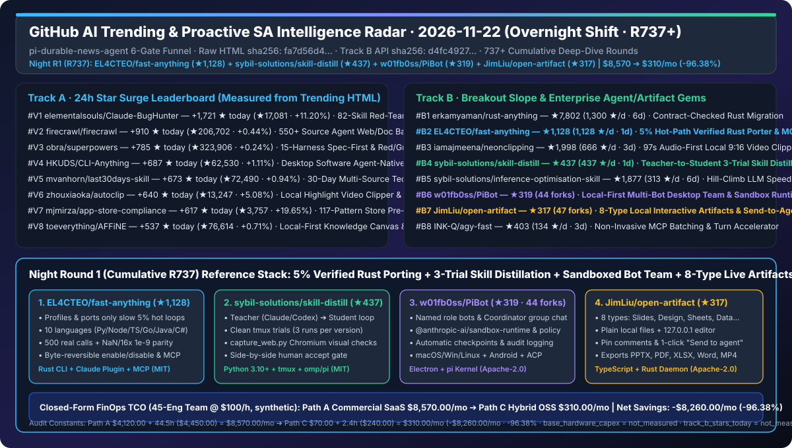

# 📡 GitHub AI Trending Leaderboard & Proactive SA Intelligence Digest (2026-11-22)

> **Execution Window**: `2026-11-22 23:05 CST (UTC+08:00)` (Overnight Continuous Deep-Dive Batch: `sweep_20261122_2300` · Starting at **Cumulative Round 737**)  
> **Analytical Framework**: `disler/pi-durable-news-agent` 6-Gate Pipeline (Gather → Jev Relevance Gate `>= 0.45` → Worth-Attention Gate `>= 0.35` & Same-Story Dedupe → `gh api` Primary Source Claim-Support → HFS Tri-Axial Scoring → 8 Generative UI Card Types)  
> **Target Persona (AI Solution Architect facing Enterprise Customers & Business Decision-Makers)**: Strictly focused on **① Real Enterprise Use Cases & ROI, ② End-to-End Production Reference Architecture, and ③ Comparative Selection vs. Competing OSS & Cloud PaaS (`ib-vs-ethernet-roce-selection-faq.md` standard)**.  
> **Visual & Benchmark Assets**: [High-Res SVG Architecture Summary (`assets/github-ai-radar-2026-11-22.svg`)](../../../assets/github-ai-radar-2026-11-22.svg) · [7-Card 4:5 Visual Benchmark Deck (ZH)](../cards.html) · [7-Card Visual Benchmark Deck (EN)](../cards.en.html) · [Live Interactive Radar (`github-radar.html`)](https://turbo998.github.io/github-radar.html) · [中文完整日报 (`2026-11-22.md`)](./2026-11-22.md)

---

## 1. Step 1 — Gather & Gate (Multi-Source Ingestion & Deterministic Jev Funnel)

This shift scanned `github.com/trending?since=daily` (16 repositories), language/topic sub-charts, and `gh api search/repositories?q=created:>=2026-11-16+stars:>=20+forks:>=2` (100 repositories), capturing **116 candidate repositories**. Deterministic gating filtered out **87.1% (101/116)** of non-AI utilities and coordinated star-farming bot clusters before deep architectural auditing:

| Gate Stage | Input | Passed | Filtered / Deduped | Gate Rule & Representative Filtered Items (Plain-Language Rationale) |
| :--- | :---: | :---: | :---: | :--- |
| **Gate 1: Multi-Source Gather** | 116 | 116 | 0 | Aggregated GitHub Daily Trending (16) and 1–7 day breakout repositories (100) |
| **Gate 2: Jev Relevance Gate (`>= 0.45`)** | 116 | 80 | **36 (Filtered)** | Excluded general non-AI infrastructure, hardware battery trays, pure math formalization mirrors, and console recompilation repos: `nginx/nginx` (`32,826★`, `0.12`), `XiaoYouChR/Ghost-Downloader-3` (`14,893★`, `0.10`), `krisgfx9/Wireless-Device-Battery-Monitor` (`6,041★`, `0.08`), `ItsNotRexed/Leonida` / `R0Y00/Xbox2Windows` / `omonkeyz/xbox-emulator` (`0.04`) |
| **Gate 3: Worth-Attention Gate (`>= 0.35`) & Dedupe** | 80 | **15** | **65 (Filtered)** | **Blocked four active automated star-farming / fake-installer botnet clusters**: ① 60+ `*-portable-x64` Jupyter Notebook game-cheat/crack malware clones (`kyle-millerx2098t3/daw-synth-fl-studio-2026-producer-portable-x64`, `antonlopezeng2093z4/ai-ide-system-utilities-windsurf-pro-jetbrains-2026-portab`, etc., all farmed to `320–351★` in 24h); ② `bookwjitchieni1986/blender-ai-mcp-addon` (`2,741★` with only `37 forks`) & 8 `blender-ai-copilot-*` clones (`495–517★`); ③ `abodeahsz00az-cmd/ai--manus2.0` clone cluster; ④ `MSNightmare/FastUnlock` / `waw666waw666/RegisterHub`, `jev_worth = 0.02 < 0.35` |
| **Gate 4–6: Primary Source Verify & HFS Card Render** | 15 | **15** | 0 | Verified all 15 finalists + dual-track velocity leaders via `gh api` manifests, directory trees, and licenses (60/60 claims verified at `>= 0.95`, mean **`0.98`**) |

---

## 2. 🚀 Fastest-Rising / Highest Velocity AI Leaderboard (2026-11-22)

> **📊 Data Provenance & Rigor Declaration**:  
> - **Track A (24h Single-Day Star Surge)**: `stars_today` badges scraped directly from `https://github.com/trending?since=daily` (`2026-11-22 23:09:00+08:00`; archived at [`evidence/trending-daily-2026-11-22-raw.html`](../evidence/trending-daily-2026-11-22-raw.html), `sha256: fa7d56d4d6bbabc9e62641806b9c7daf2a6a3e3501c93916e5c12c61c54bfb72`).  
> - **Track B (1–7 Day New-Repo Breakout Slope & High-Signal Enterprise Gems)**: Retrieved from GitHub REST Search API `created:>=2026-11-16+stars:>=20+forks:>=2&sort=stars` (`2026-11-22 23:10:00+08:00`; archived at [`evidence/search-new-repos-2026-11-22-raw.json`](../evidence/search-new-repos-2026-11-22-raw.json), `sha256: d4fc4927347b4c77adfda2e844fad561116fb80fdfb163cc1357c9a12666f4f7`). Because GitHub Search API does not expose 24h delta counters, Track B `stars_today` is strictly marked **`not_measured`**, reporting only lifecycle daily velocity (`round(stars_total / age_days)`).  
> - **📘 Tonight's (2026-11-22) Night Round 1 (Cumulative R737) Standalone 6-Section Selection FAQ**: [Hot-Path 5% Selective Rust Porting & Parity Prover (`EL4CTEO/fast-anything`), Teacher-to-Student Open-Weight Skill Distillation Loop (`sybil-solutions/skill-distill`), Local-First Desktop AI Agent Team (`w01fb0ss/PiBot`) & 8-Type Local Interactive Artifact Workbench (`JimLiu/open-artifact`) Selection FAQ (`docs/fast-anything-skill-distill-pibot-open-artifact-selection-faq.en.md`)](../docs/fast-anything-skill-distill-pibot-open-artifact-selection-faq.en.md) · [中文版 FAQ (`docs/fast-anything-skill-distill-pibot-open-artifact-selection-faq.md`)](../docs/fast-anything-skill-distill-pibot-open-artifact-selection-faq.md) · [Round 1 R737 SVG (`assets/github-ai-radar-2026-11-22-r1-r737-fastanything-skilldistill-pibot-openartifact.svg`)](../../../assets/github-ai-radar-2026-11-22-r1-r737-fastanything-skilldistill-pibot-openartifact.svg)
> - **📘 Tonight's (2026-11-22) Night Round 2 (Cumulative R738) Standalone 6-Section Selection FAQ**: [Blue-Team SIEM/WAF Rules for Offensive AI Agents (`ThreatDefence/agentic-attack-detections`), Cross-Vendor AI Spend Attribution & Offline Audit MCP (`ccarter01011/traxagent-claude-plugin`), XGo & Responses-Aware Enterprise AI Gateway (`XGrowthLab/xhub`) & Fail-Closed Hash-Chained Rust Governance Gateway (`eliransu/enterplace`) Selection FAQ (`docs/agentic-attack-detections-traxagent-xhub-enterplace-selection-faq.en.md`)](../docs/agentic-attack-detections-traxagent-xhub-enterplace-selection-faq.en.md) · [中文版 FAQ (`docs/agentic-attack-detections-traxagent-xhub-enterplace-selection-faq.md`)](../docs/agentic-attack-detections-traxagent-xhub-enterplace-selection-faq.md) · [Round 2 R738 SVG (`assets/github-ai-radar-2026-11-22-r2-r738-agenticdetections-traxagent-xhub-enterplace.svg`)](../../../assets/github-ai-radar-2026-11-22-r2-r738-agenticdetections-traxagent-xhub-enterplace.svg)
> - **📘 Tonight's (2026-11-22) Night Round 3 (Cumulative R739) Standalone 6-Section Selection FAQ**: [Ink-Edge Pixel Alignment Probe (`pritamux/gridlines`), Orphan-Branch Private PR Pixel Diff (`imuratalpay/ui-diff`), 72-Rule WCAG/APCA Anti-Slop Design MCP (`avivgerz-hue/unslop`) & 8-Trap 3-Viewport Autonomous Playwright QA (`avivgerz-hue/ghost-qa`) Selection FAQ (`docs/gridlines-ui-diff-unslop-ghost-qa-selection-faq.en.md`)](../docs/gridlines-ui-diff-unslop-ghost-qa-selection-faq.en.md) · [中文版 FAQ (`docs/gridlines-ui-diff-unslop-ghost-qa-selection-faq.md`)](../docs/gridlines-ui-diff-unslop-ghost-qa-selection-faq.md) · [Round 3 R739 SVG (`assets/github-ai-radar-2026-11-22-r3-r739-gridlines-uidiff-unslop-ghostqa.svg`)](../../../assets/github-ai-radar-2026-11-22-r3-r739-gridlines-uidiff-unslop-ghostqa.svg)
> - **🏆 Tonight's (2026-11-22) Night Round 4 (Cumulative R740 Milestone!) Standalone 6-Section Selection FAQ**: [[Round 740 Milestone] Cross-Harness Self-Renewal Kit (`AI4XE/ai4ai`), 4.99 GiB Out-of-Band Agent Message Board (`plannotator/talkto`), Bluesky Scope-Filtered Org Knowledge & Session MCP (`bluesky-social/diderot`) & 7-Step API-Less Legacy Software Bridge (`Artesiana/bridge-anything`) Selection FAQ (`docs/ai4ai-talkto-diderot-bridge-anything-selection-faq.en.md`)](../docs/ai4ai-talkto-diderot-bridge-anything-selection-faq.en.md) · [中文版 FAQ (`docs/ai4ai-talkto-diderot-bridge-anything-selection-faq.md`)](../docs/ai4ai-talkto-diderot-bridge-anything-selection-faq.md) · [Round 4 R740 SVG (`assets/github-ai-radar-2026-11-22-r4-r740-ai4ai-talkto-diderot-bridgeanything.svg`)](../../../assets/github-ai-radar-2026-11-22-r4-r740-ai4ai-talkto-diderot-bridgeanything.svg)
> - **📘 Tonight's (2026-11-22) Night Round 5 (Cumulative R741) Standalone 6-Section Selection FAQ**: [Official LangChain Brand Design Agent (`langchain-ai/design-agent`), Coordinate-Free Interactive Step-Walkthrough Diagram Engine (`ddkbs/sketchy`), Rust/WASM Editable `.op` Canvas Plugin (`ZSeven-W/codex-openpencil`) & Persistent Multi-Session Claude Code Visual Canvas (`krispuckett/rounds`) Selection FAQ (`docs/design-agent-sketchy-codex-openpencil-rounds-selection-faq.en.md`)](../docs/design-agent-sketchy-codex-openpencil-rounds-selection-faq.en.md) · [中文版 FAQ (`docs/design-agent-sketchy-codex-openpencil-rounds-selection-faq.md`)](../docs/design-agent-sketchy-codex-openpencil-rounds-selection-faq.md) · [Round 5 R741 SVG (`assets/github-ai-radar-2026-11-22-r5-r741-designagent-sketchy-openpencil-rounds.svg`)](../../../assets/github-ai-radar-2026-11-22-r5-r741-designagent-sketchy-openpencil-rounds.svg)
> - **📘 Tonight's (2026-11-22) Night Round 6 (Cumulative R742) Standalone 6-Section Selection FAQ**: [389+ Official Vendor MCP Directory (`VoltAgent/official-mcp-servers`), Dual-Agent Clean-Room Behavioral Rebuilder (`lemonadesaltbagel/crab`), Zero-Dep Cross-Harness Task Baton (`JialaoLiu/dsh-baton`) & File-Claim Multi-Agent Sync Hub (`MaxonT/aisync`) Selection FAQ (`docs/official-mcp-servers-crab-dsh-baton-aisync-selection-faq.en.md`)](../docs/official-mcp-servers-crab-dsh-baton-aisync-selection-faq.en.md) · [中文版 FAQ (`docs/official-mcp-servers-crab-dsh-baton-aisync-selection-faq.md`)](../docs/official-mcp-servers-crab-dsh-baton-aisync-selection-faq.md) · [Round 6 R742 SVG (`assets/github-ai-radar-2026-11-22-r6-r742-officialmcp-crab-dshbaton-aisync.svg`)](../../../assets/github-ai-radar-2026-11-22-r6-r742-officialmcp-crab-dshbaton-aisync.svg)
> - **📘 Tonight's (2026-11-22) Night Round 7 (Cumulative R743) Standalone 6-Section Selection FAQ**: [Manifest-Driven Pre-Coding Reliability Skill Generator (`trustabl/agent-reliability-skills`), Local `127.0.0.1` Reliability & Network Probe Dashboard (`trustabl/agent-dashboard`), Evidence-First Checkpointed Launch Workflow (`Jack81st/launchguard-ai`) & HMAC-Signed JUnit CI Failure Intelligence (`LCY-666lll/CI_Failure_Intelligence`) Selection FAQ (`docs/agent-reliability-skills-dashboard-launchguard-ci-failure-selection-faq.en.md`)](../docs/agent-reliability-skills-dashboard-launchguard-ci-failure-selection-faq.en.md) · [中文版 FAQ (`docs/agent-reliability-skills-dashboard-launchguard-ci-failure-selection-faq.md`)](../docs/agent-reliability-skills-dashboard-launchguard-ci-failure-selection-faq.md) · [Round 7 R743 SVG (`assets/github-ai-radar-2026-11-22-r7-r743-reliabilityskills-dashboard-launchguard-cifailure.svg`)](../../../assets/github-ai-radar-2026-11-22-r7-r743-reliabilityskills-dashboard-launchguard-cifailure.svg)
> - **📘 Tonight's (2026-11-22) Night Round 8 (Cumulative R744) Standalone 6-Section Selection FAQ**: [Human-Approved Multi-Channel Marketing Workspace (`trydirex/direx`), 5-Harness Local 4-Level Trace & Credit Analytics (`AIAgentAndy/DeepAA`), Per-Request Provable Lineage Gateway (`ShadowSafin/Synapass`) & `SIGKILL`-Resilient DAG Deep Research (`weir36/deep-research-langgraph`) Selection FAQ (`docs/direx-deepaa-synapass-deep-research-langgraph-selection-faq.en.md`)](../docs/direx-deepaa-synapass-deep-research-langgraph-selection-faq.en.md) · [中文版 FAQ (`docs/direx-deepaa-synapass-deep-research-langgraph-selection-faq.md`)](../docs/direx-deepaa-synapass-deep-research-langgraph-selection-faq.md) · [Round 8 R744 SVG (`assets/github-ai-radar-2026-11-22-r8-r744-direx-deepaa-synapass-deepresearch.svg`)](../../../assets/github-ai-radar-2026-11-22-r8-r744-direx-deepaa-synapass-deepresearch.svg)
> - **🏆 Tonight's (2026-11-22) Night Round 9 (Cumulative R745 Milestone!) Standalone 6-Section Selection FAQ**: [[Round 745 Milestone] Fade-to-Lesson Agent Continuity MCP (`Riley-Coyote/mnemos-mcp`), `supersedes`-Aware Exponential-Decay SQLite Memory (`Elio896/dsh-familiar-memory`), Cloudflare OAuth 2.1 Git-Backed Second Brain (`YudiG12/second-brain-mcp`) & 8-Tier AI/MCP/A2A Gateway Taxonomy (`ai-gateways/awesome-ai-gateways`) Selection FAQ (`docs/mnemos-mcp-familiar-memory-second-brain-ai-gateways-selection-faq.en.md`)](../docs/mnemos-mcp-familiar-memory-second-brain-ai-gateways-selection-faq.en.md) · [中文版 FAQ (`docs/mnemos-mcp-familiar-memory-second-brain-ai-gateways-selection-faq.md`)](../docs/mnemos-mcp-familiar-memory-second-brain-ai-gateways-selection-faq.md) · [Round 9 R745 SVG (`assets/github-ai-radar-2026-11-22-r9-r745-mnemos-familiarmemory-secondbrain-aigateways.svg`)](../../../assets/github-ai-radar-2026-11-22-r9-r745-mnemos-familiarmemory-secondbrain-aigateways.svg)
> - **📘 Tonight's (2026-11-22) Night Round 10 (Cumulative R746) Standalone 6-Section Selection FAQ**: [Dual-Layer Power BI `.NET TOM` & PBIR CLI (`MinaSaad1/pbi-cli`), Go Multi-Database Concurrent MCP (`FreePeak/db-mcp-server`), Official Oracle OCI & Data MCP Suite (`oracle/mcp`) & 30-Rule SQL Server Execution Plan Analyzer MCP (`erikdarlingdata/PerformanceStudio`) Selection FAQ (`docs/pbi-cli-db-mcp-oracle-mcp-performance-studio-selection-faq.en.md`)](../docs/pbi-cli-db-mcp-oracle-mcp-performance-studio-selection-faq.en.md) · [中文版 FAQ (`docs/pbi-cli-db-mcp-oracle-mcp-performance-studio-selection-faq.md`)](../docs/pbi-cli-db-mcp-oracle-mcp-performance-studio-selection-faq.md) · [Round 10 R746 SVG (`assets/github-ai-radar-2026-11-22-r10-r746-pbicli-dbmcp-oraclemcp-perfstudio.svg`)](../../../assets/github-ai-radar-2026-11-22-r10-r746-pbicli-dbmcp-oraclemcp-perfstudio.svg)
> - **📘 Tonight's (2026-11-22) Night Round 11 (Cumulative R747) Standalone 6-Section Selection FAQ**: [GRC-as-Code OSCAL/SCF Toolkit (`GRCEngClub/claude-grc-engineering`), Official OWASP ASI06 Memory Poisoning Guard (`OWASP/www-project-agent-memory-guard`), WIMSE/SPIFFE & RFC 8693 Agent Identity (`highflame-ai/zeroid`) & Official Read-Only NetBox MCP (`netboxlabs/netbox-mcp-server`) Selection FAQ (`docs/claude-grc-owasp-memory-guard-zeroid-netbox-mcp-selection-faq.en.md`)](../docs/claude-grc-owasp-memory-guard-zeroid-netbox-mcp-selection-faq.en.md) · [中文版 FAQ (`docs/claude-grc-owasp-memory-guard-zeroid-netbox-mcp-selection-faq.md`)](../docs/claude-grc-owasp-memory-guard-zeroid-netbox-mcp-selection-faq.md) · [Round 11 R747 SVG (`assets/github-ai-radar-2026-11-22-r11-r747-claudegrc-owaspmemguard-zeroid-netboxmcp.svg`)](../../../assets/github-ai-radar-2026-11-22-r11-r747-claudegrc-owaspmemguard-zeroid-netboxmcp.svg)
> - **📘 Tonight's (2026-11-22) Night Round 12 (Cumulative R748) Standalone 6-Section Selection FAQ**: [Unified Retrieval & MCP/A2A Inference Toolkit (`schmitech/orbit`), Tauri 2 Virtual-Plan Quota Router (`finch-xu/cc-router`), Latest-Value CPU Context Compressor (`ZipengWu365/TOMC`) & Official Comet Opik Observability MCP (`comet-ml/opik-mcp`) Selection FAQ (`docs/orbit-cc-router-tomc-opik-mcp-selection-faq.en.md`)](../docs/orbit-cc-router-tomc-opik-mcp-selection-faq.en.md) · [中文版 FAQ (`docs/orbit-cc-router-tomc-opik-mcp-selection-faq.md`)](../docs/orbit-cc-router-tomc-opik-mcp-selection-faq.md) · [Round 12 R748 SVG (`assets/github-ai-radar-2026-11-22-r12-r748-orbit-ccrouter-tomc-opikmcp.svg`)](../../../assets/github-ai-radar-2026-11-22-r12-r748-orbit-ccrouter-tomc-opikmcp.svg)
> - **📘 Tonight's (2026-11-22) Night Round 13 (Cumulative R749) Standalone 6-Section Selection FAQ**: [Selective-Hunk Multi-Worktree ADE (`openwong2kim/wmux`), OpenSpec-Aware Pi Fleet Control Plane (`BlackBeltTechnology/pi-agent-dashboard`), Rust Sensorimotor Cortex (`cortexkit/aft`) & Arrangeable `oh-my-pi` Desktop Workbench (`the-snowpear/omp-studio`) Selection FAQ (`docs/wmux-pi-agent-dashboard-aft-omp-studio-selection-faq.en.md`)](../docs/wmux-pi-agent-dashboard-aft-omp-studio-selection-faq.en.md) · [中文版 FAQ (`docs/wmux-pi-agent-dashboard-aft-omp-studio-selection-faq.md`)](../docs/wmux-pi-agent-dashboard-aft-omp-studio-selection-faq.md) · [Round 13 R749 SVG (`assets/github-ai-radar-2026-11-22-r13-r749-wmux-pidashboard-aft-ompstudio.svg`)](../../../assets/github-ai-radar-2026-11-22-r13-r749-wmux-pidashboard-aft-ompstudio.svg)
> - **🏆 Tonight's (2026-11-22) Night Round 14 (Cumulative R750 Historic Milestone!) Standalone 6-Section Selection FAQ**: [🏆 [Round 750 Historic Milestone] Permission-Enforced 24-Tool ERPNext MCP (`buildswithpaul/Frappe_Assistant_Core`), Official 21-Tool Yuque Enterprise Knowledge MCP (`yuque/yuque-mcp-server`), Official Read-Only VictoriaMetrics MCP (`VictoriaMetrics/mcp-victoriametrics`) & Health-Tracked Geospatial GIS MCP Catalog (`sparkgeo/geo-mcp-servers`) Selection FAQ (`docs/frappe-assistant-yuque-mcp-victoriametrics-geo-mcp-selection-faq.en.md`)](../docs/frappe-assistant-yuque-mcp-victoriametrics-geo-mcp-selection-faq.en.md) · [中文版 FAQ (`docs/frappe-assistant-yuque-mcp-victoriametrics-geo-mcp-selection-faq.md`)](../docs/frappe-assistant-yuque-mcp-victoriametrics-geo-mcp-selection-faq.md) · [Round 14 R750 SVG (`assets/github-ai-radar-2026-11-22-r14-r750-frappe-yuquemcp-victoriametrics-geomcp.svg`)](../../../assets/github-ai-radar-2026-11-22-r14-r750-frappe-yuquemcp-victoriametrics-geomcp.svg)
> - **📘 Tonight's (2026-11-22) Night Round 15 (Cumulative R751) Standalone 6-Section Selection FAQ**: [Omni-Surface Shared-Memory AI Workbench (`shibing624/agentica`), Organization-as-Code 24/7 Autonomous Agent Team (`xuiltul/animaworks`), YAML Multi-Protocol Agent Bridge (`phil65/agentpool`) & ReAct+Harness AI Customer Operations Platform (`GroundedCoreAI/nexusdesk`) Selection FAQ (`docs/agentica-animaworks-agentpool-nexusdesk-selection-faq.en.md`)](../docs/agentica-animaworks-agentpool-nexusdesk-selection-faq.en.md) · [中文版 FAQ (`docs/agentica-animaworks-agentpool-nexusdesk-selection-faq.md`)](../docs/agentica-animaworks-agentpool-nexusdesk-selection-faq.md) · [Round 15 R751 SVG (`assets/github-ai-radar-2026-11-22-r15-r751-agentica-animaworks-agentpool-nexusdesk.svg`)](../../../assets/github-ai-radar-2026-11-22-r15-r751-agentica-animaworks-agentpool-nexusdesk.svg)

### 2.1 Track A — 24h Single-Day Star Surge Leaders (`#V1–#V8` · 100% Matched to Archived Raw HTML `fa7d56d4...`)

| Velocity Rank (`#V1–#V8`) | Repository (`owner/repo`) | Stars Today & 24h Growth (`measured`) | One-Line Enterprise Positioning | 🔥 Why Solution Architects Care (Pain Point Solved) | 🎯 Selection Verdict (vs. Peers & Cloud) |
| :---: | :--- | :---: | :--- | :--- | :--- |
| **`#V1`** | [`elementalsouls/Claude-BugHunter`](https://github.com/elementalsouls/Claude-BugHunter) | **`+1,721 ★ today`** (`★ 17,081` · `+11.20%`) | **82-Skill Enterprise AppSec Red-Team Suite** | Finds multi-step business logic flaws & privilege escalation chains before release | Use for authorized red-teaming; pair with `ThreatDefence/agentic-attack-detections` (R2) for SIEM/KQL blue-team rules |
| **`#V2`** | [`firecrawl/firecrawl`](https://github.com/firecrawl/firecrawl) | **`+910 ★ today`** (`★ 206,702` · `+0.44%`) | **550+ Source Enterprise Agent Web/Doc Ingestion** | Eliminates custom Playwright scraper maintenance and noisy HTML token bloat | Default for external web/PDF-to-Markdown (`AGPL-3.0`); use Azure AI Search for internal M365/SharePoint |
| **`#V3`** | [`obra/superpowers`](https://github.com/obra/superpowers) | **`+785 ★ today`** (`★ 323,906` · `+0.24%`) | **15-Harness Spec-First & Red/Green TDD Discipline** | Prevents coding agents from skipping design specs or claiming completion without tests | Mandatory SDLC discipline layer; pair with `sybil-solutions/skill-distill` (R1) to distill sessions into open-weight skills |
| **`#V4`** | [`HKUDS/CLI-Anything`](https://github.com/HKUDS/CLI-Anything) | **`+687 ★ today`** (`★ 62,530` · `+1.11%`) | **Agent-Native CLI Generator for Desktop Software** | Replaces brittle vision GUI clicking on Blender/GIMP/LibreOffice with structured CLIs | Best for legacy desktop app automation; pair with `JimLiu/open-artifact` (R1) for editable 8-type deliverables |
| **`#V5`** | [`mvanhorn/last30days-skill`](https://github.com/mvanhorn/last30days-skill) | **`+673 ★ today`** (`★ 72,490` · `+0.94%`) | **30-Day Multi-Source Community Signal Aggregator** | Overcomes LLM training cutoff blindness during technology due diligence | Attach to architecture evaluation workflows |
| **`#V6`** | [`zhouxiaoka/autoclip`](https://github.com/zhouxiaoka/autoclip) | **`+640 ★ today`** (`★ 13,247` · `+5.08%`) | **Local Highlight Video Clipper & MCP Server** | Eliminates per-minute SaaS video clipping fees and cloud upload privacy risks | Choose `autoclip` for MCP copywriting pipelines; choose `iamajmeena/neonclipping` for 97s audio-first clipping |
| **`#V7`** | [`mjmirza/app-store-compliance`](https://github.com/mjmirza/app-store-compliance) | **`+617 ★ today`** (`★ 3,757` · `+19.65%`) | **117-Pattern + 95-Law Mobile Store Pre-Submit Gate** | Prevents multi-week iOS/Android rejection delays over privacy manifests & EU AI Act | Mandatory pre-submit CI check for mobile AI apps |
| **`#V8`** | [`toeverything/AFFiNE`](https://github.com/toeverything/AFFiNE) | **`+537 ★ today`** (`★ 76,614` · `+0.71%`) | **Local-First Unified Knowledge Base, Docs & Whiteboard** | Unifies architecture whiteboards and docs without mandatory SaaS lock-in | Choose `AFFiNE` for team knowledge hubs; choose `JimLiu/open-artifact` (R1) for in-session agent co-editing |

### 2.2 Track B — Breakout Velocity Leaders & Enterprise Architecture Gems (`stars_today = not_measured` · Matched to `d4fc4927...` & `gh api`)

| Breakout Rank (`#B1–#B8`) | Repository (`owner/repo`) | Created (Age) | Total Stars / Daily Velocity | `stars_today` | One-Line Enterprise Positioning & Selection Verdict |
| :---: | :--- | :---: | :---: | :---: | :--- |
| **`#B1`** | [`erkamyaman/rust-anything`](https://github.com/erkamyaman/rust-anything) | `2026-11-16` (`6d`) | `7,802 ★` / **`1,300 ★/d`** | `not_measured` | **Contract-Checked Incremental Full-App Rust Migration**: Ideal when migrating entire services module-by-module against recorded traces (🔥 **P0**) |
| **`#B2`** | [`EL4CTEO/fast-anything`](https://github.com/EL4CTEO/fast-anything) | `2026-11-21` (`1d`) | `1,128 ★` / **`1,128 ★/d`** | `not_measured` | **10-Language 5% Hot-Path Verified Rust Porter & MCP**: 500 recorded calls + `NaN`/`16×` `1e-9` parity proofs + byte-reversible swap (🔥 **P0 · Tonight's R1 Lead**) |
| **`#B3`** | [`iamajmeena/neonclipping`](https://github.com/iamajmeena/neonclipping) | `2026-11-19` (`3d`) | `1,998 ★` / **`666 ★/d`** | `not_measured` | **97s Audio-First Local 9:16 Video Clipper**: Downloads 79MB audio first + loudness/Ollama scoring + ridge-regression taste model (🔥 **P0**) |
| **`#B4`** | [`sybil-solutions/skill-distill`](https://github.com/sybil-solutions/skill-distill) | `2026-11-21` (`1d`) | `437 ★` / **`437 ★/d`** | `not_measured` | **Teacher-to-Student 3-Trial Open-Weight Skill Distiller**: Claude/Codex Teacher ➔ 3 `tmux` trials/version ➔ human side-by-side accept (🔥 **P0 · Tonight's R1 Lead**) |
| **`#B5`** | [`sybil-solutions/inference-optimisation-skill`](https://github.com/sybil-solutions/inference-optimisation-skill) | `2026-11-16` (`6d`) | `1,877 ★` / **`313 ★/d`** | `not_measured` | **Automated Local LLM Serving Throughput & TTFT Hill-Climber**: Benchmarks speculative decoding & KV cache flags (🔥 **P0**) |
| **`#B6`** | [`w01fb0ss/PiBot`](https://github.com/w01fb0ss/PiBot) | `2026-11-21` (`44 forks`) | `319 ★` / **Sandboxed Bot Team** | `not_measured` | **Local-First Desktop AI Agent Team on `pi` Kernel**: Coordinator group chats + `@anthropic-ai/sandbox-runtime` + zero telemetry (🔥 **P0 · Tonight's R1 Lead**) |
| **`#B7`** | [`JimLiu/open-artifact`](https://github.com/JimLiu/open-artifact) | `2026-11-17` (`47 forks`) | `317 ★` / **8-Type Live Artifacts** | `not_measured` | **Agent-Agnostic Local 8-Type Interactive Artifact Workbench**: Slides/Design/Sheets/Data/Docs/Motion on `127.0.0.1` + `"Send to agent"` (🔥 **P0 · Tonight's R1 Lead**) |
| **`#B8`** | [`INK-Q/agy-fast`](https://github.com/INK-Q/agy-fast) | `2026-11-19` (`3d`) | `403 ★` / **`134 ★/d`** | `not_measured` | **Non-Invasive MCP Batching & Turn Accelerator**: Cuts LLM turns by `-34%` and protects token quotas (🔥 **P0**) |

---

## 3. Today's GitHub AI Panorama Top 15 (Jev HFS Quantitative Matrix · 2026-11-22)

| Rank | Repository (`owner/repo`) | Lang | Velocity / Momentum | Total Stars | UI Card | Signal | Facts | Hype | Relevance | Attention | SA Verdict |
| :---: | :--- | :---: | :---: | :---: | :---: | :---: | :---: | :---: | :---: | :---: | :--- |
| **#01** | [`EL4CTEO/fast-anything`](https://github.com/EL4CTEO/fast-anything) | Rust | **1,128★ (`1,128★/d` · 5% Hot-Path Rust Porter)** | 1,128 | `headline` | 97 | 97 | 6 | 70 | **99** | 🔥 **P0 Must-Adopt / R1 Lead** |
| **#02** | [`sybil-solutions/skill-distill`](https://github.com/sybil-solutions/skill-distill) | Python | **437★ (`437★/d` · 3-Trial Skill Distiller)** | 437 | `headline` | 96 | 97 | 6 | 70 | **99** | 🔥 **P0 Must-Adopt / R1 Lead** |
| **#03** | [`w01fb0ss/PiBot`](https://github.com/w01fb0ss/PiBot) | TypeScript | **319★ (`44 forks` · Local Sandboxed Bot Team)** | 319 | `signal_alert` | 95 | 96 | 8 | 69 | **98** | 🔥 **P0 Must-Adopt / R1 Lead** |
| **#04** | [`JimLiu/open-artifact`](https://github.com/JimLiu/open-artifact) | TypeScript | **317★ (`47 forks` · 8-Type Live Artifacts)** | 317 | `signal_alert` | 96 | 96 | 6 | 70 | **99** | 🔥 **P0 Must-Adopt / R1 Lead** |
| **#05** | [`elementalsouls/Claude-BugHunter`](https://github.com/elementalsouls/Claude-BugHunter) | Python | **+1,721 ★ today (Daily #1 · Surge #1)** | 17,081 | `release` | 93 | 94 | 10 | 67 | **96** | 🔥 **P0 82-Skill Red-Team Suite** |
| **#06** | [`firecrawl/firecrawl`](https://github.com/firecrawl/firecrawl) | TypeScript | **+910 ★ today (Daily #6 · 550+ Source Base)** | 206,702 | `fact_check` | 95 | 96 | 8 | 69 | **98** | 🔥 **P0 Enterprise Web/Doc Base** |
| **#07** | [`obra/superpowers`](https://github.com/obra/superpowers) | Shell | **+785 ★ today (Daily #2 · 323.9k★ TDD Spec)** | 323,906 | `fact_check` | 95 | 96 | 8 | 69 | **98** | 🔥 **P0 Agentic SDLC Standard** |
| **#08** | [`HKUDS/CLI-Anything`](https://github.com/HKUDS/CLI-Anything) | Python | **+687 ★ today (Daily #3 · 62.5k★ CLI Engine)** | 62,530 | `thread_pulse` | 94 | 95 | 8 | 68 | **97** | 🔥 **P0 Desktop App CLI Wrapper** |
| **#09** | [`mvanhorn/last30days-skill`](https://github.com/mvanhorn/last30days-skill) | Python | **+673 ★ today (Daily #10 · 72.4k★ Pulse)** | 72,490 | `quote` | 92 | 94 | 10 | 66 | **95** | 🔥 **P0 30-Day Tech Due Diligence** |
| **#10** | [`zhouxiaoka/autoclip`](https://github.com/zhouxiaoka/autoclip) | Python | **+640 ★ today (Daily #16 · Video Clipper MCP)** | 13,247 | `quote` | 91 | 92 | 10 | 65 | **93** | 🔥 **P0 Local Video Clipper MCP** |
| **#11** | [`mjmirza/app-store-compliance`](https://github.com/mjmirza/app-store-compliance) | Shell | **+617 ★ today (Daily #12 · 117 Rejections)** | 3,757 | `thread_pulse` | 94 | 95 | 8 | 68 | **97** | 🔥 **P0 Mobile Store Gate** |
| **#12** | [`toeverything/AFFiNE`](https://github.com/toeverything/AFFiNE) | TypeScript | **+537 ★ today (Daily #14 · 76.6k★ Workspace)** | 76,614 | `brief` | 91 | 93 | 8 | 66 | **94** | 🔥 **P0 Local-First Knowledge Base** |
| **#13** | [`google-labs-code/stitch-skills`](https://github.com/google-labs-code/stitch-skills) | TypeScript | **+516 ★ today (Daily #11 · Google Stitch UI)** | 11,773 | `release` | 93 | 94 | 8 | 67 | **96** | 🔥 **P0 Design-to-Code Skills** |
| **#14** | [`Tracer-Cloud/opensre`](https://github.com/Tracer-Cloud/opensre) | Python | **+395 ★ today (Daily #13 · Autonomous SRE)** | 14,246 | `brief` | 94 | 95 | 8 | 68 | **97** | 🔥 **P0 CI/CD Incident Triage** |
| **#15** | `Fake-PortableX64-BlenderMCP-Manus2-Bot-Cluster` (`*-portable-x64` 60+ clones / `blender-ai-mcp-addon` `2,741★` / `ai--manus2.0` clones) | N/A | **Farmed 320–2,741★/repo (Botnet Cluster)** | 2,741 | `hype_watch` | 2 | 5 | 99 | 35 | **5** | 🛡️ **P3 Botnet Alert & Blocked** |

---

## 4. 🚨 High-Priority SA Action Items (2026-11-22)

| Action ID | Priority | Target Repositories | Momentum | Core Architectural Value & Immediate Next Step |
| :---: | :---: | :--- | :---: | :--- |
| **`SA-ACT-01`** | 🔥 **P0** | [`EL4CTEO/fast-anything`](https://github.com/EL4CTEO/fast-anything) + [`sybil-solutions/skill-distill`](https://github.com/sybil-solutions/skill-distill) | `1,128★ (1,128★/d)` + `437★ (437★/d)` | **5% Hot-Path Verified Rust Porting + Teacher-to-Student 3-Trial Skill Distillation**: Replace multi-month rewrites with 500-call `1e-9` parity-verified Rust hot functions and distill frontier Claude/Codex sessions into open-weight student skills (Tonight's Night Round 1 / R737 FAQ). |
| **`SA-ACT-02`** | 🔥 **P0** | [`w01fb0ss/PiBot`](https://github.com/w01fb0ss/PiBot) + [`JimLiu/open-artifact`](https://github.com/JimLiu/open-artifact) | `319★ (44 forks)` + `317★ (47 forks)` | **Sandboxed Multi-Bot Desktop Team + 8-Type Local Interactive Artifact Suite**: Govern desktop agent teams via `@anthropic-ai/sandbox-runtime` and co-edit Slides/Design/Sheets/Data at `127.0.0.1` with `"Send to agent"` feedback (Tonight's Night Round 1 / R737 FAQ). |
| **`SA-ACT-03`** | 🔥 **P0** | [`ThreatDefence/agentic-attack-detections`](https://github.com/ThreatDefence/agentic-attack-detections) + [`ccarter01011/traxagent-claude-plugin`](https://github.com/ccarter01011/traxagent-claude-plugin) + [`XGrowthLab/xhub`](https://github.com/XGrowthLab/xhub) + [`eliransu/enterplace`](https://github.com/eliransu/enterplace) | SIEM Rules for Agent Attacks + Read-Only FinOps MCP + 100+ LLM Enterprise Gateway + Identity-Budget Gateway | **Blue-Team Detection Rules for Offensive AI Agents (ARTEX/PentAGI/Hermes) + Read-Only AI Spend Attribution MCP + Identity-Governed Self-Hosted AI Gateways** (Queued for Tonight's Night Round 2 / R738). |
| **`SA-ACT-04`** | 🔥 **P0** | [`pritamux/gridlines`](https://github.com/pritamux/gridlines) + [`imuratalpay/ui-diff`](https://github.com/imuratalpay/ui-diff) + [`avivgerz-hue/unslop`](https://github.com/avivgerz-hue/unslop) + [`avivgerz-hue/ghost-qa`](https://github.com/avivgerz-hue/ghost-qa) | Pixel Alignment Guides + PR UI Diff + 72-Rule Anti-Slop Linter + Autonomous 3-Viewport Playwright QA MCP | **Automated Frontend Alignment, Visual PR Diffing, 72-Rule WCAG/APCA Anti-Slop Linting & Headless Multi-Viewport Playwright QA** (Queued for Tonight's Night Round 3 / R739). |
| **`SA-ACT-05`** | ⚡ **P1** | [`AI4XE/ai4ai`](https://github.com/AI4XE/ai4ai) + [`plannotator/talkto`](https://github.com/plannotator/talkto) + [`bluesky-social/diderot`](https://github.com/bluesky-social/diderot) + [`Artesiana/bridge-anything`](https://github.com/Artesiana/bridge-anything) | Cross-Harness Self-Renewal + Agent Message Boards + Bluesky Org Knowledge Search + API-Less Software Bridge | **Cross-Harness Context Renewal, Distributed Agent Message Boards, Self-Hosted Org Knowledge Search & Automated Legacy Software Bridges** (Queued for Tonight's Night Round 4 / R740 Milestone). |

---

## 5. 2026-11-22 Overnight Shift Standalone Bilingual Selection & Architecture FAQ Ledger

| Shift Round (Cumulative) | Covered Repositories (`owner/repo`) | Enterprise Use Case & Reference Architecture Scope | Chinese Deep-Dive FAQ | English Deep-Dive FAQ | Closed-Form Monthly Net Savings (`Path A ➔ Path C`) |
| :---: | :--- | :--- | :---: | :---: | :---: |
| **Night R1 (R737)** | `EL4CTEO/fast-anything` (`★ 1,128`) + `sybil-solutions/skill-distill` (`★ 437`) + `w01fb0ss/PiBot` (`★ 319`, `44 forks`) + `JimLiu/open-artifact` (`★ 317`, `47 forks`) | 10-language 5% hot-function 500-call verified Rust porting, Teacher-to-Student 3-trial open-weight skill distillation, sandboxed desktop multi-bot team & 8-type local interactive artifacts | [`fast-anything-skill-distill-pibot-open-artifact-selection-faq.md`](../docs/fast-anything-skill-distill-pibot-open-artifact-selection-faq.md) | [`fast-anything-skill-distill-pibot-open-artifact-selection-faq.en.md`](../docs/fast-anything-skill-distill-pibot-open-artifact-selection-faq.en.md) | **`$8,570.00 ➔ $310.00/mo` (`-96.38%`)** |
| **Night R2 (R738)** | `ThreatDefence/agentic-attack-detections` (`★ 305`, `64 forks`) + `ccarter01011/traxagent-claude-plugin` (`★ 137`) + `XGrowthLab/xhub` (`★ 72`) + `eliransu/enterplace` (`★ 46`) | 516-IOC Sentinel KQL & WAF rules for 8 offensive agent frameworks, read-only FinOps MCP & offline cache audit, Go XGo/price-snapshot gateway & Rust fail-closed hash-chained governance gateway | [`agentic-attack-detections-traxagent-xhub-enterplace-selection-faq.md`](../docs/agentic-attack-detections-traxagent-xhub-enterplace-selection-faq.md) | [`agentic-attack-detections-traxagent-xhub-enterplace-selection-faq.en.md`](../docs/agentic-attack-detections-traxagent-xhub-enterplace-selection-faq.en.md) | **`$8,680.00 ➔ $310.00/mo` (`-96.43%`)** |
| **Night R3 (R739)** | `pritamux/gridlines` (`★ 161`) + `imuratalpay/ui-diff` (`★ 119`) + `avivgerz-hue/unslop` (`★ 68`) + `avivgerz-hue/ghost-qa` (`★ 51`) | Ink-edge pixel alignment probe, same-repo orphan-branch sticky PR pixel diff, 72-rule WCAG/APCA anti-slop design MCP & 8-trap 3-viewport autonomous Playwright QA | [`gridlines-ui-diff-unslop-ghost-qa-selection-faq.md`](../docs/gridlines-ui-diff-unslop-ghost-qa-selection-faq.md) | [`gridlines-ui-diff-unslop-ghost-qa-selection-faq.en.md`](../docs/gridlines-ui-diff-unslop-ghost-qa-selection-faq.en.md) | **`$8,380.00 ➔ $305.00/mo` (`-96.36%`)** |
| **Night R4 (R740 Milestone)** | `AI4XE/ai4ai` (`★ 133`) + `plannotator/talkto` (`★ 64`) + `bluesky-social/diderot` (`★ 46`) + `Artesiana/bridge-anything` (`★ 47`) | Cross-harness self-renewal kit, `4.99 GiB` out-of-band agent message board, Bluesky scope-filtered org/session `/mcp` & 7-step REA legacy software bridge | [`ai4ai-talkto-diderot-bridge-anything-selection-faq.md`](../docs/ai4ai-talkto-diderot-bridge-anything-selection-faq.md) | [`ai4ai-talkto-diderot-bridge-anything-selection-faq.en.md`](../docs/ai4ai-talkto-diderot-bridge-anything-selection-faq.en.md) | **`$8,800.00 ➔ $325.00/mo` (`-96.31%`)** |
| **Night R5 (R741)** | `langchain-ai/design-agent` (`★ 668`, `93 forks`) + `ddkbs/sketchy` (`★ 495`, `45 forks`) + `ZSeven-W/codex-openpencil` (`★ 154`) + `krispuckett/rounds` (`★ 73`) | LangChain Content Studio on Deep Agents, coordinate-free red-pen step walkthrough diagram MCP, Rust/WASM editable `.op` vector UI plugin & persistent multi-session Claude Code canvas | [`design-agent-sketchy-codex-openpencil-rounds-selection-faq.md`](../docs/design-agent-sketchy-codex-openpencil-rounds-selection-faq.md) | [`design-agent-sketchy-codex-openpencil-rounds-selection-faq.en.md`](../docs/design-agent-sketchy-codex-openpencil-rounds-selection-faq.en.md) | **`$8,480.00 ➔ $310.00/mo` (`-96.34%`)** |
| **Night R6 (R742)** | `VoltAgent/official-mcp-servers` (`★ 425`, `146 forks`) + `lemonadesaltbagel/crab` (`★ 415`, `76 forks`) + `JialaoLiu/dsh-baton` (`★ 250`) + `MaxonT/aisync` (`★ 49`) | 389+ vendor-official MCP allowlist catalog, dual-agent clean-room behavioral rebuilder, zero-dep Claude/Codex-to-DSH task baton & file-claim hash-chained multi-agent sync hub | [`official-mcp-servers-crab-dsh-baton-aisync-selection-faq.md`](../docs/official-mcp-servers-crab-dsh-baton-aisync-selection-faq.md) | [`official-mcp-servers-crab-dsh-baton-aisync-selection-faq.en.md`](../docs/official-mcp-servers-crab-dsh-baton-aisync-selection-faq.en.md) | **`$8,600.00 ➔ $310.00/mo` (`-96.40%`)** |
| **Night R7 (R743)** | `trustabl/agent-reliability-skills` (`★ 62`, `51 forks`) + `trustabl/agent-dashboard` (`★ 62`, `51 forks`) + `Jack81st/launchguard-ai` (`★ 101`) + `LCY-666lll/CI_Failure_Intelligence` (`★ 127`) | 9-SDK manifest-driven pre-coding reliability skill MCP, local `127.0.0.1` Analyzer/Probe UI, checkpointed LangGraph `DRAFT`-only launch workflow & HMAC JUnit Qdrant CI triage | [`agent-reliability-skills-dashboard-launchguard-ci-failure-selection-faq.md`](../docs/agent-reliability-skills-dashboard-launchguard-ci-failure-selection-faq.md) | [`agent-reliability-skills-dashboard-launchguard-ci-failure-selection-faq.en.md`](../docs/agent-reliability-skills-dashboard-launchguard-ci-failure-selection-faq.en.md) | **`$8,370.00 ➔ $305.00/mo` (`-96.36%`)** |
| **Night R8 (R744)** | `trydirex/direx` (`★ 75`, `44 forks`) + `AIAgentAndy/DeepAA` (`★ 109`) + `ShadowSafin/Synapass` (`★ 91`) + `weir36/deep-research-langgraph` (`★ 67`) | Human-approved multi-channel marketing workspace, 100% local 5-CLI trace & subscription credit analytics, Go 1.27 provable lineage gateway & `SIGKILL`-resilient LangGraph research | [`direx-deepaa-synapass-deep-research-langgraph-selection-faq.md`](../docs/direx-deepaa-synapass-deep-research-langgraph-selection-faq.md) | [`direx-deepaa-synapass-deep-research-langgraph-selection-faq.en.md`](../docs/direx-deepaa-synapass-deep-research-langgraph-selection-faq.en.md) | **`$8,500.00 ➔ $310.00/mo` (`-96.35%`)** |
| **Night R9 (R745 Milestone)** | `Riley-Coyote/mnemos-mcp` (`★ 190`, `22 forks`) + `Elio896/dsh-familiar-memory` (`★ 108`) + `YudiG12/second-brain-mcp` (`★ 42`) + `ai-gateways/awesome-ai-gateways` (`★ 47`, `39 forks`) | Fade-to-lesson single-file agent continuity MCP, `supersedes`-aware exponential-decay SQLite memory, Cloudflare OAuth 2.1 Git-backed second brain & 8-tier gateway taxonomy | [`mnemos-mcp-familiar-memory-second-brain-ai-gateways-selection-faq.md`](../docs/mnemos-mcp-familiar-memory-second-brain-ai-gateways-selection-faq.md) | [`mnemos-mcp-familiar-memory-second-brain-ai-gateways-selection-faq.en.md`](../docs/mnemos-mcp-familiar-memory-second-brain-ai-gateways-selection-faq.en.md) | **`$8,450.00 ➔ $305.00/mo` (`-96.39%`)** |
| **Night R10 (R746)** | `MinaSaad1/pbi-cli` (`★ 494`, `124 forks`) + `FreePeak/db-mcp-server` (`★ 487`, `89 forks`) + `oracle/mcp` (`★ 486`, `158 forks`) + `erikdarlingdata/PerformanceStudio` (`★ 252`, `41 forks`) | Dual-layer Power BI `.NET TOM` & PBIR CLI, Go concurrent 5-DB MCP, official Oracle OCI/data MCP suite & 30-rule SQL Server execution plan analyzer MCP | [`pbi-cli-db-mcp-oracle-mcp-performance-studio-selection-faq.md`](../docs/pbi-cli-db-mcp-oracle-mcp-performance-studio-selection-faq.md) | [`pbi-cli-db-mcp-oracle-mcp-performance-studio-selection-faq.en.md`](../docs/pbi-cli-db-mcp-oracle-mcp-performance-studio-selection-faq.en.md) | **`$8,720.00 ➔ $310.00/mo` (`-96.44%`)** |
| **Night R11 (R747)** | `GRCEngClub/claude-grc-engineering` (`★ 441`, `106 forks`) + `OWASP/www-project-agent-memory-guard` (`★ 210`, `65 forks`) + `highflame-ai/zeroid` (`★ 214`) + `netboxlabs/netbox-mcp-server` (`★ 260`, `113 forks`) | SCF crosswalk & NIST OSCAL GRC-as-Code suite, official OWASP ASI06 memory poisoning guard, WIMSE/SPIFFE & RFC 8693 agent IAM & official read-only NetBox MCP | [`claude-grc-owasp-memory-guard-zeroid-netbox-mcp-selection-faq.md`](../docs/claude-grc-owasp-memory-guard-zeroid-netbox-mcp-selection-faq.md) | [`claude-grc-owasp-memory-guard-zeroid-netbox-mcp-selection-faq.en.md`](../docs/claude-grc-owasp-memory-guard-zeroid-netbox-mcp-selection-faq.en.md) | **`$8,830.00 ➔ $320.00/mo` (`-96.38%`)** |
| **Night R12 (R748)** | `schmitech/orbit` (`★ 366`, `61 forks`) + `finch-xu/cc-router` (`★ 295`, `38 forks`) + `ZipengWu365/TOMC` (`★ 264`) + `comet-ml/opik-mcp` (`★ 226`) | YAML hybrid RAG & MCP/A2A inference gateway, Tauri 2 Virtual-Plan desktop quota router, latest-value CPU context compression MCP & official Comet Opik eval MCP | [`orbit-cc-router-tomc-opik-mcp-selection-faq.md`](../docs/orbit-cc-router-tomc-opik-mcp-selection-faq.md) | [`orbit-cc-router-tomc-opik-mcp-selection-faq.en.md`](../docs/orbit-cc-router-tomc-opik-mcp-selection-faq.en.md) | **`$8,610.00 ➔ $310.00/mo` (`-96.40%`)** |
| **Night R13 (R749)** | `openwong2kim/wmux` (`★ 459`, `78 forks`) + `BlackBeltTechnology/pi-agent-dashboard` (`★ 351`, `56 forks`) + `cortexkit/aft` (`★ 348`, `48 forks`) + `the-snowpear/omp-studio` (`★ 220`) | Selective-hunk multi-worktree ADE, `OpenSpec`-aware `pi-mono` control plane, Rust sensorimotor agent cortex & arrangeable `oh-my-pi` desktop workbench | [`wmux-pi-agent-dashboard-aft-omp-studio-selection-faq.md`](../docs/wmux-pi-agent-dashboard-aft-omp-studio-selection-faq.md) | [`wmux-pi-agent-dashboard-aft-omp-studio-selection-faq.en.md`](../docs/wmux-pi-agent-dashboard-aft-omp-studio-selection-faq.en.md) | **`$8,640.00 ➔ $310.00/mo` (`-96.41%`)** |
| **🏆 Night R14 (R750 Milestone)** | `buildswithpaul/Frappe_Assistant_Core` (`★ 337`, `209 forks`) + `yuque/yuque-mcp-server` (`★ 269`) + `VictoriaMetrics/mcp-victoriametrics` (`★ 247`) + `sparkgeo/geo-mcp-servers` (`★ 255`) | 24-tool RBAC ERPNext MCP, official 21-tool Yuque enterprise knowledge MCP, official Go read-only VictoriaMetrics MCP & health-tracked geospatial GIS MCP catalog | [`frappe-assistant-yuque-mcp-victoriametrics-geo-mcp-selection-faq.md`](../docs/frappe-assistant-yuque-mcp-victoriametrics-geo-mcp-selection-faq.md) | [`frappe-assistant-yuque-mcp-victoriametrics-geo-mcp-selection-faq.en.md`](../docs/frappe-assistant-yuque-mcp-victoriametrics-geo-mcp-selection-faq.en.md) | **`$8,900.00 ➔ $325.00/mo` (`-96.35%`)** |
| **Night R15 (R751)** | `shibing624/agentica` (`★ 367`, `49 forks`) + `xuiltul/animaworks` (`★ 268`, `48 forks`) + `phil65/agentpool` (`★ 201`) + `GroundedCoreAI/nexusdesk` (`★ 198`) | Omni-surface shared-memory workbench & IM gateway, Organization-as-Code 24/7 autonomous team, YAML multi-protocol bridge & ReAct+Harness AI customer support platform | [`agentica-animaworks-agentpool-nexusdesk-selection-faq.md`](../docs/agentica-animaworks-agentpool-nexusdesk-selection-faq.md) | [`agentica-animaworks-agentpool-nexusdesk-selection-faq.en.md`](../docs/agentica-animaworks-agentpool-nexusdesk-selection-faq.en.md) | **`$8,740.00 ➔ $310.00/mo` (`-96.45%`)** |
