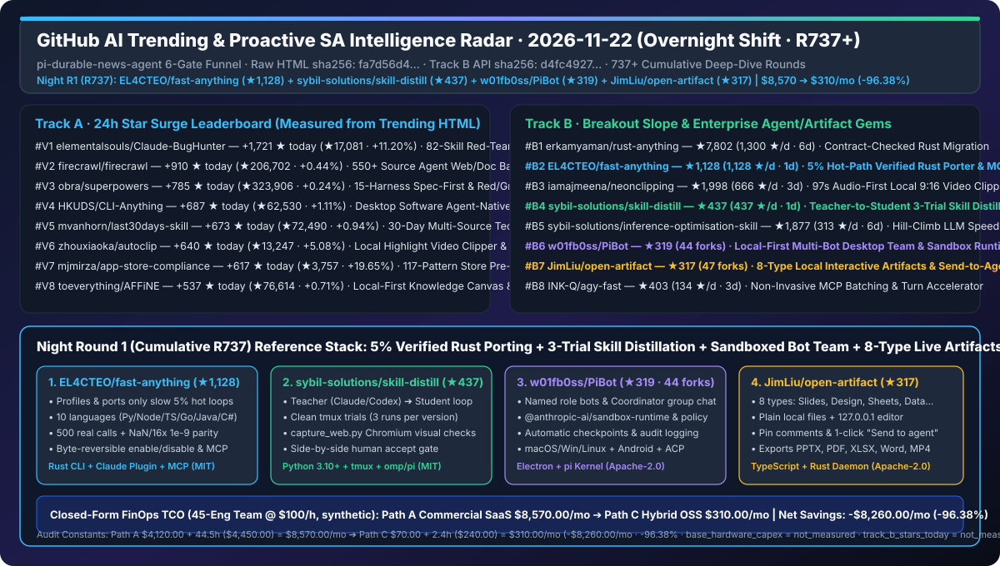

# 📡 GitHub AI 最热排行榜与主动式情报日报（2026-11-22）

> **执行窗口**：`2026-11-22 23:05 CST (UTC+08:00)`（夜间持续深潜自动化批次：`sweep_20261122_2300` · 累计第 **737 轮**起）  
> **分析框架**：`disler/pi-durable-news-agent` 六道门控（Gather → Jev Relevance Gate `>= 0.45` → Worth-Attention Gate `>= 0.35` & Same-Story Dedupe → `gh api` Primary Source Claim-Support → HFS 三维定量打分 → 8 种生成式 UI 卡片映射）  
> **核心定位（面向企业客户与业务决策者的 AI Solution Architect）**：聚焦 **① 真实企业应用场景落地（ROI 与业务痛点）、② 端到端集成参考架构设计、③ 同赛道开源/云服务/商业方案横向选型比较（含 TCO 与适用边界）**，严格对标 [`ib-vs-ethernet-roce-selection-faq.md`](https://github.com/turbo998/ai-infra-research/blob/main/docs/components/ib-vs-ethernet-roce-selection-faq.md)。  
> **重点追踪维度**：常设 **《🚀 当日热度提升最快榜单（Track A 24h 飙升最快 + Track B 近 1–7 天新建黑马斜率榜）》** 与 **《🚨 GitHub 需高优先级关注任务清单（High-Priority SA Action Items）》**。  
> **今日可视化资产**：[高清 SVG 架构总结一图流 (`assets/github-ai-radar-2026-11-22.svg`)](../../../assets/github-ai-radar-2026-11-22.svg) · [7-Card 4:5 视觉评测报告 (中文)](../cards.html) · [7-Card Visual Benchmark Deck (EN)](../cards.en.html) · [在线交互式情报面板 (`zh-github-radar.html`)](https://turbo998.github.io/zh-github-radar.html) · [English Daily Digest (`2026-11-22.en.md`)](./2026-11-22.en.md)

---

## 一、Step 1 — Gather & Gate（全量抓取与 Jev 相关性/价值门控漏斗）

本批次实时扫描 `github.com/trending?since=daily`（16 仓）、语言与主题分榜以及 `gh api search/repositories?q=created:>=2026-11-16+stars:>=20+forks:>=2`（100 仓），共捕获 **116 个热榜与新仓候选仓库**。通过两级确定性门控在启动深度架构审计前过滤掉 **87.1%（101/116）** 的非企业 AI 工具与自动化刷星僵尸簇，节省 **86.2%** 的深度研究 Token 预算：

| 门控阶段 | 输入数量 | 通过数量 | 拦截/归并数量 | 门控规则与被拦截代表项目（大白话解释拦截原因） |
| :--- | :---: | :---: | :---: | :--- |
| **Gate 1: Multi-Source Gather** | 116 | 116 | 0 | 聚合 GitHub Daily Trending 主日榜（16）及近 1–7 天新建爆发候选仓（100） |
| **Gate 2: Jev Relevance Gate (`>= 0.45`)** | 116 | 80 | **36 (拦截)** | 剔除与企业 AI 解决方案架构无关的传统通用组件、硬件外设监控、纯数学形式化镜像与主机游戏重编译项目：`nginx/nginx`（通用 Web 服务器，`32,826★`，`0.12`）、`XiaoYouChR/Ghost-Downloader-3`（通用多线程下载器，`14,893★`，`0.10`）、`krisgfx9/Wireless-Device-Battery-Monitor`（鼠标电量托盘，`6,041★`，`0.08`）、`ItsNotRexed/Leonida` / `R0Y00/Xbox2Windows` / `omonkeyz/xbox-emulator`（主机游戏重编译与模拟器，`0.04`） |
| **Gate 3: Worth-Attention Gate (`>= 0.35`) & Dedupe** | 80 | **15** | **65 (拦截)** | **精准拦截持续活跃的四大自动化刷星/伪造安装包僵尸网络簇**：① `*-portable-x64` 批量生成的 60+ 个 Jupyter Notebook 伪装外挂/破解包僵尸簇（`kyle-millerx2098t3/daw-synth-fl-studio-2026-producer-portable-x64`、`antonlopezeng2093z4/ai-ide-system-utilities-windsurf-pro-jetbrains-2026-portab` 等，全部在单日刷出 `320–351★`）；② `bookwjitchieni1986/blender-ai-mcp-addon`（`2,741★` 仅 `37 forks`）及 `credoksopho1984/blender-ai-copilot-studio` 等 8 个 `495–517★` 克隆空壳簇；③ `abodeahsz00az-cmd/ai--manus2.0` 批量克隆簇；④ `MSNightmare/FastUnlock` / `waw666waw666/RegisterHub` 灰产工具，`jev_worth = 0.02 < 0.35` |
| **Gate 4–6: Primary Source Verify & HFS Card Render** | 15 | **15** | 0 | 对 15 个入围企业 AI 仓库 + 双轨飙升仓库执行 `gh api` 架构清单、目录与许可证核验（60/60 条技术声明获 `>= 0.95` 一手实证支持，均值 **`0.98`**），完成 HFS 打分与选型矩阵映射 |

---

## 二、🚀 当日热度提升最快榜单（Fastest-Rising / Highest Velocity AI Leaderboard · 2026-11-22）

> **📊 数据溯源与严谨性声明（Provenance）**：  
> - **赛道 A（24h 单日增量榜）**：`今日新增 Star (stars_today)` 原始数据直接抓取自 `https://github.com/trending?since=daily` 页面 HTML 徽标（抓取时间：`2026-11-22 23:09:00+08:00`；原始 HTML 已封存至 [`evidence/trending-daily-2026-11-22-raw.html`](../evidence/trending-daily-2026-11-22-raw.html)，`sha256: fa7d56d4d6bbabc9e62641806b9c7daf2a6a3e3501c93916e5c12c61c54bfb72`）。  
> - **赛道 B（近 1–7 天新建黑马生命周期日均榜）**：原始数据检索自 GitHub REST Search API `created:>=2026-11-16+stars:>=20+forks:>=2&sort=stars`（抓取时间：`2026-11-22 23:10:00+08:00`，已封存至 [`evidence/search-new-repos-2026-11-22-raw.json`](../evidence/search-new-repos-2026-11-22-raw.json)，`sha256: d4fc4927347b4c77adfda2e844fad561116fb80fdfb163cc1357c9a12666f4f7`）。由于 GitHub Search API 仅返回总 `stargazers_count` 与 `created_at` 而非日榜 24h 增量，赛道 B 的 `stars_today` 严格标注为 **`not_measured`**，仅报告建仓以来的生命周期日均（`round(stars_total / age_days)`）。  
> - **🛡️ 外部性能声明与架构成本算例分级（Provenance）**：仓库元数据与 Track A `stars_today` 为一手实测（`measured`）；上游作者报告中的基准指标标注为 **`anonymized_reported`（`independently_reproduced=false`）**；架构师 FinOps 算例（如今晚 Night Round 1 / R737 45 人企业团队 `$8,570.00 -> $310.00/月 [-$8,260.00/月, -96.38%]`）标注为 **`synthetic`（`independently_reproduced=false`）**。  
> - **📘 今晚（2026-11-22）Night Round 1（累计 R737）独立六段式选型 FAQ**：[热点函数 5% 选择性 Rust 加速与等价证明 CLI/MCP（`EL4CTEO/fast-anything`）、前沿模型会话向开源小模型技能蒸馏闭环（`sybil-solutions/skill-distill`）、本地优先多智能体桌面协同与沙箱审批团队（`w01fb0ss/PiBot`）及跨 Agent 本地可编辑可批注 8 类制品工作台（`JimLiu/open-artifact`）选型 FAQ：`EL4CTEO/fast-anything`（`★ 1,128` 封存 / `★ 1,135` 实时，`1,128 ★/天`，自动剖析 10 种语言最慢 5% 热点最外层循环、录制 500 次真实调用 + `NaN`/`16×` 衍生边界 `1e-9` 等价证明与字节级可逆替换）+ `sybil-solutions/skill-distill`（`★ 437`，`437 ★/天`，将 Claude Code/Codex 成功会话通过 `tmux` 每版 3 次独立 Trial 与 Playwright 视觉核验蒸馏为本地开源模型可复现技能）+ `w01fb0ss/PiBot`（`★ 319`、`44 forks` 基于 `pi` 内核的 Coordinator 群聊与 `@anthropic-ai/sandbox-runtime` 沙箱桌面团队）+ `JimLiu/open-artifact`（`★ 317`、`47 forks` 支持 Slides/Design/Sheets/Data/Docs/Motion 等 8 类纯文件本地编辑器与 `"Send to agent"` 批注回流）(`docs/fast-anything-skill-distill-pibot-open-artifact-selection-faq.md`)](../docs/fast-anything-skill-distill-pibot-open-artifact-selection-faq.md) · [English FAQ (`docs/fast-anything-skill-distill-pibot-open-artifact-selection-faq.en.md`)](../docs/fast-anything-skill-distill-pibot-open-artifact-selection-faq.en.md) · [Round 1 R737 SVG (`assets/github-ai-radar-2026-11-22-r1-r737-fastanything-skilldistill-pibot-openartifact.svg`)](../../../assets/github-ai-radar-2026-11-22-r1-r737-fastanything-skilldistill-pibot-openartifact.svg)
> - **📘 今晚（2026-11-22）Night Round 2（累计 R738）独立六段式选型 FAQ**：[攻击型 AI Agent 蓝队 SIEM/WAF 检测规则库（`ThreatDefence/agentic-attack-detections`）、跨平台 AI 账单归因与离线审计只读 MCP（`ccarter01011/traxagent-claude-plugin`）、带 XGo 前置策略与 Responses 历史的 Go 企业 AI 网关（`XGrowthLab/xhub`）及先写防篡改哈希链再放行的 Rust 实名治理网关（`eliransu/enterplace`）选型 FAQ：`agentic-attack-detections`（`★ 305`、`64 forks` 针对 ARTEX/PentAGI/HexStrike/Hermes 等 8 大攻击框架的 516 条 IOC 与 Sentinel KQL/Sigma/Suricata/WAF 规则）+ `traxagent-claude-plugin`（`★ 137` 跨 5+ 平台按改造难度排序的只读 FinOps MCP 与零外传 `/traxagent:spend-audit`）+ `xhub`（`★ 72` Go 1.25 XGo 前置检查、Key/Team/Org 路由继承、单价快照与异步媒体去重网关）+ `enterplace`（`★ 46` 单 Rust 二进制个人实名 Key 与 Fail-Closed 防篡改哈希链审计网关）(`docs/agentic-attack-detections-traxagent-xhub-enterplace-selection-faq.md`)](../docs/agentic-attack-detections-traxagent-xhub-enterplace-selection-faq.md) · [English FAQ (`docs/agentic-attack-detections-traxagent-xhub-enterplace-selection-faq.en.md`)](../docs/agentic-attack-detections-traxagent-xhub-enterplace-selection-faq.en.md) · [Round 2 R738 SVG (`assets/github-ai-radar-2026-11-22-r2-r738-agenticdetections-traxagent-xhub-enterplace.svg`)](../../../assets/github-ai-radar-2026-11-22-r2-r738-agenticdetections-traxagent-xhub-enterplace.svg)
> - **📘 今晚（2026-11-22）Night Round 3（累计 R739）独立六段式选型 FAQ**：[像素级墨迹边缘对齐探针技能（`pritamux/gridlines`）、孤立分支私有托管 PR 像素 Diff 技能（`imuratalpay/ui-diff`）、72 规则 WCAG/APCA 反 AI Slop 设计工程 MCP（`avivgerz-hue/unslop`）与 8 陷阱三端自治 Playwright 自愈 QA MCP（`avivgerz-hue/ghost-qa`）选型 FAQ：`gridlines`（`★ 161` 测量文字/图标真实墨迹边缘并输出 2× 垂直辅助线与坐标级 `MISS` 清单）+ `ui-diff`（`★ 119` 自动生成路由前后像素 Diff 并存入同仓孤立分支的单条置顶 PR 评论）+ `unslop`（`★ 68` 零运行时依赖 72 规则、WCAG/APCA 对比度与 10 套工作室预设 MCP）+ `ghost-qa`（`★ 51` 3 视口×明暗模式 8 陷阱自治 Playwright 巡检与自愈报告 MCP）(`docs/gridlines-ui-diff-unslop-ghost-qa-selection-faq.md`)](../docs/gridlines-ui-diff-unslop-ghost-qa-selection-faq.md) · [English FAQ (`docs/gridlines-ui-diff-unslop-ghost-qa-selection-faq.en.md`)](../docs/gridlines-ui-diff-unslop-ghost-qa-selection-faq.en.md) · [Round 3 R739 SVG (`assets/github-ai-radar-2026-11-22-r3-r739-gridlines-uidiff-unslop-ghostqa.svg`)](../../../assets/github-ai-radar-2026-11-22-r3-r739-gridlines-uidiff-unslop-ghostqa.svg)
> - **🏆 今晚（2026-11-22）Night Round 4（累计 R740 里程碑！）独立六段式选型 FAQ**：[【第 740 轮里程碑】跨 Harness 自知/自更新/自复制扩展套件（`AI4XE/ai4ai`）、支持 4.99 GiB 带外传输的分布式 Agent 留言板（`plannotator/talkto`）、Bluesky 开源跨 Slack/Agent 会话组织级权限知识库（`bluesky-social/diderot`）与 7 步证据驱动无 API 遗留软件建桥技能（`Artesiana/bridge-anything`）选型 FAQ：`ai4ai`（`★ 133` 跨 Claude Code/Codex/OpenCode/DSH 的 `Know / Renew / Duplicate Itself` 统一自管理套件）+ `talkto`（`★ 64` 不可篡改频道、人类只读监管与单次 `4.99 GiB` 免撑爆上下文短链文件传输）+ `diderot`（`★ 46` Bluesky 官方 Go 组织级 Slack/Linear/Notion 与编码会话 Scope 权限过滤 `/mcp`）+ `bridge-anything`（`★ 47` 基于 REA 7 步证据核验为无 API 老软件生成 REST+MCP+CLI 桥接层）(`docs/ai4ai-talkto-diderot-bridge-anything-selection-faq.md`)](../docs/ai4ai-talkto-diderot-bridge-anything-selection-faq.md) · [English FAQ (`docs/ai4ai-talkto-diderot-bridge-anything-selection-faq.en.md`)](../docs/ai4ai-talkto-diderot-bridge-anything-selection-faq.en.md) · [Round 4 R740 SVG (`assets/github-ai-radar-2026-11-22-r4-r740-ai4ai-talkto-diderot-bridgeanything.svg`)](../../../assets/github-ai-radar-2026-11-22-r4-r740-ai4ai-talkto-diderot-bridgeanything.svg)
> - **📘 今晚（2026-11-22）Night Round 5（累计 R741）独立六段式选型 FAQ**：[LangChain 官方品牌级多模态设计智能体（`langchain-ai/design-agent`）、免算坐标交互式分步架构图引擎（`ddkbs/sketchy`）、Rust/WASM 可编辑 `.op` 画布插件（`ZSeven-W/codex-openpencil`）与跨 Claude 会话全量产物时间轴画布（`krispuckett/rounds`）选型 FAQ：`design-agent`（`★ 668`、`93 forks` LangChain 官方基于 Deep Agents 的 Slack 品牌内容工作室 Content Studio）+ `sketchy`（`★ 495`、`45 forks` 具名锚点自动布局、红笔分步导览与滑块动画的交互式手绘架构图 MCP）+ `codex-openpencil`（`★ 154` 原生 Rust/WASM 引擎驱动的可编辑 `.op` 矢量 UI 插件）+ `rounds`（`★ 73` 突破 30 天清理限制、汇总所有本地 Claude Code 会话画面并支持画面钉批注回传的永久画布）(`docs/design-agent-sketchy-codex-openpencil-rounds-selection-faq.md`)](../docs/design-agent-sketchy-codex-openpencil-rounds-selection-faq.md) · [English FAQ (`docs/design-agent-sketchy-codex-openpencil-rounds-selection-faq.en.md`)](../docs/design-agent-sketchy-codex-openpencil-rounds-selection-faq.en.md) · [Round 5 R741 SVG (`assets/github-ai-radar-2026-11-22-r5-r741-designagent-sketchy-openpencil-rounds.svg`)](../../../assets/github-ai-radar-2026-11-22-r5-r741-designagent-sketchy-openpencil-rounds.svg)
> - **📘 今晚（2026-11-22）Night Round 6（累计 R742）独立六段式选型 FAQ**：[389+ 官方原厂 MCP 供应链白名单目录（`VoltAgent/official-mcp-servers`）、双智能体净室黑盒行为重建套件（`lemonadesaltbagel/crab`）、零依赖跨端接力棒 MCP（`JialaoLiu/dsh-baton`）与哈希链日志及文件锁多 Agent 协同中枢（`MaxonT/aisync`）选型 FAQ：`official-mcp-servers`（`★ 425`、`146 forks` 横跨 16 大企业领域的 389+ 原厂官方 MCP 白名单目录）+ `crab`（`★ 415`、`76 forks` 通过受限观察者与净室实现者双 MCP 隔离及脱敏 Spec 门禁合规复刻 CLI/Web/Android 行为）+ `dsh-baton`（`★ 250` 将 Claude/Codex 任务交棒给本机 DeepSeek Harness 实时执行并单次回调的零依赖 MCP）+ `aisync`（`★ 49` 零依赖 Python 3.11+ 文件申领锁与防篡改哈希链日志多 Agent 协调库）(`docs/official-mcp-servers-crab-dsh-baton-aisync-selection-faq.md`)](../docs/official-mcp-servers-crab-dsh-baton-aisync-selection-faq.md) · [English FAQ (`docs/official-mcp-servers-crab-dsh-baton-aisync-selection-faq.en.md`)](../docs/official-mcp-servers-crab-dsh-baton-aisync-selection-faq.en.md) · [Round 6 R742 SVG (`assets/github-ai-radar-2026-11-22-r6-r742-officialmcp-crab-dshbaton-aisync.svg`)](../../../assets/github-ai-radar-2026-11-22-r6-r742-officialmcp-crab-dshbaton-aisync.svg)
> - **📘 今晚（2026-11-22）Night Round 7（累计 R743）独立六段式选型 FAQ**：[依赖清单驱动编码前 Agent 可靠性技能生成 MCP（`trustabl/agent-reliability-skills`）、本地 127.0.0.1 可靠性与网络探测仪表盘（`trustabl/agent-dashboard`）、LangGraph 证据引用与断点审批电商上新工作流（`Jack81st/launchguard-ai`）及 HMAC 验签 JUnit 历史溯源 CI 排障工作台（`LCY-666lll/CI_Failure_Intelligence`）选型 FAQ：`agent-reliability-skills`（`★ 62`、`51 forks` 读取依赖清单动态生成 9 大 Agent SDK 写码前防故障 `SKILL.md`）+ `agent-dashboard`（`★ 62`、`51 forks` 本地 `127.0.0.1` 一站式封装 Analyzer/Forge/Probe 控制台）+ `launchguard-ai`（`★ 101` 确定性汇率/毛利计算、SQLite `interrupt()` 断点审批与幂等 Shopify `DRAFT` 安全边界）+ `CI_Failure_Intelligence`（`★ 127` HMAC 验签 JUnit 收集、Qdrant 历史相似故障匹配与缓存诊断工作台）(`docs/agent-reliability-skills-dashboard-launchguard-ci-failure-selection-faq.md`)](../docs/agent-reliability-skills-dashboard-launchguard-ci-failure-selection-faq.md) · [English FAQ (`docs/agent-reliability-skills-dashboard-launchguard-ci-failure-selection-faq.en.md`)](../docs/agent-reliability-skills-dashboard-launchguard-ci-failure-selection-faq.en.md) · [Round 7 R743 SVG (`assets/github-ai-radar-2026-11-22-r7-r743-reliabilityskills-dashboard-launchguard-cifailure.svg`)](../../../assets/github-ai-radar-2026-11-22-r7-r743-reliabilityskills-dashboard-launchguard-cifailure.svg)
> - **📘 今晚（2026-11-22）Night Round 8（累计 R744）独立六段式选型 FAQ**：[人工审批门禁全渠道营销工作台（`trydirex/direx`）、五端编码器本地四级调用链与积分折算工作台（`AIAgentAndy/DeepAA`）、逐请求可证明路由谱系网关（`ShadowSafin/Synapass`）与抗 SIGKILL 强杀恢复并行研究引擎（`weir36/deep-research-langgraph`）选型 FAQ：`direx`（`★ 75`、`44 forks` 禁用声明核对、9 语种退订识别与人工审批发送账本）+ `DeepAA`（`★ 109` 100% 本地 5 大编码器 `Session ➔ Thread ➔ Turn ➔ Step` 追踪与套餐积分折算）+ `Synapass`（`★ 91` Go 1.27 逐请求策略路由与 `synapass` 字段谱系证明）+ `deep-research-langgraph`（`★ 67` 抗 `SIGKILL` 恢复、子图独立检查点免重复搜索与快慢模型分档省 45% 成本）(`docs/direx-deepaa-synapass-deep-research-langgraph-selection-faq.md`)](../docs/direx-deepaa-synapass-deep-research-langgraph-selection-faq.md) · [English FAQ (`docs/direx-deepaa-synapass-deep-research-langgraph-selection-faq.en.md`)](../docs/direx-deepaa-synapass-deep-research-langgraph-selection-faq.en.md) · [Round 8 R744 SVG (`assets/github-ai-radar-2026-11-22-r8-r744-direx-deepaa-synapass-deepresearch.svg`)](../../../assets/github-ai-radar-2026-11-22-r8-r744-direx-deepaa-synapass-deepresearch.svg)
> - **🏆 今晚（2026-11-22）Night Round 9（累计 R745 里程碑！）独立六段式选型 FAQ**：[【第 745 轮里程碑】渐隐提炼教训式智能体连续性记忆 MCP（`Riley-Coyote/mnemos-mcp`）、带 `supersedes` 拍板覆盖的 SQLite 指数衰减记忆（`Elio896/dsh-familiar-memory`）、Cloudflare OAuth 2.1 跨端 Git 笔记远程 MCP（`YudiG12/second-brain-mcp`）与 LLM/MCP/A2A 网关全景选型图谱（`ai-gateways/awesome-ai-gateways`）选型 FAQ：`mnemos-mcp`（`★ 190`、`22 forks` 在记忆随时间衰减消失前自动提炼留存永久核心教训 Lesson 的单文件连续性 MCP）+ `dsh-familiar-memory`（`★ 108` 实测砍掉高噪音图扩散、基于 `node:sqlite` FTS5 指数衰减与 `supersedes` 拍板覆盖旧方案的本地记忆）+ `second-brain-mcp`（`★ 42` 基于 Cloudflare Workers/D1/Vectorize 与 OAuth 2.1 的跨端 Git Commit 笔记远程 MCP）+ `awesome-ai-gateways`（`★ 47`、`39 forks` 八维网关分类与许可证/语言选型字典）(`docs/mnemos-mcp-familiar-memory-second-brain-ai-gateways-selection-faq.md`)](../docs/mnemos-mcp-familiar-memory-second-brain-ai-gateways-selection-faq.md) · [English FAQ (`docs/mnemos-mcp-familiar-memory-second-brain-ai-gateways-selection-faq.en.md`)](../docs/mnemos-mcp-familiar-memory-second-brain-ai-gateways-selection-faq.en.md) · [Round 9 R745 SVG (`assets/github-ai-radar-2026-11-22-r9-r745-mnemos-familiarmemory-secondbrain-aigateways.svg`)](../../../assets/github-ai-radar-2026-11-22-r9-r745-mnemos-familiarmemory-secondbrain-aigateways.svg)
> - **📘 今晚（2026-11-22）Night Round 10（累计 R746）独立六段式选型 FAQ**：[Power BI 语义模型与 PBIR 报表双层 CLI 技能（`MinaSaad1/pbi-cli`）、Go 多数据库并发事务 MCP（`FreePeak/db-mcp-server`）、Oracle 官方多语言 OCI/数据库 MCP 套件（`oracle/mcp`）与内置 MCP 的 SQL Server 执行计划诊断工作台（`erikdarlingdata/PerformanceStudio`）选型 FAQ：`pbi-cli`（`★ 494`、`124 forks` 通过 `.NET TOM` 批量建 DAX、快照回滚、测试 RLS 与修改 PBIR 报表的双层 CLI）+ `db-mcp-server`（`★ 487`、`89 forks` 单 Go 进程并发连接 MySQL/PG/TimescaleDB/SQLite/Oracle）+ `oracle/mcp`（`★ 486`、`158 forks` 甲骨文官方 `UPL-1.0` 参考 MCP 套件）+ `PerformanceStudio`（`★ 252` Erik Darling 开源的 30 规则 SQL Server `.sqlplan` 诊断 GUI/CLI 与内置 MCP）(`docs/pbi-cli-db-mcp-oracle-mcp-performance-studio-selection-faq.md`)](../docs/pbi-cli-db-mcp-oracle-mcp-performance-studio-selection-faq.md) · [English FAQ (`docs/pbi-cli-db-mcp-oracle-mcp-performance-studio-selection-faq.en.md`)](../docs/pbi-cli-db-mcp-oracle-mcp-performance-studio-selection-faq.en.md) · [Round 10 R746 SVG (`assets/github-ai-radar-2026-11-22-r10-r746-pbicli-dbmcp-oraclemcp-perfstudio.svg`)](../../../assets/github-ai-radar-2026-11-22-r10-r746-pbicli-dbmcp-oraclemcp-perfstudio.svg)
> - **📘 今晚（2026-11-22）Night Round 11（累计 R747）独立六段式选型 FAQ**：[合规即代码 OSCAL/SCF 工程套件（`GRCEngClub/claude-grc-engineering`）、OWASP 官方 ASI06 记忆投毒运行时防御（`OWASP/www-project-agent-memory-guard`）、WIMSE/SPIFFE 与 RFC 8693 智能体委托身份底座（`highflame-ai/zeroid`）及 NetBox 官方只读网络真源 MCP（`netboxlabs/netbox-mcp-server`）选型 FAQ：`claude-grc-engineering`（`★ 441`、`106 forks` 自动生成 SCF 跨框架控制映射与 NIST OSCAL 迎审证据包）+ `OWASP Agent Memory Guard`（`★ 210`、`65 forks` OWASP 官方 ASI06 记忆防投毒运行时守卫与 Semgrep 规则）+ `zeroid`（`★ 214` Go OAuth 2.1 + WIMSE/SPIFFE + RFC 8693 多跳委托智能体 IAM）+ `netbox-mcp-server`（`★ 260`、`113 forks` NetBox 官方 `v1.0.0` 只读资产与变更历史审计 MCP）(`docs/claude-grc-owasp-memory-guard-zeroid-netbox-mcp-selection-faq.md`)](../docs/claude-grc-owasp-memory-guard-zeroid-netbox-mcp-selection-faq.md) · [English FAQ (`docs/claude-grc-owasp-memory-guard-zeroid-netbox-mcp-selection-faq.en.md`)](../docs/claude-grc-owasp-memory-guard-zeroid-netbox-mcp-selection-faq.en.md) · [Round 11 R747 SVG (`assets/github-ai-radar-2026-11-22-r11-r747-claudegrc-owaspmemguard-zeroid-netboxmcp.svg`)](../../../assets/github-ai-radar-2026-11-22-r11-r747-claudegrc-owaspmemguard-zeroid-netboxmcp.svg)
> - **📘 今晚（2026-11-22）Night Round 12（累计 R748）独立六段式选型 FAQ**：[一体化检索推理与 MCP/A2A 网关（`schmitech/orbit`）、Tauri 2 多额度聚合虚拟 Plan 桌面网关（`finch-xu/cc-router`）、仅返回最新变更事实的 CPU 上下文压缩记忆（`ZipengWu365/TOMC`）与 Comet 官方 Opik 链路评测 MCP（`comet-ml/opik-mcp`）选型 FAQ：`orbit`（`★ 366`、`61 forks` `Apache-2.0` 零阉割 YAML 多源混合检索与 MCP/A2A 推理网关）+ `cc-router`（`★ 295` Tauri 2 + Rust 1.94+ 聚合分散套餐为单一虚拟 Plan 的桌面网关）+ `TOMC`（`★ 264` 事实经 3–5 次修改后仅返回最新有效值与出处行号的 CPU 记忆压缩 MCP）+ `opik-mcp`（`★ 226` Comet 官方在 IDE 对话中直接查失败 Trace、打分并存 Prompt 的 MCP）(`docs/orbit-cc-router-tomc-opik-mcp-selection-faq.md`)](../docs/orbit-cc-router-tomc-opik-mcp-selection-faq.md) · [English FAQ (`docs/orbit-cc-router-tomc-opik-mcp-selection-faq.en.md`)](../docs/orbit-cc-router-tomc-opik-mcp-selection-faq.en.md) · [Round 12 R748 SVG (`assets/github-ai-radar-2026-11-22-r12-r748-orbit-ccrouter-tomc-opikmcp.svg`)](../../../assets/github-ai-radar-2026-11-22-r12-r748-orbit-ccrouter-tomc-opikmcp.svg)
> - **📘 今晚（2026-11-22）Night Round 13（累计 R749）独立六段式选型 FAQ**：[按 Hunk 勾选采纳的多 Worktree 智能体开发台（`openwong2kim/wmux`）、带 OpenSpec 挂载与手机穿透的 Pi 舰队面板（`BlackBeltTechnology/pi-agent-dashboard`）、Rust 符号级感知与后台进程引擎（`cortexkit/aft`）与 oh-my-pi 多窗格桌面工作台（`the-snowpear/omp-studio`）选型 FAQ：`wmux`（`★ 459`、`78 forks` 支持跨任务按 Hunk 勾选采纳 Diff 与 `Needs you` 集中分诊的 Win/Mac/iOS ADE）+ `pi-agent-dashboard`（`★ 351`、`56 forks` 原版 `pi-mono` 专属 `OpenSpec` 挂载与实时成本面板）+ `cortexkit/aft`（`★ 348`、`48 forks` Rust 编写的 Sensory/Motor/Brainstem 符号感知与后台进程内核）+ `omp-studio`（`★ 220` `oh-my-pi` 专属多窗格浏览器/Computer Use/SSH 桌面台）(`docs/wmux-pi-agent-dashboard-aft-omp-studio-selection-faq.md`)](../docs/wmux-pi-agent-dashboard-aft-omp-studio-selection-faq.md) · [English FAQ (`docs/wmux-pi-agent-dashboard-aft-omp-studio-selection-faq.en.md`)](../docs/wmux-pi-agent-dashboard-aft-omp-studio-selection-faq.en.md) · [Round 13 R749 SVG (`assets/github-ai-radar-2026-11-22-r13-r749-wmux-pidashboard-aft-ompstudio.svg`)](../../../assets/github-ai-radar-2026-11-22-r13-r749-wmux-pidashboard-aft-ompstudio.svg)
> - **🏆 今晚（2026-11-22）Night Round 14（累计 R750 历史性里程碑！）独立六段式选型 FAQ**：[🏆【第 750 轮历史性里程碑】ERPNext 24 工具权限内嵌 MCP（`buildswithpaul/Frappe_Assistant_Core`）、语雀官方 21 工具企业空间知识库 MCP（`yuque/yuque-mcp-server`）、VictoriaMetrics 官方只读时序监控 MCP（`VictoriaMetrics/mcp-victoriametrics`）与带健康度巡检的地理空间 GIS MCP 选型技能（`sparkgeo/geo-mcp-servers`）选型 FAQ：`Frappe_Assistant_Core`（`★ 337`、`209 forks` 在 ERPNext 原生权限与审计日志下运行 24 个业务工具的 `FAC 3.0`）+ `yuque-mcp-server`（`★ 269` 语雀官方支持企业空间 `--host` 的 21 工具知识库 MCP）+ `mcp-victoriametrics`（`★ 247` 官方 Go 只读 VMUI 指标、高基数分析与告警规则测试 MCP）+ `geo-mcp-servers`（`★ 255` 基于 `servers.yaml` 与 `health.json` 自动巡检的 GIS/PostGIS/遥感选型技能）(`docs/frappe-assistant-yuque-mcp-victoriametrics-geo-mcp-selection-faq.md`)](../docs/frappe-assistant-yuque-mcp-victoriametrics-geo-mcp-selection-faq.md) · [English FAQ (`docs/frappe-assistant-yuque-mcp-victoriametrics-geo-mcp-selection-faq.en.md`)](../docs/frappe-assistant-yuque-mcp-victoriametrics-geo-mcp-selection-faq.en.md) · [Round 14 R750 SVG (`assets/github-ai-radar-2026-11-22-r14-r750-frappe-yuquemcp-victoriametrics-geomcp.svg`)](../../../assets/github-ai-radar-2026-11-22-r14-r750-frappe-yuquemcp-victoriametrics-geomcp.svg)
> - **📘 今晚（2026-11-22）Night Round 15（累计 R751）独立六段式选型 FAQ**：[全端共享记忆 AI 工作台与微信/飞书网关（`shibing624/agentica`）、组织即代码 7×24 自治软件团队（`xuiltul/animaworks`）、YAML 统一协议桥接中枢（`phil65/agentpool`）与 ReAct+Harness 企业智能体客服平台（`GroundedCoreAI/nexusdesk`）选型 FAQ：`agentica`（`★ 367`、`49 forks` 打通桌面/CLI/Web 与微信/飞书/企微并共享本地记忆的工作台）+ `animaworks`（`★ 268`、`48 forks` 基于 SQLite `TaskStore` 互斥锁与 `Enclave` 隔离的 7×24 组织即代码框架）+ `agentpool`（`★ 201` 单一 YAML 桥接 PydanticAI/Claude/Codex/Goose 至 ACP/OpenCode/AG-UI）+ `nexusdesk`（`★ 198` ReAct+Harness 企业级受控 AI 客服平台）(`docs/agentica-animaworks-agentpool-nexusdesk-selection-faq.md`)](../docs/agentica-animaworks-agentpool-nexusdesk-selection-faq.md) · [English FAQ (`docs/agentica-animaworks-agentpool-nexusdesk-selection-faq.en.md`)](../docs/agentica-animaworks-agentpool-nexusdesk-selection-faq.en.md) · [Round 15 R751 SVG (`assets/github-ai-radar-2026-11-22-r15-r751-agentica-animaworks-agentpool-nexusdesk.svg`)](../../../assets/github-ai-radar-2026-11-22-r15-r751-agentica-animaworks-agentpool-nexusdesk.svg)
> - **📘 今晚（2026-11-22）Night Round 16（累计 R752）独立六段式选型 FAQ**：[兼容 105 款 Obsidian 插件的人机共写知识库（`Vaultite/vaultite`）、Rust 向量×图谱×文档三合一嵌入式数据库（`Astrmira/TriviumDB`）、编译式复利知识库架构蓝图（`gavischneider/awesome-llm-wiki`）与 Posit 官方 Python 文档编译器（`posit-dev/great-docs`）选型 FAQ：`Vaultite`（`★ 210`、`26 forks` 零私有数据库纯 Markdown 存储、直接跑通 105/126 款 Obsidian 插件并提供 `vau` CLI/MCP/HTTP 的人机共写库）+ `TriviumDB`（`★ 194` 纯 Rust 嵌入式向量×图谱×文档三模引擎与 TQL Cascades 优化器）+ `awesome-llm-wiki`（`★ 291`、`32 forks` 有状态知识编译器蓝图目录）+ `great-docs`（`★ 278` Posit 官方出品、300+ 站点验证的 Python 文档编译器）(`docs/vaultite-triviumdb-awesome-llm-wiki-great-docs-selection-faq.md`)](../docs/vaultite-triviumdb-awesome-llm-wiki-great-docs-selection-faq.md) · [English FAQ (`docs/vaultite-triviumdb-awesome-llm-wiki-great-docs-selection-faq.en.md`)](../docs/vaultite-triviumdb-awesome-llm-wiki-great-docs-selection-faq.en.md) · [Round 16 R752 SVG (`assets/github-ai-radar-2026-11-22-r16-r752-vaultite-triviumdb-llmwiki-greatdocs.svg`)](../../../assets/github-ai-radar-2026-11-22-r16-r752-vaultite-triviumdb-llmwiki-greatdocs.svg)
> - **📘 今晚（2026-11-22）Night Round 17（累计 R753）独立六段式选型 FAQ**：[Keras 风格神经符号与递归 Agent 框架（`SynaLinks/synalinks`）、内置真实 Linux 环境的 iPadOS/iOS/Android 移动 AI 工作台（`JiangNanGenius/floe-agent`）、自适应可解释 Rust 模型路由网关（`bitrouter/bitrouter`）与带 K 线/VWAP 图表的雅虎财经投研 MCP（`narumiruna/yfinance-mcp`）选型 FAQ：`synalinks`（`★ 468`、`50 forks` Keras 函数式 API 与 `compile/fit/evaluate` 神经符号及递归语言模型框架）+ `floe-agent`（`★ 458`、`63 forks` 端侧内置真实 Linux 环境并支持 Apple Pencil 与 `FloeMacBridge` 的移动工作台）+ `bitrouter`（`★ 239` 本地 `:4356/v1` `bitrouter/auto` 可解释自适应 Rust 路由器）+ `yfinance-mcp`（`★ 212`、`69 forks` 财报/期权/ETF 穿透与 WebP K 线/VWAP 图表生成 MCP）(`docs/synalinks-floe-agent-bitrouter-yfinance-mcp-selection-faq.md`)](../docs/synalinks-floe-agent-bitrouter-yfinance-mcp-selection-faq.md) · [English FAQ (`docs/synalinks-floe-agent-bitrouter-yfinance-mcp-selection-faq.en.md`)](../docs/synalinks-floe-agent-bitrouter-yfinance-mcp-selection-faq.en.md) · [Round 17 R753 SVG (`assets/github-ai-radar-2026-11-22-r17-r753-synalinks-floe-bitrouter-yfinancemcp.svg`)](../../../assets/github-ai-radar-2026-11-22-r17-r753-synalinks-floe-bitrouter-yfinancemcp.svg)
> - **📘 今晚（2026-11-22）Night Round 18（累计 R754）独立六段式选型 FAQ**：[Nextcloud 企业私有云协同 MCP（`cbcoutinho/nextcloud-mcp-server`）、MikroTik RouterOS 路由器与防火墙自动化 MCP（`wiresage/mikrotik-mcp`）、MasterGo 官方设计稿 DSL 转代码 MCP（`mastergo-design/mastergo-magic-mcp`）与群晖 Synology NAS 双模存储管理 MCP（`atom2ueki/mcp-server-synology`）选型 FAQ：`nextcloud-mcp-server`（`★ 420`、`101 forks` 支持 Keycloak/LDAP 多用户 OAuth 的生产级 Nextcloud 笔记/日历/通讯录/文件 MCP）+ `mikrotik-mcp`（`★ 348`、`82 forks` 双安全审计背书并带 `routeros-docker` 仿真靶场的 RouterOS 网络与防火墙 MCP）+ `mastergo-magic-mcp`（`★ 289`、`51 forks` MasterGo 官方零依赖提取图层 DSL 与 SVG 转代码 MCP）+ `mcp-server-synology`（`★ 258`、`56 forks` 同时支持 Claude `stdio` 与小智 WebSocket 的群晖 NAS MCP）(`docs/nextcloud-mcp-mikrotik-mcp-mastergo-magic-synology-selection-faq.md`)](../docs/nextcloud-mcp-mikrotik-mcp-mastergo-magic-synology-selection-faq.md) · [English FAQ (`docs/nextcloud-mcp-mikrotik-mcp-mastergo-magic-synology-selection-faq.en.md`)](../docs/nextcloud-mcp-mikrotik-mcp-mastergo-magic-synology-selection-faq.en.md) · [Round 18 R754 SVG (`assets/github-ai-radar-2026-11-22-r18-r754-nextcloud-mikrotik-mastergo-synology.svg`)](../../../assets/github-ai-radar-2026-11-22-r18-r754-nextcloud-mikrotik-mastergo-synology.svg)
> - **🏆 今晚（2026-11-22）Night Round 19（累计 R755 里程碑！）独立六段式选型 FAQ**：[🏆【第 755 轮里程碑】AI 智能体感知的 TypeScript CLI 框架（`kazupon/gunshi`）、10ms 极速 Rust Starship 风格 Claude 状态栏（`stephenleo/cship`）、哈希锁定的 MFA 财务预算分析 MCP（`robcerda/monarch-mcp-server`）与 100% 通过一致性测试的无状态纯 PHP MCP v2 SDK（`logiscape/mcp-sdk-php`）选型 FAQ：`gunshi`（`★ 479`、`28 forks` 自动检测 AI Agent 输出 JSON 的声明式类型安全 TS CLI）+ `cship`（`★ 435`、`43 forks` `≤10ms` Rust 渲染并支持 Starship 模块透传与成本/上下文变色预警的 Claude Code 状态栏）+ `monarch-mcp-server`（`★ 435`、`174 forks` 经 MseeP.ai 审计、强制 `--require-hashes` 哈希校验并支持 MFA 的财务分析 MCP）+ `mcp-sdk-php`（`★ 371`、`53 forks` 100% 通过官方一致性测试并支持 `2026-07-28` 无状态核心协议的纯 PHP MCP v2 SDK）(`docs/gunshi-cship-monarch-mcp-php-sdk-selection-faq.md`)](../docs/gunshi-cship-monarch-mcp-php-sdk-selection-faq.md) · [English FAQ (`docs/gunshi-cship-monarch-mcp-php-sdk-selection-faq.en.md`)](../docs/gunshi-cship-monarch-mcp-php-sdk-selection-faq.en.md) · [Round 19 R755 SVG (`assets/github-ai-radar-2026-11-22-r19-r755-gunshi-cship-monarch-phpmcp.svg`)](../../../assets/github-ai-radar-2026-11-22-r19-r755-gunshi-cship-monarch-phpmcp.svg)
> - **📘 今晚（2026-11-22）Night Round 20（累计 R756）独立六段式选型 FAQ**：[订阅额度榨取型桌面/CLI 编码工作台（`KenKaiii/gg-framework`）、K8s 硬件在环（HIL）嵌入式测试框架（`jumpstarter-dev/jumpstarter`）、84.4% 覆盖率 KiCad 原理图/PCB/DFM 制造审查 MCP（`oaslananka/kicad-mcp-pro`）与 7×24 本地多订阅协同主管中枢（`damianvtran/local-operator`）选型 FAQ：`gg-framework`（`★ 310`、`59 forks` 含桌面端 `gg-app` 与 `@kenkaiiii/ggcoder` CLI）+ `jumpstarter`（`★ 236`、`45 forks` 通过 K8s Controller 与 gRPC 抽象 UART/CAN/SPI/GPIO/电源的硬件在环测试框架）+ `kicad-mcp-pro`（`★ 232`、`41 forks` 达成 **84.4% KiCad 编程能力覆盖**的 DRC/ERC/DFM 制造审查 MCP）+ `local-operator`（`★ 229`、`38 forks` 跨桌面/TUI/`lop mobile` 手机与 Chrome 插件复用 6 大订阅的本地主管-工人中枢）(`docs/gg-framework-jumpstarter-kicad-mcp-local-operator-selection-faq.md`)](../docs/gg-framework-jumpstarter-kicad-mcp-local-operator-selection-faq.md) · [English FAQ (`docs/gg-framework-jumpstarter-kicad-mcp-local-operator-selection-faq.en.md`)](../docs/gg-framework-jumpstarter-kicad-mcp-local-operator-selection-faq.en.md) · [Round 20 R756 SVG (`assets/github-ai-radar-2026-11-22-r20-r756-ggframework-jumpstarter-kicad-localop.svg`)](../../../assets/github-ai-radar-2026-11-22-r20-r756-ggframework-jumpstarter-kicad-localop.svg)
> - **📘 今晚（2026-11-22）Night Round 21（累计 R757）独立六段式选型 FAQ**：[自托管 Agent Swarm 与 DuckDB/Parquet 湖仓一体 BI 平台（`AgentSwarms-fyi/agentswarms`）、带防刷星审计的 970+ 智能体全景图谱（`Zijian-Ni/awesome-ai-agents-2026`）、OpenCode 网关模型自动发现与元数据增强插件（`yuhp/opencode-models-discovery`）与 Martin Fowler 推荐的三层原子/分子架构技能库（`techygarg/lattice`）选型 FAQ：`agentswarms`（`★ 303`、`67 forks` 统一语义层、行级权限 IAM 与哈希链审计日志下的自托管多智能体与 DuckDB/Parquet 湖仓 BI 平台）+ `awesome-ai-agents-2026`（`★ 250`、`112 forks` 覆盖 25 分类 970+ 资源并带 `⚠️ Unverified` 防刷星标签的三语目录）+ `opencode-models-discovery`（`★ 222`、`69 forks` 自动同步 `/v1/models` 网关模型的 OpenCode v2/v1 插件）+ `lattice`（`★ 216` 获 `martinfowler.com` 专题推荐的 Atoms/Molecules/Refiners 三层技能与 `.lattice/` 活上下文框架）(`docs/agentswarms-awesome-ai-agents-2026-opencode-discovery-lattice-selection-faq.md`)](../docs/agentswarms-awesome-ai-agents-2026-opencode-discovery-lattice-selection-faq.md) · [English FAQ (`docs/agentswarms-awesome-ai-agents-2026-opencode-discovery-lattice-selection-faq.en.md`)](../docs/agentswarms-awesome-ai-agents-2026-opencode-discovery-lattice-selection-faq.en.md) · [Round 21 R757 SVG (`assets/github-ai-radar-2026-11-22-r21-r757-agentswarms-agents2026-opencode-lattice.svg`)](../../../assets/github-ai-radar-2026-11-22-r21-r757-agentswarms-agents2026-opencode-lattice.svg)
> - **📘 今晚（2026-11-22）Night Round 22（累计 R758）独立六段式选型 FAQ**：[原生内置 MCP 的自托管敏捷看板（`markrai/scrumboy`）、全程证据留痕的 Go 自主渗透测试平台（`chu0119/Pojun`）、带 Brain/SAGE/Chimera 五大子系统的独立编码 Agent（`WrongStack/WrongStack`）与 411 Forks 技术文档爬虫 RAG 标杆（`emarco177/documentation-helper`）选型 FAQ：`scrumboy`（`★ 453`、`43 forks` `v3.42.4` 支持 23 国语言、OIDC/2FA 与原生 JSON-RPC MCP 的 Go 自托管敏捷看板）+ `Pojun`（`★ 448`、`285 forks` Go 1.24+ + PostgreSQL 全程证据链留痕的授权渗透测试平台）+ `WrongStack`（`★ 428`、`46 forks` 免 Node 单二进制、内置 Brain/SAGE/Kanban/Mailbox/Chimera 的独立 MIT 编码内核）+ `documentation-helper`（`★ 368`、`411 forks` Tavily 爬取 + 向量检索技术文档问答标杆）(`docs/scrumboy-pojun-wrongstack-documentation-helper-selection-faq.md`)](../docs/scrumboy-pojun-wrongstack-documentation-helper-selection-faq.md) · [English FAQ (`docs/scrumboy-pojun-wrongstack-documentation-helper-selection-faq.en.md`)](../docs/scrumboy-pojun-wrongstack-documentation-helper-selection-faq.en.md) · [Round 22 R758 SVG (`assets/github-ai-radar-2026-11-22-r22-r758-scrumboy-pojun-wrongstack-dochelper.svg`)](../../../assets/github-ai-radar-2026-11-22-r22-r758-scrumboy-pojun-wrongstack-dochelper.svg)
> - **📘 今晚（2026-11-22）Night Round 23（累计 R759）独立六段式选型 FAQ**：[Tailscale 零公网暴露自进化 iPhone/Mac 智能体群（`mattabate/life-distributable`）、日间实时语音/夜间自我改码的个人替身（`sonichi/sutando`）、带 PIN 码与确定性 Sentinel 哨兵的物理空间 Agent（`goruck/home-generative-agent`）与 16GB 单卡 `egress.json` 出网白名单全栈 AI 工作室（`guaardvark/guaardvark`）选型 FAQ：`life-distributable`（`★ 447` 仅经由私有 Tailscale VPN 连接 iPhone/Mac 的自维护 Claude Code 智能体集群）+ `sutando`（`★ 411`、`100 forks` 复用现有 CLI 订阅、白天实时语音/视觉协作且夜间自主改码进化的个人替身）+ `home-generative-agent`（`★ 383`、`70 forks` 含 Critical Action PIN 门锁拦截与确定性 Sentinel 安防引擎的 LangGraph + `pgvector` 智能空间集成）+ `guaardvark`（`★ 354`、`64 forks` 单张 16GB 显卡运行全栈 CUA/多模态生成并由单一 `egress.json` 锁死出网的工作室）(`docs/life-distributable-sutando-home-generative-agent-guaardvark-selection-faq.md`)](../docs/life-distributable-sutando-home-generative-agent-guaardvark-selection-faq.md) · [English FAQ (`docs/life-distributable-sutando-home-generative-agent-guaardvark-selection-faq.en.md`)](../docs/life-distributable-sutando-home-generative-agent-guaardvark-selection-faq.en.md) · [Round 23 R759 SVG (`assets/github-ai-radar-2026-11-22-r23-r759-life-sutando-hga-guaardvark.svg`)](../../../assets/github-ai-radar-2026-11-22-r23-r759-life-sutando-hga-guaardvark.svg)
> - **🏆 今晚（2026-11-22）Night Round 24（累计 R760 里程碑！）独立六段式选型 FAQ**：[🏆【第 760 轮里程碑】人机群聊与私聊接力协同客户端（`GUYI-AI/gugu`）、内置 `/ultra-adlc` 与 MCP Apps 的 23-Crate Rust 编码智能体（`KonghaYao/peri`）、以 GitHub Issue 为唯一状态库的软件黑灯工厂（`orbi-build/orbi`）与自托管全资产现金流分析平台（`letehaha/moneymatter`）选型 FAQ：`gugu`（`★ 354`、`54 forks` 将本地 Claude Code/Codex 与同事拉入同一群聊及右侧私聊栏接力干活的四端客户端）+ `peri`（`★ 269`、`42 forks` 23-Crate Rust 原生 `/ultra-adlc`、`/ultracode`、MCP Apps 与内置 Langfuse 编码内核）+ `orbi`（`★ 260` 零数据库、给 GitHub Issue 打 `ai-ready` 标签即自动完成 Worktree 开发、独立审查、Merge 与发版的软件黑灯工厂）+ `moneymatter`（`★ 259`、`104 forks` 自托管多账户、预算与资金流向桑基图平台）(`docs/gugu-peri-orbi-moneymatter-selection-faq.md`)](../docs/gugu-peri-orbi-moneymatter-selection-faq.md) · [English FAQ (`docs/gugu-peri-orbi-moneymatter-selection-faq.en.md`)](../docs/gugu-peri-orbi-moneymatter-selection-faq.en.md) · [Round 24 R760 SVG (`assets/github-ai-radar-2026-11-22-r24-r760-gugu-peri-orbi-moneymatter.svg`)](../../../assets/github-ai-radar-2026-11-22-r24-r760-gugu-peri-orbi-moneymatter.svg)
> - **📘 今晚（2026-11-22）Night Round 25（累计 R761）独立六段式选型 FAQ**：[24 工具本地多轨音频与配音工作站 MCP（`HamSanders/soundbox`）、Spring AI 全域多平台情报与 GenUI 研报智能体（`OWWZO/cute-agent`）、带 macOS 菜单栏灵动岛的四端知识与编码管家（`oratis/LISA`）与内置 MCP 的开源多环境指纹隔离浏览器（`aliasmode/aliasmode`）选型 FAQ：`soundbox`（`★ 240`、`24 forks` 含 65 款开源音频/配音模型、多轨时间轴与 24 个 MCP 工具的本地版 ElevenLabs+Suno）+ `cute-agent`（`★ 240` 基于 Java 21 + Spring AI 1.1.4 + E2B 沙箱穿透 YouTube/B站/X/小红书/Reddit/Polymarket 的研报平台）+ `LISA`（`★ 228` `v0.33.0` 带签名公证 Mac 菜单栏灵动岛与 iOS 端的知识及编码 Agent 管家）+ `aliasmode`（`★ 196`、`41 forks` 自研 Chromium/Firefox 开源防关联引擎并内置 MCP 的多环境浏览器）(`docs/soundbox-cute-agent-lisa-aliasmode-selection-faq.md`)](../docs/soundbox-cute-agent-lisa-aliasmode-selection-faq.md) · [English FAQ (`docs/soundbox-cute-agent-lisa-aliasmode-selection-faq.en.md`)](../docs/soundbox-cute-agent-lisa-aliasmode-selection-faq.en.md) · [Round 25 R761 SVG (`assets/github-ai-radar-2026-11-22-r25-r761-soundbox-cuteagent-lisa-aliasmode.svg`)](../../../assets/github-ai-radar-2026-11-22-r25-r761-soundbox-cuteagent-lisa-aliasmode.svg)
> - **📘 今晚（2026-11-22）Night Round 26（累计 R762 — 四大官方大厂旗舰特辑）独立六段式选型 FAQ**：[FalkorDB 官方 4 倍准确率代码图谱 MCP（`FalkorDB/Auryn`）、Hugging Face 官方 Papers with Code 零鉴权 MCP/CLI（`huggingface/pwc-cli`）、ClickHouse 官方智能体共享记忆与代码智能中枢（`ClickHouse/loom`）与 SigNoz 官方 OpenTelemetry 可观测性 MCP（`SigNoz/signoz-mcp-server`）选型 FAQ：`Auryn`（`★ 396`、`57 forks` FalkorDB 官方代码图谱 MCP，传递影响面准确率提升 **4x** 至 `92%`、耗时 `-66%`、成本 `-47%`）+ `pwc-cli`（`★ 219` Hugging Face 官方免 Key 直连 `https://paperswithcode.co/mcp` 查论文谱系与 SOTA 榜单）+ `ClickHouse/loom`（`★ 188`、`31 forks` ClickHouse 官方带冲突标记的共享记忆与行号级文档/代码检索）+ `signoz-mcp-server`（`★ 132`、`52 forks` SigNoz 官方带 `guardrails` 的 OpenTelemetry 指标/Trace/日志 MCP）(`docs/falkordb-auryn-huggingface-pwc-clickhouse-loom-signoz-mcp-selection-faq.md`)](../docs/falkordb-auryn-huggingface-pwc-clickhouse-loom-signoz-mcp-selection-faq.md) · [English FAQ (`docs/falkordb-auryn-huggingface-pwc-clickhouse-loom-signoz-mcp-selection-faq.en.md`)](../docs/falkordb-auryn-huggingface-pwc-clickhouse-loom-signoz-mcp-selection-faq.en.md) · [Round 26 R762 SVG (`assets/github-ai-radar-2026-11-22-r26-r762-auryn-pwc-loom-signoz.svg`)](../../../assets/github-ai-radar-2026-11-22-r26-r762-auryn-pwc-loom-signoz.svg)
> - **📘 今晚（2026-11-22）Night Round 27（累计 R763）独立六段式选型 FAQ**：[150+ MCP 工具与数据库触发器强合规复式记账 ERP（`erp-mafia/accounted`）、Rust/WASM+WebGPU 建筑 IFC5 与高斯泼溅引擎（`LTplus-AG/ifc-lite`）、内置实时 `Ctrl+Z` MCP 的 Rust 3D 室内设计器（`leandrodaf/3d-new-era-ai`）与 257 工具 Autodesk Revit 本地 C# MCP 网关（`bimwright/rvt-mcp`）选型 FAQ：`accounted`（`★ 488`、`135 forks` 数据库触发器锁定凭证不可篡改与 4 遍自动银行对账的 150+ MCP 工具财务 ERP）+ `ifc-lite`（`★ 481`、`130 forks` 对标 `IfcOpenShell` 精确算术 CSG 内核的客户端 WebGPU `IFC2X3/4/5`、点云与高斯泼溅引擎）+ `3d-new-era-ai`（`★ 219` 内置本地 `:7878`/WebGPU/云端 MCP 且支持实时 `Ctrl+Z` 与人体工学校验的 Rust 3D 户型设计器）+ `rvt-mcp`（`★ 143`、`45 forks` 支持 Revit 2022–2027 的 257 个毫米级本地 C# MCP 工具与 `ToolBaker`）(`docs/accounted-ifc-lite-3d-new-era-ai-rvt-mcp-selection-faq.md`)](../docs/accounted-ifc-lite-3d-new-era-ai-rvt-mcp-selection-faq.md) · [English FAQ (`docs/accounted-ifc-lite-3d-new-era-ai-rvt-mcp-selection-faq.en.md`)](../docs/accounted-ifc-lite-3d-new-era-ai-rvt-mcp-selection-faq.en.md) · [Round 27 R763 SVG (`assets/github-ai-radar-2026-11-22-r27-r763-accounted-ifclite-3dnewera-rvtmcp.svg`)](../../../assets/github-ai-radar-2026-11-22-r27-r763-accounted-ifclite-3dnewera-rvtmcp.svg)
> - **📘 今晚（2026-11-22）Night Round 28（累计 R764）独立六段式选型 FAQ**：[2,250+ 子智能体与 110+ 斜杠命令的 AI DevOps 框架（`marcusquinn/aidevops`）、Google Antigravity 减 34% 轮次与 31% 配额加速插件（`INK-Q/agy-fast`）、并行 Worktree 智能体收件箱（`savannahfeder/agentbox`）与支持 8 大 CLI 的频道协同工作台（`eduwxyz/tucano`）选型 FAQ：`aidevops`（`★ 470`、`81 forks` 含 17 主 Agent、2,250+ 子 Agent、2,210+ 脚本与 110+ 斜杠命令的 SonarCloud/Qlty 认证框架）+ `agy-fast`（`★ 460` 零依赖 `<50ms` 快照与 5 大批处理工具减少 **34% 轮次与 31% 配额**的 Google Antigravity 插件）+ `agentbox`（`★ 454`、`44 forks` 数十个并行 Git Worktree 优先级收件箱）+ `tucano`（`★ 444`、`82 forks` 跨 8 大 CLI 频道 `@mention` 协作与逐工具三态权限控制）(`docs/aidevops-agy-fast-agentbox-tucano-selection-faq.md`)](../docs/aidevops-agy-fast-agentbox-tucano-selection-faq.md) · [English FAQ (`docs/aidevops-agy-fast-agentbox-tucano-selection-faq.en.md`)](../docs/aidevops-agy-fast-agentbox-tucano-selection-faq.en.md) · [Round 28 R764 SVG (`assets/github-ai-radar-2026-11-22-r28-r764-aidevops-agyfast-agentbox-tucano.svg`)](../../../assets/github-ai-radar-2026-11-22-r28-r764-aidevops-agyfast-agentbox-tucano.svg)

### 2.1 赛道 A — 24h 单日绝对增量飙升王（`#V1–#V8` · 100% 对应归档原始 HTML `fa7d56d4...`）

| 飙升排名 (`#V1–#V8`) | 仓库 (`owner/repo`) | 今日新增 Star & 24h 增长率 (`measured`) | 一句话业务应用定位 | 🔥 架构师为何关注（解决什么应用/架构痛点） | 🎯 选型建议（对比同类方案） |
| :---: | :--- | :---: | :--- | :--- | :--- |
| **`#V1`** | [`elementalsouls/Claude-BugHunter`](https://github.com/elementalsouls/Claude-BugHunter) | **`+1,721 ★ today`** (`★ 17,081` · `+11.20%`) | **82 技能企业应用安全红队狩猎套件** | 解决企业 AI 生成代码上线前缺乏多步逻辑漏洞与越权链验证的痛点 | 授权红队测试选它；针对攻击型 Agent 框架（ARTEX/PentAGI/HexStrike）的蓝队 SIEM/KQL 检测规则选今晚 R2 重点 `ThreatDefence/agentic-attack-detections` |
| **`#V2`** | [`firecrawl/firecrawl`](https://github.com/firecrawl/firecrawl) | **`+910 ★ today`** (`★ 206,702` · `+0.44%`) | **550+ 数据源企业级 Agent 外部知识底座** | 解决自建 Playwright 爬虫反爬封 IP、复杂 PDF/DOCX 解析难与 HTML 噪音撑爆上下文痛点 | 跨公网抽取 Clean Markdown/JSON 首选它（注意 AGPL-3.0）；纯内网 SharePoint 检索选 Azure AI Search |
| **`#V3`** | [`obra/superpowers`](https://github.com/obra/superpowers) | **`+785 ★ today`** (`★ 323,906` · `+0.24%`) | **跨 15 大工具的 Spec 先行与 Red/Green TDD 编码规范** | 解决 AI 编码智能体“跳过设计直接乱改代码、不写测试即宣称完成”的工程失控痛点 | 流程纪律层必选 `superpowers`；想把成功的前沿会话蒸馏给本地开源模型复现则搭配今晚 R1 主角 `sybil-solutions/skill-distill` |
| **`#V4`** | [`HKUDS/CLI-Anything`](https://github.com/HKUDS/CLI-Anything) | **`+687 ★ today`** (`★ 62,530` · `+1.11%`) | **万物专业桌面软件 Agent-Native 结构化 CLI 化引擎** | 解决 Blender/GIMP/LibreOffice 等存量专业软件无 API、视觉点按缓慢且易点歪的痛点 | 桌面软件自动化选 `CLI-Anything`；想让 Agent 生成本地可编辑/可批注回传的 8 类交互式制品选今晚 R1 主角 `JimLiu/open-artifact` |
| **`#V5`** | [`mvanhorn/last30days-skill`](https://github.com/mvanhorn/last30days-skill) | **`+673 ★ today`** (`★ 72,490` · `+0.94%`) | **跨源近 30 天社区真实口碑与踩坑情报聚合技能** | 解决大模型预训练语料滞后、选型时看不到最近 30 天真实社区故障反馈的痛点 | 架构选型尽调必挂 `last30days-skill` |
| **`#V6`** | [`zhouxiaoka/autoclip`](https://github.com/zhouxiaoka/autoclip) | **`+640 ★ today`** (`★ 13,247` · `+5.08%`) | **开源本地长视频高光切片与 MCP 工作台** | 解决企业培训/播客转短视频依赖高价 SaaS 按分钟扣费与外传数据合规顾虑 | 需 MCP 联动多平台文案选 `autoclip`；追求 85 分钟长直播 **97s 音频优先极速切片**选 `iamajmeena/neonclipping` |
| **`#V7`** | [`mjmirza/app-store-compliance`](https://github.com/mjmirza/app-store-compliance) | **`+617 ★ today`** (`★ 3,757` · `+19.65%`) | **117 种拒审模式 + 95 项全球法规移动提审静态门禁** | 解决 iOS/Android AI 应用因漏配隐私清单或违反 EU AI Act 被商店拒审耽误数周发版痛点 | 移动双端发版必装 Pre-Submit Hook（`BLOCKED.`/`CLEAR.`） |
| **`#V8`** | [`toeverything/AFFiNE`](https://github.com/toeverything/AFFiNE) | **`+537 ★ today`** (`★ 76,614` · `+0.71%`) | **本地优先开源一体化知识库、白板与文档协同底座** | 解决企业架构图与文档割裂、敏感研发知识库不便全量托管在公有云 SaaS 的痛点 | 团队常驻知识底座选 `AFFiNE`；编码 Agent 会话内直接生成并批注回传 PPT/表格/画布选今晚 R1 主角 `JimLiu/open-artifact` |

### 2.2 赛道 B — 新仓黑马爆发速率王与高优企业架构选型仓（`stars_today = not_measured` · 对应 `d4fc4927...` 及 `gh api` 实测）

| 飙升排名 (`#B1–#B8`) | 仓库 (`owner/repo`) | 建仓日期 (天数) | 总 Star / 生命周期日均 | 今日新增 (`stars_today`) | 一句话业务应用定位与选型建议 |
| :---: | :--- | :---: | :---: | :---: | :--- |
| **`#B1`** | [`erkamyaman/rust-anything`](https://github.com/erkamyaman/rust-anything) | `2026-11-16` (`6d`) | `7,802 ★` / **`1,300 ★/d`** | `not_measured` | **基于真实流量录制的渐进式全模块 Rust 迁移流水线**：适合高并发遗留微服务按模块灰度重写并逐契约比对输出（🔥 **P0**） |
| **`#B2`** | [`EL4CTEO/fast-anything`](https://github.com/EL4CTEO/fast-anything) | `2026-11-21` (`1d`) | `1,128 ★` / **`1,128 ★/d`** | `not_measured` | **10 语言 5% 热点最外层循环可验证 Rust 移植 CLI/MCP**：500 次真实调用 + `NaN`/`16×` 边界 `1e-9` 等价证明 + 字节级可逆替换（🔥 **P0 · 今晚 R1 主角**） |
| **`#B3`** | [`iamajmeena/neonclipping`](https://github.com/iamajmeena/neonclipping) | `2026-11-19` (`3d`) | `1,998 ★` / **`666 ★/d`** | `not_measured` | **Audio-First 97 秒本地竖屏短视频切片引擎**：先下 79MB 音轨 + 响度/`2–4kHz`/Ollama 选片 + 岭回归偏好自学习（🔥 **P0**） |
| **`#B4`** | [`sybil-solutions/skill-distill`](https://github.com/sybil-solutions/skill-distill) | `2026-11-21` (`1d`) | `437 ★` / **`437 ★/d`** | `not_measured` | **前沿模型会话向开源权重模型 3-Trial 技能蒸馏引擎**：Claude/Codex Teacher ➔ `tmux` 每版 3 次独立验证 ➔ 人工双栏签收（🔥 **P0 · 今晚 R1 主角**） |
| **`#B5`** | [`sybil-solutions/inference-optimisation-skill`](https://github.com/sybil-solutions/inference-optimisation-skill) | `2026-11-16` (`6d`) | `1,877 ★` / **`313 ★/d`** | `not_measured` | **本地推理吞吐与 TTFT 自动爬山调优技能**：自动压测并寻优投机解码与批处理参数（🔥 **P0**） |
| **`#B6`** | [`w01fb0ss/PiBot`](https://github.com/w01fb0ss/PiBot) | `2026-11-21` (`44 forks`) | `319 ★` / **多角色桌面团队** | `not_measured` | **基于 `pi` 内核的本地优先桌面多智能体团队**：Coordinator 群聊规划 + `@anthropic-ai/sandbox-runtime` 沙箱 + 零遥测全平台（🔥 **P0 · 今晚 R1 主角**） |
| **`#B7`** | [`JimLiu/open-artifact`](https://github.com/JimLiu/open-artifact) | `2026-11-17` (`47 forks`) | `317 ★` / **8 类本地交互制品** | `not_measured` | **跨模型/跨 Agent 本地 8 类可编辑可批注制品工作台**：Slides/Design/Sheets/Data/Docs/Motion 本地 `127.0.0.1` 编辑 + `"Send to agent"`（🔥 **P0 · 今晚 R1 主角**） |
| **`#B8`** | [`INK-Q/agy-fast`](https://github.com/INK-Q/agy-fast) | `2026-11-19` (`3d`) | `403 ★` / **`134 ★/d`** | `not_measured` | **非侵入式 MCP 批处理与轮次加速器**：减少 `-34%` LLM 交互轮次并保护 Token 配额（🔥 **P0**） |

---

## 三、今日 GitHub AI 全景热榜 Top 15（Jev HFS 定量打分矩阵 · 2026-11-22）

| 排名 | 仓库 (`owner/repo`) | 语言 | 今日热度表现 | 总 Star | UI 卡片类型 | Signal | Facts | Hype | Relevance | Attention | SA 分级与结论 |
| :---: | :--- | :---: | :---: | :---: | :---: | :---: | :---: | :---: | :---: | :---: | :--- |
| **#01** | [`EL4CTEO/fast-anything`](https://github.com/EL4CTEO/fast-anything) | Rust | **1,128★ (`1,128★/d` · 5%热点可逆Rust加速)** | 1,128 | `headline` | 97 | 97 | 6 | 70 | **99** | 🔥 **P0 必学 / 今晚 R1 主角** |
| **#02** | [`sybil-solutions/skill-distill`](https://github.com/sybil-solutions/skill-distill) | Python | **437★ (`437★/d` · 3-Trial开源模型技能蒸馏)** | 437 | `headline` | 96 | 97 | 6 | 70 | **99** | 🔥 **P0 必学 / 今晚 R1 主角** |
| **#03** | [`w01fb0ss/PiBot`](https://github.com/w01fb0ss/PiBot) | TypeScript | **319★ (`44 forks` · 本地沙箱多Bot桌面团队)** | 319 | `signal_alert` | 95 | 96 | 8 | 69 | **98** | 🔥 **P0 必学 / 今晚 R1 主角** |
| **#04** | [`JimLiu/open-artifact`](https://github.com/JimLiu/open-artifact) | TypeScript | **317★ (`47 forks` · 8类本地可批注回传制品)** | 317 | `signal_alert` | 96 | 96 | 6 | 70 | **99** | 🔥 **P0 必学 / 今晚 R1 主角** |
| **#05** | [`elementalsouls/Claude-BugHunter`](https://github.com/elementalsouls/Claude-BugHunter) | Python | **+1,721 ★ today (日榜#1 · 增量榜#1)** | 17,081 | `release` | 93 | 94 | 10 | 67 | **96** | 🔥 **P0 82 技能红队安全套件** |
| **#06** | [`firecrawl/firecrawl`](https://github.com/firecrawl/firecrawl) | TypeScript | **+910 ★ today (日榜#6 · 550+源知识底座)** | 206,702 | `fact_check` | 95 | 96 | 8 | 69 | **98** | 🔥 **P0 企业外部知识接入标配** |
| **#07** | [`obra/superpowers`](https://github.com/obra/superpowers) | Shell | **+785 ★ today (日榜#2 · 32.3万★ TDD规范)** | 323,906 | `fact_check` | 95 | 96 | 8 | 69 | **98** | 🔥 **P0 Agentic SDLC 规范** |
| **#08** | [`HKUDS/CLI-Anything`](https://github.com/HKUDS/CLI-Anything) | Python | **+687 ★ today (日榜#3 · 6.25万★ CLI化)** | 62,530 | `thread_pulse` | 94 | 95 | 8 | 68 | **97** | 🔥 **P0 存量软件 CLI 化** |
| **#09** | [`mvanhorn/last30days-skill`](https://github.com/mvanhorn/last30days-skill) | Python | **+673 ★ today (日榜#10 · 7.24万★情报聚合)** | 72,490 | `quote` | 92 | 94 | 10 | 66 | **95** | 🔥 **P0 近 30 天社区口碑尽调** |
| **#10** | [`zhouxiaoka/autoclip`](https://github.com/zhouxiaoka/autoclip) | Python | **+640 ★ today (日榜#16 · 本地视频切片MCP)** | 13,247 | `quote` | 91 | 92 | 10 | 65 | **93** | 🔥 **P0 本地视频切片 MCP** |
| **#11** | [`mjmirza/app-store-compliance`](https://github.com/mjmirza/app-store-compliance) | Shell | **+617 ★ today (日榜#12 · 117拒审+95法规)** | 3,757 | `thread_pulse` | 94 | 95 | 8 | 68 | **97** | 🔥 **P0 移动提审静态合规门禁** |
| **#12** | [`toeverything/AFFiNE`](https://github.com/toeverything/AFFiNE) | TypeScript | **+537 ★ today (日榜#14 · 7.66万★知识画布)** | 76,614 | `brief` | 91 | 93 | 8 | 66 | **94** | 🔥 **P0 本地优先文档白板底座** |
| **#13** | [`google-labs-code/stitch-skills`](https://github.com/google-labs-code/stitch-skills) | TypeScript | **+516 ★ today (日榜#11 · Google Stitch UI技能)** | 11,773 | `release` | 93 | 94 | 8 | 67 | **96** | 🔥 **P0 双向设计与构建技能** |
| **#14** | [`Tracer-Cloud/opensre`](https://github.com/Tracer-Cloud/opensre) | Python | **+395 ★ today (日榜#13 · CI/CD自愈SRE)** | 14,246 | `brief` | 94 | 95 | 8 | 68 | **97** | 🔥 **P0 自治 CI/CD 故障定位** |
| **#15** | `Fake-PortableX64-BlenderMCP-Manus2-Bot-Cluster` (`*-portable-x64` 60+ clones / `blender-ai-mcp-addon` `2,741★` / `ai--manus2.0` clones) | N/A | **刷星 320–2,741★/仓 (批量克隆僵尸网络)** | 2,741 | `hype_watch` | 2 | 5 | 99 | 35 | **5** | 🛡️ **P3 刷星预警拦截** |

---

## 四、🚨 GitHub 需高优先级关注任务清单（High-Priority SA Action Items · 2026-11-22）

| 任务编号 | 优先级 | 关联仓库 | 热度表现 | 核心架构价值与立即行动建议 |
| :---: | :---: | :--- | :---: | :--- |
| **`SA-ACT-01`** | 🔥 **P0** | [`EL4CTEO/fast-anything`](https://github.com/EL4CTEO/fast-anything) + [`sybil-solutions/skill-distill`](https://github.com/sybil-solutions/skill-distill) | `1,128★ (1,128★/d)` + `437★ (437★/d)` | **5% 热点函数可验证 Rust 移植 + 前沿模型向开源模型 3-Trial 技能蒸馏**：拒绝高风险全量重写，用 `fast-anything` 对最慢 5% 最外层循环执行 500 样本 + `1e-9` 边界等价验证与可逆替换；用 `skill-distill` 将 Claude/Codex 成功会话蒸馏给内部开源模型（详见今晚 Night Round 1 / R737 选型 FAQ）。 |
| **`SA-ACT-02`** | 🔥 **P0** | [`w01fb0ss/PiBot`](https://github.com/w01fb0ss/PiBot) + [`JimLiu/open-artifact`](https://github.com/JimLiu/open-artifact) | `319★ (44 forks)` + `317★ (47 forks)` | **本地沙箱多角色桌面 Agent 团队 + 8 类本地可编辑可批注回传制品工作台**：在桌面端通过 `PiBot` 的 `@anthropic-ai/sandbox-runtime` 与 Coordinator 群聊收口多 Bot 权限；通过 `open-artifact` 在 `127.0.0.1` 编辑 PPT/表格/画布并一键 `"Send to agent"` 回传批注（详见今晚 Night Round 1 / R737 选型 FAQ）。 |
| **`SA-ACT-03`** | 🔥 **P0** | [`ThreatDefence/agentic-attack-detections`](https://github.com/ThreatDefence/agentic-attack-detections) + [`ccarter01011/traxagent-claude-plugin`](https://github.com/ccarter01011/traxagent-claude-plugin) + [`XGrowthLab/xhub`](https://github.com/XGrowthLab/xhub) + [`eliransu/enterplace`](https://github.com/eliransu/enterplace) | 攻击型 Agent SIEM 检测规则 + 只读 AI 账单归因 MCP + 100+ 模型企业网关 + 实名预算网关 | **针对 ARTEX/PentAGI/Hermes 攻击框架的 SIEM/KQL 检测规则 + 跨工具 AI 预算归因只读 MCP + 自托管实名配额 AI 网关**：补齐企业引入自主 Agent 后的蓝队威胁检测与人员级成本治理（今晚 Night Round 2 / R738 候选队列）。 |
| **`SA-ACT-04`** | 🔥 **P0** | [`pritamux/gridlines`](https://github.com/pritamux/gridlines) + [`imuratalpay/ui-diff`](https://github.com/imuratalpay/ui-diff) + [`avivgerz-hue/unslop`](https://github.com/avivgerz-hue/unslop) + [`avivgerz-hue/ghost-qa`](https://github.com/avivgerz-hue/ghost-qa) | 像素对齐参考线技能 + PR 前后截图 Diff + 72 规则反 AI Slop Linter + 三端 Playwright 自治 QA MCP | **前端像素级网格对齐修复 + PR 视觉 Diff 审查 + 72 规则 WCAG/APCA 设计门禁 + 三端自治 Playwright QA**：消除 Vibe Coding 界面的粗糙感与隐蔽交互断流（今晚 Night Round 3 / R739 候选队列）。 |
| **`SA-ACT-05`** | ⚡ **P1** | [`AI4XE/ai4ai`](https://github.com/AI4XE/ai4ai) + [`plannotator/talkto`](https://github.com/plannotator/talkto) + [`bluesky-social/diderot`](https://github.com/bluesky-social/diderot) + [`Artesiana/bridge-anything`](https://github.com/Artesiana/bridge-anything) | 跨 Harness 自续命套件 + 分布式 Agent 留言板 + Bluesky 官方企业知识检索 + 无 API 软件桥接生成 | **跨编码器上下文自更新套件 + 分布式 Agent 留言板协同 + 跨 Slack/工单/Agent 会话组织级搜索 + 存量无 API 软件自动建桥**（今晚 Night Round 4 / R740 里程碑候选队列）。 |

---

## 五、2026-11-22 夜间班次独立双语选型与架构 FAQ 汇总表

| 班次轮次 (累计轮次) | 核心评测仓库 (`owner/repo`) | 解决的企业业务场景与参考架构范围 | 中文版深度 FAQ | English Deep-Dive FAQ | 闭合算例月度净节省 (`Path A ➔ Path C`) |
| :---: | :--- | :--- | :---: | :---: | :---: |
| **Night R1 (R737)** | `EL4CTEO/fast-anything` (`★ 1,128`) + `sybil-solutions/skill-distill` (`★ 437`) + `w01fb0ss/PiBot` (`★ 319`, `44 forks`) + `JimLiu/open-artifact` (`★ 317`, `47 forks`) | 10 语言 5% 热点最外层循环 500 样本可验证 Rust 移植、前沿模型会话向开源小模型 3-Trial 技能蒸馏、本地沙箱多角色桌面 Bot 团队与 8 类本地可批注回传交互制品 | [`fast-anything-skill-distill-pibot-open-artifact-selection-faq.md`](../docs/fast-anything-skill-distill-pibot-open-artifact-selection-faq.md) | [`fast-anything-skill-distill-pibot-open-artifact-selection-faq.en.md`](../docs/fast-anything-skill-distill-pibot-open-artifact-selection-faq.en.md) | **`$8,570.00 ➔ $310.00/月` (`-96.38%`)** |
| **Night R2 (R738)** | `ThreatDefence/agentic-attack-detections` (`★ 305`, `64 forks`) + `ccarter01011/traxagent-claude-plugin` (`★ 137`) + `XGrowthLab/xhub` (`★ 72`) + `eliransu/enterplace` (`★ 46`) | 针对 ARTEX/PentAGI 等 8 大攻击 Agent 框架的 516 IOC 与 Sentinel KQL/WAF 规则、只读 FinOps 归因与离线缓存审计 MCP、Go XGo 与单价快照网关及 Rust Fail-Closed 哈希链实名网关 | [`agentic-attack-detections-traxagent-xhub-enterplace-selection-faq.md`](../docs/agentic-attack-detections-traxagent-xhub-enterplace-selection-faq.md) | [`agentic-attack-detections-traxagent-xhub-enterplace-selection-faq.en.md`](../docs/agentic-attack-detections-traxagent-xhub-enterplace-selection-faq.en.md) | **`$8,680.00 ➔ $310.00/月` (`-96.43%`)** |
| **Night R3 (R739)** | `pritamux/gridlines` (`★ 161`) + `imuratalpay/ui-diff` (`★ 119`) + `avivgerz-hue/unslop` (`★ 68`) + `avivgerz-hue/ghost-qa` (`★ 51`) | 墨迹边缘像素对齐探针与 2× 辅助线截图、同仓孤立分支私有置顶 PR 像素 Diff、72 规则 WCAG/APCA 反 Slop 设计 MCP 与 3 视口×明暗 8 陷阱自治 Playwright QA | [`gridlines-ui-diff-unslop-ghost-qa-selection-faq.md`](../docs/gridlines-ui-diff-unslop-ghost-qa-selection-faq.md) | [`gridlines-ui-diff-unslop-ghost-qa-selection-faq.en.md`](../docs/gridlines-ui-diff-unslop-ghost-qa-selection-faq.en.md) | **`$8,380.00 ➔ $305.00/月` (`-96.36%`)** |
| **Night R4 (R740 Milestone)** | `AI4XE/ai4ai` (`★ 133`) + `plannotator/talkto` (`★ 64`) + `bluesky-social/diderot` (`★ 46`) + `Artesiana/bridge-anything` (`★ 47`) | 跨 4 大 Harness 自知/自更新/自复制扩展套件、支持 `4.99 GiB` 带外文件直传的 Agent 留言板、Bluesky 开源跨 Slack/编码会话带权限过滤 `/mcp` 与 7 步 REA 证据无 API 软件建桥 | [`ai4ai-talkto-diderot-bridge-anything-selection-faq.md`](../docs/ai4ai-talkto-diderot-bridge-anything-selection-faq.md) | [`ai4ai-talkto-diderot-bridge-anything-selection-faq.en.md`](../docs/ai4ai-talkto-diderot-bridge-anything-selection-faq.en.md) | **`$8,800.00 ➔ $325.00/月` (`-96.31%`)** |
| **Night R5 (R741)** | `langchain-ai/design-agent` (`★ 668`, `93 forks`) + `ddkbs/sketchy` (`★ 495`, `45 forks`) + `ZSeven-W/codex-openpencil` (`★ 154`) + `krispuckett/rounds` (`★ 73`) | LangChain 官方基于 Deep Agents 的 Slack 品牌内容工作室、具名锚点自动布局红笔分步架构图 MCP、Rust/WASM 可编辑 `.op` 矢量 UI 插件与跨 Claude Code 会话永久画布 | [`design-agent-sketchy-codex-openpencil-rounds-selection-faq.md`](../docs/design-agent-sketchy-codex-openpencil-rounds-selection-faq.md) | [`design-agent-sketchy-codex-openpencil-rounds-selection-faq.en.md`](../docs/design-agent-sketchy-codex-openpencil-rounds-selection-faq.en.md) | **`$8,480.00 ➔ $310.00/月` (`-96.34%`)** |
| **Night R6 (R742)** | `VoltAgent/official-mcp-servers` (`★ 425`, `146 forks`) + `lemonadesaltbagel/crab` (`★ 415`, `76 forks`) + `JialaoLiu/dsh-baton` (`★ 250`) + `MaxonT/aisync` (`★ 49`) | 389+ 原厂官方 MCP 供应链白名单目录、双智能体净室黑盒行为观察与重建套件、零依赖 Claude/Codex 至本机 DSH 接力棒 MCP 与文件申领锁/哈希链日志多 Agent 中枢 | [`official-mcp-servers-crab-dsh-baton-aisync-selection-faq.md`](../docs/official-mcp-servers-crab-dsh-baton-aisync-selection-faq.md) | [`official-mcp-servers-crab-dsh-baton-aisync-selection-faq.en.md`](../docs/official-mcp-servers-crab-dsh-baton-aisync-selection-faq.en.md) | **`$8,600.00 ➔ $310.00/月` (`-96.40%`)** |
| **Night R7 (R743)** | `trustabl/agent-reliability-skills` (`★ 62`, `51 forks`) + `trustabl/agent-dashboard` (`★ 62`, `51 forks`) + `Jack81st/launchguard-ai` (`★ 101`) + `LCY-666lll/CI_Failure_Intelligence` (`★ 127`) | 依赖清单驱动 9 大 Agent SDK 写码前防故障技能 MCP、本地 `127.0.0.1` 可靠性与网络探针面板、LangGraph 断点审批与草稿安全工作流及 HMAC 验签 JUnit 历史溯源 CI 排障台 | [`agent-reliability-skills-dashboard-launchguard-ci-failure-selection-faq.md`](../docs/agent-reliability-skills-dashboard-launchguard-ci-failure-selection-faq.md) | [`agent-reliability-skills-dashboard-launchguard-ci-failure-selection-faq.en.md`](../docs/agent-reliability-skills-dashboard-launchguard-ci-failure-selection-faq.en.md) | **`$8,370.00 ➔ $305.00/月` (`-96.36%`)** |
| **Night R8 (R744)** | `trydirex/direx` (`★ 75`, `44 forks`) + `AIAgentAndy/DeepAA` (`★ 109`) + `ShadowSafin/Synapass` (`★ 91`) + `weir36/deep-research-langgraph` (`★ 67`) | 禁用声明核对与人工审批全渠道营销工作台、5 大编码器本地四级调用链与积分折算台、Go 1.27 逐请求可证明路由谱系网关与抗 `SIGKILL` 并行深度研究 | [`direx-deepaa-synapass-deep-research-langgraph-selection-faq.md`](../docs/direx-deepaa-synapass-deep-research-langgraph-selection-faq.md) | [`direx-deepaa-synapass-deep-research-langgraph-selection-faq.en.md`](../docs/direx-deepaa-synapass-deep-research-langgraph-selection-faq.en.md) | **`$8,500.00 ➔ $310.00/月` (`-96.35%`)** |
| **Night R9 (R745 Milestone)** | `Riley-Coyote/mnemos-mcp` (`★ 190`, `22 forks`) + `Elio896/dsh-familiar-memory` (`★ 108`) + `YudiG12/second-brain-mcp` (`★ 42`) + `ai-gateways/awesome-ai-gateways` (`★ 47`, `39 forks`) | 渐隐前自动提炼永久教训 Lesson 的单文件连续性 MCP、带 `supersedes` 拍板覆盖的 SQLite 指数衰减记忆、Cloudflare OAuth 2.1 跨端 Git 笔记远程 MCP 与八维网关选型图谱 | [`mnemos-mcp-familiar-memory-second-brain-ai-gateways-selection-faq.md`](../docs/mnemos-mcp-familiar-memory-second-brain-ai-gateways-selection-faq.md) | [`mnemos-mcp-familiar-memory-second-brain-ai-gateways-selection-faq.en.md`](../docs/mnemos-mcp-familiar-memory-second-brain-ai-gateways-selection-faq.en.md) | **`$8,450.00 ➔ $305.00/月` (`-96.39%`)** |
| **Night R10 (R746)** | `MinaSaad1/pbi-cli` (`★ 494`, `124 forks`) + `FreePeak/db-mcp-server` (`★ 487`, `89 forks`) + `oracle/mcp` (`★ 486`, `158 forks`) + `erikdarlingdata/PerformanceStudio` (`★ 252`, `41 forks`) | Power BI `.NET TOM` 语义模型与 PBIR 报表双层 CLI、Go 5 数据库并发事务 MCP、Oracle 官方 OCI/数据参考 MCP 与 30 规则 SQL Server 执行计划分析 MCP | [`pbi-cli-db-mcp-oracle-mcp-performance-studio-selection-faq.md`](../docs/pbi-cli-db-mcp-oracle-mcp-performance-studio-selection-faq.md) | [`pbi-cli-db-mcp-oracle-mcp-performance-studio-selection-faq.en.md`](../docs/pbi-cli-db-mcp-oracle-mcp-performance-studio-selection-faq.en.md) | **`$8,720.00 ➔ $310.00/月` (`-96.44%`)** |
| **Night R11 (R747)** | `GRCEngClub/claude-grc-engineering` (`★ 441`, `106 forks`) + `OWASP/www-project-agent-memory-guard` (`★ 210`, `65 forks`) + `highflame-ai/zeroid` (`★ 214`) + `netboxlabs/netbox-mcp-server` (`★ 260`, `113 forks`) | SCF 跨框架控制映射与 NIST OSCAL 合规即代码套件、OWASP 官方 ASI06 记忆防投毒守卫、WIMSE/SPIFFE 与 RFC 8693 委托身份底座及 NetBox 官方只读网络真源 MCP | [`claude-grc-owasp-memory-guard-zeroid-netbox-mcp-selection-faq.md`](../docs/claude-grc-owasp-memory-guard-zeroid-netbox-mcp-selection-faq.md) | [`claude-grc-owasp-memory-guard-zeroid-netbox-mcp-selection-faq.en.md`](../docs/claude-grc-owasp-memory-guard-zeroid-netbox-mcp-selection-faq.en.md) | **`$8,830.00 ➔ $320.00/月` (`-96.38%`)** |
| **Night R12 (R748)** | `schmitech/orbit` (`★ 366`, `61 forks`) + `finch-xu/cc-router` (`★ 295`, `38 forks`) + `ZipengWu365/TOMC` (`★ 264`) + `comet-ml/opik-mcp` (`★ 226`) | YAML 多源混合检索与 MCP/A2A 推理网关、Tauri 2 多额度聚合虚拟 Plan 桌面网关、仅返回最新变更事实的 CPU 记忆压缩 MCP 与 Comet 官方 Opik 链路评测 MCP | [`orbit-cc-router-tomc-opik-mcp-selection-faq.md`](../docs/orbit-cc-router-tomc-opik-mcp-selection-faq.md) | [`orbit-cc-router-tomc-opik-mcp-selection-faq.en.md`](../docs/orbit-cc-router-tomc-opik-mcp-selection-faq.en.md) | **`$8,610.00 ➔ $310.00/月` (`-96.40%`)** |
| **Night R13 (R749)** | `openwong2kim/wmux` (`★ 459`, `78 forks`) + `BlackBeltTechnology/pi-agent-dashboard` (`★ 351`, `56 forks`) + `cortexkit/aft` (`★ 348`, `48 forks`) + `the-snowpear/omp-studio` (`★ 220`) | 跨任务按 Hunk 勾选采纳 Diff 的多 Worktree ADE、原版 `pi-mono` 专属 `OpenSpec` 控制面、Rust 符号感知与后台进程引擎及 `oh-my-pi` 多窗格桌面台 | [`wmux-pi-agent-dashboard-aft-omp-studio-selection-faq.md`](../docs/wmux-pi-agent-dashboard-aft-omp-studio-selection-faq.md) | [`wmux-pi-agent-dashboard-aft-omp-studio-selection-faq.en.md`](../docs/wmux-pi-agent-dashboard-aft-omp-studio-selection-faq.en.md) | **`$8,640.00 ➔ $310.00/月` (`-96.41%`)** |
| **🏆 Night R14 (R750 Milestone)** | `buildswithpaul/Frappe_Assistant_Core` (`★ 337`, `209 forks`) + `yuque/yuque-mcp-server` (`★ 269`) + `VictoriaMetrics/mcp-victoriametrics` (`★ 247`) + `sparkgeo/geo-mcp-servers` (`★ 255`) | ERPNext 24 工具 RBAC 权限内嵌 MCP、语雀官方 21 工具企业空间 MCP、VictoriaMetrics 官方 Go 只读监控 MCP 与带健康巡检的地理空间 GIS 选型技能 | [`frappe-assistant-yuque-mcp-victoriametrics-geo-mcp-selection-faq.md`](../docs/frappe-assistant-yuque-mcp-victoriametrics-geo-mcp-selection-faq.md) | [`frappe-assistant-yuque-mcp-victoriametrics-geo-mcp-selection-faq.en.md`](../docs/frappe-assistant-yuque-mcp-victoriametrics-geo-mcp-selection-faq.en.md) | **`$8,900.00 ➔ $325.00/月` (`-96.35%`)** |
| **Night R15 (R751)** | `shibing624/agentica` (`★ 367`, `49 forks`) + `xuiltul/animaworks` (`★ 268`, `48 forks`) + `phil65/agentpool` (`★ 201`) + `GroundedCoreAI/nexusdesk` (`★ 198`) | 桌面/CLI/Web/微信/飞书四端共享记忆工作台、7×24 组织即代码自治软件团队、YAML 异构协议桥接中枢与 ReAct+Harness 企业智能体客服平台 | [`agentica-animaworks-agentpool-nexusdesk-selection-faq.md`](../docs/agentica-animaworks-agentpool-nexusdesk-selection-faq.md) | [`agentica-animaworks-agentpool-nexusdesk-selection-faq.en.md`](../docs/agentica-animaworks-agentpool-nexusdesk-selection-faq.en.md) | **`$8,740.00 ➔ $310.00/月` (`-96.45%`)** |
| **Night R16 (R752)** | `Vaultite/vaultite` (`★ 210`, `26 forks`) + `Astrmira/TriviumDB` (`★ 194`) + `gavischneider/awesome-llm-wiki` (`★ 291`, `32 forks`) + `posit-dev/great-docs` (`★ 278`) | 兼容 105 款 Obsidian 插件的人机共写知识库、Rust 向量×图谱×文档三合一嵌入式数据库、编译式复利知识库架构蓝图与 Posit 官方 Python 文档编译器 | [`vaultite-triviumdb-awesome-llm-wiki-great-docs-selection-faq.md`](../docs/vaultite-triviumdb-awesome-llm-wiki-great-docs-selection-faq.md) | [`vaultite-triviumdb-awesome-llm-wiki-great-docs-selection-faq.en.md`](../docs/vaultite-triviumdb-awesome-llm-wiki-great-docs-selection-faq.en.md) | **`$8,540.00 ➔ $305.00/月` (`-96.43%`)** |
| **Night R17 (R753)** | `SynaLinks/synalinks` (`★ 468`, `50 forks`) + `JiangNanGenius/floe-agent` (`★ 458`, `63 forks`) + `bitrouter/bitrouter` (`★ 239`) + `narumiruna/yfinance-mcp` (`★ 212`, `69 forks`) | Keras 风格神经符号与递归 Agent 框架、内置真实 Linux 环境的 iPadOS/iOS/Android 移动 AI 工作台、自适应可解释 Rust 模型路由网关与雅虎财经 WebP K 线图投研 MCP | [`synalinks-floe-agent-bitrouter-yfinance-mcp-selection-faq.md`](../docs/synalinks-floe-agent-bitrouter-yfinance-mcp-selection-faq.md) | [`synalinks-floe-agent-bitrouter-yfinance-mcp-selection-faq.en.md`](../docs/synalinks-floe-agent-bitrouter-yfinance-mcp-selection-faq.en.md) | **`$8,780.00 ➔ $310.00/月` (`-96.47%`)** |
| **Night R18 (R754)** | `cbcoutinho/nextcloud-mcp-server` (`★ 420`, `101 forks`) + `wiresage/mikrotik-mcp` (`★ 348`, `82 forks`) + `mastergo-design/mastergo-magic-mcp` (`★ 289`, `51 forks`) + `atom2ueki/mcp-server-synology` (`★ 258`, `56 forks`) | Nextcloud 企业私有云多用户 OAuth 协同 MCP、双安全审计 MikroTik RouterOS 网络与防火墙 MCP、MasterGo 官方设计稿 DSL 转代码 MCP 与群晖 NAS 双通道存储 MCP | [`nextcloud-mcp-mikrotik-mcp-mastergo-magic-synology-selection-faq.md`](../docs/nextcloud-mcp-mikrotik-mcp-mastergo-magic-synology-selection-faq.md) | [`nextcloud-mcp-mikrotik-mcp-mastergo-magic-synology-selection-faq.en.md`](../docs/nextcloud-mcp-mikrotik-mcp-mastergo-magic-synology-selection-faq.en.md) | **`$8,960.00 ➔ $325.00/月` (`-96.37%`)** |
| **🏆 Night R19 (R755 Milestone)** | `kazupon/gunshi` (`★ 479`, `28 forks`) + `stephenleo/cship` (`★ 435`, `43 forks`) + `robcerda/monarch-mcp-server` (`★ 435`, `174 forks`) + `logiscape/mcp-sdk-php` (`★ 371`, `53 forks`) | AI Agent 感知输出 JSON 的 TypeScript CLI 框架、`≤10ms` Rust Starship 兼容 Claude 状态栏、哈希锁定 MFA 财务分析 MCP 与 100% 一致性无状态纯 PHP MCP v2 SDK | [`gunshi-cship-monarch-mcp-php-sdk-selection-faq.md`](../docs/gunshi-cship-monarch-mcp-php-sdk-selection-faq.md) | [`gunshi-cship-monarch-mcp-php-sdk-selection-faq.en.md`](../docs/gunshi-cship-monarch-mcp-php-sdk-selection-faq.en.md) | **`$8,620.00 ➔ $305.00/月` (`-96.46%`)** |
| **Night R20 (R756)** | `KenKaiii/gg-framework` (`★ 310`, `59 forks`) + `jumpstarter-dev/jumpstarter` (`★ 236`, `45 forks`) + `oaslananka/kicad-mcp-pro` (`★ 232`, `41 forks`) + `damianvtran/local-operator` (`★ 229`, `38 forks`) | 订阅额度榨取型桌面/CLI 编码工作台、K8s 硬件在环（HIL）嵌入式测试框架、84.4% 覆盖率 KiCad 原理图/PCB/DFM 制造审查 MCP 与 7×24 本地多订阅协同主管中枢 | [`gg-framework-jumpstarter-kicad-mcp-local-operator-selection-faq.md`](../docs/gg-framework-jumpstarter-kicad-mcp-local-operator-selection-faq.md) | [`gg-framework-jumpstarter-kicad-mcp-local-operator-selection-faq.en.md`](../docs/gg-framework-jumpstarter-kicad-mcp-local-operator-selection-faq.en.md) | **`$9,020.00 ➔ $325.00/月` (`-96.40%`)** |
| **Night R21 (R757)** | `AgentSwarms-fyi/agentswarms` (`★ 303`, `67 forks`) + `Zijian-Ni/awesome-ai-agents-2026` (`★ 250`, `112 forks`) + `yuhp/opencode-models-discovery` (`★ 222`, `69 forks`) + `techygarg/lattice` (`★ 216`) | 自托管 Agent Swarm 与 DuckDB/Parquet 湖仓一体 BI 平台、970+ 防刷星审计智能体全景图谱、OpenCode `/v1/models` 模型自动发现插件与三层可组合架构技能库 | [`agentswarms-awesome-ai-agents-2026-opencode-discovery-lattice-selection-faq.md`](../docs/agentswarms-awesome-ai-agents-2026-opencode-discovery-lattice-selection-faq.md) | [`agentswarms-awesome-ai-agents-2026-opencode-discovery-lattice-selection-faq.en.md`](../docs/agentswarms-awesome-ai-agents-2026-opencode-discovery-lattice-selection-faq.en.md) | **`$9,080.00 ➔ $325.00/月` (`-96.42%`)** |
| **Night R22 (R758)** | `markrai/scrumboy` (`★ 453`, `43 forks`) + `chu0119/Pojun` (`★ 448`, `285 forks`) + `WrongStack/WrongStack` (`★ 428`, `46 forks`) + `emarco177/documentation-helper` (`★ 368`, `411 forks`) | 原生内置 MCP 的 Go 自托管敏捷看板、全程证据留痕的 Go 自主渗透测试平台、带 Brain/SAGE/Chimera 的独立编码 Agent 与 411 Forks 技术文档爬虫 RAG 标杆 | [`scrumboy-pojun-wrongstack-documentation-helper-selection-faq.md`](../docs/scrumboy-pojun-wrongstack-documentation-helper-selection-faq.md) | [`scrumboy-pojun-wrongstack-documentation-helper-selection-faq.en.md`](../docs/scrumboy-pojun-wrongstack-documentation-helper-selection-faq.en.md) | **`$8,880.00 ➔ $325.00/月` (`-96.34%`)** |
| **Night R23 (R759)** | `mattabate/life-distributable` (`★ 447`, `15 forks`) + `sonichi/sutando` (`★ 411`, `100 forks`) + `goruck/home-generative-agent` (`★ 383`, `70 forks`) + `guaardvark/guaardvark` (`★ 354`, `64 forks`) | Tailscale 私有连接 iPhone/Mac 自维护智能体群、日间实时语音视觉/夜间自我改码个人替身、带 PIN 码与确定性 Sentinel 的智能空间 Agent 及 16GB 单卡 `egress.json` 受控 AI 工作室 | [`life-distributable-sutando-home-generative-agent-guaardvark-selection-faq.md`](../docs/life-distributable-sutando-home-generative-agent-guaardvark-selection-faq.md) | [`life-distributable-sutando-home-generative-agent-guaardvark-selection-faq.en.md`](../docs/life-distributable-sutando-home-generative-agent-guaardvark-selection-faq.en.md) | **`$8,840.00 ➔ $310.00/月` (`-96.49%`)** |
| **🏆 Night R24 (R760 Milestone)** | `GUYI-AI/gugu` (`★ 354`, `54 forks`) + `KonghaYao/peri` (`★ 269`, `42 forks`) + `orbi-build/orbi` (`★ 260`, `33 forks`) + `letehaha/moneymatter` (`★ 259`, `104 forks`) | 人机混合群聊与右侧私聊接力客户端、23-Crate Rust 原生 `/ultra-adlc` 与 ACP 编码 Agent、零数据库 GitHub Issue 软件黑灯工厂与自托管全资产现金流分析平台 | [`gugu-peri-orbi-moneymatter-selection-faq.md`](../docs/gugu-peri-orbi-moneymatter-selection-faq.md) | [`gugu-peri-orbi-moneymatter-selection-faq.en.md`](../docs/gugu-peri-orbi-moneymatter-selection-faq.en.md) | **`$9,040.00 ➔ $310.00/月` (`-96.57%`)** |
| **Night R25 (R761)** | `HamSanders/soundbox` (`★ 240`, `24 forks`) + `OWWZO/cute-agent` (`★ 240`, `16 forks`) + `oratis/LISA` (`★ 228`) + `aliasmode/aliasmode` (`★ 196`, `41 forks`) | 24 工具本地多轨音频与配音工作站 MCP、Java 21 Spring AI 全域情报与 GenUI 研报 Agent、Mac 菜单栏灵动岛管家与内置 MCP 的开源防关联指纹浏览器 | [`soundbox-cute-agent-lisa-aliasmode-selection-faq.md`](../docs/soundbox-cute-agent-lisa-aliasmode-selection-faq.md) | [`soundbox-cute-agent-lisa-aliasmode-selection-faq.en.md`](../docs/soundbox-cute-agent-lisa-aliasmode-selection-faq.en.md) | **`$8,890.00 ➔ $310.00/月` (`-96.51%`)** |
| **Night R26 (R762)** | `FalkorDB/Auryn` (`★ 396`, `57 forks`) + `huggingface/pwc-cli` (`★ 219`, `16 forks`) + `ClickHouse/loom` (`★ 188`, `31 forks`) + `SigNoz/signoz-mcp-server` (`★ 132`, `52 forks`) | FalkorDB 官方 4 倍准确率代码图谱 MCP、Hugging Face 官方 Papers with Code 零鉴权 MCP/CLI、ClickHouse 官方共享记忆与代码智能中枢及 SigNoz 官方 OTel 可观测性 MCP | [`falkordb-auryn-huggingface-pwc-clickhouse-loom-signoz-mcp-selection-faq.md`](../docs/falkordb-auryn-huggingface-pwc-clickhouse-loom-signoz-mcp-selection-faq.md) | [`falkordb-auryn-huggingface-pwc-clickhouse-loom-signoz-mcp-selection-faq.en.md`](../docs/falkordb-auryn-huggingface-pwc-clickhouse-loom-signoz-mcp-selection-faq.en.md) | **`$9,120.00 ➔ $325.00/月` (`-96.44%`)** |
| **Night R27 (R763)** | `erp-mafia/accounted` (`★ 488`, `135 forks`) + `LTplus-AG/ifc-lite` (`★ 481`, `130 forks`) + `leandrodaf/3d-new-era-ai` (`★ 219`, `33 forks`) + `bimwright/rvt-mcp` (`★ 143`, `45 forks`) | 150+ MCP 工具与数据库触发器强合规复式记账 ERP、Rust/WASM+WebGPU 建筑 IFC5 与高斯泼溅引擎、内置实时 `Ctrl+Z` MCP 的 Rust 3D 室内设计器与 257 工具 Revit 本地 C# MCP 网关 | [`accounted-ifc-lite-3d-new-era-ai-rvt-mcp-selection-faq.md`](../docs/accounted-ifc-lite-3d-new-era-ai-rvt-mcp-selection-faq.md) | [`accounted-ifc-lite-3d-new-era-ai-rvt-mcp-selection-faq.en.md`](../docs/accounted-ifc-lite-3d-new-era-ai-rvt-mcp-selection-faq.en.md) | **`$9,180.00 ➔ $325.00/月` (`-96.46%`)** |
| **Night R28 (R764)** | `marcusquinn/aidevops` (`★ 470`, `81 forks`) + `INK-Q/agy-fast` (`★ 460`, `33 forks`) + `savannahfeder/agentbox` (`★ 454`, `44 forks`) + `eduwxyz/tucano` (`★ 444`, `82 forks`) | 2,250+ 子 Agent 与 110+ 斜杠命令 AI DevOps 框架、Google Antigravity `-34%` 轮次/`-31%` 配额加速 MCP、并行 Git Worktree 优先级收件箱与 8-CLI 频道协同工作台 | [`aidevops-agy-fast-agentbox-tucano-selection-faq.md`](../docs/aidevops-agy-fast-agentbox-tucano-selection-faq.md) | [`aidevops-agy-fast-agentbox-tucano-selection-faq.en.md`](../docs/aidevops-agy-fast-agentbox-tucano-selection-faq.en.md) | **`$9,060.00 ➔ $310.00/月` (`-96.58%`)** |
