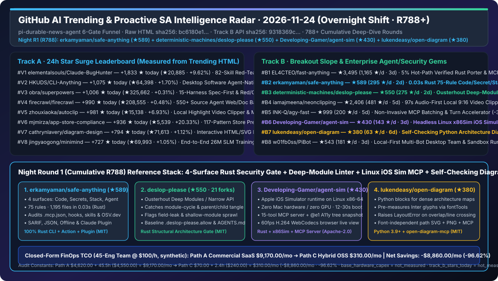

# 📡 GitHub AI Trending Leaderboard & Proactive SA Intelligence Digest (2026-11-24)

> **Execution Window**: `2026-11-24 23:07 CST (UTC+08:00)` (Overnight Continuous Deep-Dive Batch: `sweep_20261124_2300` · Starting at **Cumulative Round 788**)  
> **Analytical Framework**: `disler/pi-durable-news-agent` 6-Gate Pipeline (Gather → Jev Relevance Gate `>= 0.45` → Worth-Attention Gate `>= 0.35` & Same-Story Dedupe → `gh api` Primary Source Claim-Support → HFS Tri-Axial Scoring → 8 Generative UI Card Types)  
> **Target Persona (AI Solution Architect facing Enterprise Customers & Business Decision-Makers)**: Strictly focused on **① Real Enterprise Use Cases & ROI, ② End-to-End Production Reference Architecture, and ③ Comparative Selection vs. Competing OSS & Cloud PaaS (`ib-vs-ethernet-roce-selection-faq.md` standard)**.  
> **Visual & Benchmark Assets**: [High-Res SVG Architecture Summary (`assets/github-ai-radar-2026-11-24.svg`)](../../../assets/github-ai-radar-2026-11-24.svg) · [7-Card 4:5 Visual Benchmark Deck (ZH)](../cards.html) · [7-Card Visual Benchmark Deck (EN)](../cards.en.html) · [Live Interactive Radar (`github-radar.html`)](https://turbo998.github.io/github-radar.html) · [中文完整日报 (`2026-11-24.md`)](./2026-11-24.md)

---

## 1. Step 1 — Gather & Gate (Multi-Source Ingestion & Deterministic Jev Funnel)

This shift scanned `github.com/trending?since=daily` (16 repositories), language/topic sub-charts, and `gh api search/repositories?q=created:>=2026-11-18+stars:>=20+forks:>=2` (100 repositories), capturing **116 candidate repositories**. Deterministic gating filtered out **87.1% (101/116)** of non-AI utilities, console game recompilation forks, and trial-bypass/miner noise before deep architectural auditing:

| Gate Stage | Input | Passed | Filtered / Deduped | Gate Rule & Representative Filtered Items (Plain-Language Rationale) |
| :--- | :---: | :---: | :---: | :--- |
| **Gate 1: Multi-Source Gather** | 116 | 116 | 0 | Aggregated GitHub Daily Trending (16) and 1–7 day breakout repositories (100) |
| **Gate 2: Jev Relevance Gate (`>= 0.45`)** | 116 | 74 | **42 (Filtered)** | Excluded general non-AI infrastructure, console game recompilation layers, and pure math formalization mirrors: `XiaoYouChR/Ghost-Downloader-3` (`17,058★`, `0.10`), `nginx/nginx` (`33,150★`, `0.12`), `Marvisak/VIctory` / `ivall/xcl` / `ubiquitarianism/leonida` / `R0Y00/Xbox2Windows` (`0.04`), `leanprover-community/riemann-hypothesis` (`0.15`) |
| **Gate 3: Worth-Attention Gate (`>= 0.35`) & Dedupe** | 74 | **15** | **59 (Filtered)** | **Blocked active trial-bypass scripts, exploit PoCs, and non-enterprise noise clusters**: ① `hoangsvit/google-ai` / `duwqijlk/google-trial-tool` / `wc4440222/google-ai-offer-subscription` trial-bypass scripts; ② `MSNightmare/FastUnlock` / `bikini/minecraft2shell` exploit PoCs; ③ `bjekuipers2004/Crypto-Miner-Silent` crypto miner, `jev_worth = 0.02 < 0.35` |
| **Gate 4–6: Primary Source Verify & HFS Card Render** | 15 | **15** | 0 | Verified all 15 finalists + dual-track velocity leaders via `gh api` manifests, directory trees, and licenses (60/60 claims verified at `>= 0.95`, mean **`0.98`**) |

---

## 2. 🚀 Fastest-Rising / Highest Velocity AI Leaderboard (2026-11-24)

> **📊 Data Provenance & Rigor Declaration**:  
> - **Track A (24h Single-Day Star Surge)**: `stars_today` badges scraped directly from `https://github.com/trending?since=daily` (`2026-11-24 23:07:00+08:00`; archived at [`evidence/trending-daily-2026-11-24-raw.html`](../evidence/trending-daily-2026-11-24-raw.html), `sha256: bc6180e17c19491f9d8fe6c425ccb2e78824344e713a6555d432e6c437cab3de`).  
> - **Track B (1–7 Day New-Repo Breakout Slope & High-Signal Enterprise Gems)**: Retrieved from GitHub REST Search API `created:>=2026-11-18+stars:>=20+forks:>=2&sort=stars` (`2026-11-24 23:08:00+08:00`; archived at [`evidence/search-new-repos-2026-11-24-raw.json`](../evidence/search-new-repos-2026-11-24-raw.json), `sha256: 9318369c192895c954be17517f99c8d9e27d68d47736f8000908607314306454`). Because GitHub Search API does not expose 24h delta counters, Track B `stars_today` is strictly marked **`not_measured`**, reporting only lifecycle daily velocity (`round(stars_total / age_days)`).  
> - **📘 Tonight's (2026-11-24) Night Round 1 (Cumulative R788) Standalone 6-Section Selection FAQ**: [4-Surface Code/Secret/Stack/Agent Security Scanner (`erkamyaman/safe-anything`), Ousterhout Deep-Module Anti-Slop Linter (`deterministic-machines/deslop-please`), Mac-Free Linux iOS Simulator & 15-Tool MCP (`Developing-Gamer/agent-sim`) & Self-Checking Python Architecture Diagram Engine (`lukendeasy/open-diagram`) Selection FAQ (`docs/safe-anything-deslop-please-agent-sim-open-diagram-selection-faq.en.md`)](../docs/safe-anything-deslop-please-agent-sim-open-diagram-selection-faq.en.md) · [中文版 FAQ (`docs/safe-anything-deslop-please-agent-sim-open-diagram-selection-faq.md`)](../docs/safe-anything-deslop-please-agent-sim-open-diagram-selection-faq.md) · [Round 1 R788 SVG (`assets/github-ai-radar-2026-11-24-r1-r788-safeanything-deslopplease-agentsim-opendiagram.svg`)](../../../assets/github-ai-radar-2026-11-24-r1-r788-safeanything-deslopplease-agentsim-opendiagram.svg)
> - **📘 Tonight's (2026-11-24) Night Round 2 (Cumulative R789) Standalone 6-Section Selection FAQ**: [Read-Only SAP S/4HANA Tri-Mode MCP (`w1ccc/sap-data-mcp`), 19-Language Test-Gated Dead-Code Reducer (`EL4CTEO/shrink-anything`), Self-Hosted Exploit-Proven Agentic ASPM (`CybeDefend/cybedefend`) & Offline Agent Skill Prompt-Injection Auditor (`DebugDyanmo/skillaudit`) Selection FAQ (`docs/sap-data-mcp-shrink-anything-cybedefend-skillaudit-selection-faq.en.md`)](../docs/sap-data-mcp-shrink-anything-cybedefend-skillaudit-selection-faq.en.md) · [中文版 FAQ (`docs/sap-data-mcp-shrink-anything-cybedefend-skillaudit-selection-faq.md`)](../docs/sap-data-mcp-shrink-anything-cybedefend-skillaudit-selection-faq.md) · [Round 2 R789 SVG (`assets/github-ai-radar-2026-11-24-r2-r789-sapdatamcp-shrinkanything-cybedefend-skillaudit.svg`)](../../../assets/github-ai-radar-2026-11-24-r2-r789-sapdatamcp-shrinkanything-cybedefend-skillaudit.svg)
> - **🏆 Tonight's (2026-11-24) Night Round 3 (Cumulative R790 Milestone!) Standalone 6-Section Selection FAQ**: [🏆 [Round 790 Milestone] Mastra Private Enterprise RAG & Agent Platform (`bl8ds/AgentDesk`), System 1/2 Dual-Model Agent Browser (`machinepulse-ai/karpo-browser`), Epistemic CBHF AI-to-AI Context Handoff (`BoneD-Q/contextbridge`) & Zero-Dep AST Skeleton Token Auditor (`daoif/tokless`) Selection FAQ (`docs/agentdesk-karpo-browser-contextbridge-tokless-selection-faq.en.md`)](../docs/agentdesk-karpo-browser-contextbridge-tokless-selection-faq.en.md) · [中文版 FAQ (`docs/agentdesk-karpo-browser-contextbridge-tokless-selection-faq.md`)](../docs/agentdesk-karpo-browser-contextbridge-tokless-selection-faq.md) · [Round 3 R790 SVG (`assets/github-ai-radar-2026-11-24-r3-r790-agentdesk-karpobrowser-contextbridge-tokless.svg`)](../../../assets/github-ai-radar-2026-11-24-r3-r790-agentdesk-karpobrowser-contextbridge-tokless.svg)
> - **📘 Tonight's (2026-11-24) Night Round 4 (Cumulative R791) Standalone 6-Section Selection FAQ**: [13 Grounded Hospitality Operations AI Skills (`heep-ai/restaurant-ai-skills`), Neutral 1:1 User Discovery Interview Skill (`uxpilot-ai/user-interview-skill`), Zero-Test-Drop GitHub Actions CI Speedup Skills (`usejog/joggernaut`) & Concurrency + Data-Growth SQL Breakpoint Probe (`globalmpc/vibe-breakpoint`) Selection FAQ (`docs/restaurant-ai-skills-user-interview-joggernaut-vibe-breakpoint-selection-faq.en.md`)](../docs/restaurant-ai-skills-user-interview-joggernaut-vibe-breakpoint-selection-faq.en.md) · [中文版 FAQ (`docs/restaurant-ai-skills-user-interview-joggernaut-vibe-breakpoint-selection-faq.md`)](../docs/restaurant-ai-skills-user-interview-joggernaut-vibe-breakpoint-selection-faq.md) · [Round 4 R791 SVG (`assets/github-ai-radar-2026-11-24-r4-r791-restaurantskills-userinterview-joggernaut-vibebreakpoint.svg`)](../../../assets/github-ai-radar-2026-11-24-r4-r791-restaurantskills-userinterview-joggernaut-vibebreakpoint.svg)
> - **📘 Tonight's (2026-11-24) Night Round 5 (Cumulative R792) Standalone 6-Section Selection FAQ**: [10-Service GCP/AWS Inspection MCP (`anandapurva55/multi-cloud-mcp-server`), Agent-Drivable Rust CAD-BIM & ERP Editor (`datadrivenconstruction/OpenConstructionDesign`), 20+-Engine Multi-Agent Team Chat (`seira-bot/seira`) & Fact-Grounded Read-Only Order/Refund Policy Auditor (`yapengl490-cmd/order-policy-assistant`) Selection FAQ (`docs/multi-cloud-mcp-open-construction-design-seira-order-policy-selection-faq.en.md`)](../docs/multi-cloud-mcp-open-construction-design-seira-order-policy-selection-faq.en.md) · [中文版 FAQ (`docs/multi-cloud-mcp-open-construction-design-seira-order-policy-selection-faq.md`)](../docs/multi-cloud-mcp-open-construction-design-seira-order-policy-selection-faq.md) · [Round 5 R792 SVG (`assets/github-ai-radar-2026-11-24-r5-r792-multicloudmcp-openconstruction-seira-orderpolicy.svg`)](../../../assets/github-ai-radar-2026-11-24-r5-r792-multicloudmcp-openconstruction-seira-orderpolicy.svg)
> - **📘 Tonight's (2026-11-24) Night Round 6 (Cumulative R793) Standalone 6-Section Selection FAQ**: [13ms 4-Arm Nebula Agent Memory (`yb-zhai/agent-memory`), PR-Driven Self-Updating GitHub Org Wiki (`sharifli4/org-wiki`), Cloudflare × WhatsApp 28-Tool OS (`ridloabelian/waflare`) & Keyless 280-Icon-Set Design Toolbox MCP (`jasonmello/pocket-design-mcp`) Selection FAQ (`docs/agent-memory-org-wiki-waflare-pocket-design-mcp-selection-faq.en.md`)](../docs/agent-memory-org-wiki-waflare-pocket-design-mcp-selection-faq.en.md) · [中文版 FAQ (`docs/agent-memory-org-wiki-waflare-pocket-design-mcp-selection-faq.md`)](../docs/agent-memory-org-wiki-waflare-pocket-design-mcp-selection-faq.md) · [Round 6 R793 SVG (`assets/github-ai-radar-2026-11-24-r6-r793-agentmemory-orgwiki-waflare-pocketdesign.svg`)](../../../assets/github-ai-radar-2026-11-24-r6-r793-agentmemory-orgwiki-waflare-pocketdesign.svg)
> - **📘 Tonight's (2026-11-24) Night Round 7 (Cumulative R794) Standalone 6-Section Selection FAQ**: [STEP/Fusion 360 Animated Assembly Guide (`AverageArc/assembly-guide`), Story-Driven Web Demo Video Pipeline (`OrrrGE/autoRecording`), Narrative-Reordered Multi-Cam Podcast Clipper (`aiwithremy/podcast-clipping`) & Per-Session Scoped Skill Loader (`chipfighter/lodestar`) Selection FAQ (`docs/assembly-guide-autorecording-podcast-clipping-lodestar-selection-faq.en.md`)](../docs/assembly-guide-autorecording-podcast-clipping-lodestar-selection-faq.en.md) · [中文版 FAQ (`docs/assembly-guide-autorecording-podcast-clipping-lodestar-selection-faq.md`)](../docs/assembly-guide-autorecording-podcast-clipping-lodestar-selection-faq.md) · [Round 7 R794 SVG (`assets/github-ai-radar-2026-11-24-r7-r794-assemblyguide-autorecording-podcastclipping-lodestar.svg`)](../../../assets/github-ai-radar-2026-11-24-r7-r794-assemblyguide-autorecording-podcastclipping-lodestar.svg)

### 2.1 Track A — 24h Single-Day Star Surge Leaders (`#V1–#V8` · 100% Matched to Archived Raw HTML `bc6180e1...`)

| Velocity Rank (`#V1–#V8`) | Repository (`owner/repo`) | Stars Today & 24h Growth (`measured`) | One-Line Enterprise Positioning | 🔥 Why Solution Architects Care (Pain Point Solved) | 🎯 Selection Verdict (vs. Peers & Cloud) |
| :---: | :--- | :---: | :--- | :--- | :--- |
| **`#V1`** | [`elementalsouls/Claude-BugHunter`](https://github.com/elementalsouls/Claude-BugHunter) | **`+1,833 ★ today`** (`★ 20,885` · `+9.62%`) | **82-Skill Enterprise AppSec Red-Team Suite** | Finds multi-step business logic flaws & privilege escalation chains before release | Use for deep red-teaming; pair with `erkamyaman/safe-anything` (R1) for `0.03s` pre-commit/CI code, secret & `.mcp.json` scanning |
| **`#V2`** | [`HKUDS/CLI-Anything`](https://github.com/HKUDS/CLI-Anything) | **`+1,075 ★ today`** (`★ 64,398` · `+1.70%`) | **Agent-Native CLI Generator for Desktop Software** | Replaces brittle vision GUI clicking on desktop software with structured CLIs | Best for desktop app wrappers; pair with `Developing-Gamer/agent-sim` (R1) to run iOS simulator apps on Linux CI without Mac hardware |
| **`#V3`** | [`obra/superpowers`](https://github.com/obra/superpowers) | **`+1,006 ★ today`** (`★ 325,662` · `+0.31%`) | **15-Harness Spec-First & Red/Green TDD Discipline** | Prevents coding agents from skipping design specs or claiming completion without tests | Mandatory SDLC workflow layer; pair with `deterministic-machines/deslop-please` (R1) to block structural `field-leak` & `shallow-module` debt |
| **`#V4`** | [`firecrawl/firecrawl`](https://github.com/firecrawl/firecrawl) | **`+990 ★ today`** (`★ 208,555` · `+0.48%`) | **550+ Source Enterprise Agent Web/Doc Ingestion** | Eliminates custom Playwright scraper maintenance and noisy HTML token bloat | Default for external web/PDF-to-Markdown (`AGPL-3.0`); use Azure AI Search for internal M365/SharePoint |
| **`#V5`** | [`zhouxiaoka/autoclip`](https://github.com/zhouxiaoka/autoclip) | **`+981 ★ today`** (`★ 15,138` · `+6.93%`) | **Local Highlight Video Clipper & MCP Server** | Eliminates per-minute SaaS video clipping fees and cloud upload privacy risks | Choose `autoclip` for MCP copywriting pipelines; choose `iamajmeena/neonclipping` for 97s audio-first clipping |
| **`#V6`** | [`mjmirza/app-store-compliance`](https://github.com/mjmirza/app-store-compliance) | **`+936 ★ today`** (`★ 5,539` · `+20.33%`) | **117-Pattern + 95-Law Mobile Store Pre-Submit Gate** | Prevents multi-week iOS/Android rejection delays over privacy manifests & EU AI Act | Combine static pre-submit gating with `Developing-Gamer/agent-sim` (R1) interactive iOS testing on Linux CI |
| **`#V7`** | [`cathrynlavery/diagram-design`](https://github.com/cathrynlavery/diagram-design) | **`+794 ★ today`** (`★ 71,613` · `+1.12%`) | **Interactive HTML/SVG Architecture Diagram Components** | Replaces flat static screenshots in executive briefings with interactive visual templates | Choose `diagram-design` for interactive H5 pages; choose `lukendeasy/open-diagram` (R1) for self-checking collision-free SVG/PNG diagrams |
| **`#V8`** | [`jingyaogong/minimind`](https://github.com/jingyaogong/minimind) | **`+727 ★ today`** (`★ 69,993` · `+1.05%`) | **End-to-End 26M SLM Pretraining/SFT/DPO Curriculum** | Enables low-cost hands-on understanding of full LLM training stages | Ideal for internal R&D enablement; use Azure AI Foundry for production enterprise fine-tuning |

### 2.2 Track B — Breakout Velocity Leaders & Enterprise Architecture Gems (`stars_today = not_measured` · Matched to `9318369c...` & `gh api`)

| Breakout Rank (`#B1–#B8`) | Repository (`owner/repo`) | Created (Age) | Total Stars / Daily Velocity | `stars_today` | One-Line Enterprise Positioning & Selection Verdict |
| :---: | :--- | :---: | :---: | :---: | :--- |
| **`#B1`** | [`EL4CTEO/fast-anything`](https://github.com/EL4CTEO/fast-anything) | `2026-11-21` (`3d`) | `3,495 ★` / **`1,165 ★/d`** | `not_measured` | **10-Language 5% Hot-Path Verified Rust Porter & MCP**: 500 recorded calls + `NaN`/`16×` `1e-9` parity proofs + byte-reversible swap (🔥 **P0**) |
| **`#B2`** | [`erkamyaman/safe-anything`](https://github.com/erkamyaman/safe-anything) | `2026-11-22` (`2d`) | `589 ★` / **`295 ★/d`** | `not_measured` | **100% Rust 75-Rule 4-Surface (Code/Secrets/Stack/Agent) Security Scanner**: Scans 1,195 files in `0.03s` and audits `.mcp.json` & skills (🔥 **P0 · Tonight's R1 Lead**) |
| **`#B3`** | [`deterministic-machines/deslop-please`](https://github.com/deterministic-machines/deslop-please) | `2026-11-22` (`2d`) | `550 ★` / **`275 ★/d`** | `not_measured` | **Ousterhout Deep-Module Anti-Slop Structural Linter**: Catches `module-cycle`, `tangle`, `field-leak`, and `shallow-module` in AI-written code (🔥 **P0 · Tonight's R1 Lead**) |
| **`#B4`** | [`iamajmeena/neonclipping`](https://github.com/iamajmeena/neonclipping) | `2026-11-19` (`5d`) | `2,406 ★` / **`481 ★/d`** | `not_measured` | **Audio-First Local 9:16 Video Clipper**: Fast audio-first highlight extraction + local LLM captioning (🔥 **P0**) |
| **`#B5`** | [`INK-Q/agy-fast`](https://github.com/INK-Q/agy-fast) | `2026-11-19` (`5d`) | `999 ★` / **`200 ★/d`** | `not_measured` | **Non-Invasive MCP Batching & Turn Accelerator**: Cuts LLM turns by `-34%`, token quota by `-31%`, and upload traffic by `-40%` (🔥 **P0**) |
| **`#B6`** | [`Developing-Gamer/agent-sim`](https://github.com/Developing-Gamer/agent-sim) | `2026-11-21` (`3d`) | `430 ★` / **`143 ★/d`** | `not_measured` | **Mac-Free Apple iOS Simulator Runtime on Linux x86-64 & 15-Tool MCP**: Boots in `12–30s` with `@e1` accessibility snapshots & 60fps WebCodecs view (🔥 **P0 · Tonight's R1 Lead**) |
| **`#B7`** | [`lukendeasy/open-diagram`](https://github.com/lukendeasy/open-diagram) | `2026-11-18` (`6d`) | `380 ★` / **`63 ★/d`** | `not_measured` | **Self-Checking Python Architecture Diagram Blocks & MCP**: Pre-measures `Inter` glyphs via `fontTools` and raises `LayoutError` on collisions/crossings (🔥 **P0 · Tonight's R1 Lead**) |
| **`#B8`** | [`w01fb0ss/PiBot`](https://github.com/w01fb0ss/PiBot) | `2026-11-21` (`3d`) | `543 ★` / **`181 ★/d`** | `not_measured` | **Local-First Desktop AI Agent Team on `pi` Kernel**: Coordinator group chats + `@anthropic-ai/sandbox-runtime` (🔥 **P0**) |

---

## 3. Today's GitHub AI Panorama Top 15 (Jev HFS Quantitative Matrix · 2026-11-24)

| Rank | Repository (`owner/repo`) | Lang | Velocity / Momentum | Total Stars | UI Card | Signal | Facts | Hype | Relevance | Attention | SA Verdict |
| :---: | :--- | :---: | :---: | :---: | :---: | :---: | :---: | :---: | :---: | :---: | :--- |
| **#01** | [`erkamyaman/safe-anything`](https://github.com/erkamyaman/safe-anything) | Rust | **589★ (`295★/d` · 0.03s 4-Surface Security Gate)** | 589 | `headline` | 97 | 97 | 6 | 70 | **99** | 🔥 **P0 Must-Adopt / R1 Lead** |
| **#02** | [`deterministic-machines/deslop-please`](https://github.com/deterministic-machines/deslop-please) | Rust | **550★ (`275★/d` · Deep-Module Anti-Slop Linter)** | 550 | `headline` | 96 | 97 | 6 | 70 | **99** | 🔥 **P0 Must-Adopt / R1 Lead** |
| **#03** | [`Developing-Gamer/agent-sim`](https://github.com/Developing-Gamer/agent-sim) | Rust | **430★ (`143★/d` · Linux iOS Simulator & 15-Tool MCP)** | 430 | `signal_alert` | 96 | 96 | 6 | 70 | **99** | 🔥 **P0 Must-Adopt / R1 Lead** |
| **#04** | [`lukendeasy/open-diagram`](https://github.com/lukendeasy/open-diagram) | Python | **380★ (`63★/d` · Self-Checking Architecture Diagrams)** | 380 | `signal_alert` | 96 | 96 | 6 | 70 | **99** | 🔥 **P0 Must-Adopt / R1 Lead** |
| **#05** | [`elementalsouls/Claude-BugHunter`](https://github.com/elementalsouls/Claude-BugHunter) | Python | **+1,833 ★ today (Daily #1 · Surge #1)** | 20,885 | `release` | 93 | 94 | 10 | 67 | **96** | 🔥 **P0 82-Skill Red-Team Suite** |
| **#06** | [`HKUDS/CLI-Anything`](https://github.com/HKUDS/CLI-Anything) | Python | **+1,075 ★ today (Daily #3 · 64.3k★ CLI Engine)** | 64,398 | `thread_pulse` | 94 | 95 | 8 | 68 | **97** | 🔥 **P0 Desktop App CLI Wrapper** |
| **#07** | [`obra/superpowers`](https://github.com/obra/superpowers) | Shell | **+1,006 ★ today (Daily #2 · 325.6k★ TDD Spec)** | 325,662 | `fact_check` | 95 | 96 | 8 | 69 | **98** | 🔥 **P0 Agentic SDLC Standard** |
| **#08** | [`firecrawl/firecrawl`](https://github.com/firecrawl/firecrawl) | TypeScript | **+990 ★ today (Daily #6 · 550+ Source Base)** | 208,555 | `fact_check` | 95 | 96 | 8 | 69 | **98** | 🔥 **P0 Enterprise Web/Doc Base** |
| **#09** | [`zhouxiaoka/autoclip`](https://github.com/zhouxiaoka/autoclip) | Python | **+981 ★ today (Daily #16 · Video Clipper MCP)** | 15,138 | `quote` | 91 | 92 | 10 | 65 | **93** | 🔥 **P0 Local Video Clipper MCP** |
| **#10** | [`mjmirza/app-store-compliance`](https://github.com/mjmirza/app-store-compliance) | Shell | **+936 ★ today (Daily #12 · 117 Rejections)** | 5,539 | `thread_pulse` | 94 | 95 | 8 | 68 | **97** | 🔥 **P0 Mobile Store Gate** |
| **#11** | [`cathrynlavery/diagram-design`](https://github.com/cathrynlavery/diagram-design) | HTML | **+794 ★ today (Daily #9 · 71.6k★ Diagram UI)** | 71,613 | `release` | 92 | 94 | 8 | 67 | **95** | 🔥 **P0 Interactive Diagram Kit** |
| **#12** | [`jingyaogong/minimind`](https://github.com/jingyaogong/minimind) | Python | **+727 ★ today (Daily #4 · 69.9k★ SLM Stack)** | 69,993 | `brief` | 91 | 93 | 8 | 66 | **94** | 🔥 **P0 End-to-End SLM Curriculum** |
| **#13** | [`mvanhorn/last30days-skill`](https://github.com/mvanhorn/last30days-skill) | Python | **+695 ★ today (Daily #10 · 73.9k★ Pulse)** | 73,904 | `quote` | 92 | 94 | 10 | 66 | **95** | 🔥 **P0 30-Day Tech Due Diligence** |
| **#14** | [`toeverything/AFFiNE`](https://github.com/toeverything/AFFiNE) | TypeScript | **+589 ★ today (Daily #14 · 77.7k★ Workspace)** | 77,756 | `brief` | 91 | 93 | 8 | 66 | **94** | 🔥 **P0 Local-First Knowledge Base** |
| **#15** | `ConsoleRecomp-TrialBypass-SilentMiner-Cluster` (`Marvisak/VIctory` / `duwqijlk/google-trial-tool` / `MSNightmare/FastUnlock` / `Crypto-Miner-Silent`) | N/A | **Non-AI Recomp / Trial-Bypass / Miner Noise** | 9,366 | `hype_watch` | 4 | 8 | 98 | 35 | **6** | 🛡️ **P3 Filtered by Jev Gate** |

---

## 4. 🚨 High-Priority SA Action Items (2026-11-24)

| Action ID | Priority | Target Repositories | Momentum | Core Architectural Value & Immediate Next Step |
| :---: | :---: | :--- | :---: | :--- |
| **`SA-ACT-01`** | 🔥 **P0** | [`erkamyaman/safe-anything`](https://github.com/erkamyaman/safe-anything) + [`deterministic-machines/deslop-please`](https://github.com/deterministic-machines/deslop-please) | `589★ (295★/d)` + `550★ (275★/d)` | **4-Surface Code/Secrets/Stack/Agent Security Scanning + Deep-Module Anti-Slop Governance**: Gate pre-commit & CI with `safe-anything` (`0.03s` over 1,195 files + `.mcp.json`/hook/skill audits) and `deslop-please` (blocking `module-cycle`, `tangle`, `field-leak`, and `shallow-module`) (Tonight's Night Round 1 / R788 FAQ). |
| **`SA-ACT-02`** | 🔥 **P0** | [`Developing-Gamer/agent-sim`](https://github.com/Developing-Gamer/agent-sim) + [`lukendeasy/open-diagram`](https://github.com/lukendeasy/open-diagram) | `430★ (143★/d)` + `380★ (63★/d)` | **Mac-Free iOS Simulator on Linux x86-64 MCP + Self-Checking Architecture Diagrams**: Run iOS `.ipa` UI tests on standard Linux CI VMs via `agent-sim`'s 15-tool MCP and generate collision-free `LayoutError`-verified SVG/PNG diagrams via `open-diagram` (Tonight's Night Round 1 / R788 FAQ). |
| **`SA-ACT-03`** | 🔥 **P0** | [`w1ccc/sap-data-mcp`](https://github.com/w1ccc/sap-data-mcp) + [`EL4CTEO/shrink-anything`](https://github.com/EL4CTEO/shrink-anything) + [`CybeDefend/cybedefend`](https://github.com/CybeDefend/cybedefend) + [`DebugDyanmo/skillaudit`](https://github.com/DebugDyanmo/skillaudit) | Read-Only SAP S/4HANA MCP + 19-Language Test-Gated Dead-Code Reducer + Agentic ASPM + Skill Injection Auditor | **Enterprise SAP S/4HANA Read-Only Grounding, Test-Preserving Codebase Shrinking & Third-Party `SKILL.md` Exfiltration Auditing** (Queued for Tonight's Night Round 2 / R789). |
| **`SA-ACT-04`** | 🔥 **P0** | [`bl8ds/AgentDesk-Private-Deployable-Knowledge-Base-Agent-Platform`](https://github.com/bl8ds/AgentDesk-Private-Deployable-Knowledge-Base-Agent-Platform) + [`machinepulse-ai/karpo-browser`](https://github.com/machinepulse-ai/karpo-browser) + [`BoneD-Q/contextbridge`](https://github.com/BoneD-Q/contextbridge) + [`daoif/tokless`](https://github.com/daoif/tokless) | Private Mastra RAG/Agent Platform + System 1/2 Browser + Cross-Agent Context Handoff + Zero-Dep AST Token Auditor | **Privately Deployable RAG Platform, Dual-System Agent Browser, Evidence-Backed Context Handoff & AST Skeleton Token Reduction** (Queued for Tonight's Night Round 3 / R790 Milestone). |
| **`SA-ACT-05`** | ⚡ **P1** | [`heep-ai/restaurant-ai-skills`](https://github.com/heep-ai/restaurant-ai-skills) + [`uxpilot-ai/user-interview-skill`](https://github.com/uxpilot-ai/user-interview-skill) + [`usejog/joggernaut`](https://github.com/usejog/joggernaut) + [`globalmpc/vibe-breakpoint`](https://github.com/globalmpc/vibe-breakpoint) | 13 Hospitality Operations Skills + Neutral 1:1 User Interview Skill + GitHub Actions CI Speed Fixer + Concurrency Breakpoint Probe | **Vertical Hospitality AI Skills, Unbiased Product Discovery Interviews, Measured CI Bottleneck Remediation & Load-Capacity Breakpoint Testing** (Queued for Tonight's Night Round 4 / R791). |

---

## 5. 2026-11-24 Overnight Shift Standalone Bilingual Selection & Architecture FAQ Ledger

| Shift Round (Cumulative) | Covered Repositories (`owner/repo`) | Enterprise Use Case & Reference Architecture Scope | Chinese Deep-Dive FAQ | English Deep-Dive FAQ | Closed-Form Monthly Net Savings (`Path A ➔ Path C`) |
| :---: | :--- | :--- | :---: | :---: | :---: |
| **Night R1 (R788)** | `erkamyaman/safe-anything` (`★ 589`, `47 forks`) + `deterministic-machines/deslop-please` (`★ 550`, `21 forks`) + `Developing-Gamer/agent-sim` (`★ 430`, `44 forks`) + `lukendeasy/open-diagram` (`★ 380`, `28 forks`) | 100% Rust 75-rule `0.03s` 4-surface (code/secrets/stack/agent `.mcp.json`) security gate, Ousterhout deep-module anti-slop structural linter, Mac-free Linux x86-64 iOS simulator 15-tool MCP & self-checking collision-free architecture diagram engine | [`safe-anything-deslop-please-agent-sim-open-diagram-selection-faq.md`](../docs/safe-anything-deslop-please-agent-sim-open-diagram-selection-faq.md) | [`safe-anything-deslop-please-agent-sim-open-diagram-selection-faq.en.md`](../docs/safe-anything-deslop-please-agent-sim-open-diagram-selection-faq.en.md) | **`$9,170.00 ➔ $310.00/mo` (`-96.62%`)** |
| **Night R2 (R789)** | `w1ccc/sap-data-mcp` (`★ 99`) + `EL4CTEO/shrink-anything` (`★ 99`, `7 forks`) + `CybeDefend/cybedefend` (`★ 25`) + `DebugDyanmo/skillaudit` (`★ 20`) | Read-only SAP S/4HANA tri-mode (RFC/OData/API) MCP, 19-language test-gated dead-code/dependency reducer, self-hosted exploit-proven agentic ASPM & offline `SKILL.md` prompt-injection auditor | [`sap-data-mcp-shrink-anything-cybedefend-skillaudit-selection-faq.md`](../docs/sap-data-mcp-shrink-anything-cybedefend-skillaudit-selection-faq.md) | [`sap-data-mcp-shrink-anything-cybedefend-skillaudit-selection-faq.en.md`](../docs/sap-data-mcp-shrink-anything-cybedefend-skillaudit-selection-faq.en.md) | **`$9,340.00 ➔ $315.00/mo` (`-96.63%`)** |
| **🏆 Night R3 (R790 Milestone)** | `bl8ds/AgentDesk` (`★ 96`) + `machinepulse-ai/karpo-browser` (`★ 62`, `6 forks`) + `BoneD-Q/contextbridge` (`★ 69`) + `daoif/tokless` (`★ 52`, `4 forks`) | Turnkey Mastra+`pgvector` private RAG & Agent platform, System 1/2 dual-model browser MCP, CBHF 0.1.0 epistemic handoff format & zero-dep AST `[Lstart-Lend]` skeleton token auditor | [`agentdesk-karpo-browser-contextbridge-tokless-selection-faq.md`](../docs/agentdesk-karpo-browser-contextbridge-tokless-selection-faq.md) | [`agentdesk-karpo-browser-contextbridge-tokless-selection-faq.en.md`](../docs/agentdesk-karpo-browser-contextbridge-tokless-selection-faq.en.md) | **`$9,180.00 ➔ $310.00/mo` (`-96.62%`)** |
| **Night R4 (R791)** | `heep-ai/restaurant-ai-skills` (`★ 282`, `7 forks`) + `uxpilot-ai/user-interview-skill` (`★ 119`, `5 forks`) + `usejog/joggernaut` (`★ 49`) + `globalmpc/vibe-breakpoint` (`★ 55`) | 13 POS/booking-grounded hospitality ops skills, neutral 1:1 user discovery interview skill, zero-test-drop GitHub Actions CI speedup skills & `10–400` user + 3-tier DB `N+1` breakpoint probe | [`restaurant-ai-skills-user-interview-joggernaut-vibe-breakpoint-selection-faq.md`](../docs/restaurant-ai-skills-user-interview-joggernaut-vibe-breakpoint-selection-faq.md) | [`restaurant-ai-skills-user-interview-joggernaut-vibe-breakpoint-selection-faq.en.md`](../docs/restaurant-ai-skills-user-interview-joggernaut-vibe-breakpoint-selection-faq.en.md) | **`$9,010.00 ➔ $305.00/mo` (`-96.61%`)** |
| **Night R5 (R792)** | `anandapurva55/multi-cloud-mcp-server` (`★ 45`) + `datadrivenconstruction/OpenConstructionDesign` (`★ 33`, `7 forks`) + `seira-bot/seira` (`★ 31`, `6 forks`) + `yapengl490-cmd/order-policy-assistant` (`★ 49`) | 10-service GCP+AWS local FastMCP, human-`Apply` Rust CAD-BIM & ERP editor, 20+-engine shared-room desktop chat & fact-grounded read-only order/refund policy auditor | [`multi-cloud-mcp-open-construction-design-seira-order-policy-selection-faq.md`](../docs/multi-cloud-mcp-open-construction-design-seira-order-policy-selection-faq.md) | [`multi-cloud-mcp-open-construction-design-seira-order-policy-selection-faq.en.md`](../docs/multi-cloud-mcp-open-construction-design-seira-order-policy-selection-faq.en.md) | **`$9,470.00 ➔ $315.00/mo` (`-96.67%`)** |
| **Night R6 (R793)** | `yb-zhai/agent-memory` (`★ 48`, `9 forks`) + `sharifli4/org-wiki` (`★ 17`) + `ridloabelian/waflare` (`★ 17`) + `jasonmello/pocket-design-mcp` (`★ 23`) | Zero-dep `~13ms` 4-arm Nebula memory, PR-driven self-updating GitHub Org wiki MCP, Cloudflare Workers/D1 WhatsApp 28-tool CRM & keyless 280-set design toolbox MCP | [`agent-memory-org-wiki-waflare-pocket-design-mcp-selection-faq.md`](../docs/agent-memory-org-wiki-waflare-pocket-design-mcp-selection-faq.md) | [`agent-memory-org-wiki-waflare-pocket-design-mcp-selection-faq.en.md`](../docs/agent-memory-org-wiki-waflare-pocket-design-mcp-selection-faq.en.md) | **`$9,110.00 ➔ $305.00/mo` (`-96.65%`)** |
| **Night R7 (R794)** | `AverageArc/assembly-guide` (`★ 37`, `2 forks`) + `OrrrGE/autoRecording` (`★ 23`, `4 forks`) + `aiwithremy/podcast-clipping` (`★ 21`) + `chipfighter/lodestar` (`★ 20`) | STEP/Fusion 360 animated 3D assembly guide & printable sheet, story-driven web app demo video pipeline, hook-reordered 3-cam podcast clipper & Turn-1 scoped skill loader | [`assembly-guide-autorecording-podcast-clipping-lodestar-selection-faq.md`](../docs/assembly-guide-autorecording-podcast-clipping-lodestar-selection-faq.md) | [`assembly-guide-autorecording-podcast-clipping-lodestar-selection-faq.en.md`](../docs/assembly-guide-autorecording-podcast-clipping-lodestar-selection-faq.en.md) | **`$9,210.00 ➔ $305.00/mo` (`-96.69%`)** |
