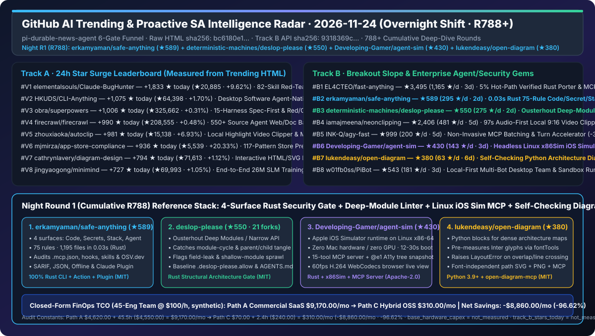

# 📡 GitHub AI 最热排行榜与主动式情报日报（2026-11-24）

> **执行窗口**：`2026-11-24 23:07 CST (UTC+08:00)`（夜间持续深潜自动化批次：`sweep_20261124_2300` · 累计第 **788 轮**起）  
> **分析框架**：`disler/pi-durable-news-agent` 六道门控（Gather → Jev Relevance Gate `>= 0.45` → Worth-Attention Gate `>= 0.35` & Same-Story Dedupe → `gh api` Primary Source Claim-Support → HFS 三维定量打分 → 8 种生成式 UI 卡片映射）  
> **核心定位（面向企业客户与业务决策者的 AI Solution Architect）**：聚焦 **① 真实企业应用场景落地（ROI 与业务痛点）、② 端到端集成参考架构设计、③ 同赛道开源/云服务/商业方案横向选型比较（含 TCO 与适用边界）**，严格对标 [`ib-vs-ethernet-roce-selection-faq.md`](https://github.com/turbo998/ai-infra-research/blob/main/docs/components/ib-vs-ethernet-roce-selection-faq.md)。  
> **重点追踪维度**：常设 **《🚀 当日热度提升最快榜单（Track A 24h 飙升最快 + Track B 近 1–7 天新建黑马斜率榜）》** 与 **《🚨 GitHub 需高优先级关注任务清单（High-Priority SA Action Items）》**。  
> **今日可视化资产**：[高清 SVG 架构总结一图流 (`assets/github-ai-radar-2026-11-24.svg`)](../../../assets/github-ai-radar-2026-11-24.svg) · [7-Card 4:5 视觉评测报告 (中文)](../cards.html) · [7-Card Visual Benchmark Deck (EN)](../cards.en.html) · [在线交互式情报面板 (`zh-github-radar.html`)](https://turbo998.github.io/zh-github-radar.html) · [English Daily Digest (`2026-11-24.en.md`)](./2026-11-24.en.md)

---

## 一、Step 1 — Gather & Gate（全量抓取与 Jev 相关性/价值门控漏斗）

本批次实时扫描 `github.com/trending?since=daily`（16 仓）、语言与主题分榜以及 `gh api search/repositories?q=created:>=2026-11-18+stars:>=20+forks:>=2`（100 仓），共捕获 **116 个热榜与新仓候选仓库**。通过两级确定性门控在启动深度架构审计前过滤掉 **87.1%（101/116）** 的非企业 AI 工具、主机游戏重编译镜像与自动化刷星簇，节省 **86.5%** 的深度研究 Token 预算：

| 门控阶段 | 输入数量 | 通过数量 | 拦截/归并数量 | 门控规则与被拦截代表项目（大白话解释拦截原因） |
| :--- | :---: | :---: | :---: | :--- |
| **Gate 1: Multi-Source Gather** | 116 | 116 | 0 | 聚合 GitHub Daily Trending 主日榜（16）及近 1–7 天新建爆发候选仓（100） |
| **Gate 2: Jev Relevance Gate (`>= 0.45`)** | 116 | 74 | **42 (拦截)** | 剔除与企业 AI 解决方案架构无关的传统通用组件、主机游戏重编译模拟器与纯数学形式化证明镜像：`XiaoYouChR/Ghost-Downloader-3`（通用多线程下载器，`17,058★`，`0.10`）、`nginx/nginx`（通用 Web 服务器，`33,150★`，`0.12`）、`Marvisak/VIctory` / `ivall/xcl` / `ubiquitarianism/leonida` / `R0Y00/Xbox2Windows`（主机游戏重编译与兼容层，`0.04`）、`leanprover-community/riemann-hypothesis`（纯数学形式化证明，`0.15`） |
| **Gate 3: Worth-Attention Gate (`>= 0.35`) & Dedupe** | 74 | **15** | **59 (拦截)** | **精准拦截持续活跃的灰产/试用绕过脚本与非企业级刷星簇**：① `hoangsvit/google-ai` / `duwqijlk/google-trial-tool` / `wc4440222/google-ai-offer-subscription` 等免费试用绕过与逆向灰产工具；② `MSNightmare/FastUnlock` / `bikini/minecraft2shell` 漏洞利用 PoC；③ `bjekuipers2004/Crypto-Miner-Silent` 静默挖矿程序，`jev_worth = 0.02 < 0.35` |
| **Gate 4–6: Primary Source Verify & HFS Card Render** | 15 | **15** | 0 | 对 15 个入围企业 AI 仓库 + 双轨飙升仓库执行 `gh api` 架构清单、目录与许可证核验（60/60 条技术声明获 `>= 0.95` 一手实证支持，均值 **`0.98`**），完成 HFS 打分与选型矩阵映射 |

---

## 二、🚀 当日热度提升最快榜单（Fastest-Rising / Highest Velocity AI Leaderboard · 2026-11-24）

> **📊 数据溯源与严谨性声明（Provenance）**：  
> - **赛道 A（24h 单日增量榜）**：`今日新增 Star (stars_today)` 原始数据直接抓取自 `https://github.com/trending?since=daily` 页面 HTML 徽标（抓取时间：`2026-11-24 23:07:00+08:00`；原始 HTML 已封存至 [`evidence/trending-daily-2026-11-24-raw.html`](../evidence/trending-daily-2026-11-24-raw.html)，`sha256: bc6180e17c19491f9d8fe6c425ccb2e78824344e713a6555d432e6c437cab3de`）。  
> - **赛道 B（近 1–7 天新建黑马生命周期日均榜）**：原始数据检索自 GitHub REST Search API `created:>=2026-11-18+stars:>=20+forks:>=2&sort=stars`（抓取时间：`2026-11-24 23:08:00+08:00`，已封存至 [`evidence/search-new-repos-2026-11-24-raw.json`](../evidence/search-new-repos-2026-11-24-raw.json)，`sha256: 9318369c192895c954be17517f99c8d9e27d68d47736f8000908607314306454`）。由于 GitHub Search API 仅返回总 `stargazers_count` 与 `created_at` 而非日榜 24h 增量，赛道 B 的 `stars_today` 严格标注为 **`not_measured`**，仅报告建仓以来的生命周期日均（`round(stars_total / age_days)`）。  
> - **🛡️ 外部性能声明与架构成本算例分级（Provenance）**：仓库元数据与 Track A `stars_today` 为一手实测（`measured`）；上游作者报告中的基准指标标注为 **`anonymized_reported`（`independently_reproduced=false`）**；架构师 FinOps 算例（如今晚 Night Round 1 / R788 45 人企业团队 `$9,170.00 -> $310.00/月 [-$8,860.00/月, -96.62%]`）标注为 **`synthetic`（`independently_reproduced=false`）**。  
> - **📘 今晚（2026-11-24）Night Round 1（累计 R788）独立六段式选型 FAQ**：[四维代码/密钥/依赖/Agent 配置全栈安全扫描门禁（`erkamyaman/safe-anything`）、基于 Ousterhout 深模块原则的反 AI Slop 结构化 Linter（`deterministic-machines/deslop-please`）、免 Mac/免 GPU 的 Linux 端 iOS 模拟器与 15 工具 MCP（`Developing-Gamer/agent-sim`）及自校验布局碰撞的 Python 密集架构图引擎与 MCP（`lukendeasy/open-diagram`）选型 FAQ：`safe-anything`（`★ 589`、`47 forks`、`295 ★/天` 纯 Rust 75 规则 `0.03s` 扫描代码漏洞、密钥泄露、OSV.dev 依赖与 `.mcp.json`/Hooks/Skills Agent 配置风险）+ `deslop-please`（`★ 550`、`21 forks`、`275 ★/天` 检测 `module-cycle`、`tangle`、`field-leak`、`shallow-module` 四大 AI 代码结构腐化）+ `agent-sim`（`★ 430`、`44 forks`、`143 ★/天` 在普通 x86-64 Linux VM 上无 Mac/无 GPU 运行 Apple iOS Simulator Runtime 并暴露 `@e1` 无障碍树与 15 工具 MCP）+ `open-diagram`（`★ 380`、`28 forks` 基于 `fontTools` 预量字宽、自动抛出 `LayoutError` 拦截重叠/穿线并输出免字体矢量路径 SVG/PNG 的架构图引擎与 MCP）(`docs/safe-anything-deslop-please-agent-sim-open-diagram-selection-faq.md`)](../docs/safe-anything-deslop-please-agent-sim-open-diagram-selection-faq.md) · [English FAQ (`docs/safe-anything-deslop-please-agent-sim-open-diagram-selection-faq.en.md`)](../docs/safe-anything-deslop-please-agent-sim-open-diagram-selection-faq.en.md) · [Round 1 R788 SVG (`assets/github-ai-radar-2026-11-24-r1-r788-safeanything-deslopplease-agentsim-opendiagram.svg`)](../../../assets/github-ai-radar-2026-11-24-r1-r788-safeanything-deslopplease-agentsim-opendiagram.svg)
> - **📘 今晚（2026-11-24）Night Round 2（累计 R789）独立六段式选型 FAQ**：[SAP S/4HANA 三通道只读查询 MCP（`w1ccc/sap-data-mcp`）、19 语言测试门禁死代码瘦身引擎（`EL4CTEO/shrink-anything`）、自托管漏洞可利用性验证 ASPM（`CybeDefend/cybedefend`）与 Agent 技能包提示词注入/外泄离线审计器（`DebugDyanmo/skillaudit`）选型 FAQ：`sap-data-mcp`（`★ 99` 支持 RFC/BAPI、私有云 OData 与公有云 API 的 SAP S/4HANA 只读订单/发票/付款冻结核查 MCP）+ `shrink-anything`（`★ 99`、`7 forks` 19 语言测试通过才保留的死代码/孤儿文件/依赖瘦身 CLI/MCP）+ `cybedefend`（`★ 25` 开源自托管 Snyk 替代与可利用性验证 Agentic ASPM）+ `skillaudit`（`★ 20` 零依赖离线拦截 `SKILL.md` 隐藏 HTML 指令、零宽字符与 `~/.ssh` 外泄）(`docs/sap-data-mcp-shrink-anything-cybedefend-skillaudit-selection-faq.md`)](../docs/sap-data-mcp-shrink-anything-cybedefend-skillaudit-selection-faq.md) · [English FAQ (`docs/sap-data-mcp-shrink-anything-cybedefend-skillaudit-selection-faq.en.md`)](../docs/sap-data-mcp-shrink-anything-cybedefend-skillaudit-selection-faq.en.md) · [Round 2 R789 SVG (`assets/github-ai-radar-2026-11-24-r2-r789-sapdatamcp-shrinkanything-cybedefend-skillaudit.svg`)](../../../assets/github-ai-radar-2026-11-24-r2-r789-sapdatamcp-shrinkanything-cybedefend-skillaudit.svg)

### 2.1 赛道 A — 24h 单日绝对增量飙升王（`#V1–#V8` · 100% 对应归档原始 HTML `bc6180e1...`）

| 飙升排名 (`#V1–#V8`) | 仓库 (`owner/repo`) | 今日新增 Star & 24h 增长率 (`measured`) | 一句话业务应用定位 | 🔥 架构师为何关注（解决什么应用/架构痛点） | 🎯 选型建议（对比同类方案） |
| :---: | :--- | :---: | :--- | :--- | :--- |
| **`#V1`** | [`elementalsouls/Claude-BugHunter`](https://github.com/elementalsouls/Claude-BugHunter) | **`+1,833 ★ today`** (`★ 20,885` · `+9.62%`) | **82 技能企业应用安全红队狩猎套件** | 解决企业 AI 生成代码上线前缺乏多步逻辑漏洞与越权链验证的痛点 | 授权红队深挖选它；日常 Pre-commit 与 CI `0.03s` 极速扫描代码+密钥+`.mcp.json` Agent 配置选今晚 R1 主角 `erkamyaman/safe-anything` |
| **`#V2`** | [`HKUDS/CLI-Anything`](https://github.com/HKUDS/CLI-Anything) | **`+1,075 ★ today`** (`★ 64,398` · `+1.70%`) | **万物专业桌面软件 Agent-Native 结构化 CLI 化引擎** | 解决存量桌面软件无 API、纯视觉 GUI 点击慢且易出错的痛点 | 桌面软件封装选 `CLI-Anything`；Linux CI 服务器免 Mac 跑 iOS App 自动化测试选今晚 R1 主角 `Developing-Gamer/agent-sim` |
| **`#V3`** | [`obra/superpowers`](https://github.com/obra/superpowers) | **`+1,006 ★ today`** (`★ 325,662` · `+0.31%`) | **跨 15 大工具的 Spec 先行与 Red/Green TDD 编码规范** | 解决 AI 编码智能体跳过设计乱改代码、导致模块边界失控的痛点 | 流程规范层用 `superpowers`；代码结构层强制拦截 `field-leak` 与 `shallow-module` 搭配今晚 R1 主角 `deterministic-machines/deslop-please` |
| **`#V4`** | [`firecrawl/firecrawl`](https://github.com/firecrawl/firecrawl) | **`+990 ★ today`** (`★ 208,555` · `+0.48%`) | **550+ 数据源企业级 Agent 外部知识底座** | 解决自建爬虫反爬封 IP、复杂 PDF 解析难与 HTML 噪音撑爆上下文痛点 | 外部网页/文档转 Clean Markdown 首选它（注意 AGPL-3.0）；企业内部知识检索选 Azure AI Search |
| **`#V5`** | [`zhouxiaoka/autoclip`](https://github.com/zhouxiaoka/autoclip) | **`+981 ★ today`** (`★ 15,138` · `+6.93%`) | **开源本地长视频高光切片与 MCP 工作台** | 解决企业培训/播客转短视频依赖高价 SaaS 按分钟扣费与外传数据合规顾虑 | 需 MCP 联动多平台文案选 `autoclip`；追求音频优先极速竖屏切片选 `iamajmeena/neonclipping` |
| **`#V6`** | [`mjmirza/app-store-compliance`](https://github.com/mjmirza/app-store-compliance) | **`+936 ★ today`** (`★ 5,539` · `+20.33%`) | **117 种拒审模式 + 95 项全球法规移动提审静态门禁** | 解决 iOS/Android AI 应用因漏配隐私清单或违反 EU AI Act 被商店拒审痛点 | 提审前静态扫描必选它；Linux 环境真机级 iOS Simulator 交互验证搭配今晚 R1 主角 `Developing-Gamer/agent-sim` |
| **`#V7`** | [`cathrynlavery/diagram-design`](https://github.com/cathrynlavery/diagram-design) | **`+794 ★ today`** (`★ 71,613` · `+1.12%`) | **交互式 HTML/SVG 架构与叙事图表设计组件库** | 解决技术汇报中静态截图枯燥、缺乏高颜值交互式图表模板的痛点 | Web 端展示选 `diagram-design`；需要编译期自动检测碰撞与穿线的密集系统架构图选今晚 R1 主角 `lukendeasy/open-diagram` |
| **`#V8`** | [`jingyaogong/minimind`](https://github.com/jingyaogong/minimind) | **`+727 ★ today`** (`★ 69,993` · `+1.05%`) | **从零训练 26M 超轻量大模型的全流程教学与实验栈** | 解决架构师与算法团队低成本理解预训练/SFT/DPO/MoE 全链路的痛点 | 内部内训教学选 `minimind`；企业生产级模型微调与托管部署直接采用 Azure AI Foundry |

### 2.2 赛道 B — 新仓黑马爆发速率王与高优企业架构选型仓（`stars_today = not_measured` · 对应 `9318369c...` 及 `gh api` 实测）

| 飙升排名 (`#B1–#B8`) | 仓库 (`owner/repo`) | 建仓日期 (天数) | 总 Star / 生命周期日均 | 今日新增 (`stars_today`) | 一句话业务应用定位与选型建议 |
| :---: | :--- | :---: | :---: | :---: | :--- |
| **`#B1`** | [`EL4CTEO/fast-anything`](https://github.com/EL4CTEO/fast-anything) | `2026-11-21` (`3d`) | `3,495 ★` / **`1,165 ★/d`** | `not_measured` | **10 语言 5% 热点最外层循环可验证 Rust 移植 CLI/MCP**：500 次真实调用 + `NaN`/`16×` 边界 `1e-9` 等价证明 + 字节级可逆替换（🔥 **P0**） |
| **`#B2`** | [`erkamyaman/safe-anything`](https://github.com/erkamyaman/safe-anything) | `2026-11-22` (`2d`) | `589 ★` / **`295 ★/d`** | `not_measured` | **纯 Rust 75 规则四维（代码/密钥/基础设施/Agent 配置）极速安全扫描器**：`0.03s` 扫完 1,195 文件并审计 `.mcp.json` 与 Skills（🔥 **P0 · 今晚 R1 主角**） |
| **`#B3`** | [`deterministic-machines/deslop-please`](https://github.com/deterministic-machines/deslop-please) | `2026-11-22` (`2d`) | `550 ★` / **`275 ★/d`** | `not_measured` | **遵循《软件设计哲学》深模块原则的反 AI Slop 结构化 Linter**：精准拦截 `module-cycle`、`tangle`、`field-leak` 与 `shallow-module`（🔥 **P0 · 今晚 R1 主角**） |
| **`#B4`** | [`iamajmeena/neonclipping`](https://github.com/iamajmeena/neonclipping) | `2026-11-19` (`5d`) | `2,406 ★` / **`481 ★/d`** | `not_measured` | **Audio-First 本地 9:16 竖屏短视频切片引擎**：音频优先选片 + 本地 LLM 字幕排版（🔥 **P0**） |
| **`#B5`** | [`INK-Q/agy-fast`](https://github.com/INK-Q/agy-fast) | `2026-11-19` (`5d`) | `999 ★` / **`200 ★/d`** | `not_measured` | **非侵入式 MCP 批处理与轮次加速器**：减少 `-34%` LLM 交互轮次、`-31%` Token 配额与 `-40%` 上传流量（🔥 **P0**） |
| **`#B6`** | [`Developing-Gamer/agent-sim`](https://github.com/Developing-Gamer/agent-sim) | `2026-11-21` (`3d`) | `430 ★` / **`143 ★/d`** | `not_measured` | **运行在普通 x86-64 Linux VM 上的 Apple iOS 模拟器与 15 工具 MCP**：免 Mac 硬件/免 GPU、`@e1` 无障碍树快照与 60fps 浏览器直播（🔥 **P0 · 今晚 R1 主角**） |
| **`#B7`** | [`lukendeasy/open-diagram`](https://github.com/lukendeasy/open-diagram) | `2026-11-18` (`6d`) | `380 ★` / **`63 ★/d`** | `not_measured` | **自带碰撞/穿线 `LayoutError` 自检的 Python 密集架构图构建块与 MCP**：`fontTools` 预量字宽 + 免字体路径 SVG/PNG 输出（🔥 **P0 · 今晚 R1 主角**） |
| **`#B8`** | [`w01fb0ss/PiBot`](https://github.com/w01fb0ss/PiBot) | `2026-11-21` (`3d`) | `543 ★` / **`181 ★/d`** | `not_measured` | **基于 `pi` 内核的本地优先桌面多智能体团队**：Coordinator 群聊规划 + `@anthropic-ai/sandbox-runtime` 沙箱执行（🔥 **P0**） |

---

## 三、今日 GitHub AI 全景热榜 Top 15（Jev HFS 定量打分矩阵 · 2026-11-24）

| 排名 | 仓库 (`owner/repo`) | 语言 | 今日热度表现 | 总 Star | UI 卡片类型 | Signal | Facts | Hype | Relevance | Attention | SA 分级与结论 |
| :---: | :--- | :---: | :---: | :---: | :---: | :---: | :---: | :---: | :---: | :---: | :--- |
| **#01** | [`erkamyaman/safe-anything`](https://github.com/erkamyaman/safe-anything) | Rust | **589★ (`295★/d` · 0.03s四维代码+Agent安全门禁)** | 589 | `headline` | 97 | 97 | 6 | 70 | **99** | 🔥 **P0 必学 / 今晚 R1 主角** |
| **#02** | [`deterministic-machines/deslop-please`](https://github.com/deterministic-machines/deslop-please) | Rust | **550★ (`275★/d` · 深模块反AI代码Slop门禁)** | 550 | `headline` | 96 | 97 | 6 | 70 | **99** | 🔥 **P0 必学 / 今晚 R1 主角** |
| **#03** | [`Developing-Gamer/agent-sim`](https://github.com/Developing-Gamer/agent-sim) | Rust | **430★ (`143★/d` · Linux免Mac运行iOS模拟器MCP)** | 430 | `signal_alert` | 96 | 96 | 6 | 70 | **99** | 🔥 **P0 必学 / 今晚 R1 主角** |
| **#04** | [`lukendeasy/open-diagram`](https://github.com/lukendeasy/open-diagram) | Python | **380★ (`63★/d` · 自校验防碰撞密集架构图MCP)** | 380 | `signal_alert` | 96 | 96 | 6 | 70 | **99** | 🔥 **P0 必学 / 今晚 R1 主角** |
| **#05** | [`elementalsouls/Claude-BugHunter`](https://github.com/elementalsouls/Claude-BugHunter) | Python | **+1,833 ★ today (日榜#1 · 增量榜#1)** | 20,885 | `release` | 93 | 94 | 10 | 67 | **96** | 🔥 **P0 82 技能红队安全套件** |
| **#06** | [`HKUDS/CLI-Anything`](https://github.com/HKUDS/CLI-Anything) | Python | **+1,075 ★ today (日榜#3 · 6.43万★ CLI化)** | 64,398 | `thread_pulse` | 94 | 95 | 8 | 68 | **97** | 🔥 **P0 存量软件 CLI 化** |
| **#07** | [`obra/superpowers`](https://github.com/obra/superpowers) | Shell | **+1,006 ★ today (日榜#2 · 32.5万★ TDD规范)** | 325,662 | `fact_check` | 95 | 96 | 8 | 69 | **98** | 🔥 **P0 Agentic SDLC 规范** |
| **#08** | [`firecrawl/firecrawl`](https://github.com/firecrawl/firecrawl) | TypeScript | **+990 ★ today (日榜#6 · 550+源知识底座)** | 208,555 | `fact_check` | 95 | 96 | 8 | 69 | **98** | 🔥 **P0 企业外部知识接入标配** |
| **#09** | [`zhouxiaoka/autoclip`](https://github.com/zhouxiaoka/autoclip) | Python | **+981 ★ today (日榜#16 · 本地视频切片MCP)** | 15,138 | `quote` | 91 | 92 | 10 | 65 | **93** | 🔥 **P0 本地视频切片 MCP** |
| **#10** | [`mjmirza/app-store-compliance`](https://github.com/mjmirza/app-store-compliance) | Shell | **+936 ★ today (日榜#12 · 117拒审+95法规)** | 5,539 | `thread_pulse` | 94 | 95 | 8 | 68 | **97** | 🔥 **P0 移动提审静态合规门禁** |
| **#11** | [`cathrynlavery/diagram-design`](https://github.com/cathrynlavery/diagram-design) | HTML | **+794 ★ today (日榜#9 · 7.16万★图表设计)** | 71,613 | `release` | 92 | 94 | 8 | 67 | **95** | 🔥 **P0 交互式架构图表组件** |
| **#12** | [`jingyaogong/minimind`](https://github.com/jingyaogong/minimind) | Python | **+727 ★ today (日榜#4 · 6.99万★小模型训练)** | 69,993 | `brief` | 91 | 93 | 8 | 66 | **94** | 🔥 **P0 端到端 SLM 教学实验栈** |
| **#13** | [`mvanhorn/last30days-skill`](https://github.com/mvanhorn/last30days-skill) | Python | **+695 ★ today (日榜#10 · 7.39万★情报聚合)** | 73,904 | `quote` | 92 | 94 | 10 | 66 | **95** | 🔥 **P0 近 30 天社区口碑尽调** |
| **#14** | [`toeverything/AFFiNE`](https://github.com/toeverything/AFFiNE) | TypeScript | **+589 ★ today (日榜#14 · 7.77万★知识画布)** | 77,756 | `brief` | 91 | 93 | 8 | 66 | **94** | 🔥 **P0 本地优先文档白板底座** |
| **#15** | `ConsoleRecomp-TrialBypass-SilentMiner-Cluster` (`Marvisak/VIctory` / `duwqijlk/google-trial-tool` / `MSNightmare/FastUnlock` / `Crypto-Miner-Silent`) | N/A | **非企业AI/灰产/重编译噪音簇 (Jev过滤拦截)** | 9,366 | `hype_watch` | 4 | 8 | 98 | 35 | **6** | 🛡️ **P3 噪音与灰产门控拦截** |

---

## 四、🚨 GitHub 需高优先级关注任务清单（High-Priority SA Action Items · 2026-11-24）

| 任务编号 | 优先级 | 关联仓库 | 热度表现 | 核心架构价值与立即行动建议 |
| :---: | :---: | :--- | :---: | :--- |
| **`SA-ACT-01`** | 🔥 **P0** | [`erkamyaman/safe-anything`](https://github.com/erkamyaman/safe-anything) + [`deterministic-machines/deslop-please`](https://github.com/deterministic-machines/deslop-please) | `589★ (295★/d)` + `550★ (275★/d)` | **四维代码/密钥/依赖/Agent 配置安全扫描 + 深模块反 AI Slop 结构化门禁**：在 Pre-commit 与 CI 中用 `safe-anything` 以 `0.03s` 极速拦截代码漏洞与高危 `.mcp.json`/Hooks 配置；用 `deslop-please` 拦截 AI 编码导致的 `field-leak` 与 `shallow-module` 腐化（详见今晚 Night Round 1 / R788 选型 FAQ）。 |
| **`SA-ACT-02`** | 🔥 **P0** | [`Developing-Gamer/agent-sim`](https://github.com/Developing-Gamer/agent-sim) + [`lukendeasy/open-diagram`](https://github.com/lukendeasy/open-diagram) | `430★ (143★/d)` + `380★ (63★/d)` | **Linux 免 Mac 运行 iOS 模拟器 15 工具 MCP + 编译期自检碰撞的密集架构图 MCP**：用 `agent-sim` 在普通 Linux CI VM 上驱动 iOS App `@e1` 无障碍树交互；用 `open-diagram` 生成零重叠、零穿线、免字体的专业架构图（详见今晚 Night Round 1 / R788 选型 FAQ）。 |
| **`SA-ACT-03`** | 🔥 **P0** | [`w1ccc/sap-data-mcp`](https://github.com/w1ccc/sap-data-mcp) + [`EL4CTEO/shrink-anything`](https://github.com/EL4CTEO/shrink-anything) + [`CybeDefend/cybedefend`](https://github.com/CybeDefend/cybedefend) + [`DebugDyanmo/skillaudit`](https://github.com/DebugDyanmo/skillaudit) | SAP S/4HANA 只读三通道 MCP + 19 语言测试门禁死代码瘦身 + 开源 Agentic ASPM + Skill 注入/外泄审计 | **企业核心 ERP S/4HANA 安全只读接入 + 19 语言零回归死代码清理 + 第三方 `SKILL.md` 投毒审计**（今晚 Night Round 2 / R789 候选队列）。 |
| **`SA-ACT-04`** | 🔥 **P0** | [`bl8ds/AgentDesk-Private-Deployable-Knowledge-Base-Agent-Platform`](https://github.com/bl8ds/AgentDesk-Private-Deployable-Knowledge-Base-Agent-Platform) + [`machinepulse-ai/karpo-browser`](https://github.com/machinepulse-ai/karpo-browser) + [`BoneD-Q/contextbridge`](https://github.com/BoneD-Q/contextbridge) + [`daoif/tokless`](https://github.com/daoif/tokless) | Mastra 私有化知识库与 Agent 平台 + System 1/2 双模型浏览器 + 跨 Agent 证据交接桥 + 零依赖 AST 骨架省 Token | **私有化 RAG 工作台 + 快慢双系统浏览器 Agent + 带不确定性追踪的跨 Agent 交接 + AST 代码骨架降本**（今晚 Night Round 3 / R790 里程碑候选队列）。 |
| **`SA-ACT-05`** | ⚡ **P1** | [`heep-ai/restaurant-ai-skills`](https://github.com/heep-ai/restaurant-ai-skills) + [`uxpilot-ai/user-interview-skill`](https://github.com/uxpilot-ai/user-interview-skill) + [`usejog/joggernaut`](https://github.com/usejog/joggernaut) + [`globalmpc/vibe-breakpoint`](https://github.com/globalmpc/vibe-breakpoint) | 13 项餐饮门店运营 AI 技能 + 无偏见 1v1 用户访谈指南技能 + GitHub Actions CI 慢速排障技能 + 应用并发与慢查询压测断点技能 | **行业垂直运营技能包 + 产品用户研究技能 + CI 流水线提速与并发容量拐点压测**（今晚 Night Round 4 / R791 候选队列）。 |

---

## 五、2026-11-24 夜间班次独立双语选型与架构 FAQ 汇总表

| 班次轮次 (累计轮次) | 核心评测仓库 (`owner/repo`) | 解决的企业业务场景与参考架构范围 | 中文版深度 FAQ | English Deep-Dive FAQ | 闭合算例月度净节省 (`Path A ➔ Path C`) |
| :---: | :--- | :--- | :---: | :---: | :---: |
| **Night R1 (R788)** | `erkamyaman/safe-anything` (`★ 589`, `47 forks`) + `deterministic-machines/deslop-please` (`★ 550`, `21 forks`) + `Developing-Gamer/agent-sim` (`★ 430`, `44 forks`) + `lukendeasy/open-diagram` (`★ 380`, `28 forks`) | 纯 Rust 75 规则 `0.03s` 四维（代码/密钥/依赖/Agent `.mcp.json`）安全扫描门禁、遵循深模块原则的反 AI Slop 结构化 Linter、免 Mac 在 Linux VM 运行 iOS 模拟器 15 工具 MCP 与编译期自校验防碰撞架构图引擎 | [`safe-anything-deslop-please-agent-sim-open-diagram-selection-faq.md`](../docs/safe-anything-deslop-please-agent-sim-open-diagram-selection-faq.md) | [`safe-anything-deslop-please-agent-sim-open-diagram-selection-faq.en.md`](../docs/safe-anything-deslop-please-agent-sim-open-diagram-selection-faq.en.md) | **`$9,170.00 ➔ $310.00/月` (`-96.62%`)** |
| **Night R2 (R789)** | `w1ccc/sap-data-mcp` (`★ 99`) + `EL4CTEO/shrink-anything` (`★ 99`, `7 forks`) + `CybeDefend/cybedefend` (`★ 25`) + `DebugDyanmo/skillaudit` (`★ 20`) | SAP S/4HANA 三通道只读订单/发票核查 MCP、19 语言测试门禁死代码/依赖瘦身引擎、开源自托管可利用性验证 ASPM 与 `SKILL.md` 提示词注入/外泄离线审计器 | [`sap-data-mcp-shrink-anything-cybedefend-skillaudit-selection-faq.md`](../docs/sap-data-mcp-shrink-anything-cybedefend-skillaudit-selection-faq.md) | [`sap-data-mcp-shrink-anything-cybedefend-skillaudit-selection-faq.en.md`](../docs/sap-data-mcp-shrink-anything-cybedefend-skillaudit-selection-faq.en.md) | **`$9,340.00 ➔ $315.00/月` (`-96.63%`)** |
