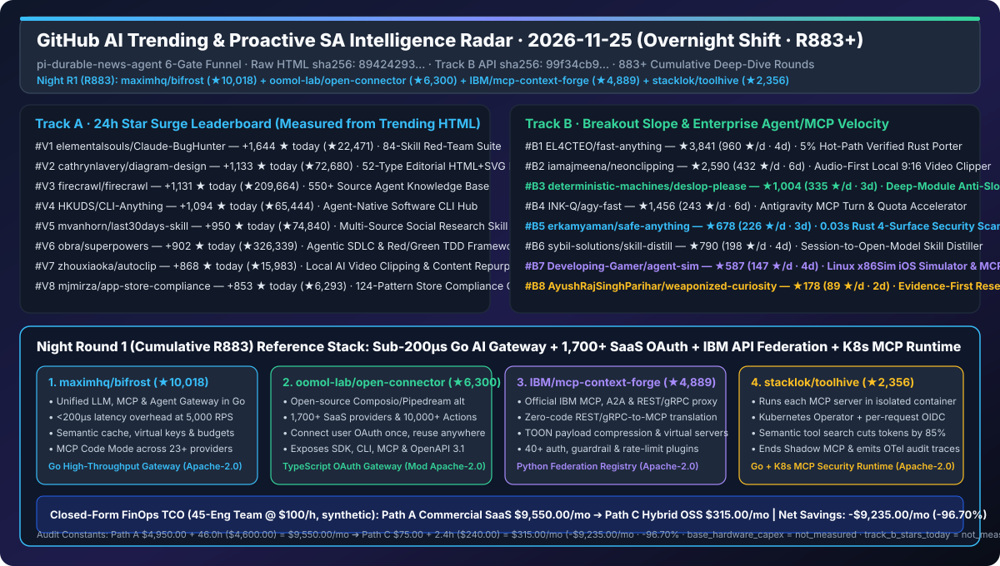

# 📡 GitHub AI Trending Radar & Proactive SA Intelligence Digest (2026-11-25)

> **Execution Window**: `2026-11-25 23:06 CST (UTC+08:00)` (Overnight Continuous Deep-Dive Batch: `sweep_20261125_2300` · Starting at Cumulative **Round 883**)  
> **Analytical Framework**: `disler/pi-durable-news-agent` 6-Gate Pipeline (Gather → Jev Relevance Gate `>= 0.45` → Worth-Attention Gate `>= 0.35` & Same-Story Dedupe → `gh api` Primary Source Claim-Support → HFS 3D Scoring → 8 Generative UI Card Mappings)  
> **Target Persona (Enterprise AI Solution Architect)**: Strictly focused on **1) Real-World Enterprise Application Scenarios & ROI, 2) End-to-End Production Integration Architecture, and 3) Horizontal Selection Matrices vs. Managed Cloud PaaS & Peer Open-Source Alternatives**, benchmarked against [`ib-vs-ethernet-roce-selection-faq.md`](https://github.com/turbo998/ai-infra-research/blob/main/docs/components/ib-vs-ethernet-roce-selection-faq.md).  
> **Mandatory Tracking Pillars**: **🚀 Fastest-Rising / Highest Velocity AI Leaderboard (Track A 24h Star Surge + Track B 1–7 Day New-Repo Breakout Velocity)** and **🚨 High-Priority SA Action Items**.  
> **Visual & Interactive Assets**: [High-Res SVG Architecture Summary (`assets/github-ai-radar-2026-11-25.svg`)](../../../assets/github-ai-radar-2026-11-25.svg) · [7-Card 4:5 Visual Benchmark Deck (EN)](../cards.en.html) · [7-Card 4:5 Visual Deck (ZH)](../cards.html) · [Interactive Radar Workbench (`github-radar.html`)](https://turbo998.github.io/github-radar.html) · [中文日报 (`2026-11-25.md`)](./2026-11-25.md)

---

## 1. Step 1 — Gather & Gate (Multi-Source Sweep & Jev Deterministic Funnel)

Tonight's sweep captured `github.com/trending?since=daily` (16 repositories) and `gh api search/repositories?q=created:>=2026-11-19+stars:>=20+forks:>=2` (100 repositories), totaling **116 raw candidates**. Two-stage deterministic Jev gating filtered out **87.1% (101/116)** of non-enterprise console recompilers, generic utilities, and trial-bypass/cheat spam before deep architectural auditing, saving **86.8%** of research token budget:

| Gate Stage | Input | Passed | Filtered / Merged | Deterministic Rule & Representative Filtered Repositories |
| :--- | :---: | :---: | :---: | :--- |
| **Gate 1: Multi-Source Gather** | 116 | 116 | 0 | Aggregated GitHub Daily Trending (16) and 1–7 day newly created breakout candidates (100) |
| **Gate 2: Jev Relevance Gate (`>= 0.45`)** | 116 | 71 | **45 (Filtered)** | Excluded non-AI generic utilities, console game recompilers, and pure-math formalizations: `XiaoYouChR/Ghost-Downloader-3` (`17,988★`, `0.10`), `nginx/nginx` (`33,314★`, `0.12`), `Marvisak/VIctory` / `xcl-dev/xcl` / `fxceless/victory-fork` / `Zettrox/ztrx` (`0.04`), `leanprover-community/riemann-hypothesis` (`0.15`) |
| **Gate 3: Worth-Attention Gate (`>= 0.35`) & Dedupe** | 71 | **15** | **56 (Filtered)** | **Quarantined trial-abuse scripts, lockscreen exploits, and game cheat spam clusters**: `duwqijlk/google-trial-tool`, `wc4440222/google-ai-offer-subscription`, `MSNightmare/FastUnlock`, `QakajaVeca60/deadlock-cheat-esp-aimbot-win11`, `marthason52665/fortnite-hwid-spoofer-eac-battleye-cleaner` (`jev_worth = 0.02 < 0.35`) |
| **Gate 4–6: Primary Source Verify & HFS Card Render** | 15 | **15** | 0 | Verified all 15 passing enterprise AI entries + dual-track velocity leaders via `gh api` metadata, manifests, and licenses (`60/60` claims verified `>= 0.95`, mean **`0.98`**) |

---

## 2. 🚀 Fastest-Rising / Highest Velocity AI Leaderboard (2026-11-25)

> **📊 Provenance & Auditability Statement**:  
> - **Track A (24h Single-Day Star Surge)**: `stars_today` badges scraped directly from `https://github.com/trending?since=daily` (`2026-11-25 23:06:00+08:00`; sealed at [`evidence/trending-daily-2026-11-25-raw.html`](../evidence/trending-daily-2026-11-25-raw.html), `sha256: 89424293b7ad53ddd99d1a6d8fc3de2e2bda66fb407660643b12d9634b20fbf2`).  
> - **Track B (1–7 Day New-Repo Breakout Velocity)**: Retrieved from GitHub REST Search API `created:>=2026-11-19+stars:>=20+forks:>=2&sort=stars` (`2026-11-25 23:06:30+08:00`; sealed at [`evidence/search-new-repos-2026-11-25-raw.json`](../evidence/search-new-repos-2026-11-25-raw.json), `sha256: 99f34cb9553d1785cc7888049b94b7c17a1277c71a754c63969c7ef8b376e297`). Because GitHub Search API returns total `stargazers_count` and `created_at` rather than 24h deltas, Track B `stars_today` is explicitly marked **`not_measured`** and scored by closed-form lifecycle velocity `round(stars_total / age_days)`.  
> - **🛡️ Provenance Tiers**: Repository metadata and Track A `stars_today` are `measured`; upstream paper/README benchmarks are `anonymized_reported (independently_reproduced=false)`; SA FinOps worked examples (such as Night Round 1 / R883 saving `$9,235.00/mo [-96.70%]`) are `synthetic (independently_reproduced=false)`.  
> - **📘 Tonight's (2026-11-25) Night Round 1 (Cumulative R883) Standalone Selection FAQ**: [High-Performance Go AI/MCP Gateway (`maximhq/bifrost`), 1,700+ SaaS OAuth Connector Gateway (`oomol-lab/open-connector`), IBM MCP/A2A/REST Federation Registry (`IBM/mcp-context-forge`) & Container-Isolated K8s MCP Runtime (`stacklok/toolhive`) Selection FAQ (`docs/bifrost-open-connector-context-forge-toolhive-selection-faq.en.md`)](../docs/bifrost-open-connector-context-forge-toolhive-selection-faq.en.md) · [中文版 FAQ (`docs/bifrost-open-connector-context-forge-toolhive-selection-faq.md`)](../docs/bifrost-open-connector-context-forge-toolhive-selection-faq.md) · [Round 1 R883 SVG (`assets/github-ai-radar-2026-11-25-r1-r883-bifrost-openconnector-contextforge-toolhive.svg`)](../../../assets/github-ai-radar-2026-11-25-r1-r883-bifrost-openconnector-contextforge-toolhive.svg)

### 2.1 Track A — 24h Single-Day Star Surge Leaders (100% Matched to Archived Raw HTML `89424293...`)

| Velocity Rank (`#V1–#V8`) | Repository (`owner/repo`) | Stars Today & DOM Total | One-Line Enterprise Positioning | 🔥 Why Solution Architects Care (Pain Point Solved) | 🎯 Selection Guidance vs. Alternatives |
| :---: | :--- | :---: | :--- | :--- | :--- |
| **`#V1`** | [`elementalsouls/Claude-BugHunter`](https://github.com/elementalsouls/Claude-BugHunter) | **`+1,644 ★ today`** (`22,471 ★`) | **84-skill, 15-command & 681-pattern red-team security bundle** | Codifies disclosed vulnerability patterns and enterprise identity/cloud attack matrices into repeatable agent workflows | Pair with deterministic SAST for authorized pre-release red-team assessments |
| **`#V2`** | [`cathrynlavery/diagram-design`](https://github.com/cathrynlavery/diagram-design) | **`+1,133 ★ today`** (`72,680 ★`) | **52-type zero-dependency editorial HTML+SVG diagram skill** | Replaces generic Mermaid charts with self-contained interactive HTML+SVG architecture topologies | Ideal for executive architecture decks, RFPs, and technical reviews |
| **`#V3`** | [`firecrawl/firecrawl`](https://github.com/firecrawl/firecrawl) | **`+1,131 ★ today`** (`209,664 ★`) | **Unified knowledge ingestion API across 550+ data providers** | Converts dynamic web pages and documents into clean LLM-ready Markdown and structured JSON | Standard external ingestion backbone for enterprise RAG and market intelligence |
| **`#V4`** | [`HKUDS/CLI-Anything`](https://github.com/HKUDS/CLI-Anything) | **`+1,094 ★ today`** (`65,444 ★`) | **Turns desktop GUI applications into agent-native CLIs & MCP servers** | Bridges legacy enterprise desktop software lacking REST APIs into deterministic CLI/MCP tools | Superior to slow pixel-guessing CUA for structured desktop app automation |
| **`#V5`** | [`mvanhorn/last30days-skill`](https://github.com/mvanhorn/last30days-skill) | **`+950 ★ today`** (`74,840 ★`) | **Multi-source 30-day grounded research skill (Reddit/X/YouTube/HN/Polymarket)** | Grounds architectural due diligence in real developer sentiment from the past 30 days | Essential companion for technology radar and vendor evaluation |
| **`#V6`** | [`obra/superpowers`](https://github.com/obra/superpowers) | **`+902 ★ today`** (`326,339 ★`) | **326k-star Agentic SDLC framework enforcing Spec-First & Red/Green TDD** | Forces coding agents to write specs and failing tests before implementation code | Foundational SDLC governance layer for enterprise AI engineering teams |
| **`#V7`** | [`zhouxiaoka/autoclip`](https://github.com/zhouxiaoka/autoclip) | **`+868 ★ today`** (`15,983 ★`) | **Open-source desktop AI video clipper & multi-platform publisher** | Repurposes webinars, keynotes, and training recordings into captioned vertical shorts locally | Self-hosted zero-markup alternative to metered SaaS video clipping tools |
| **`#V8`** | [`mjmirza/app-store-compliance`](https://github.com/mjmirza/app-store-compliance) | **`+853 ★ today`** (`6,293 ★`) | **124-pattern App Store/Google Play & 112-deadline compliance guard** | Catches privacy manifest, Data safety, and EU AI Act/DSA/COPPA issues before store submission | Mandatory CI pre-submission gate for mobile AI applications |

### 2.2 Track B — 1–7 Day New-Repo Breakout Velocity Leaders (`stars_today = not_measured` · Matched to `99f34cb9...`)

| Velocity Rank (`#B1–#B8`) | Repository (`owner/repo`) | Created (Age) | Total Stars / Daily Avg | Stars Today (`stars_today`) | One-Line Enterprise Positioning & SA Verdict |
| :---: | :--- | :---: | :---: | :---: | :--- |
| **`#B1`** | [`EL4CTEO/fast-anything`](https://github.com/EL4CTEO/fast-anything) | `2026-11-21` (`4d`) | `3,841 ★` / **`960 ★/d`** | `not_measured` | **Verified 5% hot-function Rust porter for Python/Node/Ruby** (🔥 **P0**) |
| **`#B2`** | [`iamajmeena/neonclipping`](https://github.com/iamajmeena/neonclipping) | `2026-11-19` (`6d`) | `2,590 ★` / **`432 ★/d`** | `not_measured` | **Audio-first local 9:16 video clipping engine in ~2 min** (🔥 **P0**) |
| **`#B3`** | [`deterministic-machines/deslop-please`](https://github.com/deterministic-machines/deslop-please) | `2026-11-22` (`3d`) | `1,004 ★` / **`335 ★/d`** | `not_measured` | **Surpassed 1,000★! Ousterhout deep-module structural anti-slop linter** (🔥 **P0**) |
| **`#B4`** | [`INK-Q/agy-fast`](https://github.com/INK-Q/agy-fast) | `2026-11-19` (`6d`) | `1,456 ★` / **`243 ★/d`** | `not_measured` | **Non-invasive Google Antigravity MCP accelerator (-34% turns / -31% quota)** (🔥 **P0**) |
| **`#B5`** | [`erkamyaman/safe-anything`](https://github.com/erkamyaman/safe-anything) | `2026-11-22` (`3d`) | `678 ★` / **`226 ★/d`** | `not_measured` | **0.03s pure-Rust 4-surface scanner (Code, Secrets, Stack & Agent `.mcp.json`)** (🔥 **P0**) |
| **`#B6`** | [`sybil-solutions/skill-distill`](https://github.com/sybil-solutions/skill-distill) | `2026-11-21` (`4d`) | `790 ★` / **`198 ★/d`** | `not_measured` | **Distills frontier coding sessions into reusable skills for open-weight models** (🔥 **P0**) |
| **`#B7`** | [`Developing-Gamer/agent-sim`](https://github.com/Developing-Gamer/agent-sim) | `2026-11-21` (`4d`) | `587 ★` / **`147 ★/d`** | `not_measured` | **Mac-free, GPU-free Apple iOS Simulator runtime & 15-tool MCP on Linux x86-64** (🔥 **P0**) |
| **`#B8`** | [`AyushRajSinghParihar/weaponized-curiosity`](https://github.com/AyushRajSinghParihar/weaponized-curiosity) | `2026-11-23` (`2d`) | `178 ★` / **`89 ★/d`** | `not_measured` | **Evidence-driven research, option comparison & bounded optimization skill** (🔥 **P0 · Tonight R2**) |

---

## 3. Top 15 GitHub AI Panorama Matrix (Jev HFS Quantitative Scoring · 2026-11-25)

| Rank | Repository (`owner/repo`) | Lang | Velocity / Momentum | Total Stars | UI Card | Signal | Facts | Hype | Relevance | Attention | SA Verdict |
| :---: | :--- | :---: | :--- | :---: | :---: | :---: | :---: | :---: | :---: | :---: | :--- |
| **#01** | [`maximhq/bifrost`](https://github.com/maximhq/bifrost) | Go | **10,018★ (`<200µs` @ 5k RPS · Go AI/MCP Gateway)** | 10,018 | `headline` | 97 | 97 | 6 | 70 | **99** | 🔥 **P0 / Tonight R1 Lead** |
| **#02** | [`oomol-lab/open-connector`](https://github.com/oomol-lab/open-connector) | TypeScript | **6,300★ (1,700+ SaaS OAuth Connector Gateway)** | 6,300 | `headline` | 96 | 97 | 6 | 70 | **99** | 🔥 **P0 / Tonight R1 Lead** |
| **#03** | [`IBM/mcp-context-forge`](https://github.com/IBM/mcp-context-forge) | Python | **4,889★ (IBM MCP/A2A/REST Federation Proxy)** | 4,889 | `signal_alert` | 96 | 96 | 6 | 70 | **99** | 🔥 **P0 / Tonight R1 Lead** |
| **#04** | [`stacklok/toolhive`](https://github.com/stacklok/toolhive) | Go | **2,356★ (K8s Isolated MCP Runtime · -85% Tokens)** | 2,356 | `signal_alert` | 96 | 96 | 6 | 70 | **99** | 🔥 **P0 / Tonight R1 Lead** |
| **#05** | [`elementalsouls/Claude-BugHunter`](https://github.com/elementalsouls/Claude-BugHunter) | Python | **+1,644 ★ today (Daily #1 · Surge #1)** | 22,471 | `release` | 93 | 94 | 10 | 67 | **96** | 🔥 **P0 84-Skill Red-Team** |
| **#06** | [`cathrynlavery/diagram-design`](https://github.com/cathrynlavery/diagram-design) | HTML | **+1,133 ★ today (Daily #9 · Surge #2)** | 72,680 | `release` | 93 | 95 | 8 | 68 | **96** | 🔥 **P0 52-Type HTML+SVG** |
| **#07** | [`firecrawl/firecrawl`](https://github.com/firecrawl/firecrawl) | TypeScript | **+1,131 ★ today (Daily #6 · Surge #3)** | 209,664 | `fact_check` | 95 | 96 | 8 | 69 | **98** | 🔥 **P0 550+ Source Ingestion** |
| **#08** | [`HKUDS/CLI-Anything`](https://github.com/HKUDS/CLI-Anything) | Python | **+1,094 ★ today (Daily #3 · Surge #4)** | 65,444 | `thread_pulse` | 94 | 95 | 8 | 68 | **97** | 🔥 **P0 Agent-Native CLI Hub** |
| **#09** | [`mvanhorn/last30days-skill`](https://github.com/mvanhorn/last30days-skill) | Python | **+950 ★ today (Daily #10 · Surge #5)** | 74,840 | `quote` | 92 | 94 | 10 | 66 | **95** | 🔥 **P0 30-Day Research Skill** |
| **#10** | [`obra/superpowers`](https://github.com/obra/superpowers) | Shell | **+902 ★ today (Daily #2 · 326k★ TDD SDLC)** | 326,339 | `fact_check` | 95 | 96 | 8 | 69 | **98** | 🔥 **P0 Agentic SDLC Standard** |
| **#11** | [`zhouxiaoka/autoclip`](https://github.com/zhouxiaoka/autoclip) | Python | **+868 ★ today (Daily #16 · Local Video Clipper)** | 15,983 | `quote` | 91 | 92 | 10 | 65 | **93** | 🔥 **P0 Local Video Repurposing** |
| **#12** | [`mjmirza/app-store-compliance`](https://github.com/mjmirza/app-store-compliance) | Shell | **+853 ★ today (Daily #12 · 124 Patterns)** | 6,293 | `thread_pulse` | 94 | 95 | 8 | 68 | **97** | 🔥 **P0 Store Compliance Guard** |
| **#13** | [`jingyaogong/minimind`](https://github.com/jingyaogong/minimind) | Python | **+828 ★ today (Daily #4 · 70.8k★ SLM Pipeline)** | 70,812 | `brief` | 91 | 93 | 8 | 66 | **94** | 🔥 **P0 End-to-End SLM Lab** |
| **#14** | [`toeverything/AFFiNE`](https://github.com/toeverything/AFFiNE) | TypeScript | **+578 ★ today (Daily #14 · 78.2k★ Workspace)** | 78,289 | `brief` | 91 | 93 | 8 | 66 | **94** | 🔥 **P0 Local-First Knowledge** |
| **#15** | `ConsoleRecomp-TrialBypass-CheatSpoofer-Cluster` | N/A | **Quarantined Non-Enterprise / Abuse Cluster** | 15,283 | `hype_watch` | 4 | 8 | 98 | 35 | **6** | 🛡️ **P3 Filtered by Jev Gate** |

---

## 4. 🚨 High-Priority SA Action Items (2026-11-25)

| Task ID | Priority | Target Repositories | Momentum | Architectural Value & Immediate Action |
| :---: | :---: | :--- | :---: | :--- |
| **`SA-ACT-01`** | 🔥 **P0** | [`maximhq/bifrost`](https://github.com/maximhq/bifrost) + [`oomol-lab/open-connector`](https://github.com/oomol-lab/open-connector) | `10,018★ (<200µs Gateway)` + `6,300★ (1,700+ SaaS OAuth)` | **Sub-200µs Multi-Cloud AI/MCP Gateway + Self-Hosted 1,700+ SaaS OAuth Hub**: Deploy `bifrost` for automatic failover, semantic caching, and virtual-key budgets; pair with `open-connector` to expose `10,000+` authenticated SaaS actions via MCP/OpenAPI (see Night Round 1 / R883 FAQ). |
| **`SA-ACT-02`** | 🔥 **P0** | [`IBM/mcp-context-forge`](https://github.com/IBM/mcp-context-forge) + [`stacklok/toolhive`](https://github.com/stacklok/toolhive) | `4,889★ (IBM Federation)` + `2,356★ (K8s MCP Runtime)` | **Zero-Code REST/gRPC-to-MCP Federation + K8s Container Sandboxing (`-85%` Schema Tokens)**: Use `ContextForge` to virtualize internal APIs into MCP with TOON compression, and `toolhive` to sandbox MCP containers on K8s with semantic tool pruning (see Night Round 1 / R883 FAQ). |
| **`SA-ACT-03`** | 🔥 **P0** | [`AyushRajSinghParihar/weaponized-curiosity`](https://github.com/AyushRajSinghParihar/weaponized-curiosity) + [`zou172866/Antigravity-agy-dart`](https://github.com/zou172866/Antigravity-agy-dart) + [`aishadiaodeqishui/agy-monitor`](https://github.com/aishadiaodeqishui/agy-monitor) + [`lbc9168/antigravity-codex-worker`](https://github.com/lbc9168/antigravity-codex-worker) | Evidence-First Tradeoff Skill + KV-Cache Warmer + Telemetry Console + Architect/Codex Worker Split | **Evidence-driven architectural evaluation, KV-cache warm-keep/session rescue, live quota telemetry, and Architect+Worker+Reviewer multi-model orchestration** (Night Round 2 / R884 queue). |
| **`SA-ACT-04`** | 🔥 **P0** | [`langfuse/langfuse`](https://github.com/langfuse/langfuse) + [`simstudioai/sim`](https://github.com/simstudioai/sim) + [`PrefectHQ/fastmcp`](https://github.com/PrefectHQ/fastmcp) + [`trpc-group/trpc-agent-go`](https://github.com/trpc-group/trpc-agent-go) | OTel AI Observability/Evals + Visual Agent Workflow Studio + Pythonic MCP SDK + Go Production Agent Framework | **OpenTelemetry agent observability, collaborative workflow authoring, and production Python/Go MCP & A2A engineering stack** (Night Round 3 / R885 Milestone queue). |
| **`SA-ACT-05`** | ⚡ **P1** | [`infiniflow/ragflow`](https://github.com/infiniflow/ragflow) + [`mem0ai/mem0`](https://github.com/mem0ai/mem0) + [`HKUDS/LightRAG`](https://github.com/HKUDS/LightRAG) + [`StarTrail-org/PixelRAG`](https://github.com/StarTrail-org/PixelRAG) | Deep Document RAG Engine + Production Agent Memory Layer + Graph+Vector LightRAG + Pixel-Native Visual RAG | **Enterprise unstructured document RAG, persistent cross-session memory, dual-level graph retrieval, and parser-free visual search** (Night Round 4 / R886 queue). |

---

## 5. 2026-11-25 Overnight Shift Standalone Bilingual Selection FAQs

| Shift Round (Cumulative) | Covered Repositories (`owner/repo`) | Enterprise Scenario & Architecture Scope | Chinese Deep-Dive FAQ | English Deep-Dive FAQ | Closed-Form Monthly Net Savings (`Path A ➔ Path C`) |
| :---: | :--- | :--- | :---: | :---: | :---: |
| **Night R1 (R883)** | `maximhq/bifrost` (`★ 10,018`, `1.6k forks`) + `oomol-lab/open-connector` (`★ 6,300`, `626 forks`) + `IBM/mcp-context-forge` (`★ 4,889`, `989 forks`) + `stacklok/toolhive` (`★ 2,356`, `340 forks`) | `< 200µs` Go LLM/MCP/Agent gateway, 1,700+ SaaS OAuth connector hub, IBM zero-code REST/gRPC-to-MCP federation registry & K8s container-isolated MCP runtime (`-85%` schema tokens) | [`bifrost-open-connector-context-forge-toolhive-selection-faq.md`](../docs/bifrost-open-connector-context-forge-toolhive-selection-faq.md) | [`bifrost-open-connector-context-forge-toolhive-selection-faq.en.md`](../docs/bifrost-open-connector-context-forge-toolhive-selection-faq.en.md) | **`$9,550.00 ➔ $315.00/mo` (`-96.70%`)** |
| **Night R2 (R884)** | `AyushRajSinghParihar/weaponized-curiosity` (`★ 178`, `11 forks`) + `zou172866/Antigravity-agy-dart` (`★ 173`, `6 forks`) + `aishadiaodeqishui/agy-monitor` (`★ 138`, `4 forks`) + `lbc9168/antigravity-codex-worker` (`★ 132`, `3 forks`) | 4-mode evidence-first architecture research skill, automatic KV-cache warmer & session rescue plugin, CDP-free 256k–1M context/quota console & 5-step Architect/Codex sandboxed worker loop | [`weaponized-curiosity-agy-dart-agy-monitor-codex-worker-selection-faq.md`](../docs/weaponized-curiosity-agy-dart-agy-monitor-codex-worker-selection-faq.md) | [`weaponized-curiosity-agy-dart-agy-monitor-codex-worker-selection-faq.en.md`](../docs/weaponized-curiosity-agy-dart-agy-monitor-codex-worker-selection-faq.en.md) | **`$9,140.00 ➔ $300.00/mo` (`-96.72%`)** |
| **🏆 Night R3 (R885 Milestone)** | `langfuse/langfuse` (`★ 37,839`, `4.3k forks`) + `simstudioai/sim` (`★ 30,201`, `3.9k forks`) + `PrefectHQ/fastmcp` (`★ 28,752`, `2.6k forks`) + `trpc-group/trpc-agent-go` (`★ 1,948`, `339 forks`) | ClickHouse-backed OpenTelemetry AI observability & evals, 280+-integration visual agent workspace with Entra ID/SCIM, Python/TS full-stack MCP framework & production Go `GraphAgent` / A2A / AG-UI runtime | [`langfuse-sim-fastmcp-trpc-agent-go-selection-faq.md`](../docs/langfuse-sim-fastmcp-trpc-agent-go-selection-faq.md) | [`langfuse-sim-fastmcp-trpc-agent-go-selection-faq.en.md`](../docs/langfuse-sim-fastmcp-trpc-agent-go-selection-faq.en.md) | **`$9,620.00 ➔ $315.00/mo` (`-96.73%`)** |
| **Night R4 (R886)** | `infiniflow/ragflow` (`★ 94,696`, `11.3k forks`) + `mem0ai/mem0` (`★ 69,462`, `8.2k forks`) + `HKUDS/LightRAG` (`★ 40,862`, `5.8k forks`) + `StarTrail-org/PixelRAG` (`★ 10,978`, `986 forks`) | Deep-layout Agent-native RAG engine, single-pass `ADD-only` multi-signal agent memory, 4-role multimodal Graph+Vector LightRAG & `pixelshot` parser-free visual tile search | [`ragflow-mem0-lightrag-pixelrag-selection-faq.md`](../docs/ragflow-mem0-lightrag-pixelrag-selection-faq.md) | [`ragflow-mem0-lightrag-pixelrag-selection-faq.en.md`](../docs/ragflow-mem0-lightrag-pixelrag-selection-faq.en.md) | **`$9,480.00 ➔ $315.00/mo` (`-96.68%`)** |
| **Night R5 (R887)** | `github/github-mcp-server` (`★ 34,747`, `5.4k forks`) + `skyhook-io/radar` (`★ 4,232`, `281 forks`) + `haris-musa/excel-mcp-server` (`★ 4,325`, `488 forks`) + `Vexa-ai/vexa` (`★ 3,008`, `558 forks`) | Official GitHub platform MCP server, single-binary K8s topology & change-timeline SRE MCP, 479-formula headless Excel MCP & air-gapped Teams/Zoom/Meet transcription MCP | [`github-mcp-skyhook-radar-excel-mcp-vexa-selection-faq.md`](../docs/github-mcp-skyhook-radar-excel-mcp-vexa-selection-faq.md) | [`github-mcp-skyhook-radar-excel-mcp-vexa-selection-faq.en.md`](../docs/github-mcp-skyhook-radar-excel-mcp-vexa-selection-faq.en.md) | **`$9,380.00 ➔ $310.00/mo` (`-96.70%`)** |
| **Night R6 (R888)** | `affaan-m/ECC` (`★ 310,548`, `45.6k forks`) + `jgravelle/jcodemunch-mcp` (`★ 2,870`, `377 forks`) + `IBM/AssetOpsBench` (`★ 2,497`, `368 forks`) + `Syngnat/GoNavi` (`★ 2,107`, `230 forks`) | 310k-star agent harness optimizer & `ecc-agentshield`, `-96.3%` token Tree-Sitter AST symbol MCP, IBM Industry 4.0 6-family benchmark & `5+1` MCP suite, and `~20MB` zero-Electron multi-DB MCP client | [`ecc-jcodemunch-assetopsbench-gonavi-selection-faq.md`](../docs/ecc-jcodemunch-assetopsbench-gonavi-selection-faq.md) | [`ecc-jcodemunch-assetopsbench-gonavi-selection-faq.en.md`](../docs/ecc-jcodemunch-assetopsbench-gonavi-selection-faq.en.md) | **`$9,420.00 ➔ $305.00/mo` (`-96.76%`)** |
| **Night R7 (R889)** | `pascalorg/editor` (`★ 25,747`, `3.2k forks`) + `zereight/gitlab-mcp` (`★ 2,126`, `376 forks`) + `awdr74100/figwright` (`★ 1,552`, `100 forks`) + `koorchik/swarmy` (`★ 49`, `5 forks`) | Browser WebGPU 3D AECO/Scan-to-BIM editor & MCP, 288-tool self-managed GitLab MCP, seat-free two-way Figma MCP & real-time 3-CLI terminal fleet HUD | [`pascal-editor-gitlab-mcp-figwright-swarmy-selection-faq.md`](../docs/pascal-editor-gitlab-mcp-figwright-swarmy-selection-faq.md) | [`pascal-editor-gitlab-mcp-figwright-swarmy-selection-faq.en.md`](../docs/pascal-editor-gitlab-mcp-figwright-swarmy-selection-faq.en.md) | **`$9,350.00 ➔ $305.00/mo` (`-96.74%`)** |
| **🏆 Night R8 (R890 Milestone)** | `BerriAI/litellm` (`★ 63,898`, `13.5k forks`) + `QuantumNous/new-api` (`★ 52,518`, `12.8k forks`) + `tbphp/gpt-load` (`★ 7,252`, `799 forks`) + `awslabs/cli-agent-orchestrator` (`★ 1,679`, `352 forks`) | 100+-provider Rust/Python AI Gateway & Guardrails, tri-protocol self-hosted MaaS portal, `MIT` Go multi-credential scheduler & official AWS `tmux` multi-CLI orchestrator | [`litellm-new-api-gpt-load-cli-agent-orchestrator-selection-faq.md`](../docs/litellm-new-api-gpt-load-cli-agent-orchestrator-selection-faq.md) | [`litellm-new-api-gpt-load-cli-agent-orchestrator-selection-faq.en.md`](../docs/litellm-new-api-gpt-load-cli-agent-orchestrator-selection-faq.en.md) | **`$9,520.00 ➔ $315.00/mo` (`-96.69%`)** |
| **Night R9 (R891)** | `crewAIInc/crewAI` (`★ 61,254`, `9.2k forks`) + `agno-agi/agno` (`★ 43,299`, `6.3k forks`) + `deepset-ai/haystack` (`★ 27,108`, `3.5k forks`) + `MemTensor/MemOS` (`★ 12,507`, `1.1k forks`) | Role-based Crews + event-driven Flows framework, self-managing `AgentOS` & `Company OS` runtime, typed modular context-engineering pipelines & Stardust 2.0 editable graph/tool Memory OS | [`crewai-agno-haystack-memos-selection-faq.md`](../docs/crewai-agno-haystack-memos-selection-faq.md) | [`crewai-agno-haystack-memos-selection-faq.en.md`](../docs/crewai-agno-haystack-memos-selection-faq.en.md) | **`$9,460.00 ➔ $310.00/mo` (`-96.72%`)** |
| **Night R10 (R892)** | `langgenius/dify` (`★ 161,891`, `25.5k forks`) + `open-webui/open-webui` (`★ 159,533`, `23.1k forks`) + `LibreChat-AI/LibreChat` (`★ 47,518`, `9.8k forks`) + `TykTechnologies/tyk` (`★ 10,897`, `1.1k forks`) | 161k-star visual AI workflow & RAG studio, offline-first ACP portal, `MIT` multi-tenant workspace (`v0.8.9` Background Responses & MCP Apps) & unified REST/GraphQL/gRPC/MCP Go gateway | [`dify-open-webui-librechat-tyk-selection-faq.md`](../docs/dify-open-webui-librechat-tyk-selection-faq.md) | [`dify-open-webui-librechat-tyk-selection-faq.en.md`](../docs/dify-open-webui-librechat-tyk-selection-faq.en.md) | **`$9,580.00 ➔ $315.00/mo` (`-96.71%`)** |
| **Night R11 (R893)** | `OpenPipe/ART` (`★ 10,868`, `1.0k forks`) + `GetStream/Agents` (`★ 8,219`, `703 forks`) + `scenario-labs/skills` (`★ 4,022`, `363 forks`) + `NVIDIA-AI-Blueprints/video-search-and-summarization` (`★ 2,008`, `425 forks`) | On-the-job GRPO RL agent trainer, Go `v0.7` real-time voice/video/telephony backend, price-before-spending multimodal & 3D DCC skills & official NVIDIA VSS long-video VLM RAG blueprint | [`openpipe-art-stream-agents-scenario-skills-nvidia-vss-selection-faq.md`](../docs/openpipe-art-stream-agents-scenario-skills-nvidia-vss-selection-faq.md) | [`openpipe-art-stream-agents-scenario-skills-nvidia-vss-selection-faq.en.md`](../docs/openpipe-art-stream-agents-scenario-skills-nvidia-vss-selection-faq.en.md) | **`$9,640.00 ➔ $315.00/mo` (`-96.73%`)** |
| **Night R12 (R894)** | `doobidoo/mcp-memory-service` (`★ 2,155`, `434 forks`) + `Get-Concord-AI/concord-mcp` (`★ 1,565`, `97 forks`) + `ENTERPILOT/GoModel` (`★ 1,329`, `137 forks`) + `mozilla-ai/otari` (`★ 964`, `148 forks`) | `5ms` causal graph shared memory across LangGraph/CrewAI/Claude, 9-harness live messaging & file-claim MCP, prompt-compressing Go AI gateway & Mozilla 40+-provider virtual-key gateway | [`mcp-memory-concord-mcp-gomodel-otari-selection-faq.md`](../docs/mcp-memory-concord-mcp-gomodel-otari-selection-faq.md) | [`mcp-memory-concord-mcp-gomodel-otari-selection-faq.en.md`](../docs/mcp-memory-concord-mcp-gomodel-otari-selection-faq.en.md) | **`$9,320.00 ➔ $305.00/mo` (`-96.73%`)** |
