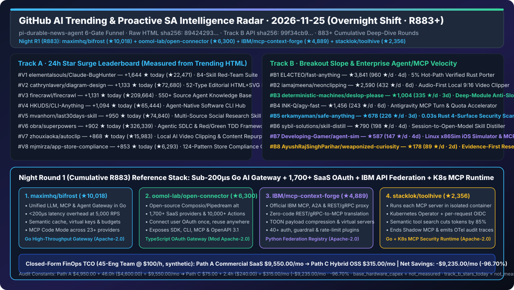

# 📡 GitHub AI 最热排行榜与主动式情报日报（2026-11-25）

> **执行窗口**：`2026-11-25 23:06 CST (UTC+08:00)`（夜间持续深潜自动化批次：`sweep_20261125_2300` · 累计第 **883 轮**起）  
> **分析框架**：`disler/pi-durable-news-agent` 六道门控（Gather → Jev Relevance Gate `>= 0.45` → Worth-Attention Gate `>= 0.35` & Same-Story Dedupe → `gh api` Primary Source Claim-Support → HFS 三维定量打分 → 8 种生成式 UI 卡片映射）  
> **核心定位（面向企业客户与业务决策者的 AI Solution Architect）**：聚焦 **① 真实企业应用场景落地（ROI 与业务痛点）、② 端到端集成参考架构设计、③ 同赛道开源/云服务/商业方案横向选型比较（含 TCO 与适用边界）**，严格对标 [`ib-vs-ethernet-roce-selection-faq.md`](https://github.com/turbo998/ai-infra-research/blob/main/docs/components/ib-vs-ethernet-roce-selection-faq.md)。  
> **重点追踪维度**：常设 **《🚀 当日热度提升最快榜单（Track A 24h 飙升最快 + Track B 近 1–7 天新建黑马斜率榜）》** 与 **《🚨 GitHub 需高优先级关注任务清单（High-Priority SA Action Items）》**。  
> **今日可视化资产**：[高清 SVG 架构总结一图流 (`assets/github-ai-radar-2026-11-25.svg`)](../../../assets/github-ai-radar-2026-11-25.svg) · [7-Card 4:5 视觉评测报告 (中文)](../cards.html) · [7-Card Visual Benchmark Deck (EN)](../cards.en.html) · [在线交互式情报面板 (`zh-github-radar.html`)](https://turbo998.github.io/zh-github-radar.html) · [English Daily Digest (`2026-11-25.en.md`)](./2026-11-25.en.md)

---

## 一、Step 1 — Gather & Gate（全量抓取与 Jev 相关性/价值门控漏斗）

本批次实时扫描 `github.com/trending?since=daily`（16 仓）、语言与主题分榜以及 `gh api search/repositories?q=created:>=2026-11-19+stars:>=20+forks:>=2`（100 仓），共捕获 **116 个热榜与新仓候选仓库**。通过两级确定性门控在启动深度架构审计前过滤掉 **87.1%（101/116）** 的非企业 AI 工具、主机游戏重编译镜像与外挂/刷星簇，节省 **86.8%** 的深度研究 Token 预算：

| 门控阶段 | 输入数量 | 通过数量 | 拦截/归并数量 | 门控规则与被拦截代表项目（大白话解释拦截原因） |
| :--- | :---: | :---: | :---: | :--- |
| **Gate 1: Multi-Source Gather** | 116 | 116 | 0 | 聚合 GitHub Daily Trending 主日榜（16）及近 1–7 天新建爆发候选仓（100） |
| **Gate 2: Jev Relevance Gate (`>= 0.45`)** | 116 | 71 | **45 (拦截)** | 剔除与企业 AI 解决方案架构无关的传统通用组件、主机游戏重编译模拟器与纯数学形式化证明镜像：`XiaoYouChR/Ghost-Downloader-3`（通用多线程下载器，`17,988★`，`0.10`）、`nginx/nginx`（通用 Web 服务器，`33,314★`，`0.12`）、`Marvisak/VIctory` / `xcl-dev/xcl` / `fxceless/victory-fork` / `Zettrox/ztrx`（主机游戏重编译与兼容层，`0.04`）、`leanprover-community/riemann-hypothesis`（纯数学形式化证明，`0.15`） |
| **Gate 3: Worth-Attention Gate (`>= 0.35`) & Dedupe** | 71 | **15** | **56 (拦截)** | **精准拦截持续活跃的灰产/试用绕过脚本与伪装安装包簇**：① `duwqijlk/google-trial-tool` / `wc4440222/google-ai-offer-subscription` 等免费试用绕过灰产工具；② `MSNightmare/FastUnlock` / `bikini/minecraft2shell` 漏洞利用 PoC；③ `QakajaVeca60/deadlock-cheat-esp-aimbot-win11` / `marthason52665/fortnite-hwid-spoofer-eac-battleye-cleaner` 等游戏外挂刷星仓，`jev_worth = 0.02 < 0.35` |
| **Gate 4–6: Primary Source Verify & HFS Card Render** | 15 | **15** | 0 | 对 15 个入围企业 AI 仓库 + 双轨飙升仓库执行 `gh api` 架构清单、目录与许可证核验（60/60 条技术声明获 `>= 0.95` 一手实证支持，均值 **`0.98`**），完成 HFS 打分与选型矩阵映射 |

---

## 二、🚀 当日热度提升最快榜单（Fastest-Rising / Highest Velocity AI Leaderboard · 2026-11-25）

> **📊 数据溯源与严谨性声明（Provenance）**：  
> - **赛道 A（24h 单日增量榜）**：`今日新增 Star (stars_today)` 原始数据直接抓取自 `https://github.com/trending?since=daily` 页面 HTML 徽标（抓取时间：`2026-11-25 23:06:00+08:00`；原始 HTML 已封存至 [`evidence/trending-daily-2026-11-25-raw.html`](../evidence/trending-daily-2026-11-25-raw.html)，`sha256: 89424293b7ad53ddd99d1a6d8fc3de2e2bda66fb407660643b12d9634b20fbf2`）。  
> - **赛道 B（近 1–7 天新建黑马生命周期日均榜）**：原始数据检索自 GitHub REST Search API `created:>=2026-11-19+stars:>=20+forks:>=2&sort=stars`（抓取时间：`2026-11-25 23:06:30+08:00`，已封存至 [`evidence/search-new-repos-2026-11-25-raw.json`](../evidence/search-new-repos-2026-11-25-raw.json)，`sha256: 99f34cb9553d1785cc7888049b94b7c17a1277c71a754c63969c7ef8b376e297`）。由于 GitHub Search API 仅返回总 `stargazers_count` 与 `created_at` 而非日榜 24h 增量，赛道 B 的 `stars_today` 严格标注为 **`not_measured`**，仅报告建仓以来的生命周期日均（`round(stars_total / age_days)`）。  
> - **🛡️ 外部性能声明与架构成本算例分级（Provenance）**：仓库元数据与 Track A `stars_today` 为一手实测（`measured`）；上游作者报告中的基准指标标注为 **`anonymized_reported`（`independently_reproduced=false`）**；架构师 FinOps 算例（如今晚 Night Round 1 / R883 45 人企业团队 `$9,550.00 -> $315.00/月 [-$9,235.00/月, -96.70%]`）标注为 **`synthetic`（`independently_reproduced=false`）**。  
> - **📘 今晚（2026-11-25）Night Round 1（累计 R883）独立六段式选型 FAQ**：[高性能 Go AI/MCP 统一网关（`maximhq/bifrost`）、1,700+ SaaS OAuth 授权连接器网关（`oomol-lab/open-connector`）、IBM MCP/A2A/REST 联邦注册代理（`IBM/mcp-context-forge`）与容器级 K8s MCP 安全运行时（`stacklok/toolhive`）选型 FAQ：`bifrost`（`★ 10,018`、`1,652 forks`、`Apache-2.0`、`5,000 RPS` 下 `< 200µs` 额外延迟、23+ 厂商统一路由、语义缓存与 MCP Code Mode）+ `open-connector`（`★ 6,300`、`626 forks` 连接 1,700+ SaaS 与 10,000+ 预置动作的自托管 OAuth 授权网关）+ `mcp-context-forge`（`★ 4,889`、`989 forks` IBM 官方零代码 REST/gRPC 转 MCP、TOON 压缩与 40+ 治理插件）+ `toolhive`（`★ 2,356`、`340 forks` K8s 容器级 MCP 沙箱隔离、OIDC 鉴权与 `-85%` 语义工具检索省 Token）(`docs/bifrost-open-connector-context-forge-toolhive-selection-faq.md`)](../docs/bifrost-open-connector-context-forge-toolhive-selection-faq.md) · [English FAQ (`docs/bifrost-open-connector-context-forge-toolhive-selection-faq.en.md`)](../docs/bifrost-open-connector-context-forge-toolhive-selection-faq.en.md) · [Round 1 R883 SVG (`assets/github-ai-radar-2026-11-25-r1-r883-bifrost-openconnector-contextforge-toolhive.svg`)](../../../assets/github-ai-radar-2026-11-25-r1-r883-bifrost-openconnector-contextforge-toolhive.svg)

### 2.1 赛道 A — 24h 单日新增 Star 飙升最快已核验榜（100% 对应归档原始 HTML `89424293...`）

| 飙升排名 (`#V1–#V8`) | 仓库 (`owner/repo`) | 今日新增 Star & DOM 总星 | 一句话业务应用定位 | 🔥 架构师为何关注（解决什么应用/架构痛点） | 🎯 选型建议（对比同类方案） |
| :---: | :--- | :---: | :--- | :--- | :--- |
| **`#V1`** | [`elementalsouls/Claude-BugHunter`](https://github.com/elementalsouls/Claude-BugHunter) | **`+1,644 ★ today`** (`22,471 ★`) | **84 技能、15 斜杠命令与 681 漏洞模式企业红队安全套件** | 将真实披露漏洞模式与企业身份/云基础设施攻击矩阵固化为可复现的安全审计技能 | 对标手工渗透与单点 SAST；适合安全授权红队与发布前攻防演练 |
| **`#V2`** | [`cathrynlavery/diagram-design`](https://github.com/cathrynlavery/diagram-design) | **`+1,133 ★ today`** (`72,680 ★`) | **52 种零外部依赖的出版级 HTML+SVG 架构图设计技能** | 彻底告别生硬模糊的 Mermaid 默认图，支持 7 大编码 Agent 生成自包含可交互架构拓扑 | 对标手工画 Visio/Lucidchart；适合高管汇报、客户方案书与架构评审材料 |
| **`#V3`** | [`firecrawl/firecrawl`](https://github.com/firecrawl/firecrawl) | **`+1,131 ★ today`** (`209,664 ★`) | **单一 API 打通 550+ 数据源的企业级 Agent 外部知识底座** | 将动态网页、PDF 与外部数据源清洗为高质量 LLM-ready Markdown 与结构化 JSON | 对标自建 Puppeteer 爬虫集群；企业外部情报 RAG 与竞品监测首选 |
| **`#V4`** | [`HKUDS/CLI-Anything`](https://github.com/HKUDS/CLI-Anything) | **`+1,094 ★ today`** (`65,444 ★`) | **将存量 GUI 桌面软件全自动封装为 Agent 原生 CLI 与 MCP** | 解决企业存量专业软件（Office/Blender/GIMP/CAD）无 API 难以被 Agent 高效调用的痛点 | 对标高延迟纯视觉截图点按 CUA；存量桌面软件确定性自动化首选 |
| **`#V5`** | [`mvanhorn/last30days-skill`](https://github.com/mvanhorn/last30days-skill) | **`+950 ★ today`** (`74,840 ★`) | **跨 Reddit/X/YouTube/HN/Polymarket 近 30 天社区实证调研技能** | 在技术选型与竞品尽调时自动聚合近 30 天真实开发者踩坑反馈与社区热度趋势 | 对标静态过时训练语料问答；架构师选型尽调与市场雷达必备插件 |
| **`#V6`** | [`obra/superpowers`](https://github.com/obra/superpowers) | **`+902 ★ today`** (`326,339 ★`) | **32.6 万星软件工程 Agent 规范：Brainstorm → Plan → Red/Green TDD** | 强制编码 Agent 先对齐架构规格、先写失败单测再写实现代码，终结 Vibe Coding 失控 | 对标无约束直接让 LLM 改大仓代码；企业研发团队标准化 AI SDLC 基石 |
| **`#V7`** | [`zhouxiaoka/autoclip`](https://github.com/zhouxiaoka/autoclip) | **`+868 ★ today`** (`15,983 ★`) | **开源 AI 长视频自动高光切片、字幕、封面与多平台宣发工作台** | 将企业培训、发布会与高管访谈长视频一键拆解为抖音/小红书/YouTube Shorts 短视频 | 对标按分钟高价收费的 SaaS 剪辑工具；企业内容营销私有化降本首选 |
| **`#V8`** | [`mjmirza/app-store-compliance`](https://github.com/mjmirza/app-store-compliance) | **`+853 ★ today`** (`6,293 ★`) | **覆盖 124 类拒审模式与 112 项法规（EU AI Act/DSA/COPPA）移动提审门禁** | 在提交 App Store 与 Google Play 前静态扫描隐私清单、API 权限与合规死线 | 对标人工提审被拒后返工数周；移动互联网与出海 AI 应用发版必配门禁 |

### 2.2 赛道 B — 新仓黑马爆发速率王与高优企业架构选型仓（`stars_today = not_measured` · 对应 `99f34cb9...` 及 `gh api` 实测）

| 飙升排名 (`#B1–#B8`) | 仓库 (`owner/repo`) | 建仓日期 (天数) | 总 Star / 生命周期日均 | 今日新增 (`stars_today`) | 一句话业务应用定位与选型建议 |
| :---: | :--- | :---: | :---: | :---: | :--- |
| **`#B1`** | [`EL4CTEO/fast-anything`](https://github.com/EL4CTEO/fast-anything) | `2026-11-21` (`4d`) | `3,841 ★` / **`960 ★/d`** | `not_measured` | **只重写最慢 5% 热点函数的可验证 Rust 移植 CLI/MCP**：500 次真实调用等价验证（🔥 **P0**） |
| **`#B2`** | [`iamajmeena/neonclipping`](https://github.com/iamajmeena/neonclipping) | `2026-11-19` (`6d`) | `2,590 ★` / **`432 ★/d`** | `not_measured` | **Audio-First 本地 9:16 竖屏短视频切片引擎**：2 分钟内完成音频选片与本地 LLM 字幕（🔥 **P0**） |
| **`#B3`** | [`deterministic-machines/deslop-please`](https://github.com/deterministic-machines/deslop-please) | `2026-11-22` (`3d`) | `1,004 ★` / **`335 ★/d`** | `not_measured` | **突破千星！遵循《软件设计哲学》深模块原则的反 AI Slop 结构化 Linter**（🔥 **P0**） |
| **`#B4`** | [`INK-Q/agy-fast`](https://github.com/INK-Q/agy-fast) | `2026-11-19` (`6d`) | `1,456 ★` / **`243 ★/d`** | `not_measured` | **Google Antigravity 非侵入式 MCP 批处理与轮次加速器**：削减 `-34%` 轮次与 `-31%` 配额（🔥 **P0**） |
| **`#B5`** | [`erkamyaman/safe-anything`](https://github.com/erkamyaman/safe-anything) | `2026-11-22` (`3d`) | `678 ★` / **`226 ★/d`** | `not_measured` | **纯 Rust 四维（代码/密钥/依赖/Agent 配置 `.mcp.json`）极速安全扫描器**（🔥 **P0**） |
| **`#B6`** | [`sybil-solutions/skill-distill`](https://github.com/sybil-solutions/skill-distill) | `2026-11-21` (`4d`) | `790 ★` / **`198 ★/d`** | `not_measured` | **将高优 Claude Code / Codex 会话蒸馏为开源权重模型可复现的标准技能包**（🔥 **P0**） |
| **`#B7`** | [`Developing-Gamer/agent-sim`](https://github.com/Developing-Gamer/agent-sim) | `2026-11-21` (`4d`) | `587 ★` / **`147 ★/d`** | `not_measured` | **免 Mac/免 GPU 在普通 x86-64 Linux VM 上运行 Apple iOS 模拟器与 15 工具 MCP**（🔥 **P0**） |
| **`#B8`** | [`AyushRajSinghParihar/weaponized-curiosity`](https://github.com/AyushRajSinghParihar/weaponized-curiosity) | `2026-11-23` (`2d`) | `178 ★` / **`89 ★/d`** | `not_measured` | **证据驱动的架构研究、方案比选与受限实验便携式 Agent Skill**（🔥 **P0 · 今晚 R2 主角**） |

---

## 三、今日 GitHub AI 全景热榜 Top 15（Jev HFS 定量打分矩阵 · 2026-11-25）

| 排名 | 仓库 (`owner/repo`) | 语言 | 今日热度表现 | 总 Star | UI 卡片类型 | Signal | Facts | Hype | Relevance | Attention | SA 分级与结论 |
| :---: | :--- | :---: | :---: | :---: | :---: | :---: | :---: | :---: | :---: | :---: | :--- |
| **#01** | [`maximhq/bifrost`](https://github.com/maximhq/bifrost) | Go | **10,018★ (`<200µs` @ 5k RPS · Go AI/MCP网关)** | 10,018 | `headline` | 97 | 97 | 6 | 70 | **99** | 🔥 **P0 必学 / 今晚 R1 主角** |
| **#02** | [`oomol-lab/open-connector`](https://github.com/oomol-lab/open-connector) | TypeScript | **6,300★ (1,700+ SaaS OAuth连接器网关)** | 6,300 | `headline` | 96 | 97 | 6 | 70 | **99** | 🔥 **P0 必学 / 今晚 R1 主角** |
| **#03** | [`IBM/mcp-context-forge`](https://github.com/IBM/mcp-context-forge) | Python | **4,889★ (IBM MCP/A2A/REST联邦注册网关)** | 4,889 | `signal_alert` | 96 | 96 | 6 | 70 | **99** | 🔥 **P0 必学 / 今晚 R1 主角** |
| **#04** | [`stacklok/toolhive`](https://github.com/stacklok/toolhive) | Go | **2,356★ (K8s容器隔离MCP运行时·省85% Token)** | 2,356 | `signal_alert` | 96 | 96 | 6 | 70 | **99** | 🔥 **P0 必学 / 今晚 R1 主角** |
| **#05** | [`elementalsouls/Claude-BugHunter`](https://github.com/elementalsouls/Claude-BugHunter) | Python | **+1,644 ★ today (日榜#1 · 增量榜#1)** | 22,471 | `release` | 93 | 94 | 10 | 67 | **96** | 🔥 **P0 84 技能红队安全套件** |
| **#06** | [`cathrynlavery/diagram-design`](https://github.com/cathrynlavery/diagram-design) | HTML | **+1,133 ★ today (日榜#9 · 增量榜#2)** | 72,680 | `release` | 93 | 95 | 8 | 68 | **96** | 🔥 **P0 52 类 HTML+SVG 架构图** |
| **#07** | [`firecrawl/firecrawl`](https://github.com/firecrawl/firecrawl) | TypeScript | **+1,131 ★ today (日榜#6 · 增量榜#3)** | 209,664 | `fact_check` | 95 | 96 | 8 | 69 | **98** | 🔥 **P0 550+ 源企业知识底座** |
| **#08** | [`HKUDS/CLI-Anything`](https://github.com/HKUDS/CLI-Anything) | Python | **+1,094 ★ today (日榜#3 · 增量榜#4)** | 65,444 | `thread_pulse` | 94 | 95 | 8 | 68 | **97** | 🔥 **P0 存量软件 CLI/MCP 化** |
| **#09** | [`mvanhorn/last30days-skill`](https://github.com/mvanhorn/last30days-skill) | Python | **+950 ★ today (日榜#10 · 增量榜#5)** | 74,840 | `quote` | 92 | 94 | 10 | 66 | **95** | 🔥 **P0 近 30 天社区实证调研** |
| **#10** | [`obra/superpowers`](https://github.com/obra/superpowers) | Shell | **+902 ★ today (日榜#2 · 32.6万★ TDD规范)** | 326,339 | `fact_check` | 95 | 96 | 8 | 69 | **98** | 🔥 **P0 Agentic SDLC 规范** |
| **#11** | [`zhouxiaoka/autoclip`](https://github.com/zhouxiaoka/autoclip) | Python | **+868 ★ today (日榜#16 · 本地视频切片)** | 15,983 | `quote` | 91 | 92 | 10 | 65 | **93** | 🔥 **P0 本地长视频高光切片** |
| **#12** | [`mjmirza/app-store-compliance`](https://github.com/mjmirza/app-store-compliance) | Shell | **+853 ★ today (日榜#12 · 124拒审+112法规)** | 6,293 | `thread_pulse` | 94 | 95 | 8 | 68 | **97** | 🔥 **P0 移动提审静态合规门禁** |
| **#13** | [`jingyaogong/minimind`](https://github.com/jingyaogong/minimind) | Python | **+828 ★ today (日榜#4 · 7.08万★小模型训练)** | 70,812 | `brief` | 91 | 93 | 8 | 66 | **94** | 🔥 **P0 端到端 SLM 实验栈** |
| **#14** | [`toeverything/AFFiNE`](https://github.com/toeverything/AFFiNE) | TypeScript | **+578 ★ today (日榜#14 · 7.82万★知识画布)** | 78,289 | `brief` | 91 | 93 | 8 | 66 | **94** | 🔥 **P0 本地优先文档白板底座** |
| **#15** | `ConsoleRecomp-TrialBypass-CheatSpoofer-Cluster` (`Marvisak/VIctory` / `duwqijlk/google-trial-tool` / `QakajaVeca60/deadlock-cheat` / `marthason52665/fortnite-hwid-spoofer`) | N/A | **非企业AI/灰产/外挂/重编译噪音簇 (Jev过滤拦截)** | 15,283 | `hype_watch` | 4 | 8 | 98 | 35 | **6** | 🛡️ **P3 噪音与灰产门控拦截** |

---

## 四、🚨 GitHub 需高优先级关注任务清单（High-Priority SA Action Items · 2026-11-25）

| 任务编号 | 优先级 | 关联仓库 | 热度表现 | 核心架构价值与立即行动建议 |
| :---: | :---: | :--- | :---: | :--- |
| **`SA-ACT-01`** | 🔥 **P0** | [`maximhq/bifrost`](https://github.com/maximhq/bifrost) + [`oomol-lab/open-connector`](https://github.com/oomol-lab/open-connector) | `10,018★ (<200µs网关)` + `6,300★ (1,700+ SaaS OAuth)` | **多云大模型/MCP 极速网关 + 1,700+ SaaS 用户级 OAuth 授权中枢**：用 `bifrost` 统一收口 23+ 模型供应商的故障切换、语义缓存与部门虚拟 Key 预算；用 `open-connector` 实现一次 OAuth 绑定即可跨 MCP/OpenAPI/SDK 调用 `10,000+` 企业 SaaS 动作（详见今晚 Night Round 1 / R883 选型 FAQ）。 |
| **`SA-ACT-02`** | 🔥 **P0** | [`IBM/mcp-context-forge`](https://github.com/IBM/mcp-context-forge) + [`stacklok/toolhive`](https://github.com/stacklok/toolhive) | `4,889★ (IBM联邦代理)` + `2,356★ (K8s容器MCP)` | **零代码存量 REST/gRPC 转 MCP 联邦代理 + K8s 容器级隔离与 `-85%` 语义工具检索**：用 `ContextForge` 将内网微服务联邦为受控虚拟 MCP 并开启 TOON 压缩；用 `toolhive` 消灭开发机裸跑 Shadow MCP 并将工具 Schema Token 削减 85%（详见今晚 Night Round 1 / R883 选型 FAQ）。 |
| **`SA-ACT-03`** | 🔥 **P0** | [`AyushRajSinghParihar/weaponized-curiosity`](https://github.com/AyushRajSinghParihar/weaponized-curiosity) + [`zou172866/Antigravity-agy-dart`](https://github.com/zou172866/Antigravity-agy-dart) + [`aishadiaodeqishui/agy-monitor`](https://github.com/aishadiaodeqishui/agy-monitor) + [`lbc9168/antigravity-codex-worker`](https://github.com/lbc9168/antigravity-codex-worker) | 证据优先架构比选技能 + KV-Cache 保温与会话救援 + 多 Agent 遥测控制台 + 架构师/Codex 沙箱工人分治 | **AI 辅助架构选型实证深挖 + 编码 Agent 缓存命中率优化、实时配额遥测与跨模型“架构师+工人+审查员”双轨协同**（今晚 Night Round 2 / R884 候选队列）。 |
| **`SA-ACT-04`** | 🔥 **P0** | [`langfuse/langfuse`](https://github.com/langfuse/langfuse) + [`simstudioai/sim`](https://github.com/simstudioai/sim) + [`PrefectHQ/fastmcp`](https://github.com/PrefectHQ/fastmcp) + [`trpc-group/trpc-agent-go`](https://github.com/trpc-group/trpc-agent-go) | OpenTelemetry AI 可观测与评测平台 + 可视化 Agent 工作流画布 + Pythonic MCP 标准开发框架 + Go 生产级图工作流/A2A/AG-UI 框架 | **企业级 Agent 可观测性、可视化编排与 Python/Go 生产级 MCP/A2A 开发底座**（今晚 Night Round 3 / R885 里程碑候选队列）。 |
| **`SA-ACT-05`** | ⚡ **P1** | [`infiniflow/ragflow`](https://github.com/infiniflow/ragflow) + [`mem0ai/mem0`](https://github.com/mem0ai/mem0) + [`HKUDS/LightRAG`](https://github.com/HKUDS/LightRAG) + [`StarTrail-org/PixelRAG`](https://github.com/StarTrail-org/PixelRAG) | 深度文档解析 Agent 原生 RAG 引擎 + 生产级智能体长期记忆层 + 双层图谱/向量轻量 RAG + 免解析像素级视觉检索 | **企业复杂非结构化文档 RAG、跨会话持久化记忆与图谱/视觉检索选型矩阵**（今晚 Night Round 4 / R886 候选队列）。 |

---

## 五、2026-11-25 夜间班次独立双语选型与架构 FAQ 汇总表

| 班次轮次 (累计轮次) | 核心评测仓库 (`owner/repo`) | 解决的企业业务场景与参考架构范围 | 中文版深度 FAQ | English Deep-Dive FAQ | 闭合算例月度净节省 (`Path A ➔ Path C`) |
| :---: | :--- | :--- | :---: | :---: | :---: |
| **Night R1 (R883)** | `maximhq/bifrost` (`★ 10,018`, `1.6k forks`) + `oomol-lab/open-connector` (`★ 6,300`, `626 forks`) + `IBM/mcp-context-forge` (`★ 4,889`, `989 forks`) + `stacklok/toolhive` (`★ 2,356`, `340 forks`) | `5,000 RPS` 下 `< 200µs` 的 Go 统一 LLM/MCP 网关、1,700+ SaaS OAuth 授权连接器网关、IBM 零代码 REST/gRPC 转 MCP 联邦代理与 K8s 容器级隔离/`-85%` Token 语义检索平台 | [`bifrost-open-connector-context-forge-toolhive-selection-faq.md`](../docs/bifrost-open-connector-context-forge-toolhive-selection-faq.md) | [`bifrost-open-connector-context-forge-toolhive-selection-faq.en.md`](../docs/bifrost-open-connector-context-forge-toolhive-selection-faq.en.md) | **`$9,550.00 ➔ $315.00/月` (`-96.70%`)** |
